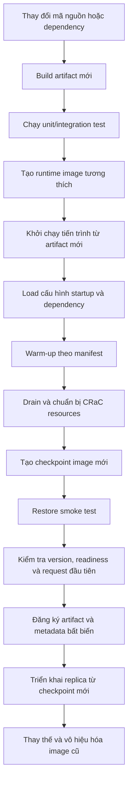

# Khi nào phải tạo lại ảnh sau thay đổi mã nguồn hoặc bản vá

Checkpoint CRaC là trạng thái của một tiến trình Java tại thời điểm chụp. Nó lưu trạng thái bộ nhớ và trạng thái thực thi mà runtime cùng môi trường checkpoint/restore hỗ trợ. Khi restore, ứng dụng tiếp tục từ trạng thái đã lưu; JVM không khởi chạy lại từ đầu để đọc một JAR mới hoặc nạp lại toàn bộ class như một lần chạy lạnh.

Vì vậy, khi mã nguồn, bytecode, tài nguyên đóng gói hoặc dependency thay đổi, cần đánh giá lại checkpoint image. Nếu thay đổi phải ảnh hưởng đến mã đang chạy, cách triển khai thông thường là build artifact mới, khởi chạy ứng dụng từ artifact đó, thực hiện warm-up và tạo checkpoint image mới. Những tiến trình được restore từ image cũ vẫn mang trạng thái của phiên bản cũ, dù file JAR trên filesystem hoặc image container đã được thay thế.

Điểm cốt lõi là phân biệt **application artifact** với **checkpoint image**. Application artifact chứa mã và tài nguyên của phiên bản ứng dụng. Checkpoint image chứa trạng thái tiến trình đã khởi tạo từ một artifact, một JDK và một môi trường cụ thể. Thay artifact không tự cập nhật checkpoint đã tồn tại.

## 1. Checkpoint image giữ phiên bản mã nào?

Trong lần khởi động lạnh, Java launcher nạp các class từ classpath/module path, tạo classloader, chạy static initializer và khởi tạo ứng dụng. Khi checkpoint, trạng thái của tiến trình đang chạy được lưu. Những class đã nạp, object đã tạo, cấu hình đã bind và trạng thái thực thi có thể được khôi phục cùng tiến trình.

Giả sử ứng dụng đang chạy bản `orders-service:1.4.2`. Sau khi warm-up, tiến trình tạo checkpoint `orders-service-1.4.2-crac`. Sau đó nhóm phát triển sửa lỗi trong `OrderService.java` và build `orders-service:1.4.3`.

Nếu restore checkpoint cũ, tiến trình tiếp tục sử dụng trạng thái đã tạo từ `1.4.2`. Việc copy JAR `1.4.3` vào cùng đường dẫn không thay thế các class đã được nạp vào JVM. Restore không tự gọi launcher, không chạy lại `main()` và không dựng lại Spring context.

```text
Build 1.4.2
    |
    v
Khởi chạy JVM từ artifact 1.4.2
    |
    v
Nạp class và khởi tạo ứng dụng
    |
    v
Warm-up
    |
    v
Checkpoint image A (mã 1.4.2)
    |
    +---- Restore image A ----> tiếp tục mã 1.4.2

Sửa lỗi và build 1.4.3
    |
    v
Khởi chạy JVM mới từ artifact 1.4.3
    |
    v
Khởi tạo và warm-up lại
    |
    v
Checkpoint image B (mã 1.4.3)
    |
    +---- Restore image B ----> tiếp tục mã 1.4.3
```

Đây là lý do thay đổi mã nguồn hoặc bản vá làm thay đổi hành vi ứng dụng thường yêu cầu tạo checkpoint image mới. Image mới phải được tạo từ đúng artifact đã phát hành.

## 2. Phân biệt application artifact, container image và checkpoint image

Trong pipeline triển khai, ba loại artifact này có thể được quản lý riêng:

| Artifact | Chứa gì? | Vai trò |
|---|---|---|
| Application artifact | JAR/WAR, class, resource, dependency hoặc package ứng dụng | Xác định phiên bản mã và tài nguyên ứng dụng |
| Container/runtime image | JDK, hệ điều hành user space, thư viện hệ thống, ứng dụng và cấu hình runtime | Cung cấp môi trường để khởi chạy ứng dụng hoặc restore theo cách triển khai |
| Checkpoint image | Trạng thái tiến trình đã được checkpoint, kèm các metadata/runtime artifact liên quan | Khởi tạo nhanh tiến trình từ trạng thái đã chuẩn bị |

Tên gọi và cách lưu trữ checkpoint artifact tùy JDK CRaC, công cụ checkpoint/restore và nền tảng triển khai. Có hệ thống lưu checkpoint trong thư mục hoặc volume riêng; có hệ thống đóng gói nó cùng container layer hoặc artifact phát hành. Dù cách lưu nào, checkpoint vẫn gắn với phiên bản tiến trình đã được chụp.

Một tag container mới không tự làm cho checkpoint cũ chứa mã mới. Nếu nền tảng vẫn trỏ đến checkpoint cũ, nó có thể tiếp tục restore trạng thái cũ. Pipeline cần cập nhật cả application artifact, checkpoint artifact và tham chiếu triển khai đang sử dụng.

## 3. Những thay đổi thường yêu cầu tạo checkpoint image mới

### Thay đổi mã nguồn hoặc bytecode

Các thay đổi sau thường yêu cầu khởi chạy từ build mới và tạo checkpoint mới:

- Sửa logic nghiệp vụ hoặc thuật toán.
- Sửa lỗi, thêm validation hoặc thay đổi cách xử lý exception.
- Thay đổi API contract, controller, service, repository hoặc interceptor.
- Thay đổi class, method, field, annotation hoặc cấu trúc object ảnh hưởng đến trạng thái ứng dụng.
- Thay đổi code được tạo tự động trong quá trình build.

Class đã nạp trong JVM không tự được thay bằng class mới trên đĩa. Nếu một phần class được nạp trước checkpoint và phần khác chỉ được nạp sau restore, việc thay JAR bên dưới classloader có thể dẫn đến một tiến trình chứa các class đến từ nhiều phiên bản. Đây là trạng thái khó dự đoán và không nên dùng làm cơ chế cập nhật.

### Thay đổi resource đóng gói

Resource trong JAR cũng là một phần của application artifact:

- Template HTML, email hoặc report.
- File SQL, migration metadata và schema.
- Rule, mapping, serializer configuration hoặc file XML/JSON.
- Static asset, certificate bundle hoặc file dữ liệu được đóng gói.

Một resource có thể đã được đọc và giữ trong heap trước checkpoint. Resource khác có thể chỉ được đọc lần đầu sau restore. Nếu thay JAR trong khi vẫn dùng checkpoint cũ, hai trường hợp có thể cho kết quả khác nhau: object đã đọc vẫn giữ nội dung cũ, còn resource đọc muộn có thể nhìn thấy file mới nếu đường dẫn/archive được thay thế và classloader còn truy cập được. Điều này có thể tạo trạng thái trộn phiên bản.

Khi resource đóng gói thay đổi và cần áp dụng đồng nhất, hãy build artifact mới và tạo checkpoint mới. Với file bên ngoài được thiết kế để refresh động, hãy dùng cơ chế refresh có version và kiểm tra rõ ràng thay vì thay file ngầm.

### Thay đổi dependency hoặc classpath

Tạo image mới khi thay đổi có ảnh hưởng đến class hoặc runtime dependency, chẳng hạn:

- Nâng/hạ phiên bản thư viện Java.
- Thay JDBC driver, HTTP client, Kafka client hoặc RabbitMQ client.
- Thay Spring Boot/Spring Framework hoặc framework khác.
- Thay classpath, module path, service provider hoặc plugin được nạp.
- Thay Java agent hoặc instrumentation agent.
- Thay thư viện native, JNI/JNA binding hoặc thành phần phụ thuộc ABI.

Dependency mới cần được nạp trong một tiến trình mới để bảo đảm toàn bộ classloader và object graph nhất quán với phiên bản đã build. Chỉ cập nhật file dependency bên ngoài không làm thay thế class đã nạp hoặc object đã tạo trong checkpoint.

### Thay đổi JDK, JVM options hoặc runtime nền tảng

Checkpoint image còn phụ thuộc runtime và môi trường được hỗ trợ. Thay đổi JDK/CRaC distribution, JVM options quan trọng, hệ điều hành, kiến trúc CPU, kernel hoặc thư viện native có thể làm image cũ không còn tương thích hoặc không còn đáp ứng yêu cầu vận hành.

Ví dụ:

- Nâng JDK để nhận bản vá bảo mật hoặc sửa lỗi runtime.
- Thay lựa chọn GC, heap sizing hoặc tham số JVM gắn với khởi tạo.
- Nâng native library hoặc OS package mà tiến trình phụ thuộc.
- Chuyển sang kiến trúc CPU hoặc môi trường kernel khác.

Với các thay đổi này, hãy tạo và kiểm thử checkpoint trong môi trường runtime tương thích mới. Không giả định một checkpoint tạo bằng JDK hoặc kernel cũ có thể restore an toàn bằng bất kỳ runtime nào khác. Tuân theo ma trận tương thích và hướng dẫn của bản phân phối CRaC đang triển khai.

## 4. Bảng quyết định: thay đổi nào cần image mới?

| Loại thay đổi | Hướng xử lý thường phù hợp | Lý do |
|---|---|---|
| Sửa class Java hoặc bytecode | Build và tạo checkpoint mới | Class đã nạp không tự thay đổi khi restore |
| Thay JAR/WAR hoặc dependency | Tạo checkpoint mới | Classloader và object graph phải đến từ cùng build |
| Thay template/resource đóng gói trong JAR | Tạo checkpoint mới nếu cần áp dụng đồng nhất | Resource có thể đã được nạp hoặc được đọc muộn từ archive cũ/mới |
| Thay Java agent hoặc native library | Tạo tiến trình và checkpoint mới | Agent/native state gắn với runtime và tiến trình |
| Nâng JDK/CRaC hoặc JVM startup options | Tạo checkpoint mới trong runtime mới | Checkpoint phụ thuộc runtime tương thích |
| Thay file cấu hình startup đã bind vào bean | Refresh có chủ đích hoặc tạo checkpoint mới | Bean/object trong heap vẫn giữ cấu hình cũ |
| Thay feature flag từ config service | Có thể refresh sau restore nếu được hỗ trợ | Đây là cấu hình động ngoài tiến trình |
| Đổi endpoint database hoặc broker | Tạo client/pool mới và refresh cấu hình; image mới nếu thay đổi startup tĩnh | Kết nối cũ không tự chuyển sang endpoint mới |
| Token hoặc certificate ngắn hạn hết hạn | Refresh/xác thực lại sau restore | Thời hạn tiếp tục trôi trong lúc checkpoint |
| Thay schema database | Triển khai migration có điều phối và tương thích phiên bản; thường đi cùng build mới | Mã cũ và schema mới cần tương thích trong giai đoạn rollout |
| Thay log level qua API runtime | Có thể thay nóng nếu logging framework hỗ trợ | Không nhất thiết cần thay bytecode hoặc JVM |

Đây là hướng dẫn phân loại. Quyết định cuối cùng phụ thuộc vào cách ứng dụng nạp cấu hình, khả năng refresh của framework và yêu cầu tương thích của thư viện.

## 5. Vì sao không nên vá JAR tại chỗ rồi restore image cũ?

Giả sử checkpoint được tạo từ `/app/application.jar` phiên bản `2.0.0`. Sau đó pipeline copy `2.0.1` đè lên cùng đường dẫn nhưng vẫn yêu cầu restore checkpoint cũ.

Các class đã nạp trước checkpoint vẫn là định nghĩa class của `2.0.0`. Các object trong heap vẫn có field và trạng thái được tạo theo code `2.0.0`. Static initializer không chạy lại. Spring bean và proxy đã tạo vẫn là object cũ.

Trong khi đó, nếu classloader cần nạp một class chưa từng được sử dụng, nó có thể đọc byte từ archive hiện tại tùy cách classpath và file được quản lý. Kết quả tiềm ẩn là một tiến trình trộn class cũ và class mới. Các resource có thể cũng bị trộn tương tự.

```text
Checkpoint tạo từ JAR 2.0.0
       |
       +-- Class A đã nạp: bytecode 2.0.0
       +-- Class B chưa nạp: chưa có định nghĩa trong JVM
       +-- Bean/configuration: object được tạo theo 2.0.0

Thay JAR trên đĩa thành 2.0.1
       |
       +-- Restore checkpoint cũ
       +-- Class A vẫn là 2.0.0
       +-- Class B có thể được nạp từ archive đang nằm trên đường dẫn
       +-- Bean/configuration vẫn là trạng thái 2.0.0
       |
       v
Nguy cơ tiến trình trộn phiên bản và hành vi không nhất quán
```

Không nên dùng việc thay file bên dưới tiến trình đã checkpoint như một cơ chế patch. Hãy giữ artifact bất biến và tạo checkpoint mới từ build mới.

## 6. HotSwap và instrumentation không thay thế quy trình phát hành CRaC

Một số công cụ phát triển có thể thay định nghĩa class trong JVM đang chạy thông qua Java Instrumentation hoặc HotSwap của debugger. Khả năng này có giới hạn, phụ thuộc công cụ và thường không hỗ trợ mọi thay đổi cấu trúc class. Nó cũng không tự cập nhật object đã tạo, cấu hình đã bind, resource đóng gói hoặc native state.

Ngay cả khi một công cụ có thể thay class definition trước khi tạo checkpoint, đây không phải quy trình phát hành mặc định cho production. Muốn dùng cần có cơ chế kiểm soát phiên bản class, xác minh trạng thái object, tương thích serialization nội bộ, kiểm thử restore và quản lý artifact. Cách an toàn và dễ tái lập hơn vẫn là build artifact mới, khởi chạy tiến trình mới, warm-up rồi tạo checkpoint mới.

Không nên hiểu restore như một thao tác HotSwap. Restore tiếp tục trạng thái đã lưu; nó không có nhiệm vụ tìm class mới, áp dụng patch hoặc migrate object graph sang phiên bản mới.

## 7. Cấu hình động có thể được refresh mà không cần tạo image mới

Không phải mọi thay đổi đều đòi hỏi checkpoint mới. Một số giá trị được thiết kế để đọc từ hệ thống bên ngoài sau restore:

- Feature flag hoặc routing rule từ config service.
- Endpoint dịch vụ được phân giải lại qua service discovery.
- Token hoặc credential được cấp mới từ secret manager/identity provider.
- Lease, leader assignment hoặc instance identity được đăng ký lại.
- Log level được thay đổi qua API của logging framework.
- Giới hạn concurrency có thể resize nếu executor hoặc pool hỗ trợ an toàn.

Để refresh đúng, ứng dụng cần đọc cấu hình mới, validate và áp dụng một cách đồng bộ. Việc thay environment variable hoặc file YAML bên ngoài không tự cập nhật object đã được bind trong heap. `System.setProperty()` cũng không tự tái cấu hình các bean hoặc thay JVM option.

Ví dụ, một provider có thể tải snapshot cấu hình mới sau restore:

```java
import org.crac.Context;
import org.crac.Core;
import org.crac.Resource;

public final class RuntimeConfigResource implements Resource {

    private final ConfigProvider provider;
    private final ConfigApplier applier;

    public RuntimeConfigResource(ConfigProvider provider,
                                 ConfigApplier applier) {
        this.provider = provider;
        this.applier = applier;
        Core.getGlobalContext().register(this);
    }

    @Override
    public void beforeCheckpoint(Context<? extends Resource> context) {
        applier.stopConfigDependentWork();
    }

    @Override
    public void afterRestore(Context<? extends Resource> context)
            throws Exception {
        RuntimeConfig candidate = provider.loadCurrent();
        provider.validate(candidate);
        applier.apply(candidate);
    }
}
```

`ConfigProvider`, `ConfigApplier` và `RuntimeConfig` là abstraction của ứng dụng. Ví dụ cho thấy vị trí refresh, không phải API chuẩn của CRaC. Nếu cấu hình mới yêu cầu thay datasource, HTTP client hoặc executor, `apply()` cần tạo resource mới, xác minh hoạt động, chuyển sử dụng và đóng resource cũ theo một trình tự an toàn.

Nếu cấu hình mới làm thay đổi cấu trúc bean, class, thuật toán hoặc startup behavior không hỗ trợ refresh, hãy tạo application artifact và checkpoint mới.

## 8. Bản vá bảo mật cần vô hiệu hóa checkpoint cũ

Khi một bản vá sửa lỗ hổng trong ứng dụng, dependency, JDK hoặc native library, việc build JAR mới chưa đủ. Cần bảo đảm không còn replica nào được khởi chạy từ checkpoint image chứa thành phần dễ bị tổn thương.

Một quy trình xử lý bản vá nên gồm:

1. Xác định thành phần bị ảnh hưởng: mã ứng dụng, dependency, JDK, OS package hay native library.
2. Build artifact mới từ nguồn đã vá và khóa phiên bản dependency.
3. Tạo runtime/container image mới nếu bản vá thay đổi môi trường nền.
4. Khởi chạy ứng dụng từ artifact mới, chạy warm-up và tạo checkpoint mới.
5. Thực hiện restore test và kiểm tra build/version đang chạy.
6. Cập nhật deployment để chỉ tham chiếu checkpoint image mới.
7. Thay thế toàn bộ replica cũ, kể cả replica đang idle hoặc được scale về zero nhưng có thể được restore lại.
8. Thu hồi hoặc xóa checkpoint cũ theo chính sách lưu trữ và rollback.
9. Xác nhận autoscaler, job, node cache và pipeline không còn đường khởi chạy image cũ.

Đặc biệt, scale về zero không đồng nghĩa image cũ đã bị loại bỏ. Nếu checkpoint cũ vẫn nằm trong registry, object storage hoặc cache của nền tảng, một lần scale-up sau đó có thể vô tình khởi chạy lại phiên bản dễ bị tổn thương.

Với bản vá bảo mật khẩn cấp, rollback về image cũ có thể tái đưa lỗ hổng vào hệ thống. Cần đánh giá rủi ro trước khi cho phép rollback và có thể cần vô hiệu hóa checkpoint cũ hoàn toàn.

## 9. Quản lý version và metadata của checkpoint image

Checkpoint image nên được quản lý như một artifact bất biến có danh tính rõ ràng. Tránh đặt tên chung như `latest` rồi ghi đè nội dung dưới cùng một tên.

Metadata phát hành nên ghi nhận:

| Trường | Mục đích |
|---|---|
| Application version/build ID | Xác định phiên bản mã nguồn |
| Source commit hoặc release tag | Truy về thay đổi đã tạo artifact |
| Application artifact digest | Xác minh JAR/package đúng nội dung |
| Dependency lock/SBOM revision | Xác định tập thư viện được đóng gói |
| JDK và CRaC distribution/build | Xác định runtime tạo checkpoint |
| JVM startup options profile | Ghi nhận cấu hình JVM có liên quan |
| OS/kernel/architecture | Theo dõi điều kiện tương thích môi trường |
| Static config revision | Xác định cấu hình khởi tạo đã được nạp |
| Warm-up manifest version | Biết tập scenario đã chuẩn bị trạng thái |
| Checkpoint creation time | Theo dõi tuổi của image |
| Checkpoint artifact digest | Xác minh đúng checkpoint được triển khai |

Không ghi password, access token, private key hoặc secret trực tiếp vào metadata. Có thể ghi secret version hoặc identifier để hệ thống lấy giá trị hiện hành sau restore.

Ví dụ metadata minh họa:

```yaml
application:
  name: orders-service
  version: 2.1.0
  buildId: 2.1.0+build.1842
  sourceCommit: 7f3a91c
  artifactSha256: 8c1d...redacted-example

runtime:
  jdkDistribution: crac-enabled-jdk
  jdkBuild: 21.0.x+vendor
  jvmProfile: production-g1-2g
  architecture: amd64

checkpoint:
  id: orders-service-2.1.0-build1842
  createdAt: 2026-11-13T05:00:00Z
  warmupManifest: warmup-v7
  staticConfigRevision: config-2026-11-12.3
```

Các giá trị trên chỉ minh họa cấu trúc. Digest thực tế phải được tạo từ artifact; không tự điền placeholder vào metadata phát hành.

## 10. Pipeline tạo lại checkpoint sau một bản vá

Một pipeline có thể tổ chức thành các bước sau:



Các bước kiểm thử ứng dụng cần được thực hiện theo pipeline của dự án. Worker STEP 4 chỉ tạo tài liệu; sơ đồ mô tả quy trình phát hành tham khảo, không phải kết quả đã chạy trong repository.

### Tạo checkpoint từ đúng build

Điều quan trọng là bước khởi chạy phải dùng đúng JAR/package có digest đã ghi trong metadata. Không build lại một artifact khác sau khi đã tạo checkpoint rồi gắn nhãn checkpoint theo build mới. Nếu artifact thay đổi dù chỉ do dependency resolution hoặc resource filtering, digest cũng phải thay đổi và checkpoint phải được gắn với đúng nội dung thực tế.

### Kiểm tra sau restore

Sau khi tạo checkpoint mới, cần restore thử trong môi trường tương thích và xác nhận:

- Build ID hoặc phiên bản ứng dụng trong tiến trình đúng với artifact mới.
- Endpoint health/readiness hoạt động.
- Dependency bên ngoài được kết nối lại đúng.
- Các route hoặc use case liên quan đến bản vá cho kết quả mong đợi.
- Không có class/resource nào được lấy từ một phiên bản artifact khác.
- Request đầu tiên sau restore không gặp lỗi khởi tạo.
- Nhiều replica restore từ image mới có identity và resource riêng.

## 11. Triển khai rolling update và rollback

Khi thay checkpoint image, cần xem xét trạng thái đồng thời của replica cũ và mới. Một rolling update có thể giữ cả hai phiên bản trong một khoảng thời gian. Database schema và message contract phải tương thích với cả hai phiên bản trong giai đoạn chuyển tiếp, hoặc rollout phải được điều phối để không có phiên bản cũ chạy cùng schema mới không tương thích.

Một trình tự thường dùng:

1. Triển khai schema thay đổi theo hướng backward-compatible nếu cần.
2. Tạo checkpoint mới và kiểm thử restore.
3. Khởi chạy một nhóm nhỏ replica mới từ image mới.
4. Kiểm tra readiness, lỗi và metrics.
5. Tăng dần tỷ lệ traffic sang replica mới.
6. Drain và dừng replica cũ.
7. Sau khi không còn cần rollback, thu hồi checkpoint cũ theo chính sách.

Nếu cần rollback, phải khôi phục cả application artifact và checkpoint image thuộc cùng một release. Không dùng checkpoint mới với JAR cũ hoặc checkpoint cũ với JAR mới. Đồng thời xác minh schema, event format và contract của dependency vẫn tương thích với phiên bản rollback.

## 12. Tuổi của checkpoint và chính sách hết hạn

Ngay cả khi mã nguồn không đổi, checkpoint có thể trở nên không phù hợp theo thời gian:

- JDK hoặc OS base image đã nhận bản vá bảo mật mới.
- Certificate, token hoặc secret được nhúng trong heap đã hết hạn hoặc bị thu hồi.
- Endpoint, DNS, feature flag hoặc static configuration đã thay đổi.
- Dependency bên ngoài đã nâng cấp và không còn tương thích với trạng thái cũ.
- Warm-up cache đã quá cũ hoặc dữ liệu trong image không còn đại diện.
- Chính sách vận hành yêu cầu giới hạn tuổi tối đa của checkpoint.

Do đó, nên có chính sách TTL/expiry cho checkpoint artifact. Tuổi tối đa phụ thuộc rủi ro ứng dụng, tần suất vá bảo mật, thời hạn secret và mức thay đổi cấu hình. Khi image hết hạn, tạo tiến trình mới từ artifact hiện hành và tạo checkpoint mới.

Checkpoint cũ có thể được giữ trong thời gian rollback nếu chính sách cho phép, nhưng phải được đánh dấu rõ là không còn dùng cho scale-out thông thường. Với bản vá bảo mật, chính sách có thể yêu cầu xóa ngay hoặc chặn restore từ image cũ.

## 13. Những trường hợp không nhất thiết phải tạo image mới

Một số thay đổi có thể được áp dụng sau restore nếu ứng dụng đã thiết kế hỗ trợ:

- Feature flag được tải từ config service.
- Endpoint được đọc lại từ service discovery.
- Token được refresh từ issuer.
- Lease hoặc lock được acquire lại.
- Log level được cập nhật qua API runtime của logging framework.
- Cache có TTL được invalidate hoặc nạp lại.
- Executor hoặc pool có API resize an toàn, sau khi thay đổi được validate.

Tuy nhiên, cần xác nhận rằng thay đổi thực sự được áp dụng tới object đang hoạt động. Đổi một property hoặc file không đủ nếu bean, client hoặc pool đã giữ giá trị cũ. Nếu refresh đòi hỏi thay đổi class, method, object graph hoặc startup lifecycle không hỗ trợ, hãy tạo image mới.

## 14. Các lỗi thường gặp

### Build JAR mới nhưng vẫn restore checkpoint cũ

Checkpoint cũ phục hồi trạng thái tiến trình cũ. JAR mới không tự thay class đã nạp. Hãy tạo checkpoint mới từ build mới.

### Ghi đè JAR tại cùng đường dẫn

Classloader và object có thể giữ class/resource cũ trong khi class chưa nạp đọc từ file mới. Điều này tạo nguy cơ trộn phiên bản. Dùng đường dẫn/artifact bất biến theo version hoặc digest.

### Chỉ cập nhật container tag

Deployment có thể vẫn tham chiếu checkpoint artifact cũ hoặc cache cũ. Cập nhật toàn bộ mapping release và xác minh image ID thực tế được restore.

### Coi HotSwap là cơ chế phát hành production

HotSwap có giới hạn và không cập nhật toàn bộ trạng thái object/resource. Build và khởi chạy từ artifact mới là quy trình có thể tái lập hơn.

### Bỏ quên checkpoint cũ khi vá bảo mật

Replica scale về zero hoặc node cache có thể vẫn restore image dễ bị tổn thương. Cần vô hiệu hóa mọi tham chiếu tới checkpoint cũ và xác nhận không còn đường scale-up sử dụng nó.

### Chỉ đổi cấu hình mà không thay resource phụ thuộc

Datasource hoặc client có thể tiếp tục dùng endpoint cũ. Refresh phải tạo và kiểm tra resource mới rồi chuyển sử dụng.

### Không ghi metadata phiên bản

Khi có sự cố, khó xác định replica được restore từ build nào. Gắn build ID, digest, runtime và checkpoint ID vào metadata/metrics.

## 15. Checklist phát hành sau thay đổi mã nguồn hoặc bản vá

| Câu hỏi | Hành động khi câu trả lời là có |
|---|---|
| Có thay class, bytecode hoặc logic nghiệp vụ không? | Build artifact mới và tạo checkpoint mới |
| Có thay resource đóng gói trong JAR không? | Tạo checkpoint mới nếu thay đổi phải áp dụng nhất quán |
| Có nâng dependency, agent hoặc native library không? | Tạo tiến trình mới và checkpoint tương thích |
| Có thay JDK, CRaC runtime hoặc JVM option quan trọng không? | Tạo checkpoint mới trong môi trường runtime mới |
| Có thay startup config đã bind vào bean không? | Refresh có kiểm soát hoặc tạo checkpoint mới |
| Có thay feature flag/secret/endpoint động không? | Xác minh cơ chế refresh sau restore và readiness |
| Đây là bản vá bảo mật khẩn cấp không? | Vô hiệu hóa checkpoint cũ và thay mọi replica có thể restore từ nó |
| Có nhiều replica hoặc scale-to-zero không? | Kiểm tra mọi nguồn tham chiếu, cache và autoscaler |
| Có cần rollback không? | Giữ cặp application/checkpoint artifact tương ứng và kiểm tra schema compatibility |

## 16. Kết luận

Checkpoint image là trạng thái của một tiến trình đã khởi tạo từ một phiên bản ứng dụng và runtime cụ thể. Khi restore, tiến trình tiếp tục với trạng thái đã lưu; việc thay JAR, dependency hoặc file trên đĩa không tự cập nhật class, object, bean hay cấu hình đã được checkpoint. Thay đổi mã nguồn, bytecode, resource đóng gói, dependency, agent, native library, JDK hoặc JVM startup options quan trọng thường yêu cầu build và tạo checkpoint image mới.

Một số cấu hình bên ngoài có thể được refresh sau restore nếu ứng dụng có cơ chế đọc, validate và áp dụng rõ ràng. Hãy phân biệt các giá trị động này với trạng thái startup đã nằm trong heap. Với bản vá bảo mật, cần thay toàn bộ replica và vô hiệu hóa checkpoint cũ để scale-out không khởi chạy lại phiên bản dễ bị tổn thương.

Quản lý application artifact và checkpoint image bằng version/digest bất biến, ghi metadata runtime và cấu hình khởi tạo, kiểm thử restore từ đúng build, rồi triển khai và thu hồi image theo release. Cách làm đó bảo đảm mỗi tiến trình được restore chạy đúng mã đã phát hành và có thể truy vết khi cần điều tra hoặc rollback.
