# Tách giai đoạn tạo ảnh khỏi giai đoạn khôi phục

CRaC cho phép chuẩn bị một tiến trình Java đã khởi động, tạo checkpoint của trạng thái tiến trình đó, rồi khôi phục trạng thái ở một lần chạy sau. Trong quy trình đóng gói và triển khai, nên xem **giai đoạn tạo checkpoint** và **giai đoạn restore** là hai giai đoạn riêng có đầu vào, trách nhiệm và điều kiện thành công khác nhau.

Ở giai đoạn tạo ảnh, ứng dụng được chạy trong môi trường chuẩn bị tương thích, hoàn tất khởi tạo, làm nóng các đường code cần thiết, đưa tài nguyên về trạng thái an toàn và tạo checkpoint. Kết quả là một artifact checkpoint gắn với một phiên bản ứng dụng và runtime cụ thể.

Ở giai đoạn restore, hệ thống triển khai lấy đúng artifact đó, chuẩn bị môi trường đích tương thích, khôi phục tiến trình, làm mới những tài nguyên phụ thuộc môi trường, xác minh health và sau đó mới nhận traffic. Restore không phải là chạy lại toàn bộ bước build hoặc warm-up; nó là bước tiếp tục một trạng thái tiến trình đã được chuẩn bị trước.

Tách hai giai đoạn giúp pipeline dễ lặp lại, dễ kiểm soát tính tương thích và dễ rollback. Đồng thời, nó buộc đội vận hành xác định rõ checkpoint nào thuộc về build/version nào, môi trường nào có thể restore checkpoint đó và những cấu hình nào phải được cấp mới khi chạy.

## 1. Phân biệt application image và checkpoint image

Trong môi trường container, từ “image” có thể được dùng cho hai loại artifact khác nhau. Cần phân biệt chúng:

| Artifact | Nội dung | Vai trò |
|---|---|---|
| Application/container image | Filesystem, JDK, thư viện, application JAR, cấu hình mặc định và entrypoint | Môi trường thực thi ứng dụng có thể khởi chạy từ đầu |
| CRaC checkpoint | Trạng thái tiến trình tại thời điểm checkpoint và các file metadata/resource cần cho restore | Cho phép runtime tiếp tục từ trạng thái đã khởi tạo |
| Release manifest | Phiên bản ứng dụng, JDK, kiến trúc, nền tảng, cấu hình checkpoint và checksum | Xác định checkpoint tương thích với application image và môi trường nào |

Application image thường là artifact bất biến được build và phân phối qua registry. Checkpoint lại là snapshot của một tiến trình cụ thể. Tùy cách triển khai, checkpoint có thể được lưu như thư mục hoặc tập file riêng, được đóng gói cùng image, hoặc được lưu ở một kho artifact rồi gắn với application image bằng manifest.

Không nên coi checkpoint là một JAR hay một file cấu hình thông thường. Nó có thể chứa heap, thread state, native memory, file descriptor và dữ liệu nhạy cảm đã tồn tại trong tiến trình. Kích thước, quyền truy cập, tính tương thích và vòng đời của nó khác với application JAR.

## 2. Vì sao phải tách create và restore?

Nếu gộp mọi thao tác vào một bước startup, mỗi replica có thể phải tự khởi động, warm-up và checkpoint lại. Điều đó làm tăng thời gian scale-out và khiến kết quả phụ thuộc tải, thời điểm chạy hoặc trạng thái dịch vụ bên ngoài.

Tách giai đoạn mang lại các lợi ích:

- **Chi phí chuẩn bị được trả một lần cho mỗi phiên bản:** pipeline tạo checkpoint thực hiện class loading, framework initialization và warm-up trước khi phát hành.
- **Scale-out nhanh hơn:** nhiều instance có thể restore từ cùng checkpoint đã được kiểm chứng, nếu nền tảng cho phép nhân bản trạng thái đó.
- **Tách quyền và trách nhiệm:** pipeline build/prepare có quyền tạo checkpoint; runtime deployment chỉ cần đọc artifact và restore.
- **Kiểm thử độc lập:** có thể kiểm tra checkpoint artifact trước khi phát hành, sau đó kiểm tra restore trong từng môi trường đích.
- **Rollback rõ ràng:** giữ cặp application image và checkpoint đã biết là tương thích để quay lại release trước.
- **Dễ kiểm toán:** manifest ghi rõ checkpoint được tạo từ commit, JDK, cấu hình và môi trường nào.

Tuy nhiên, tách giai đoạn không làm checkpoint trở thành artifact portable tuyệt đối. Restore vẫn phụ thuộc runtime CRaC, hệ điều hành, kiến trúc, checkpoint engine, filesystem, network namespace, mount và tài nguyên bên ngoài. Cần định nghĩa một ma trận tương thích thay vì giả định một checkpoint chạy ở mọi nơi.

## 3. Kiến trúc pipeline hai giai đoạn

Một pipeline thường có hai luồng công việc chính:

### Giai đoạn A — Prepare và create checkpoint

1. Build application image từ source code và dependency đã khóa phiên bản.
2. Chọn CRaC JDK, OS base image và cấu hình runtime tương ứng.
3. Chạy ứng dụng trong môi trường chuẩn bị có các dependency warm-up được kiểm soát.
4. Chờ ApplicationContext và các thành phần cần thiết khởi tạo xong.
5. Chạy workload warm-up đại diện.
6. Dừng nhận việc mới, drain request/job và chuẩn bị tài nguyên.
7. Tạo checkpoint bằng cơ chế của CRaC runtime và nền tảng.
8. Ghi manifest, checksum, compatibility metadata và lưu artifact.
9. Thử restore artifact trong môi trường kiểm chứng trước khi đánh dấu release sẵn sàng.

### Giai đoạn B — Deploy và restore

1. Lấy đúng application image và checkpoint artifact theo release manifest.
2. Kiểm tra checksum và metadata tương thích.
3. Chuẩn bị filesystem, mount, quyền, network và các resource cần thiết.
4. Cấp cấu hình, secret và identity riêng cho instance hiện tại.
5. Khởi chạy runtime theo chế độ restore, trỏ tới checkpoint tương ứng.
6. Chạy `afterRestore` để tạo lại connection, listener, exporter, lease và các resource cần thiết.
7. Kiểm tra health, readiness và khả năng phục vụ request thật.
8. Chỉ đưa instance vào load balancer/service discovery sau khi restore hoàn tất.

```mermaid
flowchart LR
    subgraph A[Stage A - Prepare]
        A1[Build application image] --> A2[Run in compatible environment]
        A2 --> A3[Initialize and warm up]
        A3 --> A4[Drain and prepare resources]
        A4 --> A5[Create checkpoint]
        A5 --> A6[Manifest and checksum]
    end
    subgraph B[Stage B - Restore]
        B1[Fetch matched artifacts] --> B2[Check compatibility]
        B2 --> B3[Prepare target environment]
        B3 --> B4[Restore process]
        B4 --> B5[Recreate runtime resources]
        B5 --> B6[Health and readiness]
    end
    A6 --> B1
```



Checkpoint creation có thể là một bước trong CI/CD hoặc một job chuẩn bị release riêng. Restore là một phần của startup/deployment runtime. Không cần buộc hai bước chạy trong cùng một container hoặc cùng một máy, nhưng môi trường restore phải thỏa các điều kiện tương thích của checkpoint.

## 4. Giai đoạn tạo checkpoint cần cố định những gì?

Checkpoint được tạo từ một tiến trình cụ thể. Để có thể tái lập, cần ghi nhận đầy đủ thông tin tạo ảnh.

### Phiên bản phần mềm

- Commit hoặc release ID của ứng dụng.
- Hash của application JAR và dependency lockfile.
- Phiên bản JDK, vendor/distribution và build number.
- Phiên bản thư viện CRaC API và các CRaC integration.
- Phiên bản framework, driver và native library quan trọng.
- JVM flags ảnh hưởng đến heap, GC, class loading, JIT và checkpoint.

### Môi trường hệ thống

- OS distribution và version của base image.
- CPU architecture và các đặc tính instruction set liên quan.
- Kernel version và checkpoint engine/CRIU version nếu được sử dụng.
- Container runtime, cgroup và namespace configuration.
- Filesystem, mount point, volume và đường dẫn checkpoint.
- Quyền capability, user/group và security profile.

### Cấu hình và workload warm-up

- Profile cấu hình warm-up được sử dụng.
- Fixture/data-set version và nguồn dependency giả lập.
- Các use case đã được thực thi.
- Các resource đã được đóng, giữ lại hoặc đánh dấu cần tạo lại.
- Thời điểm tạo checkpoint và trạng thái hoàn tất của warm-up.
- Kết quả kiểm tra sơ bộ sau checkpoint.

Không nên lưu secret production vào checkpoint chỉ để warm-up thành công. Dùng credential thử nghiệm với quyền tối thiểu, rồi cấp credential của môi trường đích khi restore. Vì checkpoint có thể chứa heap và native memory, phải xem nó là artifact nhạy cảm.

## 5. Manifest liên kết application image với checkpoint

Application image và checkpoint cần được liên kết bằng metadata rõ ràng. Một manifest có thể mô tả:

```yaml
release:
  id: orders-service-2026.11.13.1
  applicationImage: registry.example.com/orders-service:2026.11.13.1
  applicationDigest: sha256:APPLICATION_IMAGE_DIGEST
  applicationCommit: 8f12ab34

runtime:
  jdkDistribution: crac-enabled-jdk
  jdkVersion: 25.0.x
  architecture: linux-amd64
  osImageDigest: sha256:BASE_IMAGE_DIGEST
  kernelCompatibility: linux-kernel-family
  checkpointEngine: criu-version-and-build

checkpoint:
  artifact: orders-service-checkpoint-2026.11.13.1.tar
  digest: sha256:CHECKPOINT_DIGEST
  createdAt: "2026-11-13T06:00:00Z"
  warmupProfile: production-shaped-fixtures-v3
  status: verified
```

Các giá trị trong ví dụ là placeholder minh họa, không phải phiên bản hoặc digest thực tế. Manifest thật nên dùng định dạng và schema được pipeline quản lý. Không để placeholder hoặc thông tin chưa xác minh lọt vào release.

Manifest cần giúp deployment trả lời các câu hỏi:

- Checkpoint được tạo từ application image nào?
- JDK và CRaC runtime nào đã tạo checkpoint?
- Kiến trúc và hệ điều hành nào được hỗ trợ?
- Checkpoint artifact có bị thay đổi hoặc hỏng trong quá trình lưu/truyền không?
- Nó đã vượt qua restore smoke test chưa?
- Có yêu cầu cấu hình, mount hoặc resource nào phải chuẩn bị trước restore không?

Checksum xác nhận tính toàn vẹn của artifact, không xác nhận tính tương thích. Một checkpoint có checksum đúng vẫn có thể không restore được trên runtime sai phiên bản hoặc môi trường hệ thống không phù hợp.

## 6. Tạo checkpoint trong môi trường chuẩn bị

Giai đoạn tạo ảnh nên chạy ứng dụng với cùng application image và runtime nền tảng mà release dự kiến sử dụng. Mục tiêu là tạo trạng thái khởi động đã chuẩn bị nhưng không mang theo dữ liệu riêng của một instance production.

Một quy trình điển hình:

1. Tạo container hoặc VM từ application image đã build.
2. Nạp cấu hình warm-up, endpoint test và credential giới hạn.
3. Khởi động JVM và chờ framework báo initialized.
4. Chạy warm-up runner với fixture tổng hợp.
5. Chờ async work, consumer và scheduler cần thiết kết thúc.
6. Đóng admission gate và dừng nguồn phát sinh việc mới.
7. Gọi lifecycle callback để flush/close tài nguyên theo thiết kế.
8. Yêu cầu CRaC runtime tạo checkpoint.
9. Lưu checkpoint cùng manifest và checksum.

Tên cờ JVM, lệnh checkpoint, quyền hệ thống và cách lưu ảnh phụ thuộc bản phân phối CRaC JDK và nền tảng. Một số runtime cung cấp tùy chọn JVM để chỉ định đường dẫn checkpoint/restore; một số tích hợp với container checkpoint engine. Hãy dùng tài liệu của đúng runtime đang triển khai thay vì giả định một lệnh duy nhất áp dụng cho mọi bản phân phối.

### Checkpoint không phải snapshot của application source

Checkpoint không thay thế build. Nó không phải bản sao source code hoặc JAR để build lại. Nó chứa trạng thái runtime của process. Application JAR, native library, cấu hình filesystem và runtime cần thiết vẫn phải được giữ ở đúng vị trí và phiên bản mà checkpoint mong đợi.

Nếu thay JAR hoặc native library sau khi tạo checkpoint, không nên dùng checkpoint cũ với application image mới trừ khi runtime và ứng dụng có cam kết tương thích cụ thể. Cách an toàn là tạo cặp application image/checkpoint mới cho mỗi release.

## 7. Chuẩn bị artifact sau khi tạo ảnh

Checkpoint thường gồm nhiều file và metadata phụ trợ. Pipeline cần xử lý artifact như một đơn vị nhất quán:

- Chờ thao tác checkpoint hoàn tất hoàn toàn trước khi copy hoặc nén.
- Không đọc/copy thư mục checkpoint khi runtime còn đang ghi.
- Bảo toàn tên file, quyền và cấu trúc thư mục cần thiết.
- Tạo checksum sau khi artifact hoàn chỉnh.
- Đóng gói hoặc upload theo cơ chế không làm mất metadata file.
- Lưu manifest cùng artifact và ký manifest nếu quy trình release yêu cầu.
- Ghi nhận kích thước, thời gian tạo và kết quả kiểm chứng.
- Không sửa nội dung checkpoint sau khi checksum đã được tạo.

Nếu checkpoint gồm nhiều file liên quan, không upload từng file rời rạc rồi cho phép deployment sử dụng khi mới có một phần. Hãy publish một artifact versioned hoặc một manifest chỉ chuyển sang trạng thái ready khi tất cả thành phần đã có mặt và checksum đúng.

### Lưu trữ và phân phối

Có thể lưu checkpoint trong:

- Artifact repository gắn với release.
- Object storage có versioning và access control.
- Registry hoặc cơ chế phân phối chuyên dụng của nền tảng container.
- Volume được quản lý nếu deployment platform yêu cầu vị trí filesystem cụ thể.

Lựa chọn phụ thuộc kích thước checkpoint, tốc độ tải, yêu cầu locality và cách runtime restore. Với checkpoint lớn, thời gian tải và giải nén có thể chiếm phần đáng kể của startup. Hãy đo thời gian từ lúc lấy artifact tới lúc process sẵn sàng, không chỉ đo thời gian restore engine.

## 8. Giai đoạn restore cần chuẩn bị những gì?

Restore stage chịu trách nhiệm đưa checkpoint vào môi trường có thể tiếp tục chạy.

### Xác minh cặp artifact

Trước khi khởi chạy:

1. Đọc release manifest.
2. Lấy đúng application image theo digest, không chỉ dựa vào tag có thể bị thay đổi.
3. Lấy đúng checkpoint artifact theo version/digest.
4. Xác minh checksum và chữ ký nếu có.
5. So sánh JDK, OS, architecture và checkpoint engine với compatibility metadata.
6. Kiểm tra các mount, path, user/group, capability và resource yêu cầu.

Nếu manifest không khớp, dừng restore và chuyển sang startup bình thường hoặc một release tương thích theo chính sách deployment. Không thử restore ngẫu nhiên rồi hy vọng runtime tự xử lý khác biệt.

### Cấp cấu hình theo instance

Checkpoint có thể chứa các giá trị được tạo trong môi trường prepare. Restore stage cần cấp hoặc refresh:

- Instance ID/incarnation ID.
- Hostname, IP, bind address và advertise address.
- Port thực tế nếu dùng cổng động.
- Database URL, credential và connection pool.
- Message broker client, consumer group session và lease.
- Secret, token, certificate và identity của workload.
- Endpoint metrics/log/tracing collector.
- Feature flag và remote configuration cần cập nhật.

Không để một cấu hình warm-up hoặc danh tính của process chuẩn bị trở thành danh tính của mọi replica restore. Khi một checkpoint được nhân bản, mỗi instance phải tạo identity và lease riêng.

## 9. Restore và callback phục hồi

Khi runtime restore checkpoint, JVM tiếp tục từ trạng thái đã chụp. CRaC gọi callback `afterRestore(...)` cho các `Resource` đã đăng ký theo hợp đồng của API/runtime. Callback này là nơi ứng dụng phục hồi các resource đã chuẩn bị trước checkpoint.

Một trình tự phục hồi thường gồm:

1. Đọc cấu hình và secret hiện tại.
2. Tạo lại database pool, HTTP client và broker connection.
3. Xác định lại địa chỉ mạng và đăng ký service mới.
4. Khởi động logging appender, metrics exporter và tracing processor.
5. Làm mới cache, static state và singleton phụ thuộc môi trường.
6. Bind/start embedded server.
7. Chạy health check cho dependency bắt buộc.
8. Chuyển readiness sang accepting traffic.

Thứ tự phải tuân theo dependency graph. Ví dụ, không thể mở readiness trước khi database pool đã sẵn sàng; không nên đăng ký endpoint nếu listener chưa bind thành công. Nếu resource độc lập có thứ tự phụ thuộc, hãy điều phối bằng lifecycle coordinator hoặc thứ tự callback được runtime hỗ trợ và đã kiểm chứng.

### Ví dụ Resource điều phối restore

```java
import org.crac.Context;
import org.crac.Resource;

final class RestoreCoordinator implements Resource {
    private final RuntimeConfigurationProvider configuration;
    private final DatabaseLifecycle database;
    private final NetworkLifecycle network;
    private final TelemetryLifecycle telemetry;
    private final ApplicationReadiness readiness;

    RestoreCoordinator(
            RuntimeConfigurationProvider configuration,
            DatabaseLifecycle database,
            NetworkLifecycle network,
            TelemetryLifecycle telemetry,
            ApplicationReadiness readiness) {
        this.configuration = configuration;
        this.database = database;
        this.network = network;
        this.telemetry = telemetry;
        this.readiness = readiness;
    }

    @Override
    public void beforeCheckpoint(Context<? extends Resource> context)
            throws Exception {
        readiness.refuseTraffic();
        network.stopAcceptingAndDrain();
        database.awaitTransactionsComplete();
        telemetry.flushAndPrepare();
    }

    @Override
    public void afterRestore(Context<? extends Resource> context)
            throws Exception {
        RuntimeSettings settings = configuration.loadCurrent();
        database.recreate(settings.database());
        database.verify();
        network.recreate(settings.network());
        network.verifyListening();
        telemetry.recreate(settings.telemetry());
        telemetry.verifyExport();
        readiness.acceptTraffic();
    }
}
```

Các interface và record trong ví dụ là abstraction của ứng dụng, không phải kiểu API có sẵn của CRaC. `beforeCheckpoint` cần drain đầy đủ và chuẩn bị resource theo từng thư viện. `afterRestore` cần xử lý lỗi rõ ràng; nếu một dependency thiết yếu không phục hồi được, callback phải báo lỗi và ứng dụng không được chuyển readiness sang accepting.

Không đăng ký nhiều resource cùng đóng hoặc tạo lại một thành phần. Mỗi resource nên có một chủ sở hữu lifecycle rõ ràng, còn coordinator điều phối thứ tự giữa các chủ sở hữu.

## 10. Không đưa cấu hình môi trường prepare vào production restore

Checkpoint có thể giữ các giá trị trong static field, singleton, environment-derived configuration và client object. Nếu giai đoạn prepare dùng database thử nghiệm, fake payment adapter hoặc stub HTTP server, các tham chiếu đó có thể vẫn tồn tại sau restore.

Một số biện pháp:

- Tách `prepare` profile khỏi `production` profile.
- Dùng dependency registry hoặc provider để thay adapter warm-up bằng adapter production.
- Đọc lại secret và endpoint từ nguồn cấu hình đáng tin cậy sau restore.
- Xóa cache chỉ chứa fixture trước khi mở readiness.
- Tạo instance ID mới cho từng replica.
- Không dùng một boolean `isProduction` đã được checkpoint làm nguồn duy nhất quyết định endpoint hoặc quyền truy cập.
- Bảo đảm test credential không có quyền ghi vào production.

Nếu cần giữ cache đã warm-up, chỉ giữ dữ liệu bất biến hoặc có version/TTL được xác minh. Cache chứa dữ liệu tenant, quyền truy cập, giá, tồn kho hoặc remote configuration phải được refresh theo nguồn chuẩn.

## 11. Tương thích giữa nơi tạo checkpoint và nơi restore

Checkpoint không nhất thiết portable giữa các host. Tính tương thích có thể phụ thuộc:

| Yếu tố | Vì sao quan trọng |
|---|---|
| JDK distribution/build | Cấu trúc runtime, CRaC implementation và native layout có thể khác |
| Java/application version | Object graph và code được checkpoint phải khớp với class/native library được nạp |
| OS/kernel | Checkpoint engine tương tác với kernel và trạng thái process |
| CPU architecture | Register, instruction set và native binary phụ thuộc kiến trúc |
| CRIU/checkpoint engine | Định dạng và khả năng restore phụ thuộc phiên bản/feature |
| Container namespace/cgroup | PID, mount, network và resource limit có thể ảnh hưởng restore |
| Filesystem/mount | File path, descriptor và backing storage phải phù hợp |
| Native library/driver | Native state và ABI có thể không tương thích |
| Network topology | IP, socket, DNS, route và peer có thể thay đổi |

Trong thực tế, có thể định nghĩa các nhóm tương thích như:

- **Exact match:** cùng digest application image, JDK build, OS base image và cấu hình checkpoint đã kiểm chứng.
- **Qualified compatibility:** một tập host/kernel/runtime được kiểm thử và được nhà cung cấp hỗ trợ.
- **Unsupported:** khác architecture, native library, runtime hoặc điều kiện nền tảng chưa được xác nhận.

Không tự mở rộng nhóm qualified chỉ vì một lần restore tình cờ thành công. Hãy cập nhật ma trận hỗ trợ dựa trên kiểm thử và tài liệu runtime.

## 12. Checkpoint artifact và bảo mật chuỗi cung ứng

Checkpoint có thể chứa dữ liệu nhạy cảm trong heap và native memory:

- Access token, API key, password hoặc session cookie.
- Private key hoặc material dùng cho TLS.
- Dữ liệu request, user profile hoặc nội dung cache.
- JDBC URL và thông tin kết nối.
- Trace/log buffer có payload hoặc metadata nhạy cảm.

Vì vậy, checkpoint cần được bảo vệ ít nhất như một artifact chứa secret:

- Chỉ service account cần thiết mới được đọc artifact.
- Mã hóa khi truyền và khi lưu theo chính sách bảo mật.
- Không publish checkpoint vào registry public.
- Dùng checksum để phát hiện hỏng dữ liệu và chữ ký để xác minh nguồn gốc nếu pipeline hỗ trợ.
- Quản lý retention và xóa artifact cũ theo release policy.
- Không đưa secret production vào giai đoạn prepare nếu có thể cấp lại sau restore.
- Ghi audit log cho việc tạo, tải và restore checkpoint.

Checksum không thay thế chữ ký: checksum xác nhận bytes không thay đổi so với giá trị đã biết, còn chữ ký giúp xác nhận artifact/manifest đến từ pipeline hoặc danh tính được tin cậy.

## 13. Rollback và fallback startup bình thường

Một release checkpoint có thể thất bại vì artifact hỏng, không tương thích, thiếu mount, lỗi native resource hoặc dependency không phục hồi được. Deployment cần có đường fallback rõ ràng.

Một chiến lược thường dùng:

1. Giữ application image và checkpoint của release hiện tại cùng release trước đó.
2. Kiểm tra manifest và checksum trước khi restore.
3. Thử restore trong môi trường canary hoặc smoke-test trước khi tăng traffic.
4. Nếu restore thất bại trước khi instance nhận traffic, đánh dấu instance unhealthy và loại khỏi service discovery.
5. Tùy chính sách, khởi động application image tương ứng từ đầu hoặc quay về cặp artifact release trước.
6. Không ghép checkpoint của release trước với application image mới.
7. Giữ log và metadata lỗi để xác định nguyên nhân.

Fallback cold start hữu ích khi checkpoint artifact bị lỗi hoặc runtime không đáp ứng điều kiện restore. Nó cần được chuẩn bị và đo thời gian trước; không nên giả định startup bình thường luôn có đủ tài nguyên trong lúc scale-out.

### Bảng quyết định triển khai

| Tình huống | Hành động |
|---|---|
| Checksum sai | Từ chối artifact, tải lại hoặc fallback cold start |
| Manifest không khớp JDK/OS/architecture | Không restore; chọn checkpoint tương thích hoặc cold start |
| Restore engine thất bại | Ghi nhận lỗi, giữ instance not ready, thử fallback theo policy |
| Restore thành công nhưng database chưa sẵn sàng | Retry có giới hạn, không mở readiness |
| Listener không bind được | Không đăng ký endpoint; giữ instance unhealthy |
| Telemetry chưa phục hồi | Áp dụng degraded policy đã định nghĩa; giữ fallback logging |
| Một số replica restore lỗi | Chỉ đưa replica khỏe vào traffic, scale theo chính sách |

## 14. Versioning và retention của checkpoint

Mỗi checkpoint nên được version hóa theo release, không ghi đè artifact đang được deployment sử dụng. Một quy ước có thể gồm:

```text
orders-service/
  2026.11.13.1/
    application-image.ref
    checkpoint.tar
    checkpoint.manifest.yml
    checkpoint.sha256
    restore-smoke-test.json
  2026.11.06.2/
    ...
```

Tên và cấu trúc trên chỉ là ví dụ. Điều quan trọng là artifact và manifest phải có quan hệ một-một hoặc một-nhiều được khai báo rõ, tránh chọn nhầm checkpoint theo tên tag mơ hồ.

Retention policy cần cân bằng giữa chi phí lưu trữ và khả năng rollback. Giữ lại các release đang được deploy, release trước đó và những checkpoint cần cho kiểm toán. Khi xóa checkpoint, bảo đảm không còn deployment hoặc rollback plan tham chiếu tới nó.

## 15. Đo hiệu quả của quy trình tách giai đoạn

Không chỉ đo thời gian restore engine. Tổng thời gian đưa instance vào phục vụ gồm nhiều phần:

```text
time-to-ready =
    artifact fetch
  + artifact verify/unpack
  + environment preparation
  + process restore
  + resource recreation
  + dependency health checks
  + readiness propagation
```

Nên theo dõi:

| Chỉ số | Mục đích |
|---|---|
| Checkpoint creation duration | Đo chi phí prepare và tạo ảnh |
| Checkpoint size | Theo dõi heap/native state và chi phí phân phối |
| Artifact fetch/unpack time | Phát hiện nút thắt lưu trữ hoặc mạng |
| Restore duration | Đo riêng thời gian runtime khôi phục process |
| Resource recreation duration | Đo database, network, telemetry và client initialization |
| Time to readiness | Thời gian thực tế trước khi instance nhận traffic |
| Restore success rate | Theo dõi độ tin cậy theo runtime/host group |
| Cold-start fallback rate | Đo tần suất checkpoint không dùng được |
| First-request latency | Xác nhận lợi ích người dùng thực tế |

So sánh với cold start trên cùng phần cứng, cấu hình và workload. Nếu restore nhanh nhưng fetch artifact hoặc tạo connection pool mất nhiều thời gian, cần tối ưu phần đó thay vì chỉ tập trung vào checkpoint engine.

## 16. Checklist cho pipeline create/restore

### Giai đoạn create

- [ ] Application image, JDK và native dependency được khóa phiên bản.
- [ ] Môi trường tạo checkpoint tương thích với nhóm môi trường restore dự kiến.
- [ ] Warm-up dùng fixture tổng hợp và dependency kiểm soát được.
- [ ] Warm-up hoàn tất và các công việc bất đồng bộ đã drain.
- [ ] Resource đã chuẩn bị theo CRaC lifecycle trước khi checkpoint.
- [ ] Checkpoint engine báo hoàn tất trước khi artifact được copy/đóng gói.
- [ ] Manifest chứa release, JDK, OS, architecture, engine và warm-up metadata.
- [ ] Checksum/chữ ký được tạo và artifact được lưu theo version bất biến.
- [ ] Checkpoint đã vượt qua restore smoke test.

### Giai đoạn restore

- [ ] Deployment lấy đúng application image và checkpoint theo manifest.
- [ ] Checksum/chữ ký và compatibility metadata được xác minh.
- [ ] Filesystem, mount, quyền và network environment đã sẵn sàng.
- [ ] Instance ID, secret, endpoint và cấu hình runtime được cấp mới.
- [ ] Runtime restore dùng checkpoint đúng cặp application image.
- [ ] `afterRestore` tạo lại resource và xác minh dependency.
- [ ] Listener, pool, exporter và service registration đã sẵn sàng.
- [ ] Readiness chỉ mở sau health check.
- [ ] Có fallback cold start và rollback về cặp artifact release trước.
- [ ] Có metric cho restore duration, time-to-ready và lỗi restore.

## 17. Kết luận

Tách giai đoạn tạo checkpoint khỏi giai đoạn restore giúp biến CRaC thành một quy trình phát hành có thể kiểm soát. Giai đoạn create chuẩn bị ứng dụng, warm-up, drain và tạo checkpoint gắn với một application image/runtime cụ thể. Giai đoạn restore xác minh cặp artifact, chuẩn bị môi trường đích, phục hồi resource, kiểm tra health và chỉ sau đó mới nhận traffic.

Hãy version hóa checkpoint cùng release manifest, bảo vệ artifact như dữ liệu nhạy cảm và xác định rõ ma trận tương thích. Restore cần cấp lại identity, secret, endpoint và các kết nối phụ thuộc môi trường; nếu checkpoint không phù hợp, deployment phải có đường fallback hoặc rollback. Nhờ vậy, checkpoint có thể được tạo một lần cho một release đã kiểm chứng và sử dụng có kiểm soát trong các lần triển khai tiếp theo.
