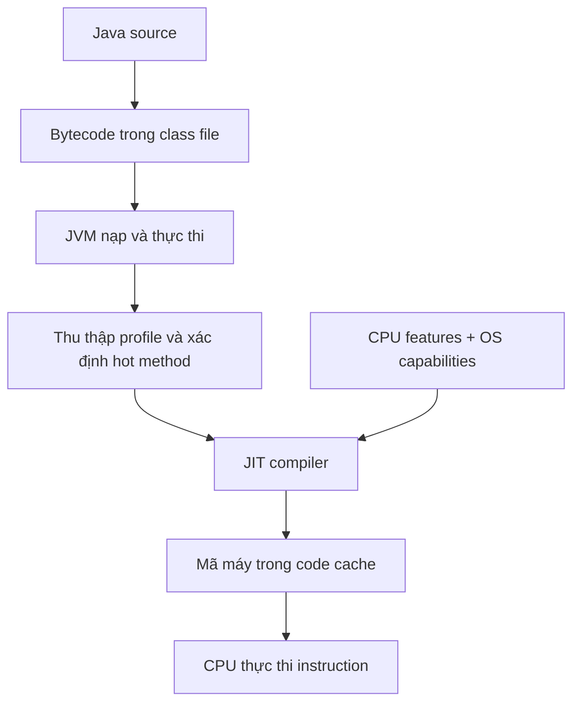

# Kiến trúc CPU và các tập lệnh được mã JIT sử dụng

Java bytecode có thể chạy trên nhiều nền tảng vì JVM biên dịch và thực thi bytecode theo kiến trúc của máy đang chạy. Tuy nhiên, sau khi JIT biên dịch, một phần code của ứng dụng đã trở thành mã máy phụ thuộc kiến trúc CPU và những tập lệnh mà JVM phát hiện được. CRaC lưu trạng thái của một tiến trình đang chạy, vì vậy checkpoint có thể chứa code cache, trạng thái runtime và các cấu trúc bộ nhớ gắn với kiến trúc máy nguồn.

Điều này tạo ra một giới hạn tương thích quan trọng: checkpoint không phải artifact Java portable như JAR. Một checkpoint được tạo trên x86-64 không thể được xem như có thể restore trên AArch64. Ngay cả khi hai máy cùng kiến trúc, tập instruction extension mà CPU và hệ điều hành công bố cho JVM có thể khác nhau. Nếu mã JIT hoặc native library sử dụng instruction mà CPU đích không hỗ trợ, ứng dụng có thể gặp lỗi illegal instruction hoặc crash khi đường code đó được thực thi.

Khi triển khai CRaC, cần xác định kiến trúc CPU, ISA extensions và khả năng CPU mà JVM thực sự nhìn thấy. Sau đó xây dựng chính sách restore trên cùng kiến trúc và một baseline instruction set tương thích, đặc biệt khi di chuyển VM giữa các host vật lý khác nhau.

## 1. Phân biệt kiến trúc CPU, ISA và microarchitecture

Ba khái niệm này liên quan nhưng không đồng nghĩa.

- **Kiến trúc CPU (architecture):** họ kiến trúc và mô hình thực thi mà phần mềm nhắm tới, chẳng hạn x86-64 hoặc AArch64.
- **Instruction Set Architecture (ISA):** tập lệnh, thanh ghi, kiểu dữ liệu, quy tắc gọi hàm và hành vi mà phần mềm có thể sử dụng. ISA xác định hợp đồng giữa mã máy và CPU.
- **Microarchitecture:** cách một nhà sản xuất triển khai ISA bên trong bộ xử lý, ví dụ pipeline, cache, branch predictor và execution unit. Hai CPU có microarchitecture khác nhau vẫn có thể thực thi cùng một ISA.

| Khái niệm | Ví dụ | Ý nghĩa với CRaC |
|---|---|---|
| Kiến trúc | x86-64, AArch64 | Khác kiến trúc thường đồng nghĩa khác mã máy, ABI và trạng thái tiến trình; không coi checkpoint là có thể chuyển chéo. |
| ISA extension | SSE4.2, AVX2, AVX-512, AES, NEON, SVE | Mã JIT hoặc native library có thể dùng extension tùy CPU/OS; máy đích cần hỗ trợ các extension đã được dùng. |
| Microarchitecture | Intel Core, AMD Zen, Arm Neoverse | Có thể ảnh hưởng hiệu năng và đặc tính phần cứng; điều quan trọng trước hết là các feature được expose có tương thích hay không. |
| ABI và runtime platform | Linux x86-64 ABI, AArch64 ABI | Native library, calling convention, pointer width và cấu trúc tiến trình phải phù hợp với môi trường restore. |

Hai máy cùng là x86-64 không có nghĩa chúng có cùng tập lệnh. Một CPU cũ có thể hỗ trợ SSE nhưng không hỗ trợ AVX2; một CPU mới có thể hỗ trợ thêm AVX-512 hoặc các extension khác. Tương tự, các CPU AArch64 có thể khác nhau về SVE/SVE2, crypto extension và những feature tùy chọn.

## 2. Vì sao mã JIT phụ thuộc vào CPU?

JVM bắt đầu từ bytecode. Khi chương trình chạy, runtime thu thập thông tin về những method được gọi thường xuyên và những đường code nóng. JIT compiler có thể biên dịch các method đó thành mã máy để giảm chi phí thông dịch và tối ưu hóa theo dữ liệu quan sát được.

Quy trình khái quát:



JIT compiler phải tạo mã máy phù hợp với CPU mà JVM đang chạy trên đó. Vì vậy, cùng một JAR có thể được biên dịch thành các chuỗi instruction khác nhau trên hai máy.

### 2.1. C1, C2 và tiered compilation

HotSpot thường sử dụng nhiều tầng biên dịch. C1 có thể biên dịch nhanh để giảm chi phí thực thi ban đầu; C2 có thể tối ưu sâu hơn cho method nóng. Với tiered compilation, method có thể đi qua nhiều mức biên dịch khi profile được thu thập.

Các tầng compiler đều phải tuân theo tập lệnh mà JVM cho phép sử dụng. Khi CPU có extension phù hợp, compiler có thể chọn instruction hoặc tối ưu hóa hiệu quả hơn. Nếu không có extension, JVM thường chọn đường code khác hoặc không dùng tối ưu hóa đó.

### 2.2. CPU intrinsics và vectorization

JVM có thể thay một số lời gọi Java quen thuộc bằng intrinsic được triển khai bằng instruction đặc biệt. Ví dụ, các phép mã hóa, băm, checksum, thao tác bit hoặc phép toán vector có thể tận dụng phần cứng khi feature tương ứng được hỗ trợ.

Trên x86-64, các nhóm instruction thường gặp gồm:

- SSE và các phiên bản mở rộng như SSE4.x.
- AVX, AVX2 và AVX-512 cho phép xử lý vector rộng hơn.
- AES-NI, SHA extensions và các instruction hỗ trợ mật mã.
- BMI và các instruction bit manipulation.

Trên AArch64, các nhóm feature có thể gồm:

- Advanced SIMD/NEON.
- Crypto extensions cho một số phép toán mật mã.
- CRC extension.
- SVE và SVE2 trên những CPU hỗ trợ.

Các ví dụ này chỉ là nhóm ISA extension. Không phải mọi JVM hoặc CPU đều hỗ trợ tất cả; danh sách feature thực tế cần lấy từ môi trường đang chạy.

### 2.3. Code cache và mã máy đã biên dịch

HotSpot lưu mã máy được JIT biên dịch trong vùng code cache. Một tiến trình đã warm-up có thể có nhiều method đã biên dịch và profile runtime tương ứng. Khi checkpoint, trạng thái tiến trình được lưu theo cơ chế của JDK CRaC và checkpoint engine. Cách từng phiên bản xử lý executable mapping và code cache là chi tiết triển khai của runtime.

Không nên giả định rằng code cache sẽ luôn được giữ nguyên, luôn bị xóa hoặc luôn được JIT biên dịch lại sau restore. Cần dùng tài liệu của đúng JDK CRaC và kiểm thử trên runtime mục tiêu. Dù runtime có cơ chế kiểm tra hoặc tái tạo một phần code, checkpoint vẫn phụ thuộc kiến trúc CPU và ABI của tiến trình nguồn.

## 3. Điều gì có thể xảy ra khi restore trên CPU khác?

Hãy xem xét một ứng dụng được warm-up trên CPU nguồn có AVX2. JIT compiler có thể tạo code sử dụng AVX2 cho một method nóng. Nếu checkpoint được restore trên CPU đích không hỗ trợ AVX2 và code đó được thực thi, CPU có thể phát sinh lỗi illegal instruction. Tùy runtime, lỗi có thể xuất hiện ngay trong quá trình restore hoặc chỉ xuất hiện khi method tương ứng chạy.

Một số tình huống thường gặp:

| Máy nguồn | Máy đích | Đánh giá |
|---|---|---|
| x86-64 với baseline feature | x86-64 có cùng feature baseline | Thường là lựa chọn dễ kiểm soát nhất, nếu JDK, OS và runtime cũng tương thích. |
| x86-64 có AVX2 | x86-64 không có AVX2 | Rủi ro nếu code cache hoặc native library dùng AVX2. Không nên restore nếu chưa có bảo đảm tương thích. |
| x86-64 có AVX-512 | x86-64 chỉ có AVX2 | Có thể gặp instruction không hỗ trợ nếu mã nguồn dùng AVX-512. |
| x86-64 | AArch64 | Không tương thích mã máy/ABI; không xem là đường restore được hỗ trợ. |
| AArch64 có SVE | AArch64 không expose SVE | Rủi ro nếu mã máy hoặc native library dùng SVE. |
| Máy nguồn có feature set thấp hơn | Máy đích có feature set cao hơn | Thường an toàn hơn về instruction nếu toàn bộ feature nguồn được expose ở đích; không tự động làm code đã biên dịch tận dụng feature mới. |

CPU đích có nhiều feature hơn không đồng nghĩa JVM sẽ tự biên dịch lại toàn bộ code cache để dùng chúng. Ngược lại, CPU đích thiếu feature mà code nguồn đã dùng có thể gây lỗi. Cần so sánh feature set mà JVM thực sự nhìn thấy, không chỉ so sánh tên model CPU.

### 3.1. Lỗi illegal instruction

Khi CPU thực thi opcode không được hỗ trợ, hệ điều hành thường báo tín hiệu như `SIGILL` trên Linux. Log có thể cho thấy tiến trình bị dừng bởi illegal instruction, nhưng không phải mọi lỗi restore đều có cùng dấu hiệu. Có thể thất bại trước đó do architecture mismatch, native library không tương thích hoặc checkpoint engine không thể khôi phục một mapping.

Đừng kết luận chỉ từ một lần chạy không lỗi. Code JIT dùng extension có thể nằm trong method chỉ chạy khi có workload cụ thể. Sau restore, cần thực thi các đường code nóng đại diện để xác nhận chúng hoạt động trên CPU đích.

### 3.2. CPU feature và trạng thái của hệ điều hành

Một số instruction yêu cầu cả hỗ trợ CPU lẫn hỗ trợ hệ điều hành để lưu/khôi phục trạng thái thanh ghi mở rộng. Ví dụ trên x86, AVX cần CPU hỗ trợ AVX và hệ điều hành bật cơ chế quản lý trạng thái phù hợp qua OSXSAVE/XCR0. Vì vậy, chỉ đọc một cờ CPU không phải lúc nào cũng đủ để biết JVM có thể sử dụng instruction đó.

JVM thường kiểm tra cả CPU và điều kiện hệ điều hành khi quyết định feature nào có thể dùng. Trong môi trường VM/container, hypervisor có thể mask hoặc giới hạn feature mà guest nhìn thấy. Feature list trong guest mới là thông tin có liên quan trực tiếp đến code mà JVM guest có thể sinh ra.

## 4. JVM phát hiện và sử dụng tập lệnh như thế nào?

Khi JVM khởi động, runtime kiểm tra kiến trúc, CPU feature và một số điều kiện hệ điều hành. HotSpot dùng thông tin này để chọn đường code, intrinsic và tùy chọn compiler.

Trên một số nền tảng, JVM flags có thể điều khiển giới hạn instruction mà JIT được phép sử dụng. Ví dụ, HotSpot trên x86 có các flag liên quan đến SSE/AVX; tên, miền giá trị và khả năng hỗ trợ phụ thuộc phiên bản JDK. Không nên sao chép một flag từ máy khác mà không kiểm tra `java -XX:+PrintFlagsFinal -version` hoặc tài liệu của JDK đang chạy.

Các điểm cần nhớ:

- CPU feature detection diễn ra trong bối cảnh JVM khởi động và môi trường mà nó nhìn thấy.
- JIT compiler có thể dùng feature được JVM cho phép để tạo mã máy.
- Intrinsics và vectorization có thể tạo ra instruction khác nhau giữa các CPU.
- JVM flags có thể giới hạn một số tối ưu hóa, nhưng không biến native library được biên dịch sai kiến trúc thành portable.
- Việc thay đổi CPU feature mask hoặc JVM flag giữa lúc checkpoint và restore cần được kiểm tra rất cẩn thận.

### 4.1. Ví dụ về baseline AVX

Giả sử fleet có cả CPU x86-64 hỗ trợ AVX2 và CPU cũ hơn chỉ hỗ trợ baseline thấp hơn. Nếu JVM nguồn nhìn thấy AVX2, JIT có thể chọn code sử dụng AVX2. Khi di chuyển checkpoint sang máy cũ, chỉ cùng kiến trúc x86-64 là chưa đủ.

Có hai hướng triển khai:

1. Giữ fleet đồng nhất để mọi host có cùng feature baseline.
2. Nếu JDK hỗ trợ cấu hình giới hạn instruction set, cấu hình JVM dùng một baseline chung mà tất cả host trong nhóm đều hỗ trợ, sau đó kiểm thử hiệu năng và restore.

Hướng thứ hai có thể giảm một số tối ưu hóa. Flag cụ thể phụ thuộc HotSpot build và CPU architecture; cần xem output của JVM đang sử dụng trước khi chọn. Không nên tự đặt `UseAVX` hoặc `UseSSE` theo một con số mà không xác nhận ý nghĩa trên JDK cụ thể.

## 5. Native library cũng phụ thuộc kiến trúc và ISA

Ngay cả khi bytecode Java tương thích, ứng dụng có thể nạp thư viện native qua JNI, FFM hoặc dependency của agent. Các thư viện đó được biên dịch cho một kiến trúc và có thể sử dụng instruction extension cụ thể.

Ví dụ:

- Một thư viện compression được biên dịch với AVX2.
- Một thư viện mật mã có đường code AES-NI hoặc ARM crypto extension.
- Một native profiler có binary riêng cho x86-64 hoặc AArch64.
- Một thư viện JNI được build với `-march=native`, vô tình phụ thuộc CPU của máy build.

Nếu checkpoint restore trên host có CPU feature thấp hơn, native library có thể gặp lỗi ngay cả khi JIT code của ứng dụng không dùng instruction đó.

### 5.1. Tránh build native library với `-march=native` cho fleet không đồng nhất

`-march=native` yêu cầu compiler tối ưu cho CPU của máy build. Binary tạo ra có thể sử dụng instruction không có trên các host khác. Với ứng dụng triển khai trên nhiều máy, hãy chọn target architecture và feature baseline rõ ràng.

Nếu cần hiệu năng cao trên nhiều loại CPU, có thể build nhiều implementation và chọn runtime dispatch dựa trên feature detection an toàn. Việc dispatch phải được thực hiện bởi thư viện có hỗ trợ chính thức; không tự nhảy vào function chứa instruction mở rộng trước khi xác nhận feature.

### 5.2. JNI và native handle

Checkpoint còn liên quan đến native memory, thread và handle của thư viện. Một con trỏ native trong heap không đảm bảo vùng nhớ hoặc resource mà nó trỏ tới tương thích với CPU đích. Hãy kiểm tra cả binary architecture, ABI, thư viện phụ thuộc và lifecycle của native resource.

## 6. Kiến trúc CPU trong môi trường ảo hóa và container

Trong môi trường ảo hóa, CPU mà JVM nhìn thấy có thể là một model ảo do hypervisor công bố, không phải toàn bộ feature của host vật lý. Đây là điều quan trọng khi checkpoint một VM rồi restore hoặc migrate sang host khác.

### 6.1. Guest CPU model

Hypervisor có thể expose một CPU model chung để VM có thể di chuyển giữa nhiều host. Nếu model chung chỉ công bố baseline feature, JVM sẽ JIT theo baseline đó, ngay cả khi host nguồn có instruction extension mới hơn.

Đây là một cách kiểm soát portability trong cùng kiến trúc: cố định guest-visible CPU feature set trước khi JVM khởi động. Không thay đổi model CPU hoặc feature mask của VM theo cách làm mất những feature mà tiến trình đã sử dụng.

### 6.2. Container không tạo ISA độc lập

Container chia sẻ kernel và kiến trúc CPU của host. Một container image Java không làm mã JIT trở nên portable giữa x86-64 và AArch64. Nếu chạy multi-architecture image, mỗi architecture cần binary native phù hợp; checkpoint image vẫn cần tương thích với kiến trúc và feature của runtime đích.

CPU quota hoặc CPU affinity không nhất thiết đồng nghĩa với việc giới hạn ISA. Tuy nhiên, môi trường ảo hóa, seccomp hoặc cấu hình nền tảng có thể ảnh hưởng khả năng truy cập một số tài nguyên. Hãy kiểm tra CPU features từ bên trong chính container/VM nơi JVM chạy.

## 7. Xây dựng chính sách tương thích cho checkpoint

Một chính sách thực tế cần ghi lại ít nhất bốn lớp thông tin:

1. **Architecture:** x86-64 hay AArch64 và ABI liên quan.
2. **CPU feature baseline:** những instruction extensions mà guest/OS expose và JVM có thể sử dụng.
3. **JVM runtime:** vendor, version, build, compiler flags và các tùy chọn ảnh hưởng tới code generation.
4. **Native dependencies:** kiến trúc binary, ISA baseline và phiên bản native library/agent.

Có thể định nghĩa một runtime compatibility profile cho từng nhóm checkpoint. Ví dụ:

| Profile | Architecture | Feature policy | Restore target |
|---|---|---|---|
| `linux-x86-baseline` | x86-64 | Baseline feature đã thống nhất cho toàn nhóm. | Chỉ host/VM expose baseline đó trở lên. |
| `linux-x86-avx2` | x86-64 | Cho phép AVX2 và các feature được profile ghi rõ. | Chỉ host/VM expose đầy đủ feature yêu cầu. |
| `linux-arm64-baseline` | AArch64 | Baseline ARM64 chung của fleet. | Chỉ host/VM AArch64 có feature baseline tương thích. |
| `linux-arm64-sve` | AArch64 | Yêu cầu SVE/SVE2 theo cấu hình cụ thể. | Chỉ host/VM expose extension tương ứng. |

Tên profile là ví dụ do hệ thống triển khai định nghĩa, không phải tên chuẩn của CRaC hoặc JVM. Mỗi profile cần lưu rõ danh sách feature thực tế, JDK build và native dependencies.

### 7.1. Nguyên tắc chọn target

- Không restore chéo architecture.
- Đảm bảo CPU đích expose mọi instruction feature mà mã nguồn và native libraries có thể dùng.
- Giữ guest CPU model ổn định trong suốt vòng đời checkpoint.
- Dùng một baseline chung nếu cần migrate trong nhóm host không đồng nhất.
- Không coi CPU model name là đủ; so sánh feature flags và khả năng OS.
- Nếu không xác định được compatibility, tạo checkpoint riêng cho từng profile thay vì dùng chung.

CPU đích có feature superset thường có thể thực thi instruction subset mà nguồn dùng, nhưng đây chỉ là điều kiện CPU-level. JDK build, OS/kernel, ABI, native library và checkpoint engine vẫn phải tương thích.

## 8. Thu thập thông tin CPU và JVM trước khi tạo checkpoint

Trước khi checkpoint, ghi lại fingerprint của môi trường chạy. Nên thu thập từ bên trong VM/container thực tế, vì đó là CPU feature set mà JVM nhìn thấy.

### 8.1. Thông tin từ Linux

```bash
uname -m
lscpu
grep -m1 -E '^(flags|Features)' /proc/cpuinfo
```

- `uname -m` cho biết machine architecture mà kernel báo cáo.
- `lscpu` hiển thị kiến trúc, model và feature flags được hệ điều hành expose.
- `/proc/cpuinfo` cung cấp flags/features theo từng CPU; format khác nhau giữa x86 và ARM.

Trong container, chạy các lệnh bên trong container thay vì chỉ chạy trên host. Một số runtime có thể giới hạn thông tin hiển thị hoặc expose CPU model ảo.

### 8.2. Thông tin từ JVM

Có thể ghi lại các flag JVM:

```bash
java -XX:+PrintFlagsFinal -version
```

Với HotSpot hỗ trợ unified logging tương ứng, có thể xem thông tin CPU mà JVM phát hiện khi khởi động:

```bash
java -Xlog:os+cpu=info -version
```

Đối với tiến trình đang chạy, `jcmd` có thể cung cấp thông tin runtime và flag:

```bash
jcmd <pid> VM.info
jcmd <pid> VM.flags -all
```

Các lệnh và nội dung output có thể thay đổi theo JDK vendor/version. Không phải mọi runtime đều hỗ trợ cùng logging tag hoặc diagnostic command. Hãy lưu output thực tế cùng checkpoint metadata.

### 8.3. Runtime fingerprint nên lưu

| Trường | Ví dụ thông tin cần ghi |
|---|---|
| OS architecture | `x86_64`, `aarch64`. |
| CPU vendor/model | Thông tin CPU guest-visible. |
| CPU features | SSE, AVX2, AVX-512, AES, NEON, SVE... theo môi trường thực tế. |
| OS support | Các capability mà hệ điều hành bật cho instruction state. |
| JVM | Vendor, version, build, architecture. |
| Compiler options | Các flag liên quan tới JIT và intrinsic. |
| Native dependencies | Tên, version, binary architecture và ISA baseline. |
| Virtualization | Guest CPU model và policy feature masking nếu có. |

Không cần ghi mọi thông tin CPU vào log của từng request. Hãy lưu như metadata của image hoặc deployment profile để hệ thống điều phối có thể so sánh trước khi restore.

## 9. Kiểm thử tương thích CPU trước khi đưa vào vận hành

Kiểm thử cần bao phủ cả việc restore và việc thực thi các method JIT/native sau restore. Chỉ restore thành công chưa đủ nếu một method có instruction không hỗ trợ chưa được gọi.

### 9.1. Ma trận kiểm thử

| Máy tạo checkpoint | Máy restore | Kịch bản kiểm tra | Kết quả mong đợi |
|---|---|---|---|
| Host thuộc baseline A | Host cùng baseline A | Restore và chạy workload đại diện. | Restore và workload hoàn tất. |
| Host có feature set cao | Host có cùng feature set | Chạy các method nóng và native path. | Không có lỗi instruction; hiệu năng nằm trong ngưỡng. |
| Host có feature set cao | Host thiếu extension đã dùng | Thử trong môi trường cô lập. | Bị từ chối theo policy hoặc lỗi được nhận diện; không đưa vào production. |
| x86-64 | AArch64 | Kiểm tra policy trước restore. | Hệ thống từ chối vì architecture không tương thích. |
| VM guest CPU baseline | Host vật lý khác nhưng expose cùng guest model | Restore sau migration. | Hành vi tương thích theo profile đã kiểm thử. |
| Có native agent/library | Host cùng architecture nhưng feature thấp hơn | Gọi đầy đủ native path. | Không có native illegal instruction hoặc ABI error. |

### 9.2. Warm-up workload đại diện

Nếu ứng dụng có các method được JIT biên dịch, hãy chạy workload đủ để thực thi những đường code nóng trước checkpoint. Sau restore, gọi lại các đường đó và theo dõi:

- Illegal instruction hoặc process crash.
- JVM compiler/deoptimization log nếu cần chẩn đoán.
- Native library loading error.
- Latency và throughput so với baseline.
- Hành vi của intrinsic/vectorized code.

Không nên chỉ chạy một endpoint đơn giản nếu các phép toán nặng nằm ở một module khác. Workload cần đại diện cho những code path quan trọng của ứng dụng.

### 9.3. Kiểm thử khi CPU feature bị mask

Trong môi trường test, có thể dùng VM/hypervisor cấu hình CPU model hoặc feature mask khác nhau để xác nhận policy. Không thay đổi CPU feature của máy production đang chứa tiến trình đã warm-up chỉ để thử khả năng tương thích.

Nếu dùng JVM flag để giới hạn JIT feature, phải tạo checkpoint bằng đúng cấu hình đó và restore bằng runtime tương thích. Đừng chỉ thay flag ở lệnh restore rồi cho rằng code cache cũ sẽ tự được biên dịch lại an toàn.

## 10. Các chiến lược triển khai

### 10.1. Fleet đồng nhất

Đơn giản nhất là tạo và restore checkpoint trong một nhóm host có cùng architecture và feature baseline. Cách này giảm số biến cần quản lý, đặc biệt với ứng dụng có nhiều native dependency hoặc JIT warm-up nặng.

### 10.2. Chia checkpoint theo CPU profile

Nếu fleet có nhiều nhóm CPU, tạo checkpoint riêng cho từng profile. Ví dụ, nhóm x86 baseline và nhóm x86 AVX2 dùng image riêng. Bộ điều phối chỉ restore image vào nhóm có feature tương thích.

### 10.3. Giới hạn JIT ở baseline chung

Trong một số triển khai HotSpot, có thể cấu hình compiler không dùng instruction extension vượt quá baseline của fleet. Điều này giúp cùng một checkpoint phù hợp hơn với nhiều host trong nhóm, đổi lại có thể giảm hiệu năng trên CPU mới.

Chỉ sử dụng flag được JDK cụ thể hỗ trợ và xác nhận bằng output runtime. Không dùng flag JIT để cố biến checkpoint x86-64 thành checkpoint AArch64; đó là khác kiến trúc và ABI.

### 10.4. Build native library theo baseline

Build native dependencies với target architecture và ISA baseline rõ ràng. Nếu cần nhiều đường tối ưu, dùng runtime dispatch đã được thư viện hỗ trợ. Tránh binary phụ thuộc vô tình vào CPU build host.

## 11. Những hiểu lầm thường gặp

**“Java bytecode portable nên checkpoint cũng portable.”** Bytecode có thể chạy trên nhiều JVM, nhưng checkpoint chứa trạng thái tiến trình và mã máy/runtime gắn với kiến trúc. Hai loại artifact có tính di động khác nhau.

**“Cùng x86-64 là chắc chắn restore được.”** Các CPU x86-64 có thể khác nhau về AVX, AVX2, AVX-512 và feature khác. Cần so sánh tập lệnh mà JVM và native library sử dụng.

**“CPU đích mới hơn luôn an toàn.”** CPU mới hơn thường hỗ trợ nhiều instruction hơn, nhưng vẫn phải kiểm tra feature thực sự expose, OS support, ABI, JDK và native dependencies.

**“Restore xong mà chưa lỗi nghĩa là không có instruction không hỗ trợ.”** Method chứa instruction đó có thể chưa chạy. Cần thực thi workload đại diện sau restore.

**“JVM tự biên dịch lại mọi method khi restore.”** Không nên giả định điều đó. Cách runtime xử lý code cache phụ thuộc JDK CRaC; hãy kiểm tra tài liệu và thử trên đúng build.

**“Container image quyết định CPU architecture.”** Container dùng CPU và kernel của host/VM. Image multi-architecture không làm checkpoint process snapshot portable giữa các ISA.

**“Chỉ JIT code mới phụ thuộc CPU.”** JNI, JVMTI agent, profiler và native library cũng có thể chứa instruction phụ thuộc CPU.

## 12. Checklist tương thích kiến trúc CPU

- [ ] Xác định architecture của máy tạo checkpoint và máy restore.
- [ ] Không restore chéo x86-64 và AArch64.
- [ ] Ghi CPU vendor/model và feature flags mà guest/container thực sự expose.
- [ ] Kiểm tra OS support cho instruction state, không chỉ dựa trên CPUID/feature label.
- [ ] Ghi JDK vendor/version/build và các compiler flag liên quan.
- [ ] Xác định JIT intrinsics, vectorization hoặc native library có thể dùng extension nào.
- [ ] Tránh native binary được build với `-march=native` nếu fleet không đồng nhất.
- [ ] Dùng guest CPU model hoặc feature baseline ổn định khi VM cần migration.
- [ ] Tạo checkpoint riêng cho từng CPU profile nếu cần.
- [ ] Kiểm thử restore trên host có feature set bằng baseline mục tiêu.
- [ ] Sau restore, thực thi các hot path và native path đại diện.
- [ ] Từ chối restore nếu CPU đích thiếu feature bắt buộc hoặc không xác định được compatibility.

## 13. Thuật ngữ cần nhớ

- **CPU architecture:** họ kiến trúc như x86-64 hoặc AArch64.
- **ISA:** tập instruction, thanh ghi và quy tắc thực thi mà phần mềm có thể sử dụng.
- **ISA extension:** phần mở rộng của tập lệnh, ví dụ AVX2, AVX-512, AES-NI, NEON hoặc SVE.
- **Microarchitecture:** cách CPU triển khai ISA ở cấp phần cứng.
- **JIT compiler:** thành phần biên dịch bytecode thành mã máy trong lúc ứng dụng chạy.
- **Code cache:** vùng bộ nhớ JVM lưu mã máy được JIT biên dịch.
- **Intrinsic:** lời gọi Java được JVM thay bằng implementation tối ưu, có thể dùng instruction phần cứng.
- **Vectorization:** thực hiện nhiều phép toán dữ liệu trong một instruction vector.
- **CPU feature mask:** tập feature mà môi trường ảo hóa hoặc hệ thống công bố cho tiến trình.
- **ABI:** quy ước nhị phân như calling convention, data layout và liên kết giữa chương trình với thư viện native.
- **`SIGILL`:** tín hiệu trên Unix-like systems thường liên quan tới instruction không hợp lệ hoặc không được CPU hỗ trợ.
- **Runtime fingerprint:** tập thông tin về CPU, OS, JVM và native dependencies dùng để quyết định tính tương thích.

Với CRaC, hãy coi kiến trúc CPU và tập lệnh JIT sử dụng là một phần của định danh môi trường checkpoint. Java bytecode có thể chạy trên nhiều kiến trúc, nhưng trạng thái tiến trình đã warm-up không phải một gói portable. Chỉ restore trong cùng kiến trúc và trên CPU/OS expose đủ feature mà code JIT cùng native dependencies yêu cầu; nếu cần di chuyển giữa nhiều host, hãy thống nhất baseline CPU hoặc tạo checkpoint riêng theo từng profile.

## Tài liệu tham khảo

- [OpenJDK HotSpot VM Options](https://docs.oracle.com/en/java/javase/21/docs/specs/man/java.html): các tùy chọn JVM, bao gồm nhóm tùy chọn compiler và runtime phụ thuộc nền tảng.
- [Java HotSpot VM Performance Enhancements](https://docs.oracle.com/en/java/javase/21/vm/java-hotspot-virtual-machine-performance-enhancements.html): cơ chế JIT, tiered compilation và tối ưu hóa của HotSpot.
- [JVM Tool Interface (JVMTI) Specification](https://docs.oracle.com/en/java/javase/21/docs/specs/jvmti.html): native agent và tương tác với JVM.
- [CRaC — About CRaC](https://crac.org/about/about-crac/): mô hình checkpoint/restore tiến trình và yêu cầu môi trường tương thích.
- [CRaC — Best Practices](https://crac.org/reference/best-practices/): thực hành chuẩn bị resource và vận hành checkpoint/restore.
