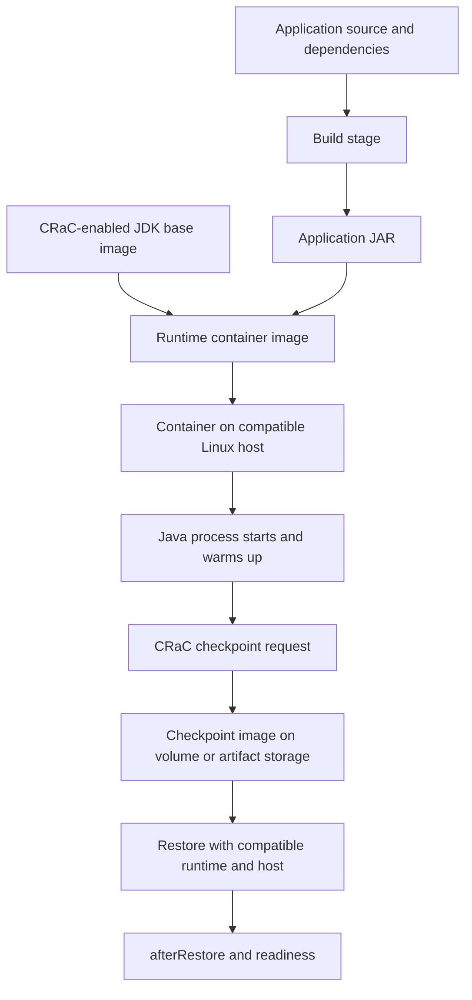

# Xây dựng container có JDK hỗ trợ CRaC

Để chạy ứng dụng Java bằng CRaC trong container, image runtime phải chứa một bản JDK có hỗ trợ checkpoint/restore, ứng dụng và các thư viện hệ thống cần thiết. Môi trường container cũng phải được chạy trên host Linux, kernel, kiến trúc CPU và container runtime đáp ứng yêu cầu của bản JDK CRaC cùng cơ chế checkpoint/restore đang sử dụng.

Điểm cần phân biệt là **container image** và **checkpoint image** là hai artifact khác nhau. Container image chứa filesystem, JDK, application JAR và cấu hình runtime. Checkpoint image lưu trạng thái của một tiến trình đã chạy. Tạo được container image có JDK CRaC không tự động có nghĩa container có thể checkpoint hoặc restore trên mọi host. Cần chuẩn bị cả runtime image, thư mục lưu checkpoint, quyền hệ thống, cách kích hoạt checkpoint và quy trình restore.

## 1. Kiến trúc container khi sử dụng CRaC

Một triển khai thường có các thành phần:



Có thể chia trách nhiệm như sau:

| Thành phần | Trách nhiệm |
|---|---|
| Build stage | Biên dịch và đóng gói ứng dụng thành JAR |
| CRaC JDK runtime image | Cung cấp JVM có hỗ trợ CRaC và các thư viện user-space cần thiết |
| Linux host | Cung cấp kernel, kiến trúc và các tính năng hệ thống cần cho checkpoint/restore |
| Container runtime | Tạo namespace, cgroup, mount và cấp quyền cần thiết cho tiến trình |
| Checkpoint directory | Lưu các file và metadata của snapshot tiến trình |
| Application Resource | Đóng, tạm dừng hoặc phục hồi tài nguyên phụ thuộc môi trường |
| Orchestrator/deployment process | Chọn image, host tương thích và thời điểm restore; điều khiển readiness |

CRaC không thay thế container runtime hoặc hệ điều hành. Tùy bản phân phối JDK, checkpoint/restore trên Linux có thể phối hợp với CRIU (Checkpoint/Restore In Userspace). Cần theo tài liệu của vendor để biết CRIU được gọi ở đâu, cần cài thành phần nào và những capability nào phải được cấp.

## 2. Chọn base image có JDK hỗ trợ CRaC

Không phải mọi Docker image có Java đều chứa JDK CRaC. Một image `eclipse-temurin`, `openjdk` hoặc một image JRE thông thường không mặc nhiên hỗ trợ checkpoint/restore chỉ vì chạy được ứng dụng Java.

Khi chọn base image, xác minh:

- Nhà cung cấp và distribution có công bố hỗ trợ CRaC cho dòng JDK đó.
- Phiên bản đầy đủ và build của JDK.
- Hệ điều hành và kiến trúc CPU được hỗ trợ.
- Phiên bản kernel, CRIU và cấu hình host cần thiết.
- Có cần `jcmd`, compiler tools hoặc tiện ích chẩn đoán trong runtime image không.
- Có yêu cầu thư viện native, libc hoặc package hệ thống nào không.
- Cách vendor khuyến nghị kích hoạt checkpoint và restore.
- Image có được cung cấp digest bất biến để pin trong pipeline không.

Ví dụ dưới đây dùng placeholder cho image của nhà cung cấp:

```dockerfile
FROM <vendor>/<crac-jdk-distribution>:<exact-version>@sha256:<verified-digest>
```

Thay placeholder bằng image thật được vendor công bố. Không dùng `latest` trong môi trường build/release vì tag có thể trỏ đến nội dung khác theo thời gian. Ghi lại cả tag lẫn digest để có thể tái tạo đúng runtime.

### 2.1. Dùng JDK hay JRE?

Một số image runtime tối giản chỉ chứa JRE hoặc runtime đã lược bỏ công cụ phát triển. Với quy trình CRaC, có thể cần `jcmd` để yêu cầu checkpoint và công cụ chẩn đoán để xem trạng thái JVM. Nếu runtime image không có `jcmd`, cần dùng một công cụ được vendor hỗ trợ trong cùng PID namespace hoặc một cơ chế điều khiển checkpoint khác.

Hãy chọn image dựa trên cách vận hành thực tế. Không cài thêm một JDK thông thường chỉ để lấy `jcmd` rồi điều khiển một JVM CRaC khác mà chưa xác nhận công cụ đó tương thích. Ưu tiên dùng công cụ đi kèm cùng distribution và build.

### 2.2. Cố định phiên bản và kiến trúc

Ghi nhận JDK vendor, version, build, OS và kiến trúc trong manifest. `amd64` và `arm64` là hai target riêng; không mặc định checkpoint image tạo trên kiến trúc này có thể restore trên kiến trúc kia.

Nếu ứng dụng hỗ trợ nhiều kiến trúc, hãy build runtime image và tạo checkpoint image riêng cho từng kiến trúc. Các thư viện JNI, JNA và `.so` phải tương ứng với target CPU.

## 3. Tạo container image bằng multi-stage build

Multi-stage build giúp tách công cụ biên dịch khỏi runtime image. Stage đầu dùng Gradle/JDK để build JAR; stage cuối dùng CRaC-enabled JDK để chạy ứng dụng.

Ví dụ Dockerfile:

```dockerfile
ARG CRAC_JDK_IMAGE

# Stage 1: build application
FROM gradle:8.10-jdk21 AS build

WORKDIR /workspace
COPY gradlew settings.gradle build.gradle ./
COPY gradle ./gradle
COPY src ./src

RUN ./gradlew --no-daemon clean bootJar

# Stage 2: runtime with a CRaC-enabled JDK
FROM ${CRAC_JDK_IMAGE} AS runtime

WORKDIR /app

COPY --from=build /workspace/build/libs/application.jar /app/application.jar
COPY docker/entrypoint.sh /app/entrypoint.sh

RUN mkdir -p /var/lib/application/checkpoint \
    && mkdir -p /var/log/application \
    && chmod 0755 /app/entrypoint.sh

ENV CRAC_CHECKPOINT_DIR=/var/lib/application/checkpoint
ENV CRAC_START_MODE=normal

ENTRYPOINT ["/app/entrypoint.sh"]
```

Đây là cấu trúc minh họa. Cần điều chỉnh tên JAR, Gradle task, phiên bản Gradle/JDK build và đường dẫn theo dự án. Giá trị `CRAC_JDK_IMAGE` phải là image CRaC-enabled có tag đầy đủ và digest đã xác minh. Không truyền một image Java thông thường vào biến này.

Build argument `CRAC_JDK_IMAGE` phải được truyền khi build và cần là image CRaC-enabled có tag đầy đủ cùng digest đã xác minh. Ví dụ cấu trúc lệnh:

```bash
docker build \
  --build-arg CRAC_JDK_IMAGE=<vendor>/<crac-jdk>:<exact-version>@sha256:<verified-digest> \
  -t orders-api:3.1.0 .
```

Thay các placeholder bằng tham chiếu image thật của nhà cung cấp.

### 3.1. Vì sao tách build stage và runtime stage?

Build stage có thể chứa Gradle, compiler, source code và cache dependency. Runtime stage chỉ cần JDK CRaC, JAR và các file cần khi ứng dụng chạy. Tách hai stage giúp:

- Giảm kích thước runtime image.
- Giảm số công cụ không cần thiết trong production.
- Pin runtime JDK độc lập với môi trường build.
- Hạn chế đưa source code và build cache vào image chạy.
- Dễ kiểm soát digest của JDK được dùng để tạo và restore checkpoint.

Tuy nhiên, build JAR bằng một JDK khác với runtime vẫn cần tuân thủ yêu cầu tương thích bytecode và framework. Runtime JDK là thành phần quan trọng nhất đối với checkpoint image; build JDK vẫn cần được ghi nhận để tái lập artifact.

## 4. Thiết kế entrypoint cho khởi động mới và restore

Container cần biết khi nào khởi động ứng dụng từ JAR và khi nào restore tiến trình từ checkpoint image. Hai đường này khác nhau:

- Khởi động mới: chạy `java` với `-jar` để tạo tiến trình và khởi chạy ứng dụng.
- Restore: dùng tùy chọn restore của bản JDK CRaC để khôi phục tiến trình từ checkpoint image. Không chạy lại ứng dụng như một startup mới.

Ví dụ entrypoint:

```sh
#!/bin/sh
set -eu

CHECKPOINT_DIR="${CRAC_CHECKPOINT_DIR:-/var/lib/application/checkpoint}"

case "${CRAC_START_MODE:-normal}" in
  normal)
    exec java \
      "-XX:CRaCCheckpointTo=${CHECKPOINT_DIR}" \
      -jar /app/application.jar
    ;;
  restore)
    if [ ! -d "$CHECKPOINT_DIR" ]; then
      echo "Checkpoint directory does not exist: $CHECKPOINT_DIR" >&2
      exit 1
    fi
    exec java "-XX:CRaCRestoreFrom=${CHECKPOINT_DIR}"
    ;;
  *)
    echo "Unsupported CRAC_START_MODE: ${CRAC_START_MODE}" >&2
    exit 2
    ;;
esac
```

Tên cờ `-XX:CRaCCheckpointTo` và `-XX:CRaCRestoreFrom` là cách dùng phổ biến trên các bản JDK CRaC hỗ trợ chúng; hãy xác minh tên option và quy trình chính xác trong tài liệu vendor. Một số triển khai có thể yêu cầu cách gọi hoặc công cụ điều khiển khác.

`exec` thay thế shell bằng tiến trình Java để Java nhận tín hiệu của container trực tiếp và có thể chạy dưới PID 1. Điều này hữu ích khi container được dừng hoặc điều phối. Script không tự quyết định lúc nào checkpoint phải xảy ra; một lệnh điều khiển hoặc thành phần orchestration cần gửi yêu cầu checkpoint theo cơ chế vendor hỗ trợ.

### 4.1. Đặt checkpoint path

Checkpoint directory nên là một đường dẫn rõ ràng, có quyền ghi cho user chạy JVM và được mount nếu cần giữ image sau khi container dừng.

Ví dụ:

```text
/var/lib/application/
  checkpoint/
  metadata/
```

Không dùng thư mục tạm trong writable layer của container nếu checkpoint cần tồn tại qua lần tạo container mới. Writable layer có thể bị xóa khi container được thay thế. Hãy dùng volume hoặc một kho artifact phù hợp với cấu trúc checkpoint của JDK/CRIU.

Không cho nhiều tiến trình ghi đồng thời vào cùng một checkpoint directory. Mỗi tiến trình/build/lần tạo image cần output riêng, trừ khi vendor cung cấp cơ chế quản lý đồng thời cụ thể.

## 5. Cài đặt CRIU và chuẩn bị host

Trên các triển khai Linux dùng CRIU, cần phân biệt package user-space với khả năng kernel và quyền của host. Chỉ thêm lệnh cài `criu` vào Dockerfile chưa chắc làm container checkpoint được.

Tùy mô hình tích hợp, CRIU có thể cần được cài trong container, trên host hoặc được cung cấp bởi runtime/platform. Hãy dùng đúng hướng dẫn của vendor JDK và container runtime.

Trên host Linux, cần kiểm tra tối thiểu:

```bash
uname -a
uname -m
cat /etc/os-release
criu --version
```

Sau đó kiểm tra các điều kiện cụ thể:

- Kernel có các tính năng cần thiết cho CRIU/JDK đang dùng.
- Phiên bản CRIU nằm trong phạm vi được hỗ trợ.
- Container runtime có hỗ trợ cách checkpoint/restore đã chọn.
- Namespace, cgroup và mount có thể được lưu/khôi phục theo yêu cầu.
- Capability và security profile cho phép thao tác cần thiết.
- Filesystem hỗ trợ metadata và loại file mà checkpoint image sử dụng.
- Host có đủ dung lượng và I/O để ghi, đọc checkpoint image.

### 5.1. Quyền container và nguyên tắc least privilege

Checkpoint/restore có thể yêu cầu quyền đặc biệt. Một số kernel và runtime sử dụng capability như `CAP_CHECKPOINT_RESTORE`; một số thao tác có thể còn cần quyền hoặc cấu hình khác tùy CRIU, kernel và namespace.

Không nên mặc định bật `--privileged` cho mọi container chỉ để checkpoint hoạt động. Hãy xác định chính xác capability, seccomp rule, AppArmor/SELinux policy và quyền filesystem mà vendor yêu cầu, sau đó cấp mức tối thiểu cần thiết. Cấu hình quyền quá rộng làm tăng phạm vi ảnh hưởng nếu ứng dụng bị khai thác.

Chạy container bằng user không phải root vẫn là mục tiêu tốt, nhưng khả năng checkpoint phụ thuộc hỗ trợ rootless của kernel, CRIU và runtime. Không giả định rootless hoạt động trong mọi môi trường. Nếu cần quyền cao hơn, hãy ghi rõ lý do và giới hạn quyền ở đúng container/host cần thiết.

### 5.2. Không nhầm CRIU với JDK CRaC

CRIU là công cụ ở tầng hệ điều hành. Nó không thay thế JDK CRaC, cũng không biết cách ứng dụng cần đóng database pool hoặc làm mới token. JDK CRaC và `org.crac.Resource` phối hợp với nền tảng để chuẩn bị trạng thái JVM và ứng dụng.

Một container có CRIU nhưng chạy JDK không hỗ trợ CRaC chưa chắc có thể dùng quy trình CRaC Java. Ngược lại, JDK có CRaC nhưng host thiếu kernel feature hoặc quyền phù hợp cũng không thể hoàn tất checkpoint/restore.

## 6. Quản lý Resource trong ứng dụng container

Container hóa không làm biến mất yêu cầu quản lý tài nguyên của ứng dụng. Trước checkpoint, ứng dụng vẫn cần:

- Ngừng nhận request hoặc message mới.
- Chờ tác vụ đang chạy đạt ranh giới an toàn.
- Hoàn tất hoặc rollback transaction.
- Đóng database connection pool và HTTP connection không thể tái sử dụng.
- Tạm dừng scheduler, consumer và thread nền.
- Flush dữ liệu cần thiết.

Sau restore, ứng dụng cần:

- Tạo lại kết nối mạng và connection pool.
- Làm mới credential hoặc token có thời hạn.
- Đăng ký lại message consumer/subscription.
- Tạo instance ID hoặc worker ID riêng nếu image được dùng cho nhiều replica.
- Kiểm tra dependency và chỉ chuyển readiness sang thành công khi đã sẵn sàng.

Ví dụ Resource cho database pool hoặc client bên thứ ba cần được đăng ký với CRaC context. Container image chỉ đóng gói mã và runtime; callback vẫn do ứng dụng thực hiện.

Không nên giữ trong checkpoint image những tài nguyên phụ thuộc vào một container instance cụ thể như IP, lease, token ngắn hạn hoặc socket client. Hãy tạo lại chúng sau restore bằng cấu hình và secret hiện hành.

## 7. Tạo checkpoint trong container

Một quy trình checkpoint điển hình gồm:

1. Khởi chạy container bằng CRaC-enabled JDK.
2. Xác nhận ứng dụng đã khởi tạo và warm-up hoàn tất.
3. Xác nhận các Resource đã được đăng ký.
4. Dừng nhận công việc mới và drain các task đang chạy.
5. Yêu cầu JVM checkpoint theo hướng dẫn của vendor.
6. Xác nhận checkpoint image đã được tạo đầy đủ trong directory được cấu hình.
7. Ghi manifest chứa JDK, build ứng dụng, container digest, OS, kernel, CRIU và kiến trúc.
8. Kiểm tra quyền và tính toàn vẹn của artifact.
9. Restore thử trước khi công bố image.

Với những bản JDK CRaC hỗ trợ `jcmd`, một ví dụ thường gặp là:

```bash
jcmd <java-pid> JDK.checkpoint
```

Lệnh cần chạy trong môi trường có thể truy cập đúng JVM, cùng PID namespace và đúng phiên bản công cụ tương thích. Nếu Java chạy là PID 1 trong container, cách xác định PID hoặc gọi `jcmd` cần theo cách vận hành của image. Không hardcode PID nếu tiến trình có thể thay đổi.

Tùy bản JDK, checkpoint có thể khiến tiến trình gốc dừng, tiếp tục hoặc có hành vi điều khiển riêng. Hãy xác nhận quy trình lifecycle của vendor trước khi xây dựng automation quanh exit code hoặc trạng thái container.

### 7.1. Không mặc định tạo checkpoint trong Docker build

Docker build thường chạy trong môi trường builder có kernel, quyền và container runtime khác môi trường production. Tạo checkpoint trong `RUN` của Dockerfile có thể thất bại hoặc tạo image phụ thuộc vào builder không giống host triển khai.

Chỉ tạo checkpoint trong build stage nếu vendor có quy trình build-time checkpoint chính thức và môi trường build đáp ứng đầy đủ yêu cầu tương thích. Với quy trình thông thường, hãy build container image trước, chạy nó trên host tương thích, warm-up ứng dụng rồi tạo checkpoint ở môi trường chạy được kiểm soát.

## 8. Đóng gói và lưu trữ checkpoint image

Checkpoint image có thể gồm nhiều file và metadata. Không giả định nó luôn là một file đơn lẻ. Khi lưu trữ hoặc vận chuyển, cần giữ nguyên cấu trúc, quyền, owner, symlink và metadata mà công cụ tạo image yêu cầu.

Một số nguyên tắc:

- Dùng thư mục riêng theo application build, JDK build, kiến trúc và lần checkpoint.
- Không ghi đè image đang được deployment sử dụng.
- Không copy thư mục khi checkpoint vẫn đang ghi dữ liệu.
- Chỉ công bố artifact sau khi checkpoint hoàn tất và restore test thành công.
- Lưu checksum hoặc manifest cho các file cần kiểm tra tính toàn vẹn.
- Bảo vệ image như dữ liệu nhạy cảm vì heap có thể chứa token, credential và dữ liệu người dùng.
- Dọn artifact cũ theo retention policy nhưng giữ image đang được workload tham chiếu.

Ví dụ cấu trúc lưu trữ:

```text
artifacts/
  orders-api/
    3.1.0/
      commit-91ab23/
        linux-amd64/
          crac-jdk-vendor-build-456/
            checkpoint-image/...
            manifest.yml
            checksums.txt
            restore-test.log
```

Tên phiên bản trong ví dụ chỉ minh họa. Cần dùng danh tính thực tế của JDK và image. Nếu checkpoint directory được mount từ volume, bảo đảm volume tồn tại và được gắn vào đúng đường dẫn khi restore.

### 8.1. Checkpoint image và OCI image

Có thể lưu checkpoint image bên cạnh OCI container image trong artifact repository, hoặc đóng gói vào một artifact/container image mới nếu vendor và pipeline hỗ trợ cách đó. Dù chọn cách nào, cần quản lý hai danh tính riêng:

- Digest của OCI image chứa JDK và application.
- Version/checksum của checkpoint image được tạo từ tiến trình chạy trong OCI image đó.

Không sửa nội dung OCI image đã phát hành để thay checkpoint data mà vẫn giữ nguyên digest cũ. Nếu đóng gói checkpoint vào OCI image mới, đó là một image artifact mới và phải có digest mới.

## 9. Restore container từ checkpoint image

Restore cần đúng runtime và môi trường tương thích với image. Quy trình tổng quát:

1. Chọn đúng OCI image và JDK build đã được xác nhận trong manifest.
2. Chạy trên host có OS, kernel, kiến trúc, CRIU và quyền phù hợp.
3. Mount checkpoint directory vào đúng đường dẫn.
4. Chọn chế độ restore của entrypoint.
5. Khởi chạy JVM theo tùy chọn restore của vendor.
6. Chờ callback `afterRestore` hoàn tất.
7. Xác thực database, HTTP client, broker và các dependency bắt buộc.
8. Chuyển readiness sang thành công rồi mới nhận traffic.

Ví dụ với entrypoint ở trên:

```bash
docker run --rm \
  -e CRAC_START_MODE=restore \
  -e CRAC_CHECKPOINT_DIR=/var/lib/application/checkpoint \
  -v /srv/orders/checkpoint:/var/lib/application/checkpoint \
  <runtime-image-reference>
```

Lệnh chỉ minh họa cách mount volume và chọn mode. Các tùy chọn Docker, quyền, network, cgroup và capability cần theo hướng dẫn của môi trường thực tế. Không thêm `--privileged` hoặc capability rộng nếu chưa xác định yêu cầu.

Restore không phải là chạy lại `java -jar application.jar`. JVM cần khôi phục tiến trình từ checkpoint image. Nếu entrypoint luôn chạy `-jar`, nó sẽ tạo một tiến trình mới và bỏ qua trạng thái đã lưu.

## 10. Health check và readiness

Container có thể đã chạy nhưng ứng dụng chưa sẵn sàng sau restore. Callback có thể đang tạo connection pool, lấy secret, đăng ký subscription hoặc làm mới cache.

Nên phân biệt:

- **Process running:** JVM/container tồn tại.
- **Liveness:** tiến trình không bị treo hoặc lỗi không thể phục hồi.
- **Readiness:** ứng dụng và dependency bắt buộc đã phục hồi, có thể nhận traffic.

Readiness chỉ nên thành công sau khi:

- Các callback `afterRestore` bắt buộc hoàn tất.
- Database connection được tạo và kiểm tra.
- HTTP client hoặc SDK cần thiết hoạt động.
- Message consumer được đăng ký đúng chính sách.
- Worker/scheduler chỉ được resume khi dependency đã sẵn sàng.
- Instance identity và lease đã được cấp riêng nếu cần.

Không dùng một health check chỉ kiểm tra cổng TCP của JVM làm bằng chứng ứng dụng đã sẵn sàng. Với Kubernetes, readiness probe cần phản ánh trạng thái phục hồi ở cấp ứng dụng.

## 11. Container và Kubernetes

Chạy ứng dụng CRaC trong Kubernetes cần phối hợp giữa container image, host node, container runtime, storage và cơ chế điều phối. Một Pod restart thông thường không tự động restore checkpoint image chỉ vì image có chứa JDK CRaC.

Kubernetes quản lý Pod và container theo lifecycle của nó. Việc checkpoint một tiến trình Java và restore từ checkpoint image cần tích hợp tương ứng với runtime, kubelet/platform hoặc controller riêng. Không giả định mọi cluster đều cung cấp chức năng này mặc định.

### 11.1. Điều kiện ở node

Các node được dùng để restore cần tương thích về:

- CPU architecture.
- Kernel và các tính năng được CRIU/JDK yêu cầu.
- Container runtime và cấu hình checkpoint/restore.
- Capability, seccomp, AppArmor/SELinux và chính sách bảo mật.
- Mount và storage path.
- JDK/container image digest theo manifest.

Nếu image gắn với một tập điều kiện host hẹp, cần dùng node label, affinity hoặc một cơ chế admission/scheduling phù hợp để tránh đưa workload lên node không tương thích. Cách cụ thể phụ thuộc cluster và runtime.

### 11.2. Lưu checkpoint trên volume

Nếu checkpoint image cần tồn tại sau khi Pod/container bị thay thế, phải lưu trên storage bền vững phù hợp. EmptyDir hoặc writable layer thường không phù hợp nếu dữ liệu phải tồn tại qua việc tạo Pod mới.

Khi chọn PersistentVolume, cần kiểm tra khả năng lưu trữ các file, quyền, ownership, metadata và dung lượng mà checkpoint image yêu cầu. Không phải mọi network filesystem đều phù hợp với mọi cơ chế checkpoint. Hãy thử ghi, đọc và restore trên đúng loại volume dự kiến.

Không cho hai Pod cùng ghi một checkpoint directory. Nếu nhiều replica cần dùng cùng một checkpoint image làm nguồn, hãy quản lý nó như artifact chỉ đọc sau khi công bố; mỗi tiến trình restore phải có vùng runtime riêng cho các file có thể thay đổi.

### 11.3. Lifecycle hook không tự thay thế CRaC callback

Kubernetes `preStop` hoặc container termination signal có thể dùng để yêu cầu ứng dụng drain trước khi dừng Pod. Nhưng chúng không tự động tương đương với `beforeCheckpoint`; chúng thuộc lifecycle dừng container. Tương tự, startup probe không tự gọi `afterRestore`.

Hãy xác định rõ thành phần nào yêu cầu checkpoint, thành phần nào khởi chạy restore và cách ứng dụng báo readiness. Nếu có operator hoặc controller riêng, nó cần phối hợp với CRaC Resource và lưu trữ checkpoint artifact theo một quy trình nhất quán.

## 12. Bảo mật container và checkpoint artifact

Checkpoint image có thể chứa trạng thái heap, token, credential, dữ liệu người dùng, nội dung request và cấu hình nhạy cảm. Bảo vệ checkpoint artifact với mức tương đương dữ liệu nhạy cảm của ứng dụng.

Các biện pháp cần cân nhắc:

- Giới hạn quyền đọc/ghi checkpoint directory.
- Không công khai checkpoint artifact qua HTTP hoặc image registry không phù hợp.
- Mã hóa storage và đường truyền theo chính sách bảo mật.
- Quản lý secret để sau restore có thể lấy credential mới thay vì phụ thuộc token đã nằm trong heap.
- Không tạo image từ tiến trình đang giữ dữ liệu người dùng thật nếu không cần thiết.
- Xóa artifact hết hạn theo retention policy.
- Pin digest runtime image và xác minh nguồn cung cấp.
- Cấp capability tối thiểu cần cho CRIU/JDK.
- Không đưa tool debug, compiler hoặc package không cần thiết vào runtime image production.

Nếu image được sao chép sang môi trường khác, kiểm soát quyền truy cập và danh tính người nhận. Người có thể đọc checkpoint image có thể truy cập nhiều dữ liệu mà tiến trình đã giữ trong bộ nhớ tại thời điểm snapshot.

## 13. Kiểm thử container có CRaC

Một container build thành công chưa chứng minh checkpoint/restore hoạt động. Cần có smoke test chạy trên host và container runtime tương thích.

### 13.1. Kiểm tra runtime image

Trong container, ghi nhận:

```bash
java -version
java -XshowSettings:properties -version
jcmd -l
```

Xác nhận:

- `java` đúng binary của CRaC-enabled JDK.
- Vendor, version, build và kiến trúc đúng manifest.
- Các tùy chọn CRaC cần thiết được runtime nhận diện.
- `jcmd` có mặt nếu quy trình dùng công cụ này.
- Application JAR và native dependency tồn tại đúng đường dẫn.
- Checkpoint directory có quyền ghi và dung lượng đủ.

### 13.2. Kiểm tra host

Trên host, ghi nhận OS, kernel, architecture, CRIU, container runtime và các quyền được cấp. Chạy công cụ kiểm tra CRIU theo hướng dẫn của bản phân phối và xác nhận các tính năng cần thiết được hỗ trợ.

Không chỉ kiểm thử trên một máy developer nếu production chạy cluster khác kernel hoặc security profile. Test cần dùng cấu hình gần với node đích.

### 13.3. Kiểm thử vòng đời đầy đủ

1. Build runtime image với JDK CRaC đã pin.
2. Chạy container trên host tương thích.
3. Chờ ứng dụng khởi tạo và warm-up hoàn tất.
4. Gửi một số request kiểm thử và xác nhận readiness.
5. Yêu cầu checkpoint và xác nhận Resource callback được gọi.
6. Xác nhận checkpoint artifact được tạo đầy đủ.
7. Tạo container mới với cùng runtime và mount checkpoint directory.
8. Restore tiến trình.
9. Xác nhận `afterRestore` tạo lại tài nguyên ngoài.
10. Kiểm tra readiness và gửi request nghiệp vụ sau restore.
11. Thử dependency ngoài chưa sẵn sàng và xác nhận ứng dụng không nhận traffic.
12. Ghi thời gian checkpoint, kích thước image, thời gian restore và restore-to-readiness.

### 13.4. Kiểm thử nhiều instance

Nếu một checkpoint image được dùng làm nguồn cho nhiều replica, hãy kiểm tra:

- Mỗi instance có ID/worker identity riêng.
- Connection pool và socket được tạo riêng.
- Token, lease và subscription được làm mới theo yêu cầu.
- Không có hai instance cùng sở hữu một tài nguyên độc quyền.
- Mỗi instance có runtime writable state riêng.
- Việc scale up không làm database hoặc service ngoài quá tải vì tất cả kết nối đồng thời.

## 14. Manifest cho container và checkpoint image

Nên lưu metadata của OCI image cùng checkpoint artifact để deployment xác định đúng runtime. Ví dụ:

```yaml
containerRuntime:
  application:
    version: "3.1.0"
    gitCommit: "<commit-sha>"
    jarSha256: "<jar-sha256>"
  image:
    reference: "<registry>/<application-runtime>:<version>"
    digest: "sha256:<oci-image-digest>"
  jdk:
    vendor: "<vendor>"
    distribution: "<crac-jdk-distribution>"
    version: "<full-version-and-build>"
    architecture: "amd64"
  platform:
    os: "<linux-distribution>"
    kernelBaseline: "<tested-kernel>"
    criu: "<tested-criu-version>"
    containerRuntime: "<runtime-and-version>"
  checkpoint:
    directory: "/var/lib/application/checkpoint"
    artifactId: "<checkpoint-artifact-id>"
    createdAt: "<timestamp>"
    restoreValidation: "PASS"
```

Các giá trị trong dấu ngoặc nhọn là placeholder. Hãy sinh manifest từ pipeline và kết quả kiểm thử thay vì nhập tay. Trước khi restore, so sánh runtime thực tế với manifest; nếu JDK, architecture hoặc điều kiện host nằm ngoài ma trận đã xác nhận, dừng triển khai và yêu cầu image phù hợp.

## 15. Những lỗi thường gặp

**Dùng base image Java thông thường.** Có Java runtime không đồng nghĩa có CRaC. Chọn JDK distribution công bố hỗ trợ checkpoint/restore.

**Cài CRIU trong container rồi cho rằng đã đủ.** Kernel, quyền, namespace và container runtime thuộc môi trường host. Kiểm tra toàn bộ stack theo tài liệu vendor.

**Tạo checkpoint trong Docker build mà không kiểm tra builder.** Builder có thể không có kernel hoặc quyền giống production. Chỉ làm build-time checkpoint khi vendor hỗ trợ quy trình đó.

**Lưu checkpoint trong writable layer.** Container bị thay thế có thể làm mất image. Dùng volume hoặc artifact storage phù hợp nếu cần restore ở container mới.

**Luôn chạy `java -jar` khi restore.** Lệnh đó tạo tiến trình mới. Restore phải dùng cơ chế `CRaCRestoreFrom` hoặc cách vendor chỉ định.

**Cho rằng Kubernetes tự restore CRaC image.** Pod restart thông thường không tự động thực hiện CRaC restore. Cần tích hợp container runtime/orchestrator và storage tương ứng.

**Cấp `--privileged` như cấu hình mặc định.** Quyền rộng làm tăng rủi ro. Xác định capability và security profile tối thiểu cần thiết.

**Không pin JDK image digest.** Tag có thể thay đổi nội dung. Ghi và sử dụng digest của runtime image đã kiểm chứng.

**Dùng chung checkpoint directory cho nhiều tiến trình.** Có thể ghi đè hoặc trộn artifact. Tách directory theo build và instance/lần checkpoint.

**Đưa socket và credential cũ vào image rồi dùng lại.** Tài nguyên có thể hết hạn hoặc thay đổi. Đóng và tạo lại theo Resource callback.

**Chỉ kiểm tra container running.** JVM có thể chạy nhưng ứng dụng chưa sẵn sàng. Readiness phải chờ callback và dependency phục hồi xong.

## 16. Tự kiểm tra mức độ hiểu

1. **Container image và checkpoint image khác nhau thế nào?** Container image chứa filesystem, JDK và ứng dụng; checkpoint image chứa trạng thái của tiến trình đã chạy.
2. **Vì sao cần CRaC-enabled JDK trong base image?** Vì JDK thông thường không tự có khả năng checkpoint/restore chỉ nhờ thêm thư viện `org.crac`.
3. **Cài CRIU trong container có đủ không?** Không. Còn cần kernel, quyền, namespace, cgroup và container runtime phù hợp trên host.
4. **Vì sao nên dùng multi-stage build?** Để tách công cụ build khỏi runtime image và chỉ đóng gói JDK CRaC cùng artifact cần chạy.
5. **Vì sao checkpoint directory nên nằm trên volume?** Để checkpoint artifact tồn tại khi container bị thay thế và có thể được mount lại khi restore.
6. **Có nên chạy `java -jar` khi restore không?** Không. Restore phải dùng tùy chọn hoặc cơ chế restore của JDK CRaC.
7. **Kubernetes Pod restart có tự động restore image không?** Không được mặc định như vậy; cần tích hợp runtime/orchestrator hỗ trợ quy trình checkpoint/restore.
8. **Khi nào readiness được báo thành công?** Sau khi callback phục hồi và các dependency bắt buộc đã được xác thực.

## Kết luận

Container có thể chạy CRaC khi runtime image sử dụng đúng JDK có hỗ trợ checkpoint/restore và host cung cấp kernel, CRIU, kiến trúc, quyền cùng container runtime tương thích. Multi-stage build giúp đóng gói ứng dụng vào một runtime image gọn, có version và digest rõ ràng. Entrypoint cần phân biệt khởi động mới với restore, còn checkpoint directory phải được lưu trữ theo cách có thể dùng lại khi tạo container mới.

Trong ứng dụng, vẫn cần Resource callback để drain worker, đóng kết nối và làm mới tài nguyên sau restore. Với Kubernetes, phải thiết kế rõ phần tích hợp orchestration, storage và readiness; Pod restart thông thường không tự động khôi phục checkpoint image. Chỉ công bố container/checkpoint artifact sau khi đã chạy thử toàn bộ chu kỳ trên host và runtime gần với môi trường triển khai thật.
