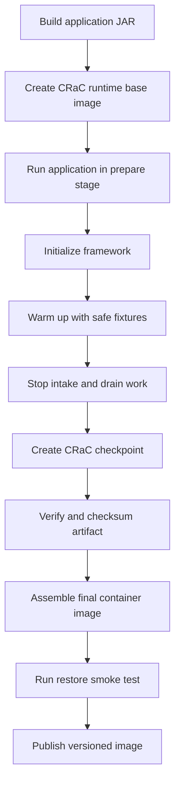

# Tạo ảnh checkpoint trong quy trình container build

CRaC có thể được đưa vào quy trình đóng gói container để ứng dụng Java được khởi tạo và warm-up trước khi image được phát hành. Thay vì để mỗi container mới phải thực hiện toàn bộ quá trình cold start, pipeline có thể chạy ứng dụng trong một môi trường build tương thích, tạo checkpoint từ trạng thái đã chuẩn bị, rồi đóng gói checkpoint cùng application image.

Khi container khởi chạy ở môi trường triển khai, runtime sử dụng checkpoint tương ứng để restore tiến trình. Cách làm này có thể giảm thời gian đưa instance vào phục vụ, đặc biệt với ứng dụng có chi phí khởi tạo framework hoặc warm-up lớn.

Điểm quan trọng là checkpoint được tạo từ một tiến trình cụ thể và phụ thuộc vào môi trường đã tạo nó. Container image chứa checkpoint phải giữ đúng application binary, JDK, native library, filesystem layout và các điều kiện runtime mà checkpoint cần. Vì vậy, pipeline cần quản lý **application image**, **checkpoint artifact** và **release metadata** như một bộ sản phẩm gắn kết với nhau.

## 1. Hai loại image trong quy trình CRaC

Trong container build, cần phân biệt filesystem image và trạng thái tiến trình:

| Thành phần | Nội dung | Mục đích |
|---|---|---|
| Application image | JDK có hỗ trợ CRaC, application JAR, thư viện, cấu hình mặc định và entrypoint | Cung cấp filesystem/runtime để chạy ứng dụng từ đầu hoặc restore |
| Checkpoint artifact | Snapshot trạng thái tiến trình và metadata cần cho restore | Khởi tạo tiến trình từ trạng thái đã warm-up |
| Release metadata | Phiên bản ứng dụng, digest image, JDK, OS, kiến trúc, checkpoint engine và checksum | Ghép đúng checkpoint với runtime image tương thích |

Checkpoint có thể được lưu trong một thư mục bên trong image, được copy từ build stage, hoặc được phân phối như artifact riêng rồi tải vào container khi khởi chạy. Cách đóng gói phụ thuộc kích thước checkpoint, nền tảng container và cách runtime restore tìm checkpoint.

Checkpoint không thay thế application JAR hoặc runtime. Một snapshot có thể tham chiếu tới file, thư viện native, đường dẫn, mount và resource của môi trường đã tạo nó. Nếu final image thiếu một thư viện hoặc đặt application ở đường dẫn khác, restore có thể thất bại dù checkpoint file đã được copy đầy đủ.

## 2. Quy trình tổng quát: build, warm-up, checkpoint, package

Một pipeline container có thể chia thành các bước:

1. Build application JAR và dependency đã khóa phiên bản.
2. Tạo runtime image từ CRaC-enabled JDK và OS base image đã chọn.
3. Chạy application image trong môi trường prepare có điều kiện tương thích với môi trường restore.
4. Chờ ứng dụng khởi tạo xong, sau đó chạy workload warm-up với dữ liệu tổng hợp và dependency kiểm soát được.
5. Ngừng nhận việc mới, drain request/task và chuẩn bị resource qua CRaC lifecycle.
6. Yêu cầu CRaC runtime tạo checkpoint.
7. Chờ checkpoint hoàn tất, xác minh các file được tạo và ghi metadata/checksum.
8. Đưa checkpoint vào final image hoặc lưu thành artifact gắn với digest của application image.
9. Kiểm thử restore từ chính artifact đã đóng gói.



Build stage và restore stage không bắt buộc phải chạy trên cùng máy. Tuy nhiên, môi trường tạo checkpoint phải tương thích với nhóm môi trường sẽ restore. Việc tách giai đoạn cũng không có nghĩa checkpoint có thể được chuyển tùy ý giữa các kernel, kiến trúc CPU hoặc CRaC runtime khác nhau.

## 3. Điều kiện của môi trường tạo checkpoint

Tạo checkpoint trong container build khác với chạy một lệnh build thông thường. CRaC runtime cần tương tác với trạng thái tiến trình và checkpoint engine của hệ điều hành. Tùy nền tảng, việc này có thể cần quyền, capability, namespace và kernel feature mà môi trường build sandbox mặc định không cấp.

Trước khi thiết kế Dockerfile, cần xác định:

- CRaC JDK distribution và build được sử dụng.
- Hệ điều hành, kernel và kiến trúc CPU của build runner.
- Checkpoint engine/CRIU và phiên bản tương thích.
- Container runtime và chế độ BuildKit đang chạy.
- Các capability/quyền cần thiết cho checkpoint process.
- Khả năng truy cập `/proc`, cgroup, namespace và filesystem cần thiết.
- Các hạn chế của seccomp, AppArmor/SELinux hoặc security profile.
- Đường dẫn checkpoint và quyền ghi trong build stage.

Không giả định một Dockerfile `RUN` có thể checkpoint process trên mọi builder. Một build sandbox thông thường thường bị giới hạn quyền và không tương đương một container runtime được cấu hình để checkpoint/restore. Nếu build runner không cung cấp đủ điều kiện, hãy tạo checkpoint trong một job prepare chuyên dụng hoặc một container chạy trên runner được cấu hình phù hợp, rồi đưa artifact đã xác minh vào bước đóng gói image.

### Quyền và bảo mật

Checkpoint engine có thể cần quyền tác động lên process, memory mapping, file descriptor và namespace. Tập quyền cụ thể phụ thuộc kernel, CRIU và cách runtime được triển khai. Không bật `privileged` hoặc cấp toàn bộ capability theo thói quen; xác định quyền tối thiểu từ tài liệu của nền tảng và thử trên runner riêng.

Nếu buộc phải dùng runner có quyền cao:

- Chạy trong runner cô lập, dùng một job cho một checkpoint attempt.
- Không mount Docker socket hoặc host filesystem rộng hơn mức cần thiết.
- Không đưa credential production vào môi trường prepare.
- Giới hạn quyền đọc artifact checkpoint sau khi tạo.
- Hủy môi trường prepare sau khi artifact được lưu và xác minh.
- Ghi lại quyền/capability thực tế để có thể tái lập pipeline.

## 4. Dùng multi-stage Docker build

Multi-stage build giúp tách phần tạo checkpoint khỏi final image. Một nguyên tắc quan trọng là **prepare stage và final stage phải dùng cùng runtime base hoặc các filesystem layer đã được chứng minh tương thích**.

Ví dụ cấu trúc Dockerfile minh họa:

```dockerfile
# Runtime base chứa CRaC-enabled JDK và các thư viện hệ thống cần thiết.
FROM registry.example.com/java-crac-runtime:25 AS runtime-base
WORKDIR /opt/app

COPY build/libs/orders-service.jar /opt/app/orders-service.jar
COPY docker/prepare-checkpoint.sh /opt/app/prepare-checkpoint.sh
RUN chmod 0755 /opt/app/prepare-checkpoint.sh

# Stage chạy ứng dụng, warm-up và tạo checkpoint.
FROM runtime-base AS checkpoint-build
RUN mkdir -p /opt/app/checkpoint

# Script phải khởi chạy ứng dụng, chờ readiness, warm-up,
# drain và gọi checkpoint command của đúng CRaC JDK.
RUN /opt/app/prepare-checkpoint.sh /opt/app/checkpoint

# Final image có filesystem runtime giống runtime-base.
FROM runtime-base AS final
COPY --from=checkpoint-build /opt/app/checkpoint /opt/app/checkpoint

ENV CRAC_CHECKPOINT_DIR=/opt/app/checkpoint
ENTRYPOINT ["/opt/app/start-container.sh"]
```

Đây là khung Dockerfile. `registry.example.com/java-crac-runtime:25`, script, đường dẫn checkpoint và lệnh CRaC là giá trị minh họa cần thay theo runtime thật. Không thể chạy nguyên ví dụ nếu chưa cung cấp các file script và image base tương ứng.

Điểm cần giữ nhất quán:

- `runtime-base` cung cấp cùng JDK, native library và đường dẫn filesystem cho prepare và final stage.
- Application JAR trong final image phải đúng binary đã được dùng để tạo checkpoint.
- Checkpoint directory phải được copy đầy đủ, giữ cấu trúc và metadata cần thiết.
- Entrypoint final phải khởi chạy runtime theo chế độ restore, không chạy lại startup command thông thường nếu checkpoint được chọn.
- Nếu ứng dụng cần file ngoài checkpoint để restore, những file đó phải tồn tại đúng đường dẫn trong final image hoặc được mount trước restore.

### Tại sao không dùng một base image khác ở final stage?

Nếu checkpoint được tạo trên một filesystem có JDK hoặc native library khác với final image, tiến trình restore có thể không tìm thấy đúng binary hoặc ABI. Ngay cả khi tag image trông giống nhau, tag có thể đã được cập nhật. Với pipeline nghiêm ngặt, dùng image digest để khóa runtime base.

Nếu final stage cần giảm kích thước, không tùy tiện chuyển checkpoint sang một JRE slim hoặc distroless image khác. Trước tiên phải chứng minh runtime và toàn bộ file cần cho restore tương thích. Có thể loại bỏ công cụ build không cần thiết bằng cách thiết kế runtime base ngay từ đầu, nhưng không được loại bỏ thư viện mà checkpoint process đang sử dụng.

## 5. Script prepare: khởi động, warm-up và checkpoint

Script trong build stage chịu trách nhiệm điều phối một tiến trình Java thực sự. Nó thường cần thực hiện các bước:

1. Nạp cấu hình prepare và endpoint dependency an toàn.
2. Khởi chạy application bằng CRaC JDK.
3. Chờ health/readiness của ứng dụng báo đã khởi tạo.
4. Gọi warm-up runner hoặc internal endpoint với fixture tổng hợp.
5. Chờ mọi async task phát sinh từ warm-up hoàn tất.
6. Đóng admission gate và dừng scheduler/consumer không cần thiết.
7. Chuẩn bị resource thông qua callback `beforeCheckpoint`.
8. Gọi lệnh checkpoint theo đúng tài liệu của JDK.
9. Xác nhận checkpoint hoàn tất và tiến trình/build step kết thúc theo semantics của runtime.

Ví dụ pseudocode shell để thể hiện thứ tự:

```sh
#!/bin/sh
set -eu

CHECKPOINT_DIR="$1"

# 1. Start application using the selected CRaC-enabled JDK.
# 2. Wait for its prepare-only readiness endpoint.
# 3. Run deterministic warm-up fixtures.
# 4. Wait for async warm-up work to finish.
# 5. Request checkpoint using the command supported by this JDK build.
# 6. Verify the checkpoint output exists and is complete.

mkdir -p "$CHECKPOINT_DIR"
/opt/app/bin/run-prepare-and-checkpoint \
  --checkpoint-dir "$CHECKPOINT_DIR"
```

`run-prepare-and-checkpoint` ở đây là wrapper do pipeline hoặc runtime cung cấp, không phải command chuẩn có sẵn trong mọi CRaC JDK. Cách gọi `jcmd`, JVM option hoặc checkpoint API thay đổi theo distribution/version và cách tích hợp. Hãy lấy đúng command từ tài liệu của JDK đang dùng.

### Ví dụ về lệnh CRaC

Một số CRaC JDK dựa trên OpenJDK cung cấp cơ chế yêu cầu checkpoint qua diagnostic command, chẳng hạn `jcmd <pid> JDK.checkpoint`, và restore qua JVM option như `-XX:CRaCRestoreFrom=<directory>`. Cú pháp, tên command, quyền attach và đường dẫn chính xác phải được xác nhận với build cụ thể. Không copy nguyên lệnh này sang vendor/runtime khác nếu tài liệu của họ quy định cách gọi khác.

Khi dùng lệnh diagnostic, process cần chạy với cùng user/permission phù hợp để attach. Nếu ứng dụng chạy dưới user không phải root, script tạo checkpoint cũng cần tuân theo user và quyền file của process. Tránh tạo checkpoint dưới root rồi chạy final container dưới user khác nếu quyền đọc/ghi và ownership không được thiết lập chính xác.

## 6. Đóng gói checkpoint trong final image

Sau khi checkpoint hoàn tất, pipeline cần đưa toàn bộ artifact vào final image hoặc kho artifact. Với cách copy vào image:

- Copy nguyên thư mục checkpoint; không chỉ copy một file có tên cố định.
- Giữ permission và cấu trúc thư mục theo yêu cầu runtime.
- Không thay đổi path nếu metadata checkpoint phụ thuộc vào path ban đầu.
- Không chạy thêm script sửa file trong checkpoint sau khi tạo.
- Đảm bảo checkpoint directory không bị ghi đè bởi volume rỗng khi container khởi chạy.
- Tạo checksum sau khi copy/đóng gói và lưu trong release manifest.

Nếu checkpoint được lưu trên volume bên ngoài, entrypoint cần xác minh volume đã mount và artifact đã tải đầy đủ trước khi gọi restore. Không để container khởi động restore khi checkpoint directory mới được mount nhưng còn trống.

### Checkpoint nằm trong image hay được tải khi runtime?

| Cách đóng gói | Ưu điểm | Hạn chế |
|---|---|---|
| Copy checkpoint vào final image | Một image digest chứa cả app và checkpoint; deployment đơn giản | Image lớn hơn; mỗi checkpoint update cần build/push image mới |
| Lưu checkpoint riêng và tải khi deploy | Có thể phân phối/retention độc lập; tái sử dụng application image | Cần ghép đúng version, tải/verify trước startup và quản lý cache artifact |
| Dùng volume/artifact mount | Có thể giảm duplication giữa nhiều container trên cùng host | Phụ thuộc storage, locality, quyền mount và lifecycle volume |

Với cách nào, manifest phải xác định chính xác checkpoint thuộc application image nào. Không chọn checkpoint theo tên tag không bất biến hoặc theo “latest” khi có nhiều release song song.

## 7. Entrypoint cho container restore

Final image cần có entrypoint hiểu container đang chạy ở chế độ restore. Có thể chọn giữa hai mô hình:

### Image chỉ chạy restore

Image chứa checkpoint và entrypoint luôn gọi runtime restore. Mô hình này đơn giản khi môi trường chỉ dùng image cho CRaC.

### Image hỗ trợ restore và cold start

Entrypoint kiểm tra biến cấu hình hoặc deployment mode để chọn restore hay startup bình thường. Cách này hữu ích khi cần fallback, nhưng phải tránh việc biến môi trường prepare bị lưu trong checkpoint và ghi đè cấu hình runtime.

Pseudocode entrypoint:

```sh
#!/bin/sh
set -eu

if [ "${USE_CRAC_RESTORE:-true}" = "true" ]; then
    test -d "$CRAC_CHECKPOINT_DIR"
    test -n "$(find "$CRAC_CHECKPOINT_DIR" -mindepth 1 -print -quit)"

    exec /opt/java/bin/java \
      -XX:CRaCRestoreFrom="$CRAC_CHECKPOINT_DIR"
fi

exec /opt/java/bin/java -jar /opt/app/orders-service.jar
```

Đây là pseudocode cho một kiểu runtime có option restore tương ứng. Đường dẫn Java, option và yêu cầu tham số ứng dụng phụ thuộc JDK. Trong một số integration, restore command được cung cấp bởi runtime launcher hoặc container platform, không phải entrypoint tự gọi `java` như trên.

Lệnh restore thường tiếp tục tiến trình từ checkpoint; không thêm `-jar` hoặc chạy lại main class trừ khi tài liệu runtime yêu cầu. Nếu restore option đã chỉ tới trạng thái process, hãy dùng đúng cách gọi mà runtime quy định.

### PID 1 và signal handling

Container entrypoint nên dùng `exec` để tiến trình Java trở thành PID 1 khi runtime yêu cầu. Nếu dùng shell wrapper không `exec`, signal dừng có thể chỉ tới shell và không tới JVM. Khi triển khai, cần xác minh signal, graceful shutdown và checkpoint/restore lifecycle tương tác đúng với container runtime.

Không để một supervisor khởi động thêm một JVM mới trong khi checkpoint process đã được restore. Mỗi container phải có một process ownership rõ ràng và một chính sách restart thống nhất.

## 8. Cấu hình prepare và runtime phải tách biệt

Build stage thường dùng endpoint thử nghiệm, dữ liệu fixture và credential hạn chế. Những giá trị này có thể nằm trong static field, singleton hoặc client object của checkpoint. Sau restore, ứng dụng phải nạp cấu hình đích và thay thế những dependency đó.

Các giá trị nên được cấp mới khi container chạy:

- Database URL, username/password hoặc token.
- Message broker endpoint và consumer group session.
- Service registry identity, lease và instance ID.
- Bind/advertise address và port.
- HTTP client endpoint, DNS và TLS certificate.
- Logging, metrics và tracing collector endpoint.
- Secret, feature flag và remote configuration.

Không nên đóng gói secret production trong image layer hoặc checkpoint. Dùng secret manager, workload identity hoặc cơ chế inject secret của nền tảng. Checkpoint có thể chứa dữ liệu nhạy cảm trong heap nên cần được mã hóa và giới hạn quyền đọc như artifact chứa secret.

### Dùng fixture warm-up an toàn

Warm-up cần chạy code path thật nhưng tránh side effect production:

- Dùng ID có namespace riêng cho warm-up.
- Dùng database/schema thử nghiệm hoặc fake repository tùy mục tiêu.
- Dùng stub payment, email, SMS và event sink.
- Không tiêu thụ message production.
- Không tạo session người dùng thật.
- Drain các tác vụ bất đồng bộ trước checkpoint.
- Xóa hoặc đánh dấu stale cache chỉ chứa fixture trước readiness production.

Nếu muốn warm-up JDBC/ORM, dùng database thử nghiệm có schema và dialect tương thích. Nếu chỉ muốn warm-up business logic, fake adapter có thể đủ. Hãy chọn theo mục tiêu đo lường.

## 9. File descriptor, mount và filesystem trong container

Checkpoint có thể lưu trạng thái liên quan tới file descriptor, mapping và đường dẫn. Final image và môi trường restore phải cung cấp các file/resource cần thiết.

Kiểm tra:

- Working directory và absolute path có giống stage tạo checkpoint không.
- Application JAR và native library có ở đúng path không.
- File cấu hình, truststore và certificate có tồn tại ở runtime không.
- Mount point được yêu cầu có được mount trước restore không.
- File permission, UID/GID và ownership có tương thích không.
- Temporary directory hoặc socket path có được tạo lại không.
- File descriptor phụ thuộc vào file/daemon bên ngoài đã được đóng hoặc tái tạo theo lifecycle chưa.

Không dựa vào một file nằm trong writable layer của build container nếu file đó không được copy sang final image. Ngược lại, không copy các file tạm hoặc dữ liệu fixture không cần thiết vào final image vì chúng có thể làm tăng kích thước và lộ dữ liệu.

Nếu ứng dụng dùng `mmap`, shared memory, Unix socket hoặc device handle, hãy xác minh khả năng restore trên đúng kernel/container runtime. Một path tồn tại trong final image không chứng minh descriptor cũ còn hợp lệ.

## 10. Tương thích kernel, architecture và container runtime

Checkpoint thường gắn chặt với môi trường hệ thống. Cần ghi nhận và kiểm soát ít nhất:

| Thành phần | Kiểm soát trong pipeline |
|---|---|
| CPU architecture | Không tạo checkpoint trên `amd64` rồi mặc định restore trên `arm64` |
| JDK distribution/build | Khóa vendor, version và build đã kiểm chứng |
| OS base image | Khóa digest và các native library cần thiết |
| Kernel/checkpoint engine | Dùng runner và host group nằm trong ma trận hỗ trợ |
| CRIU/runtime integration | Ghi version/build và tính năng được bật |
| Namespace/cgroup | Kiểm tra PID, mount, network và resource limits |
| Container security profile | Bảo đảm quyền cần thiết được cấp ở build và restore stage |
| Filesystem | Bảo toàn path, permission, mount và backing file |

Một image digest cố định không đủ để bảo đảm restore thành công nếu kernel host khác. Có thể dùng cùng application image trên nhiều host nhưng chỉ bật CRaC restore trên các node pool đã được kiểm chứng. Với host không tương thích, deployment cần dùng cold start hoặc route sang nhóm node hỗ trợ.

## 11. Kiểm tra checkpoint trước khi publish

Build thành công chỉ chứng minh Dockerfile tạo được image. Nó không chứng minh checkpoint có thể restore. Nên có một bước kiểm chứng sau khi assemble final image:

1. Chạy final image trong container runtime tương thích.
2. Xác minh checkpoint directory tồn tại, không rỗng và checksum khớp.
3. Khởi chạy container theo đúng restore entrypoint.
4. Chờ callback `afterRestore` và resource recreation hoàn tất.
5. Kiểm tra database, listener, service registration và telemetry.
6. Gửi request smoke test qua đường xử lý thật.
7. Xác nhận readiness chỉ thành công sau health check.
8. Kiểm tra log không còn endpoint hoặc credential của môi trường prepare.
9. Dừng container và xác nhận shutdown bình thường.

Restore smoke test nên chạy từ final image đã đóng gói, không chỉ từ build stage. Nếu build stage restore được nhưng final image không restore được, thường có khác biệt filesystem, permission, runtime hoặc entrypoint giữa hai stage.

## 12. Versioning, checksum và release manifest

Application image và checkpoint phải được phát hành theo một version bất biến. Manifest ví dụ:

```yaml
release:
  id: catalog-service-2026.11.13.1
  image: registry.example.com/catalog-service:2026.11.13.1
  imageDigest: sha256:APPLICATION_IMAGE_DIGEST
  commit: 3b7d9e10

checkpoint:
  path: /opt/app/checkpoint
  artifactDigest: sha256:CHECKPOINT_ARTIFACT_DIGEST
  createdAt: "2026-11-13T06:00:00Z"
  status: restore-tested

runtime:
  jdk: crac-enabled-jdk-build
  osImageDigest: sha256:OS_IMAGE_DIGEST
  architecture: linux-amd64
  kernelCompatibility: approved-linux-kernel-group
  checkpointEngine: tested-engine-version
```

Các giá trị là placeholder minh họa. Manifest thật phải lấy digest và version từ build output, không ghi thủ công giá trị giả. Checksum phát hiện artifact bị hỏng hoặc thay đổi; chữ ký giúp xác minh nguồn gốc artifact nếu pipeline hỗ trợ.

Không dùng tag `latest` để ghép checkpoint với application image. Dùng image digest hoặc release ID bất biến. Nếu checkpoint được lưu riêng, manifest phải chỉ rõ checkpoint nào được tạo từ image digest nào.

## 13. Tối ưu kích thước và thời gian build

Checkpoint có thể làm image tăng kích thước đáng kể vì chứa heap và native memory. Cần đo và tối ưu có chủ đích:

- Chỉ warm-up những code path có giá trị đối với latency sau restore.
- Tránh nạp fixture lớn hoặc dữ liệu không cần giữ trong heap.
- Xóa cache có thể tái tạo nếu chi phí restore cache lớn hơn lợi ích.
- Không giữ log buffer, response body hoặc object tạm sau warm-up.
- Dùng multi-stage build để không mang compiler, source tree hoặc tool không cần thiết vào final image.
- Nén artifact nếu quy trình restore cho phép và đo cả chi phí giải nén.
- Dùng cache build cho dependency và application layer, nhưng không tái sử dụng checkpoint cũ khi input/runtime đã thay đổi.
- Đo thời gian fetch, unpack, restore và resource recreation riêng biệt.

Không nên xóa object tùy tiện ngay trước checkpoint nếu chúng là trạng thái warm-up cần giữ. Hãy đo heap, checkpoint size và first-request latency để chọn dữ liệu giữ lại.

### Build cache và tính đúng đắn

Docker/BuildKit có thể cache layer dựa trên input của bước build. Một checkpoint step phụ thuộc vào nhiều yếu tố ngoài Dockerfile như kernel, CRIU, host capability, thời gian và dependency bên ngoài. Nếu build cache không phản ánh những yếu tố này, pipeline có thể tái sử dụng checkpoint được tạo trong môi trường khác.

Hãy version hóa checkpoint theo runtime/host compatibility metadata và chủ động vô hiệu hóa cache khi các input có ảnh hưởng thay đổi. Không coi việc một layer cache hit là bằng chứng checkpoint vẫn tương thích.

## 14. Lỗi thường gặp trong container build

### Build stage không đủ quyền checkpoint

Docker build chạy trong sandbox không có capability hoặc kernel feature cần thiết. Lệnh checkpoint thất bại dù ứng dụng chạy bình thường. Dùng runner/job prepare được cấu hình phù hợp hoặc tách checkpoint generation khỏi Docker build thông thường.

### Final stage dùng runtime base khác

Checkpoint được tạo với một JDK hoặc native library nhưng final image dùng base khác. Restore có thể lỗi do thiếu binary, ABI hoặc runtime metadata. Khóa digest runtime base và tái sử dụng cùng stage.

### Chỉ copy một phần checkpoint

Checkpoint có nhiều file nhưng Dockerfile chỉ copy một file hoặc copy khi engine chưa hoàn tất. Restore không thể tìm metadata/resource. Chờ hoàn tất và copy toàn bộ thư mục theo cấu trúc gốc.

### Sai ownership hoặc permission

Checkpoint được tạo bởi root nhưng container runtime chạy bằng non-root user. Process không đọc được artifact hoặc không truy cập file cần thiết. Đặt ownership/permission rõ ràng theo user runtime và yêu cầu bảo mật.

### Entrypoint chạy cold start thay vì restore

Image chứa checkpoint nhưng startup command vẫn chạy `java -jar`. Ứng dụng khởi động lại từ đầu, bỏ qua checkpoint. Kiểm tra entrypoint và log startup để xác nhận runtime thực sự đi vào restore path.

### Checkpoint chứa endpoint prepare

Client hoặc singleton giữ URL stub/database thử nghiệm. Sau restore, ứng dụng tiếp tục gọi môi trường prepare. Đọc lại runtime configuration và thay adapter/client trước khi readiness mở.

### Host deploy không tương thích

Image restore được trên build runner nhưng không được trên node production vì kernel, architecture, CRIU hoặc security profile khác. Dùng compatibility group và kiểm thử trên đúng node pool.

### Checkpoint được cache sai

Build system tái sử dụng layer checkpoint dù application JAR hoặc JDK đã đổi. Gắn checkpoint với image digest và runtime metadata, vô hiệu hóa cache khi các input thay đổi.

## 15. Rollback và fallback cold start

Không phải mọi lần restore đều thành công. Deployment cần giữ đường fallback:

1. Kiểm tra image/checkpoint digest trước khi khởi chạy.
2. Thử restore ở canary hoặc smoke-test stage.
3. Nếu restore thất bại, giữ container not ready và không đăng ký endpoint.
4. Theo policy, thử cold start từ application image tương ứng hoặc quay lại cặp image/checkpoint release trước.
5. Không ghép checkpoint release cũ với application JAR/runtime mới.
6. Ghi lại lỗi, host metadata và restore duration để điều tra.

Cold start phải được kiểm thử như một đường triển khai thực sự. Nếu toàn bộ node pool phụ thuộc vào checkpoint và artifact hỏng, hệ thống có thể không scale được. Có thể giữ một số replica cold-start hoặc một rollout mode fallback tùy yêu cầu availability.

## 16. Bảo mật checkpoint trong image registry

Checkpoint có thể chứa credential, token, session, dữ liệu request và các object nhạy cảm trong heap. Khi checkpoint được copy vào container image, những dữ liệu này trở thành một phần của layer image.

Điều đó có nghĩa:

- Xóa file secret ở layer sau không loại bỏ secret khỏi layer trước trong image history.
- Người có quyền pull image có thể có khả năng trích xuất checkpoint và dữ liệu bên trong.
- Retention của registry và cache builder có thể giữ checkpoint lâu hơn dự kiến.
- Image promotion giữa môi trường có thể vô tình mang credential của môi trường prepare.

Biện pháp:

- Không nạp secret production trong prepare stage.
- Dùng credential thử nghiệm tối thiểu và loại bỏ/rotate trước khi publish.
- Hạn chế quyền pull image chứa checkpoint.
- Mã hóa artifact hoặc dùng kho artifact có kiểm soát nếu nền tảng yêu cầu.
- Không ghi checkpoint vào public registry.
- Quản lý retention và xóa cache/layer theo chính sách.
- Quét image và artifact theo quy trình bảo mật của tổ chức.

Nếu checkpoint chứa dữ liệu không thể loại bỏ an toàn, cân nhắc lưu artifact riêng có access control chặt thay vì nhúng vào image phổ biến cho mọi môi trường.

## 17. Kiểm thử và quan sát pipeline

Nên đo cả giai đoạn create lẫn restore:

| Chỉ số | Giai đoạn | Ý nghĩa |
|---|---|---|
| Build application duration | Create | Chi phí build JAR/runtime image |
| Application warm-up duration | Create | Thời gian tạo trạng thái nóng |
| Checkpoint creation duration | Create | Chi phí tạo snapshot process |
| Checkpoint size | Create | Chi phí lưu trữ/phân phối |
| Artifact packaging/upload duration | Create | Nút thắt đóng gói và lưu trữ |
| Artifact download/verify duration | Restore | Chi phí chuẩn bị checkpoint trên node |
| Process restore duration | Restore | Thời gian runtime khôi phục process |
| Resource recreation duration | Restore | Chi phí database/network/telemetry |
| Time to readiness | Restore | Thời gian instance thực sự nhận traffic |
| Restore success/fallback rate | Cả hai | Độ tin cậy theo release và node pool |

Kịch bản kiểm thử tối thiểu:

1. Build image và checkpoint trên runner dự kiến.
2. Restore final image trên cùng loại host đã được hỗ trợ.
3. Restore trên các host khác trong compatibility group.
4. Thử image/checkpoint digest không khớp và xác nhận deployment từ chối.
5. Thử thiếu checkpoint file hoặc sai permission.
6. Thử dependency không sẵn sàng sau restore và xác nhận readiness chưa mở.
7. Thử cold-start fallback.
8. Restore nhiều replica và xác nhận mỗi replica có instance ID, lease và endpoint riêng.
9. Đo first-request latency so với cold start.

## 18. Checklist cho container checkpoint build

### Build/prepare stage

- [ ] Đã khóa application JAR, dependency, CRaC JDK và OS base image.
- [ ] Build runner có kernel/checkpoint engine và quyền cần thiết.
- [ ] Warm-up chạy với fixture tổng hợp và dependency an toàn.
- [ ] Warm-up task và request đã drain trước checkpoint.
- [ ] CRaC command đúng với distribution/version đang dùng.
- [ ] Checkpoint engine hoàn tất trước khi artifact được copy.
- [ ] Checkpoint directory được kiểm tra và checksum được tạo.
- [ ] Manifest ghi lại image digest, JDK, OS, architecture và engine.

### Final image/restore stage

- [ ] Final image dùng runtime filesystem tương thích với stage tạo checkpoint.
- [ ] Copy đầy đủ checkpoint và giữ cấu trúc/permission.
- [ ] Entrypoint thực sự gọi restore path theo đúng runtime.
- [ ] Runtime config, secret và instance identity được cấp theo môi trường đích.
- [ ] Mount, path và network được chuẩn bị trước restore.
- [ ] Resource được tái tạo và health check thành công trước readiness.
- [ ] Restore smoke test chạy từ final image.
- [ ] Có fallback cold start và rollback release.
- [ ] Image/checkpoint được bảo vệ như artifact có thể chứa secret.

## 19. Kết luận

Tạo ảnh checkpoint trong quy trình container build là cách chuẩn bị trạng thái JVM một lần cho một release rồi đóng gói cùng application image. Pipeline cần chạy ứng dụng trong môi trường CRaC tương thích, warm-up bằng dữ liệu an toàn, drain công việc, tạo checkpoint và lưu artifact theo version bất biến. Final image phải giữ đúng runtime/filesystem mà checkpoint cần và có entrypoint restore phù hợp.

Không phải mọi Docker build sandbox đều có đủ quyền hoặc kernel feature để tạo checkpoint. Nếu build stage bị giới hạn, hãy dùng một runner prepare chuyên dụng rồi đưa artifact đã kiểm chứng vào bước đóng gói. Khi triển khai, xác minh image/checkpoint pairing, cấp cấu hình và identity riêng, phục hồi resource, kiểm tra readiness và giữ fallback cold start. Bằng cách đó, checkpoint trở thành một phần có thể kiểm soát của container release thay vì một file snapshot được copy vào image mà không có bảo đảm tương thích.
