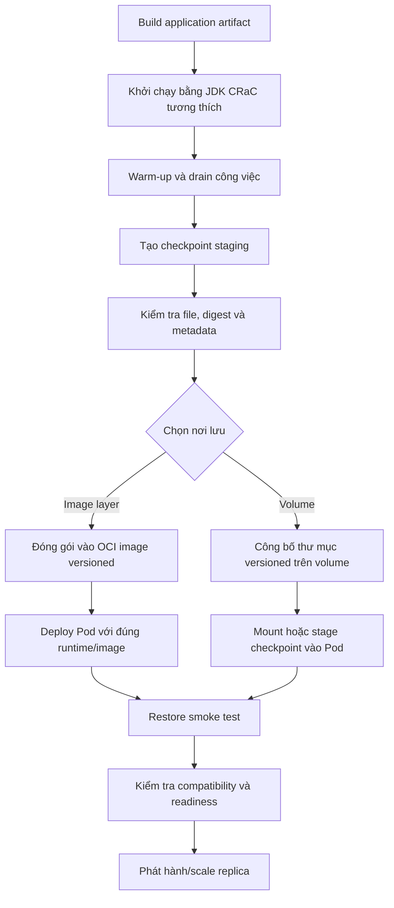

# Bố trí checkpoint trong image layer hoặc volume

Khi triển khai Java CRaC trong container, checkpoint phải được đặt ở một vị trí mà tiến trình restore có thể truy cập với đúng quyền và đúng môi trường runtime. Hai cách bố trí thường gặp là đóng gói checkpoint vào một **OCI/Docker image layer** hoặc lưu checkpoint trên một **volume** được mount vào container.

Hai cách này giải quyết những nhu cầu khác nhau. Image layer phù hợp với checkpoint được tạo trước, gắn với một phiên bản ứng dụng và phát hành như artifact bất biến. Volume phù hợp khi checkpoint được tạo trong lúc vận hành, cần tồn tại qua việc thay container/Pod hoặc cần được quản lý độc lập với application image.

Trước khi lựa chọn, cần phân biệt hai khái niệm: **CRaC checkpoint** là trạng thái tiến trình Java do JDK/runtime CRaC tạo; **image layer** là lớp filesystem của OCI/Docker image chứa các file checkpoint đó. Việc đặt file CRaC vào một image layer không biến nó thành một tính năng checkpoint của container runtime. Checkpoint toàn bộ container bằng CRIU hoặc tính năng của container runtime là cơ chế khác, có phạm vi và yêu cầu riêng.

## 1. Checkpoint là artifact trên filesystem

Với CRaC, ứng dụng có thể yêu cầu runtime tạo checkpoint sau khi đã khởi tạo và warm-up. Tùy JDK distribution và công cụ triển khai, checkpoint thường được lưu thành một thư mục chứa nhiều file trạng thái tiến trình và metadata liên quan. Runtime cần đọc đúng các file này khi restore.

Ví dụ về luồng khái niệm:

```text
Khởi chạy JVM có hỗ trợ CRaC
        |
        v
Khởi tạo ứng dụng và warm-up
        |
        v
Chuẩn bị/đóng các resource cần xử lý
        |
        v
Tạo checkpoint vào một thư mục
        |
        v
Đóng gói thư mục checkpoint vào image layer
hoặc lưu thư mục trên volume
        |
        v
Container mới mount/nhận checkpoint
        |
        v
JVM restore từ đường dẫn checkpoint
```

Đường dẫn checkpoint phải khớp với cách runtime được cấu hình để restore. Ví dụ minh họa dưới đây dùng option thường gặp ở một số bản CRaC JDK:

```bash
# Khi tạo checkpoint
java -XX:CRaCCheckpointTo=/opt/app/checkpoint -jar /opt/app/app.jar

# Khi restore
java -XX:CRaCRestoreFrom=/opt/app/checkpoint
```

Tên option, công cụ yêu cầu checkpoint và điều kiện chạy phụ thuộc bản phân phối JDK CRaC. Hãy dùng tài liệu đúng phiên bản đang triển khai. Đừng giả định mọi JDK có CRaC đều dùng cùng một cú pháp hoặc mọi checkpoint có thể restore bằng bất kỳ runtime nào.

Checkpoint không chỉ là một file JAR hoặc file cấu hình. Nó đại diện cho trạng thái của tiến trình đã được khởi tạo, có thể bao gồm heap, thread state và những phần trạng thái runtime/hệ điều hành được cơ chế hỗ trợ. Vì vậy, phải quản lý checkpoint cùng phiên bản ứng dụng, JDK, hệ điều hành, kiến trúc và điều kiện tương thích liên quan.

## 2. Bố trí checkpoint trong OCI/Docker image layer

Với cách này, thư mục checkpoint được đưa vào một layer của container image. Khi image được pull về node, checkpoint đi cùng image và có sẵn tại đường dẫn đã định nghĩa trong container.

Ví dụ cấu trúc filesystem:

```text
/opt/app/
├── app.jar
└── checkpoint/
    ├── ... checkpoint metadata/files ...
    └── ... runtime state files ...
```

Image layer phù hợp khi pipeline tạo checkpoint trước lúc phát hành và mỗi release có checkpoint riêng. Image được gắn tag/digest bất biến; Pod mới chỉ cần pull đúng image rồi restore từ đường dẫn bên trong image.

### Ví dụ Dockerfile đóng gói checkpoint có sẵn

Giả sử pipeline đã tạo checkpoint trong thư mục `build/checkpoint/` bằng đúng JDK/runtime và artifact sẽ phát hành. Dockerfile có thể copy thư mục đó vào image:

```dockerfile
FROM eclipse-temurin:21-jre

WORKDIR /opt/app

COPY --chown=10001:10001 build/app.jar /opt/app/app.jar
COPY --chown=10001:10001 build/checkpoint/ /opt/app/checkpoint/

USER 10001:10001

ENTRYPOINT ["java", "-XX:CRaCRestoreFrom=/opt/app/checkpoint"]
```

Đây là ví dụ minh họa; cần thay base image bằng JDK CRaC distribution tương thích và dùng đúng option restore của bản JDK đó. Đường dẫn, user/group và entrypoint cũng phải khớp pipeline thực tế. Nếu checkpoint cần thêm file runtime hoặc thư viện hệ thống, chúng phải có mặt trong image theo đúng phiên bản đã dùng lúc tạo checkpoint.

Không nên tạo checkpoint từ một JDK rồi đóng gói vào image dùng JDK khác chỉ vì cả hai cùng có số phiên bản Java major. Hãy khóa chính xác vendor/build/runtime và kiểm tra điều kiện tương thích của CRaC.

### Tạo checkpoint trước, đóng gói sau

Một pipeline thường tách bước tạo checkpoint và bước đóng gói image:

1. Build JAR và dependency lock từ source commit cụ thể.
2. Tạo runtime image hoặc môi trường builder với đúng JDK CRaC, OS user space và cấu hình JVM.
3. Khởi chạy ứng dụng, nạp cấu hình startup và warm-up theo manifest.
4. Chờ request/future/job warm-up hoàn tất; chuẩn bị resource theo CRaC lifecycle.
5. Tạo checkpoint vào một thư mục staging.
6. Kiểm tra checkpoint tạo xong và thu thập metadata/digest.
7. Copy checkpoint vào image layer của release tương ứng.
8. Restore smoke test từ chính image vừa build.
9. Publish image theo tag và digest bất biến.

Tách bước này giúp artifact có nguồn gốc rõ ràng: checkpoint được tạo từ build nào, runtime nào và warm-up manifest nào. Không nên build lại JAR hoặc thay dependency sau khi tạo checkpoint rồi vẫn giữ nguyên nhãn checkpoint cũ.

### Đặt checkpoint trong layer riêng

Nếu checkpoint có kích thước lớn, có thể tổ chức Dockerfile hoặc quy trình đóng gói sao cho layer chứa checkpoint được tách biệt với layer ứng dụng và runtime. Khi checkpoint thay đổi, registry có thể tái sử dụng các layer nền không đổi, tùy cách build và cache.

Ví dụ bố cục layer về mặt ý tưởng:

```text
Layer 1: base OS/runtime libraries
Layer 2: JDK CRaC distribution
Layer 3: application artifact and static resources
Layer 4: checkpoint files for this release
Layer 5: entrypoint and release metadata
```

Thứ tự thực tế cần tối ưu theo cách build image. Các layer phía trước có thể được chia sẻ giữa nhiều image nếu nội dung giống nhau. Layer checkpoint thường thay đổi theo release nên đặt riêng giúp giảm việc rebuild hoặc truyền lại các layer không đổi. Tuy nhiên, nếu layer sau đó phụ thuộc nội dung checkpoint hoặc build tool làm thay đổi các layer trước, lợi ích cache có thể giảm.

### Ưu điểm của image layer

- Checkpoint được phát hành cùng application/runtime image và có thể được xác định bằng image digest.
- Pod mới có thể restore mà không cần tải checkpoint từ một dịch vụ riêng trong lúc khởi động.
- Nội dung image layer có tính bất biến; nhiều Pod có thể đọc cùng một checkpoint artifact.
- Registry và node image cache có thể tái sử dụng layer nền.
- Dễ gắn checkpoint với một release và rollback theo cặp application/checkpoint image.

### Hạn chế của image layer

- Checkpoint có thể rất lớn, làm tăng dung lượng image, thời gian push/pull và dung lượng registry.
- Mỗi checkpoint mới có thể tạo layer lớn mới, tăng chi phí lưu trữ dù layer cũ được chia sẻ.
- Thay checkpoint thường đồng nghĩa phát hành image mới và cập nhật deployment.
- Layer của container image về bản chất là filesystem bất biến; không phù hợp để ghi checkpoint runtime mới vào đó.
- Checkpoint có thể bị gắn với kernel, CPU architecture, JDK build hoặc môi trường cụ thể, nên việc phát hành image không tự bảo đảm portability.

Image layer là lựa chọn phù hợp cho checkpoint được chuẩn bị trước và phát hành như một phần của release. Không nên dùng writable container layer như kho lưu checkpoint lâu dài: lớp ghi của container thường mất khi container bị thay thế.

## 3. Bố trí checkpoint trên volume

Với cách này, checkpoint nằm ngoài image filesystem và được mount vào container tại một đường dẫn, ví dụ `/var/lib/app/checkpoints`. Container image chỉ chứa ứng dụng và runtime; checkpoint được cung cấp qua volume hoặc được copy vào volume khi triển khai.

Volume hữu ích khi:

- Checkpoint được tạo trong lúc chạy và cần lưu lại sau khi container kết thúc.
- Checkpoint lớn, muốn quản lý/lưu trữ độc lập với application image.
- Nhiều Pod cần truy cập cùng một checkpoint artifact bất biến.
- Cần thay checkpoint mà không rebuild toàn bộ application image.
- Muốn giữ checkpoint theo release trên PVC hoặc storage service có vòng đời riêng.

Ví dụ layout:

```text
Container filesystem             Mounted volume
--------------------             -----------------------------
/opt/app/app.jar                 /var/lib/app/checkpoints/
/opt/app/bin/entrypoint.sh          orders-2.1.0-build1842/
                                    orders-2.2.0-build1901/
```

Entry point có thể chọn thư mục checkpoint theo release metadata hoặc biến cấu hình được quản lý. Tránh dùng một thư mục `latest` có thể bị ghi đè trong khi Pod khác đang restore từ đó.

### Docker Compose: mount thư mục checkpoint

```yaml
services:
  orders:
    image: registry.example.com/orders-service:2.1.0
    volumes:
      - type: volume
        source: orders-checkpoints
        target: /var/lib/app/checkpoints
        read_only: true
    environment:
      CRAC_CHECKPOINT_DIR: /var/lib/app/checkpoints/orders-2.1.0-build1842

volumes:
  orders-checkpoints:
    external: true
```

Đây là cấu hình minh họa. Volume phải được tạo và nạp checkpoint trước khi service chạy. Mount `read_only` phù hợp nếu runtime chỉ đọc checkpoint và không cần ghi metadata/working file vào cùng thư mục; nếu runtime yêu cầu ghi, hãy dùng thư mục làm việc riêng có quyền ghi hoặc mount phù hợp theo tài liệu JDK.

Không nên để nhiều phiên bản ứng dụng cùng ghi vào một thư mục checkpoint. Mỗi release nên có đường dẫn riêng và chỉ chuyển tham chiếu sau khi checkpoint mới được tạo, kiểm tra và công bố hoàn chỉnh.

## 4. Lựa chọn loại volume trong Kubernetes

Kubernetes cung cấp nhiều cách mount dữ liệu vào Pod. Chúng có semantics và vòng đời khác nhau.

| Loại volume | Vòng đời | Phù hợp với checkpoint? | Lưu ý |
|---|---|---|---|
| `emptyDir` | Tồn tại trong vòng đời Pod; dữ liệu mất khi Pod bị xóa | Phù hợp làm thư mục staging/copy checkpoint cho một Pod | Có thể dùng để giải nén/copy checkpoint từ artifact store; không phải nơi lưu bền vững qua Pod replacement |
| PVC | Gắn với PersistentVolume theo storage class và reclaim policy | Phù hợp lưu checkpoint cần tồn tại qua Pod replacement | Phụ thuộc access mode, CSI driver, performance và topology |
| `hostPath` | Gắn với filesystem của node | Chỉ phù hợp trong môi trường node-local được kiểm soát | Pod chuyển node có thể không thấy dữ liệu; tăng rủi ro bảo mật và vận hành |
| `configMap`/`secret` | Dữ liệu cấu hình được Kubernetes quản lý | Không phù hợp cho checkpoint lớn | Dùng cho config/credential, không dùng làm kho trạng thái tiến trình |
| Object storage qua init container | Dữ liệu nằm ngoài cluster, được tải về khi Pod khởi tạo | Phù hợp phân phối checkpoint lớn theo version | Cần xác minh digest, quyền truy cập và đủ dung lượng local staging |

### `emptyDir`

`emptyDir` hữu ích khi checkpoint được lưu trong OCI image hoặc object storage nhưng mỗi Pod cần một bản copy riêng để restore. Init container có thể copy checkpoint vào `emptyDir`, sau đó container ứng dụng restore từ đó.

`emptyDir` vẫn tồn tại khi một container trong Pod restart, nhưng bị xóa khi Pod bị xóa khỏi node. Vì vậy, nếu cần giữ checkpoint do ứng dụng tạo sau khi Pod bị thay thế, `emptyDir` không đủ. Nó phù hợp cho staging, cache hoặc bản sao dùng riêng của Pod.

### PersistentVolumeClaim

PVC phù hợp khi checkpoint được tạo trong runtime và phải tồn tại qua việc Pod được thay thế. Tuy nhiên, cần kiểm tra access mode của storage class:

- `ReadWriteOnce` thường cho phép mount read-write từ một node; nhiều Pod trên cùng node có thể có hành vi phụ thuộc CSI driver và cách mount.
- `ReadOnlyMany` cho phép nhiều node mount read-only nếu storage backend hỗ trợ.
- `ReadWriteMany` cho phép nhiều node mount read-write nếu backend hỗ trợ.
- `ReadWriteOncePod` giới hạn mount read-write cho một Pod theo hỗ trợ của Kubernetes/CSI.

Không giả định mọi storage class đều hỗ trợ mọi access mode. Với checkpoint artifact bất biến được nhiều replica đọc, ưu tiên mô hình read-only/shared nếu backend hỗ trợ. Nếu mỗi Pod cần ghi hoặc biến đổi dữ liệu sau restore, hãy cấp working directory riêng cho từng Pod thay vì để nhiều replica cùng ghi vào một checkpoint directory.

### `hostPath`

`hostPath` có thể cho hiệu năng tốt khi checkpoint nằm trên NVMe/local disk của node, nhưng dữ liệu gắn với node đó. Nếu scheduler chuyển Pod sang node khác, đường dẫn có thể không tồn tại hoặc chứa checkpoint khác. Dùng `hostPath` cần node affinity/selector, quản lý dung lượng, quyền filesystem và chính sách bảo mật rõ ràng. Không nên dùng nó như giải pháp lưu trữ portable cho cluster.

## 5. Ví dụ Kubernetes mount checkpoint từ PVC

Ví dụ sau mount một PVC vào Pod để đọc checkpoint theo release:

```yaml
apiVersion: v1
kind: PersistentVolumeClaim
metadata:
  name: orders-checkpoint-2-1-0
spec:
  accessModes:
    - ReadOnlyMany
  resources:
    requests:
      storage: 8Gi
  storageClassName: shared-checkpoint-storage
---
apiVersion: apps/v1
kind: Deployment
metadata:
  name: orders-service
spec:
  replicas: 3
  selector:
    matchLabels:
      app: orders-service
  template:
    metadata:
      labels:
        app: orders-service
    spec:
      containers:
        - name: orders
          image: registry.example.com/orders-service:2.1.0
          env:
            - name: CRAC_CHECKPOINT_DIR
              value: /var/lib/app/checkpoints/orders-2.1.0-build1842
          volumeMounts:
            - name: checkpoint
              mountPath: /var/lib/app/checkpoints
              readOnly: true
      volumes:
        - name: checkpoint
          persistentVolumeClaim:
            claimName: orders-checkpoint-2-1-0
```

Manifest này minh họa cấu trúc, không phải cấu hình áp dụng cho mọi cluster. `ReadOnlyMany` chỉ dùng được nếu storage class/CSI backend hỗ trợ. Một số môi trường có thể cần `ReadWriteMany`, object storage hoặc init container copy checkpoint về `emptyDir`. Cũng cần kiểm tra kích thước checkpoint thực tế, dung lượng PVC, filesystem semantics và thời gian mount.

Nếu runtime chỉ cần đọc checkpoint, mount read-only giúp ngăn Pod vô tình sửa artifact dùng chung. Nếu runtime cần ghi vào thư mục restore hoặc tạo file phụ, hãy tách checkpoint nguồn read-only khỏi working directory read-write. Không tự đổi mount thành read-write dùng chung nếu chưa xác định các file nào có thể bị sửa.

## 6. Init container copy checkpoint vào `emptyDir`

Một mô hình hữu ích là lưu checkpoint ở một vị trí phân phối bất biến rồi copy vào `emptyDir` riêng của từng Pod. Nguồn có thể là PVC read-only hoặc một image/artifact chuyên chứa checkpoint. Init container xác minh checksum và copy dữ liệu trước khi container ứng dụng bắt đầu.

```yaml
apiVersion: v1
kind: Pod
metadata:
  name: orders-restore-example
spec:
  initContainers:
    - name: stage-checkpoint
      image: registry.example.com/checkpoint-tools:1.0
      command:
        - sh
        - -c
        - |
          set -eu
          cp -a /checkpoint-source/orders-2.1.0-build1842/. /checkpoint-work/
          sha256sum -c /checkpoint-source/orders-2.1.0-build1842/SHA256SUMS
      volumeMounts:
        - name: checkpoint-source
          mountPath: /checkpoint-source
          readOnly: true
        - name: checkpoint-work
          mountPath: /checkpoint-work
  containers:
    - name: orders
      image: registry.example.com/orders-service:2.1.0
      env:
        - name: CRAC_CHECKPOINT_DIR
          value: /checkpoint-work
      volumeMounts:
        - name: checkpoint-work
          mountPath: /checkpoint-work
  volumes:
    - name: checkpoint-source
      persistentVolumeClaim:
        claimName: orders-checkpoint-source
    - name: checkpoint-work
      emptyDir:
        sizeLimit: 10Gi
```

Đây là mẫu minh họa. Init container phải có công cụ checksum phù hợp và file checksum phải được tạo từ pipeline phát hành, không được tạo lại ngay từ nguồn chưa xác minh. Đường dẫn trong ví dụ cần khớp chính xác với layout checkpoint. Nếu runtime yêu cầu các file metadata hoặc permission đặc biệt, phải bảo toàn chúng khi copy; kiểm tra hành vi của `cp -a` hoặc dùng công cụ copy phù hợp.

Mô hình này có các lợi ích:

- Mỗi Pod có một bản checkpoint riêng để restore.
- Nguồn checkpoint có thể được mount read-only.
- Pod có thể dùng thư mục làm việc riêng nếu runtime cần ghi file phụ.
- Việc copy và kiểm tra digest hoàn tất trước khi ứng dụng khởi động.

Đổi lại, thời gian init và dung lượng local disk tăng theo kích thước checkpoint. Nếu checkpoint lớn, cần đo thời gian copy và cân nhắc cache trên node hoặc phân phối qua image layer.

## 7. Volume cần được chuẩn bị nguyên vẹn trước khi restore

Một checkpoint được copy hoặc ghi dở có thể khiến restore thất bại hoặc tạo lỗi khó chẩn đoán. Không nên cho Pod restore từ một thư mục đang được pipeline ghi.

Một cách công bố checkpoint an toàn:

1. Tạo checkpoint trong thư mục staging có version riêng.
2. Chờ lệnh checkpoint hoàn tất và xác nhận tiến trình/ công cụ báo thành công.
3. Xác minh đầy đủ file, kích thước, permission và metadata cần thiết.
4. Tính digest/checksum để kiểm tra tính toàn vẹn.
5. Ghi manifest chứa application build, JDK/CRaC build, architecture, kernel compatibility, checkpoint ID và checksum.
6. Ghi marker `READY` sau cùng khi mọi bước hoàn tất.
7. Công bố đường dẫn versioned bất biến cho deployment.
8. Chỉ cập nhật Pod template sang version mới sau khi artifact đã sẵn sàng.

Ví dụ layout trên volume:

```text
/var/lib/app/checkpoints/
├── orders-2.0.0-build1800/
│   ├── checkpoint-files...
│   ├── manifest.yml
│   └── READY
└── orders-2.1.0-build1842/
    ├── checkpoint-files...
    ├── manifest.yml
    └── READY
```

Có thể tạo thư mục staging trên cùng filesystem rồi đổi tên thành thư mục versioned sau khi hoàn tất. Rename trong cùng filesystem thường giúp công bố thư mục nguyên tử ở mức directory entry, nhưng cần xác minh semantics của filesystem/CSI. Nếu ghi trên network filesystem hoặc object storage, không giả định rename và consistency có cùng hành vi như local POSIX filesystem.

Không dùng một thư mục `current` bị ghi đè trực tiếp trong khi Pod đang đọc. Nếu cần alias `current`, hãy cập nhật nó sau khi checkpoint versioned đã hoàn chỉnh và dùng cơ chế đồng bộ để Pod chỉ resolve alias một lần khi bắt đầu restore.

## 8. Quyền truy cập và ownership của file

Container thường chạy dưới non-root user. Nếu checkpoint được tạo bởi user khác, Pod có thể không đọc được file hoặc không thể tạo file tạm cần thiết khi restore.

Hãy kiểm tra:

- UID/GID của user chạy JVM.
- Owner/group và mode của thư mục checkpoint cùng mọi file bên trong.
- `runAsUser`, `runAsGroup` và `fsGroup` trong Pod security context.
- Storage driver có hỗ trợ thay đổi ownership hoặc mount option cần thiết không.
- SELinux/AppArmor hoặc chính sách bảo mật node có chặn truy cập không.
- Volume read-only có phù hợp với yêu cầu thực tế của runtime không.

Ví dụ security context:

```yaml
spec:
  securityContext:
    runAsNonRoot: true
    runAsUser: 10001
    runAsGroup: 10001
    fsGroup: 10001
```

`fsGroup` có thể giúp cấp quyền nhóm trên volume, nhưng hành vi phụ thuộc volume type và CSI driver. Không nên chạy container bằng root chỉ để né lỗi permission. Hãy chuẩn hóa owner/mode trong pipeline hoặc cấu hình storage phù hợp.

Checkpoint có thể chứa dữ liệu nhạy cảm đang nằm trong heap như token, password, private key hoặc dữ liệu người dùng. Hãy giới hạn quyền đọc checkpoint, mã hóa storage/backup theo chính sách, bảo vệ registry và không cho phép mọi workload trong cluster mount volume đó.

## 9. Đường dẫn mount phải nhất quán giữa tạo và restore

Một checkpoint có thể chứa trạng thái file descriptor hoặc thông tin runtime liên quan đến đường dẫn. Tùy cơ chế và thư viện, ứng dụng có thể còn giữ các path tuyệt đối đã mở hoặc các resource cần xuất hiện ở cùng vị trí khi restore.

Do đó:

- Chọn một đường dẫn checkpoint ổn định, chẳng hạn `/opt/app/checkpoint` hoặc `/var/lib/app/checkpoint`.
- Dùng cùng đường dẫn logic trong môi trường tạo checkpoint và môi trường restore khi runtime yêu cầu.
- Nếu volume mount vào đường dẫn khác, kiểm tra các resource/file path đã được lưu trong tiến trình.
- Không đổi tên hoặc di chuyển file bên trong checkpoint sau khi tạo.
- Đảm bảo thư viện native, config file và mount point mà tiến trình phụ thuộc vẫn có mặt.

Đường dẫn checkpoint truyền cho JVM và đường dẫn của các tài nguyên ứng dụng là hai thứ cần xem xét riêng. Việc mount đúng thư mục checkpoint không tự bảo đảm mọi file bên ngoài mà ứng dụng đang giữ tham chiếu cũng được mount đúng.

## 10. Storage performance và thời gian restore

Checkpoint có thể chứa lượng dữ liệu lớn. Restore phải đọc các file trạng thái và thiết lập tiến trình theo cơ chế của runtime. Vị trí lưu trữ ảnh hưởng trực tiếp đến thời gian đọc, độ trễ I/O và khả năng nhiều Pod cùng restore.

### Image layer

Khi image đã được pull và layer nằm trong node cache, đọc checkpoint có thể tận dụng local image storage. Nhưng nếu node chưa có image, thời gian pull checkpoint layer lớn có thể chiếm phần đáng kể của startup. Nhiều Pod scale-out cùng lúc có thể làm registry hoặc network bị tải cao.

### Persistent/network volume

Volume dùng network storage giúp chia sẻ checkpoint giữa node, nhưng throughput, IOPS, latency và giới hạn mount có thể ảnh hưởng restore. Nhiều Pod đọc cùng một checkpoint lớn có thể tạo read burst lên storage backend. Một số CSI driver cần thời gian attach/mount trước khi container khởi động.

### Local SSD hoặc node cache

Local SSD có thể giảm thời gian đọc, nhưng dữ liệu thường gắn với node và cần chính sách cache/eviction. Nếu Pod được schedule sang node khác, checkpoint phải được phân phối lại hoặc node phải có bản cache phù hợp.

Hãy đo:

- Kích thước checkpoint thực tế.
- Thời gian pull image hoặc attach/mount volume.
- Thời gian copy checkpoint vào working directory.
- Throughput/IOPS và latency khi restore.
- Thời gian từ Pod scheduling đến restore complete và readiness.
- Hành vi khi nhiều replica restore đồng thời.

Không chỉ đo thời gian lệnh restore. Tổng thời gian sẵn sàng còn gồm scheduling, image pull, volume mount, init container, copy/verify checkpoint, reconnect dependency và readiness check.

## 11. Nhiều replica dùng chung một checkpoint

Một checkpoint bất biến có thể làm nguồn cho nhiều replica nếu runtime và môi trường hỗ trợ cùng điều kiện restore. Tuy nhiên, cần phân biệt **nguồn checkpoint** với **trạng thái writable của từng replica**.

Mô hình thường phù hợp:

- Một checkpoint versioned được phát hành ở image layer, PVC read-only hoặc object storage.
- Mỗi Pod restore từ nguồn đó.
- Mỗi Pod có working directory hoặc volume riêng nếu runtime cần ghi file phụ.
- Mỗi Pod tạo identity, connection, lease và subscription riêng sau restore.
- Không để các replica cùng sửa một thư mục checkpoint gốc.

Nếu storage chỉ hỗ trợ một writer, không thể mount read-write cùng một PVC cho nhiều Pod trên các node khác nhau. Nếu dùng shared filesystem, phải xác minh semantics concurrent read và file locking của backend. Một số runtime có thể sửa hoặc tạo file trong thư mục restore; nếu vậy, hãy copy checkpoint vào `emptyDir`/local scratch riêng cho từng Pod.

Checkpoint giống nhau không có nghĩa các bản restore được phép chia sẻ một instance ID, lease, lock, transaction ID hoặc trạng thái consumer độc quyền. Những trạng thái đó phải được cấp lại hoặc điều phối sau restore.

## 12. Phân biệt checkpoint nguồn và dữ liệu runtime được tạo sau restore

Không nên ghi dữ liệu hoạt động của Pod trở lại thư mục checkpoint nguồn. Sau restore, ứng dụng có thể tạo log, cache, file tạm, pid file, socket path hoặc metadata runtime. Các dữ liệu này có vòng đời khác checkpoint ban đầu.

Một layout rõ ràng có thể là:

```text
/opt/app/checkpoint-source/   # checkpoint bất biến, chỉ đọc
/var/lib/app/runtime/         # dữ liệu runtime của Pod
/var/log/app/                 # log, tốt nhất chuyển ra stdout/stderr
/tmp/app/                     # file tạm có thể tạo lại
```

Tách thư mục giúp tránh ghi đè checkpoint nguồn và dễ dọn dữ liệu theo vòng đời. Với `readOnlyRootFilesystem: true`, hãy mount volume riêng cho những đường dẫn runtime cần ghi. Không nên nới quyền ghi trên toàn bộ container filesystem chỉ vì một thư viện cần thư mục tạm.

## 13. Lưu checkpoint được tạo trong lúc Pod đang chạy

Nếu ứng dụng tạo checkpoint khi đang vận hành, đường dẫn đích cần nằm trên volume có vòng đời phù hợp. Không ghi vào writable layer của container nếu muốn checkpoint tồn tại sau khi Pod bị xóa hoặc thay thế.

Một quy trình runtime có thể gồm:

1. Nhận yêu cầu checkpoint từ coordinator hoặc công cụ vận hành.
2. Đưa ứng dụng về trạng thái quiescent và xử lý CRaC resource.
3. Ghi checkpoint vào thư mục staging trên volume read-write.
4. Chờ checkpoint hoàn tất và xác minh trạng thái.
5. Tạo manifest/checksum và công bố thư mục versioned.
6. Báo coordinator rằng checkpoint đã sẵn sàng.
7. Quản lý Pod/process hiện tại theo chiến lược triển khai.

PVC cần được gắn lại vào Pod có runtime tương thích khi restore. Nếu Pod được tạo trên node khác, CSI phải attach/mount volume và node đó phải đáp ứng điều kiện kernel/architecture/JDK cần thiết. Persistent volume giúp giữ file, nhưng không làm checkpoint trở nên độc lập với môi trường.

Nếu cần backup hoặc sao chép checkpoint sang vùng khác, dùng snapshot hoặc cơ chế backup của storage backend sau khi checkpoint đã hoàn tất. Không copy thư mục khi runtime còn đang ghi file checkpoint.

## 14. Bảo đảm tương thích khi Kubernetes schedule Pod

Checkpoint đặt trong image layer hay volume đều có thể bị ràng buộc bởi môi trường tạo ra nó. Việc storage mount thành công không chứng minh restore sẽ thành công trên node bất kỳ.

Metadata checkpoint nên ghi:

- Application build/version và digest.
- JDK/CRaC vendor, version và build.
- JVM startup options profile.
- CPU architecture và các yêu cầu instruction set nếu có.
- OS/kernel hoặc runtime compatibility được xác nhận.
- Phiên bản native library và dependency quan trọng.
- Đường dẫn checkpoint và checksum.
- Phiên bản cấu hình startup/warm-up manifest.

Trong Kubernetes, có thể dùng `nodeSelector`, node affinity, taint/toleration hoặc `RuntimeClass` để giới hạn Pod vào môi trường đã được xác minh. Ví dụ:

```yaml
spec:
  nodeSelector:
    kubernetes.io/arch: amd64
    node-pool: crac-compatible
```

Label `node-pool` trong ví dụ là label do cluster quản lý. Không nên chỉ dựa vào `kubernetes.io/arch`; các node cùng kiến trúc vẫn có thể khác kernel, CRIU/runtime configuration hoặc thư viện hệ thống. Dùng label/affinity phản ánh đúng ma trận tương thích đã kiểm thử.

## 15. Quyết định image layer hay volume

| Tiêu chí | Checkpoint trong image layer | Checkpoint trên volume |
|---|---|---|
| Cách phát hành | Gắn cùng image release | Phát hành độc lập hoặc được tạo lúc runtime |
| Tính bất biến | Cao; layer của image là read-only | Phụ thuộc mount mode và quy trình quản lý |
| Cập nhật | Build/push image mới | Cập nhật thư mục/version trên volume hoặc thay PVC |
| Dung lượng image | Tăng theo kích thước checkpoint | Không làm tăng application image |
| Startup trên node mới | Có thể phải pull layer lớn | Có thể phải attach/mount hoặc tải/copy checkpoint |
| Chia sẻ giữa Pod | Qua cùng image digest | Qua shared volume/object storage nếu backend hỗ trợ |
| Ghi checkpoint runtime | Không phù hợp với layer bất biến | Phù hợp nếu volume read-write và được quản lý |
| Rollback | Chọn lại image digest cũ | Chọn lại checkpoint version/PVC snapshot tương ứng |
| Rủi ro chính | Image lớn, layer cũ vẫn được tham chiếu | Permission, mount, concurrency và storage performance |

### Chọn image layer khi

- Checkpoint được tạo trong CI/release pipeline trước khi triển khai.
- Checkpoint gắn chặt với một build và runtime image cụ thể.
- Muốn triển khai một artifact bất biến, dễ truy vết bằng digest.
- Kích thước image và chi phí pull phù hợp.
- Không cần cập nhật checkpoint độc lập với application release.

### Chọn volume khi

- Checkpoint được tạo sau khi Pod đã chạy hoặc được cập nhật ngoài pipeline build image.
- Checkpoint lớn và muốn quản lý vòng đời độc lập.
- Cần lưu checkpoint qua việc thay container/Pod.
- Có storage backend đáp ứng throughput, access mode và durability.
- Cần dùng checkpoint nguồn chung nhưng vẫn cấp working copy riêng cho từng Pod.

### Mô hình kết hợp

Một mô hình thực tế là giữ checkpoint nguồn bất biến trong image layer hoặc object storage/PVC read-only, sau đó init container copy nó vào `emptyDir` riêng của Pod. Cách này kết hợp việc phát hành versioned artifact với working directory riêng, tránh nhiều replica cùng ghi vào một checkpoint nguồn.

## 16. Các lỗi thường gặp

### Ghi checkpoint vào writable layer của container rồi kỳ vọng nó tồn tại

Writable layer thường gắn với vòng đời container. Khi container bị xóa và tạo lại, dữ liệu có thể mất. Dùng image layer cho checkpoint được tạo trước hoặc volume bền vững cho checkpoint tạo lúc runtime.

### Đóng gói checkpoint vào image nhưng đổi JDK ở final stage

Checkpoint được tạo từ runtime khác có thể không tương thích. Builder và final runtime phải được khóa theo ma trận tương thích và được kiểm thử restore.

### Mount PVC nhưng Pod không có quyền đọc file

UID/GID, file mode, `fsGroup`, CSI driver hoặc SELinux có thể làm restore thất bại. Chuẩn hóa ownership và kiểm tra bằng đúng user chạy JVM.

### Dùng `emptyDir` làm nơi lưu checkpoint lâu dài

`emptyDir` bị xóa khi Pod bị xóa. Dùng nó cho staging hoặc working copy, còn checkpoint cần tồn tại qua Pod replacement phải ở PVC hoặc storage bền vững.

### Nhiều replica cùng ghi vào checkpoint directory

Các file có thể bị ghi đè hoặc trạng thái không nhất quán. Giữ nguồn checkpoint read-only và tạo working directory riêng cho mỗi Pod.

### Cập nhật thư mục checkpoint đang được Pod sử dụng

Pod có thể đọc một phần file cũ và một phần file mới. Dùng thư mục versioned bất biến, staging và công bố sau khi hoàn tất.

### Cho rằng PVC làm checkpoint portable giữa mọi node

PVC chỉ cung cấp dữ liệu filesystem. Kernel, CPU, JDK và runtime vẫn phải tương thích. Dùng node affinity/selector theo môi trường đã kiểm thử.

### Không tính thời gian copy/pull vào startup budget

Restore có thể nhanh nhưng image pull, volume mount hoặc init container copy checkpoint lại chậm. Đo toàn bộ thời gian từ scheduling đến readiness.

### Không bảo vệ checkpoint chứa dữ liệu nhạy cảm

Checkpoint có thể chứa secret trong heap. Hạn chế quyền mount, mã hóa storage/backup và quản lý retention an toàn.

## 17. Quy trình triển khai tham khảo



Trước khi rollout rộng, hãy thử ít nhất một Pod trên từng nhóm node tương thích. Với volume, xác minh mount và permission dưới đúng UID/GID. Với image layer, xác minh image digest và checkpoint directory đúng release. Sau đó thử scale nhiều replica để quan sát image pull, storage read burst, reconnect dependency và readiness.

## 18. Kết luận

Checkpoint trong image layer phù hợp với checkpoint được tạo trước và phát hành cùng một application/runtime release bất biến. Cách này đơn giản hóa việc versioning và rollback, nhưng làm image lớn hơn và checkpoint phải được tạo từ môi trường tương thích với runtime trong image.

Checkpoint trên volume phù hợp khi cần lưu trạng thái được tạo lúc runtime, quản lý checkpoint độc lập với application image hoặc giữ file qua việc thay container/Pod. Khi dùng volume, phải quản lý access mode, quyền UID/GID, hiệu năng, tính toàn vẹn và concurrency. `emptyDir` phù hợp cho staging hoặc bản copy riêng của Pod; PVC hoặc storage bền vững phù hợp cho checkpoint cần tồn tại qua Pod replacement.

Trong cả hai mô hình, hãy dùng checkpoint versioned bất biến, xác minh checksum và metadata, tách checkpoint nguồn khỏi dữ liệu runtime sau restore, và bảo đảm JDK/CRaC, kernel, CPU architecture cùng thư viện native tương thích. Nhiều Pod có thể dùng chung một checkpoint nguồn nếu backend và runtime hỗ trợ, nhưng mỗi Pod cần trạng thái writable, identity và resource riêng. Đo toàn bộ thời gian từ scheduling, pull/mount/copy đến restore và readiness để chọn vị trí lưu phù hợp với mục tiêu triển khai.
