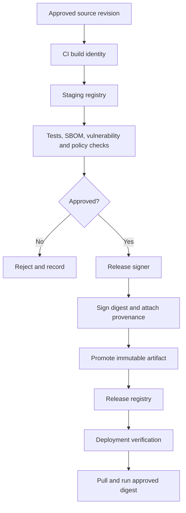

# Phân quyền tải ảnh và kiểm soát nguồn phát hành

Trong hệ thống dùng Java CRaC, việc bảo vệ checkpoint không dừng ở quyền chạy container. Một checkpoint image chứa trạng thái của tiến trình đã chạy và có thể bao gồm dữ liệu trong heap như access token, credential, thông tin người dùng, cache và nội dung request. Người có thể tải hoặc restore image có thể tiếp cận trạng thái nhạy cảm đó. Vì vậy, cần kiểm soát rõ **ai được tải artifact**, **artifact đến từ pipeline nào**, **nội dung có bị thay đổi không** và **runtime nào được phép restore**.

Trong bài này, từ “ảnh” có thể chỉ hai loại artifact khác nhau:

- **OCI/container image:** filesystem chứa JDK hỗ trợ CRaC, application JAR, thư viện hệ thống và entrypoint.
- **Checkpoint image:** snapshot trạng thái của một tiến trình Java được tạo khi checkpoint.

Hai loại artifact có thể được lưu ở cùng một registry hoặc artifact repository, nhưng chúng có vòng đời và mức độ nhạy cảm khác nhau. Cần áp dụng quyền truy cập, xác minh nguồn phát hành và chính sách lưu trữ phù hợp cho từng loại.

## 1. Mục tiêu bảo mật khi tải và phát hành image

Một quy trình an toàn cần trả lời được bốn câu hỏi:

1. **Ai được phép tải?** Người dùng, CI job, cluster node hoặc deployment controller nào được quyền đọc artifact?
2. **Ai được phép phát hành?** Pipeline hoặc danh tính nào có quyền ghi image vào repository chính thức?
3. **Artifact có đúng nguồn và toàn vẹn không?** Digest, chữ ký và provenance có chứng minh artifact đến từ build đã được phê duyệt không?
4. **Có được phép restore không?** Image có thuộc release được phê duyệt, đúng runtime và chưa bị thu hồi hay thay thế không?

Các mục tiêu này liên quan nhưng không thay thế lẫn nhau. Đăng nhập thành công vào registry chỉ chứng minh danh tính; nó không chứng minh người dùng có quyền đọc repository cụ thể. Digest giúp phát hiện nội dung khác đi; nó không chứng minh ai tạo artifact. Chữ ký xác nhận một danh tính đã ký dữ liệu; cần thêm policy để xác định danh tính đó có được phép phát hành hay không.

| Mục tiêu | Cơ chế thường dùng | Câu hỏi kiểm tra |
|---|---|---|
| Xác thực danh tính (authentication) | IAM, service account, workload identity, token | Ai đang yêu cầu tải hoặc phát hành? |
| Phân quyền (authorization) | RBAC, repository policy, scoped token | Danh tính này được đọc/ghi repository nào? |
| Toàn vẹn (integrity) | Digest, checksum, immutable artifact | Nội dung có khớp artifact đã công bố không? |
| Xác thực nguồn (provenance/authenticity) | Chữ ký số, attestation, build provenance | Artifact được tạo bởi pipeline/danh tính nào? |
| Kiểm soát triển khai | Admission policy, allowlist, release policy | Artifact có được phép chạy hoặc restore ở môi trường này không? |
| Truy vết (auditability) | Audit log, release metadata, access log | Ai đã tải, ký, promote, restore hoặc thu hồi artifact? |

## 2. Phân biệt OCI image và checkpoint image

OCI image thường được lưu trong container registry. Registry quản lý manifest, layer, tag và digest theo định dạng OCI/Docker. Các cơ chế như repository IAM, image signing và admission policy có thể áp dụng trực tiếp cho OCI image.

Checkpoint image lại là output của tiến trình checkpoint. Nó có thể gồm nhiều file và metadata theo định dạng của JDK/CRIU, không mặc nhiên là một OCI image. Nếu lưu trong object storage hoặc artifact repository, cần tự quản lý manifest, checksum, chữ ký và quyền đọc/ghi theo khả năng của kho lưu trữ.

| Đặc điểm | OCI/container image | Checkpoint image |
|---|---|---|
| Nội dung | JDK, application, filesystem và runtime config | Trạng thái tiến trình đã chạy |
| Nguồn tạo | Container build pipeline | Tiến trình CRaC sau warm-up và checkpoint |
| Nơi lưu phổ biến | OCI registry | Object storage, artifact repository hoặc bundle được quản lý riêng |
| Nhận diện nội dung | OCI digest | Manifest/checksum của bộ checkpoint hoặc digest của archive bất biến |
| Xác thực nguồn | Chữ ký OCI, provenance/attestation | Chữ ký manifest hoặc bundle và metadata tạo checkpoint |
| Dữ liệu nhạy cảm | Có thể chứa secret nếu build sai cách | Có thể chứa dữ liệu runtime, token và credential trong heap |
| Quy trình kiểm tra | Verify signature, policy và image scan | Verify signature/manifest, runtime compatibility và restore test |

Không giả định việc ký OCI image tự động bảo vệ checkpoint image được mount từ volume. Nếu checkpoint được đóng gói thành một OCI artifact riêng, phải xác định rõ manifest nào được ký, nội dung nào nằm trong digest và cách verify trước restore.

## 3. Xác thực và phân quyền tải artifact

### 3.1. Authentication và authorization

Authentication xác minh danh tính của người hoặc workload. Authorization quyết định danh tính đó được thực hiện hành động nào trên tài nguyên nào.

Ví dụ, CI pipeline có thể xác thực vào registry bằng workload identity. Registry sau đó kiểm tra policy để quyết định pipeline đó có được push vào repository `staging` hay không. Một Kubernetes node có thể dùng service account hoặc credential được cấp để pull image từ repository `release`, nhưng không cần quyền push.

Không dùng một tài khoản quản trị chung cho developer, CI, cluster và release automation. Mỗi danh tính cần quyền vừa đủ với công việc của nó.

### 3.2. Vai trò và quyền tối thiểu

Có thể phân chia quyền theo vai trò:

| Vai trò | Quyền nên có | Quyền không nên có mặc định |
|---|---|---|
| Developer | Đọc source, xem metadata và log build; có thể pull image phát triển | Push release chính thức, đọc checkpoint production chứa dữ liệu nhạy cảm |
| CI build identity | Push image vào repository staging; tạo SBOM/provenance | Xóa release, ký production nếu chưa qua approval |
| Release signer/promoter | Ký và promote artifact đã được kiểm tra | Thay đổi source hoặc bỏ qua build policy |
| Deployment controller/node | Pull đúng repository và digest được phép triển khai | Push, sửa tag release hoặc đọc mọi repository |
| Checkpoint operator | Yêu cầu checkpoint/restore trong phạm vi workload được giao | Tải mọi checkpoint của mọi môi trường |
| Security/audit | Đọc chữ ký, provenance, manifest và audit log | Đọc nội dung checkpoint thô nếu không cần cho nhiệm vụ |
| Registry administrator | Quản trị policy, repository và retention theo quy trình | Dùng credential quản trị cho công việc build hằng ngày |

Tên vai trò chỉ là ví dụ. Hãy ánh xạ sang IAM group, service account, repository role hoặc policy engine thực tế. Quyền đọc checkpoint nên được tách khỏi quyền đọc OCI runtime image vì checkpoint có thể chứa dữ liệu nhạy cảm hơn nhiều.

### 3.3. Tách repository theo môi trường và loại artifact

Không nên để mọi artifact trong một repository mà mọi pipeline đều có quyền đọc/ghi. Có thể tách:

```text
registry.example.internal/
  app-builds/                 # image build thử nghiệm
  app-release/                # OCI image đã được phê duyệt
  app-checkpoint-staging/     # checkpoint tạm, hạn chế người đọc
  app-checkpoint-production/  # checkpoint production, quyền rất hẹp
```

Tách repository giúp áp dụng retention, encryption, audit và quyền khác nhau. Nếu nền tảng hỗ trợ project/namespace riêng theo môi trường, có thể dùng thêm `dev`, `test`, `staging`, `production`.

Checkpoint staging không nên tự động trở thành checkpoint production. Cần có bước kiểm tra, promote và phê duyệt rõ ràng. Artifact production chỉ nên được ghi bởi pipeline hoặc operator có danh tính được phép.

## 4. Cấp credential tải image an toàn

### 4.1. Ưu tiên danh tính workload

Đối với CI/CD và Kubernetes, ưu tiên cơ chế danh tính workload hoặc token ngắn hạn thay cho mật khẩu tĩnh được lưu lâu dài. Ví dụ có thể là OIDC federation, cloud workload identity, service account token hoặc cơ chế credential helper do registry hỗ trợ.

Lợi ích:

- Credential có phạm vi và thời hạn rõ ràng.
- Không phải phân phối một password dùng chung đến nhiều node.
- Có thể thu hồi danh tính workload hoặc policy mà không thay mọi cấu hình ứng dụng.
- Audit log có thể gắn hành động với pipeline, service account hoặc workload cụ thể.

Nếu bắt buộc dùng token tĩnh, giới hạn repository và quyền, đặt thời hạn, lưu trong secret manager, xoay vòng định kỳ và không đưa token vào Dockerfile, source code, image layer hoặc checkpoint image.

### 4.2. Không nhúng registry credential vào image

Không viết credential vào `ARG`, `ENV`, file cấu hình được copy vào image hoặc shell history của build. Docker build argument và environment có thể xuất hiện trong metadata hoặc layer tùy cách sử dụng; chúng không phải kho bí mật.

Với Docker BuildKit, dùng secret mount khi bước build thực sự cần credential:

```dockerfile
# syntax=docker/dockerfile:1.7
FROM <build-base-image> AS build
WORKDIR /workspace

RUN --mount=type=secret,id=repo_token \
    ./gradlew --no-daemon build
```

Build command có thể truyền secret từ môi trường CI theo cơ chế BuildKit:

```bash
docker build \
  --secret id=repo_token,src=<temporary-secret-file> \
  -t <staging-image-reference> .
```

Đây là ví dụ về secret mount; Gradle hoặc tool tải dependency phải được cấu hình để đọc secret tại đường dẫn BuildKit cung cấp. Không copy file secret vào layer và không in giá trị secret ra log.

### 4.3. Kubernetes pull secret và workload identity

Kubernetes hỗ trợ `imagePullSecrets` để kubelet lấy image từ registry riêng. Secret nên nằm trong namespace cần dùng và chỉ được gắn cho service account phù hợp. Nếu cluster hỗ trợ workload identity hoặc credential provider plugin, ưu tiên cơ chế đó để giảm việc quản lý password registry thủ công.

Ví dụ Pod tham chiếu image theo digest và dùng pull secret:

```yaml
apiVersion: v1
kind: Pod
metadata:
  name: orders-api
spec:
  serviceAccountName: orders-runtime
  imagePullSecrets:
    - name: release-registry-read
  containers:
    - name: app
      image: registry.example.internal/app-release/orders-api@sha256:<approved-digest>
```

Secret `release-registry-read` chỉ nên có quyền pull repository cần thiết. Không dùng credential có quyền push hoặc admin cho kubelet. Nếu dùng workload identity, cấu hình tương ứng có thể thay `imagePullSecrets` theo nền tảng.

## 5. Kiểm soát nguồn phát hành

Quyền push vào registry không nên đồng nghĩa với quyền phát hành production. Nguồn phát hành cần được xác định bằng một chuỗi bằng chứng:

1. Source code đến từ repository và revision được phê duyệt.
2. Build chạy trong pipeline đã được kiểm soát.
3. Dependency và base image có nguồn rõ ràng.
4. Artifact được tạo trong môi trường build có danh tính xác định.
5. Kết quả scan, test và policy được ghi nhận.
6. Artifact được ký bởi danh tính release được phép.
7. Artifact được promote bằng digest bất biến sang repository release.
8. Deployment xác minh chữ ký, provenance và policy trước khi pull/restore.

### 5.1. Tách staging và release

Pipeline có thể push bản build vào staging repository trước. Sau khi test, scan và kiểm tra metadata hoàn tất, một bước promote có quyền hẹp sẽ copy artifact theo digest sang repository release.



Bước promote cần giữ nguyên nội dung artifact. Nếu copy hoặc chuyển đổi làm thay đổi digest, phải tạo digest mới, ký lại và cập nhật provenance theo quy trình. Không dựa vào tag `latest` để chứng minh một artifact đã được phê duyệt.

### 5.2. Tách build identity và signing identity

Build job tạo artifact chưa nhất thiết có quyền ký production. Tách danh tính giúp giảm tác động nếu build script hoặc dependency bị xâm nhập:

- Build identity được push staging và tạo metadata.
- Verification job đọc artifact, kiểm tra policy và test result.
- Release signer chỉ ký artifact đáp ứng điều kiện, có thể yêu cầu approval.
- Promoter ghi artifact đã ký vào release repository.
- Deployment identity chỉ pull artifact đã được phê duyệt.

Không để source build tùy ý truy cập private signing key. Nếu dùng keyless signing, giới hạn OIDC identity, issuer, repository, workflow và nhánh được phép ký theo policy của hệ thống.

## 6. Digest, tag và tính bất biến

Tag như `1.4.0`, `stable` hoặc `latest` là tên tham chiếu. Tùy registry policy, tag có thể bị di chuyển để trỏ đến nội dung khác. Digest như `sha256:...` nhận diện nội dung manifest/layer cụ thể của OCI image.

Trong deployment production, ưu tiên tham chiếu bằng digest:

```text
registry.example.internal/app-release/orders-api@sha256:<approved-digest>
```

Tag vẫn hữu ích cho con người và quy trình release, nhưng cần được bảo vệ bằng immutable tag policy nếu registry hỗ trợ. Digest pinning giúp workload tải đúng nội dung đã kiểm tra ngay cả khi tag bị di chuyển.

Với checkpoint image không phải OCI, tạo manifest chứa danh sách file, kích thước và SHA-256. Nếu đóng gói thành archive, tính digest của archive hoàn chỉnh sau khi tạo. Nếu dùng nhiều file riêng, manifest cần bao phủ tất cả file cần thiết và cách kiểm tra cấu trúc.

### 6.1. Checksum không xác thực nguồn

Checksum giúp phát hiện thay đổi nếu giá trị checksum được lấy từ nguồn đáng tin. Nếu kẻ tấn công thay được cả artifact và file checksum, checksum đơn thuần không chứng minh nguồn phát hành.

Vì vậy, ký manifest hoặc digest bằng khóa/danh tính release được bảo vệ. Bên tải cần verify chữ ký bằng trust root hoặc danh tính đã được cấu hình ngoài artifact. Không tải public key từ cùng một nơi không được xác thực rồi dùng nó để xác minh chính artifact đó.

## 7. Ký OCI image và xác minh trước khi triển khai

Với OCI image, có thể dùng công cụ ký như Sigstore Cosign hoặc Notation tùy hệ sinh thái. Chữ ký phải gắn với digest bất biến; policy triển khai phải kiểm tra danh tính signer và issuer/trust root.

Ví dụ minh họa Cosign với khóa được quản lý riêng:

```bash
# Ký đúng digest của OCI image đã được phê duyệt
cosign sign --key cosign.key \
  registry.example.internal/app-release/orders-api@sha256:<approved-digest>

# Xác minh chữ ký bằng public key đã được phân phối qua kênh tin cậy
cosign verify --key cosign.pub \
  registry.example.internal/app-release/orders-api@sha256:<approved-digest>
```

Các placeholder cần thay bằng digest và đường dẫn khóa thực tế. Trong production, private key phải được bảo vệ bằng KMS/HSM hoặc cơ chế keyless signing phù hợp; không lưu private key trong source repository hoặc container image.

Xác minh chữ ký thành công mới chỉ chứng minh chữ ký khớp với trust key. Deployment policy vẫn cần kiểm tra signer đó có được phép phát hành image cho ứng dụng, môi trường và release này hay không.

### 7.1. Xác minh keyless identity

Với keyless signing, policy cần giới hạn danh tính OIDC đã ký: issuer, subject/certificate identity, repository, workflow và điều kiện nhánh/tag theo nền tảng CI. Không chấp nhận mọi chứng thư được cấp bởi một issuer rộng nếu chỉ một workflow release cụ thể được phép phát hành.

Ví dụ kiểm tra Cosign keyless có thể dùng các tham số identity và OIDC issuer theo phiên bản công cụ:

```bash
cosign verify \
  --certificate-identity <approved-workflow-identity> \
  --certificate-oidc-issuer <approved-oidc-issuer> \
  registry.example.internal/app-release/orders-api@sha256:<approved-digest>
```

Tên identity thực tế phụ thuộc CI provider và cấu hình certificate. Hãy dùng giá trị quan sát được trong chứng thư và policy được kiểm soát, không tự đoán subject.

### 7.2. Admission policy

Để không phụ thuộc vào việc mỗi developer nhớ chạy lệnh verify, có thể dùng admission controller hoặc policy engine để từ chối workload tham chiếu image không có chữ ký hợp lệ hoặc không thỏa provenance policy.

Policy có thể yêu cầu:

- Image đến từ release registry được cho phép.
- Image được tham chiếu bằng digest.
- Chữ ký thuộc release identity được phê duyệt.
- Provenance xác định đúng repository, revision và builder.
- SBOM và kết quả scan đáp ứng ngưỡng policy.
- Artifact không bị thu hồi hoặc nằm trong danh sách cấm.

Admission policy cho OCI image không tự động kiểm soát checkpoint directory được mount từ volume. Phần restore checkpoint cần có bước verify manifest/chữ ký riêng trước khi JVM sử dụng artifact.

## 8. Provenance, SBOM và nguồn dependency

Chữ ký cho biết một danh tính đã ký artifact. Provenance cung cấp thêm thông tin artifact được tạo như thế nào: source revision, builder, build parameters và materials đầu vào. SBOM liệt kê thành phần phần mềm được đóng gói.

Đối với runtime image CRaC, provenance/SBOM nên bao gồm:

- Source repository và commit.
- Pipeline/workflow và builder identity.
- JDK vendor, distribution, version và build.
- Base image reference và digest.
- Application JAR digest.
- Dependency lockfile và dependency versions.
- Native libraries và agent quan trọng.
- Thời điểm build và kết quả kiểm tra.

Đối với checkpoint image, bổ sung:

- OCI runtime image digest đã chạy khi tạo checkpoint.
- JDK vendor/build và JVM options.
- OS, kernel, architecture và CRIU đã kiểm thử.
- Application build ID và artifact digest.
- Checkpoint timestamp và môi trường tạo.
- Kết quả restore validation.
- Danh tính pipeline/operator yêu cầu checkpoint.

Provenance không thay thế chữ ký. Một file JSON ghi `builder: trusted` không có giá trị nếu không được ký hoặc xác thực bằng kênh tin cậy. Deployment cần verify chữ ký trước, sau đó đánh giá các trường provenance theo policy.

## 9. Ký và bảo vệ checkpoint artifact

Checkpoint image có thể không được registry xử lý như OCI image. Một cách đơn giản là tạo manifest sau khi checkpoint hoàn tất, tính checksum cho các file và ký manifest bằng release/checkpoint signing identity.

Ví dụ manifest:

```yaml
checkpointArtifact:
  artifactId: "orders-api-3.1.0-build-418"
  application:
    gitCommit: "<commit-sha>"
    jarSha256: "<jar-sha256>"
  runtime:
    ociImageDigest: "sha256:<runtime-image-digest>"
    jdkVendor: "<vendor>"
    jdkVersion: "<full-version-and-build>"
    architecture: "amd64"
  platform:
    os: "<linux-distribution>"
    kernel: "<tested-kernel>"
    criu: "<tested-criu-version>"
  checkpoint:
    createdAt: "<timestamp>"
    files:
      - path: "checkpoint/metadata"
        sha256: "<file-sha256>"
      - path: "checkpoint/memory-file"
        sha256: "<file-sha256>"
    restoreValidation: "PASS"
```

Đây là schema minh họa. Manifest thật cần liệt kê đầy đủ file theo định dạng output của runtime; tên file trong ví dụ không phải cấu trúc chuẩn của mọi CRaC/CRIU implementation. Không bỏ sót file hoặc tự sửa cấu trúc checkpoint.

Có thể ký manifest bằng Cosign blob signing:

```bash
cosign sign-blob \
  --key checkpoint-signing.key \
  --output-signature checkpoint-manifest.sig \
  checkpoint-manifest.yml

cosign verify-blob \
  --key checkpoint-signing.pub \
  --signature checkpoint-manifest.sig \
  checkpoint-manifest.yml
```

Lưu public key hoặc trust policy ở một nơi độc lập, được bảo vệ. Khi tải checkpoint, xác minh chữ ký manifest trước, kiểm tra checksum tất cả file sau khi tải, đối chiếu runtime metadata và chỉ sau đó mới cho phép restore.

Nếu nền tảng artifact hỗ trợ OCI artifact signing hoặc attestation trực tiếp, có thể dùng cách đó thay cho ký file rời. Điều quan trọng là chữ ký phải bao phủ đúng nội dung được restore và được kiểm tra bằng trust policy bên ngoài artifact.

## 10. Bảo mật nội dung checkpoint

Checkpoint image là dữ liệu nhạy cảm vì có thể chứa:

- Access token, refresh token và API key.
- Password hoặc credential đã giải mã trong bộ nhớ.
- Cookie, session và thông tin xác thực người dùng.
- Dữ liệu request, response hoặc payload message.
- Dữ liệu cache và object nghiệp vụ.
- Khóa mã hóa hoặc secret mà ứng dụng đang sử dụng.
- Thông tin kết nối và cấu hình runtime.

Do đó, quyền tải checkpoint cần hẹp hơn quyền pull runtime image thông thường. Một developer có thể cần pull container image để chạy local nhưng không cần đọc snapshot production.

Các biện pháp bảo vệ:

- Mã hóa storage at rest và đường truyền bằng TLS.
- Quản lý encryption key qua KMS/HSM hoặc dịch vụ khóa được kiểm soát.
- Tách key theo môi trường và repository khi cần.
- Giới hạn quyền download theo workload, namespace, môi trường và thời hạn.
- Audit mọi lần đọc, copy, export và xóa artifact.
- Không đưa checkpoint image lên public registry hoặc nơi chia sẻ rộng.
- Xóa artifact hết hạn và bản sao tạm theo retention policy.
- Không tạo checkpoint từ workload có dữ liệu nhạy cảm thật nếu không có nhu cầu và kiểm soát phù hợp.

Mã hóa storage không thay thế authorization. Người có quyền giải mã và tải artifact vẫn có thể đọc dữ liệu bên trong. Ngược lại, chữ ký đảm bảo tính xác thực/toàn vẹn nhưng không che giấu nội dung. Cần kết hợp encryption, access control và signature.

## 11. Kiểm soát restore và chống rollback

Kiểm soát download là một lớp; trước khi restore còn phải xác minh artifact được phép sử dụng. Một checkpoint image hợp lệ về chữ ký vẫn có thể quá cũ, bị thu hồi hoặc không còn phù hợp với runtime hiện tại.

Trước restore, deployment process nên:

1. Xác thực danh tính workload được phép đọc artifact.
2. Tải từ repository và path được allowlist.
3. Verify chữ ký của manifest/bundle.
4. Kiểm tra checksum của tất cả file checkpoint.
5. Đối chiếu application build, OCI digest, JDK build, OS, kernel, architecture và CRIU.
6. Kiểm tra trạng thái release: approved, active và không bị revoked.
7. Kiểm tra tuổi artifact và chính sách chống rollback.
8. Chạy restore trên môi trường tương thích và chờ readiness.

### 11.1. Chống rollback

Kẻ tấn công hoặc lỗi vận hành có thể khiến deployment dùng lại một checkpoint cũ có chữ ký hợp lệ nhưng chứa phần mềm dễ bị khai thác hoặc cấu hình đã bị thu hồi. Vì vậy, chữ ký hợp lệ không đủ để chấp nhận mọi phiên bản cũ.

Có thể kiểm soát bằng:

- Release metadata có version/sequence tăng đơn điệu theo chính sách.
- Danh sách release và checkpoint artifact được phép dùng.
- Thời hạn tối đa cho checkpoint artifact.
- Danh sách artifact bị thu hồi.
- Quy trình phê duyệt riêng khi rollback về release cũ.
- Ràng buộc checkpoint artifact với application build và runtime digest cụ thể.

Rollback hợp lệ vẫn cần được cho phép có chủ đích. Chống rollback không có nghĩa cấm mọi rollback; nó yêu cầu một quyết định có audit và runtime tương thích.

### 11.2. Không restore trực tiếp từ nguồn không tin cậy

Không mount thư mục checkpoint do người dùng tải lên, artifact từ fork không được kiểm soát hoặc file đính kèm không rõ nguồn vào JVM restore. Một checkpoint có thể làm tiến trình tiếp tục từ trạng thái tùy ý và có thể chứa mã, object hoặc cấu hình nguy hiểm trong heap. Chỉ restore artifact do pipeline/operator được ủy quyền tạo và đã qua verify.

## 12. Audit và truy vết tải/phát hành

Audit log nên cho phép trả lời:

- Ai hoặc workload nào đã push artifact?
- Pipeline nào tạo image và từ commit nào?
- Ai ký hoặc approve release?
- Artifact được promote từ staging sang release khi nào?
- Danh tính nào đã tải OCI image hoặc checkpoint image?
- Node/pod nào đã restore artifact nào?
- Ai đã thu hồi hoặc xóa artifact?
- Có lần tải hoặc restore nào bị từ chối không?

Log nên ghi actor identity, repository, digest/artifact ID, action, timestamp, kết quả và request context cần thiết. Không ghi credential, token hoặc nội dung heap vào audit log.

Theo dõi cả hành động thành công và thất bại. Nhiều lần tải checkpoint production từ danh tính không thường dùng, tải từ vị trí bất thường hoặc thay đổi policy repository có thể là dấu hiệu cần điều tra.

## 13. Ví dụ phân quyền theo môi trường

Một mô hình tham khảo:

| Môi trường | OCI runtime image | Checkpoint artifact | Quyền phát hành |
|---|---|---|---|
| Development | Developer và CI có thể pull; CI push staging | Chỉ nhóm phát triển được cấp quyền đọc checkpoint dev | CI dev identity |
| Test | Test runner pull image đã build | Test runner đọc checkpoint test | Pipeline test tạo; promotion tự động theo policy |
| Staging | Staging cluster chỉ pull release candidate đã ký | Staging controller đọc checkpoint staging | Release pipeline sau test |
| Production | Production node chỉ pull digest được phê duyệt | Chỉ workload/operator production được cấp quyền đọc checkpoint production | Release signer/promoter được phê duyệt |

Đây là cách phân vai tham khảo. Tổ chức có thể dùng registry riêng, project/namespace riêng hoặc policy theo path. Cần bảo đảm credential của staging không thể đọc checkpoint production và credential pull không thể ghi đè artifact release.

## 14. Quy trình CI/CD phát hành image đáng tin cậy

Một pipeline có thể triển khai theo các giai đoạn:

**Bước 1 — Kiểm soát source.** Chỉ build từ branch/tag được bảo vệ; yêu cầu review và kiểm tra commit theo chính sách repository.

**Bước 2 — Build runtime image.** Dùng base image CRaC JDK được pin bằng digest; khóa dependency và ghi nhận JDK vendor/build.

**Bước 3 — Tạo metadata.** Sinh SBOM, provenance, application checksum và thông tin base image.

**Bước 4 — Push staging.** CI build identity chỉ có quyền push repository staging.

**Bước 5 — Kiểm tra.** Chạy test, scan vulnerability, kiểm tra license/policy và xác nhận runtime image có CRaC support.

**Bước 6 — Tạo checkpoint artifact.** Chạy image trên host tương thích, warm-up, drain và checkpoint theo quy trình được phê duyệt. Ghi manifest runtime/host và checksum.

**Bước 7 — Restore validation.** Tải artifact bằng danh tính kiểm thử, verify manifest, chữ ký và checksum; restore trên môi trường tương thích rồi kiểm tra readiness.

**Bước 8 — Ký và promote.** Release signer ký digest OCI image và manifest checkpoint; promoter copy artifact bất biến sang repository release.

**Bước 9 — Deploy verification.** Admission/deployment policy xác minh nguồn, chữ ký, digest, provenance, release state và runtime compatibility trước khi triển khai.

**Bước 10 — Audit và retention.** Lưu kết quả, theo dõi lượt tải/restore, thu hồi artifact lỗi và xóa artifact hết hạn theo policy.

Không nên để một job duy nhất vừa build, ký, promote, deploy và có quyền quản trị registry. Tách quyền theo giai đoạn giúp giảm tác động nếu một bước bị xâm nhập.

## 15. Xử lý thu hồi và sự cố nguồn phát hành

Nếu phát hiện image hoặc checkpoint được tạo từ source/build không đáng tin, cần có khả năng ngăn artifact tiếp tục được tải và restore.

Quy trình thu hồi có thể gồm:

1. Đánh dấu digest/artifact ID là revoked trong release metadata.
2. Chặn pull hoặc restore theo policy; không chỉ xóa tag nếu digest vẫn truy cập được.
3. Thu hồi hoặc xoay signing key/identity nếu signer bị xâm nhập.
4. Kiểm tra audit log để xác định ai đã tải hoặc restore artifact.
5. Xác định workload đang chạy từ artifact bị ảnh hưởng.
6. Tạo release mới từ source và runtime đã xác minh.
7. Thay checkpoint artifact và runtime image theo quy trình rollout an toàn.
8. Xóa bản sao tạm và artifact bị thu hồi theo retention/security policy.

Xóa một tag không nhất thiết xóa mọi bản sao hoặc ngăn truy cập bằng digest. Cần dùng cơ chế deny/revocation ở registry, artifact store và deployment policy.

## 16. Checklist triển khai

Trước khi cho phép tải hoặc restore artifact, xác nhận:

- [ ] OCI runtime image và checkpoint image được phân loại, lưu và cấp quyền riêng.
- [ ] Registry/repository có authentication và authorization theo vai trò.
- [ ] CI, signer, promoter, deployer và operator dùng danh tính riêng.
- [ ] Token có scope hẹp, thời hạn phù hợp và được quản lý qua secret manager/workload identity.
- [ ] Production checkpoint không được chia sẻ rộng như OCI runtime image.
- [ ] Image được tham chiếu bằng digest bất biến.
- [ ] Chữ ký được verify bằng trust root và signer identity được allowlist.
- [ ] Provenance liên kết artifact với source revision, builder và materials.
- [ ] Checkpoint manifest bao phủ đầy đủ file và runtime metadata.
- [ ] Checksum được kiểm tra sau tải; manifest được xác thực bằng chữ ký.
- [ ] Restore policy kiểm tra release state, runtime compatibility và chống rollback.
- [ ] Checkpoint storage được mã hóa, audit và có retention policy.
- [ ] Có quy trình thu hồi artifact và signing identity.
- [ ] Readiness chỉ thành công sau khi restore callback và dependency hoàn tất.

## 17. Những lỗi thường gặp

**Dùng một registry credential cho mọi pipeline và node.** Nếu credential bị lộ, phạm vi ảnh hưởng rất rộng. Tạo danh tính riêng với quyền read/write hẹp.

**Cho node quyền push.** Node chỉ cần pull image để chạy workload. Không cấp quyền ghi release repository cho runtime identity.

**Cho rằng private registry đã đủ an toàn.** Registry riêng vẫn cần RBAC, audit, encryption, signature và policy. Người có quyền trong registry vẫn có thể tải artifact nhạy cảm.

**Dùng tag mutable trong production.** Tag có thể trỏ sang nội dung khác. Pin digest và bật immutable tag policy khi có thể.

**Chỉ dùng SHA-256 mà không ký.** Hash không chứng minh ai tạo artifact nếu người tấn công thay được cả file và hash. Ký manifest/digest bằng danh tính tin cậy.

**Ký bằng khóa nằm trong source repository.** Kẻ có quyền đọc source có thể lấy khóa. Dùng KMS/HSM, keyless identity hoặc secret store có kiểm soát.

**Không kiểm tra signer identity.** Chữ ký hợp lệ từ một danh tính không được phép phát hành vẫn phải bị từ chối. Policy phải xác định signer và issuer được chấp nhận.

**Coi chữ ký OCI bao phủ checkpoint volume.** Nếu checkpoint được lưu riêng, cần ký và verify manifest/bundle checkpoint riêng.

**Cho developer tải checkpoint production.** Snapshot có thể chứa token và dữ liệu trong heap. Giới hạn quyền theo môi trường và nhu cầu công việc.

**Đưa secret vào Docker layer hoặc checkpoint image.** Secret có thể tồn tại lâu hơn dự kiến và được truy cập bởi người tải artifact. Dùng secret mount khi build và làm mới secret sau restore.

**Restore image chỉ vì checksum khớp.** Checksum không xác nhận nguồn phát hành, runtime compatibility hoặc trạng thái release. Kết hợp signature, provenance và restore policy.

**Không có cơ chế thu hồi.** Artifact đã ký vẫn có thể bị phát hiện lỗi hoặc compromise. Cần denylist/revocation và chặn restore theo digest.

## 18. Tự kiểm tra mức độ hiểu

1. **Authentication khác authorization thế nào?** Authentication xác minh danh tính; authorization quyết định danh tính đó được thực hiện hành động nào trên repository/artifact.
2. **Vì sao quyền tải checkpoint nên hẹp hơn quyền pull OCI image?** Checkpoint có thể chứa token, credential và dữ liệu runtime trong heap.
3. **Digest có chứng minh ai phát hành image không?** Không. Digest nhận diện nội dung; cần chữ ký và provenance để xác minh nguồn phát hành.
4. **Vì sao phải tách build identity và signing identity?** Để job build không thể tự ý ký mọi artifact production nếu source hoặc dependency bị xâm nhập.
5. **Chữ ký OCI image có bảo vệ checkpoint image trên volume không?** Không mặc nhiên. Cần ký và verify manifest/bundle checkpoint riêng.
6. **Kubernetes node nên có quyền gì với registry?** Thường chỉ cần quyền pull repository và digest được phép; không cần quyền push hoặc admin.
7. **Vì sao checksum không thay thế chữ ký?** Nếu attacker thay được cả artifact và checksum, tính toàn vẹn không còn được xác thực bằng một nguồn tin cậy.
8. **Trước restore cần kiểm tra những gì?** Danh tính tải, chữ ký, checksum, provenance, runtime compatibility, release state và chính sách chống rollback.
9. **Vì sao cần audit download?** Để truy vết ai hoặc workload nào đã đọc/copy checkpoint nhạy cảm và điều tra sự cố.

## Kết luận

Phân quyền tải ảnh và kiểm soát nguồn phát hành cần được thiết kế cho cả OCI runtime image lẫn checkpoint image. Hãy xác thực danh tính workload, cấp quyền đọc/ghi theo repository và môi trường, tách CI build khỏi signing/promote, pin artifact bằng digest và xác minh chữ ký cùng provenance trước triển khai. Với checkpoint image, cần ký manifest bao phủ đầy đủ nội dung, kiểm tra checksum sau tải và ràng buộc artifact với application build, JDK, host cùng kết quả restore test.

Checkpoint có thể chứa dữ liệu nhạy cảm trong bộ nhớ, vì vậy cần mã hóa, giới hạn download, audit và retention nghiêm ngặt. Trước khi restore, kiểm tra release có còn được phê duyệt, artifact có bị thu hồi hay quá cũ và runtime có nằm trong ma trận tương thích. Chỉ khi nguồn phát hành, nội dung và môi trường đều được xác minh, deployment mới được phép sử dụng image.
