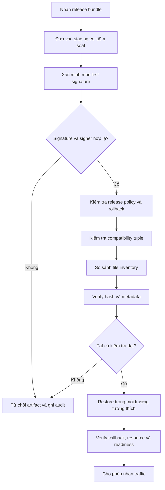

# Kiểm tra tính toàn vẹn và độ tin cậy trước khi restore

Checkpoint CRaC là một artifact đặc biệt: nó chứa trạng thái của một tiến trình Java đã chạy, có thể bao gồm heap, object graph, class metadata, thread state, dữ liệu ứng dụng và thông tin nhạy cảm đang nằm trong bộ nhớ. Trước khi restore, hệ thống cần xác minh rằng toàn bộ checkpoint vẫn nguyên vẹn, đến từ nguồn phát hành được tin cậy và thuộc đúng release/runtime dự kiến.

Chỉ kiểm tra việc thư mục checkpoint tồn tại hoặc lệnh restore có thể đọc được các file là chưa đủ. Artifact có thể bị thiếu file, bị thay đổi trong lúc truyền, bị ghi đè, bị tráo với checkpoint của release khác hoặc bị tạo bởi một nguồn không được phép. Một checkpoint hỏng có thể làm restore thất bại; một checkpoint bị thay thế có thể đưa mã hoặc dữ liệu không mong muốn vào tiến trình.

Quy trình an toàn cần kết hợp nhiều lớp: checksum để phát hiện thay đổi, chữ ký số để xác thực nguồn phát hành, manifest để liên kết checkpoint với JDK và application build, provenance để xác định quá trình tạo artifact, kiểm soát quyền truy cập và kiểm tra compatibility trước khi restore. Sau đó cần restore thử trong môi trường cô lập, xác minh resource và readiness rồi mới đưa instance vào phục vụ.

## 1. Phân biệt tính toàn vẹn, tính xác thực và tính tin cậy

Ba khái niệm thường bị nhầm lẫn:

| Khái niệm | Câu hỏi cần trả lời | Cơ chế thường dùng |
| --- | --- | --- |
| Tính toàn vẹn (integrity) | Dữ liệu có bị thay đổi, thiếu hoặc hỏng so với bản đã ghi nhận không? | Cryptographic hash, checksum, manifest |
| Tính xác thực (authenticity) | Artifact hoặc manifest có thực sự do bên phát hành được phép tạo ra không? | Chữ ký số và danh tính khóa ký được tin cậy |
| Tính tin cậy (trust) | Artifact có được tạo từ quy trình, nguồn và môi trường được chấp thuận không? | Provenance, build attestation, kiểm soát release và chính sách phê duyệt |

Checksum SHA-256 có thể phát hiện file thay đổi so với checksum đã lưu. Nhưng nếu kẻ tấn công có thể thay cả checkpoint lẫn file checksum, phép kiểm tra vẫn có thể thành công. Chữ ký số trên manifest giúp xác nhận manifest do khóa ký tương ứng tạo ra; tuy nhiên, hệ thống còn phải biết khóa đó thuộc đúng tổ chức hoặc pipeline phát hành.

Một chữ ký hợp lệ cũng không tự chứng minh checkpoint được tạo từ mã nguồn an toàn. Để đánh giá độ tin cậy, cần xem thêm source revision, build pipeline, image digest, dependency set, người hoặc service identity thực hiện phát hành và chính sách phê duyệt.

## 2. Các thành phần cần xác minh trước restore

Checkpoint không tồn tại độc lập. Một release CRaC thường gồm nhiều thành phần cần được liên kết:

| Thành phần | Điều cần xác minh |
| --- | --- |
| Checkpoint files | Đủ file, đúng kích thước và hash, không có file lạ hoặc bị thay thế |
| Checkpoint manifest | Chứa release ID, danh sách file, checksum và metadata tạo ảnh |
| Manifest signature | Chữ ký hợp lệ, khóa ký thuộc trust store được quản lý |
| Application artifact | Đúng version/build và checksum đã phát hành |
| JDK/runtime | Đúng vendor, version, build và CRaC capability đã kiểm chứng |
| Dependency set | Classpath, framework, native library và lockfile khớp release |
| Container image | Digest bất biến đúng với môi trường tạo checkpoint |
| OS/kernel/CRIU | Nằm trong compatibility profile đã kiểm thử |
| Launch configuration | JVM flags, classpath, working directory và các tham số cần thiết không bị thay đổi ngoài policy |
| Provenance | Artifact được tạo bởi pipeline và source revision được chấp thuận |

Kiểm tra từng file checkpoint là cần thiết nhưng chưa đủ. Deployment cần xác nhận checkpoint thuộc đúng bộ runtime–application–dependency. Một checkpoint nguyên vẹn nhưng được ghép với JDK hoặc application JAR không tương thích vẫn không nên được restore.

## 3. Hash và checksum của checkpoint

Hash mật mã tạo ra một dấu vân tay có kích thước cố định từ nội dung file. Khi nội dung thay đổi, hash gần như chắc chắn thay đổi. SHA-256 là lựa chọn phổ biến để kiểm tra tính toàn vẹn artifact.

Ví dụ tính hash cho application JAR:

```bash
sha256sum /opt/app/app.jar
```

Checkpoint thường gồm nhiều file trong một thư mục. Vì vậy, cần tạo checksum cho toàn bộ cây file, không chỉ hash tên thư mục. Một cách đơn giản trên Linux:

```bash
cd /var/lib/app
find checkpoint -type f -print0 \
  | sort -z \
  | xargs -0 sha256sum > checkpoint-files.sha256
```

Lệnh trên tạo danh sách hash cho các file thông thường trong thư mục checkpoint. Trong pipeline production, cần xác định chính sách cho symbolic link, file đặc biệt, permission và metadata. Nếu checkpoint format hoặc công cụ restore yêu cầu những thuộc tính đó, manifest cần ghi nhận và xác minh chúng. Không nên âm thầm bỏ qua symlink hoặc file đặc biệt mà runtime cần.

### 3.1. Xác minh checksum trước restore

Sau khi tải artifact về staging directory, có thể kiểm tra:

```bash
cd /var/lib/app
sha256sum --check checkpoint-files.sha256
```

Kết quả thành công cho biết các file được liệt kê khớp với checksum. Tuy nhiên, cần bảo đảm danh sách checksum chính nó cũng được bảo vệ bằng chữ ký số hoặc được lấy từ một nguồn tin cậy độc lập.

Một kiểm tra đầy đủ cần phát hiện cả:

- File bị sửa nội dung.
- File bị thiếu.
- File bị thêm vào nhưng không có trong manifest.
- File bị đổi tên hoặc chuyển vị trí.
- File trùng tên hoặc đường dẫn bất thường.
- Metadata quan trọng như mode hoặc symlink target bị thay đổi nếu runtime phụ thuộc vào chúng.

Chỉ chạy `sha256sum --check` trên danh sách có sẵn không tự phát hiện file lạ được thêm vào thư mục. Deployment validator nên so sánh tập đường dẫn thực tế với tập đường dẫn đã ký trong manifest.

### 3.2. Tại sao không dùng MD5 hoặc SHA-1?

MD5 và SHA-1 không còn phù hợp cho mục tiêu xác minh artifact có yêu cầu bảo mật cao vì đã có các điểm yếu về collision. Nên dùng SHA-256 hoặc thuật toán hash hiện đại được tổ chức chấp thuận. Hash chỉ là một phần của quy trình; cần chữ ký hoặc kênh tin cậy để bảo vệ giá trị hash.

## 4. Manifest mô tả release và checkpoint

Manifest là tài liệu máy đọc được liên kết checkpoint với môi trường đã tạo ra nó. Manifest nên được tạo tự động từ chính tiến trình và artifact thực tế, không nhập thủ công dựa trên giả định.

Một manifest có thể chứa:

- Release ID duy nhất.
- Thời điểm tạo checkpoint.
- Source revision và build ID.
- Application artifact version và checksum.
- JDK vendor/version/build.
- Container image digest.
- Dependency lockfile và classpath digest.
- Native library inventory.
- OS, kernel, architecture và CRIU version.
- Các JVM flags hiệu lực quan trọng.
- Danh sách file checkpoint, kích thước, hash và metadata cần thiết.
- Identity của pipeline hoặc service đã tạo artifact.
- Schema version của manifest.

Ví dụ:

```json
{
  "schemaVersion": 1,
  "releaseId": "orders-service-1.4.0-build.281",
  "createdAt": "2026-11-13T07:00:00Z",
  "source": {
    "revision": "<approved-git-commit>",
    "buildId": "<pipeline-run-id>"
  },
  "application": {
    "version": "1.4.0",
    "artifact": "app.jar",
    "sha256": "<application-sha256>"
  },
  "runtime": {
    "vendor": "<jdk-vendor>",
    "version": "<jdk-runtime-version-and-build>",
    "imageDigest": "sha256:<container-image-digest>",
    "architecture": "amd64",
    "os": "linux",
    "criuVersion": "<criu-version>"
  },
  "dependencies": {
    "classpathDigest": "<runtime-classpath-digest>",
    "nativeLibrariesDigest": "<native-library-digest>"
  },
  "checkpoint": {
    "path": "checkpoint/",
    "filesManifest": "checkpoint-files.sha256",
    "filesManifestSha256": "<manifest-sha256>"
  }
}
```

Các chuỗi trong dấu ngoặc nhọn là placeholder minh họa. Pipeline cần điền giá trị thực tế và xác minh chúng từ artifact đã tạo. Không để placeholder hoặc thông tin suy đoán trong manifest phát hành.

### 4.1. Manifest phải liên kết đúng toàn bộ artifact

Manifest cần xác định rõ checkpoint nào đi với image nào, JDK nào và application build nào. Nếu chỉ ghi `javaVersion: 21`, thông tin đó quá chung để nhận diện một JDK CRaC build cụ thể.

Nên dùng digest bất biến cho container image và checksum cho application/dependency artifacts. Tên tag như `latest` hoặc `stable` có thể trỏ tới nội dung khác trong tương lai, nên không đủ làm định danh release.

### 4.2. Định dạng manifest và canonicalization

Chữ ký số được tính trên bytes cụ thể. Nếu manifest được parse rồi serialize lại với thứ tự field, whitespace hoặc encoding khác, chữ ký có thể không còn hợp lệ.

Một số cách xử lý:

- Ký trực tiếp file manifest nguyên bản và verify đúng bytes đó.
- Dùng định dạng canonical có quy tắc serialization rõ ràng.
- Không sửa manifest sau khi ký; nếu cần thay đổi, tạo manifest mới và ký lại.
- Ghi rõ encoding và schema version.

Không ký một biểu diễn rồi verify một biểu diễn khác mà không có quy tắc canonicalization được thống nhất.

## 5. Chữ ký số xác thực nguồn phát hành

Checksum trả lời nội dung có khớp hay không. Chữ ký số giúp xác minh manifest được tạo bởi chủ sở hữu private key tương ứng và nội dung manifest không bị thay đổi sau khi ký.

Một quy trình phổ biến:

1. Build pipeline tạo checkpoint và manifest.
2. Pipeline tính hash cho mọi artifact.
3. Signing service ký manifest bằng khóa được bảo vệ.
4. Manifest và signature được publish cùng release.
5. Deployment lấy public key hoặc certificate từ trust store được quản lý độc lập.
6. Deployment xác minh chữ ký trước khi tin bất kỳ đường dẫn hoặc checksum nào trong manifest.
7. Sau khi chữ ký hợp lệ, deployment mới kiểm tra hash của checkpoint và các artifact.

Ví dụ dùng GPG detached signature:

```bash
# Trong pipeline phát hành: ký đúng file manifest đã hoàn tất
gpg --batch --local-user "$SIGNING_KEY_FINGERPRINT" \
  --armor --detach-sign \
  --output release-manifest.json.asc \
  release-manifest.json

# Trong deployment: xác minh bằng keyring đã được quản trị tin cậy
gpg --verify release-manifest.json.asc release-manifest.json
```

Đây là ví dụ minh họa. Signing key phải được quản lý trong KMS, HSM hoặc signing service phù hợp; private key không nên nằm trong source repository hoặc container image. Deployment cần xác nhận fingerprint của public key thuộc tổ chức/pipeline được phép phát hành, thay vì chỉ chấp nhận bất kỳ key nào được gửi kèm artifact.

### 5.1. Chữ ký hợp lệ không có nghĩa artifact an toàn tuyệt đối

Chữ ký chỉ chứng minh manifest được ký bởi khóa tương ứng và nội dung không đổi sau khi ký. Nếu pipeline hoặc signing key bị xâm phạm, một artifact độc hại vẫn có thể được ký hợp lệ.

Do đó, cần bảo vệ cả:

- Quyền sử dụng signing key.
- Danh tính workload được phép yêu cầu ký.
- Source repository và quyền merge.
- Build runner và dependency resolution.
- Quy trình phê duyệt release.
- Trust store của deployment.
- Audit log của hoạt động ký và phát hành.

## 6. Provenance và nguồn gốc artifact

Provenance mô tả artifact được tạo từ đâu và bằng quy trình nào. Với checkpoint CRaC, provenance nên giúp trả lời:

- Source revision nào được build?
- Pipeline run nào tạo application artifact?
- JDK và container image nào được dùng để chạy warm-up?
- Checkpoint được tạo trên môi trường nào?
- Dependency lockfile và native library nào được sử dụng?
- Ai hoặc service identity nào đã yêu cầu tạo và ký release?
- Những bước kiểm tra nào đã hoàn tất?

Provenance giúp điều tra khi một checkpoint có vấn đề và hỗ trợ chính sách chỉ cho phép restore artifact từ pipeline được chấp thuận. Có thể lưu build attestation hoặc metadata tương đương bên cạnh manifest.

Không nên dùng một file text tự khai báo `trusted: true` làm bằng chứng provenance. Nguồn gốc cần được bảo vệ bằng chữ ký hoặc hệ thống attestation có identity và audit.

## 7. Bảo vệ checkpoint khi lưu trữ và truyền tải

Checkpoint có thể chứa dữ liệu trong heap, gồm credential, token, session, thông tin người dùng, dữ liệu nghiệp vụ và cấu hình nội bộ. Tính toàn vẹn và tính bí mật là hai yêu cầu khác nhau; checksum hoặc chữ ký không mã hóa nội dung checkpoint.

Các biện pháp bảo vệ nên gồm:

- Giới hạn quyền đọc/ghi checkpoint theo release và môi trường.
- Mã hóa dữ liệu khi truyền qua mạng.
- Mã hóa artifact khi lưu trữ nếu chính sách yêu cầu.
- Dùng bucket/artifact repository riêng có authentication và audit.
- Không publish checkpoint vào repository công khai.
- Không đưa token hoặc nội dung heap vào log.
- Áp dụng retention và quy trình xóa artifact cũ.
- Tách quyền tạo checkpoint, ký release và triển khai restore khi phù hợp.

Nếu checkpoint được chia sẻ giữa nhiều môi trường, cần xác định rõ dữ liệu nào có thể đi qua ranh giới môi trường. Một checkpoint tạo từ production có thể chứa dữ liệu production; không nên dùng nó trong staging hoặc môi trường developer nếu chưa có chính sách xử lý dữ liệu phù hợp.

## 8. Lưu trữ bất biến và kiểm soát quyền truy cập

Sau khi release được ký và publish, artifact nên được lưu ở vị trí bất biến. Không ghi đè checkpoint của release cũ bằng nội dung mới dưới cùng một tên.

Các nguyên tắc:

- Mỗi release có ID riêng.
- Checkpoint và manifest được publish vào đường dẫn versioned.
- Quyền sửa artifact đã publish bị giới hạn hoặc bị khóa.
- Deployment chỉ đọc artifact từ repository đã được tin cậy.
- Mọi thao tác thay đổi quyền, xóa hoặc promote đều có audit.
- Release cũ được giữ theo retention policy để rollback.

Một object store hỗ trợ versioning hoặc object lock có thể giúp bảo vệ artifact khỏi bị ghi đè hoặc xóa ngoài ý muốn. Cấu hình cụ thể phụ thuộc nền tảng lưu trữ.

## 9. Chống rollback và replay artifact cũ

Một checkpoint cũ có thể vẫn có chữ ký hợp lệ và checksum chính xác. Tuy nhiên, nó có thể chứa ứng dụng đã có lỗ hổng, credential cũ hoặc schema không còn tương thích. Vì vậy, xác minh chữ ký thôi chưa đủ; cần chính sách chống rollback.

Manifest có thể chứa:

- Release sequence hoặc build number tăng đơn điệu.
- Thời điểm phát hành.
- Thời hạn hiệu lực nếu phù hợp.
- Minimum allowed release version.
- Environment hoặc deployment target được phép.
- Trạng thái thu hồi của signing key hoặc release.

Deployment nên đối chiếu release với policy hiện hành. Ví dụ, nếu release sequence 281 đã bị thu hồi và minimum accepted sequence là 294, không cho phép restore release 281 chỉ vì signature còn hợp lệ.

Không nên chỉ dựa vào timestamp do manifest tự khai báo vì đồng hồ hoặc metadata có thể bị thao túng. Với yêu cầu cao, dùng release registry hoặc policy service có trạng thái đã được xác thực để xác định release nào được phép deploy.

## 10. Kiểm tra compatibility trước khi restore

Sau khi xác minh manifest signature, cần kiểm tra checkpoint thuộc đúng môi trường:

| Kiểm tra | Điều kiện |
| --- | --- |
| JDK | Vendor, version và build khớp compatibility profile |
| JVM flags | Heap, GC, object layout và các flags quan trọng khớp |
| Application | Version và checksum đúng manifest |
| Dependencies | Classpath digest và native library inventory khớp |
| Container image | Image digest đúng release |
| OS/architecture | OS family, kernel capability và CPU architecture được hỗ trợ |
| CRIU | Version và capability nằm trong profile đã kiểm thử |
| Filesystem | Đường dẫn, mount point và permission cần thiết tồn tại |
| Checkpoint files | Đủ tập file, checksum và metadata hợp lệ |
| Configuration | Profile và cấu hình bắt buộc đúng environment |

Một checkpoint có checksum đúng nhưng không khớp JDK build hoặc architecture vẫn phải bị từ chối. Không cố restore để xem có chạy được không trong môi trường production khi preflight đã phát hiện sai lệch.

### 10.1. Không tin dữ liệu từ manifest trước khi xác minh chữ ký

Manifest có thể chứa path, image reference hoặc tên file. Nếu manifest chưa được xác thực, không dùng các trường đó để tự động tải file, mount volume hoặc chạy command. Trước tiên xác minh chữ ký và policy; sau đó mới diễn giải các giá trị trong manifest.

Đặc biệt, kiểm tra path phải bảo đảm nằm trong staging directory được phép. Không cho phép đường dẫn tuyệt đối ngoài workspace, `..` traversal hoặc symbolic link trỏ ra ngoài vùng artifact. Nếu phải giải nén archive, dùng thư viện/công cụ có bảo vệ path traversal và kiểm tra nội dung trước khi đưa vào restore location.

## 11. Quy trình xác minh checkpoint nhiều file

Một quy trình thực tế có thể gồm:

1. Tải manifest, signature và artifact vào staging location có quyền hạn chế.
2. Xác minh signature bằng trust store đã được quản trị độc lập.
3. Kiểm tra release ID, policy chống rollback và environment target.
4. Kiểm tra schema manifest và giới hạn kích thước/số lượng file.
5. Liệt kê toàn bộ file checkpoint thực tế.
6. So sánh đường dẫn thực tế với danh sách đã ký trong manifest.
7. Xác minh hash, kích thước và metadata cần thiết của từng file.
8. Xác minh application, JDK, dependency và image digest.
9. Kiểm tra quyền truy cập, symlink, file type và mount point.
10. Chỉ sau khi tất cả bước đạt mới cho phép restore.



### 11.1. Ví dụ kiểm tra checksum và chữ ký

Một quy trình shell đơn giản có thể được tổ chức như sau:

```bash
set -euo pipefail

RELEASE_DIR=/var/lib/releases/orders-service-1.4.0
cd "$RELEASE_DIR"

# 1. Xác minh manifest bằng keyring đã được quản trị tin cậy.
gpg --verify release-manifest.json.asc release-manifest.json

# 2. Xác minh các file đã được liệt kê trong manifest checksum.
sha256sum --check checkpoint-files.sha256

# 3. Xác minh application artifact.
sha256sum --check app.jar.sha256

# 4. Chỉ tiếp tục khi validator đã kiểm tra thêm inventory,
#    release policy, JDK/image digest và metadata.
```

Đoạn lệnh là minh họa, không phải validator đầy đủ. `sha256sum --check` chỉ xác minh các đường dẫn được ghi trong file checksum. Production validator còn phải so sánh inventory thực tế với manifest đã ký, kiểm tra symlink và metadata, đồng thời xác minh release policy và compatibility tuple.

## 12. Tránh race condition và TOCTOU

TOCTOU (time-of-check to time-of-use) xảy ra khi artifact được kiểm tra ở một thời điểm nhưng bị thay đổi trước lúc restore sử dụng nó.

Ví dụ:

1. Deployment kiểm tra checksum của checkpoint trong thư mục dùng chung.
2. Một tiến trình khác có quyền ghi thay file sau khi kiểm tra.
3. JVM restore đọc nội dung đã bị thay đổi.

Để giảm rủi ro:

- Tải artifact vào staging directory riêng, không cho process khác ghi.
- Xác minh chữ ký và checksum trên staging copy.
- Đổi quyền hoặc mount read-only sau khi xác minh.
- Dùng immutable object/version ID thay vì đường dẫn mutable.
- Không restore trực tiếp từ thư mục đang được một pipeline khác cập nhật.
- Nếu copy sang restore location, xác minh lại checksum sau khi copy.
- Chỉ cấp quyền đọc cho process restore.

Một release đã được xác minh nên được giữ nguyên cho đến khi restore hoàn tất. Không dùng chung một thư mục staging cho nhiều deployment đồng thời nếu có thể ghi đè hoặc trộn file.

## 13. Restore thử trong môi trường cô lập

Ngay cả khi signature, checksum và compatibility preflight đều đạt, vẫn cần restore thử trước khi promote release. Một artifact có thể nguyên vẹn nhưng resource callback lỗi, dependency không kết nối được hoặc ứng dụng không đạt readiness.

Smoke test nên chạy trong môi trường gần với target:

1. Dùng đúng container image digest và JDK build.
2. Mount đúng checkpoint đã xác minh.
3. Restore tiến trình theo tài liệu của JDK distribution.
4. Quan sát log JVM, CRIU và callback CRaC.
5. Xác nhận database, broker, cache và các resource bắt buộc được tạo lại.
6. Kiểm tra liveness và readiness.
7. Gửi workload đại diện trong môi trường cô lập.
8. Đo restore-to-ready, latency và error rate.
9. Chỉ promote artifact sau khi kiểm thử đạt.

Không dùng production traffic thật trong lần restore thử nếu chưa có kế hoạch kiểm soát side effect. Dùng sandbox hoặc dữ liệu kiểm thử phù hợp.

## 14. Xử lý khi xác minh thất bại

Khi một bước xác minh thất bại, cần dừng trước khi restore và phân loại nguyên nhân.

| Dấu hiệu | Nguyên nhân có thể | Hành động |
| --- | --- | --- |
| Signature không hợp lệ | Manifest bị thay đổi, signature sai hoặc signer không được tin cậy | Từ chối artifact; kiểm tra key identity và audit pipeline |
| Hash file không khớp | File hỏng hoặc bị thay đổi trong lưu trữ/truyền tải | Tải lại từ nguồn tin cậy; không tự cập nhật checksum để bỏ qua lỗi |
| Thiếu file trong checkpoint | Copy/upload chưa hoàn tất hoặc artifact bị xóa | Tạo lại bundle từ release gốc |
| Có file lạ hoặc path bất thường | Artifact bị trộn hoặc manifest không đầy đủ | Từ chối và điều tra nguồn artifact |
| Release sequence thấp hơn policy | Artifact cũ hoặc đã bị thu hồi | Từ chối rollback ngoài policy; dùng release được phê duyệt |
| JDK/image digest không khớp | Ghép sai runtime với checkpoint | Lấy đúng bundle hoặc tạo checkpoint mới |
| Checkpoint restore thất bại dù hash đúng | Môi trường không tương thích hoặc checkpoint được tạo lỗi | Xem log CRIU/JVM và kiểm tra compatibility tuple |
| `afterRestore` thất bại | Resource hoặc dependency không phục hồi được | Giữ readiness từ chối traffic; xử lý phục hồi theo lifecycle |
| Ứng dụng không đạt readiness | Dependency hoặc cấu hình chưa sẵn sàng | Không đưa instance vào load balancer; điều tra và retry có giới hạn |

Không sửa file checksum để khớp với artifact bị nghi ngờ. Nếu hash không khớp, cần lấy lại artifact từ nguồn đã được xác thực hoặc tạo lại checkpoint từ pipeline tin cậy.

## 15. Audit và khả năng truy vết

Mỗi lần verify và restore nên tạo audit record để có thể truy lại release đã được sử dụng.

Thông tin hữu ích:

- Release ID và manifest digest.
- Signer identity và key fingerprint.
- Kết quả signature verification.
- Checkpoint inventory và checksum result.
- Application/JDK/container image digest.
- Deployment environment và instance identity.
- Thời điểm bắt đầu/kết thúc verify và restore.
- Kết quả preflight và compatibility checks.
- Callback/health/readiness result.
- Người hoặc service identity đã phê duyệt deployment.

Audit log không nên chứa nội dung checkpoint, token, password, heap dump hoặc dữ liệu nhạy cảm. Chỉ lưu metadata đủ để nhận diện artifact và quyết định vận hành.

## 16. Phân quyền trong vòng đời checkpoint

Không nhất thiết một service phải có toàn bộ quyền tạo, ký, lưu, xác minh và restore checkpoint. Có thể tách quyền để giảm tác động nếu một thành phần bị xâm phạm.

| Vai trò | Quyền phù hợp |
| --- | --- |
| Checkpoint builder | Chạy ứng dụng và tạo checkpoint trong môi trường được phép |
| Manifest generator | Đọc metadata artifact và tạo manifest |
| Signing service | Ký manifest khi request đến từ pipeline identity được phép |
| Artifact repository | Lưu artifact bất biến và ghi audit |
| Deployment verifier | Đọc artifact, xác minh signature/hash/policy |
| Restore runtime | Đọc checkpoint đã xác minh và thực hiện restore |
| Release approver | Phê duyệt promote release theo policy |

Tách quyền giúp hạn chế trường hợp một build runner bị xâm phạm có thể tự sửa artifact, ký nó và triển khai trực tiếp mà không có kiểm soát độc lập.

## 17. Chính sách thu hồi và xoay vòng khóa

Signing key có thể bị lộ, hết hạn hoặc được thay thế. Trust policy cần hỗ trợ:

- Danh sách signer được phép theo môi trường.
- Thời hạn hiệu lực và trạng thái thu hồi của key/certificate.
- Quy trình xoay vòng khóa.
- Khả năng xác minh artifact cũ trong thời gian rollback được cho phép.
- Chính sách từ chối release được ký bởi key đã bị thu hồi.
- Audit mọi lần cập nhật trust store.

Khi key bị thu hồi, không nên tiếp tục tin mọi manifest từng được ký bằng key đó mà không có policy đánh giá. Tùy nguyên nhân thu hồi, tổ chức có thể cần thu hồi các release liên quan và tạo checkpoint mới bằng pipeline/key tin cậy.

## 18. Các lỗi bảo mật thường gặp

| Lỗi | Rủi ro | Cách xử lý |
| --- | --- | --- |
| Chỉ kiểm tra file tồn tại | Không phát hiện file hỏng hoặc bị thay thế | Hash toàn bộ inventory và verify manifest |
| Lưu checksum cạnh artifact nhưng không ký | Kẻ thay artifact có thể thay luôn checksum | Ký manifest bằng khóa được bảo vệ |
| Tin bất kỳ public key đi kèm bundle | Kẻ tấn công có thể tự tạo key và signature | Lấy trust anchor từ trust store độc lập |
| Chỉ ký application JAR | Checkpoint hoặc dependency khác vẫn có thể bị thay | Ký manifest liên kết toàn bộ release bundle |
| Bỏ qua file lạ trong thư mục | Có thể restore nhầm hoặc dùng file ngoài manifest | So sánh inventory chính xác |
| Restore trực tiếp từ thư mục mutable | TOCTOU sau khi verify | Dùng staging bất biến hoặc read-only |
| Không chống rollback | Release cũ có chữ ký hợp lệ vẫn được dùng | Kiểm tra release sequence và revocation policy |
| Chỉ xác minh checksum, không kiểm tra compatibility | Artifact nguyên vẹn nhưng không restore đúng runtime | Kiểm tra JDK, flags, image, OS và CRIU |
| Đưa checkpoint vào log hoặc repository công khai | Lộ dữ liệu trong heap | Hạn chế truy cập, mã hóa và retention |
| Bỏ qua lỗi `afterRestore` | Instance có thể nhận traffic khi resource chưa sẵn sàng | Giữ readiness refusing và báo lỗi |
| Dùng chung quyền build/sign/deploy | Một identity bị xâm phạm có thể kiểm soát toàn bộ chuỗi | Tách quyền và dùng audit/approval |

## 19. Checklist vận hành trước khi restore

Checklist dưới đây có thể dùng trong release pipeline hoặc deployment controller:

- [ ] Manifest được tải từ artifact repository tin cậy.
- [ ] Chữ ký manifest hợp lệ.
- [ ] Signer fingerprint/identity nằm trong trust policy.
- [ ] Release chưa bị thu hồi và không vi phạm anti-rollback policy.
- [ ] Checkpoint file inventory khớp manifest đã ký.
- [ ] Mọi checksum và kích thước file đều khớp.
- [ ] Không có file lạ, path traversal hoặc symlink không được phép.
- [ ] Application JAR và dependency digest khớp release.
- [ ] JDK vendor/version/build và JVM flags khớp compatibility profile.
- [ ] Container image digest, OS, kernel, architecture và CRIU phù hợp.
- [ ] Staging artifact không thể bị sửa sau khi verify.
- [ ] Secret/config động được nạp qua cơ chế bảo mật hiện hành.
- [ ] Restore test đã đạt trong môi trường tương thích.
- [ ] Callback `afterRestore`, resource verification và readiness đạt.
- [ ] Audit record được ghi mà không chứa dữ liệu nhạy cảm.

Checklist này là một phần của policy vận hành. Các điều kiện bắt buộc cần được tự động hóa trong deployment validator để tránh phụ thuộc vào thao tác thủ công.

## 20. Kết luận

Trước khi restore checkpoint CRaC, cần xác minh đồng thời tính toàn vẹn, tính xác thực và nguồn gốc của toàn bộ release bundle. Hash giúp phát hiện thay đổi nội dung; chữ ký số xác nhận manifest đến từ signer được tin cậy; provenance và release policy giúp xác định artifact được tạo bởi quy trình được chấp thuận và chưa bị thu hồi.

Hãy ký manifest liên kết checkpoint với JDK, application build, dependencies, container image và môi trường tạo ảnh. Xác minh signature trước khi tin metadata, so sánh toàn bộ file inventory và checksum trong staging bất biến, kiểm tra compatibility và chống rollback. Sau đó restore thử, xác minh resource và readiness rồi mới đưa instance vào phục vụ. Vì checkpoint có thể chứa dữ liệu nhạy cảm trong heap, cần bảo vệ cả quyền truy cập và tính bí mật của artifact trong suốt quá trình lưu trữ, truyền tải và xóa bỏ.
