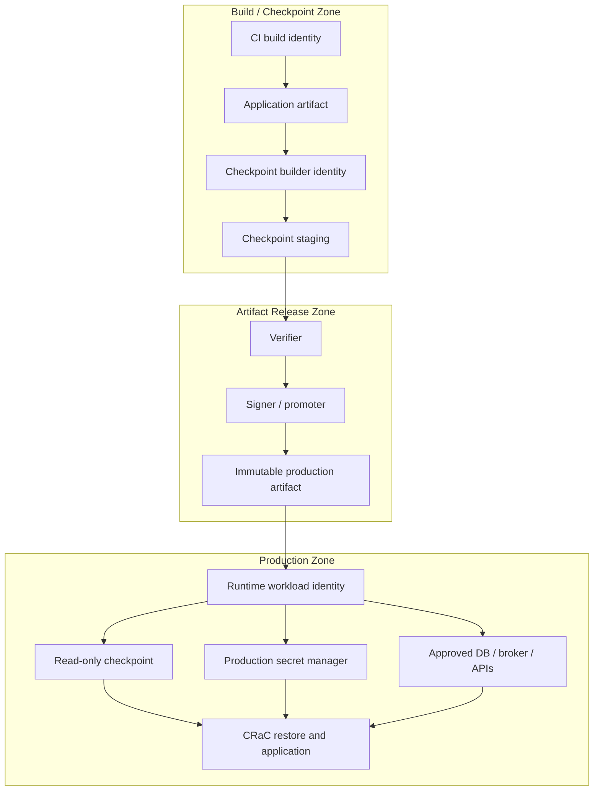

# Phân tách quyền tạo ảnh với quyền chạy ứng dụng trong môi trường thật

Checkpoint CRaC lưu trạng thái của một tiến trình Java đã được khởi tạo. Vì trạng thái đó có thể chứa heap, thread, cấu hình đã nạp và dữ liệu nhạy cảm đang nằm trong bộ nhớ, quyền tạo checkpoint cần được quản lý như một quyền đặc biệt. Quyền chạy ứng dụng trong production có mục tiêu khác: đọc một checkpoint đã được phê duyệt, restore tiến trình trong môi trường tương thích và truy cập đúng những dịch vụ mà ứng dụng cần.

Không nên dùng cùng một danh tính, credential hoặc phạm vi quyền cho cả hai công việc. Thành phần tạo checkpoint thường cần quyền ghi artifact và có thể cần quyền hệ điều hành bổ sung để thực hiện checkpoint. Ứng dụng production chỉ cần quyền đọc artifact đã phát hành, quyền truy cập dependency theo nghiệp vụ và quyền thực thi tối thiểu để restore. Nếu ứng dụng production có thể tự ghi đè checkpoint, publish image hoặc truy cập credential của pipeline, một lỗ hổng trong ứng dụng có thể biến thành quyền sửa artifact phát hành và ảnh hưởng đến các lần scale-out tiếp theo.

Mô hình an toàn cần tách ít nhất ba vai trò: **checkpoint builder** tạo trạng thái tiến trình trong môi trường được kiểm soát; **artifact promoter/signer** xác minh và công bố artifact; **production runtime** chỉ nhận artifact đã được duyệt và chạy nó. Việc phân tách này giảm phạm vi ảnh hưởng khi một thành phần bị xâm nhập và giúp truy vết ai đã tạo, phê duyệt, phát hành hoặc sử dụng checkpoint.

## 1. Phân biệt quyền tạo checkpoint và quyền chạy ứng dụng

Một lần tạo checkpoint và một lần restore là hai thao tác khác nhau trong vòng đời CRaC.

- **Tạo checkpoint:** ứng dụng đã chạy, được warm-up và yêu cầu runtime lưu trạng thái tiến trình vào một thư mục hoặc vị trí lưu trữ. Thành phần thực hiện phải được phép tạo file checkpoint và có đủ quyền hệ điều hành/runtime theo cơ chế đang dùng.
- **Restore:** runtime đọc checkpoint đã có và phục hồi tiến trình. Thành phần thực hiện cần đọc artifact, chạy trong môi trường tương thích và có quyền cần thiết cho thao tác restore.
- **Chạy ứng dụng sau restore:** tiến trình dùng cấu hình và credential production, mở kết nối mới, nhận traffic và thực hiện nghiệp vụ.
- **Phát hành artifact:** pipeline xác minh checkpoint, gắn metadata, ký và đưa artifact vào registry hoặc storage production.

Trong một số triển khai, cùng một binary hoặc container entrypoint có thể hỗ trợ cả checkpoint và restore. Điều đó không có nghĩa cùng một danh tính vận hành phải được cấp mọi quyền. Hãy điều khiển quyền theo môi trường, command, service account và đường dẫn lưu trữ.

| Hoạt động | Danh tính phù hợp | Quyền cần có | Quyền nên tránh |
|---|---|---|---|
| Build ứng dụng | CI build identity | Đọc source/dependency, ghi build artifact | Đọc production secret hoặc truy cập production database |
| Tạo checkpoint | Checkpoint builder identity | Chạy runtime CRaC trong môi trường được kiểm soát, ghi thư mục staging, quyền hệ điều hành đúng yêu cầu | Quyền quản trị production cluster, publish trực tiếp vào registry production nếu không cần |
| Xác minh và ký | Artifact signer/promoter | Đọc artifact staging, kiểm tra digest/provenance, ký và promote artifact đã duyệt | Sửa source hoặc chạy workload production |
| Restore và chạy production | Runtime workload identity | Đọc checkpoint đã phát hành, đọc runtime config/secret cần thiết, truy cập dependency được cho phép | Ghi đè checkpoint, publish image, đọc CI credential hoặc tạo checkpoint production tùy tiện |
| Vận hành cluster | Platform operator identity | Triển khai workload, quản lý node/storage theo vai trò | Dùng chung credential của ứng dụng hoặc builder |

Điểm cần nhớ là quyền Kubernetes RBAC và quyền của Linux kernel là hai lớp khác nhau. RBAC quyết định một identity có thể tạo/sửa/xóa Kubernetes resource nào qua API server. Linux capabilities, UID/GID, filesystem permissions và seccomp quyết định tiến trình trong container có thể thực hiện thao tác hệ điều hành nào. Cấp quyền `create` cho một Kubernetes object không tự cấp khả năng checkpoint tiến trình; ngược lại, thêm Linux capability cho container không tự cấp quyền sửa Deployment hoặc đọc Kubernetes Secret qua API.

## 2. Tách môi trường tạo checkpoint khỏi production

Checkpoint builder nên chạy trong một môi trường riêng, có vòng đời ngắn và có thể tái tạo. Môi trường này dùng đúng JDK/CRaC, kernel, kiến trúc CPU và thư viện hệ thống đã được kiểm thử, nhưng không cần mang toàn bộ quyền của production workload.

Một pipeline tham khảo:

```text
Source repository
      |
      v
CI build identity
  - build JAR/container
  - chạy test
      |
      v
Checkpoint builder (isolated)
  - dùng JDK CRaC đã khóa phiên bản
  - chạy ứng dụng bằng dữ liệu fixture
  - warm-up theo manifest
  - tạo checkpoint vào staging
      |
      v
Artifact verification
  - kiểm tra metadata và compatibility
  - tính digest
  - kiểm tra secret/data policy
      |
      v
Signer / promoter
  - ký provenance
  - promote artifact bất biến
      |
      v
Production registry / checkpoint store
      |
      v
Production runtime identity
  - pull/read đúng artifact
  - restore
  - nạp runtime secret mới
  - tạo kết nối và identity riêng
  - readiness rồi nhận traffic
```

Builder không nên chạy trong namespace production với service account của ứng dụng. Nếu checkpoint phải được tạo trong một môi trường gần production để warm-up có hành vi sát thực tế, hãy tạo namespace hoặc account riêng, chỉ cấp quyền tới dependency thử nghiệm đã chọn và dùng dữ liệu/credential giới hạn. Môi trường tương đồng về cấu hình không đồng nghĩa phải chia sẻ quyền production.

### Tách danh tính theo giai đoạn

Mỗi giai đoạn cần một identity riêng:

- CI builder đọc repository và ghi artifact build vào staging registry.
- Checkpoint builder đọc đúng artifact đã build, tạo checkpoint trong vùng staging được phép ghi.
- Signer/promoter chỉ đọc artifact đã tạo, xác minh và ký/promote theo chính sách.
- Production workload đọc image/checkpoint đã phát hành và lấy runtime secret qua cơ chế identity của workload.

Không nhúng token của registry production, khóa ký, kubeconfig quản trị hoặc cloud administrator credential vào checkpoint builder. Nếu builder bị xâm nhập, attacker không nên có sẵn quyền phát hành artifact production hoặc thay đổi deployment.

## 3. Vì sao quyền tạo checkpoint nhạy cảm hơn quyền chạy ứng dụng?

Tạo checkpoint thường liên quan đến việc lưu trạng thái bộ nhớ của tiến trình. Tùy runtime và môi trường Linux, thao tác checkpoint/restore có thể cần quyền hệ điều hành hoặc capability đặc biệt để quan sát và tái tạo trạng thái tiến trình. Những quyền đó có thể mạnh hơn quyền mà một web service bình thường cần để xử lý request.

Với CRIU-based checkpoint/restore trên Linux, các capability như `CAP_CHECKPOINT_RESTORE` có thể liên quan; một số kernel, CRIU/JDK build hoặc cấu hình có thể yêu cầu thêm quyền khác. Không có một danh sách capability duy nhất đúng cho mọi bản phân phối. Hãy xác định chính xác yêu cầu từ tài liệu runtime, phiên bản kernel và cách triển khai đã kiểm thử. Tránh cấp `privileged: true` hoặc `CAP_SYS_ADMIN` rộng chỉ để làm cho một lệnh hoạt động khi chưa hiểu nguyên nhân.

Nếu builder cần quyền cao hơn, hãy giới hạn quyền đó trong job/worker riêng:

- Chạy builder trên node pool hoặc môi trường build chuyên dụng.
- Giới hạn thời gian sống và xóa worker sau khi tạo artifact.
- Chỉ mount thư mục staging cần thiết ở chế độ read-write.
- Không mount Docker socket, host root filesystem hoặc credential quản trị cluster nếu không thực sự bắt buộc.
- Giới hạn network egress tới registry staging và dependency warm-up được phê duyệt.
- Ghi log/audit lệnh tạo checkpoint, runtime build và artifact output.

Production runtime cũng có thể cần quyền hệ điều hành cho restore, tùy cách JDK CRaC và container runtime triển khai. Không nên mặc định restore luôn chạy được khi drop mọi capability. Hãy cấp đúng tập quyền tối thiểu mà restore đã được kiểm chứng cần, chỉ cho container/process tương ứng và không cấp thêm quyền tạo/publish artifact. Nếu có thể dùng một launcher hoặc helper được kiểm soát để thực hiện phần restore cần đặc quyền, hãy giữ phần xử lý request sau restore ở user và capability tối thiểu; cần xác minh mô hình đó với runtime cụ thể.

## 4. Checkpoint có thể chứa secret và dữ liệu production

Một checkpoint có thể chứa các object đang nằm trong heap tại thời điểm tạo, ví dụ:

- Database password hoặc token đã được nạp vào bean/client.
- Access token, refresh token, session cookie hoặc API key.
- Private key, certificate material hoặc credential của message broker.
- Dữ liệu người dùng, request payload, cache và kết quả truy vấn.
- Cấu hình nội bộ, endpoint hoặc thông tin định danh dịch vụ.

Vì vậy, checkpoint phải được bảo vệ như một artifact có thể chứa secret và dữ liệu nhạy cảm. Không được coi nó chỉ là file cache hoặc file build thông thường.

### Tránh đưa production secret vào builder

Trong giai đoạn tạo checkpoint, ưu tiên dùng fixture tổng hợp, database/schema thử nghiệm và credential ngắn hạn có phạm vi giới hạn. Nếu warm-up cần gọi dịch vụ bên ngoài, cấp credential chỉ đủ gọi đúng endpoint thử nghiệm và có thể thu hồi sau khi hoàn tất.

Không đưa production password, token dài hạn hoặc private key vào builder chỉ để làm warm-up. Nếu credential đã được nạp vào heap trước checkpoint, xóa field sau đó không bảo đảm mọi bản sao trong heap hoặc native memory đã biến mất. Cách an toàn hơn là không nạp secret production vào tiến trình dùng để tạo checkpoint.

### Nạp secret production sau restore

Ứng dụng production nên lấy credential hiện hành từ secret manager, workload identity hoặc cơ chế cấp credential của nền tảng sau restore. Tài nguyên phụ thuộc credential như datasource, HTTP client, Kafka producer/consumer hoặc RabbitMQ connection cần được tạo lại sau khi có credential mới.

Ví dụ lifecycle khái niệm:

```text
Checkpoint builder
  - dùng credential staging
  - warm-up code path an toàn
  - đóng client và loại bỏ session staging
  - tạo checkpoint

Production restore
  - phục hồi tiến trình
  - xác thực workload với secret manager
  - lấy credential production hiện hành
  - tạo connection/client mới
  - health check
  - readiness
```

Không nên chỉ thay `System.setProperty()` rồi kỳ vọng client đã được tạo trước checkpoint tự chuyển sang credential mới. Phải tạo lại hoặc refresh resource theo API của thư viện.

## 5. Quyền trên checkpoint storage và registry

Checkpoint storage nên có policy rõ ràng theo vai trò và theo release. Một cách phân chia:

| Kho lưu trữ | Checkpoint builder | Signer/promoter | Production runtime |
|---|---|---|---|
| Source repository | Read theo repo/job | Không cần | Không cần |
| Build artifact staging | Read đúng build | Read | Không cần |
| Checkpoint staging directory/bucket | Write phiên bản mới | Read/verify | Không truy cập |
| Production image registry | Không hoặc chỉ push staging namespace | Promote/push artifact đã duyệt | Pull/read only |
| Production checkpoint store | Không ghi trực tiếp | Publish phiên bản đã ký | Read đúng version |
| Production secrets | Không | Không | Read đúng secret/runtime identity |
| Kubernetes API | Không cần quyền production | Chỉ quyền promotion/deploy nếu vai trò cho phép | Thường không cần token API |

Runtime nên tham chiếu checkpoint bằng version hoặc digest cụ thể. Tránh quyền đọc/ghi toàn bộ bucket hoặc tag `latest` có thể bị thay đổi âm thầm. Nếu storage hỗ trợ policy theo prefix/object, chỉ cấp quyền đọc đúng release path. Nếu registry hỗ trợ repository-level pull, không dùng credential có quyền push cho runtime.

Checkpoint builder nên ghi vào một vùng staging riêng. Sau khi artifact được xác minh và ký, promoter sao chép hoặc phát hành vào production store. Việc promote nên tạo artifact bất biến hoặc tham chiếu digest, không sửa nội dung tại chỗ.

### Tính toàn vẹn và provenance

Chữ ký artifact và metadata provenance giúp runtime hoặc admission policy xác nhận checkpoint được tạo từ pipeline được tin cậy. Metadata nên ghi:

- Application build ID, source commit và artifact digest.
- JDK/CRaC vendor, version/build và JVM startup profile.
- Kiến trúc CPU, kernel/runtime compatibility đã kiểm chứng.
- Warm-up manifest version và static configuration revision.
- Checkpoint creation time, checkpoint ID và digest của file checkpoint.
- Danh tính pipeline/builder và kết quả bước xác minh.

Signer nên dùng khóa ký được quản lý riêng, không lưu private signing key trong checkpoint builder hoặc application image. Runtime xác minh chữ ký/digest trước khi restore hoặc dựa vào admission/promotion gate đã xác minh artifact. Chữ ký chứng minh nguồn gốc và tính toàn vẹn theo trust policy; nó không chứng minh nội dung checkpoint không chứa secret hoặc logic độc hại. Cần cả kiểm soát nội dung, provenance và quyền truy cập.

## 6. Ví dụ tách service account trong Kubernetes

Kubernetes ServiceAccount là danh tính của workload khi gọi Kubernetes API hoặc khi tích hợp workload identity của cloud provider. Không nên dùng cùng ServiceAccount cho checkpoint builder và production Deployment.

Ví dụ production Deployment chỉ cần chạy ứng dụng và đọc checkpoint từ volume:

```yaml
apiVersion: v1
kind: ServiceAccount
metadata:
  name: orders-runtime
  namespace: production
automountServiceAccountToken: false
---
apiVersion: apps/v1
kind: Deployment
metadata:
  name: orders-service
  namespace: production
spec:
  replicas: 3
  selector:
    matchLabels:
      app: orders-service
  template:
    metadata:
      labels:
        app: orders-service
    spec:
      serviceAccountName: orders-runtime
      automountServiceAccountToken: false
      securityContext:
        runAsNonRoot: true
        runAsUser: 10001
        runAsGroup: 10001
        seccompProfile:
          type: RuntimeDefault
      containers:
        - name: app
          image: registry.example.com/orders-service@sha256:REPLACE_WITH_VERIFIED_DIGEST
          securityContext:
            allowPrivilegeEscalation: false
            readOnlyRootFilesystem: true
            capabilities:
              drop: ["ALL"]
          volumeMounts:
            - name: checkpoint
              mountPath: /opt/app/checkpoint
              readOnly: true
            - name: runtime-tmp
              mountPath: /tmp
      volumes:
        - name: checkpoint
          persistentVolumeClaim:
            claimName: orders-checkpoint-release-42
        - name: runtime-tmp
          emptyDir:
            sizeLimit: 512Mi
```

Manifest này là baseline minh họa cho runtime có thể restore mà không cần thêm Linux capability. Nếu JDK/CRaC restore trong môi trường cụ thể cần capability bổ sung, phải thêm đúng capability đã xác minh và chỉ trong phạm vi container cần thiết. Không copy nguyên cấu hình `drop: ["ALL"]` vào production mà bỏ qua kiểm thử restore. `automountServiceAccountToken: false` phù hợp khi ứng dụng không gọi Kubernetes API; nếu cần workload identity hoặc API access, bật theo cơ chế được quản trị và cấp quyền tối thiểu.

Volume checkpoint được mount read-only để ứng dụng không thể sửa artifact nguồn. `/tmp` là vùng writable riêng cho file tạm. Nếu runtime cần một working directory writable khác, hãy mount riêng thay vì mở quyền ghi trên toàn root filesystem.

### Builder Job có identity riêng

Checkpoint builder có thể là một Job chạy trong namespace build/staging, không dùng ServiceAccount production:

```yaml
apiVersion: v1
kind: ServiceAccount
metadata:
  name: checkpoint-builder
  namespace: build-system
automountServiceAccountToken: false
---
apiVersion: batch/v1
kind: Job
metadata:
  name: orders-checkpoint-build-42
  namespace: build-system
spec:
  backoffLimit: 0
  template:
    spec:
      restartPolicy: Never
      serviceAccountName: checkpoint-builder
      automountServiceAccountToken: false
      containers:
        - name: checkpoint-builder
          image: registry.example.com/orders-checkpoint-builder@sha256:REPLACE_WITH_VERIFIED_DIGEST
          command: ["/opt/builder/create-checkpoint.sh"]
          securityContext:
            allowPrivilegeEscalation: false
            runAsNonRoot: true
            runAsUser: 10001
            runAsGroup: 10001
          volumeMounts:
            - name: checkpoint-staging
              mountPath: /workspace/checkpoint
      volumes:
        - name: checkpoint-staging
          emptyDir:
            sizeLimit: 10Gi
```

Đây chỉ là khung cấu trúc. Một số CRaC/CRIU setup có thể không chạy được với cấu hình security mặc định hoặc cần Linux capabilities, mount namespace, kernel configuration và quyền bổ sung. Nếu cần, cấp quyền đã xác minh cho Job builder riêng, giới hạn node pool, thời gian chạy và filesystem. Không chuyển builder sang `privileged: true` như giải pháp mặc định.

Ví dụ cũng không cấp quyền Kubernetes API cho builder vì `automountServiceAccountToken` bị tắt. Nếu builder phải đọc artifact từ registry hoặc upload checkpoint staging, dùng workload identity/cloud IAM hoặc secret ngắn hạn chỉ có quyền trên repository/bucket staging cần thiết. Không cấp quyền đọc Secret production hoặc sửa Deployment production.

## 7. RBAC không thay thế filesystem permissions và Linux capabilities

Khi thiết kế policy, cần phân biệt các lớp quyền sau:

| Lớp quyền | Kiểm soát điều gì? | Ví dụ |
|---|---|---|
| Kubernetes RBAC | ServiceAccount được gọi API server để làm gì | `get` Pod, tạo Job, đọc ConfigMap |
| Cloud IAM/object storage policy | Workload được đọc/ghi object hoặc secret nào | Read checkpoint object theo release prefix |
| Registry permission | Identity được pull/push image nào | Runtime pull-only; promoter push |
| Linux UID/GID và mode | Tiến trình đọc/ghi file nào trong container/volume | Checkpoint owner/group và mode read-only |
| Linux capabilities | Tiến trình được thực hiện thao tác kernel đặc biệt nào | Capability cần cho CRIU/CRaC theo môi trường |
| seccomp/LSM | System call và hành động bị giới hạn | RuntimeDefault seccomp, SELinux/AppArmor policy |
| Network policy | Workload được kết nối tới endpoint nào | Builder chỉ tới staging registry; runtime tới DB/broker |

Ví dụ, một Pod có thể không có quyền `get secrets` qua Kubernetes API nhưng vẫn nhận được một Secret được khai báo trong Pod spec qua volume mount. Ngược lại, một ServiceAccount có quyền đọc Secret qua API không tự giúp tiến trình đọc file trên volume nếu UID/GID và mode không cho phép. Hãy đánh giá từng lớp riêng.

## 8. Phân tách quyền ghi và quyền đọc trên filesystem

Checkpoint builder cần ghi vào thư mục staging. Production runtime thường chỉ cần đọc checkpoint nguồn. Nên dùng owner/group và mode phù hợp, đồng thời mount read-only ở production.

Ví dụ layout:

```text
/workspace/checkpoint-staging/        # builder ghi được
    orders-build-42/

/opt/app/checkpoint-source/           # production runtime chỉ đọc
    orders-build-42/

/var/lib/app/runtime/                 # dữ liệu runtime riêng, có thể ghi
/tmp/app/                             # file tạm có thể tạo lại
```

Không nên cấp quyền write cho user production trên thư mục checkpoint nguồn. Nếu ứng dụng cần ghi log, cache hoặc pid file, hãy đặt chúng ở thư mục runtime riêng. Nếu runtime cần thay đổi file checkpoint trong quá trình restore theo yêu cầu của một bản phân phối cụ thể, hãy copy nguồn read-only sang working directory riêng của Pod rồi cho phép ghi ở bản copy đó.

Kiểm tra các thuộc tính sau:

- UID/GID của user tạo checkpoint và user restore.
- Owner/group/mode của mọi thư mục và file checkpoint.
- ACL, SELinux label, AppArmor profile và mount option.
- Volume có thực sự read-only ở container runtime hay chỉ được đặt convention trong ứng dụng.
- Checkpoint có file nhạy cảm cần hạn chế quyền đọc không.
- Builder và runtime có cùng yêu cầu đường dẫn tuyệt đối hoặc mount point không.

Không dùng `chmod -R 777` để sửa lỗi quyền truy cập. Cấp quyền đọc cho group cụ thể và quyền execute trên thư mục cần thiết; giới hạn quyền write ở staging hoặc working directory.

## 9. Network policy và quyền truy cập dependency

Checkpoint builder và production runtime thường cần network access khác nhau.

Builder có thể cần:

- Source/dependency registry và artifact staging.
- Config service thử nghiệm hoặc mock server.
- Database/schema staging nếu warm-up cần truy vấn.
- Dịch vụ kiểm tra, ký hoặc lưu metadata theo pipeline.

Builder không nên có network path mặc định tới production database, production broker, payment provider hoặc secret manager production. Nếu cần kiểm tra tương thích production, dùng contract test hoặc môi trường staging được kiểm soát.

Production runtime có thể cần:

- Secret manager/workload identity endpoint.
- Database, broker, cache hoặc API được ứng dụng sử dụng.
- DNS/service discovery và telemetry collector.
- Registry/object store chỉ trong trường hợp runtime cần tải checkpoint lúc khởi động.

Hãy dùng Kubernetes NetworkPolicy, security group, firewall hoặc service mesh authorization để giới hạn egress theo namespace, label và port. Network policy cần được kiểm tra với CNI thực tế; một policy không có tác dụng nếu cluster không có network plugin hỗ trợ enforcement.

## 10. Tách quyền publish khỏi quyền restore

Production runtime không nên có credential có thể push image hoặc overwrite checkpoint. Nếu container bị xâm nhập, attacker chỉ nên có khả năng ảnh hưởng đến instance hiện tại trong phạm vi quyền runtime, không thể thay checkpoint cho mọi replica mới.

Một mô hình promotion:

1. Builder ghi checkpoint vào staging bucket/repository với tên versioned.
2. Verifier đọc artifact, kiểm tra metadata, checksum, compatibility và policy.
3. Signer ký digest/provenance bằng khóa được bảo vệ riêng.
4. Promoter đưa artifact đã ký vào production registry/store.
5. Deployment controller chỉ tham chiếu digest đã được phê duyệt.
6. Runtime identity có quyền pull/read đúng artifact đó.

Nếu dùng registry hỗ trợ immutable tag hoặc digest, ưu tiên tham chiếu digest trong deployment. Tag có thể hữu ích cho con người, nhưng tag mutable không nên là bằng chứng duy nhất về phiên bản đã được phê duyệt.

Không đặt registry push token trong environment variable của application container. Không mount Docker socket vào production workload. Không cho runtime sửa tag `stable`, `latest` hoặc metadata release.

## 11. Tách quyền tạo checkpoint runtime khỏi quyền của ứng dụng

Một số hệ thống có nhu cầu tạo checkpoint mới trong lúc production đang chạy, ví dụ tạo image sau warm-up để scale nhanh hoặc tạo checkpoint định kỳ. Nếu có nhu cầu này, không nên mặc định cấp quyền ghi checkpoint cho toàn bộ tiến trình xử lý request.

Có thể tách thành một workflow điều phối:

- Application workload chỉ nhận tín hiệu yêu cầu checkpoint đã được xác thực.
- Coordinator kiểm tra chính sách, trạng thái replica và thời điểm cho phép.
- Một thành phần checkpoint chuyên trách thực hiện quiesce/checkpoint trong phạm vi được cấp quyền.
- Output được ghi vào vùng staging có version riêng.
- Artifact được xác minh/ký trước khi được phép dùng cho replica mới.

Nếu CRaC API được gọi trực tiếp trong tiến trình ứng dụng, việc tạo checkpoint vẫn diễn ra trong process đó; không thể giả định có thể tách thao tác kernel khỏi process mà không có thiết kế runtime phù hợp. Dù vậy, có thể tách quyền điều khiển và quyền lưu trữ: application không giữ credential publish, coordinator quyết định có cho checkpoint, và một uploader/promoter riêng chịu trách nhiệm công bố artifact. Quyền OS cần thiết vẫn phải được giới hạn trong môi trường thực thi checkpoint.

Một checkpoint runtime không được đưa thẳng vào production registry chỉ vì lệnh tạo checkpoint thành công. Nó cần metadata, integrity check, compatibility validation và chính sách secret/data trước khi được dùng làm nguồn restore.

## 12. Least privilege cho runtime production

Ứng dụng sau restore chỉ nên nhận quyền cần thiết cho nghiệp vụ:

- Chạy bằng non-root UID/GID riêng.
- Không bật privilege escalation.
- Dùng seccomp profile và LSM policy phù hợp.
- Drop Linux capabilities không cần thiết; chỉ thêm capability restore đã được xác minh nếu runtime yêu cầu.
- Mount checkpoint nguồn read-only.
- Mount thư mục tạm/runtime riêng với quota hoặc size limit.
- Tắt tự động mount Kubernetes API token nếu ứng dụng không cần.
- Dùng workload identity để lấy đúng secret và credential.
- Giới hạn network egress đến dependency bắt buộc.
- Không cấp quyền đọc source repository, build cache, signing key hoặc staging credential.
- Không cấp quyền ghi image registry hoặc checkpoint store production.

Least privilege không có nghĩa làm cho restore thất bại bằng cách drop mọi quyền mà runtime cần. Hãy đo và xác minh tập quyền tối thiểu với đúng kernel, CRIU/JDK build, container runtime và storage. Sau đó ghi nhận policy như một phần của release và kiểm thử nó trong CI/CD.

## 13. Bảo vệ checkpoint trong quá trình lưu trữ và truyền tải

Vì checkpoint có thể chứa secret và dữ liệu người dùng, cần bảo vệ ở cả lúc lưu, lúc truyền và lúc sử dụng:

- Mã hóa storage/volume/backup theo chính sách của tổ chức.
- Dùng TLS khi upload/download từ registry hoặc object storage.
- Hạn chế quyền đọc theo release và workload identity.
- Dùng checksum/digest để phát hiện file bị thay đổi hoặc hỏng.
- Ký provenance và xác minh trước khi restore.
- Không để checkpoint trong public registry hoặc bucket công khai.
- Giới hạn retention và xóa artifact cũ theo chính sách.
- Audit ai tạo, đọc, promote, deploy và thu hồi checkpoint.
- Bảo vệ log/metadata để không lộ nội dung secret hoặc thông tin cá nhân.

Mã hóa at rest không thay thế quyền truy cập. Nếu mọi Pod đều có thể giải mã cùng checkpoint, quyền đọc của chúng vẫn cần được giới hạn. Tương tự, checksum chỉ phát hiện thay đổi nếu digest được bảo vệ; attacker có quyền ghi cả file và checksum có thể thay cả hai.

## 14. Quy trình thu hồi và xử lý sự cố

Nếu phát hiện checkpoint chứa secret không nên có, artifact bị thay đổi hoặc builder/runtime identity bị xâm nhập, cần xử lý cả artifact và credential liên quan.

Một quy trình phản ứng có thể gồm:

1. Ngăn deployment mới tham chiếu checkpoint bị ảnh hưởng.
2. Thu hồi quyền đọc/pull của identity không còn tin cậy.
3. Đánh dấu digest checkpoint không hợp lệ trong promotion/admission policy.
4. Thu hồi hoặc rotate secret có thể đã nằm trong heap image.
5. Tạo checkpoint mới từ builder sạch với dữ liệu/credential đúng chính sách.
6. Thay thế replica đang chạy nếu cần loại bỏ secret hoặc trạng thái bị xâm phạm khỏi bộ nhớ.
7. Xóa checkpoint cũ, cache và backup theo chính sách retention/incident response.
8. Kiểm tra audit log để xác định ai đã đọc hoặc promote artifact.

Chỉ xóa file checkpoint trong registry chưa đủ nếu node cache, volume snapshot, backup hoặc image layer cũ vẫn có thể được restore. Cần thu hồi mọi tham chiếu có khả năng khởi chạy lại artifact đó.

## 15. Kiểm thử việc phân tách quyền

Không chỉ kiểm thử rằng builder và runtime đều chạy thành công. Cần kiểm tra các thao tác trái quyền phải bị từ chối.

| Kiểm thử | Kết quả mong đợi |
|---|---|
| Builder đọc source và artifact build được giao | Thành công |
| Builder ghi checkpoint vào staging path | Thành công |
| Builder đọc production Secret hoặc production DB | Bị từ chối |
| Builder publish trực tiếp vào production registry khi không được giao quyền | Bị từ chối |
| Signer đọc artifact staging và ký digest | Thành công |
| Runtime pull/read checkpoint đã được promote | Thành công |
| Runtime ghi đè checkpoint nguồn | Bị từ chối |
| Runtime push image hoặc thay tag release | Bị từ chối |
| Runtime đọc CI token hoặc signing key | Bị từ chối |
| Runtime truy cập dependency được cho phép | Thành công |
| Runtime truy cập endpoint không nằm trong policy | Bị từ chối |
| Restore trên node/runtime không tương thích | Thất bại có log rõ ràng, không tự fallback sang artifact khác |

Ngoài ra, kiểm tra UID/GID và permission trên volume, capability thực tế trong container, seccomp/LSM enforcement và quyền cloud IAM. Xác minh Pod runtime không có token API nếu không cần và không mount host path hoặc Docker socket ngoài chính sách.

## 16. Những lỗi thường gặp

### Dùng cùng ServiceAccount cho builder và runtime

Runtime có thể thừa hưởng quyền tạo Job, ghi artifact hoặc đọc staging. Tách ServiceAccount và cloud identity theo từng giai đoạn.

### Cấp `privileged: true` để checkpoint hoạt động

Privileged container thường có phạm vi quyền rất rộng. Xác định capability/kernel requirement cụ thể và chỉ cấp phần cần thiết trong môi trường builder hoặc restore đã kiểm soát.

### Cho production app ghi checkpoint nguồn

Một lỗi ứng dụng có thể làm hỏng artifact dùng cho nhiều replica. Mount nguồn read-only và dùng một pipeline/promoter riêng để phát hành phiên bản mới.

### Đưa production secret vào checkpoint builder

Secret có thể bị lưu trong heap image. Dùng dữ liệu và credential staging; nạp secret production sau restore.

### Chỉ dùng RBAC mà quên Linux capabilities

Kubernetes RBAC không quyết định process có quyền thao tác kernel hay filesystem. Kiểm soát cả RBAC, UID/GID, capability, seccomp và storage policy.

### Chỉ dùng checksum mà không bảo vệ digest

Attacker có thể thay file và checksum nếu cùng có quyền ghi. Dùng chữ ký/provenance với khóa được bảo vệ riêng và storage bất biến.

### Dùng registry push credential trong application container

Khi app bị xâm nhập, attacker có thể thay image hoặc checkpoint cho lần triển khai sau. Runtime chỉ cần pull/read.

### Quên thu hồi checkpoint cũ

Artifact cũ có thể còn trong registry, node cache, volume snapshot hoặc backup và được restore lại. Cần quản lý version, expiry và revocation.

## 17. Mô hình phân quyền tham khảo



Mô hình này tạo các ranh giới rõ ràng: builder có thể tạo artifact nhưng không tự phê duyệt production; signer/promoter có thể công bố artifact đã xác minh nhưng không cần chạy ứng dụng; runtime có thể sử dụng artifact và secret production nhưng không thể thay đổi artifact phát hành.

## 18. Checklist thiết kế trước khi đưa CRaC vào production

- [ ] Có identity riêng cho build, checkpoint creation, signing/promotion và production runtime.
- [ ] Checkpoint builder chạy trong môi trường cô lập và dùng dữ liệu/credential staging.
- [ ] Quyền hệ điều hành cần cho checkpoint/restore đã được xác định theo đúng JDK, kernel và CRIU/runtime.
- [ ] Không dùng `privileged: true` hoặc quyền quản trị rộng nếu chưa có lý do và phê duyệt rõ ràng.
- [ ] Runtime chỉ đọc checkpoint đã phát hành và không có quyền push/overwrite.
- [ ] Checkpoint storage được mã hóa, giới hạn quyền đọc và có retention/revocation policy.
- [ ] Artifact có version, digest, provenance và chữ ký được xác minh.
- [ ] Secret production được nạp sau restore qua workload identity/secret manager.
- [ ] Connection, session, lease và identity theo instance được tạo lại sau restore.
- [ ] RBAC, cloud IAM, registry policy, filesystem permissions, capabilities và network policy được kiểm soát riêng.
- [ ] Readiness chỉ bật sau khi resource và dependency bắt buộc đã sẵn sàng.
- [ ] Negative tests chứng minh builder/runtime không thể thực hiện thao tác ngoài quyền được giao.

## 19. Kết luận

Quyền tạo checkpoint và quyền chạy ứng dụng trong production phục vụ hai mục đích khác nhau. Checkpoint builder cần tạo trạng thái tiến trình trong môi trường được kiểm soát và có thể cần quyền hệ điều hành đặc biệt. Production runtime cần đọc checkpoint đã được xác minh, restore bằng runtime tương thích, lấy credential hiện hành và truy cập các dependency đúng phạm vi. Không nên gộp hai vai trò vào cùng một identity có quyền ghi artifact, đọc secret và vận hành production.

Hãy tách builder, signer/promoter và runtime; dùng artifact versioned bất biến; mount checkpoint nguồn read-only; giới hạn capability theo yêu cầu thực tế; và không đưa production secret vào heap của tiến trình tạo checkpoint. Sau restore, nạp secret, connection và identity theo môi trường thật. Kết hợp RBAC, cloud IAM, filesystem permission, Linux capability, seccomp, network policy và audit để mỗi thành phần chỉ có quyền cần thiết. Khi checkpoint bị lộ hoặc có bản vá bảo mật, thu hồi artifact và credential liên quan để không có replica nào vô tình restore trạng thái không còn tin cậy.
