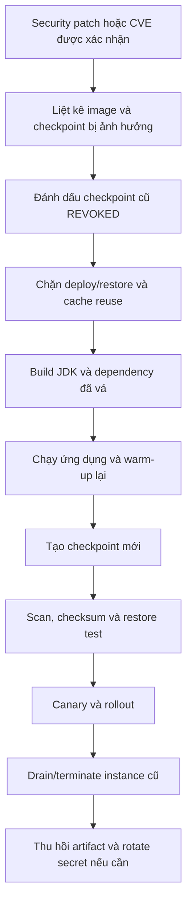

# Thu hồi ảnh cũ và tạo lại ảnh khi vá JDK hoặc thư viện

Checkpoint CRaC là trạng thái của một tiến trình Java tại thời điểm chụp. Nó có thể chứa heap, class metadata, trạng thái JIT, thread, native memory, file descriptor và các object đang tham chiếu tới thư viện hoặc dịch vụ bên ngoài. Vì vậy, khi vá JDK, framework, dependency Java hoặc native library, một checkpoint đã tạo từ phiên bản cũ không tự trở thành checkpoint an toàn của phiên bản mới.

Nếu một JDK hoặc thư viện có lỗ hổng bảo mật, chỉ cập nhật file JAR hay package trên filesystem không đủ để loại bỏ code cũ đang nằm trong trạng thái tiến trình được checkpoint. Restore có thể khôi phục class đã nạp, object, method state và native mapping từ ảnh cũ. Cách xử lý an toàn là **thu hồi checkpoint cũ khỏi luồng phát hành, build application/runtime đã vá, khởi chạy và warm-up lại, tạo checkpoint mới, kiểm thử restore rồi triển khai cặp artifact mới**.

Thu hồi cũng phải bao gồm các container image, bản sao artifact, cache build, node đang chạy từ checkpoint cũ và mọi bản backup còn có thể được dùng để restore. Nếu checkpoint cũ có thể chứa credential hoặc dữ liệu nhạy cảm, cần đánh giá việc rotate secret và thu hồi token liên quan.

## 1. Vì sao không thể chỉ vá file rồi tiếp tục dùng checkpoint cũ?

Một checkpoint không chỉ ghi lại đường dẫn tới application JAR. Nó ghi lại trạng thái của process. Tùy runtime và checkpoint engine, ảnh có thể bao gồm:

- Heap với object graph và class instance được tạo từ code đã nạp.
- Class metadata, classloader state và trạng thái runtime liên quan.
- Code đã được JIT compile và các dữ liệu profile/runtime.
- Native memory, thư viện native đã được map và trạng thái JNI.
- Thread state, stack, lock và các tài nguyên của process.
- File descriptor, socket, mapping và metadata cần cho restore.

Giả sử ứng dụng đã nạp `library-a-1.4.jar`, khởi tạo một singleton và tạo checkpoint. Sau đó pipeline thay file trên filesystem bằng `library-a-1.5.jar` nhưng vẫn dùng checkpoint cũ. Restore không đồng nghĩa với việc JVM khởi động lại classloader và nạp toàn bộ class từ file JAR mới. Process được khôi phục từ trạng thái cũ; các class đã nạp và object trong heap có thể vẫn là phiên bản trước.

Tương tự, nếu thay binary của JDK hoặc native library bên dưới checkpoint, runtime có thể không tương thích với trạng thái process đã được tạo bởi binary cũ. Ngay cả khi thao tác restore không báo lỗi ngay, việc trộn runtime cũ và mới có thể tạo hành vi không được hỗ trợ.

**Checkpoint phải được xem là gắn với đúng application image, JDK, native libraries và môi trường đã tạo nó.** Khi những thành phần đó thay đổi vì bản vá, hãy tạo checkpoint mới từ runtime và application đã vá, trừ khi nhà cung cấp runtime xác nhận rõ một đường nâng cấp checkpoint cụ thể được hỗ trợ.

## 2. Phân biệt các loại bản vá

Không phải mọi thay đổi đều có cùng phạm vi ảnh hưởng. Trước khi quyết định thu hồi checkpoint, cần xác định thành phần nào được vá và nó có nằm trong trạng thái process hay môi trường restore không.

| Loại thay đổi | Ví dụ | Hành động với checkpoint |
|---|---|---|
| JDK security update | Cập nhật CPU/PSU, sửa lỗi JVM, TLS, class library hoặc CRaC implementation | Tạo lại checkpoint bằng đúng JDK đã vá và kiểm thử trên runtime đích |
| Java dependency update | Cập nhật Spring, logging, HTTP client, ORM hoặc thư viện có CVE | Rebuild application, chạy lại để nạp class mới, warm-up và tạo checkpoint mới |
| Native library update | Cập nhật OpenSSL, compression library, JNI library hoặc driver | Tạo lại checkpoint từ image có native library mới; kiểm tra ABI và lifecycle |
| OS/base image update | Cập nhật libc, package hệ thống, CA bundle hoặc base image | Đánh giá compatibility; thường tạo checkpoint mới trên base image đã vá |
| Cấu hình runtime không đổi code | Thay endpoint hoặc timeout | Có thể refresh lúc restore nếu thiết kế hỗ trợ; vẫn cần xác minh checkpoint không giữ cấu hình cũ |
| Thay secret hoặc certificate | Rotate password, API key, TLS certificate | Cấp mới khi restore và thu hồi credential cũ; checkpoint chứa secret cũ phải được xử lý như bản sao nhạy cảm |

Nếu bản vá chỉ thay đổi cấu hình không nằm trong process snapshot và ứng dụng có thể đọc lại cấu hình sau restore, có thể không cần tạo lại toàn bộ checkpoint trong một số thiết kế. Tuy nhiên, nếu bản vá thay code, class, JDK, native library hoặc bất kỳ thành phần nào đã được nạp vào process, hãy tạo lại checkpoint.

## 3. Checkpoint cũ có thể tiếp tục mang lỗ hổng

Một lỗ hổng trong JDK hoặc dependency có thể được khai thác qua code đã nạp vào process. Nếu checkpoint cũ còn được restore, ứng dụng có thể quay lại trạng thái dễ bị tấn công dù container image mới đã chứa file đã vá.

Ví dụ quy trình sai:

1. Tạo checkpoint từ JDK cũ và dependency có CVE.
2. Cập nhật JDK hoặc JAR trên filesystem của final image.
3. Giữ nguyên checkpoint directory cũ.
4. Triển khai image và restore checkpoint cũ.

Ở đây, pipeline đã thay filesystem nhưng vẫn khôi phục trạng thái process được tạo từ code cũ. Việc cập nhật file không phải bằng chứng rằng class đã nạp, JIT code hoặc native state cũ đã được thay thế.

Một quy trình đúng hơn:

1. Xác định release và checkpoint chịu ảnh hưởng.
2. Ngăn deployment mới sử dụng checkpoint cũ.
3. Build application image với JDK/dependency/native library đã vá.
4. Chạy ứng dụng mới từ đầu trong môi trường tương thích.
5. Warm-up bằng fixture an toàn và drain công việc.
6. Tạo checkpoint mới và gắn với digest image mới.
7. Kiểm thử restore từ final image mới.
8. Triển khai bản mới, loại bỏ instance cũ và thu hồi artifact cũ theo chính sách.

## 4. Xác định phạm vi thu hồi

Trước khi xóa artifact, hãy xác định tất cả nơi có thể lưu hoặc sử dụng checkpoint. Một release có thể tồn tại ở nhiều tầng khác nhau:

| Nơi lưu hoặc sử dụng | Việc cần làm |
|---|---|
| Container registry | Đánh dấu image cũ không còn được phép triển khai; xóa tag hoặc manifest theo chính sách và kiểm soát digest |
| Checkpoint artifact repository | Thu hồi quyền tải, đánh dấu revoked và xóa version cũ khi retention cho phép |
| Object storage | Kiểm tra versioning, object lock, replication và backup; thu hồi quyền truy cập hoặc xóa theo policy |
| CI/CD artifact cache | Vô hiệu hóa cache layer chứa checkpoint cũ và ngăn pipeline tái sử dụng |
| Build runner/local workspace | Xóa checkpoint tạm và workspace sau khi artifact mới được xác minh |
| Node/container đang chạy | Drain traffic, thay thế process/container được restore từ checkpoint cũ |
| Kubernetes workload/volume | Cập nhật image digest, checkpoint reference, init container và volume chứa artifact |
| Backup/replica/DR site | Đánh dấu bản cũ không hợp lệ, kiểm soát khả năng restore và cập nhật bản dự phòng |
| Developer workstation hoặc mirror | Theo dõi các bản sao được phân phối; thu hồi quyền hoặc xóa theo chính sách nội bộ |

Xóa một tag không nhất thiết xóa blob content-addressed trong registry. Xóa file ở repository chính cũng không xóa bản sao trong cache, mirror, backup hoặc node đã tải xuống. Cần phân biệt **ngừng phát hành**, **thu hồi quyền sử dụng** và **xóa vật lý mọi bản sao**; khả năng xóa hoàn toàn phụ thuộc hệ thống lưu trữ và retention policy.

## 5. Quy trình ứng phó khi phát hiện bản vá bảo mật

Khi JDK hoặc thư viện có CVE ảnh hưởng tới ứng dụng, nên điều phối xử lý theo release và checkpoint identity:

### Bước 1 — Xác định release bị ảnh hưởng

- Xác định phiên bản JDK, vendor, build và package đã cài.
- Xác định dependency Java và native library có trong application image.
- Đối chiếu SBOM, scan report và advisory của nhà cung cấp.
- Liệt kê application image digest và checkpoint digest được tạo từ các thành phần đó.
- Xác định node pool, môi trường và replica đang chạy từ checkpoint bị ảnh hưởng.

### Bước 2 — Ngăn sử dụng checkpoint cũ

- Đánh dấu checkpoint release là `REVOKED` hoặc trạng thái tương đương trong release catalog.
- Chặn pipeline deployment chọn checkpoint đó.
- Chặn restore job tải artifact cũ theo policy.
- Vô hiệu hóa build cache có thể tái sử dụng checkpoint cũ.
- Không cho phép tag cũ được promotion trở lại môi trường production.

### Bước 3 — Build bản vá và tạo checkpoint mới

- Cập nhật JDK/base image và dependency bị ảnh hưởng.
- Build lại application binary, native library và container image.
- Tạo SBOM mới và scan lại artifact.
- Chạy ứng dụng từ đầu bằng runtime đã vá.
- Warm-up bằng dữ liệu tổng hợp và dependency kiểm soát được.
- Thực hiện `beforeCheckpoint` để drain và chuẩn bị tài nguyên.
- Tạo checkpoint mới, checksum và manifest mới.

### Bước 4 — Kiểm chứng restore

- Restore checkpoint mới từ final image/artifact đúng như deployment sẽ chạy.
- Xác nhận JDK và dependency version trong runtime thực tế là phiên bản đã vá.
- Kiểm tra kết nối, listener, service discovery, logging, metrics và tracing.
- Chạy smoke test qua các đường nghiệp vụ quan trọng.
- Kiểm tra scan/provenance metadata của image và checkpoint.

### Bước 5 — Triển khai và thay thế process cũ

- Triển khai canary với image/checkpoint mới.
- Chờ readiness và health check thành công.
- Chuyển traffic dần sang instance mới.
- Drain và terminate instance đang chạy từ checkpoint cũ.
- Xác nhận không còn replica cũ nhận traffic hoặc giữ lease.

### Bước 6 — Thu hồi và đóng sự kiện

- Thu hồi artifact và tag cũ theo retention policy.
- Xóa cache, workspace và bản sao tạm có thể kiểm soát.
- Rotate credential nếu checkpoint cũ có thể chứa secret đã bị lộ hoặc không còn hợp lệ.
- Ghi lại release bị thu hồi, artifact mới, node đã cập nhật và bằng chứng kiểm chứng.



## 6. Tạo checkpoint mới từ JDK đã vá

Khi JDK được cập nhật, hãy build lại runtime image từ đúng distribution/build đã vá. Không chỉ thay thư mục `JAVA_HOME` trong image cũ rồi dùng checkpoint cũ.

Quy trình prepare mới:

1. Chọn CRaC-enabled JDK có bản vá và xác nhận phiên bản CRaC tương thích.
2. Cập nhật OS base image và package hệ thống nếu advisory yêu cầu.
3. Build application image mới với digest bất biến.
4. Chạy ứng dụng từ đầu trên runtime đã vá.
5. Xác nhận JVM thực tế đang chạy đúng vendor, version và build.
6. Chạy warm-up với fixture và dependency an toàn.
7. Drain request, scheduler, consumer và background task.
8. Tạo checkpoint bằng runtime đã vá.
9. Lưu checkpoint trong release path mới, không ghi đè artifact cũ.
10. Thử restore từ chính cặp image/checkpoint mới.

Một checkpoint tạo từ JDK build cũ thường không nên được restore bằng JDK build mới nếu không có cam kết compatibility rõ ràng. Thay đổi JDK có thể ảnh hưởng layout runtime, class library, native code và CRaC implementation. Hãy ưu tiên tạo checkpoint trên chính runtime sẽ được đóng gói và dùng để restore.

### Ghi lại phiên bản runtime thực tế

Trong prepare stage, lưu output của `java -version`, thông tin vendor/build và các JVM flags liên quan vào manifest hoặc build provenance. Không chỉ dựa vào tên tag như `java-crac:latest`, vì tag có thể trỏ tới nội dung khác ở lần build sau.

Manifest nên ghi:

- JDK vendor/distribution và full build version.
- Application image digest và application commit.
- OS base image digest và architecture.
- CRIU/checkpoint engine version nếu dùng.
- Native library và driver quan trọng.
- Checkpoint creation timestamp và digest.
- SBOM reference và vulnerability scan result.

## 7. Tạo checkpoint mới khi vá Java dependency

Với thư viện Java, cần rebuild application artifact để dependency graph mới được đóng gói. Sau đó chạy ứng dụng từ đầu để classloader nạp phiên bản đã vá và warm-up các đường code cần thiết.

Ví dụ, nếu `http-client` có CVE:

1. Cập nhật version trong dependency management hoặc lockfile.
2. Kiểm tra dependency tree để bảo đảm không còn version dễ bị ảnh hưởng qua dependency bắc cầu.
3. Build lại JAR/image và ghi lại SBOM mới.
4. Chạy ứng dụng mới trên runtime tương thích.
5. Xác nhận classpath thực tế không còn JAR cũ.
6. Warm-up request sử dụng HTTP client đã cập nhật.
7. Tạo checkpoint mới từ process đã nạp thư viện mới.
8. Kiểm thử restore và xác nhận runtime sử dụng đúng dependency.

Không thay JAR trong container filesystem sau khi checkpoint đã được tạo rồi tiếp tục dùng checkpoint đó. Các class đã nạp và object cũ có thể vẫn nằm trong snapshot. Cũng không nên dùng classloader hot reload như một biện pháp thay thế cho việc tạo lại checkpoint khi bản vá liên quan tới code đang được giữ trong process state.

### Kiểm tra dependency bắc cầu

Một bản vá trực tiếp có thể chưa đủ nếu dependency khác vẫn kéo phiên bản cũ vào classpath. Dùng dependency lock, dependency insight/tree và SBOM để kiểm tra toàn bộ đồ thị thư viện. Nếu nhiều version cùng tồn tại, xác định classloader thực tế nạp bản nào.

Sau khi build, kiểm tra artifact mới thay vì chỉ kiểm tra file build script. Release manifest cần trỏ tới đúng JAR/image digest đã được scan và dùng để tạo checkpoint.

## 8. Vá native library và driver

Native library có thể được map vào process và được gọi qua JNI hoặc bởi JDK. Ví dụ: OpenSSL, zlib, font/rendering library, database client native, GPU driver hoặc thư viện C/C++ riêng.

Khi cập nhật native library:

- Build lại container/base image có binary đã vá.
- Kiểm tra ABI, architecture và dynamic linker path.
- Khởi chạy process mới để nạp đúng binary mới.
- Kiểm tra `ldd`, package inventory hoặc công cụ tương đương trong môi trường build để xác nhận dependency native.
- Chạy warm-up và test những đường JNI/native quan trọng.
- Tạo checkpoint mới từ process đã nạp thư viện đã vá.
- Restore test trên host/kernel/driver tương thích.

Không ghi đè `.so` hoặc DLL trong khi process checkpoint cũ vẫn tồn tại rồi giả định restore sẽ dùng binary mới. Mapping và trạng thái native của process cũ có thể còn tham chiếu tới binary cũ. Một số thay đổi driver/kernel còn yêu cầu kiểm tra tương thích hệ điều hành và host node.

## 9. Thu hồi checkpoint và image cũ trong registry

Thu hồi cần có một danh mục artifact rõ ràng. Với mỗi release, lưu quan hệ giữa:

```text
release ID
  -> application image digest
  -> checkpoint artifact digest
  -> JDK/runtime build
  -> dependency/native SBOM
  -> restore test result
  -> deployment/node references
```

Khi release bị thu hồi:

1. Đánh dấu release/checkpoint là revoked trong catalog hoặc manifest registry.
2. Chặn quyền deploy/restore đối với digest đó.
3. Xóa hoặc disable tag mutable trỏ tới image cũ.
4. Xóa checkpoint artifact cũ khi policy cho phép.
5. Dọn registry cache và artifact cache theo cơ chế của nền tảng.
6. Kiểm tra replication/mirror và backup có giữ bản cũ không.
7. Lưu audit record về artifact bị thu hồi và lý do.

Không nên chỉ xóa tag rồi coi như checkpoint đã biến mất. Registry có thể giữ blob theo digest, node có thể đã pull image, và cache builder có thể giữ layer. Cần kiểm tra retention/garbage collection và xác nhận artifact cũ không còn được tham chiếu bởi deployment đang hoạt động.

### Dùng trạng thái revoked thay cho xóa tức thì trong mọi trường hợp

Trong một số tổ chức, artifact phải được giữ một thời gian để kiểm toán. Có thể đánh dấu revoked, chặn quyền sử dụng và giữ bản lưu cách ly theo retention policy. Bản lưu đó không được xuất hiện trong danh sách release có thể deploy hoặc restore.

Nếu quy định yêu cầu xóa vật lý, thực hiện theo chính sách xóa của registry/object store và kiểm tra các bản replica/backup. Không hứa rằng mọi bản sao đã tải xuống bên ngoài hệ thống có thể bị xóa từ xa.

## 10. Thu hồi checkpoint đang chạy trên node

Xóa artifact khỏi registry không dừng các process đã restore từ artifact đó. Những instance này vẫn có thể đang chạy code cũ và tiếp tục phục vụ traffic.

Với mỗi node hoặc workload:

- Xác định image digest và checkpoint release mà instance đang dùng.
- Đánh dấu instance cũ not ready và ngừng nhận traffic mới.
- Drain request, transaction, message handler và background task.
- Gỡ service registration/lease cũ.
- Terminate process/container theo quy trình graceful shutdown.
- Tạo instance mới từ cặp image/checkpoint đã vá.
- Xác nhận readiness và health trước khi chuyển traffic.
- Kiểm tra không còn pod/container/VM cũ giữ lease hoặc tham gia consumer group.

Nếu lỗ hổng nghiêm trọng và đang bị khai thác, thời gian drain có thể phải rút ngắn theo incident policy. Tuy nhiên, không để một instance cũ tiếp tục nhận traffic chỉ vì chưa thể tạo checkpoint mới; có thể tạm thời dùng cold start từ image đã vá nếu tương thích.

### Kubernetes

Với Kubernetes, cập nhật image digest trong Deployment/StatefulSet/DaemonSet và rollout để thay pod cũ. Nếu checkpoint được mount từ PVC, object storage hoặc init container tải về, cần cập nhật checkpoint reference cùng release ID và bảo đảm volume/cache cũ không được tái sử dụng nhầm.

Không chỉ restart pod mà giữ nguyên một volume chứa checkpoint cũ. Cũng cần xem xét node-local cache, image pull cache, init container và sidecar có tham chiếu tới artifact cũ hay không. Sau rollout, kiểm tra tất cả replica đã chạy digest mới và endpoint cũ đã biến mất khỏi service discovery.

## 11. Secret rotation khi checkpoint cũ có thể chứa thông tin nhạy cảm

Checkpoint có thể chứa password, API token, session cookie, private key, TLS context hoặc credential đã được nạp vào heap/native memory. Nếu artifact cũ bị lộ hoặc đã được phân phối tới một nơi không còn kiểm soát, việc xóa artifact chưa chắc đủ.

Đánh giá các hành động:

- Rotate database password, API key hoặc service credential đã nằm trong checkpoint cũ.
- Thu hồi access token hoặc refresh token có thể vẫn còn hiệu lực.
- Thay certificate/private key nếu checkpoint có thể chứa private key và có nguy cơ lộ.
- Xóa/thu hồi session hoặc lease gắn với instance cũ.
- Cấp workload identity mới cho instance restore.
- Kiểm tra log và audit event để xác định artifact đã được tải hoặc sử dụng ở đâu.

Không phải mọi checkpoint đều buộc phải rotate mọi secret. Quyết định dựa trên loại credential, phạm vi quyền, thời hạn, khả năng bị truy cập và chính sách incident. Nhưng khi có dấu hiệu checkpoint bị lộ, hãy coi các secret nằm trong snapshot là có nguy cơ và xử lý theo quy trình ứng phó sự cố.

## 12. Rollback sau khi vá: không quay lại checkpoint dễ bị tổn thương

Rollback thường dùng release trước khi release mới gặp lỗi. Nhưng trong một bản vá bảo mật, release trước có thể chính là bản chứa JDK hoặc dependency dễ bị tấn công.

Vì vậy, cần phân biệt:

- **Rollback kỹ thuật:** quay về một cặp application image/checkpoint đã biết hoạt động.
- **Rollback an toàn:** quay về một cặp artifact vẫn đáp ứng yêu cầu bảo mật hiện tại.

Nếu release trước còn lỗ hổng, không dùng checkpoint cũ làm fallback production chỉ vì nó restore nhanh. Các lựa chọn có thể gồm:

1. Sửa nhanh bản vá và tạo checkpoint mới.
2. Dùng cold start từ application image đã vá nếu checkpoint mới chưa sẵn sàng.
3. Quay về một release cũ hơn nhưng đã được vá hoặc không chịu ảnh hưởng.
4. Tạm giảm tính năng hoặc traffic trong khi tạo lại artifact an toàn.

Release catalog nên ghi trạng thái security approval/revocation riêng với trạng thái restore-tested. Một checkpoint có thể restore thành công về mặt kỹ thuật nhưng vẫn bị cấm deploy vì chứa code dễ bị tấn công.

## 13. Kiểm soát cache và tránh tái sử dụng nhầm checkpoint

Build cache là một nguồn gây tái sử dụng artifact cũ nếu cache key không bao gồm mọi input quan trọng. Checkpoint phụ thuộc vào application image, JDK, native libraries, OS, kernel, CRIU/checkpoint engine, cấu hình và workload prepare.

Khi vá, hãy:

- Tăng release ID hoặc checkpoint generation.
- Dùng image digest bất biến thay vì tag mutable.
- Đưa JDK build, dependency lock/SBOM digest và native base image digest vào manifest.
- Invalidate layer/cache checkpoint khi bất kỳ input nào ảnh hưởng process state thay đổi.
- Không copy checkpoint từ cache cũ chỉ vì Docker layer báo cache hit.
- Lưu checkpoint vào đường dẫn versioned, không ghi đè thư mục release đang dùng.
- Xác minh checkpoint digest sau khi copy và trước khi restore.

Ví dụ quy ước đường dẫn:

```text
artifacts/
  orders-service/
    release-2026.11.13.2-patched/
      application-image.digest
      checkpoint.tar
      checkpoint.sha256
      release-manifest.yml
      sbom.spdx.json
      restore-test.json
```

Tên trên chỉ minh họa. Mỗi release cần artifact path bất biến và có thể truy nguyên về đúng commit/build.

## 14. Manifest và provenance cho checkpoint mới

Một manifest tốt giúp chứng minh checkpoint mới được tạo từ đúng runtime đã vá. Ví dụ:

```yaml
release:
  id: orders-service-2026.11.13.2
  status: approved
  applicationCommit: 3b7d9e10
  applicationImage: registry.example.com/orders-service@sha256:IMAGE_DIGEST

runtime:
  jdkVendor: example-vendor
  jdkVersion: 25.0.x+patched-build
  osImageDigest: sha256:OS_IMAGE_DIGEST
  architecture: linux-amd64
  checkpointEngine: tested-engine-build

dependencies:
  lockfileDigest: sha256:LOCKFILE_DIGEST
  sbom: sbom.spdx.json
  nativeLibrariesDigest: sha256:NATIVE_LIBRARIES_DIGEST

checkpoint:
  generation: 2
  artifact: checkpoint.tar
  digest: sha256:CHECKPOINT_DIGEST
  createdAt: "2026-11-13T08:00:00Z"
  restoreTest: passed

security:
  patchedAdvisories:
    - CVE-YYYY-NNNN
  scanResult: passed
  supersedes: orders-service-2026.11.13.1
```

Các giá trị là placeholder, không phải thông tin về một CVE hoặc runtime thực tế. Pipeline phải điền dữ liệu từ build, SBOM, scanner và restore test. Không tự ghi `passed` khi chưa có bằng chứng tương ứng.

Manifest nên được ký hoặc gắn provenance attestation nếu chuỗi cung ứng hỗ trợ. Chữ ký cần bao phủ release identity và digest của checkpoint/image để người triển khai có thể xác minh nguồn gốc.

## 15. Kiểm chứng bản vá trước khi phát hành checkpoint mới

Việc tạo checkpoint mới không thay thế quy trình kiểm tra bản vá. Trước khi publish:

1. Xác nhận JDK build đúng bản vá từ nhà cung cấp.
2. Xác nhận dependency tree không còn phiên bản bị ảnh hưởng.
3. Quét application image, OS packages và native libraries.
4. Kiểm tra SBOM và provenance.
5. Chạy test chức năng và integration trên application image mới.
6. Tạo checkpoint từ đúng image đã scan.
7. Restore từ final image/artifact đúng cách deployment sẽ dùng.
8. Xác nhận runtime version sau restore.
9. Chạy smoke test và kiểm tra resource lifecycle.
10. Xác nhận checkpoint digest trong deployment manifest trùng với artifact đã kiểm thử.

Nếu scanner báo CVE ở một package không được nạp vào process, vẫn cần đánh giá phạm vi ảnh hưởng theo policy bảo mật. Không tự bỏ qua kết quả chỉ vì package không nằm trong classpath Java; native library hoặc package hệ thống vẫn có thể được sử dụng bởi process.

## 16. Triển khai theo canary và xác nhận không còn process cũ

Một rollout có kiểm soát giúp phát hiện lỗi restore trước khi thay toàn bộ fleet:

1. Triển khai một canary với image/checkpoint mới.
2. Xác nhận image digest, checkpoint digest và JDK build trên instance.
3. Kiểm tra callback restore và resource recreation.
4. Gửi traffic thử nghiệm và quan sát latency/error rate.
5. Mở rộng rollout theo batch.
6. Drain và terminate instance cũ theo đúng release identity.
7. Kiểm tra service registry, consumer group, lease và node inventory.
8. Chỉ đánh dấu rollout hoàn tất khi không còn instance sử dụng release bị thu hồi.

Một metric hữu ích là số instance theo checkpoint generation. Nếu số instance của generation cũ không về 0, cần tìm process bị bỏ sót, pod không được rollout, VM chưa thay hoặc worker chạy ngoài deployment controller.

## 17. Thu hồi artifact và retention

Không phải lúc nào cũng có thể xóa ngay checkpoint cũ. Registry có thể áp dụng retention, object lock hoặc backup immutable. Trong trường hợp đó, hãy:

- Đánh dấu artifact revoked trong catalog.
- Chặn quyền tải và restore.
- Di chuyển artifact sang vùng lưu trữ cách ly nếu cần giữ kiểm toán.
- Gắn thời điểm hết hạn và người chịu trách nhiệm xóa.
- Kiểm tra replica và backup theo chu kỳ.
- Xác nhận các deployment manifest không còn tham chiếu tới digest cũ.

Nếu có yêu cầu xóa vật lý, thực hiện theo cơ chế của storage provider và lưu bằng chứng xóa. Với bản sao ngoài hệ thống đã tải xuống, chỉ có thể thu hồi quyền truy cập nếu nền tảng hỗ trợ; không thể đảm bảo xóa từ xa mọi bản sao không được quản lý.

## 18. Kịch bản kiểm thử thu hồi và tạo lại

Một quy trình vận hành nên được diễn tập trước khi có CVE nghiêm trọng:

1. Tạo release mẫu có application image và checkpoint generation 1.
2. Đánh dấu generation 1 là revoked trong môi trường kiểm thử.
3. Xác nhận deployment pipeline từ chối restore generation 1.
4. Cập nhật JDK hoặc dependency trong application build.
5. Tạo application image và checkpoint generation 2.
6. Xác nhận manifest ghi đúng JDK/dependency mới và digest mới.
7. Restore generation 2 từ final image.
8. Kiểm tra runtime version, classpath, native library và readiness.
9. Rollout generation 2 và xác nhận instance generation 1 được drain/terminate.
10. Kiểm tra registry/cache/backup và trạng thái revoked của generation 1.
11. Thử rollback để xác nhận policy không cho quay về checkpoint có lỗ hổng.
12. Thử secret rotation nếu fixture checkpoint có credential giả lập.

Kịch bản này kiểm tra cả khả năng tạo checkpoint mới lẫn khả năng ngăn hệ thống vô tình tái sử dụng checkpoint đã thu hồi.

## 19. Quan sát và báo cáo trạng thái thu hồi

Nên có một báo cáo cho mỗi đợt vá:

| Trường | Ý nghĩa |
|---|---|
| Advisory/CVE | Lý do cần vá |
| Affected release IDs | Các release có thể bị ảnh hưởng |
| Old image/checkpoint digest | Artifact cần thu hồi |
| New image/checkpoint digest | Artifact thay thế |
| JDK/dependency version | Bằng chứng phiên bản đã vá |
| Restore test result | Kết quả kiểm chứng cặp artifact mới |
| Running old instances | Số process cũ còn hoạt động |
| Revocation status | Artifact cũ đã bị chặn/thu hồi ở đâu |
| Secret rotation status | Credential liên quan đã được xử lý chưa |
| Exceptions | Backup hoặc môi trường chưa thể cập nhật |

Các metric vận hành có thể gồm:

- Số instance theo checkpoint generation.
- Số lần deployment bị chặn do checkpoint revoked.
- Số artifact cũ còn trong registry hoặc backup.
- Thời gian từ thông báo bản vá tới lúc không còn instance cũ.
- Restore success rate của checkpoint generation mới.
- Tỷ lệ cold-start fallback trong đợt rollout.

Không đưa secret hoặc nội dung checkpoint vào báo cáo. Chỉ lưu digest, version, trạng thái và metadata cần cho audit.

## 20. Checklist thu hồi và tạo lại checkpoint

### Xác định và thu hồi

- [ ] Đã xác định JDK/dependency/native library và advisory bị ảnh hưởng.
- [ ] Đã liệt kê application image digest và checkpoint digest được tạo từ phiên bản cũ.
- [ ] Checkpoint cũ đã được đánh dấu revoked trong release catalog.
- [ ] Pipeline deploy/restore không còn chọn artifact cũ.
- [ ] Build cache, registry, object storage, mirror và backup đã được kiểm tra.
- [ ] Instance đang chạy từ checkpoint cũ đã được drain và thay thế.
- [ ] Secret/token/certificate đã được đánh giá để rotate hoặc revoke.

### Tạo lại và kiểm chứng

- [ ] JDK, application dependency, native library và base image đã được vá.
- [ ] Application image mới có digest bất biến.
- [ ] SBOM và scan report mới được tạo.
- [ ] Ứng dụng được chạy từ đầu bằng runtime đã vá.
- [ ] Warm-up và drain hoàn tất trước checkpoint.
- [ ] Checkpoint mới được tạo từ đúng runtime/application image đã vá.
- [ ] Manifest liên kết đúng image digest, checkpoint digest và runtime build.
- [ ] Restore smoke test chạy từ artifact cuối cùng đã đóng gói.
- [ ] Canary và rollout xác nhận resource/health/readiness.
- [ ] Không còn process cũ sử dụng checkpoint generation bị thu hồi.

### Đóng sự kiện

- [ ] Artifact cũ bị chặn sử dụng và được xóa/cách ly theo retention policy.
- [ ] Rollback policy không trỏ tới checkpoint dễ bị tổn thương.
- [ ] Bằng chứng scan, restore test, rollout và revocation được lưu.
- [ ] Các exception còn tồn tại có owner và thời hạn xử lý.

## 21. Kết luận

Checkpoint CRaC là trạng thái process, nên nó có thể giữ class, object, JIT state và native resource từ phiên bản JDK hoặc thư viện đã được nạp trước đó. Khi vá JDK, Java dependency, native library hoặc base image, hãy rebuild application/runtime và tạo checkpoint mới từ process đã chạy trên các binary đã vá. Không thay file trên filesystem rồi tiếp tục restore ảnh cũ.

Thu hồi phải bao gồm artifact repository, container registry, build cache, backup và instance đang chạy. Đánh dấu checkpoint cũ không còn được phép deploy, rollout process mới, kiểm tra không còn replica cũ và rotate secret nếu snapshot có thể chứa credential cần thu hồi. Gắn checkpoint mới với image digest, runtime build, SBOM và restore test để mỗi lần triển khai có thể xác định chính xác trạng thái đã được vá.
