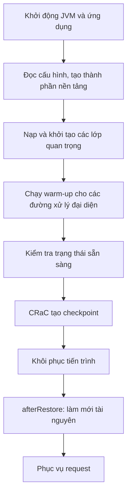

# Nạp lớp và khởi tạo lớp trước thời điểm checkpoint

Trong ứng dụng Java sử dụng CRaC (Coordinated Restore at Checkpoint), checkpoint lưu lại trạng thái tiến trình tại một thời điểm đã chọn. Khi khôi phục từ checkpoint, JVM tiếp tục từ trạng thái đã lưu thay vì phải khởi động ứng dụng từ đầu. Vì vậy, những công việc có thể hoàn tất an toàn trước checkpoint — chẳng hạn nạp các lớp thường dùng, chạy bộ khởi tạo tĩnh và chuẩn bị các đường xử lý quan trọng — có thể được thực hiện sớm để giảm độ trễ sau restore.

Nạp lớp và khởi tạo lớp là hai giai đoạn khác nhau. Nạp một lớp giúp JVM biết định nghĩa của lớp; khởi tạo lớp chạy các biểu thức gán trường `static` và khối `static`. Một lớp đã được nạp chưa chắc đã được khởi tạo. Muốn chuẩn bị đúng trạng thái cho checkpoint, cần hiểu rõ sự khác nhau này, biết cách chủ động kích hoạt từng giai đoạn và kiểm soát tác dụng phụ của mã khởi tạo.

## 1. Vì sao chuẩn bị lớp trước checkpoint?

Ở lần chạy đầu tiên, JVM có thể phải đọc bytecode, định nghĩa lớp, kiểm tra bytecode, liên kết các tham chiếu và chạy mã khởi tạo tĩnh khi ứng dụng lần đầu sử dụng một lớp. Những thao tác này thường phân tán trong quá trình xử lý request. Nếu request đầu tiên sau restore chạm vào một lớp chưa được nạp hoặc chưa được khởi tạo, người dùng vẫn phải chờ phần công việc đó.

Một quy trình chuẩn bị trước checkpoint có thể:

- Đưa chi phí nạp và khởi tạo các lớp quan trọng vào giai đoạn startup có kiểm soát.
- Phát hiện sớm lỗi thiếu lớp, lỗi liên kết hoặc lỗi trong static initializer.
- Làm nóng các thành phần framework thường chỉ được tạo khi request đầu tiên xuất hiện, ví dụ bộ chuyển đổi dữ liệu, bộ tuần tự hóa, validator hoặc bộ định tuyến.
- Lưu trạng thái Java đã chuẩn bị trong checkpoint để tiến trình được khôi phục với trạng thái tương ứng.

Việc chuẩn bị lớp không tự động làm cho mọi request nhanh hơn. Lợi ích phụ thuộc vào những lớp và đường xử lý được chuẩn bị, cũng như thời gian và bộ nhớ tăng thêm trước checkpoint. Một ứng dụng chỉ nên làm nóng những thành phần có giá trị thực tế đối với thời gian đáp ứng sau restore.

## 2. Vòng đời của một lớp trong JVM

Theo mô hình JVM, quá trình xử lý một lớp gồm ba nhóm công việc: loading, linking và initialization. Linking bao gồm verification, preparation và resolution. Một số tham chiếu có thể được phân giải muộn khi chương trình cần đến chúng.

| Giai đoạn | JVM thực hiện | Kết quả chính |
|---|---|---|
| Loading (nạp lớp) | Tìm bytecode và tạo biểu diễn `Class` thông qua một class loader | JVM có định nghĩa lớp để sử dụng |
| Verification (kiểm tra) | Kiểm tra cấu trúc và tính hợp lệ của bytecode | Bytecode đáp ứng các ràng buộc của JVM |
| Preparation (chuẩn bị) | Cấp vùng lưu trữ cho trường `static` và gán giá trị mặc định | Các trường tĩnh có giá trị mặc định theo kiểu dữ liệu |
| Resolution (phân giải) | Chuyển các tham chiếu ký hiệu thành tham chiếu trực tiếp khi cần | Các tham chiếu lớp, trường và phương thức có thể được sử dụng |
| Initialization (khởi tạo) | Chạy bộ khởi tạo lớp `<clinit>` nếu có | Các phép gán `static` và khối `static` được thực thi |

Ví dụ:

```java
public final class PricingRules {
    static final int DEFAULT_DISCOUNT = 5;
    static final Map<String, Integer> DISCOUNTS = loadDiscounts();

    static {
        System.out.println("PricingRules initialized");
    }

    private static Map<String, Integer> loadDiscounts() {
        return Map.of("WELCOME", 10, "LOYAL", 15);
    }

    private PricingRules() {
    }
}
```

Khi `PricingRules` được khởi tạo, JVM thực hiện các phép gán trường tĩnh và khối `static` theo thứ tự xuất hiện trong mã nguồn. Trong ví dụ này, `loadDiscounts()` chạy trong lúc khởi tạo lớp. Nếu phương thức đó đọc tệp, gọi dịch vụ bên ngoài hoặc phụ thuộc vào một tài nguyên chỉ tồn tại trong giai đoạn startup, tác dụng phụ ấy cũng xảy ra khi lớp được khởi tạo.

### 2.1. Nạp lớp không đồng nghĩa với khởi tạo lớp

`ClassLoader.loadClass()` thường nạp lớp mà không yêu cầu khởi tạo lớp. Tương tự, `Class.forName(name, false, loader)` yêu cầu JVM nạp lớp nhưng không chạy static initializer của lớp đó.

Ngược lại, `Class.forName(name, true, loader)` yêu cầu khởi tạo lớp sau khi nạp. Cách gọi `Class.forName(name)` cũng yêu cầu khởi tạo và sử dụng class loader của lớp gọi theo hợp đồng của API.

```java
ClassLoader loader = Thread.currentThread().getContextClassLoader();

// Nạp lớp; không chủ động chạy static initializer.
Class<?> loadedOnly = Class.forName(
        "com.example.PricingRules", false, loader);

// Nạp và khởi tạo lớp nếu lớp chưa được khởi tạo.
Class<?> loadedAndInitialized = Class.forName(
        "com.example.PricingRules", true, loader);
```

Không nên dùng `PricingRules.class` như một cách bảo đảm rằng static initializer đã chạy. Class literal cung cấp đối tượng `Class`, nhưng bản thân thao tác đó không phải là một hành động chủ động khởi tạo lớp theo quy tắc initialization của JVM.

### 2.2. Khi nào JVM khởi tạo một lớp?

JVM khởi tạo lớp khi chương trình thực hiện một số hành động chủ động sử dụng lớp, ví dụ:

- Tạo một instance mới bằng `new`.
- Gọi một phương thức `static` được khai báo trong lớp.
- Đọc hoặc ghi một trường `static` không phải hằng số thời gian biên dịch.
- Gọi `Class.forName(name, true, loader)`.

Khi khởi tạo một lớp, JVM cũng xử lý việc khởi tạo lớp cha theo quy tắc của Java. Việc khởi tạo một lớp có thể kéo theo khởi tạo các superinterface có phương thức `default` cần thiết theo đặc tả. Do đó, chủ động khởi tạo một lớp có thể kích hoạt thêm mã khởi tạo ở những kiểu liên quan.

Việc khởi tạo một lớp được đồng bộ hóa theo cơ chế của JVM. Nếu nhiều luồng cùng chạm vào lớp chưa khởi tạo, JVM bảo đảm bộ khởi tạo của lớp chỉ được thực hiện một lần cho định nghĩa lớp đó. Nếu bộ khởi tạo thất bại, lần khởi tạo đầu tiên thường nhận `ExceptionInInitializerError` khi lỗi ban đầu không phải là `Error`; những lần sử dụng sau có thể nhận `NoClassDefFoundError` vì JVM đánh dấu lớp ở trạng thái khởi tạo lỗi.

Danh tính của một lớp bao gồm tên lớp và class loader định nghĩa lớp đó. Hai class loader khác nhau có thể định nghĩa hai lớp cùng tên nhưng JVM xem chúng là hai kiểu khác nhau. Điều này đặc biệt quan trọng trong ứng dụng có plugin, application server hoặc nhiều class loader.

## 3. CRaC giữ lại điều gì khi checkpoint?

CRaC cho phép tạo checkpoint của tiến trình Java và khôi phục tiến trình từ trạng thái đã lưu. Khi một lớp đã được nạp và khởi tạo trước thời điểm checkpoint, trạng thái tương ứng của JVM được lưu trong checkpoint. Sau restore, JVM tiếp tục với lớp đó ở trạng thái đã khởi tạo; static initializer không chạy lại chỉ vì tiến trình vừa được khôi phục.

Điều này giúp tránh lặp lại một phần công việc startup. Tuy nhiên, trạng thái tĩnh cũng được khôi phục như trạng thái bộ nhớ khác. Nếu một trường `static` giữ dữ liệu đã cũ, một kết nối đã đóng hoặc thông tin phụ thuộc vào thời điểm startup, ứng dụng có thể tiếp tục với dữ liệu không còn phù hợp.

Ví dụ không phù hợp:

```java
public final class RuntimeState {
    // Giá trị này được chụp lại cùng trạng thái tiến trình.
    static final Instant STARTED_AT = Instant.now();

    // Kết nối mạng có thể không còn hợp lệ sau restore.
    static final RemoteClient CLIENT = RemoteClient.connect();

    private RuntimeState() {
    }
}
```

`STARTED_AT` sẽ biểu thị thời điểm khởi tạo trước checkpoint, không tự cập nhật thành thời điểm restore. `CLIENT` có thể giữ socket hoặc trạng thái giao tiếp không còn hợp lệ khi tiến trình được khôi phục. Việc lớp đã được khởi tạo thành công trước checkpoint không chứng minh rằng mọi tài nguyên mà lớp nắm giữ vẫn dùng được sau restore.

Vì vậy, cần phân biệt hai loại trạng thái:

- **Trạng thái Java có thể giữ lại:** cấu trúc dữ liệu bất biến, bảng tra cứu đã tính toán, metadata, cấu hình cố định của môi trường triển khai và các đối tượng thuần Java không phụ thuộc tài nguyên bên ngoài.
- **Trạng thái cần làm mới:** socket, kết nối cơ sở dữ liệu, file descriptor, thread nền, bộ hẹn giờ, dữ liệu phụ thuộc thời gian, thông tin xác thực có vòng đời riêng hoặc cache cần đồng bộ lại.

Với nhóm thứ hai, hãy quản lý vòng đời tài nguyên bằng cơ chế CRaC và làm mới trạng thái sau restore. Không nên đặt việc mở kết nối hoặc khởi động thread nền vào static initializer chỉ để ép lớp được khởi tạo trước checkpoint.

## 4. Thiết kế giai đoạn warm-up trước checkpoint

Một giai đoạn warm-up tốt nên chạy sau khi cấu hình và các thành phần ứng dụng cần thiết đã sẵn sàng, nhưng trước khi yêu cầu tạo checkpoint được thực hiện. Giai đoạn này cần có danh sách mục tiêu rõ ràng và có thể chạy lặp lại an toàn trong môi trường kiểm thử.

Quy trình điển hình:



Các bước cần chú ý:

1. **Chọn đúng class loader.** Dùng class loader chịu trách nhiệm định nghĩa các lớp của ứng dụng. Trong môi trường có plugin hoặc container, class loader của luồng hiện tại có thể khác class loader của module cần làm nóng.
2. **Nạp và khởi tạo theo danh sách.** Ưu tiên lớp thuộc đường xử lý quan trọng, các adapter, serializer, validator, controller hoặc thành phần framework có chi phí khởi tạo đáng kể.
3. **Thực thi đường xử lý đại diện.** Nạp lớp không bảo đảm mọi lớp phụ thuộc được phân giải, mọi proxy được tạo hoặc mọi nhánh framework được chuẩn bị. Hãy chạy những thao tác đại diện bằng dữ liệu thử an toàn.
4. **Kiểm tra hoàn tất.** Nếu một lớp bắt buộc không thể nạp hoặc khởi tạo, hãy làm startup thất bại trước khi tạo checkpoint. Không đánh dấu ứng dụng sẵn sàng khi warm-up còn lỗi.
5. **Chuẩn bị tài nguyên cho checkpoint.** Dừng hoặc giải phóng các tài nguyên cần xử lý trước checkpoint theo vòng đời CRaC.
6. **Làm mới sau restore.** Mở lại kết nối, tạo lại thread hoặc đồng bộ cache cần thiết trong callback sau restore trước khi ứng dụng nhận request phụ thuộc vào chúng.

### 4.1. Chủ động nạp và khởi tạo lớp

Có thể dùng `Class.forName` để khởi tạo một danh sách lớp đã biết. Danh sách tường minh giúp người đọc hiểu ứng dụng đang chuẩn bị thành phần nào và tránh quét toàn bộ classpath một cách thiếu kiểm soát.

```java
import java.util.List;

public final class ClassWarmup {
    private static final List<String> IMPORTANT_CLASSES = List.of(
            "com.example.api.OrderController",
            "com.example.json.OrderSerializer",
            "com.example.validation.OrderValidator",
            "com.example.pricing.PricingRules"
    );

    private ClassWarmup() {
    }

    public static void run(ClassLoader loader) {
        for (String className : IMPORTANT_CLASSES) {
            try {
                Class.forName(className, true, loader);
            } catch (ClassNotFoundException e) {
                throw new IllegalStateException(
                        "Cannot warm up required class: " + className, e);
            }
        }
    }
}
```

Gọi warm-up trong giai đoạn startup:

```java
public final class Application {
    public static void main(String[] args) {
        ApplicationContext context = createApplicationContext();
        context.start();

        ClassLoader appLoader = Application.class.getClassLoader();
        ClassWarmup.run(appLoader);

        warmupImportantPaths(context);
        markReadyForCheckpoint();
    }

    private static void warmupImportantPaths(ApplicationContext context) {
        // Gọi các thao tác đại diện bằng dữ liệu thử an toàn.
        context.orderSerializer().serialize(sampleOrder());
        context.orderValidator().validate(sampleOrder());
    }
}
```

Đây là ví dụ minh họa cấu trúc. Trong ứng dụng thực tế, hãy tích hợp warm-up vào lifecycle hiện có của framework để bảo đảm dependency injection, cấu hình và class loader đã ở trạng thái đúng. Tránh tạo một luồng startup song song không được chờ hoàn tất trước checkpoint.

`Class.forName` có thể ném `ClassNotFoundException`. Static initializer cũng có thể ném lỗi trong lúc khởi tạo; lỗi đó cần được xử lý như lỗi startup. Không nên bắt mọi `Throwable` rồi bỏ qua, vì như vậy checkpoint có thể được tạo dù thành phần quan trọng chưa sẵn sàng.

### 4.2. Làm nóng đường xử lý, không chỉ danh sách lớp

Một lớp có thể được nạp và khởi tạo trong khi những phần quan trọng của hệ thống vẫn chưa được chuẩn bị. Ví dụ, framework có thể tạo proxy khi bean được lấy lần đầu, serializer có thể phân tích kiểu dữ liệu khi serialize lần đầu, hoặc router có thể dựng metadata khi nhận request đầu tiên.

Vì thế, sau khi nạp các lớp chính, hãy thực thi một số đường xử lý đại diện:

- Serialize và deserialize một đối tượng mẫu.
- Chạy validation trên dữ liệu hợp lệ và, nếu cần, dữ liệu không hợp lệ.
- Khởi tạo bộ chuyển đổi hoặc mapping cho các kiểu dữ liệu quan trọng.
- Đăng ký và kiểm tra các route cần phục vụ ngay sau restore.
- Tạo các proxy hoặc metadata mà framework chỉ tạo khi thành phần được sử dụng.

Warm-up nên dùng dữ liệu tổng hợp hoặc tài nguyên thử. Không gửi giao dịch thật, không phát thông báo tới khách hàng, không ghi dữ liệu nghiệp vụ và không tiêu thụ một lần các tác vụ chỉ được phép thực hiện đúng một lần. Nếu thao tác warm-up có tác dụng phụ, hãy thiết kế để có thể lặp lại an toàn hoặc cung cấp cơ chế hoàn tác phù hợp.

## 5. Quản lý tài nguyên bằng callback CRaC

Việc chuẩn bị lớp và việc quản lý tài nguyên có liên quan nhưng là hai trách nhiệm khác nhau. Lớp và static state có thể được giữ lại trong checkpoint; tài nguyên gắn với hệ điều hành hoặc dịch vụ bên ngoài có thể cần đóng trước checkpoint và tạo lại sau restore.

Với API CRaC, ứng dụng có thể đăng ký một `Resource` để xử lý hai thời điểm:

- `beforeCheckpoint`: đưa tài nguyên về trạng thái an toàn trước khi chụp trạng thái tiến trình, ví dụ dừng nhận công việc mới và đóng kết nối cần mở lại.
- `afterRestore`: khôi phục tài nguyên để ứng dụng có thể tiếp tục hoạt động, ví dụ tạo lại connection pool hoặc kết nối tới dịch vụ bên ngoài.

Ví dụ minh họa một tài nguyên quản lý client:

```java
import org.crac.Context;
import org.crac.Core;
import org.crac.Resource;

public final class ClientResource implements Resource {
    private RemoteClient client;

    public ClientResource() {
        Core.getGlobalContext().register(this);
        this.client = RemoteClient.connect();
    }

    @Override
    public void beforeCheckpoint(Context<? extends Resource> context)
            throws Exception {
        if (client != null) {
            client.close();
            client = null;
        }
    }

    @Override
    public void afterRestore(Context<? extends Resource> context)
            throws Exception {
        client = RemoteClient.connect();
    }

    public RemoteClient client() {
        if (client == null) {
            throw new IllegalStateException("Client is not available");
        }
        return client;
    }
}
```

Ví dụ giả định `RemoteClient` có thể đóng và tạo lại theo cách đó. Ứng dụng thật cần dùng API và quy tắc vòng đời của thư viện đang sử dụng; một số thư viện có tích hợp CRaC riêng hoặc yêu cầu cấu hình bổ sung. Cũng cần bảo đảm các luồng đang sử dụng client đã dừng hoặc đã được đồng bộ trước khi đóng.

Không dùng callback `afterRestore` để thay thế toàn bộ warm-up. Callback này phù hợp với việc phục hồi tài nguyên và trạng thái cần làm mới. Những lớp có thể nạp và khởi tạo an toàn trước checkpoint nên được chuẩn bị trong startup, để callback sau restore không phải gánh lại toàn bộ chi phí khởi tạo ứng dụng.

## 6. Các lỗi thiết kế thường gặp

### Chỉ gọi `loadClass` rồi cho rằng lớp đã sẵn sàng

`loadClass` không yêu cầu chạy static initializer. Nếu mục tiêu là thực hiện khởi tạo tĩnh trước checkpoint, hãy dùng một hành động chủ động khởi tạo phù hợp, chẳng hạn `Class.forName(name, true, loader)`, hoặc thực thi đường xử lý thực tế có sử dụng lớp.

### Khởi tạo quá nhiều lớp

Quét và khởi tạo mọi lớp tìm thấy trên classpath có thể làm startup dài hơn, tăng bộ nhớ và kích hoạt các static initializer không cần thiết. Một số lớp chỉ nên được nạp khi tính năng tương ứng thực sự được sử dụng. Hãy chọn theo dữ liệu quan sát về request và độ trễ sau restore.

### Đặt tác dụng phụ vào static initializer

Static initializer chỉ chạy một lần cho một định nghĩa lớp trong vòng đời class loader. Nếu nó mở kết nối, khởi chạy thread, đọc dữ liệu thay đổi thường xuyên hoặc ghi trạng thái ra bên ngoài, những hành động đó có thể không phù hợp với việc khôi phục từ snapshot. Hãy chuyển quản lý tài nguyên sang lifecycle rõ ràng và giữ static initializer càng đơn giản, xác định càng tốt.

### Bỏ qua class loader

Nạp một lớp bằng class loader sai có thể gây `ClassNotFoundException`, tạo ra định nghĩa lớp khác với định nghĩa mà framework sử dụng hoặc làm hỏng quan hệ kiểu giữa các module. Trong ứng dụng modular, plugin hoặc application server, hãy xác định class loader sở hữu lớp trước khi warm-up.

### Cho rằng nạp lớp đồng nghĩa với JIT warm-up

Nạp và khởi tạo lớp không đồng nghĩa với biên dịch các phương thức thành mã máy tối ưu. JIT compilation phụ thuộc vào hành vi thực thi và ngưỡng của JVM. Nếu độ trễ của đường xử lý còn phụ thuộc vào JIT, cần chạy workload đại diện và đo lường riêng; không thể kết luận rằng chỉ gọi `Class.forName` đã làm nóng mã thực thi.

### Lưu cache hoặc giá trị phụ thuộc thời điểm vào static field

Checkpoint giữ lại giá trị bộ nhớ tại thời điểm chụp. Cache có thể lỗi thời, token có thể hết hạn, đồng hồ startup không phản ánh thời điểm restore và bộ sinh số ngẫu nhiên có thể tiếp tục từ trạng thái đã lưu. Hãy xác định dữ liệu nào cần làm mới sau restore và thực hiện việc đó bằng lifecycle phù hợp.

### Warm-up có tác dụng phụ nghiệp vụ

Nếu warm-up gửi email, tạo đơn hàng, trừ tiền hoặc ghi dữ liệu thật, mỗi lần tạo checkpoint hoặc chạy lại startup có thể tạo ra kết quả ngoài ý muốn. Chỉ dùng dữ liệu thử và thao tác an toàn; nếu không thể tránh tác dụng phụ, cần một thiết kế idempotent có thể kiểm chứng.

## 7. Đo lường và xác nhận hiệu quả

Warm-up chỉ có ý nghĩa khi có thể chứng minh rằng nó cải thiện hành vi sau restore. Nên đo ít nhất ba mốc: thời gian startup trước checkpoint, thời gian restore đến lúc sẵn sàng và độ trễ của request đầu tiên sau restore.

Có thể bật log của JVM để quan sát việc nạp và khởi tạo lớp:

```bash
java -Xlog:class+load=info,class+init=info -jar application.jar
```

Các tag logging và mức chi tiết có thể khác nhau giữa các bản phân phối hoặc phiên bản JVM; hãy kiểm tra tài liệu của runtime đang chạy nếu tùy chọn không được hỗ trợ. Log giúp nhận biết lớp nào được nạp hoặc khởi tạo trong giai đoạn warm-up và lớp nào chỉ xuất hiện khi request đầu tiên chạy.

Quy trình kiểm tra thực tế:

1. Chạy ứng dụng với log class loading và class initialization để xác định các lớp xuất hiện trong request đầu tiên.
2. Thêm những lớp và đường xử lý quan trọng vào warm-up.
3. Tạo checkpoint sau khi warm-up hoàn tất và các tài nguyên đã được xử lý đúng.
4. Restore trong môi trường tương đương môi trường triển khai.
5. Gửi cùng một workload thử và so sánh độ trễ request đầu tiên, độ trễ các request tiếp theo, thời gian đạt trạng thái sẵn sàng và mức sử dụng bộ nhớ.
6. Lặp lại nhiều chu kỳ checkpoint/restore để phát hiện tài nguyên không được tái tạo hoặc trạng thái tĩnh bị cũ.

Một kết quả tốt không chỉ là request đầu tiên nhanh hơn. Ứng dụng cũng cần giữ đúng hành vi, không rò rỉ tài nguyên qua nhiều lần restore và không tăng thời gian startup đến mức triệt tiêu lợi ích thu được.

## 8. Checklist thiết kế

Trước khi đưa warm-up vào quy trình tạo checkpoint, hãy xác nhận:

- [ ] Danh sách lớp cần chuẩn bị xuất phát từ các đường xử lý quan trọng và có lý do rõ ràng.
- [ ] Mỗi lớp được khởi tạo bằng class loader đúng.
- [ ] Các static initializer không thực hiện tác dụng phụ không an toàn khi restore.
- [ ] Những đường xử lý cần thiết đã được thực thi bằng dữ liệu thử an toàn.
- [ ] Lỗi nạp lớp hoặc khởi tạo lớp làm startup thất bại trước khi checkpoint được tạo.
- [ ] Kết nối, thread, file và tài nguyên bên ngoài được xử lý qua lifecycle phù hợp.
- [ ] Callback sau restore làm mới những trạng thái cần thiết trước khi request sử dụng chúng.
- [ ] Đã kiểm tra nhiều chu kỳ checkpoint/restore và đo độ trễ thực tế.
- [ ] Đã cân nhắc chi phí startup và bộ nhớ do việc nạp thêm lớp tạo ra.

## 9. Kết luận

Chuẩn bị lớp trước checkpoint là cách chuyển một phần công việc khởi động và khởi tạo sang giai đoạn startup có kiểm soát. Cần phân biệt loading với initialization, dùng đúng class loader, chủ động chạy những đường xử lý quan trọng và kiểm soát static state được lưu trong snapshot. Với tài nguyên phụ thuộc hệ điều hành hoặc dịch vụ bên ngoài, hãy dùng callback CRaC để đóng trước checkpoint và tạo lại sau restore. Cuối cùng, đo request đầu tiên sau restore và kiểm tra nhiều chu kỳ để xác nhận warm-up thực sự cải thiện thời gian sẵn sàng mà vẫn giữ đúng hành vi của ứng dụng.
