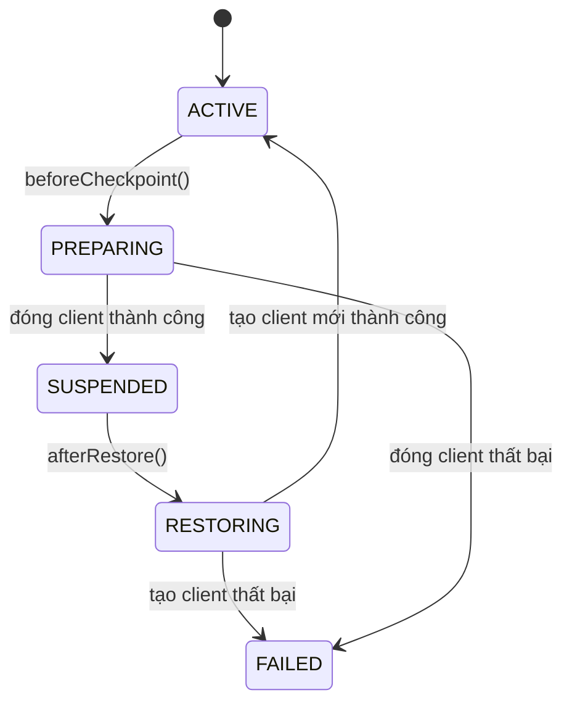
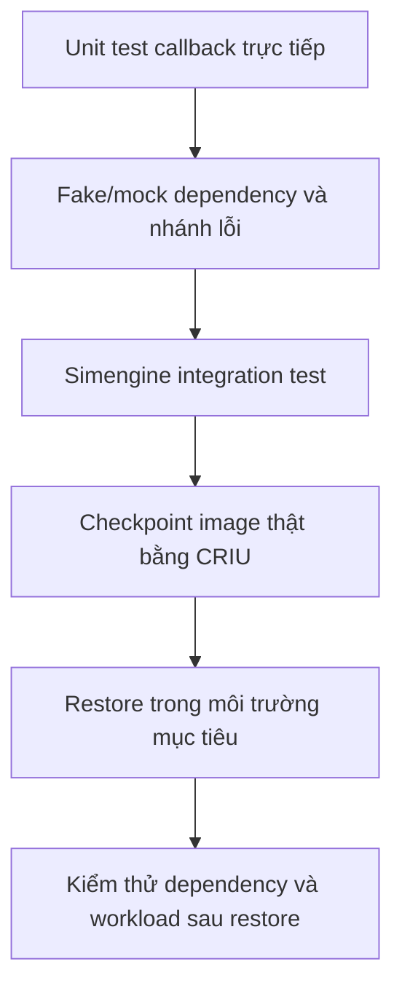

# Kiểm thử callback độc lập với cơ chế tạo ảnh

Trong CRaC, `beforeCheckpoint(...)` và `afterRestore(...)` là hai điểm phối hợp để ứng dụng chuẩn bị tài nguyên trước checkpoint và khôi phục chúng sau restore. Khi phát triển ứng dụng, việc kiểm tra hai callback không nhất thiết phải bắt đầu bằng cách tạo một checkpoint image thật. Có thể kiểm tra logic callback trực tiếp bằng unit test, sau đó dùng `simengine` để chạy thử toàn bộ chu kỳ notification mà không ghi image ra đĩa.

Hai cách kiểm thử này giải quyết hai câu hỏi khác nhau:

- **Unit test callback:** logic của từng Resource có đóng, tạm dừng, tạo lại hoặc kiểm tra tài nguyên đúng như mong đợi không?
- **Simengine integration test:** khi CRaC runtime phát chu kỳ checkpoint/restore, các Resource đã đăng ký có nhận callback và phối hợp đúng trình tự không?

`simengine` mô phỏng checkpoint ngay sau đó là restore trong cùng tiến trình. Nó gọi `beforeCheckpoint(...)` rồi `afterRestore(...)` cho các Resource đã đăng ký nhưng không tạo checkpoint image trên filesystem. Vì vậy, đây là cách kiểm thử hữu ích trên máy phát triển không thể chạy CRIU hoặc không có quyền checkpoint tiến trình. Tuy nhiên, kết quả không chứng minh rằng một image thật có thể được tạo hoặc restore thành công.

## 1. Tách logic Resource khỏi cơ chế tạo image

Một Resource thường quản lý những tài nguyên như file, socket, connection pool, HTTP client, executor hoặc scheduler. Phần logic cần kiểm tra chủ yếu là cách thành phần chuyển trạng thái giữa hai giai đoạn:

1. Trước checkpoint, ngừng nhận công việc mới và đưa tài nguyên về trạng thái an toàn.
2. Sau restore, tạo lại hoặc kiểm tra tài nguyên rồi cho phép ứng dụng tiếp tục.

Đây là logic Java thông thường. Nếu callback không gọi API riêng của checkpoint engine, có thể gọi trực tiếp phương thức của Resource trong unit test mà không cần tạo image.

Ví dụ, một `Resource` quản lý client kết nối tới dịch vụ ngoài có thể có trạng thái như sau:



Unit test có thể kiểm tra từng chuyển trạng thái, từng nhánh lỗi và các side effect như gọi `close()` đúng một lần. Simengine bổ sung việc xác nhận runtime thực sự gọi hai callback theo chu kỳ mô phỏng.

## 2. Hai lớp kiểm thử và phạm vi của chúng

| Cách kiểm thử | Có cần CRaC-enabled JDK? | Có tạo image thật? | Điều có thể xác nhận |
|---|---:|---:|---|
| Unit test gọi trực tiếp callback | Không, nếu có `org.crac:crac` trên test classpath. | Không. | Logic Java trong callback, thứ tự thao tác nội bộ, xử lý lỗi và trạng thái Resource. |
| Test với fake/mock dependency | Không. | Không. | Ứng dụng phản ứng thế nào khi đóng, mở lại hoặc kiểm tra resource thành công/thất bại. |
| Integration test dùng `simengine` | Có, runtime phải cung cấp engine này. | Không; engine mô phỏng chu kỳ trong cùng process. | CRaC gọi callback của Resource đã đăng ký và luồng ứng dụng tiếp tục sau chu kỳ mô phỏng. |
| Integration test với `criuengine` | Có, cùng môi trường Linux/CRIU đáp ứng yêu cầu. | Có. | Khả năng tạo checkpoint image thật và các điều kiện restore trên môi trường đã thử. |

Không nên xem unit test hoặc simengine là phép thay thế hoàn toàn cho kiểm thử CRIU. Mỗi lớp cung cấp một loại bằng chứng riêng và nên được dùng theo đúng câu hỏi cần trả lời.

## 3. Kiểm thử callback trực tiếp bằng JUnit

Một callback là method Java trên đối tượng triển khai `org.crac.Resource`. Unit test có thể tạo Resource, chuẩn bị dependency giả và gọi method trực tiếp.

Ví dụ Resource quản lý một client:

```java
import org.crac.Context;
import org.crac.Resource;

public final class ClientResource implements Resource {

    private final ClientFactory factory;
    private ClientHandle client;
    private boolean suspended;

    public ClientResource(ClientHandle initialClient, ClientFactory factory) {
        this.client = initialClient;
        this.factory = factory;
    }

    @Override
    public synchronized void beforeCheckpoint(
            Context<? extends Resource> context) throws Exception {
        if (suspended) {
            return;
        }

        if (client != null) {
            client.close();
            client = null;
        }
        suspended = true;
    }

    @Override
    public synchronized void afterRestore(
            Context<? extends Resource> context) throws Exception {
        if (!suspended) {
            return;
        }

        // Chỉ đổi trạng thái sau khi client mới được tạo thành công.
        ClientHandle restored = factory.open();
        client = restored;
        suspended = false;
    }

    public synchronized boolean isAvailable() {
        return !suspended && client != null;
    }
}
```

Các abstraction dùng trong ví dụ:

```java
public interface ClientHandle {
    void close() throws Exception;
}

public interface ClientFactory {
    ClientHandle open() throws Exception;
}
```

`ClientHandle` và `ClientFactory` là interface của ứng dụng minh họa, không phải API CRaC. Trong code thật, chúng đại diện cho client hoặc connection pool mà ứng dụng quản lý.

### 3.1. Unit test với Mockito

Vì callback nhận một `Context<? extends Resource>`, test có thể cung cấp một context mock nếu callback không cần thao tác với context đó. Không cần gọi `Core.checkpointRestore()` để kiểm tra logic của method.

```java
import org.crac.Context;
import org.crac.Resource;
import org.junit.jupiter.api.BeforeEach;
import org.junit.jupiter.api.Test;

import static org.junit.jupiter.api.Assertions.*;
import static org.mockito.Mockito.*;

class ClientResourceTest {

    private ClientHandle initialClient;
    private ClientHandle restoredClient;
    private ClientFactory factory;
    private Context<? extends Resource> context;

    @BeforeEach
    void setUp() {
        initialClient = mock(ClientHandle.class);
        restoredClient = mock(ClientHandle.class);
        factory = mock(ClientFactory.class);
        context = mock(Context.class);
    }

    @Test
    void beforeCheckpointClosesClientAndMarksResourceUnavailable()
            throws Exception {
        ClientResource resource =
                new ClientResource(initialClient, factory);

        resource.beforeCheckpoint(context);

        verify(initialClient).close();
        assertFalse(resource.isAvailable());
        verifyNoInteractions(factory);
    }

    @Test
    void afterRestoreCreatesNewClientAndMakesResourceAvailable()
            throws Exception {
        when(factory.open()).thenReturn(restoredClient);
        ClientResource resource =
                new ClientResource(initialClient, factory);

        resource.beforeCheckpoint(context);
        resource.afterRestore(context);

        verify(initialClient).close();
        verify(factory).open();
        assertTrue(resource.isAvailable());
    }

    @Test
    void failedReopenKeepsResourceUnavailable() throws Exception {
        when(factory.open()).thenThrow(new IllegalStateException("service unavailable"));
        ClientResource resource =
                new ClientResource(initialClient, factory);

        resource.beforeCheckpoint(context);

        assertThrows(
                IllegalStateException.class,
                () -> resource.afterRestore(context));
        assertFalse(resource.isAvailable());
    }
}
```

Ví dụ sử dụng JUnit 5 và Mockito. Nếu dự án dùng test framework khác, nguyên tắc vẫn giống nhau: tạo dependency giả, gọi callback, rồi xác nhận trạng thái và side effect. `Context` là tham số của callback; nếu code Resource thực sự dùng context để đăng ký hoặc điều phối Resource con, test cần cung cấp một context fake có hành vi tương ứng thay vì mock rỗng.

### 3.2. Những điều unit test nên xác nhận

- `beforeCheckpoint(...)` dừng hoặc đóng đúng tài nguyên.
- Không còn cho phép sử dụng resource sau khi chuẩn bị checkpoint hoàn tất.
- `afterRestore(...)` tạo lại hoặc xác minh tài nguyên cần thiết.
- Ứng dụng chỉ chuyển sang trạng thái sẵn sàng sau khi khôi phục thành công.
- Lỗi đóng hoặc tạo lại resource được truyền ra, không bị nuốt.
- Gọi callback lặp lại không tạo double-close hoặc resource trùng nếu thiết kế yêu cầu idempotency.
- Resource tùy chọn và bắt buộc được xử lý theo chính sách tương ứng.
- Timeout, cancellation và rollback được kiểm tra với các dependency giả lập.

Không cần kiểm tra checkpoint image trong các unit test này. Mục tiêu là xác minh logic của Resource như một đối tượng Java độc lập.

## 4. Dùng fake dependency để kiểm tra nhánh lỗi

Không phải lúc nào Mockito cũng là lựa chọn tốt nhất. Với lifecycle có nhiều bước, fake object có thể làm rõ trạng thái và thứ tự hơn mock.

Ví dụ một fake client:

```java
final class FakeClient implements ClientHandle {
    private boolean closed;
    private int closeCount;

    @Override
    public void close() {
        closed = true;
        closeCount++;
    }

    boolean isClosed() {
        return closed;
    }

    int closeCount() {
        return closeCount;
    }
}
```

Một fake factory có thể được cấu hình để thành công hoặc ném lỗi:

```java
final class FakeClientFactory implements ClientFactory {
    private boolean fail;
    private FakeClient lastCreated;

    void failNextOpen() {
        fail = true;
    }

    @Override
    public ClientHandle open() {
        if (fail) {
            fail = false;
            throw new IllegalStateException("simulated connection failure");
        }
        lastCreated = new FakeClient();
        return lastCreated;
    }

    FakeClient lastCreated() {
        return lastCreated;
    }
}
```

Fake cho phép kiểm tra các trường hợp như:

1. Client ban đầu được đóng đúng một lần.
2. Factory không được gọi trong `beforeCheckpoint(...)`.
3. Factory được gọi trong `afterRestore(...)`.
4. Nếu factory thất bại, Resource vẫn không sẵn sàng.
5. Khi retry sau lỗi, Resource có thể tạo client mới mà không dùng lại client đã đóng.

Fake không kiểm tra TCP socket, TLS hoặc database server thật. Những kiểm tra đó thuộc integration test với dependency thực hoặc test server.

## 5. Vì sao cần `simengine` sau unit test?

Unit test gọi trực tiếp `beforeCheckpoint(...)` và `afterRestore(...)` theo ý của test. Nó không xác nhận rằng CRaC runtime đã nhận diện Resource, Resource được đăng ký đúng context hay runtime thực sự phát callback trong chu kỳ checkpoint/restore.

`simengine` lấp khoảng trống này. Đây là checkpoint engine mô phỏng có trong các bản OpenJDK CRaC hỗ trợ engine đó. Nó thực hiện chu kỳ checkpoint rồi restore ngay trong cùng tiến trình và không ghi checkpoint image ra đĩa. Các Resource đã đăng ký nhận `beforeCheckpoint(...)` rồi `afterRestore(...)`.

Nhờ vậy, có thể kiểm tra:

- Resource có được đăng ký với context mà runtime sử dụng không.
- Callback có được gọi khi ứng dụng yêu cầu checkpoint không.
- Logic phối hợp giữa nhiều Resource có hoạt động không.
- Ứng dụng có tiếp tục sau `Core.checkpointRestore()` không.
- Những lỗi coordination có được phát hiện trong callback hay không.

`simengine` là engine thật của CRaC runtime nhưng chỉ mô phỏng chu kỳ. Nó khác với dummy implementation của thư viện `org.crac` trên JVM không hỗ trợ CRaC. Dummy implementation cho phép đăng ký Resource nhưng checkpoint request thất bại; nó không gọi callback như `simengine`.

## 6. Chạy ứng dụng với `simengine`

Chọn engine bằng JVM option `-XX:CRaCEngine=simengine`. Ví dụ:

```bash
java \
  -XX:CRaCEngine=simengine \
  -XX:CRaCCheckpointTo=./build/crac-sim \
  -jar target/application.jar
```

Tài liệu CRaC hiện hướng dẫn chọn engine bằng `-XX:CRaCEngine=` và ví dụ `simengine` đi cùng `-XX:CRaCCheckpointTo`. Với `simengine`, đường dẫn checkpoint được cung cấp cho option không trở thành image chứa trạng thái tiến trình; engine mô phỏng chu kỳ mà không ghi image ra disk.

Runtime phải thực sự cung cấp `simengine`. Các engine có sẵn phụ thuộc JDK build/vendor; nếu build không có engine được chỉ định, JVM báo lỗi khi khởi động. Hãy kiểm tra tài liệu của đúng runtime thay vì giả định mọi JDK đều hỗ trợ option này.

### 6.1. Kích hoạt chu kỳ mô phỏng từ code

Ứng dụng có thể gọi `Core.checkpointRestore()` tại safe point:

```java
import org.crac.Context;
import org.crac.Core;
import org.crac.Resource;

import java.util.ArrayList;
import java.util.List;

public final class SimengineProbe {

    private static final List<String> EVENTS = new ArrayList<>();

    // Giữ strong reference để Resource không bị garbage-collected.
    private static final Resource PROBE = new Resource() {
        @Override
        public void beforeCheckpoint(Context<? extends Resource> context) {
            EVENTS.add("beforeCheckpoint");
        }

        @Override
        public void afterRestore(Context<? extends Resource> context) {
            EVENTS.add("afterRestore");
        }
    };

    static {
        Core.getGlobalContext().register(PROBE);
    }

    public static void main(String[] args) throws Exception {
        EVENTS.add("beforeRequest");
        Core.checkpointRestore();
        EVENTS.add("returnedFromCheckpointRestore");
        System.out.println(String.join(" -> ", EVENTS));
    }
}
```

Chạy class này với JVM option của `simengine`. Dấu vết mong đợi trong trường hợp thành công là:

```text
beforeRequest -> beforeCheckpoint -> afterRestore -> returnedFromCheckpointRestore
```

Ví dụ giữ Resource trong static field vì context và cách quản lý Resource cần giữ strong reference tới đối tượng handler. Không nên đăng ký một anonymous Resource chỉ tồn tại trong biểu thức `register(new Resource() { ... })` nếu không có tham chiếu mạnh khác giữ nó sống.

Đây là probe tối giản. Trong ứng dụng thật, Resource sẽ thực hiện thao tác đóng/mở tài nguyên và có thể ghi log hoặc metric thay vì chỉ thêm chuỗi vào list.

### 6.2. Kích hoạt từ `jcmd`

Nếu muốn kiểm thử chu kỳ được yêu cầu từ bên ngoài, có thể khởi chạy ứng dụng với `simengine`, lấy PID rồi gửi lệnh checkpoint:

```bash
jcmd <pid> JDK.checkpoint
```

Điều này hữu ích để kiểm tra ứng dụng đang chạy khi checkpoint được yêu cầu từ công cụ vận hành. Hãy thay `<pid>` bằng PID thực tế. Log của ứng dụng là nơi cần xem để xác định callback nào chạy và lỗi nào xuất hiện.

Khi dùng `Core.checkpointRestore()`, code chủ động chọn điểm gọi. Khi dùng `jcmd`, checkpoint được yêu cầu từ bên ngoài tiến trình. Cả hai có thể dùng `simengine`, nhưng khác nhau về đường kích hoạt và ngữ cảnh thread; nên thử cả hai nếu ứng dụng hỗ trợ cả hai cách vận hành.

## 7. Tổ chức simengine test trong tiến trình con

Không nên mặc định chạy `Core.checkpointRestore()` trong chính JVM đang chạy toàn bộ JUnit suite. Khi simengine được kích hoạt, mọi Resource đã đăng ký trong global context của JVM đó có thể nhận callback, bao gồm Resource do test framework, extension hoặc ứng dụng tạo ra.

Một cách cô lập tốt hơn là chạy một probe hoặc ứng dụng test trong tiến trình con:

1. Test JUnit của tiến trình cha khởi chạy một Java process riêng.
2. Process con dùng CRaC-enabled JDK và `-XX:CRaCEngine=simengine`.
3. Process con chỉ đăng ký các Resource cần kiểm tra.
4. Process con gọi `Core.checkpointRestore()`.
5. Process con ghi event trace và kết thúc.
6. Test cha đọc output, exit code và xác nhận thứ tự callback.

Ví dụ ý tưởng với `ProcessBuilder`:

```java
Process process = new ProcessBuilder(
        javaExecutable,
        "-XX:CRaCEngine=simengine",
        "-XX:CRaCCheckpointTo=" + checkpointPath,
        "-cp",
        System.getProperty("java.class.path"),
        SimengineProbe.class.getName())
    .redirectErrorStream(true)
    .start();

String output;
try (var input = process.getInputStream()) {
    output = new String(input.readAllBytes(), StandardCharsets.UTF_8);
}

int exitCode = process.waitFor();
if (exitCode != 0) {
    throw new AssertionError("simengine process failed: " + output);
}
if (!output.contains(
        "beforeRequest -> beforeCheckpoint -> afterRestore -> "
                + "returnedFromCheckpointRestore")) {
    throw new AssertionError("Unexpected callback trace: " + output);
}
```

Đây là đoạn minh họa; test hoàn chỉnh cần lấy `javaExecutable` từ JDK CRaC được cấu hình cho test, tạo `checkpointPath` tạm phù hợp và có timeout cho process con. Không lấy mặc định `java.home` nếu test runner đang chạy bằng một JDK không hỗ trợ CRaC.

Chạy trong process con giúp:

- Tránh kích hoạt callback của Resource thuộc JUnit hoặc test framework.
- Tránh global context tích lũy Resource từ test trước.
- Cô lập lỗi callback hoặc lỗi runtime khỏi JVM chạy suite.
- Kiểm tra command line và JDK build thực tế giống cách triển khai.

## 8. Kiểm tra nhiều Resource và thứ tự callback

Ứng dụng có thể đăng ký nhiều Resource có quan hệ phụ thuộc. Theo quy tắc context của CRaC, callback `beforeCheckpoint(...)` được gọi theo thứ tự đăng ký và `afterRestore(...)` theo thứ tự ngược lại. Hãy viết test để xác nhận thứ tự mà ứng dụng dựa vào, đặc biệt khi Resource đóng/mở các thành phần phụ thuộc nhau.

Ví dụ event trace mong đợi với hai Resource:

```text
before-A
before-B
after-B
after-A
```

Trong đó B có thể phụ thuộc vào tài nguyên do A quản lý: A chuẩn bị trước, B chuẩn bị sau; khi restore, B được khôi phục trước rồi A hoàn tất sau theo quan hệ đã thiết kế. Không dựa vào thứ tự ngẫu nhiên của khởi tạo bean hoặc đăng ký Resource nếu ứng dụng cần một trình tự cụ thể.

Một test với simengine có thể đăng ký hai Resource probe, mỗi Resource ghi event vào một danh sách dùng chung, sau đó gọi `Core.checkpointRestore()` và so sánh chuỗi event. Unit test trực tiếp cũng có thể kiểm tra thứ tự trong một coordinator tự gọi các collaborator, nhưng chỉ simengine mới xác nhận context runtime đang sử dụng phát notification theo chu kỳ thực.

## 9. Kiểm tra lỗi callback

Một phần quan trọng của kiểm thử là xác nhận callback thất bại theo cách an toàn.

### 9.1. `beforeCheckpoint(...)` ném exception

Nếu Resource không thể đưa tài nguyên về trạng thái an toàn, callback nên báo lỗi thay vì đóng/mở dở dang rồi giả vờ thành công. Unit test có thể cấu hình dependency giả để `close()` ném exception và xác nhận:

- Lỗi được truyền ra.
- Resource không đánh dấu đã chuẩn bị thành công nếu thao tác chưa hoàn tất.
- Không tiếp tục checkpoint với resource đang được sử dụng.
- Đường rollback hoặc phục hồi trạng thái được kiểm tra nếu thiết kế có hỗ trợ.

Simengine có thể giúp xác nhận lỗi xuất hiện trong đường callback do runtime kích hoạt. Khi kiểm thử, cần quan sát cả exception, log và trạng thái ứng dụng sau khi chu kỳ mô phỏng thất bại.

### 9.2. `afterRestore(...)` ném exception

Nếu không tạo lại được connection pool hoặc không mở lại file, ứng dụng không được báo sẵn sàng. Test nên xác nhận:

- Resource giữ trạng thái unavailable/failed.
- Callback truyền lỗi theo hợp đồng API.
- Readiness hoặc recovery gate vẫn đóng.
- Retry có giới hạn hoặc fail-stop được kích hoạt theo chính sách.
- Không tạo resource trùng nếu thử khôi phục lại.

### 9.3. Phân biệt lỗi callback với lỗi engine

Trong simengine, callback chạy mà không có image thật. Nếu callback ném exception, đó là lỗi trong logic hoặc dependency của ứng dụng ở giai đoạn notification. Nếu JVM không nhận ra `simengine` ngay khi khởi động, đó là vấn đề runtime/build/engine configuration. Nếu process không tới callback, hãy kiểm tra Resource registration và điểm kích hoạt.

## 10. Những điều simengine không kiểm tra

Simengine có ích cho việc kiểm tra logic phối hợp, nhưng không thực hiện thao tác lưu và khôi phục tiến trình ở cấp hệ điều hành. Vì vậy, nó không chứng minh:

- Checkpoint image có được tạo ra hay không.
- CRIU có thể dump toàn bộ process state, memory mapping và file descriptor hay không.
- Kernel, container runtime, namespace, capability hoặc seccomp có cho phép checkpoint/restore hay không.
- File, socket và native handle thực sự có thể được khôi phục trên máy đích hay không.
- Checkpoint image có tương thích với CPU, JDK, OS, native library và cấu hình triển khai hay không.
- Restore trên một tiến trình mới hoặc máy khác có thành công hay không.
- Thời gian restore, image size, cold-start improvement hoặc hiệu năng production.
- Dịch vụ bên ngoài có giữ trạng thái kết nối hoặc dữ liệu nhất quán sau khoảng thời gian checkpoint hay không.

Một callback thành công trong simengine chỉ cho biết logic notification đã chạy qua chu kỳ mô phỏng. Ví dụ, `afterRestore(...)` tạo một HTTP client mới thành công trong simengine không chứng minh DNS, TLS, firewall hoặc HTTP service thật sẽ cho phép kết nối khi restore bằng CRIU.

## 11. Phân biệt simengine với dummy implementation của `org.crac`

Đây là hai trường hợp dễ bị nhầm lẫn khi chạy test trên laptop.

| Đặc điểm | `org.crac` dummy implementation | `simengine` |
|---|---|---|
| Runtime | JVM không có CRaC implementation tương thích nhưng có compatibility library. | CRaC-enabled runtime có cung cấp engine `simengine`. |
| Đăng ký Resource | Có thể đăng ký. | Có thể đăng ký. |
| Gọi `Core.checkpointRestore()` | Ném `UnsupportedOperationException` theo dummy behavior. | Thực hiện chu kỳ mô phỏng checkpoint rồi restore. |
| Gọi callback | Không phát callback notification. | Gọi `beforeCheckpoint(...)` rồi `afterRestore(...)`. |
| Ghi image | Không. | Không. |
| Mục đích | Giúp ứng dụng có thể chạy trên JVM không hỗ trợ CRaC. | Kiểm thử coordination code mà không tạo image thật. |

Nếu một unit test chạy trên JDK thông thường và gọi trực tiếp `resource.beforeCheckpoint(...)`, test đó vẫn có thể thành công. Nhưng nếu test gọi `Core.checkpointRestore()` trên dummy implementation, callback không tự động được gọi. Muốn kiểm tra runtime notification, phải dùng CRaC runtime có `simengine`.

## 12. Kết hợp unit test, simengine và kiểm thử image thật

Một quy trình kiểm thử theo tầng giúp phát hiện lỗi sớm mà vẫn giữ bằng chứng cho khả năng triển khai.



| Giai đoạn | Mục tiêu | Khi nào cần chạy |
|---|---|---|
| Unit test | Kiểm tra logic method, trạng thái, lỗi và idempotency. | Trong vòng lặp phát triển thường xuyên. |
| Fake/mock integration trong JVM thường | Kiểm tra phối hợp với dependency giả. | Khi sửa logic resource mà không cần CRaC runtime. |
| Simengine | Kiểm tra runtime notification, registration và thứ tự callback. | Trong CI có CRaC-enabled JDK hỗ trợ engine. |
| CRIU checkpoint thật | Xác nhận process state có thể tạo image. | Trong môi trường Linux/CI phù hợp với triển khai. |
| Restore thật | Xác nhận image có thể restore trong môi trường đích. | Trước khi phát hành hoặc thay đổi runtime/OS/agent. |

Không cần chạy CRIU cho từng thay đổi nhỏ của một method callback nếu unit test đã bao phủ logic. Nhưng thay đổi ở JDK, OS, kernel, CRIU, native library hoặc deployment configuration cần được kiểm tra ở tầng image thật.

## 13. Cấu hình CI cho simengine test

Một pipeline có thể tách test thường và simengine test thành hai task hoặc hai job:

```text
Job 1: Unit tests
  - JDK dùng để compile/test
  - org.crac:crac trên test classpath
  - JUnit/Mockito
  - Gọi callback trực tiếp

Job 2: Simengine integration tests
  - CRaC-enabled JDK có simengine
  - Chạy probe trong process riêng
  - -XX:CRaCEngine=simengine
  - -XX:CRaCCheckpointTo=<temporary-path>
  - Assert callback trace và exit code

Job 3: Real checkpoint/restore (environment-specific)
  - Linux runner đáp ứng yêu cầu CRIU
  - JDK/CRIU/kernel/runtime tương thích
  - Tạo image thật và restore
  - Chạy smoke test sau restore
```

Nếu pipeline dùng container, image test phải chứa đúng CRaC-enabled JDK. Không nên dùng một runner chỉ có JDK thông thường rồi thêm `-XX:CRaCEngine=simengine`; engine không được cung cấp chỉ bằng JVM flag.

Giữ output test đủ để chẩn đoán: callback event trace, Resource name, exception và trạng thái readiness. Không ghi password, token hoặc payload nhạy cảm vào log CI.

## 14. Những lỗi thường gặp khi kiểm thử callback

**Chỉ kiểm thử bằng cách gọi `Core.checkpointRestore()` trên JDK thường.** Nếu runtime đang dùng dummy implementation, callback không chạy. Hãy gọi callback trực tiếp trong unit test hoặc dùng CRaC runtime với simengine.

**Cho rằng simengine tạo checkpoint image.** Simengine mô phỏng chu kỳ trong cùng process và không ghi image. Dùng engine thật như `criuengine` để kiểm tra image.

**Đăng ký anonymous Resource mà không giữ reference.** Handler có thể bị garbage-collected trước khi runtime phát notification. Giữ strong reference trong component hoặc registry phù hợp.

**Chạy simengine trong JVM của toàn bộ JUnit suite.** Các Resource khác đã đăng ký trong global context cũng có thể nhận callback. Dùng process con cô lập.

**Unit test chỉ kiểm tra callback không ném exception.** Cần kiểm tra trạng thái resource, thứ tự thao tác, lỗi dependency và readiness sau restore.

**Mock mọi dependency rồi kết luận restore thật thành công.** Mock không kiểm tra socket, file descriptor, CRIU, kernel, native library hoặc filesystem.

**Bỏ qua nhánh `afterRestore(...)` thất bại.** Ứng dụng có thể chạy tiếp khi resource bắt buộc chưa sẵn sàng. Hãy xác nhận readiness false hoặc fail-stop.

**Dùng simengine để đo tốc độ restore.** Vì engine không ghi/đọc image thật, thời gian của nó không phải số liệu restore production.

## 15. Checklist kiểm thử callback độc lập với image

- [ ] Tách logic đóng/mở resource thành collaborator có thể fake hoặc mock.
- [ ] Viết unit test gọi trực tiếp `beforeCheckpoint(...)` và `afterRestore(...)`.
- [ ] Cung cấp context mock/fake nếu callback cần tham số context.
- [ ] Kiểm tra trạng thái resource sau từng callback.
- [ ] Kiểm tra exception khi đóng hoặc tạo lại resource thất bại.
- [ ] Kiểm tra readiness/recovery gate không mở khi restore thất bại.
- [ ] Kiểm tra idempotency và trường hợp callback được gọi lại nếu thiết kế yêu cầu.
- [ ] Giữ strong reference tới Resource đã đăng ký.
- [ ] Xác nhận JDK test có hỗ trợ `simengine` trước khi chạy integration test.
- [ ] Chạy simengine trong process riêng với `-XX:CRaCEngine=simengine`.
- [ ] Dùng `Core.checkpointRestore()` hoặc `jcmd ... JDK.checkpoint` để kích hoạt chu kỳ.
- [ ] Xác nhận event trace theo thứ tự before → after → code tiếp tục.
- [ ] Kiểm tra nhiều Resource và thứ tự callback nếu ứng dụng phụ thuộc thứ tự đó.
- [ ] Không coi simengine là bằng chứng image thật hoặc CRIU restore thành công.
- [ ] Chạy checkpoint/restore thật ở pipeline hoặc môi trường phù hợp trước khi phát hành.

## 16. Thuật ngữ cần nhớ

- **Callback test:** kiểm thử trực tiếp logic của `beforeCheckpoint(...)` và `afterRestore(...)`.
- **Unit test:** kiểm thử một thành phần riêng lẻ với dependency được kiểm soát.
- **Fake:** implementation đơn giản thay thế dependency thật để kiểm tra hành vi.
- **Mock:** đối tượng giả cho phép cấu hình kết quả và xác nhận lời gọi.
- **Integration test:** kiểm tra nhiều thành phần phối hợp với nhau trong một runtime thực.
- **`simengine`:** CRaC engine mô phỏng chu kỳ checkpoint/restore trong cùng tiến trình mà không ghi image ra disk.
- **`criuengine`:** engine sử dụng CRIU để tạo và restore checkpoint image trên Linux.
- **Global context:** context CRaC dùng chung để đăng ký Resource cho runtime notification.
- **Event trace:** chuỗi sự kiện ghi lại thứ tự callback và thao tác ứng dụng.
- **Dummy implementation:** fallback của `org.crac` trên runtime không có CRaC implementation; cho phép đăng ký Resource nhưng không thực hiện callback khi checkpoint request unsupported.
- **Checkpoint image:** dữ liệu được tạo bởi engine thật để khôi phục trạng thái tiến trình.

Kiểm thử callback độc lập với cơ chế tạo image giúp phát hiện lỗi logic Resource sớm và chạy thường xuyên. Hãy dùng unit test để kiểm tra từng nhánh đóng/mở và lỗi, dùng `simengine` để xác nhận CRaC runtime gọi callback theo chu kỳ mô phỏng, rồi dùng engine tạo image thật để xác nhận khả năng checkpoint/restore của hệ điều hành. Ba lớp kiểm thử bổ sung cho nhau và giúp kết luận luôn đúng với loại bằng chứng đã thu được.

## Tài liệu tham khảo

- [CRaC — Checkpoint engines](https://crac.org/reference/engines/): mô tả `criuengine`, `simengine`, cách chọn engine bằng `-XX:CRaCEngine` và giới hạn của mô phỏng.
- [CRaC — Integrating CRaC in your Application](https://docs.azul.com/crac/usage/integrating-crac): đăng ký `Resource`, hai callback và thứ tự notification.
- [CRaC — Best practices](https://crac.org/reference/best-practices/): quản lý Resource, giữ strong reference và các mẫu phối hợp callback.
- [CRaC — Checkpoint and restore](https://crac.org/use/checkpoint-and-restore/): cấu hình checkpoint engine, đường dẫn image và kích hoạt checkpoint bằng `jcmd` hoặc API.
