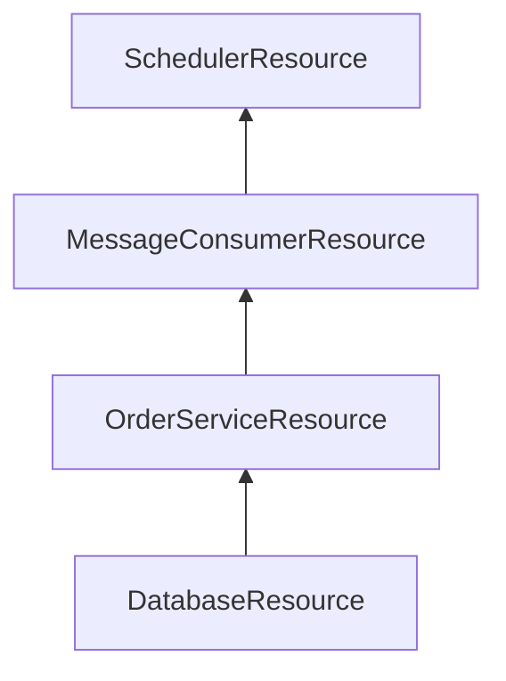

# Kiểm thử thứ tự đăng ký, phụ thuộc và vòng đời Resource

Trong CRaC (Coordinated Restore at Checkpoint), một ứng dụng có thể đăng ký nhiều `Resource` để chuẩn bị tài nguyên trước checkpoint và khôi phục chúng sau restore. Khi các resource phụ thuộc lẫn nhau, thứ tự đăng ký ảnh hưởng trực tiếp đến thứ tự callback. Nếu database pool chưa được khôi phục mà message consumer đã bắt đầu nhận message, consumer có thể xử lý công việc trong khi dependency chưa sẵn sàng. Nếu consumer chưa dừng mà database pool đã đóng, một message đang xử lý có thể thất bại.

Vì vậy, kiểm thử CRaC cần xác nhận ba khía cạnh: resource được đăng ký đúng một lần vào đúng context; thứ tự callback phản ánh quan hệ phụ thuộc; và mỗi resource đi qua vòng đời chuẩn bị, đóng, restore và mở lại một cách an toàn. Unit test giúp kiểm tra logic của từng resource và kế hoạch đăng ký. Integration test với JDK CRaC và môi trường checkpoint/restore thực tế mới xác nhận được thứ tự mà runtime thực sự điều phối.

## 1. Vòng đời Resource trong CRaC

Một lớp triển khai `org.crac.Resource` cung cấp hai callback:

```java
void beforeCheckpoint(Context<? extends Resource> context)
        throws Exception;

void afterRestore(Context<? extends Resource> context)
        throws Exception;
```

`beforeCheckpoint` được gọi khi JVM chuẩn bị tạo checkpoint. Resource cần đưa tài nguyên do nó sở hữu về trạng thái an toàn, ví dụ dừng nhận công việc, flush dữ liệu, hoàn tất thao tác đang chạy và đóng kết nối không thể giữ qua checkpoint.

`afterRestore` được gọi khi tiến trình được phục hồi. Resource tạo lại hoặc xác minh tài nguyên, kết nối lại dịch vụ bên ngoài và chỉ mở quyền sử dụng khi dependency đã sẵn sàng.

Với các resource được đăng ký trong cùng một `Context`, quy tắc điều phối thông thường của CRaC là:

- `beforeCheckpoint`: callback được gọi theo thứ tự ngược với thứ tự đăng ký.
- `afterRestore`: callback được gọi theo thứ tự đăng ký.

Quy tắc này cho phép biểu diễn dependency bằng thứ tự đăng ký: đăng ký dependency trước, thành phần phụ thuộc sau. Khi checkpoint, thành phần phụ thuộc dừng trước; khi restore, dependency khôi phục trước.

Ví dụ:

```java
Core.getGlobalContext().register(databaseResource);
Core.getGlobalContext().register(orderServiceResource);
Core.getGlobalContext().register(messageConsumerResource);
```

Thứ tự mong đợi:

| Giai đoạn | Thứ tự callback |
| --- | --- |
| Trước checkpoint | `messageConsumer` → `orderService` → `database` |
| Sau restore | `database` → `orderService` → `messageConsumer` |

Trong ví dụ, `orderService` cần database; consumer cần order service. Khi chuẩn bị checkpoint, consumer dừng nhận message trước, order service kết thúc hoạt động phụ thuộc, rồi database pool mới đóng. Khi restore, database sẵn sàng trước order service và consumer.

## 2. Biểu diễn dependency thành thứ tự đăng ký

Trước khi viết test, hãy vẽ dependency graph của các resource. Mũi tên nên biểu diễn quan hệ “A cần B để hoạt động”.



Với đồ thị này, thứ tự đăng ký là dependency trước, dependent sau:

```text
1. DatabaseResource
2. OrderServiceResource
3. MessageConsumerResource
4. SchedulerResource
```

Khi checkpoint, thứ tự được đảo ngược để ngừng các nguồn tạo công việc và thành phần ở phía trên trước. Khi restore, thứ tự đăng ký giúp các dependency được phục hồi trước thành phần sử dụng chúng.

### 2.1. Quy tắc đăng ký dependency trước

Nếu `A` phụ thuộc vào `B`, hãy đăng ký `B` trước `A`:

```java
context.register(databaseResource);  // Dependency
context.register(repositoryResource); // Dùng database
context.register(serviceResource);    // Dùng repository
context.register(consumerResource);   // Gọi service
```

Không sắp xếp theo tên class, thứ tự tạo bean hoặc thứ tự xuất hiện trong package. Thứ tự phải xuất phát từ dependency runtime thực tế.

### 2.2. Dependency độc lập

Nếu hai resource không phụ thuộc nhau, thứ tự tương đối giữa chúng thường không ảnh hưởng tính đúng đắn. Tuy nhiên, vẫn nên chọn một thứ tự ổn định để log, test và vận hành dễ dự đoán. Không nên dựa vào thứ tự của `HashSet`, reflection hoặc cơ chế discovery không có hợp đồng thứ tự.

### 2.3. Dependency vòng

Nếu A cần B trong khi B cũng cần A để dừng hoặc khôi phục, không thể giải quyết bằng một thứ tự đăng ký tuyến tính đơn giản. Đây thường là dấu hiệu cần tách trách nhiệm hoặc tạo một resource coordinator quản lý cả nhóm.

Coordinator có thể dừng hai thành phần theo một giao thức nội bộ, hoặc chia lifecycle thành các pha rõ ràng. Hãy xác định thao tác nào thực sự cần dependency và thao tác nào chỉ cần được thực hiện sau khi cả nhóm đã ngừng hoạt động.

## 3. Xác định ranh giới sở hữu Resource

Mỗi tài nguyên nên có một chủ sở hữu lifecycle rõ ràng. Ví dụ, nếu `DatabaseResource` sở hữu connection pool, chỉ resource đó đóng và tạo lại pool. `OrderServiceResource` có thể ngừng nhận thao tác và xác minh database sẵn sàng, nhưng không tự đóng pool lần thứ hai.

| Thành phần | Trách nhiệm phù hợp |
| --- | --- |
| `DatabaseResource` | Drain thao tác database, đóng pool và tạo lại pool |
| `OrderServiceResource` | Ngừng công việc mới, hoàn tất logic đang chạy và xác minh service có thể sử dụng database |
| `MessageConsumerResource` | Pause consumer, chờ message đang xử lý và resume sau restore |
| `SchedulerResource` | Hủy trigger mới, drain job đang chạy và tạo lại lịch sau restore |
| `ResourceCoordinator` | Điều phối nhiều resource khi cần một quy trình đồng bộ chung |

Không đăng ký cùng một tài nguyên qua nhiều resource độc lập nếu chúng đều đóng/mở cùng một đối tượng. Việc đó có thể dẫn tới đóng hai lần, tạo nhiều client hoặc khởi động listener trùng lặp.

## 4. Tổ chức đăng ký để có thể kiểm thử

Nếu mọi lớp tự gọi `Core.getGlobalContext().register(this)` ở nhiều vị trí, việc kiểm tra thứ tự đăng ký sẽ khó khăn. Có thể gom việc đăng ký vào một thành phần nhỏ có thứ tự rõ ràng.

Ví dụ một abstraction đăng ký:

```java
import org.crac.Core;
import org.crac.Resource;

@FunctionalInterface
public interface ResourceRegistrar {
    void register(Resource resource);
}

public final class CracResourceRegistrar implements ResourceRegistrar {

    @Override
    public void register(Resource resource) {
        Core.getGlobalContext().register(resource);
    }
}
```

Registry của ứng dụng:

```java
import java.util.List;
import org.crac.Resource;

public final class ApplicationResourceRegistration {

    private final Resource database;
    private final Resource orderService;
    private final Resource messageConsumer;

    public ApplicationResourceRegistration(
            Resource database,
            Resource orderService,
            Resource messageConsumer) {
        this.database = database;
        this.orderService = orderService;
        this.messageConsumer = messageConsumer;
    }

    public void registerAll(ResourceRegistrar registrar) {
        List.of(database, orderService, messageConsumer)
                .forEach(registrar::register);
    }
}
```

Trong ứng dụng thật, các field nên dùng kiểu cụ thể như `DatabaseResource`, `OrderServiceResource` và `MessageConsumerResource` để thể hiện dependency. Ví dụ dùng `Resource` chung để tập trung vào thứ tự đăng ký.

Abstraction này tạo một điểm kiểm tra độc lập: unit test có thể truyền registrar giả và xác nhận resource được gửi tới theo đúng thứ tự. Khi chạy production, `CracResourceRegistrar` đăng ký chúng vào global context.

## 5. Unit test thứ tự đăng ký

Dùng JUnit 5 để kiểm tra registry gọi registrar theo đúng dependency order. Test này không cần khởi chạy JVM CRaC.

```java
import static org.junit.jupiter.api.Assertions.assertEquals;

import java.util.ArrayList;
import java.util.List;

import org.crac.Resource;
import org.junit.jupiter.api.Test;

class ApplicationResourceRegistrationTest {

    @Test
    void registersDependenciesBeforeDependents() {
        Resource database = new NamedResource("database");
        Resource service = new NamedResource("service");
        Resource consumer = new NamedResource("consumer");

        ApplicationResourceRegistration registration =
                new ApplicationResourceRegistration(
                        database, service, consumer);

        List<Resource> registered = new ArrayList<>();
        registration.registerAll(registered::add);

        assertEquals(
                List.of(database, service, consumer),
                registered);
    }
}
```

`NamedResource` là một implementation đơn giản dùng trong test. Test có thể kiểm tra identity của object để bảo đảm registry đăng ký đúng instance được ứng dụng quản lý, không tạo một instance thay thế.

```java
import org.crac.Context;
import org.crac.Resource;

final class NamedResource implements Resource {

    private final String name;

    NamedResource(String name) {
        this.name = name;
    }

    @Override
    public void beforeCheckpoint(Context<? extends Resource> context) {
        // Không cần thao tác trong test đăng ký.
    }

    @Override
    public void afterRestore(Context<? extends Resource> context) {
        // Không cần thao tác trong test đăng ký.
    }

    String name() {
        return name;
    }
}
```

Unit test trên xác nhận **kế hoạch đăng ký của ứng dụng**. Nó chưa xác nhận CRaC runtime thực sự gọi callback theo thứ tự đó. Phần kiểm tra runtime sẽ được thực hiện trong integration test.

## 6. Kiểm thử thứ tự callback bằng trace

Để kiểm tra logic của từng callback, có thể dùng một trace collector ghi lại sự kiện. Mỗi resource ghi tên và pha lifecycle.

```java
import java.util.List;
import java.util.concurrent.CopyOnWriteArrayList;

public final class LifecycleTrace {

    private final List<String> events = new CopyOnWriteArrayList<>();

    public void record(String event) {
        events.add(event);
    }

    public List<String> events() {
        return List.copyOf(events);
    }

    public void clear() {
        events.clear();
    }
}
```

Một resource ghi trace:

```java
import org.crac.Context;
import org.crac.Resource;

public final class RecordingResource implements Resource {

    private final String name;
    private final LifecycleTrace trace;

    public RecordingResource(String name, LifecycleTrace trace) {
        this.name = name;
        this.trace = trace;
    }

    @Override
    public void beforeCheckpoint(Context<? extends Resource> context) {
        trace.record(name + ":beforeCheckpoint");
    }

    @Override
    public void afterRestore(Context<? extends Resource> context) {
        trace.record(name + ":afterRestore");
    }
}
```

Với resource không sử dụng tham số `context`, test đơn vị có thể gọi callback với `null`. Nếu implementation cần thao tác với context, hãy dùng test double hoặc mock phù hợp với API `Context` của phiên bản CRaC đang sử dụng.

### 6.1. Kiểm tra mô hình dispatch

Có thể mô phỏng quy tắc dispatch trên danh sách đăng ký để kiểm tra dependency plan:

```java
import java.util.List;
import org.crac.Resource;

final class LifecycleDispatchModel {

    static void beforeCheckpoint(List<Resource> registered)
            throws Exception {
        for (int i = registered.size() - 1; i >= 0; i--) {
            registered.get(i).beforeCheckpoint(null);
        }
    }

    static void afterRestore(List<Resource> registered)
            throws Exception {
        for (Resource resource : registered) {
            resource.afterRestore(null);
        }
    }
}
```

Test:

```java
import static org.junit.jupiter.api.Assertions.assertEquals;

import java.util.List;
import org.crac.Resource;
import org.junit.jupiter.api.Test;

class LifecycleDispatchModelTest {

    @Test
    void stopsDependentsFirstAndRestoresDependenciesFirst()
            throws Exception {
        LifecycleTrace trace = new LifecycleTrace();

        Resource database = new RecordingResource("database", trace);
        Resource service = new RecordingResource("service", trace);
        Resource consumer = new RecordingResource("consumer", trace);

        List<Resource> registered = List.of(database, service, consumer);

        LifecycleDispatchModel.beforeCheckpoint(registered);
        assertEquals(List.of(
                "consumer:beforeCheckpoint",
                "service:beforeCheckpoint",
                "database:beforeCheckpoint"), trace.events());

        trace.clear();
        LifecycleDispatchModel.afterRestore(registered);
        assertEquals(List.of(
                "database:afterRestore",
                "service:afterRestore",
                "consumer:afterRestore"), trace.events());
    }
}
```

Test này xác nhận mô hình thứ tự mà ứng dụng mong đợi. Nó tự gọi callback theo quy tắc được mô phỏng, vì vậy không thay thế integration test với `Core.getGlobalContext()` và JVM CRaC thật.

## 7. Kiểm thử trạng thái và tính idempotent của Resource

Thứ tự đúng vẫn chưa đủ nếu callback của resource không quản lý trạng thái an toàn. Mỗi resource cần có state machine riêng hoặc một hợp đồng trạng thái tương đương.

Ví dụ database resource có trạng thái:

```text
OPEN -> QUIESCING -> CLOSED -> RESTORING -> OPEN
                         \-> FAILED
```

Các bất biến cần kiểm tra:

- Không nhận operation mới sau khi bắt đầu quiesce.
- Chỉ đóng pool sau khi operation đang chạy đã kết thúc.
- `afterRestore` chỉ mở resource sau khi pool mới được tạo và xác minh.
- Nếu tạo pool thất bại, resource ở trạng thái lỗi và không cho phép truy cập.
- Resource không bị đóng hoặc mở nhiều lần ngoài hợp đồng lifecycle.

Ví dụ một resource đơn giản có thể inject factory để unit test không cần database thật:

```java
import org.crac.Context;
import org.crac.Resource;

public final class DatabaseResource implements Resource {

    public interface Pool {
        void close() throws Exception;
        void verify() throws Exception;
    }

    @FunctionalInterface
    public interface PoolFactory {
        Pool create() throws Exception;
    }

    private final PoolFactory factory;
    private Pool pool;
    private boolean open;

    public DatabaseResource(PoolFactory factory) throws Exception {
        this.factory = factory;
        this.pool = factory.create();
        this.pool.verify();
        this.open = true;
    }

    @Override
    public synchronized void beforeCheckpoint(
            Context<? extends Resource> context) throws Exception {
        if (!open) {
            throw new IllegalStateException("Database is not open");
        }

        pool.close();
        pool = null;
        open = false;
    }

    @Override
    public synchronized void afterRestore(
            Context<? extends Resource> context) throws Exception {
        if (open) {
            throw new IllegalStateException("Database is already open");
        }

        Pool restored = factory.create();
        try {
            restored.verify();
            pool = restored;
            open = true;
        } catch (Exception ex) {
            try {
                restored.close();
            } catch (Exception closeFailure) {
                ex.addSuppressed(closeFailure);
            }
            throw ex;
        }
    }

    public synchronized boolean isOpen() {
        return open;
    }
}
```

Đây là ví dụ rút gọn để minh họa test seam. Trong ứng dụng thật, cần thêm operation gate và drain thao tác đang sử dụng pool trước khi đóng. `synchronized` trong ví dụ chỉ bảo vệ state transition đơn giản; không thay thế cơ chế quản lý các request hoặc transaction đang chạy.

### 7.1. Test đóng và khôi phục thành công

```java
import static org.junit.jupiter.api.Assertions.assertFalse;
import static org.junit.jupiter.api.Assertions.assertTrue;

import org.junit.jupiter.api.Test;

class DatabaseResourceTest {

    @Test
    void closesBeforeCheckpointAndRecreatesAfterRestore() throws Exception {
        FakePoolFactory factory = new FakePoolFactory();
        DatabaseResource resource = new DatabaseResource(factory);

        assertTrue(resource.isOpen());

        resource.beforeCheckpoint(null);
        assertFalse(resource.isOpen());
        assertEquals(1, factory.createdCount());
        assertEquals(1, factory.closedCount());

        resource.afterRestore(null);
        assertTrue(resource.isOpen());
        assertEquals(2, factory.createdCount());
        assertEquals(1, factory.closedCount());
    }
}
```

`FakePoolFactory` là test double đếm số lần tạo, đóng và xác minh pool. Các assertion giúp phát hiện resource không được tạo lại hoặc bị đóng sai số lần.

### 7.2. Test lỗi khi khôi phục

Factory giả có thể ném exception ở lần tạo thứ hai. Test cần xác nhận:

- `afterRestore` truyền lỗi lên caller.
- Resource không báo `open=true`.
- Pool tạo dở được đóng nếu có thể.
- Ứng dụng giữ readiness ở trạng thái từ chối traffic.

Không bắt exception rồi tiếp tục như thể restore thành công. Resource thất bại phải giữ trạng thái không thể sử dụng cho tới khi lifecycle manager xử lý.

## 8. Kiểm thử thứ tự phụ thuộc bằng sự kiện quan sát được

Một test dependency không nên chỉ kiểm tra danh sách callback. Nó nên kiểm tra điều kiện mà callback cần ở thời điểm thực thi.

Ví dụ `OrderServiceResource.afterRestore` chỉ được phép hoàn tất nếu database đã mở. `MessageConsumerResource.afterRestore` chỉ được phép resume nếu order service đã sẵn sàng.

```java
public final class OrderServiceResource implements Resource {

    private final DatabaseResource database;
    private boolean ready;

    public OrderServiceResource(DatabaseResource database) {
        this.database = database;
    }

    @Override
    public void beforeCheckpoint(Context<? extends Resource> context) {
        ready = false;
    }

    @Override
    public void afterRestore(Context<? extends Resource> context) {
        if (!database.isOpen()) {
            throw new IllegalStateException(
                    "Database must be restored before order service");
        }
        ready = true;
    }

    public boolean isReady() {
        return ready;
    }
}
```

Consumer kiểm tra service:

```java
public final class MessageConsumerResource implements Resource {

    private final OrderServiceResource orderService;
    private boolean running;

    public MessageConsumerResource(OrderServiceResource orderService) {
        this.orderService = orderService;
    }

    @Override
    public void beforeCheckpoint(Context<? extends Resource> context) {
        running = false;
    }

    @Override
    public void afterRestore(Context<? extends Resource> context) {
        if (!orderService.isReady()) {
            throw new IllegalStateException(
                    "Order service must be ready before consumer resumes");
        }
        running = true;
    }

    public boolean isRunning() {
        return running;
    }
}
```

Trong ví dụ, các dependency được kiểm tra bằng trạng thái đơn giản. Hệ thống thực tế nên xác minh chức năng thật: lấy connection, chạy truy vấn kiểm tra, xác thực broker hoặc kiểm tra listener. Chỉ kiểm tra cờ boolean do chính resource đặt có thể không phát hiện được dependency đã mất kết nối.

## 9. Kiểm thử đăng ký trùng và hủy đăng ký

Đăng ký trùng một resource hoặc đăng ký cùng tài nguyên qua nhiều owner có thể làm callback chạy nhiều lần hoặc dẫn đến đóng/mở lặp. Nên kiểm soát việc đăng ký tại một điểm tập trung.

Các tình huống cần kiểm tra:

- `registerAll()` không bị gọi hai lần trong cùng lifecycle.
- Mỗi resource instance được đăng ký đúng một lần.
- Resource bị thay thế được unregister khi vòng đời cũ kết thúc.
- Resource đã unregister không còn tham gia chu kỳ checkpoint tiếp theo.
- Việc unregister không xảy ra chỉ vì resource tạm đóng trong `beforeCheckpoint`; resource vẫn cần nhận `afterRestore`.

Nếu ứng dụng có đăng ký/hủy đăng ký động, hãy gắn thao tác đó với lifecycle của thành phần và bảo đảm không thay đổi registry tùy tiện giữa lúc CRaC đang dispatch callback. Kiểm tra hành vi `register`/`unregister` theo phiên bản API được sử dụng.

Một registry ứng dụng có thể bảo vệ đăng ký một lần:

```java
import java.util.Collections;
import java.util.IdentityHashMap;
import java.util.Set;
import org.crac.Resource;

public final class OnceOnlyRegistrar implements ResourceRegistrar {

    private final ResourceRegistrar delegate;
    private final Set<Resource> registered =
            Collections.newSetFromMap(new IdentityHashMap<>());

    public OnceOnlyRegistrar(ResourceRegistrar delegate) {
        this.delegate = delegate;
    }

    @Override
    public synchronized void register(Resource resource) {
        if (!registered.add(resource)) {
            throw new IllegalStateException(
                    "Resource instance was registered more than once");
        }
        delegate.register(resource);
    }
}
```

Identity-based set giúp phân biệt instance cụ thể thay vì phụ thuộc vào `equals()`. Trong production, cần xử lý trường hợp `delegate.register()` ném exception: registry nên rollback phần tử vừa thêm để lần thử lại không bị chặn sai. Cũng cần bổ sung `unregister` nếu ứng dụng có vòng đời resource động.

## 10. Kiểm thử lỗi và timeout trong callback

Callback có thể thất bại khi resource không thể đóng hoặc khôi phục. Test cần xác nhận lỗi được truyền lên và trạng thái ứng dụng không bị đánh dấu thành công giả.

### 10.1. Lỗi trước checkpoint

Ví dụ database pool không thể đóng do thao tác còn hoạt động. `beforeCheckpoint` phải báo lỗi. Không được tiếp tục coi resource đã ở trạng thái `CLOSED` nếu pool vẫn đang mở hoặc không xác định được trạng thái.

Kiểm thử nên xác nhận:

- Exception từ resource được truyền ra khỏi callback.
- Coordinator không báo checkpoint preparation thành công.
- Readiness vẫn từ chối traffic cho tới khi resource được xác minh.
- Nếu có rollback, rollback phải khôi phục đầy đủ tài nguyên đã đóng một phần.

Không nên viết test giả định mọi CRaC implementation sẽ tiếp tục hoặc dừng dispatch các resource còn lại theo cùng một cách khi một callback ném exception, trừ khi tài liệu của runtime cụ thể quy định rõ. Hãy kiểm tra kết quả tổng thể là checkpoint thất bại và ứng dụng không đi vào trạng thái phục vụ không an toàn.

### 10.2. Lỗi sau restore

Nếu database được tạo lại nhưng broker client không thể kết nối, readiness phải tiếp tục từ chối traffic nếu broker là dependency bắt buộc. Callback cần truyền lỗi lên hoặc báo trạng thái phục hồi thất bại theo thiết kế.

Nếu một resource tùy chọn thất bại, ứng dụng có thể phục vụ một phần chức năng nếu readiness policy cho phép. Policy phải được xác định rõ thay vì tự động bỏ qua mọi exception.

### 10.3. Timeout

Drain có thể chờ thao tác đang chạy. Test cần dùng latch hoặc controllable fake để kiểm tra:

- Callback chờ khi còn operation đang hoạt động.
- Khi operation kết thúc, callback tiếp tục.
- Khi hết timeout, callback thất bại.
- Không đóng dependency trong khi operation vẫn dùng nó.
- Cơ chế cancel/rollback chỉ mở lại admission nếu tài nguyên chưa bị đóng hoặc đã được phục hồi an toàn.

Không dùng `Thread.sleep()` dài để đồng bộ test nếu có thể dùng `CountDownLatch`, `CyclicBarrier` hoặc `CompletableFuture` để điều khiển thời điểm.

## 11. Kiểm thử nhiều chu kỳ checkpoint/restore

Một resource có thể trải qua nhiều chu kỳ trong cùng một vòng đời triển khai. Không nên chỉ kiểm tra một lần `beforeCheckpoint` và một lần `afterRestore`.

Ví dụ chu kỳ:

```text
OPEN
  -> beforeCheckpoint
CLOSED
  -> afterRestore
OPEN
  -> beforeCheckpoint
CLOSED
  -> afterRestore
OPEN
```

Các test nên xác nhận:

- Sau restore thành công, resource trở lại trạng thái cho phép hoạt động.
- Chu kỳ checkpoint tiếp theo có thể bắt đầu bình thường.
- Không giữ tham chiếu tới connection/client cũ.
- Không đăng ký thêm một resource mới trong mỗi lần restore nếu không có chủ đích.
- Callback không đóng hoặc khởi tạo trùng cùng một tài nguyên.
- Bộ đếm, lease và trạng thái admission được reset đúng cách.

Nếu một callback thất bại, trạng thái phải chuyển sang lỗi hoặc phục hồi có kiểm soát; không cho phép chu kỳ tiếp theo chạy trên một state machine chưa rõ trạng thái.

## 12. Unit test và integration test khác nhau thế nào?

Unit test và integration test có mục tiêu khác nhau:

| Loại test | Kiểm tra được | Không chứng minh được |
| --- | --- | --- |
| Unit test resource | Logic đóng/mở, state transition, timeout, exception và operation gate | CRaC runtime dispatch callback thật |
| Unit test registrar | Thứ tự và identity resource được đăng ký | Context runtime gọi callback theo thứ tự nào |
| Model test dispatch | Kế hoạch callback mong đợi theo quy tắc đã mô hình hóa | JDK/CRIU thực tế thực hiện đúng trong môi trường triển khai |
| Integration test CRaC | Thứ tự callback do runtime thực tế dispatch, checkpoint và restore | Tất cả tình huống production hoặc mọi kernel/container đều tương thích |
| End-to-end test | Resource, readiness, request và dependency sau restore | Tính đúng đắn với mọi tải hoặc mọi môi trường chưa được thử |

Không nên coi unit test mô phỏng callback là bằng chứng cuối cùng cho CRaC. Nó rất hữu ích để phát hiện lỗi logic nhanh, nhưng integration test cần chạy bằng JDK CRaC và môi trường hệ điều hành được hỗ trợ.

## 13. Integration test với JVM CRaC thật

Để kiểm tra thứ tự dispatch thực tế, tạo một chương trình nhỏ đăng ký hai hoặc ba resource vào `Core.getGlobalContext()`. Mỗi callback ghi một dòng vào file trace nằm ngoài heap, mở và đóng file ở mỗi lần ghi để dữ liệu được flush.

Ví dụ resource ghi trace:

```java
import java.io.IOException;
import java.nio.file.Files;
import java.nio.file.Path;
import java.nio.file.StandardOpenOption;

import org.crac.Context;
import org.crac.Resource;

public final class FileTraceResource implements Resource {

    private final String name;
    private final Path traceFile;

    public FileTraceResource(String name, Path traceFile) {
        this.name = name;
        this.traceFile = traceFile;
    }

    private void append(String event) throws IOException {
        Files.writeString(
                traceFile,
                event + System.lineSeparator(),
                StandardOpenOption.CREATE,
                StandardOpenOption.WRITE,
                StandardOpenOption.APPEND);
    }

    @Override
    public void beforeCheckpoint(Context<? extends Resource> context)
            throws Exception {
        append(name + ":beforeCheckpoint");
    }

    @Override
    public void afterRestore(Context<? extends Resource> context)
            throws Exception {
        append(name + ":afterRestore");
    }
}
```

Ứng dụng probe đăng ký theo dependency order:

```java
import java.nio.file.Path;
import org.crac.Core;

public final class CracResourceOrderProbe {

    public static void main(String[] args) throws Exception {
        Path trace = Path.of(System.getenv("CRAC_TRACE_FILE"));

        Core.getGlobalContext().register(
                new FileTraceResource("database", trace));
        Core.getGlobalContext().register(
                new FileTraceResource("service", trace));
        Core.getGlobalContext().register(
                new FileTraceResource("consumer", trace));

        System.out.println("CRAC resource order probe is ready");
        System.out.flush();

        while (true) {
            Thread.sleep(1_000);
        }
    }
}
```

Chạy probe bằng đúng JDK CRaC trong môi trường Linux/CRIU tương thích. Ví dụ lệnh tổng quát:

```bash
export CRAC_TRACE_FILE=/tmp/crac-resource-order.log
mkdir -p /tmp/crac-resource-checkpoint

java -XX:CRaCCheckpointTo=/tmp/crac-resource-checkpoint \
  -cp target/classes CracResourceOrderProbe
```

Trong terminal khác, xác định PID và yêu cầu checkpoint:

```bash
jcmd -l
jcmd <pid> JDK.checkpoint
```

Sau khi checkpoint hoàn tất, kiểm tra trace. Thứ tự mong đợi trước checkpoint là:

```text
consumer:beforeCheckpoint
service:beforeCheckpoint
database:beforeCheckpoint
```

Restore bằng đúng JDK và cách khởi chạy được tài liệu của bản phân phối CRaC hỗ trợ. Với các bản JDK có tùy chọn restore thông dụng, lệnh có dạng:

```bash
java -XX:CRaCRestoreFrom=/tmp/crac-resource-checkpoint
```

Sau restore, trace mong đợi:

```text
database:afterRestore
service:afterRestore
consumer:afterRestore
```

Trace file nằm ngoài heap giúp quan sát được cả giai đoạn trước checkpoint và sau restore. Trong test thực tế, nên tạo trace file riêng cho mỗi lần chạy, tránh trộn kết quả giữa các lần thử.

### 13.1. Điều kiện của integration test

Integration test cần ghi nhận:

- JDK vendor, version và build.
- Phiên bản CRIU và kết quả kiểm tra môi trường.
- Kernel, architecture và container configuration.
- Thứ tự resource đăng ký.
- PID trước checkpoint và thông tin tiến trình sau restore.
- Log callback trước và sau restore.
- Kết quả tạo checkpoint và restore.
- Readiness và kết nối dependency sau restore.

Không chạy test này trên môi trường production đang phục vụ traffic. Dùng VM hoặc container thử nghiệm có quyền và kernel capability phù hợp.

## 14. Kiểm thử dependency thật thay vì chỉ kiểm tra thứ tự log

Một trace đúng thứ tự chưa chứng minh resource phụ thuộc đã sẵn sàng. Integration test nên thêm điều kiện xác minh dependency.

Ví dụ:

- Database callback sau restore tạo pool mới và thực hiện truy vấn kiểm tra.
- Service callback sau đó xác minh repository có thể truy cập database.
- Consumer callback cuối cùng kết nối broker, xác thực và chỉ resume khi service đã ready.

Test nên ghi cả thời điểm bắt đầu và kết thúc từng callback:

```text
database:afterRestore:start
database:afterRestore:verified
service:afterRestore:start
service:afterRestore:ready
consumer:afterRestore:start
consumer:afterRestore:resumed
```

Nếu `consumer:afterRestore:start` xuất hiện trước `service:afterRestore:ready`, test phải thất bại. Có thể ghi event vào file, structured log hoặc test event collector. Điều quan trọng là quan sát được mốc dependency thực sự sẵn sàng, không chỉ callback đã được gọi.

## 15. Kiểm thử thất bại có chủ đích

Một bộ test tốt cần xác nhận ứng dụng không nhận traffic khi restore chưa hoàn tất.

Các tình huống:

| Tình huống | Kết quả mong đợi |
| --- | --- |
| Database đóng thất bại trước checkpoint | Checkpoint preparation thất bại; không báo resource đã closed |
| Consumer không drain được | Không đóng database khi consumer vẫn sử dụng nó |
| Database restore thất bại | Service và consumer không được đánh dấu ready |
| Service restore thất bại | Consumer không resume |
| Consumer kết nối broker thất bại | Readiness vẫn từ chối nếu consumer là dependency bắt buộc |
| Callback bị gọi sai thứ tự trong test harness | Dependency assertion thất bại ngay |
| Resource đăng ký trùng | Registrar từ chối hoặc test phát hiện callback trùng |
| Resource đã unregister | Không tham gia chu kỳ kế tiếp theo chính sách của context |
| Drain timeout | Không tiếp tục checkpoint như thể đã quiesced |
| Restore thành công lần hai | Resource được mở lại đúng một lần cho chu kỳ mới |

Không giả lập lỗi bằng cách thay đổi thứ tự callback của runtime trong production. Dùng fake, test harness hoặc integration environment có thể kiểm soát để tạo lỗi một cách xác định.

## 16. Kiểm thử coordinator khi có nhiều Resource

Khi số resource lớn, có thể dùng một coordinator để quản lý nhóm phụ thuộc. Coordinator cần có kế hoạch rõ ràng:

1. Ngừng producer ở tầng ngoài cùng.
2. Drain các operation đã được chấp nhận.
3. Đóng các dependency theo thứ tự phụ thuộc.
4. Sau restore, khôi phục dependency trước.
5. Xác minh các service ở tầng giữa.
6. Resume producer ở tầng ngoài cùng.

Nếu coordinator là resource duy nhất được đăng ký cho nhóm, các resource con không nên đồng thời đăng ký riêng vào global context và nhận cùng callback lần nữa. Nếu mỗi resource được đăng ký riêng, không để coordinator gọi lại callback của chúng. Chọn một mô hình sở hữu duy nhất.

Test coordinator nên kiểm tra:

- Thứ tự shutdown và restore.
- Một lỗi ở bước giữa không làm các bước sau chạy như thể thành công.
- Cleanup hoặc rollback được thực hiện theo chính sách.
- Readiness chỉ mở sau khi tất cả resource bắt buộc sẵn sàng.
- Coordinator không giữ state `READY` sau khi một dependency chuyển sang `FAILED`.

## 17. Test với Spring Boot lifecycle

Trong ứng dụng Spring Boot, resource có thể được đăng ký qua bean lifecycle, một cấu hình CRaC integration hoặc một component khởi tạo riêng. Cần xác định chính xác thời điểm bean được tạo và đăng ký.

Một số điểm cần kiểm tra:

- Resource đã được tạo trước khi yêu cầu checkpoint.
- Dependency injection đã hoàn tất trước khi đăng ký.
- Không có bean lazy quan trọng chỉ được tạo sau khi checkpoint.
- Một resource không bị đăng ký lại do listener nhận nhiều application event.
- Khi context shutdown, resource được unregister hoặc cleanup theo ownership phù hợp.
- `afterRestore` không mở readiness trước khi các bean và dependency bắt buộc sẵn sàng.

Có thể dùng Spring integration test để kiểm tra bean wiring và thứ tự registrar, nhưng test đó vẫn không thay thế việc restore JVM thật. Nếu framework hoặc thư viện đã có CRaC integration, hãy xác nhận resource nào do framework sở hữu để tránh đăng ký trùng.

## 18. Quan sát và chẩn đoán thứ tự callback

Log callback nên chứa resource name, pha lifecycle, timestamp và correlation/release ID. Ví dụ:

```text
2026-11-13T07:00:00Z release=281 resource=consumer phase=beforeCheckpoint
2026-11-13T07:00:01Z release=281 resource=service phase=beforeCheckpoint
2026-11-13T07:00:02Z release=281 resource=database phase=beforeCheckpoint
2026-11-13T07:00:10Z release=281 resource=database phase=afterRestore
2026-11-13T07:00:11Z release=281 resource=service phase=afterRestore
2026-11-13T07:00:12Z release=281 resource=consumer phase=afterRestore
```

Metric hữu ích:

- Số resource đã đăng ký.
- Thời gian callback theo resource và pha.
- Số lần callback thất bại.
- Thời gian drain từng resource.
- Số operation còn hoạt động khi bắt đầu callback.
- Thời gian từ restore tới khi mỗi dependency ready.
- Thời gian từ callback cuối cùng tới readiness accepting.

Không ghi connection string, password, token hoặc payload nghiệp vụ trong log lifecycle. Tên resource và trạng thái đủ để chẩn đoán thứ tự trong phần lớn trường hợp.

## 19. Ma trận kiểm thử đề xuất

Có thể tổ chức test theo lớp để xác định lỗi nhanh:

| Lớp | Phạm vi | Tần suất phù hợp |
| --- | --- | --- |
| Unit test resource | State transition, close/recreate, timeout và failure | Mỗi lần thay đổi code resource |
| Unit test registrar | Thứ tự, identity và đăng ký trùng | Mỗi lần thay đổi cấu hình resource |
| Model test dispatch | Dependency order và trace mong đợi | Mỗi lần thay đổi dependency graph |
| Spring integration test | Bean lifecycle, wiring và readiness policy | Mỗi lần thay đổi framework integration |
| CRaC integration test | Checkpoint/restore và thứ tự callback runtime | Mỗi release hoặc thay đổi JDK/CRaC |
| End-to-end test | Dependency thật, readiness và request sau restore | Trước promote release |

Không cần chạy integration test CRIU cho mọi unit change nhỏ nếu pipeline có thể phân tầng; nhưng mọi thay đổi JDK, CRaC distribution, dependency lifecycle hoặc cấu hình container cần có kiểm thử runtime tương ứng.

## 20. Kết luận

Kiểm thử thứ tự đăng ký, phụ thuộc và vòng đời `Resource` cần bắt đầu từ dependency graph. Đăng ký dependency trước và thành phần phụ thuộc sau; CRaC gọi `beforeCheckpoint` theo thứ tự ngược và `afterRestore` theo thứ tự đăng ký trong cùng context. Nhờ đó, thành phần sử dụng dependency dừng trước và chỉ hoạt động lại sau khi dependency đã được phục hồi.

Unit test nên kiểm tra kế hoạch đăng ký, state transition, lỗi, timeout, đăng ký trùng và nhiều chu kỳ lifecycle. Integration test với JDK CRaC và môi trường tương thích phải xác nhận thứ tự callback thật, checkpoint/restore thành công và dependency thực sự sẵn sàng. Một trace đúng thứ tự là bằng chứng hữu ích; kết quả cuối cùng vẫn phải xác nhận tài nguyên có thể phục vụ và readiness chỉ được mở sau khi toàn bộ dependency bắt buộc đã phục hồi.
