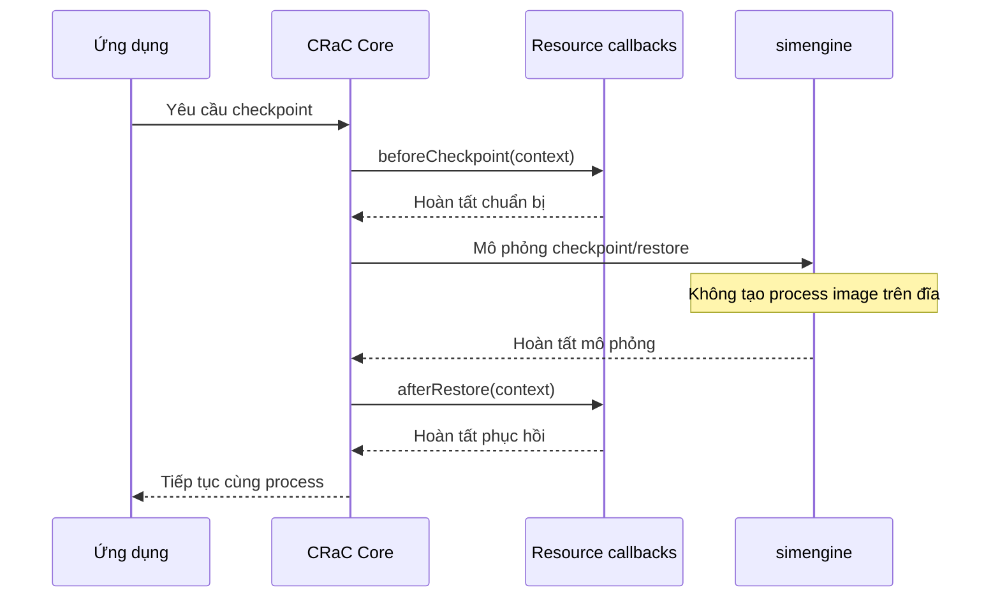
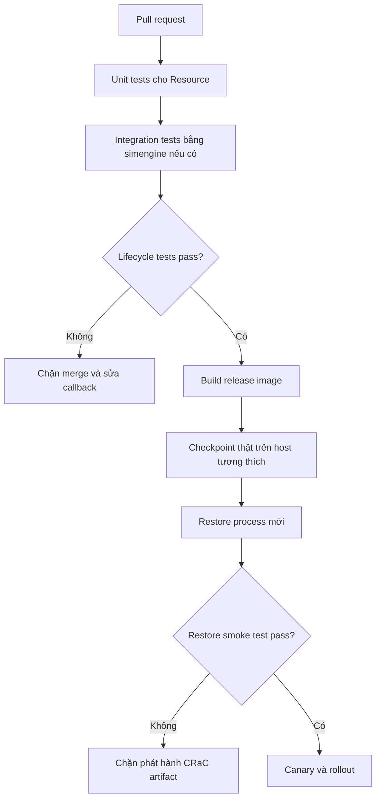

# Kiểm thử mô phỏng bằng simengine khi bản dựng hỗ trợ

`simengine` là một checkpoint engine mô phỏng trong một số bản dựng CRaC. Nó cho phép lập trình viên chạy thử chu trình phối hợp checkpoint/restore trên máy không có khả năng tạo ảnh tiến trình thật. Khi ứng dụng yêu cầu checkpoint, engine mô phỏng gọi các callback `beforeCheckpoint(...)` rồi `afterRestore(...)` của các `Resource` đã đăng ký. Chu trình diễn ra ngay trong cùng tiến trình và không ghi checkpoint image xuống đĩa.

Điều này rất hữu ích khi phát triển và kiểm thử logic lifecycle: ứng dụng có đóng admission gate không, có drain công việc không, có flush và đóng tài nguyên không, có tạo lại client sau restore không, và có đưa readiness về trạng thái phù hợp không. Nếu callback thiếu phối hợp hoặc để resource ở trạng thái không hợp lệ, lỗi có thể xuất hiện trên máy lập trình viên mà không cần một môi trường Linux có quyền checkpoint.

Tuy nhiên, `simengine` không thực hiện snapshot bộ nhớ và không kiểm tra khả năng phục hồi của kernel, file descriptor, socket, native thread, namespace hay CPU. Nó không tạo artifact để triển khai và không chứng minh một checkpoint thật sẽ restore được. Vì vậy, hãy dùng nó như một lớp kiểm thử nhanh cho code CRaC, sau đó vẫn chạy smoke test bằng engine checkpoint thật trên môi trường tương thích.

## 1. `simengine` nằm ở đâu trong kiến trúc CRaC?

CRaC tách hợp đồng phối hợp ứng dụng khỏi cơ chế thực hiện checkpoint. API CRaC thông báo cho ứng dụng rằng checkpoint sắp diễn ra và khi tiến trình đã được restore. Engine chịu trách nhiệm thực hiện thao tác tạo ảnh và khôi phục process.

Trong các bản dựng OpenJDK CRaC, hai engine thường được nhắc đến là:

| Engine | Vai trò | Đặc điểm |
|---|---|---|
| `criuengine` | Thực hiện checkpoint/restore thật qua CRIU trên Linux | Tạo ảnh tiến trình; cần kernel, CRIU và quyền/capability phù hợp |
| `simengine` | Mô phỏng chu trình checkpoint/restore | Gọi callback trong cùng process, không ghi ảnh ra đĩa |

Một số bản dựng của vendor có thể bổ sung engine riêng hoặc có ma trận hỗ trợ khác. Engine có sẵn phụ thuộc vào **bản dựng JDK**, không chỉ phụ thuộc việc ứng dụng đã thêm CRaC API. Vì vậy, không được giả định mọi JDK có `jdk.crac` hoặc `org.crac` đều hỗ trợ `simengine`.

Có thể chọn engine bằng JVM option:

```text
-XX:CRaCEngine=simengine
```

Đường dẫn checkpoint được cấu hình bằng `-XX:CRaCCheckpointTo=...`. Với `simengine`, đường dẫn này không đại diện cho một ảnh tiến trình được ghi ra đĩa; một số bản dựng yêu cầu option này để bật chế độ checkpointable dù engine mô phỏng không sử dụng nội dung path.

## 2. Chu trình mô phỏng diễn ra như thế nào?

Với checkpoint thật, runtime chuẩn bị các resource, engine chụp trạng thái process, rồi một lần chạy restore tiếp tục từ ảnh. Với `simengine`, engine mô phỏng phần phối hợp ứng dụng mà không tạo ảnh process:

1. Ứng dụng khởi động bằng CRaC-enabled JDK có `simengine`.
2. Ứng dụng đăng ký các `Resource` với CRaC context.
3. Một lệnh hoặc lời gọi API yêu cầu checkpoint.
4. Engine gọi `beforeCheckpoint(...)` để resource chuẩn bị trạng thái.
5. Engine mô phỏng hoàn tất chu trình và gọi `afterRestore(...)`.
6. Ứng dụng tiếp tục chạy trong cùng process.



Điểm quan trọng là `simengine` vẫn thực thi code callback của ứng dụng. Đây không phải chế độ bỏ qua CRaC lifecycle. Một resource không đóng file, không dừng worker hoặc không tạo lại client vẫn có thể bộc lộ lỗi trong quá trình mô phỏng nếu logic callback của nó phát hiện trạng thái sai.

Ngược lại, engine không thực hiện snapshot thật. Nếu callback chạy thành công, điều đó chỉ cho biết code phối hợp đã đi qua chu trình mô phỏng; nó không cho biết kernel có thể lưu toàn bộ process state hay restore ảnh trên một host khác.

## 3. Xác nhận bản dựng có hỗ trợ `simengine`

Trước khi viết test, cần xác định chính xác JDK đang chạy. Kiểm tra ít nhất:

- Vendor/distribution của JDK.
- Phiên bản và build number đầy đủ.
- Nền tảng được hỗ trợ bởi bản dựng đó.
- Engine `simengine` có nằm trong build hay không.
- Các option CRaC mà build yêu cầu.

Không chỉ kiểm tra `java -version` có chữ CRaC rồi kết luận engine tồn tại. Một runtime có thể hỗ trợ CRaC API và engine thật nhưng không đóng gói engine mô phỏng; một vendor build cũng có thể có mặc định engine khác nhau theo OS.

### Kiểm tra nhanh bằng startup option

Khởi chạy một ứng dụng nhỏ hoặc ứng dụng thử nghiệm với engine được chỉ định:

```bash
java \
  -XX:CRaCEngine=simengine \
  -XX:CRaCCheckpointTo=./simulated-checkpoint \
  -jar app.jar
```

Nếu build không có engine được yêu cầu, JVM sẽ báo lỗi khi khởi động thay vì đợi tới lúc ứng dụng đã làm nhiều công việc. Đây là cách phát hiện sớm một build không phù hợp.

Một số runtime có thể yêu cầu option hoặc cách gọi khác. Hãy xem tài liệu của đúng vendor/build. Với build có hỗ trợ `-XX:CRaCEngineOptions=help`, có thể dùng tùy chọn đó để xem các engine option mà runtime công bố:

```bash
java -XX:CRaCEngine=simengine -XX:CRaCEngineOptions=help
```

Không giả định mọi build hỗ trợ cùng một tập engine option. Nếu lệnh help không được hỗ trợ hoặc không có ý nghĩa với engine này, dùng tài liệu runtime và startup test làm căn cứ.

### Kiểm tra trên Windows hoặc macOS

Một số bản dựng CRaC dành cho Windows/macOS cung cấp `simengine` để kiểm thử callback trong khi hệ điều hành không thực hiện checkpoint thật theo cách CRIU trên Linux. Đây là tình huống điển hình mà engine mô phỏng có ích.

Kết quả trên Windows/macOS không chứng minh ứng dụng có thể checkpoint/restore thật trên Linux. Khi chuyển sang triển khai, vẫn cần kiểm thử bằng engine thật và môi trường đích.

## 4. Khởi chạy và kích hoạt chu trình mô phỏng

Chỉ cấu hình `-XX:CRaCEngine=simengine` chưa chắc đã tự chạy callback ngay khi JVM khởi động. Ứng dụng vẫn cần một thao tác yêu cầu checkpoint thông qua cơ chế được runtime hỗ trợ.

Một quy trình thủ công thường có hai terminal.

**Terminal 1 — Khởi chạy ứng dụng:**

```bash
java \
  -XX:CRaCEngine=simengine \
  -XX:CRaCCheckpointTo=./simulated-checkpoint \
  -jar app.jar
```

**Terminal 2 — Yêu cầu mô phỏng checkpoint:**

```bash
jcmd -l
jcmd <pid> JDK.checkpoint
```

Thay `<pid>` bằng PID của JVM thử nghiệm. Tên command và cách attach phụ thuộc bản dựng. Một số implementation cũng cho phép yêu cầu chu trình từ ứng dụng qua `Core.checkpointRestore()`.

Ví dụ lời gọi API trong một bài test hoặc internal test hook:

```java
import jdk.crac.Core;

public final class SimulationTrigger {
    private SimulationTrigger() {
    }

    public static void runCycle() throws Exception {
        Core.checkpointRestore();
    }
}
```

Đây là ví dụ dùng API `jdk.crac` của CRaC JDK. Nếu ứng dụng dùng `org.crac`, hãy theo API tương ứng của thư viện và runtime. Không để endpoint kích hoạt checkpoint công khai cho người dùng; chỉ expose qua test harness hoặc kênh quản trị nội bộ được bảo vệ.

Sau khi yêu cầu checkpoint, quan sát log của ứng dụng để xác nhận callback đã chạy. Không chỉ dựa vào dòng `Command executed successfully` từ `jcmd`: tùy implementation, output của công cụ attach có thể không phản ánh đầy đủ lỗi xảy ra trong process. Hãy kiểm tra log, exception và trạng thái ứng dụng.

## 5. Viết một Resource nhỏ để quan sát callback

Một resource thử nghiệm đơn giản giúp xác nhận `beforeCheckpoint` và `afterRestore` được gọi theo đúng chu trình.

```java
import java.util.concurrent.atomic.AtomicInteger;

import jdk.crac.Context;
import jdk.crac.Resource;

public final class SimulationProbe implements Resource {
    private final AtomicInteger beforeCount = new AtomicInteger();
    private final AtomicInteger afterCount = new AtomicInteger();

    @Override
    public void beforeCheckpoint(Context<? extends Resource> context) {
        int count = beforeCount.incrementAndGet();
        System.out.println("beforeCheckpoint count=" + count);
    }

    @Override
    public void afterRestore(Context<? extends Resource> context) {
        int count = afterCount.incrementAndGet();
        System.out.println("afterRestore count=" + count);
    }

    public int beforeCount() {
        return beforeCount.get();
    }

    public int afterCount() {
        return afterCount.get();
    }
}
```

Đăng ký resource một lần trong quá trình khởi tạo ứng dụng:

```java
import jdk.crac.Core;

SimulationProbe probe = new SimulationProbe();
Core.getGlobalContext().register(probe);
```

Sau khi kích hoạt một chu trình mô phỏng, log dự kiến có một thông báo từ mỗi callback. Có thể chạy nhiều chu trình để kiểm tra bộ đếm và trạng thái của resource.

Ví dụ trên chỉ chứng minh callback được gọi. Trong ứng dụng thật, `Resource` cần thực hiện công việc lifecycle thực tế như drain task, đóng connection và tái tạo dependency. Không để code production chỉ ghi log trong callback rồi coi như đã hỗ trợ CRaC.

## 6. Kiểm thử state transition thay vì chỉ kiểm tra log

Một test tốt nên xác nhận trạng thái ứng dụng trước, trong và sau chu trình. Ví dụ, resource có thể dùng state machine đơn giản:

```java
import java.util.concurrent.atomic.AtomicReference;

import jdk.crac.Context;
import jdk.crac.Resource;

final class LifecycleStateResource implements Resource {
    enum State {
        RUNNING,
        PREPARING
    }

    private final AtomicReference<State> state =
            new AtomicReference<>(State.RUNNING);

    @Override
    public void beforeCheckpoint(Context<? extends Resource> context) {
        if (!state.compareAndSet(State.RUNNING, State.PREPARING)) {
            throw new IllegalStateException(
                    "Cannot prepare from state " + state.get()
            );
        }
        stopAcceptingWork();
        drainWork();
        closeCheckpointSensitiveResources();
    }

    @Override
    public void afterRestore(Context<? extends Resource> context) {
        if (state.get() != State.PREPARING) {
            throw new IllegalStateException(
                    "Restore callback ran in unexpected state " + state.get()
            );
        }
        recreateResources();
        verifyDependencies();
        state.set(State.RUNNING);
        resumeAcceptingWork();
    }

    private void stopAcceptingWork() { /* application code */ }
    private void drainWork() { /* application code */ }
    private void closeCheckpointSensitiveResources() { /* application code */ }
    private void recreateResources() { /* application code */ }
    private void verifyDependencies() { /* application code */ }
    private void resumeAcceptingWork() { /* application code */ }
}
```

Các hàm trong ví dụ là placeholder cho logic của ứng dụng. Khi dùng thật, hãy xử lý exception, timeout và rollback cho từng thao tác. `afterRestore` chỉ nên mở admission gate sau khi mọi dependency bắt buộc đã phục hồi.

Với `simengine`, có thể quan sát rằng code chuyển từ `RUNNING` sang `PREPARING`, sau đó thực hiện phục hồi và quay lại `RUNNING`. Trong process thật sau restore, các object được phục hồi từ snapshot; với engine mô phỏng, object vẫn nằm trong cùng process. Vì vậy, test này xác nhận logic chuyển trạng thái nhưng không kiểm tra khả năng phục hồi object graph từ một ảnh thực.

## 7. Những phần của ứng dụng nên kiểm thử bằng simengine

`simengine` đặc biệt hữu ích để kiểm tra các phần do ứng dụng kiểm soát:

### Đăng ký và điều phối Resource

- Resource có được đăng ký vào đúng CRaC context không?
- Callback có được gọi khi yêu cầu checkpoint không?
- Mỗi resource có hoàn thành công việc chuẩn bị trước khi callback trả về không?
- Coordinator có xử lý dependency giữa các resource không?
- Có resource nào bị đăng ký trùng khiến callback chạy nhiều lần ngoài dự kiến không?

### Dừng và phục hồi công việc

- Admission gate có đóng trước khi drain không?
- Request/task đang chạy có được đợi tới khi hoàn tất không?
- Scheduler/consumer có ngừng tạo việc mới không?
- Sau callback restore, trigger có được khởi động lại đúng lúc không?
- Async task có giữ lease hoặc trạng thái làm bộ đếm drain không về 0 không?

### Tài nguyên bên ngoài

- Connection pool có được đóng hoặc chuẩn bị theo lifecycle không?
- HTTP client, message client và registry client có được tạo lại không?
- Credential, DNS và endpoint có được đọc lại sau restore không?
- Logging/metrics/tracing exporter có được flush và khởi tạo lại khi cần không?
- Readiness có chỉ chuyển sang accepting sau khi dependency khỏe không?

### Lỗi và trạng thái biên

- Callback có báo lỗi nếu không thể drain hoặc đóng tài nguyên không?
- Timeout có được áp dụng thay vì chờ vô hạn không?
- Resource có xử lý trạng thái không mong đợi không?
- Có thể chạy nhiều chu trình mô phỏng liên tiếp mà không double-close hoặc double-register không?
- Một lần prepare thất bại có để ứng dụng ở trạng thái không thể phục hồi không?

Các test này có thể chạy thường xuyên trong unit/integration test suite và trên máy lập trình viên, miễn là build có engine mô phỏng.

## 8. Ví dụ kiểm tra nhiều chu trình liên tiếp

Một lần mô phỏng thành công chưa đủ để phát hiện resource chỉ hoạt động đúng lần đầu. Hãy thử nhiều chu trình để phát hiện lỗi như đóng hai lần, không mở lại connection, giữ cờ `isClosed` hoặc đăng ký lại cùng listener.

Kịch bản thủ công:

1. Khởi chạy ứng dụng với `simengine`.
2. Gọi một chu trình checkpoint/restore.
3. Gửi một request thử nghiệm và xác nhận ứng dụng hoạt động.
4. Gọi chu trình thứ hai.
5. Gửi request khác và xác nhận dependency vẫn sẵn sàng.
6. Kiểm tra callback count, resource count và log lỗi.

Một test harness có thể theo dõi số lần gọi:

```java
final class LifecycleAssertions {
    static void assertCycleCounts(
            SimulationProbe probe,
            int expectedCycles) {
        if (probe.beforeCount() != expectedCycles) {
            throw new AssertionError("Unexpected beforeCheckpoint count");
        }
        if (probe.afterCount() != expectedCycles) {
            throw new AssertionError("Unexpected afterRestore count");
        }
    }
}
```

Việc kích hoạt chu trình và lấy reference `probe` phụ thuộc cấu trúc test harness. Nếu ứng dụng dùng nhiều JVM fork, static state trong test runner không tự chia sẻ giữa các process; hãy kiểm tra state ở đúng process đang chạy engine.

## 9. Kiểm thử exception trong callback

Resource có thể thất bại trong `beforeCheckpoint` hoặc `afterRestore`. Các tình huống thường gặp:

- Không thể drain request trước timeout.
- Không đóng được file/socket hoặc pool.
- Không flush được dữ liệu bắt buộc.
- Không tạo lại connection hoặc credential sau restore.
- Dependency chưa sẵn sàng.
- Một resource chạy callback trong trạng thái không hợp lệ.

Với `beforeCheckpoint`, lỗi phải làm checkpoint attempt thất bại thay vì cho phép tạo ảnh khi ứng dụng chưa an toàn. Với `afterRestore`, lỗi phục hồi resource thiết yếu phải được báo rõ và không được mở readiness.

`simengine` giúp chạy qua các nhánh callback và quan sát cách ứng dụng xử lý exception. Tuy nhiên, chi tiết cách exception được hiển thị hoặc cách engine kết thúc chu trình có thể khác theo runtime. Hãy kiểm tra log và trạng thái process của build đang dùng, không chỉ assert chuỗi output của một phiên bản vendor.

Một test nên cố tình tạo lỗi có kiểm soát:

```java
import java.io.IOException;

import jdk.crac.Context;
import jdk.crac.Resource;

final class FailingResource implements Resource {
    private final boolean failBeforeCheckpoint;

    FailingResource(boolean failBeforeCheckpoint) {
        this.failBeforeCheckpoint = failBeforeCheckpoint;
    }

    @Override
    public void beforeCheckpoint(Context<? extends Resource> context)
            throws Exception {
        if (failBeforeCheckpoint) {
            throw new IOException("Simulated preparation failure");
        }
    }

    @Override
    public void afterRestore(Context<? extends Resource> context) {
        System.out.println("restore callback reached");
    }
}
```

Ví dụ cần import `java.io.IOException` và các kiểu CRaC tương ứng. Dùng một test process riêng cho trường hợp callback thất bại để tránh làm hỏng trạng thái các test khác. Xác nhận checkpoint không được coi là thành công nếu bước chuẩn bị thất bại.

## 10. Dùng simengine trong unit test và integration test

Không nhất thiết phải kích hoạt engine qua terminal cho mọi test. Có thể phân tầng kiểm thử:

| Cấp test | Cách thực hiện | Vai trò của simengine |
|---|---|---|
| Unit test | Test từng resource/coordinator bằng fake dependency | Có thể test logic callback trực tiếp; không bắt buộc chạy engine |
| Integration test trong JVM | Chạy ứng dụng với CRaC JDK và yêu cầu checkpoint | `simengine` gọi chu trình callback để test phối hợp thật giữa các bean |
| Integration test nhiều process | Tạo checkpoint và khởi chạy process mới từ ảnh | Cần engine checkpoint thật; simengine không đủ |
| Platform test | Chạy trên đúng Linux/kernel/container/runtime/CPU của deployment | Cần engine thật để xác nhận khả năng tạo và restore ảnh |
| Performance test | Đo checkpoint size, restore time và time-to-ready | Không dùng simengine làm số đo hiệu năng checkpoint thật |

Unit test vẫn nên kiểm tra từng resource độc lập vì nó dễ tạo lỗi có chủ đích và xác định nguyên nhân. Integration test với `simengine` bổ sung xác nhận rằng các resource được đăng ký và điều phối trong ứng dụng thật.

## 11. Ma trận: simengine kiểm tra được gì và không kiểm tra được gì?

| Hạng mục | Kiểm thử bằng simengine | Cần checkpoint engine thật |
|---|---|---|
| `beforeCheckpoint` được gọi | Có | Có thể xác nhận lại trong smoke test |
| `afterRestore` được gọi | Có | Có thể xác nhận lại trong smoke test |
| Logic đóng/mở resource do ứng dụng viết | Có thể kiểm tra luồng code và state transition | Cần test thêm để xác nhận resource OS thật được xử lý đúng |
| Admission gate và drain | Có | Có, để kiểm tra tương tác với process/traffic thật |
| Recreate client bằng fake dependency | Có | Không đủ nếu cần kiểm tra socket/driver thật |
| File descriptor được lưu/restore | Không | Có |
| TCP socket và network namespace | Không | Có |
| Native thread, signal, mutex và native memory | Không chứng minh được | Có |
| CRIU privilege/capability và kernel compatibility | Không | Có |
| CPU feature compatibility | Không | Có |
| Checkpoint artifact được tạo và có thể tải | Không | Có |
| Restore sang process mới hoặc host khác | Không | Có |
| Kích thước ảnh và thời gian restore | Không đại diện | Có |

Đừng nâng kết quả `simengine passed` thành tuyên bố “ứng dụng CRaC-ready trên production”. Nó là bằng chứng về callback/lifecycle logic trong bản dựng đang test, không phải bằng chứng cho toàn bộ native checkpoint/restore path.

## 12. Kết hợp simengine với engine thật trong CI

Một pipeline hiệu quả có thể dùng nhiều lớp kiểm thử:

### Mỗi pull request

- Compile bằng JDK/build hỗ trợ CRaC API.
- Chạy unit test cho từng resource và lifecycle coordinator.
- Nếu runtime có `simengine`, chạy integration test mô phỏng.
- Kiểm tra các callback có timeout và lỗi được xử lý rõ.
- Không yêu cầu quyền checkpoint hệ điều hành cho mọi developer/CI runner.

### Trước khi phát hành

- Chạy application image trên host Linux tương thích.
- Dùng engine checkpoint thật, ví dụ `criuengine` nếu đó là engine của runtime.
- Tạo checkpoint thực và xác minh artifact được ghi đầy đủ.
- Khởi chạy process mới bằng restore option.
- Xác nhận resource, database, listener và telemetry hoạt động.
- Chạy smoke test và kiểm tra readiness.

### Trước khi rollout rộng

- Chạy trên node pool có kernel, CPU, container runtime và security profile giống production.
- Kiểm tra nhiều replica restore từ cùng checkpoint nếu deployment có scale-out.
- Kiểm tra network, lease, identity và dependency refresh.
- Đo time-to-ready và first-request latency.
- Giữ cold-start fallback nếu policy yêu cầu.



Nếu bản dựng không có `simengine`, không cần dừng toàn bộ phát triển. Có thể chạy unit test callback bằng cách gọi logic coordinator trực tiếp và dành integration test engine thật cho runner chuyên dụng. Tuy nhiên, ghi rõ test nào đã chạy và test nào chưa có trong build report.

## 13. Lưu ý khi test trên các bản dựng khác nhau

Tên engine và option phụ thuộc runtime distribution. Một số điểm cần kiểm tra:

- `simengine` có thể có trong upstream CRaC và một số vendor build, nhưng không phải mọi JDK đều đóng gói nó.
- Mặc định engine có thể khác theo hệ điều hành hoặc vendor.
- Cách trigger checkpoint qua `jcmd` và quyền attach có thể khác.
- Cách hiển thị exception từ callback và engine log có thể khác.
- `CRaCCheckpointTo` có thể được yêu cầu về mặt cấu hình dù engine mô phỏng không ghi ảnh.
- Một số bản dựng có engine mô phỏng bổ sung hoặc option riêng; không suy ra chúng là chuẩn upstream.

Hãy ghi rõ trong CI report:

```text
JDK vendor: <vendor>
JDK version/build: <full build>
OS/architecture: <platform>
CRaC engine: simengine
Simulation trigger: <jcmd or API>
beforeCheckpoint callbacks: <count/result>
afterRestore callbacks: <count/result>
Result: <passed/failed>
```

Các giá trị trong mẫu phải được điền từ lần chạy thực tế. Không ghi engine là `simengine` nếu test chỉ gọi trực tiếp method callback mà không chạy engine.

## 14. Tránh các hiểu nhầm thường gặp

**`simengine` tạo checkpoint file để dùng lại.** Không. Engine mô phỏng chu trình và không ghi process image xuống đĩa.

**Test qua `simengine` chứng minh CRIU có thể checkpoint.** Không. Nó không gọi CRIU để lưu process state và không kiểm tra kernel privilege.

**`afterRestore` được gọi trong process khác.** Không với `simengine`; chu trình mô phỏng diễn ra trong cùng process.

**Nếu callback không ném exception thì ứng dụng đã tương thích CRaC.** Chưa đủ. Còn phải kiểm tra native resource, file descriptor, socket, kernel, CPU, filesystem và restore thật.

**Mọi bản dựng CRaC đều hỗ trợ `simengine`.** Không. Engine có sẵn phụ thuộc JDK build và vendor.

**Chỉ cần cấu hình JVM option là callback tự chạy.** Không nhất thiết. Cần yêu cầu checkpoint bằng command hoặc API được runtime hỗ trợ.

**Có thể dùng `simengine` để benchmark restore time.** Không. Vì không tạo/đọc ảnh process, thời gian của nó không đại diện cho checkpoint I/O hoặc restore thật.

**Nếu ứng dụng chạy trên Windows với simengine thì có thể deploy checkpoint trên Windows.** Không thể kết luận như vậy. Kết quả chỉ xác nhận logic callback trong bản dựng và môi trường mô phỏng; khả năng checkpoint thật phải theo engine/platform hỗ trợ.

## 15. Ví dụ test checklist cho một service

Giả sử service có HTTP server, HikariCP, scheduled job và OpenTelemetry. Một vòng kiểm thử mô phỏng có thể xác nhận:

1. Readiness chuyển sang refusing traffic.
2. Admission gate từ chối request mới.
3. Scheduled job ngừng tạo lần chạy mới.
4. Request và transaction đang chạy được drain.
5. Pool được đóng hoặc chuyển sang trạng thái chuẩn bị.
6. Trace batch và async log được flush theo deadline.
7. Callback `afterRestore` tạo pool mới và xác minh kết nối.
8. HTTP server lifecycle được đưa về trạng thái sẵn sàng theo abstraction của ứng dụng.
9. Telemetry exporter được mở lại và kiểm tra khả năng export.
10. Readiness chỉ chuyển sang accepting sau khi dependency cần thiết đã khỏe.
11. Request mới thành công sau chu trình mô phỏng.
12. Chu trình thứ hai vẫn chạy mà không double-close hoặc đăng ký trùng.

Kết quả test cần ghi rõ đây là mô phỏng. Sau đó, chạy cùng kịch bản trên engine thật để xác nhận socket, pool, native state và process image thực sự hoạt động.

## 16. Khi nào nên dùng simengine?

Nên dùng khi:

- Developer đang làm việc trên máy không có quyền hoặc khả năng checkpoint thật.
- Muốn chạy nhanh callback integration trong CI.
- Muốn test logic `beforeCheckpoint`/`afterRestore` mà không dựng CRIU host cho mỗi commit.
- Muốn kiểm tra resource coordinator, state transition, timeout và exception path.
- Muốn phát hiện sớm callback không được đăng ký hoặc resource không phục hồi đúng.

Không dùng nó làm bằng chứng duy nhất khi:

- Thay đổi JDK, kernel, CRIU hoặc native library.
- Thay đổi file/socket/JNI/driver lifecycle.
- Thay đổi container capability, mount hoặc network namespace.
- Phát hành checkpoint artifact mới.
- Thay đổi CPU architecture hoặc nhóm host restore.
- Cần đo checkpoint size, restore time hoặc time-to-ready thực tế.

Trong các trường hợp này, cần test bằng engine thật trên môi trường tương thích.

## 17. Checklist sử dụng simengine

- [ ] Đã xác nhận đúng JDK vendor, version và build hỗ trợ `simengine`.
- [ ] JVM được khởi chạy với `-XX:CRaCEngine=simengine`.
- [ ] Đã cấu hình `-XX:CRaCCheckpointTo` theo yêu cầu của runtime.
- [ ] Đã kích hoạt chu trình bằng `jcmd` hoặc API được build hỗ trợ.
- [ ] Đã xác nhận `beforeCheckpoint(...)` được gọi.
- [ ] Đã xác nhận `afterRestore(...)` được gọi.
- [ ] Đã kiểm tra state transition và trạng thái resource sau chu trình.
- [ ] Đã kiểm tra timeout và exception path.
- [ ] Đã chạy nhiều chu trình liên tiếp để phát hiện lỗi lifecycle lặp.
- [ ] Đã kiểm tra ứng dụng tiếp tục phục vụ sau mô phỏng.
- [ ] CI report ghi rõ engine, build và trigger thực tế.
- [ ] Không coi kết quả mô phỏng là bằng chứng có checkpoint image thật.
- [ ] Đã lên lịch smoke test bằng engine thật trên host/kernel tương thích.

## 18. Kết luận

`simengine` là công cụ phát triển và kiểm thử cho CRaC khi bản dựng JDK có hỗ trợ. Nó mô phỏng chu trình checkpoint/restore trong cùng process, gọi `beforeCheckpoint(...)` và `afterRestore(...)` của các resource đã đăng ký nhưng không tạo ảnh tiến trình trên đĩa. Nhờ đó, lập trình viên có thể kiểm tra logic drain, đóng/mở tài nguyên, refresh dependency và readiness ngay trên máy không có checkpoint engine thật.

Hãy đưa test `simengine` vào vòng lặp phát triển và CI để phát hiện sớm lỗi lifecycle. Đồng thời, giữ một bước kiểm thử riêng bằng engine thật trên đúng kernel, container runtime, CPU và quyền triển khai. `simengine passed` là bằng chứng callback logic đã chạy trong mô phỏng; chỉ restore test thật mới chứng minh checkpoint artifact có thể được tạo và khôi phục trên môi trường mục tiêu.

## Tài liệu tham khảo

- [CRaC — Checkpoint engines](https://crac.org/reference/engines/): mô tả engine `criuengine`, `simengine`, phạm vi mô phỏng và khác biệt giữa engine upstream/vendor.
- [CRaC — Checkpoint and restore](https://crac.org/use/checkpoint-and-restore/): hướng dẫn cấu hình `-XX:CRaCCheckpointTo`, yêu cầu checkpoint và restore bằng `-XX:CRaCRestoreFrom`.
- [Azul — Running an Application With CRaC](https://docs.azul.com/crac/usage/running-crac.html): mô tả cách dùng simulated checkpoint/restore để kiểm thử callback trên Windows/macOS và giới hạn của chế độ mô phỏng.
- [Azul — CRaC Command-Line Options](https://docs.azul.com/crac/usage/vm-options): mô tả `-XX:CRaCEngine`, `-XX:CRaCCheckpointTo`, `-XX:CRaCRestoreFrom` và engine availability theo build.
