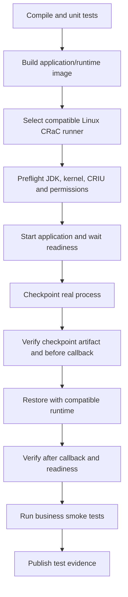

# Kiểm thử tích hợp bằng checkpoint và restore thật trên Linux

Một unit test có thể xác nhận `beforeCheckpoint()` gọi `close()` và `afterRestore()` gọi factory tạo tài nguyên mới. Tuy nhiên, nó không chứng minh JVM thực sự tạo được checkpoint image, CRIU khôi phục được tiến trình hoặc ứng dụng tiếp tục hoạt động trên Linux sau restore. Để xác nhận toàn bộ chu kỳ CRaC, cần chạy integration test bằng JDK có hỗ trợ CRaC trên môi trường Linux tương thích và thực hiện checkpoint/restore thật.

Kiểm thử này phải đi qua các lớp: JVM, CRaC API, kernel, CRIU, container runtime nếu có, filesystem, network và dependency bên ngoài. Một bài test có giá trị cần xác nhận cả hai phía: callback trước checkpoint đã đưa ứng dụng về trạng thái an toàn; callback sau restore đã phục hồi tài nguyên; tiến trình khôi phục thực sự phục vụ được request hoặc hoàn tất công việc nghiệp vụ.

## 1. Unit test và integration test kiểm chứng điều gì?

Hai loại test có mục tiêu khác nhau:

| Loại test | Phạm vi | Có chứng minh checkpoint/restore thật không? |
|---|---|---|
| Unit test cho Resource | Kiểm tra thứ tự gọi `beforeCheckpoint`, `afterRestore`, xử lý exception và state machine bằng mock/fake | Không |
| Spring context test | Kiểm tra bean được tạo, Resource được đăng ký và dependency được inject | Không |
| Integration test trên Linux | Khởi chạy CRaC-enabled JVM, yêu cầu checkpoint, restore image bằng runtime thật | Có |
| End-to-end test | Restore rồi gọi API hoặc thực hiện nghiệp vụ qua dependency thật hoặc môi trường test | Có, đồng thời kiểm tra hành vi ứng dụng |

Unit test vẫn cần thiết vì chạy nhanh và giúp xác định lỗi logic. Nhưng checkpoint/restore phụ thuộc vào JVM và kernel; chỉ integration test trên runtime thật mới xác nhận được các điều kiện đó.

## 2. Chọn môi trường Linux tương thích

Trước khi viết test harness, xác định chính xác runtime sẽ được kiểm thử. Không phải mọi JDK có cùng Java feature version đều có CRaC; cũng không phải mọi Linux host đều đáp ứng điều kiện checkpoint/restore.

Ghi nhận tối thiểu:

- JDK vendor, distribution, version đầy đủ và build number.
- Tên JVM và các cờ khởi chạy liên quan CRaC.
- Kiến trúc CPU như `x86_64` hoặc `aarch64`.
- Linux distribution và version.
- Kernel version và các tính năng cần thiết.
- Phiên bản CRIU nếu bản JDK dùng CRIU.
- Container runtime, namespace, cgroup và security profile nếu chạy trong container.
- Native library, JNI/JNA, agent và driver mà ứng dụng nạp.

Ví dụ thu thập thông tin trên Linux:

```bash
java -version
java -XshowSettings:properties -version
uname -a
uname -m
cat /etc/os-release
criu --version
criu check
```

`criu check` là bước kiểm tra cơ bản khi môi trường dùng CRIU; các yêu cầu và lệnh kiểm tra chi tiết phụ thuộc phiên bản CRIU, kernel và JDK vendor. Hãy làm theo hướng dẫn của đúng bản phân phối CRaC đang chạy. Không kết luận môi trường sẵn sàng chỉ từ việc lệnh `criu --version` trả về phiên bản.

### 2.1. Quyền và cấu hình host

Checkpoint có thể cần capability, quyền truy cập `/proc`, namespace hoặc cấu hình bảo mật đặc biệt. Tùy host và container runtime, những yêu cầu này có thể bao gồm quyền checkpoint/restore, cấu hình seccomp, AppArmor/SELinux và khả năng thao tác với tiến trình.

Không bật `--privileged` hoặc chạy root như một giải pháp mặc định. Xác định quyền tối thiểu theo tài liệu vendor, sau đó chạy test bằng cấu hình gần với production. Một test thành công trong container privileged không chứng minh workload production với security profile hạn chế cũng restore được.

### 2.2. Kiểm thử trên host hay trong container?

Nếu mới thiết lập CRaC, nên bắt đầu bằng Linux host tương thích để tách lỗi JVM/CRIU khỏi lỗi cấu hình container. Sau khi host test thành công, lặp lại trong container với đúng image, volume, namespace và quyền của môi trường triển khai.

Container dùng kernel của host. Cài CRIU trong container không tự cung cấp kernel feature hoặc capability còn thiếu. Nếu production chạy Kubernetes, cuối cùng phải kiểm thử trên node và container runtime tương ứng; Pod restart thông thường không tự động thực hiện CRaC restore.

## 3. Chuẩn bị ứng dụng kiểm thử

Ứng dụng test nên có ít nhất:

1. Một Resource đăng ký với CRaC context.
2. Một dấu vết bên ngoài tiến trình để chứng minh callback đã chạy.
3. Một endpoint hoặc tác vụ có thể kiểm tra sau restore.
4. Một dependency được đóng trước checkpoint và tạo lại sau restore.
5. Một readiness signal chỉ thành công sau khi phục hồi hoàn tất.

Không chỉ kiểm tra một biến static trong heap. Vì heap được khôi phục, biến đó có thể giữ nguyên giá trị cũ và không chứng minh callback `afterRestore()` đã chạy. Dùng một marker file hoặc test service nằm ngoài checkpoint directory để quan sát callback từ bên ngoài tiến trình.

### 3.1. Resource ghi marker trước và sau restore

Ví dụ Resource đơn giản ghi sự kiện vào thư mục marker độc lập:

```java
import org.crac.Context;
import org.crac.Core;
import org.crac.Resource;

import java.io.IOException;
import java.nio.charset.StandardCharsets;
import java.nio.file.Files;
import java.nio.file.Path;
import java.nio.file.StandardOpenOption;
import java.time.Instant;

public final class CheckpointProbe implements Resource {
    private final Path markerDirectory;
    private volatile boolean restored;

    public CheckpointProbe(Path markerDirectory) {
        this.markerDirectory = markerDirectory;
    }

    public static CheckpointProbe register(Path markerDirectory)
            throws IOException {
        Files.createDirectories(markerDirectory);
        CheckpointProbe probe = new CheckpointProbe(markerDirectory);
        Core.getGlobalContext().register(probe);
        return probe;
    }

    @Override
    public void beforeCheckpoint(Context<? extends Resource> context)
            throws Exception {
        append("before-checkpoint");
    }

    @Override
    public void afterRestore(Context<? extends Resource> context)
            throws Exception {
        restored = true;
        append("after-restore");
    }

    public boolean isRestored() {
        return restored;
    }

    private void append(String event) throws IOException {
        String line = Instant.now() + " " + event + System.lineSeparator();
        Files.writeString(
                markerDirectory.resolve("lifecycle.log"),
                line,
                StandardCharsets.UTF_8,
                StandardOpenOption.CREATE,
                StandardOpenOption.WRITE,
                StandardOpenOption.APPEND);
    }
}
```

Đăng ký Resource khi ứng dụng khởi động:

```java
Path markerDirectory = Path.of(
        System.getenv().getOrDefault(
                "CRAC_TEST_MARKER_DIR",
                "/tmp/crac-integration-test/markers"));

CheckpointProbe probe = CheckpointProbe.register(markerDirectory);
```

Trong Spring Boot, có thể đăng ký probe từ một bean cấu hình hoặc một startup callback sau khi dependency cần thiết đã sẵn sàng. Đảm bảo chỉ đăng ký một lần.

Thư mục marker phải nằm ngoài checkpoint directory và có thể được đọc từ test runner sau khi tiến trình checkpoint/restore. Nếu marker nằm bên trong checkpoint directory, nó có thể bị snapshot cùng tiến trình và làm mất ý nghĩa của phép quan sát bên ngoài.

Marker là công cụ cho test. Không nên ghi token, credential hoặc dữ liệu nhạy cảm vào file này. Trong test song song, dùng một marker directory riêng cho mỗi lần chạy.

### 3.2. Endpoint quan sát trạng thái sau restore

Với ứng dụng HTTP, có thể cung cấp endpoint chỉ bật trong profile test:

```java
import org.springframework.web.bind.annotation.GetMapping;
import org.springframework.web.bind.annotation.RestController;

import java.util.Map;

@RestController
public final class CracTestController {
    private final CheckpointProbe probe;
    private final TestDependencyHandle dependency;

    public CracTestController(
            CheckpointProbe probe,
            TestDependencyHandle dependency) {
        this.probe = probe;
        this.dependency = dependency;
    }

    @GetMapping("/internal/test/crac-state")
    public Map<String, Object> state() {
        return Map.of(
                "restored", probe.isRestored(),
                "dependencyReady", dependency.isReady(),
                "pid", ProcessHandle.current().pid());
    }
}
```

Endpoint này chỉ dành cho test profile hoặc môi trường cô lập. Không công khai thông tin PID và trạng thái nội bộ qua endpoint production nếu không có nhu cầu vận hành rõ ràng.

Test runner sẽ kiểm tra `restored == true` và `dependencyReady == true` sau restore. PID có thể được ghi nhận để chẩn đoán, nhưng không nên giả định PID host luôn đổi hoặc luôn giữ nguyên: hành vi phụ thuộc PID namespace và cách restore.

## 4. Kiểm thử dependency được đóng và tạo lại

Marker callback chứng minh callback được gọi; nó chưa chứng minh tài nguyên bên ngoài đã được xử lý đúng. Hãy có ít nhất một dependency đại diện, ví dụ connection pool hoặc client của thư viện.

Một test handle có thể theo dõi generation của instance:

```java
import java.util.concurrent.atomic.AtomicInteger;
import java.util.concurrent.atomic.AtomicReference;

public final class TestDependencyHandle {
    private final AtomicInteger generations = new AtomicInteger();
    private final AtomicReference<TestClient> current = new AtomicReference<>();

    public void closeForCheckpoint() throws Exception {
        TestClient old = current.getAndSet(null);
        if (old != null) {
            old.close();
        }
    }

    public void recreateAfterRestore() throws Exception {
        TestClient replacement = new TestClient(generations.incrementAndGet());
        replacement.connectAndVerify();
        if (!current.compareAndSet(null, replacement)) {
            replacement.close();
            throw new IllegalStateException("Client is already installed");
        }
    }

    public boolean isReady() {
        TestClient client = current.get();
        return client != null && client.isReady();
    }

    public int generation() {
        TestClient client = current.get();
        return client == null ? 0 : client.generation();
    }
}
```

`TestClient` ở đây đại diện cho client kiểm thử. Trong integration test thật, thay bằng adapter tới database, HTTP service hoặc thư viện mà ứng dụng cần phục hồi. Generation chỉ có ý nghĩa khi được lưu ở nơi test có thể quan sát; nếu nó nằm trong heap và bị snapshot, test phải kết hợp marker ngoài tiến trình hoặc server-side observation để chứng minh instance mới đã được tạo.

Một kiểm thử mạnh hơn sẽ xác nhận server bên ngoài nhìn thấy kết nối mới, ví dụ ghi nhận session ID database mới hoặc một request sau restore được phục vụ bởi client generation mới. Không chỉ dựa vào việc `DataSource` object khác null.

## 5. Chuẩn bị thư mục checkpoint và marker

Checkpoint output phải được tách khỏi dữ liệu kiểm thử bên ngoài. Ví dụ:

```text
/tmp/crac-test-run-<id>/
  checkpoint/       # output của CRaC/CRIU
  markers/          # lifecycle log, nằm ngoài checkpoint
  logs/             # stdout/stderr của JVM và test runner
  metadata/         # version và kết quả test
```

Tạo các thư mục với quyền phù hợp:

```bash
RUN_DIR="$(mktemp -d /tmp/crac-it.XXXXXX)"
CHECKPOINT_DIR="$RUN_DIR/checkpoint"
MARKER_DIR="$RUN_DIR/markers"
LOG_DIR="$RUN_DIR/logs"

mkdir -p "$CHECKPOINT_DIR" "$MARKER_DIR" "$LOG_DIR"
chmod 0700 "$RUN_DIR" "$CHECKPOINT_DIR" "$MARKER_DIR" "$LOG_DIR"
```

Không dùng chung checkpoint directory giữa nhiều test chạy song song. Mỗi test cần output riêng để tránh ghi đè hoặc restore nhầm image.

Đảm bảo user chạy JVM có quyền ghi checkpoint và marker directory. Nếu CRIU/JDK cần quyền host bổ sung, cấp theo hướng dẫn của môi trường test và thu hồi sau khi test hoàn tất.

## 6. Khởi chạy JVM CRaC trên Linux

Chạy ứng dụng bằng đúng JDK CRaC đã chọn. Ví dụ:

```bash
export CRAC_TEST_MARKER_DIR="$MARKER_DIR"

"$JAVA_HOME/bin/java" \
  "-XX:CRaCCheckpointTo=$CHECKPOINT_DIR" \
  -jar application.jar \
  > "$LOG_DIR/source-jvm.log" 2>&1 &

APP_PID=$!
```

Tên option `-XX:CRaCCheckpointTo` là cách dùng phổ biến trên các bản JDK CRaC hỗ trợ option này. Xác minh cú pháp và cách khởi chạy trong tài liệu của vendor đang kiểm thử. Đừng dùng JDK thông thường rồi chỉ thêm dependency `org.crac`.

Chờ ứng dụng sẵn sàng trước khi checkpoint:

```bash
for attempt in $(seq 1 60); do
  if curl --fail --silent http://127.0.0.1:8080/actuator/health/readiness >/dev/null; then
    break
  fi
  sleep 1
done

curl --fail http://127.0.0.1:8080/internal/test/crac-state
```

Nếu ứng dụng không có Actuator, dùng endpoint readiness riêng. Test runner phải thất bại nếu hết thời hạn mà ứng dụng chưa sẵn sàng; không tiếp tục checkpoint một tiến trình chưa khởi động xong.

Trước checkpoint, gửi một số request nghiệp vụ kiểm thử và xác nhận kết quả để có baseline. Nếu có worker nền, hãy tạo công việc có thể quan sát để xác nhận `beforeCheckpoint` drain đúng cách.

## 7. Yêu cầu checkpoint thật

Với các JDK CRaC hỗ trợ lệnh diagnostic command, có thể yêu cầu checkpoint bằng `jcmd`:

```bash
"$JAVA_HOME/bin/jcmd" "$APP_PID" JDK.checkpoint
```

Lệnh cần truy cập đúng JVM, cùng môi trường PID phù hợp và dùng công cụ tương thích với JDK đang chạy. Nếu JVM ở container, chạy `jcmd` trong đúng container/PID namespace hoặc dùng cách điều khiển mà vendor hỗ trợ.

Không chỉ kiểm tra exit code của `jcmd`. Sau lệnh, xác nhận:

- Log có ghi nhận callback `beforeCheckpoint`.
- Marker `before-checkpoint` xuất hiện trong marker directory bên ngoài.
- Checkpoint directory có các file/metadata được runtime tạo.
- Log không chứa lỗi callback, CRIU hoặc filesystem.
- Trạng thái tiến trình nguồn phù hợp với hành vi mà vendor mô tả.

### 7.1. Không giả định tiến trình nguồn luôn thoát

Hành vi tiến trình gốc sau checkpoint phụ thuộc runtime và cách gọi checkpoint. Một số quy trình có thể để tiến trình tiếp tục chạy, trong khi quy trình khác có thể kết thúc hoặc chuyển trạng thái theo công cụ điều khiển.

Test harness phải theo tài liệu JDK đang dùng. Nếu tiến trình nguồn tiếp tục chạy sau khi snapshot hoàn tất, cần quản lý nó tách biệt trước khi restore để test không vô tình phục vụ request từ tiến trình nguồn thay vì tiến trình được khôi phục. Không giết tiến trình trước khi xác nhận checkpoint đã hoàn tất và artifact đã được ghi đầy đủ.

Không dùng việc PID thay đổi làm assertion duy nhất. PID có thể được khôi phục trong namespace hoặc được ánh xạ khác trên host. Hãy dùng marker callback, readiness và hành vi dependency để xác nhận restore.

## 8. Kiểm tra checkpoint artifact

Sau checkpoint, kiểm tra thư mục output:

```bash
find "$CHECKPOINT_DIR" -maxdepth 3 -type f -printf '%p %s bytes\n'
du -sh "$CHECKPOINT_DIR"
test -n "$(find "$CHECKPOINT_DIR" -type f -print -quit)"
```

Các lệnh trên chỉ kiểm tra artifact có file và kích thước. Cấu trúc cụ thể phụ thuộc JDK/CRIU. Không tự sửa, đổi tên hoặc xóa file bên trong checkpoint directory trước khi restore.

Ghi nhận:

- Thời điểm checkpoint bắt đầu và kết thúc.
- Kích thước checkpoint directory.
- Số file và tổng dung lượng.
- Log JVM và CRIU.
- JDK vendor/version/build và host metadata.
- Kết quả callback trước checkpoint.

Một thư mục không rỗng chưa chứng minh image hợp lệ. Chỉ restore thật mới xác nhận runtime có thể dùng artifact.

## 9. Restore từ checkpoint image

Restore phải dùng đúng JDK CRaC và môi trường tương thích. Ví dụ với các bản hỗ trợ `-XX:CRaCRestoreFrom`:

```bash
export CRAC_TEST_MARKER_DIR="$MARKER_DIR"

"$JAVA_HOME/bin/java" \
  "-XX:CRaCRestoreFrom=$CHECKPOINT_DIR" \
  > "$LOG_DIR/restored-jvm.log" 2>&1 &

RESTORED_PID=$!
```

Đây là ví dụ theo option phổ biến của CRaC-enabled JDK; hãy dùng đúng lệnh restore mà vendor yêu cầu. Restore không phải chạy `java -jar application.jar` lần nữa. JVM cần khôi phục tiến trình từ checkpoint artifact.

Sau khi restore, chờ readiness và kiểm tra endpoint test:

```bash
curl --fail http://127.0.0.1:8080/actuator/health/readiness
curl --fail http://127.0.0.1:8080/internal/test/crac-state
```

Kết quả cần xác nhận `restored` là `true` và dependency bắt buộc sẵn sàng. Nếu callback `afterRestore` thất bại, readiness phải giữ trạng thái chưa sẵn sàng hoặc tiến trình phải báo lỗi theo chính sách ứng dụng.

### 9.1. Xác nhận marker ngoài tiến trình

Đọc lifecycle log:

```bash
cat "$MARKER_DIR/lifecycle.log"
```

Tối thiểu cần có sự kiện `before-checkpoint` từ giai đoạn tạo image và `after-restore` từ tiến trình khôi phục. Vì marker nằm ngoài checkpoint directory, test runner quan sát được callback thực tế thay vì chỉ đọc lại dữ liệu đã được snapshot.

Nếu dùng nhiều checkpoint cycle, mỗi lần nên thêm một run ID hoặc event ID để phân biệt callback. Không xóa marker trước khi test runner đã thu thập kết quả.

## 10. Kiểm tra hành vi nghiệp vụ sau restore

Callback chạy thành công chưa đủ. Sau restore, gọi chức năng thực tế của ứng dụng:

- Gửi request HTTP đại diện.
- Đọc/ghi một bản ghi trong database test.
- Gửi và nhận message trên broker test.
- Gọi một HTTP service test.
- Xử lý một công việc qua worker.
- Xác nhận cache hoặc parser/serializer tiếp tục hoạt động.

Nếu ứng dụng có transaction, xác nhận dữ liệu trước checkpoint không bị xử lý lặp hoặc mất. Nếu có message consumer, xác nhận subscription được đăng ký lại và message được acknowledge đúng. Nếu có scheduler, xác nhận lịch được tính lại theo thời gian hiện tại.

Không dùng production database hoặc broker cho test destructive. Tạo namespace, schema, topic hoặc tenant test riêng và dọn dữ liệu sau khi hoàn tất.

### 10.1. Kiểm tra tài nguyên mới được tạo

Với database, có thể kiểm tra session/connection mới ở phía server hoặc thực hiện truy vấn qua repository sau restore. Với HTTP client, gọi endpoint test và kiểm tra server nhận request mới. Với native engine, gọi một thao tác kiểm thử và xác nhận handle mới hoạt động.

Một `DataSource` object tồn tại hoặc `isClosed() == false` không nhất thiết chứng minh server bên ngoài còn reachable. Kiểm tra phải đi qua thao tác thực tế mà ứng dụng cần.

## 11. Kiểm thử lỗi và điều kiện âm

Integration suite cần kiểm tra trường hợp checkpoint/restore không thành công, không chỉ đường đi lý tưởng.

| Kịch bản | Cách tạo điều kiện | Kết quả mong đợi |
|---|---|---|
| Resource không drain kịp | Giữ một task test chạy lâu hơn drain timeout | Checkpoint bị từ chối; dependency đang dùng không bị đóng sớm |
| `beforeCheckpoint` ném lỗi | Resource test cố ý báo lỗi | Checkpoint thất bại và log chỉ ra Resource |
| Checkpoint directory không ghi được | Dùng thư mục không có quyền ghi | Checkpoint thất bại rõ ràng, không công bố artifact |
| Runtime thiếu điều kiện CRIU/kernel | Chạy trong môi trường test không tương thích | Preflight hoặc checkpoint thất bại; nguyên nhân được ghi nhận |
| Dependency ngoài unavailable sau restore | Tắt service test hoặc dùng endpoint không hợp lệ | `afterRestore` thất bại hoặc readiness không thành công |
| Credential hết hạn | Dùng credential test đã hết hạn | Ứng dụng không báo ready và không nhận traffic |
| Artifact thiếu file hoặc bị thay đổi | Copy thiếu file hoặc sửa một file test | Restore/verification bị từ chối |
| Runtime không đúng build | Thử restore bằng runtime ngoài ma trận | Deployment/test gate từ chối trước khi đưa vào sử dụng |

Không làm hỏng checkpoint artifact production để thử negative case. Dùng image test riêng, copy vào thư mục sandbox và giữ nguyên bản gốc.

## 12. Kiểm thử nhiều chu kỳ checkpoint–restore

Một số lỗi chỉ xuất hiện ở chu kỳ thứ hai: Resource đóng idempotency không đúng, pool mới không được đóng ở lần tiếp theo, callback bị đăng ký trùng hoặc thread cũ vẫn tồn tại.

Hãy chạy ít nhất hai chu kỳ trên cùng tiến trình lineage nếu runtime và quy trình ứng dụng hỗ trợ:

1. Khởi động mới và xác nhận readiness.
2. Checkpoint lần thứ nhất.
3. Restore lần thứ nhất và xác nhận dependency generation mới.
4. Gọi nghiệp vụ sau restore.
5. Checkpoint lần thứ hai.
6. Restore lần thứ hai.
7. Gọi lại nghiệp vụ và xác nhận không có thread, connection hoặc listener cũ.

Nếu test dùng một checkpoint image gốc để tạo nhiều tiến trình độc lập, đó là một kịch bản khác với checkpoint nhiều lần trên cùng lineage. Cần kiểm tra cả hai nếu kiến trúc triển khai hỗ trợ cả hai.

### 12.1. Restore nhiều replica từ cùng image

Khi một image được dùng làm nguồn cho nhiều replica, cần kiểm tra:

- Mỗi instance có identity riêng.
- Connection pool và socket được tạo riêng.
- Credential, lease và subscription được làm mới đúng cách.
- Không có hai instance dùng cùng worker ID hoặc tài nguyên độc quyền.
- Không có RNG state hoặc counter trong heap gây trùng ID giữa các replica.
- Database/broker không bị quá tải do các instance kết nối đồng thời.

Không chỉ chạy hai restore tuần tự. Nếu production scale nhiều replica cùng lúc, thử restore song song ở quy mô phù hợp trong môi trường kiểm thử.

## 13. Orchestration script tham khảo

Có thể viết một shell script điều phối test. Script dưới đây là skeleton, cần điều chỉnh readiness endpoint, JDK option và hành vi tiến trình nguồn theo đúng vendor:

```bash
#!/usr/bin/env bash
set -Eeuo pipefail

: "${JAVA_HOME:?Set JAVA_HOME to the CRaC-enabled JDK}"
: "${APP_JAR:?Set APP_JAR to the application jar}"

RUN_DIR="$(mktemp -d /tmp/crac-it.XXXXXX)"
CHECKPOINT_DIR="$RUN_DIR/checkpoint"
MARKER_DIR="$RUN_DIR/markers"
LOG_DIR="$RUN_DIR/logs"
PORT="${PORT:-8080}"

mkdir -p "$CHECKPOINT_DIR" "$MARKER_DIR" "$LOG_DIR"
chmod 0700 "$RUN_DIR" "$CHECKPOINT_DIR" "$MARKER_DIR" "$LOG_DIR"
export CRAC_TEST_MARKER_DIR="$MARKER_DIR"

SOURCE_PID=""
RESTORE_PID=""

cleanup() {
  if [[ -n "$RESTORE_PID" ]] && kill -0 "$RESTORE_PID" 2>/dev/null; then
    kill "$RESTORE_PID" || true
  fi
  if [[ -n "$SOURCE_PID" ]] && kill -0 "$SOURCE_PID" 2>/dev/null; then
    kill "$SOURCE_PID" || true
  fi
}
trap cleanup EXIT

"$JAVA_HOME/bin/java" -version
criu check

"$JAVA_HOME/bin/java" \
  "-XX:CRaCCheckpointTo=$CHECKPOINT_DIR" \
  -jar "$APP_JAR" >"$LOG_DIR/source.log" 2>&1 &
SOURCE_PID=$!

wait_http() {
  local url="$1"
  for attempt in $(seq 1 90); do
    if curl --fail --silent "$url" >/dev/null; then
      return 0
    fi
    sleep 1
  done
  return 1
}

wait_http "http://127.0.0.1:$PORT/actuator/health/readiness"

"$JAVA_HOME/bin/jcmd" "$SOURCE_PID" JDK.checkpoint

test -n "$(find "$CHECKPOINT_DIR" -type f -print -quit)"
grep -q "before-checkpoint" "$MARKER_DIR/lifecycle.log"

# Apply the vendor-documented source-process handling here.
# Do not terminate the source until the checkpoint is confirmed complete.

"$JAVA_HOME/bin/java" \
  "-XX:CRaCRestoreFrom=$CHECKPOINT_DIR" \
  >"$LOG_DIR/restore.log" 2>&1 &
RESTORE_PID=$!

wait_http "http://127.0.0.1:$PORT/actuator/health/readiness"
curl --fail "http://127.0.0.1:$PORT/internal/test/crac-state"
grep -q "after-restore" "$MARKER_DIR/lifecycle.log"

echo "CRaC integration test passed: $RUN_DIR"
```

Đây là skeleton để minh họa các bước, không phải script portable cho mọi vendor. Cần điều chỉnh cách gọi checkpoint, xử lý tiến trình nguồn, cổng, readiness, cleanup và restore option theo tài liệu JDK. Trong môi trường có systemd, container runtime hoặc CRIU wrapper, quy trình có thể được điều khiển bởi công cụ khác thay cho `jcmd` trực tiếp.

Đặc biệt, script không nên tự động `kill` tiến trình nguồn ngay sau lệnh checkpoint nếu chưa biết checkpoint đã hoàn tất và runtime yêu cầu xử lý source process như thế nào. Hãy hoàn thiện phần đó theo đúng quy trình được hỗ trợ trước khi dùng trong CI.

## 14. Tích hợp vào CI trên Linux

Checkpoint/restore test cần runner có quyền và kernel phù hợp. Một CI runner dùng container thông thường có thể không đủ điều kiện, dù build và unit test vẫn chạy bình thường.

Một pipeline tham khảo:



CI nên tách job build thông thường khỏi job CRaC integration nếu runner có yêu cầu đặc biệt. Job integration chỉ chạy trên runner đã được cấu hình và kiểm soát; không cấp quyền host rộng cho mọi pull request không đáng tin.

### 14.1. Khi nào nên chạy test?

Có thể chạy ở các thời điểm:

- Khi thay đổi Resource callback hoặc lifecycle của dependency.
- Khi nâng JDK vendor/version/build.
- Khi thay kernel, CRIU, container runtime hoặc base image.
- Khi thay native library, agent, JDBC driver hoặc framework quan trọng.
- Trước khi phát hành checkpoint artifact mới.
- Theo lịch định kỳ trên runtime production-like.

Unit test có thể chạy ở mọi commit. Integration test CRaC có thể chạy trên nhánh được bảo vệ, nightly hoặc release gate tùy chi phí runner. Những thay đổi ảnh hưởng trực tiếp tới checkpoint/restore nên chặn phát hành nếu integration test bắt buộc thất bại.

### 14.2. Lưu bằng chứng kiểm thử

Mỗi lần chạy nên lưu:

- Commit và application artifact digest.
- JDK vendor/version/build và JVM options.
- OS, kernel, architecture, CRIU và container runtime.
- Log startup, checkpoint và restore.
- Marker lifecycle.
- Checkpoint size và thời gian tạo.
- Thời gian restore đến readiness.
- Kết quả request/transaction/message test.
- Kết quả negative test quan trọng.

Không đưa checkpoint image chứa dữ liệu runtime nhạy cảm vào artifact công khai của CI. Nếu cần giữ image để chẩn đoán, lưu trong kho hạn chế quyền, mã hóa và đặt retention ngắn.

## 15. Chẩn đoán lỗi tích hợp

Lỗi có thể xuất hiện ở nhiều giai đoạn. Hãy xác định test thất bại trước, trong hay sau checkpoint.

| Giai đoạn | Dấu hiệu | Nhóm nguyên nhân cần kiểm tra |
|---|---|---|
| Preflight | CRIU check thất bại | Kernel, CRIU, capability, security profile hoặc namespace |
| Startup | JVM không nhận CRaC option | JDK không hỗ trợ CRaC hoặc dùng sai option/vendor |
| Resource preparation | `beforeCheckpoint` ném exception | Task chưa drain, FD chưa đóng, dependency lifecycle lỗi |
| Dump | CRIU/JVM không tạo image | Quyền, kernel feature, filesystem, socket hoặc native resource |
| Artifact validation | Checkpoint directory rỗng/thiếu file | Checkpoint chưa hoàn tất, path hoặc quyền sai |
| Restore | JVM/CRIU từ chối image | Runtime/build/architecture/host không tương thích hoặc artifact hỏng |
| `afterRestore` | Factory hoặc callback thất bại | Credential, network, database, thứ tự Resource hoặc cấu hình |
| Readiness | JVM chạy nhưng endpoint chưa ready | Dependency chưa phục hồi hoặc ứng dụng giữ trạng thái lỗi |
| Business test | API lỗi sau restore | Connection/session cũ, transaction, cache hoặc worker state |

### 15.1. Thu thập log đầy đủ

Giữ riêng log của:

- JVM nguồn trước checkpoint.
- Công cụ điều khiển như `jcmd`.
- CRIU hoặc container runtime.
- JVM sau restore.
- Dependency test bên ngoài.

Ghi timestamp và run ID để ghép sự kiện giữa các tiến trình. Không chỉ giữ dòng exception cuối cùng; nguyên nhân thường nằm ở log trước đó.

### 15.2. Phân biệt callback lỗi với lỗi runtime

Nếu `beforeCheckpoint` hoặc `afterRestore` ném exception, đó là lỗi ở lifecycle ứng dụng hoặc dependency. Nếu CRIU không thể dump/restore process, đó có thể là vấn đề ở tầng kernel/runtime. Cần phân loại đúng trước khi sửa code; thêm retry vào callback không giải quyết được thiếu capability hoặc image không tương thích.

## 16. Đo hiệu năng của checkpoint/restore test

Ngoài pass/fail, nên đo:

| Chỉ số | Ý nghĩa |
|---|---|
| Startup đến readiness | Thời gian tạo tiến trình ban đầu |
| Warm-up duration | Chi phí chuẩn bị trước checkpoint |
| Drain duration | Thời gian đưa worker về trạng thái an toàn |
| Checkpoint duration | Thời gian tạo snapshot |
| Checkpoint size | Dung lượng cần lưu và truyền |
| Restore duration | Thời gian JVM khôi phục tiến trình |
| Restore-to-readiness | Thời gian đến khi ứng dụng nhận traffic |
| First request latency | Độ trễ request đầu tiên sau restore |
| Resource recreation duration | Thời gian tạo lại connection/client/worker |

Đo nhiều lần trong cùng cấu hình host và tải. So sánh với startup thông thường để đánh giá lợi ích. Một restore nhanh nhưng mất nhiều thời gian tái tạo database pool hoặc warm cache có thể không cải thiện thời gian sẵn sàng tổng thể như kỳ vọng.

## 17. Những lỗi thường gặp

**Chỉ mock callback trong unit test.** Mock xác nhận logic gọi method nhưng không kiểm tra JVM/CRIU. Bổ sung integration test checkpoint/restore thật trên Linux.

**Dùng JDK không có CRaC support.** Có dependency `org.crac` không có nghĩa JVM hỗ trợ checkpoint. Dùng đúng JDK distribution được vendor công bố.

**Kiểm tra phiên bản CRIU nhưng không kiểm tra khả năng host.** CRIU cần kernel feature và quyền phù hợp. Chạy preflight theo hướng dẫn vendor trên runner đích.

**Chỉ xác nhận checkpoint directory tồn tại.** Directory có thể rỗng hoặc thiếu file. Kiểm tra output và thực hiện restore thật.

**Chỉ kiểm tra biến trong heap sau restore.** Biến đó có thể đã được snapshot. Dùng marker ngoài checkpoint directory và kiểm tra hành vi bên ngoài tiến trình.

**Giả định PID phải thay đổi sau restore.** PID phụ thuộc namespace và cơ chế restore. Dùng callback marker, readiness và business operation làm assertion chính.

**Khởi chạy lại JAR thay vì restore image.** `java -jar` tạo tiến trình mới. Dùng lệnh restore được JDK CRaC hỗ trợ.

**Giết tiến trình nguồn quá sớm.** Có thể làm gián đoạn checkpoint hoặc vi phạm quy trình runtime. Xác nhận checkpoint hoàn tất và làm theo hướng dẫn vendor.

**Để marker nằm trong checkpoint directory.** Marker có thể được snapshot và không chứng minh callback của tiến trình restore. Đặt marker ở đường dẫn bên ngoài.

**Chỉ test một chu kỳ.** Lỗi callback lặp, resource generation hoặc thread cũ có thể chỉ xuất hiện ở chu kỳ sau. Kiểm thử nhiều chu kỳ.

**Không test nhiều restore song song.** Một số state như ID, RNG hoặc lease có thể bị sao chép. Test mô hình nhiều replica nếu production dùng chung image.

**CI runner không giống production.** Test trên runner privileged hoặc kernel khác có thể cho kết quả không đại diện. Dùng runner có cấu hình gần production và lưu metadata.

## 18. Tự kiểm tra mức độ hiểu

1. **Vì sao unit test Resource chưa đủ?** Vì nó không thực hiện checkpoint/restore thật và không kiểm tra JVM, CRIU, kernel hay filesystem.
2. **Cần xác nhận gì trước khi chạy integration test?** JDK CRaC, vendor/build, Linux kernel, architecture, CRIU, quyền và container runtime nếu có.
3. **Vì sao marker nên nằm ngoài checkpoint directory?** Để test runner quan sát callback thực sự sau restore, thay vì đọc lại marker đã được snapshot.
4. **`jcmd <pid> JDK.checkpoint` dùng để làm gì?** Yêu cầu checkpoint trên các JDK CRaC hỗ trợ diagnostic command này; phải dùng công cụ tương thích và đúng PID namespace.
5. **Có nên giả định tiến trình nguồn luôn thoát sau checkpoint không?** Không. Hành vi phụ thuộc runtime và quy trình vendor; harness phải xử lý theo tài liệu.
6. **Điều gì chứng minh dependency đã phục hồi?** Một thao tác thực tế qua client/repository sau restore và bằng chứng từ hệ thống bên ngoài nếu cần.
7. **Vì sao cần kiểm thử nhiều chu kỳ?** Để phát hiện Resource không idempotent, instance cũ còn sống hoặc callback đăng ký trùng.
8. **Vì sao CI cần runner chuyên biệt?** Checkpoint/restore phụ thuộc kernel, CRIU, quyền và runtime mà runner CI thông thường có thể không đáp ứng.

## Kết luận

Kiểm thử tích hợp CRaC có giá trị khi thực hiện checkpoint và restore thật trên Linux bằng đúng JDK, kernel, CRIU và quyền mà môi trường triển khai hỗ trợ. Test cần quan sát callback bằng marker bên ngoài tiến trình, xác nhận tài nguyên được đóng trước checkpoint, được tạo lại sau restore và ứng dụng thực sự phục vụ được request hoặc hoàn tất nghiệp vụ.

Hãy kết hợp unit test nhanh với một Linux integration runner chuyên biệt. Kiểm tra cả điều kiện âm, nhiều chu kỳ checkpoint–restore và nhiều replica nếu kiến trúc dùng chung image. Lưu runtime metadata, log JVM/CRIU, checkpoint size và thời gian restore-to-readiness để mỗi kết quả có thể tái lập. Chỉ đánh dấu một bản phát hành đạt yêu cầu sau khi restore test và readiness trên môi trường tương thích đều thành công.
