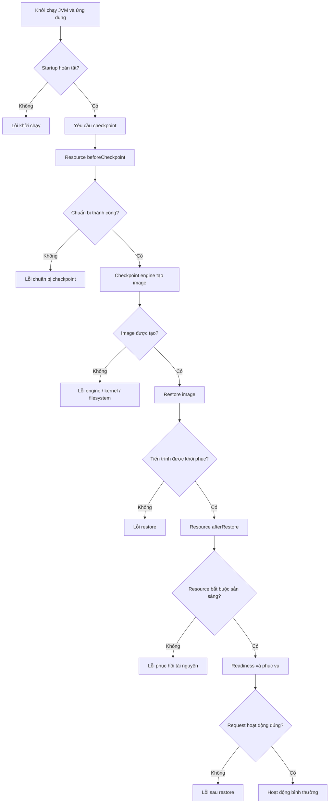

# Phân loại lỗi khởi chạy, checkpoint, restore và phục vụ sau restore

Khi vận hành ứng dụng Java với CRaC, một thông báo “checkpoint thất bại” chưa đủ để xác định nguyên nhân. Lỗi có thể xuất hiện trước khi ứng dụng khởi động xong, trong lúc Resource chuẩn bị checkpoint, khi CRIU hoặc runtime tạo image, khi tiến trình được restore, hoặc sau khi ứng dụng đã tiếp tục chạy nhưng dependency chưa sẵn sàng. Mỗi giai đoạn có dấu hiệu, dữ liệu chẩn đoán và cách xử lý khác nhau.

Cách chẩn đoán hiệu quả là xác định **giai đoạn cuối cùng đã hoàn tất**, sau đó khoanh vùng lớp chịu trách nhiệm: code ứng dụng, CRaC API/runtime, checkpoint engine, kernel/container runtime, filesystem, dependency bên ngoài hay readiness của ứng dụng. Đừng chỉ dựa vào exit code hoặc một dòng log cuối cùng; hãy ghép timestamp, callback, log JVM, log engine và trạng thái dependency thành một timeline.

## 1. Bốn giai đoạn cần phân biệt

Một vòng đời CRaC có thể được chia thành bốn giai đoạn vận hành:

1. **Khởi chạy:** JVM khởi động, nạp CRaC API/engine và ứng dụng khởi tạo trạng thái ban đầu.
2. **Checkpoint:** ứng dụng yêu cầu checkpoint; Resource chuẩn bị tài nguyên; runtime và engine lưu trạng thái tiến trình.
3. **Restore:** runtime đọc image và khôi phục tiến trình; Resource xử lý tài nguyên sau restore.
4. **Phục vụ sau restore:** ứng dụng tiếp tục xử lý công việc, kết nối lại dependency và chỉ nhận traffic khi đã sẵn sàng.



Sơ đồ giúp phân loại sự cố, không phải mô tả một API duy nhất. Khi checkpoint được yêu cầu từ `Core.checkpointRestore()`, luồng Java gọi API có thể tiếp tục sau khi restore thành công. Khi yêu cầu đến từ `jcmd` hoặc công cụ bên ngoài, điểm quan sát và thread thực hiện callback có thể khác.

## 2. Bước đầu tiên: xác định giai đoạn xảy ra lỗi

Trước khi sửa cấu hình hoặc thêm retry, hãy trả lời những câu hỏi sau:

- JVM có khởi động và nạp ứng dụng được không?
- Ứng dụng đã hoàn thành khởi tạo và đạt readiness lần đầu chưa?
- Lệnh checkpoint có được nhận không?
- `beforeCheckpoint(...)` đã bắt đầu và hoàn tất chưa?
- Checkpoint engine đã bắt đầu tạo image chưa? Có image hoặc metadata hoàn chỉnh không?
- Restore đã bắt đầu chưa? Tiến trình có đi tới callback `afterRestore(...)` không?
- Callback đã hoàn tất nhưng ứng dụng vẫn chưa ready, hay request đã chạy rồi mới lỗi?
- Lỗi xảy ra ngay lập tức hay sau một khoảng thời gian/loại request cụ thể?

Hãy ghi lại timeline theo timestamp và một mã định danh cho lần chạy hoặc checkpoint:

| Mốc | Bằng chứng nên có |
|---|---|
| JVM bắt đầu | JDK vendor/version/build, command line, architecture, PID và log JVM đầu tiên. |
| Ứng dụng khởi tạo | Log startup, bean/component initialization và kết quả kiểm tra dependency. |
| Checkpoint được yêu cầu | Nguồn yêu cầu (`Core`, `jcmd` hoặc orchestration), timestamp và caller nếu có. |
| Bắt đầu callback | Tên Resource, callback, thread và thời gian bắt đầu. |
| Kết thúc callback | Thành công/thất bại, exception và thời gian thực hiện. |
| Engine checkpoint | Phiên bản engine/CRIU, log engine, đường dẫn artifact và trạng thái hoàn tất. |
| Restore bắt đầu/kết thúc | Runtime log, PID/process state và kết quả từng Resource. |
| Readiness | Kết quả liveness/readiness, dependency state và thời điểm mở traffic. |
| Request đầu tiên | Endpoint/operation, status, latency và correlation ID đã loại bỏ dữ liệu nhạy cảm. |

Nếu chỉ có một log “process exited”, chưa thể kết luận đó là lỗi checkpoint, restore hay shutdown bình thường. Cần đối chiếu với log của runtime và công cụ điều phối.

## 3. Lỗi trong giai đoạn khởi chạy

Lỗi khởi chạy xảy ra trước khi ứng dụng đi tới một trạng thái có thể checkpoint. Có thể chia thành lỗi Java/API, lỗi engine/runtime và lỗi khởi tạo dependency.

### 3.1. Không tìm thấy CRaC API hoặc compatibility library

Triệu chứng thường gặp:

- Compiler báo không tìm thấy package `org.crac` hoặc `jdk.crac`.
- JVM báo `ClassNotFoundException` hoặc `NoClassDefFoundError` khi nạp class tham chiếu CRaC API.
- Ứng dụng build được trong một module nhưng chạy thất bại vì dependency không có trên runtime classpath/module path.

Nguyên nhân có thể:

- Thiếu dependency `org.crac:crac` khi ứng dụng dùng API `org.crac`.
- Dùng package API không tương ứng với JDK distribution đang chạy.
- Dependency chỉ được khai báo ở test/runtime configuration không được đóng gói vào artifact.
- Module path hoặc classloader của agent/framework không nhìn thấy thư viện.

Hướng xử lý:

1. Xác nhận code dùng `org.crac` hay `jdk.crac`.
2. Kiểm tra dependency tree và nội dung artifact được triển khai.
3. Xác nhận đúng JDK vendor, version và build.
4. Chạy thử class tối giản chỉ import và gọi API trên đúng runtime.

Không nhầm lỗi thiếu class với lỗi JVM không hỗ trợ checkpoint. Đây là hai lớp khác nhau: thiếu class là lỗi đóng gói/nạp thư viện; runtime không có implementation có thể dùng dummy implementation nếu ứng dụng dùng compatibility library phù hợp.

### 3.2. JVM không hỗ trợ checkpoint hoặc engine không tồn tại

Nếu ứng dụng dùng `org.crac` compatibility library trên JVM không có CRaC implementation, dummy implementation có thể cho phép đăng ký Resource nhưng `Core.checkpointRestore()` ném `UnsupportedOperationException`. Trong trường hợp đó, callback không tự động chạy và không có checkpoint image.

Nếu command line yêu cầu một engine mà JDK build không cung cấp, JVM có thể từ chối option hoặc thất bại ngay khi khởi động. Ví dụ, `-XX:CRaCEngine=simengine` chỉ dùng được nếu runtime cụ thể có engine đó.

Phân biệt:

| Dấu hiệu | Diễn giải |
|---|---|
| `UnsupportedOperationException` từ dummy `org.crac` khi gọi checkpoint | Runtime hiện tại không có CRaC implementation được compatibility library nhận diện. |
| JVM báo option/engine không hợp lệ | JDK build không hỗ trợ option hoặc engine được chỉ định. |
| `ClassNotFoundException` / `NoClassDefFoundError` | API library không có trên đường nạp class. |
| `CheckpointException` hoặc `RestoreException` | CRaC API/runtime đã đi vào đường xử lý tương ứng nhưng thao tác gặp lỗi; cần đọc nguyên nhân gốc. |

Hãy xác minh engine và JDK trước khi điều tra CRIU. Không thể sửa một JVM không có engine bằng cách cấp thêm capability cho container.

### 3.3. Lỗi trong quá trình khởi tạo ứng dụng

Ứng dụng có thể thất bại trước khi checkpoint vì constructor, init callback, Spring bean, cấu hình hoặc dependency từ xa.

Ví dụ:

- Database không truy cập được trong `@PostConstruct`.
- Token hoặc secret không được cấp.
- HTTP client khởi tạo TLS thất bại.
- Warm-up chạy quá lâu hoặc cấp phát vượt giới hạn bộ nhớ.
- Thread nền được tạo nhưng component khởi tạo sau đó thất bại.

Hãy phân biệt lỗi ứng dụng với lỗi CRaC. Nếu `ApplicationContext` chưa refresh hoặc `ApplicationReadyEvent` chưa phát, tiến trình chưa tới giai đoạn sẵn sàng để checkpoint theo thiết kế của ứng dụng. Kiểm tra log gốc của bean/component thất bại và xem liệu remote call có nên diễn ra trong init hay nên được trì hoãn tới lifecycle start.

### 3.4. Kiểm tra môi trường khởi chạy

Ghi nhận tối thiểu:

```bash
java -version
java -XX:+PrintFlagsFinal -version
uname -a
uname -m
```

Nếu dùng Linux, có thể ghi thêm thông tin CPU và kernel mà tiến trình nhìn thấy:

```bash
lscpu
cat /proc/self/status
```

Các lệnh và output phụ thuộc JDK/OS. Chúng giúp xác định môi trường, không tự chứng minh checkpoint/restore đã được hỗ trợ.

## 4. Lỗi trong giai đoạn checkpoint

Checkpoint có ít nhất hai lớp cần phân biệt: ứng dụng chuẩn bị Resource và engine thực hiện việc lưu trạng thái tiến trình.

### 4.1. Lỗi trong `beforeCheckpoint(...)`

Nếu callback không thể chuẩn bị resource, checkpoint có thể bị hủy hoặc báo lỗi. Nguyên nhân phổ biến:

- Không drain được request hoặc worker đang sử dụng resource.
- Lock bị giữ quá lâu hoặc xảy ra deadlock.
- Connection pool không đóng được.
- File buffer không flush được.
- Scheduler hoặc executor không dừng tại safe point.
- Callback chờ dependency bên ngoài vô thời hạn.
- Resource được đăng ký trùng và bị đóng nhiều lần.

Hãy thu thập:

- Tên Resource và callback bị lỗi.
- Exception cùng toàn bộ cause/suppressed exception.
- Thread dump tại thời điểm callback bị treo.
- Thời gian chờ lock, barrier, executor hoặc I/O.
- Trạng thái worker và số request đang chạy.
- Resource nào đã chuẩn bị thành công trước khi lỗi xuất hiện.

Ví dụ callback nên báo lỗi rõ ràng nếu không thể đưa tài nguyên về trạng thái an toàn:

```java
@Override
public void beforeCheckpoint(Context<? extends Resource> context)
        throws Exception {
    if (!requestGate.stopAndDrain(Duration.ofSeconds(10))) {
        throw new IllegalStateException(
                "HTTP requests did not drain before checkpoint deadline");
    }

    try {
        client.close();
        clientClosed = true;
    } catch (Exception e) {
        throw new IllegalStateException(
                "Unable to close HTTP client before checkpoint", e);
    }
}
```

`requestGate` và `client` trong ví dụ là abstraction của ứng dụng. Callback không nên nuốt lỗi rồi tiếp tục như thể resource đã sẵn sàng. Cần có chính sách rollback nếu một số resource đã đóng trước khi Resource khác thất bại.

### 4.2. Callback bị treo

Nếu checkpoint dừng ở `beforeCheckpoint(...)`, hãy kiểm tra thread dump. Một số pattern nguy hiểm:

- Callback chờ worker, trong khi worker đang chờ lock do callback giữ.
- Callback gọi `Future.get()` trên task được gửi vào chính single-thread executor đang chạy callback.
- Worker bị block trong I/O không có timeout.
- `Phaser`/barrier chờ party đã kết thúc hoặc không còn tham gia.
- Callback chờ remote service không có deadline.

Đặt timeout cho mọi bước chờ. Nếu hết deadline, báo lỗi checkpoint thay vì đóng resource trong lúc worker còn sử dụng. Không dùng `Thread.sleep(...)` để phỏng đoán worker đã dừng.

### 4.3. Lỗi do checkpoint engine, CRIU hoặc kernel

Nếu callback đã hoàn tất nhưng engine không tạo được image, hãy chuyển điều tra sang lớp runtime/hệ điều hành.

Các nhóm nguyên nhân thường gặp:

| Nhóm | Ví dụ dấu hiệu/nguyên nhân | Bằng chứng cần thu thập |
|---|---|---|
| Permission/capability | `EPERM`, `EACCES`, thao tác dump bị từ chối. | UID/GID, capabilities, user namespace, seccomp, AppArmor/SELinux và log CRIU/runtime. |
| Filesystem | Không tạo được image, `ENOSPC`, `EDQUOT`, `EROFS`, `ENOENT`. | Mount path, owner/mode, dung lượng, inode, quota và mount options. |
| Kernel/CRIU | Kernel feature hoặc CRIU không hỗ trợ một loại resource. | Kernel version, CRIU version, `criu check`, log chi tiết và loại resource bị từ chối. |
| Process resource | Socket, file descriptor, pipe, namespace hoặc mapping không hỗ trợ. | CRIU log, danh sách FD, `/proc/<pid>/maps`, resource đang mở. |
| Container runtime | Runtime hoặc orchestration không hỗ trợ thao tác checkpoint được yêu cầu. | Runtime version, cấu hình container, event/log của node và cluster. |
| Storage | Checkpoint image hoặc file phụ trợ không ghi/đọc được. | Storage backend, mount consistency, ownership, I/O error và capacity. |

Các lỗi cụ thể và yêu cầu capability phụ thuộc kernel, CRIU, container runtime và cách triển khai. Không có một danh sách quyền tối thiểu đúng cho mọi môi trường. Hãy xác định process nào thực hiện checkpoint: JVM trong container, CRIU helper, container runtime hay node agent.

### 4.4. Kiểm tra filesystem và dung lượng

Một số lệnh chẩn đoán trên Linux:

```bash
id
umask
df -h <checkpoint-directory>
df -i <checkpoint-directory>
ls -ld <checkpoint-directory>
namei -l <checkpoint-directory>
```

Chúng giúp kiểm tra danh tính, dung lượng, inode và quyền trên từng thư mục cha. Nếu dùng `readOnlyRootFilesystem`, xác nhận checkpoint path được mount trên volume ghi được và mount không bị đặt `readOnly: true`.

Không giả định checkpoint image luôn nằm trong một thư mục cố định bên trong container. Một số nền tảng quản lý artifact bên ngoài container. Hãy dùng đúng đường dẫn do engine hoặc orchestration cấu hình.

### 4.5. Kiểm tra CRIU và kernel

Trên môi trường Linux có CRIU, có thể thu thập:

```bash
criu --version
criu check
uname -r
```

`criu check` chỉ là một bước kiểm tra khả năng của CRIU trong môi trường hiện tại; kết quả không đảm bảo ứng dụng cụ thể có thể checkpoint. Một tiến trình có socket, namespace, mount hoặc native resource đặc biệt vẫn có thể thất bại.

Nếu cần điều tra sâu hơn, lấy log CRIU do integration tạo ra và đối chiếu syscall bị từ chối. `strace` có thể hữu ích trong môi trường debug nếu được phép; `dmesg` hoặc kernel log có thể bị hạn chế bởi cluster. Không bật tracing nặng trên production nếu chưa đánh giá overhead.

## 5. Lỗi trong giai đoạn restore

Restore có thể thất bại trước khi tiến trình tiếp tục, hoặc tiến trình có thể được khôi phục nhưng một số Resource không thể phục hồi.

### 5.1. Image không tương thích với môi trường đích

Các điều kiện cần so sánh:

- JDK vendor, version và build.
- Kiến trúc CPU và instruction features mà JVM nhìn thấy.
- OS, kernel và checkpoint engine/CRIU version.
- Container runtime, namespace và security context.
- Native library, JNI/JVMTI agent và ABI.
- Mount path, filesystem và file descriptor liên quan.
- UID/GID, capabilities và quyền đọc image.

Checkpoint là trạng thái tiến trình, không phải JAR portable. Không restore chéo x86-64 và AArch64. Cùng architecture cũng chưa đủ nếu máy đích thiếu CPU instruction extension mà JIT code hoặc native library sử dụng.

### 5.2. Lỗi đọc checkpoint image

Triệu chứng có thể gồm file không tồn tại, permission denied, image không đầy đủ, checksum/metadata không hợp lệ hoặc storage không mount được.

Kiểm tra:

1. Image và metadata có được tạo hoàn chỉnh không?
2. Có process nào xóa hoặc ghi đè artifact sau checkpoint không?
3. Restore có mount đúng volume và đúng path không?
4. UID/GID của tiến trình restore có quyền đọc tất cả file cần thiết không?
5. Storage có đủ dung lượng, inode và không báo I/O error không?
6. Image có thuộc đúng JDK, engine và runtime profile không?

Không sửa lỗi bằng cách nới quyền toàn bộ thư mục thành `0777`. Cấp quyền đọc cần thiết cho đúng user/group và bảo vệ checkpoint image vì nó có thể chứa dữ liệu nhạy cảm trong heap.

### 5.3. Lỗi trong `afterRestore(...)`

Nếu tiến trình đã được restore nhưng callback thất bại, nguyên nhân thường nằm ở resource bên ngoài hoặc logic phục hồi:

- Database connection cũ không còn hợp lệ.
- Broker hoặc HTTP service chưa sẵn sàng.
- Credential/token hết hạn.
- TLS certificate hoặc trust store thay đổi.
- File/volume không còn ở cùng path hoặc permission đã đổi.
- Native library không thể khởi tạo lại.
- Executor hoặc scheduler được start trùng.
- Cache cần refresh nhưng nguồn dữ liệu không truy cập được.

Hãy ghi nhận Resource nào thất bại, bước nào đã thành công, bước nào chưa chạy và ứng dụng đang giữ readiness ở trạng thái nào. Đừng chỉ ghi “restore callback failed” mà không có tên resource hoặc dependency.

Ví dụ xử lý lỗi bắt buộc:

```java
@Override
public void afterRestore(Context<? extends Resource> context)
        throws Exception {
    readiness.markRestoring();

    try {
        client = clientFactory.createAndVerify();
        readiness.markDependencyReady("catalog-api");
    } catch (Exception e) {
        readiness.markFailed("catalog-api", e);
        throw new IllegalStateException(
                "Unable to restore required catalog client", e);
    }
}
```

`readiness` và `clientFactory` là abstraction của ứng dụng. Nếu dependency là tùy chọn, có thể vô hiệu hóa capability liên quan và tiếp tục ở chế độ degraded. Nếu dependency bắt buộc, không đánh dấu ứng dụng ready khi callback thất bại.

### 5.4. Restore thất bại trước callback

Nếu không thấy log `afterRestore(...)`, đừng vội kết luận callback không được đăng ký. Restore có thể đã thất bại trước khi runtime tới giai đoạn notification. Đối chiếu log engine và runtime để xác định image có được đọc, memory mapping có được khôi phục và JVM có tiếp tục được hay không.

## 6. Lỗi sau restore khi ứng dụng bắt đầu phục vụ

Một trong những tình huống khó chẩn đoán nhất là restore thành công và callback đã hoàn tất, nhưng request đầu tiên hoặc worker nền vẫn thất bại.

### 6.1. Process sống nhưng chưa sẵn sàng

Liveness và readiness trả lời hai câu hỏi khác nhau:

- **Liveness:** tiến trình còn sống và có thể tiếp tục hoạt động không?
- **Readiness:** ứng dụng có thể phục vụ loại traffic được định tuyến tới nó không?

Sau restore, JVM có thể sống nhưng database pool, HTTP client hoặc broker consumer chưa sẵn sàng. Nếu readiness probe chỉ kiểm tra process hoặc endpoint đơn giản trả `200`, orchestrator có thể gửi traffic quá sớm.

Giải pháp:

- Đặt trạng thái `RESTORING` trước khi phục hồi resource.
- Giữ readiness false cho tới khi dependency bắt buộc hoạt động.
- Dùng capability gate trong ứng dụng cho các chức năng nhạy cảm.
- Chỉ mở worker/consumer sau khi resource tương ứng sẵn sàng.
- Dùng degraded mode chỉ khi chức năng lỗi được cô lập rõ ràng.

### 6.2. Kết nối stale hoặc lỗi mạng ở request đầu tiên

Một connection object có thể còn trong heap nhưng peer đã đóng socket trong thời gian checkpoint. Request đầu tiên sau restore có thể gặp reset, broken pipe, timeout hoặc TLS error.

Hãy kiểm tra:

- Client/pool cũ có được đóng hoặc reset trước checkpoint không?
- Sau restore có tạo client/pool mới theo hướng dẫn thư viện không?
- DNS, proxy, TLS và credential có được nạp lại khi cần không?
- Request có thể retry an toàn không?
- Response body hoặc async future từ trước checkpoint có còn bị giữ không?

Không tự động retry mọi request. Với POST hoặc thao tác ghi dữ liệu, server có thể đã xử lý request dù client chưa nhận response. Dùng idempotency key hoặc đối soát trạng thái trước khi gửi lại.

### 6.3. Cache stale và dữ liệu không nhất quán

Cache trong heap có thể sống qua checkpoint trong khi dữ liệu nguồn thay đổi. Các dấu hiệu:

- Request trả dữ liệu cũ ngay sau restore.
- Quyền hoặc trạng thái người dùng không còn đúng.
- Cache miss tăng đột biến do nhiều entry hết hạn cùng lúc.
- Nhiều instance đồng thời refresh cache làm database quá tải.

Hãy xác minh version, generation hoặc timestamp với nguồn dữ liệu; đặt TTL/eviction; tránh cache stampede bằng single-flight, jitter và giới hạn concurrency. Dữ liệu nghiệp vụ quan trọng không nên dựa duy nhất vào TTL nếu cần tính đúng đắn mạnh.

### 6.4. Thread, scheduler và consumer chạy trùng

Nếu callback khởi động worker hoặc scheduler nhưng trạng thái trước checkpoint vẫn giữ lịch cũ, sau restore có thể có hai nhóm task cùng chạy. Dấu hiệu gồm xử lý message lặp, heartbeat trùng, CPU tăng hoặc cùng một tác vụ chạy đồng thời nhiều lần.

Kiểm tra:

- Scheduled future cũ có được cancel trước checkpoint không?
- Executor đã shutdown có bị dùng lại sai cách không?
- `afterRestore(...)` có thể được gọi qua đường code khác khiến task được start hai lần không?
- Consumer có commit offset/ack đúng trước checkpoint không?
- Worker có idempotent và có cơ chế chống xử lý trùng không?

Đảm bảo lifecycle start idempotent và một owner cho mỗi executor, scheduler hoặc consumer.

### 6.5. Hiệu năng kém dù restore thành công

Restore thành công không có nghĩa mọi hot path đạt latency như mong đợi. Có thể do:

- Workload warm-up chưa đại diện nên một số method chưa được JIT biên dịch.
- Cache bị stale hoặc cần nạp lại.
- Connection pool mới chưa được warm.
- CPU feature hoặc JDK build ở máy đích khác môi trường nguồn.
- GC, heap sizing, container CPU quota hoặc memory pressure khác.
- Profiler/agent chưa hoạt động hoặc tạo overhead mới.

So sánh cold start, warm-up, checkpoint duration, restore duration, time-to-readiness và first-request latency bằng cùng workload. Không dùng thời gian của `simengine` làm số liệu restore thật.

## 7. Bảng phân loại triệu chứng theo giai đoạn

| Triệu chứng | Giai đoạn nghi ngờ | Lớp nguyên nhân cần kiểm tra đầu tiên |
|---|---|---|
| `ClassNotFoundException` cho `org.crac` | Khởi chạy | Dependency/classpath/module path. |
| `UnsupportedOperationException` khi gọi checkpoint trên JVM thường | Khởi chạy/yêu cầu checkpoint | Dummy implementation; runtime không có CRaC engine. |
| JVM không nhận `-XX:CRaCEngine=...` | Khởi chạy | JDK build hoặc engine option không được hỗ trợ. |
| Ứng dụng fail trước khi ready lần đầu | Khởi chạy | Bean/init code, cấu hình, dependency hoặc resource limit. |
| Callback `beforeCheckpoint` ném exception | Checkpoint | Logic Resource, lock, drain, timeout hoặc dependency. |
| Checkpoint treo ở callback | Checkpoint | Deadlock, worker chưa quiescent, I/O không timeout hoặc barrier sai. |
| Callback hoàn tất nhưng không có image | Checkpoint | CRIU, kernel, quyền, filesystem, namespace hoặc resource không hỗ trợ. |
| `EPERM`/`EACCES` trong engine log | Checkpoint/restore | Capability, UID/GID, seccomp, LSM hoặc mount permission. |
| `ENOSPC`/`EDQUOT` | Checkpoint | Dung lượng, inode hoặc quota của storage. |
| Image không đọc được | Restore | Artifact path, ownership, storage mount hoặc image không hoàn chỉnh. |
| Restore thất bại trước `afterRestore` | Restore | Runtime/CRIU/kernel/image compatibility. |
| `afterRestore` ném exception | Restore | Resource recreation, credential, network, file hoặc native dependency. |
| Readiness false sau restore | Phục vụ sau restore | Dependency bắt buộc chưa sẵn sàng hoặc recovery gate chưa mở. |
| Request đầu tiên lỗi socket/TLS | Phục vụ sau restore | Stale connection, DNS, proxy, certificate hoặc credential. |
| Request trả dữ liệu cũ | Phục vụ sau restore | Cache freshness/version và consistency. |
| Worker/consumer chạy hai lần | Phục vụ sau restore | Scheduler/executor lifecycle hoặc retry/idempotency. |
| Restore thành công nhưng latency cao | Phục vụ sau restore | Warm-up, JIT, cache, pool, CPU profile hoặc resource limits. |

Bảng này là điểm bắt đầu điều tra. Một triệu chứng có thể có nhiều nguyên nhân; luôn xác nhận bằng log và trạng thái thực tế.

## 8. Quy trình điều tra theo thứ tự

Một quy trình nhất quán giúp tránh thay đổi nhiều biến cùng lúc:

### Bước 1: Ghi nhận runtime fingerprint

Lưu JDK vendor/version/build, command line, OS/kernel, CPU architecture/features, CRIU version, container runtime, image digest và security context. Nếu môi trường thay đổi giữa lần tạo checkpoint và restore, so sánh fingerprint trước khi điều tra code.

### Bước 2: Xác định nguồn kích hoạt

Ghi rõ checkpoint được gọi từ `Core.checkpointRestore()`, `jcmd <pid> JDK.checkpoint` hay orchestration. Xác nhận process/PID và log của công cụ gửi yêu cầu.

### Bước 3: Xác định callback cuối cùng đã chạy

Thêm log có tên Resource, phase, thread, timestamp và duration ở đầu/cuối mỗi callback. Không ghi secret hoặc payload nhạy cảm. Nếu callback không chạy, kiểm tra registration và xem engine đã tới notification phase chưa.

### Bước 4: Tách lỗi ứng dụng khỏi lỗi engine

Nếu callback ném exception, điều tra code và dependency trước. Nếu callback hoàn tất nhưng image không được tạo, chuyển sang CRIU/kernel/filesystem/runtime. Nếu image có nhưng restore thất bại, so sánh môi trường đích và log restore.

### Bước 5: Kiểm tra resource và quyền

Kiểm tra file descriptor, socket, mount, UID/GID, capability, volume, dung lượng, inode, seccomp và LSM. Chỉ cấp thêm quyền khi đã xác định thao tác cụ thể cần quyền đó.

### Bước 6: Xác minh readiness và request thật

Sau restore, kiểm tra health/readiness, dependency, cache, scheduler, consumer và request đầu tiên. Xác nhận chức năng nào được phép phục vụ trong degraded mode.

### Bước 7: Tái hiện tối thiểu

Giảm ứng dụng về một Resource hoặc một dependency. Dùng unit test cho logic callback, `simengine` cho notification flow, rồi CRIU thật cho image/restore. Thêm lại thành phần từng bước để xác định nguyên nhân.

## 9. Công cụ và dữ liệu chẩn đoán

Không có một lệnh duy nhất chẩn đoán được mọi lỗi CRaC. Chọn công cụ theo lớp đang điều tra.

| Công cụ/dữ liệu | Dùng để kiểm tra | Giới hạn |
|---|---|---|
| `java -version` | JDK vendor, version và build. | Không chứng minh engine/runtime có thể checkpoint. |
| `java -XX:+PrintFlagsFinal -version` | Flag JVM và cấu hình runtime. | Output lớn; chỉ một số flag có trên từng build. |
| `jcmd <pid> VM.info` | Thông tin JVM đang chạy. | Diagnostic command phụ thuộc JDK và quyền attach. |
| `jcmd <pid> VM.flags -all` | Flag runtime thực tế. | Không thay thế log của CRIU hoặc kernel. |
| `jcmd <pid> JDK.checkpoint` | Yêu cầu checkpoint từ bên ngoài nếu runtime hỗ trợ. | Cần attach/quyền phù hợp; không phải engine nào cũng có hành vi giống nhau. |
| `criu --version`, `criu check` | Phiên bản và kiểm tra môi trường CRIU. | Không đảm bảo process cụ thể có thể dump/restore. |
| `uname`, `lscpu`, `/proc` | Kernel, CPU và process state. | Nội dung có thể bị giới hạn trong container. |
| `df`, `df -i`, `ls -l`, `namei` | Storage, inode và permission path. | Không cho biết toàn bộ chính sách LSM hoặc runtime. |
| Thread dump | Lock, worker, deadlock và thread đang chờ. | Cần lấy gần thời điểm sự cố; dump có thể không đủ cho native hang. |
| CRIU/runtime logs | Lỗi engine, syscall, resource không hỗ trợ. | Path và mức chi tiết phụ thuộc integration. |
| Application metrics | Readiness, pool, cache, retry, latency và worker state. | Chỉ hữu ích nếu instrumentation đã có trước sự cố. |

Các lệnh ví dụ:

```bash
jcmd <pid> VM.info
jcmd <pid> VM.flags -all
jcmd <pid> JDK.checkpoint

criu --version
criu check

uname -a
uname -m
lscpu

df -h <checkpoint-directory>
df -i <checkpoint-directory>
namei -l <checkpoint-directory>
```

Thay `<pid>` và `<checkpoint-directory>` bằng giá trị thật. Chỉ chạy lệnh phù hợp với runtime và môi trường; `jcmd` cần attach được vào target và `criu` cần quyền theo cấu hình hệ thống.

## 10. Thiết kế log để phân loại sự cố nhanh

Một log tốt nên cho biết phase và resource thay vì chỉ ghi “failed”. Có thể dùng các trường có cấu trúc:

```json
{
  "event": "crac.resource.callback.failed",
  "checkpointId": "run-2026-11-13-001",
  "phase": "afterRestore",
  "resource": "orders-database-pool",
  "thread": "main",
  "durationMs": 4200,
  "errorType": "ConnectionTimeoutException",
  "dependency": "orders-db",
  "retryable": true
}
```

Các giá trị trong JSON chỉ là ví dụ. Không ghi connection string, password, token, private key, request body hoặc dữ liệu người dùng vào log.

Nên có log đầu và cuối callback để phát hiện callback treo. Ghi duration và trạng thái trước/sau thao tác. Nếu một Resource có nhiều bước, log theo step name để biết bước nào thất bại.

Metric hữu ích:

- Thời gian `beforeCheckpoint` và `afterRestore` theo Resource.
- Số callback thành công/thất bại.
- Thời gian tạo image và restore nếu engine cung cấp.
- Số worker/request còn hoạt động khi bắt đầu checkpoint.
- Thời gian từ restore tới readiness.
- Số lần retry và số dependency chưa sẵn sàng.
- Số lần fail-stop hoặc degraded mode.
- First-request latency và lỗi request sau restore.

## 11. Chọn retry, degraded mode hay fail-stop

Không phải mọi lỗi đều nên retry. Chính sách cần dựa vào loại tài nguyên và mức độ an toàn của ứng dụng.

| Loại lỗi | Hướng xử lý thường phù hợp |
|---|---|
| Dependency tạm thời chưa sẵn sàng | Retry có backoff, deadline và readiness false trong thời gian chờ. |
| Credential sai hoặc cấu hình không hợp lệ | Không retry vô hạn; báo lỗi cấu hình và dừng nếu dependency bắt buộc. |
| Resource tùy chọn không khôi phục được | Degraded mode, tắt capability phụ và phục hồi nền có giới hạn. |
| Resource bắt buộc không khôi phục được | Giữ readiness false; retry hữu hạn nếu có thể, sau đó fail-stop. |
| Image/runtime/CPU không tương thích | Từ chối restore; tạo checkpoint mới trên profile tương thích. |
| Worker không thể drain an toàn | Hủy checkpoint request và xử lý worker; không lưu trạng thái đang tranh chấp resource. |
| Request ghi dữ liệu có kết quả không xác định | Đối soát hoặc dùng idempotency; không retry mù quáng. |

Một ứng dụng không nên báo ready chỉ vì callback không ném exception. Readiness cần phản ánh resource bắt buộc và capability thực sự có thể phục vụ.

## 12. Ma trận kiểm thử chẩn đoán

Để xác nhận hệ thống phân loại lỗi đúng, nên có kịch bản kiểm thử cho từng giai đoạn:

| Kịch bản | Giai đoạn | Kết quả cần xác nhận |
|---|---|---|
| Thiếu CRaC dependency | Khởi chạy | Lỗi classpath/module path được nhận diện. |
| JVM thường dùng dummy implementation | Khởi chạy/yêu cầu | `UnsupportedOperationException` được phân biệt với lỗi engine. |
| Engine option không được hỗ trợ | Khởi chạy | Startup fail rõ ràng với JDK/build không phù hợp. |
| Bean init gọi remote service thất bại | Khởi chạy | Log chỉ ra component/dependency gốc. |
| `beforeCheckpoint` không drain worker | Checkpoint | Callback timeout và checkpoint không tiếp tục với resource đang dùng. |
| `beforeCheckpoint` đóng pool thất bại | Checkpoint | Lỗi được báo và trạng thái rollback/fail-stop được xác định. |
| Checkpoint path read-only | Checkpoint | Engine báo lỗi filesystem; không nới quyền toàn container. |
| Hết dung lượng hoặc inode | Checkpoint | Lỗi storage được phân biệt với lỗi Resource. |
| CRIU/kernel không hỗ trợ resource | Checkpoint | Log engine chỉ ra loại resource/feature không tương thích. |
| Image được tạo trên CPU/JDK profile khác | Restore | Policy từ chối môi trường không tương thích trước khi phục vụ. |
| `afterRestore` không tạo lại database pool | Restore | Callback lỗi; readiness vẫn false. |
| Database tạm thời chưa sẵn sàng | Restore/phục vụ | Retry có giới hạn và readiness được mở sau khi kết nối thành công. |
| Cache hết hạn sau checkpoint | Phục vụ sau restore | Cache được refresh/invalidated trước khi dữ liệu cũ gây sai nghiệp vụ. |
| Scheduler được start trùng | Phục vụ sau restore | Test phát hiện task duplicate và lifecycle được bảo đảm idempotent. |
| Request POST bị mất response | Phục vụ sau restore | Không retry mù quáng; có idempotency/đối soát. |

Unit test có thể mô phỏng lỗi Resource và dependency. `simengine` có thể kiểm tra notification flow. Những kịch bản liên quan tới image, CRIU, kernel, mount, native resource và restore trên máy đích phải được kiểm thử trong môi trường thực tương ứng.

## 13. Những lỗi chẩn đoán thường gặp

**Gọi mọi lỗi là “CRaC không hỗ trợ”.** Thiếu API, dummy implementation, engine option sai và callback exception là các trường hợp khác nhau. Xác định đúng exception và giai đoạn trước khi thay JDK.

**Chỉ xem exit code.** Exit code không cho biết callback nào đã chạy hoặc image có hoàn chỉnh không. Đọc log runtime, engine và ứng dụng cùng nhau.

**Cho rằng callback không xuất hiện nghĩa Resource chưa đăng ký.** Restore có thể thất bại trước notification phase. Xác nhận engine đã tới giai đoạn đó chưa.

**Tăng timeout cho mọi lỗi.** Timeout dài hơn không sửa deadlock, credential sai hoặc filesystem read-only. Phân biệt lỗi tạm thời với lỗi cấu hình và lỗi không thể phục hồi.

**Cấp root/privileged để sửa `EPERM`.** Trước tiên xác định process nào cần quyền và thao tác nào bị chặn. Cấp capability tối thiểu cho đúng thành phần theo yêu cầu runtime.

**Đánh dấu readiness ngay sau restore.** Tiến trình có thể sống nhưng dependency chưa sẵn sàng. Giữ gate đóng cho tới khi resource bắt buộc hoạt động.

**Retry mọi request sau restore.** Với thao tác ghi, server có thể đã xử lý request. Dùng idempotency hoặc đối soát.

**Dùng simengine để kết luận CRIU hoạt động.** Simengine kiểm tra callback coordination mà không tạo image. Cần checkpoint/restore thật để xác nhận engine và kernel.

## 14. Checklist điều tra một sự cố CRaC

- [ ] Ghi timestamp, checkpoint ID và nguồn kích hoạt.
- [ ] Ghi JDK vendor/version/build, OS/kernel, CPU và CRIU/runtime version.
- [ ] Xác định ứng dụng có khởi động và đạt readiness lần đầu không.
- [ ] Xác định callback cuối cùng đã bắt đầu/kết thúc.
- [ ] Thu exception đầy đủ, cause và suppressed exception.
- [ ] Nếu callback treo, lấy thread dump và kiểm tra lock/barrier/I/O.
- [ ] Nếu callback hoàn tất nhưng image thất bại, đọc log engine/CRIU/kernel.
- [ ] Kiểm tra UID/GID, capability, seccomp/LSM, mount, dung lượng và inode.
- [ ] Nếu restore thất bại, so sánh image metadata với runtime fingerprint của máy đích.
- [ ] Nếu `afterRestore` lỗi, xác định Resource/dependency cụ thể.
- [ ] Nếu process sống nhưng chưa ready, kiểm tra readiness gate và dependency health.
- [ ] Kiểm tra connection stale, cache freshness, scheduler và consumer sau restore.
- [ ] Chọn retry, degraded mode hoặc fail-stop theo mức độ quan trọng.
- [ ] Tái hiện bằng unit test, simengine hoặc CRIU thật đúng với lớp lỗi.
- [ ] Lưu log/metric đủ chẩn đoán nhưng không chứa secret hoặc dữ liệu nhạy cảm.

## 15. Thuật ngữ cần nhớ

- **Startup failure:** lỗi xảy ra trước khi ứng dụng hoàn tất khởi tạo.
- **Checkpoint failure:** lỗi khi chuẩn bị Resource hoặc lưu trạng thái tiến trình.
- **Restore failure:** lỗi khi đọc image hoặc khôi phục tiến trình.
- **Post-restore failure:** lỗi sau khi tiến trình tiếp tục, thường liên quan dependency, cache, worker hoặc request.
- **`CheckpointException`:** ngoại lệ biểu thị lỗi trong quá trình checkpoint notification/checkpoint theo CRaC API.
- **`RestoreException`:** ngoại lệ biểu thị lỗi trong quá trình restore notification/restore theo CRaC API.
- **`UnsupportedOperationException`:** trong dummy implementation, báo rằng yêu cầu checkpoint không được runtime hỗ trợ.
- **CRIU:** công cụ Linux để checkpoint và restore tiến trình.
- **Runtime fingerprint:** thông tin JDK, OS, CPU, CRIU, container và native dependency dùng để so sánh môi trường.
- **Readiness:** điều kiện cho biết ứng dụng đã sẵn sàng nhận traffic.
- **Liveness:** điều kiện cho biết tiến trình còn sống và có thể tiếp tục hoạt động.
- **Degraded mode:** chế độ chỉ phục vụ những chức năng còn an toàn khi một dependency tùy chọn chưa sẵn sàng.
- **Fail-stop:** chủ động dừng phục vụ và kết thúc tiến trình khi không thể bảo đảm tính đúng đắn.
- **Idempotency:** khả năng thực hiện lại thao tác mà không tạo tác động nghiệp vụ trùng lặp.

Khi phân loại sự cố CRaC, hãy bắt đầu từ giai đoạn cuối cùng đã hoàn tất và bằng chứng quan sát được. Lỗi khởi chạy thường nằm ở API, JDK, engine hoặc khởi tạo ứng dụng; lỗi checkpoint có thể đến từ Resource callback hoặc CRIU/kernel/filesystem; lỗi restore có thể do image và môi trường đích không tương thích hoặc Resource không thể tạo lại; lỗi sau restore thường liên quan readiness, kết nối, cache và worker. Phân loại đúng giúp chọn cách xử lý phù hợp, tránh retry vô hạn hoặc mở traffic khi ứng dụng chưa thể phục vụ an toàn.

## Tài liệu tham khảo

- [CRaC — Checkpoint and restore](https://crac.org/use/checkpoint-and-restore/): cách yêu cầu checkpoint, sử dụng engine và kiểm tra tiến trình.
- [CRaC — Checkpoint engines](https://crac.org/reference/engines/): phân biệt engine mô phỏng và engine tạo checkpoint image thật.
- [CRaC — Best practices](https://crac.org/reference/best-practices/): quản lý Resource, callback, thread và tài nguyên quanh checkpoint/restore.
- [CRIU — Documentation](https://criu.org/): chẩn đoán yêu cầu Linux, resource được hỗ trợ và lỗi checkpoint/restore.
- [Kubernetes — Security Context](https://kubernetes.io/docs/tasks/configure-pod-container/security-context/): UID/GID, capabilities và các lớp kiểm soát bảo mật của container.
