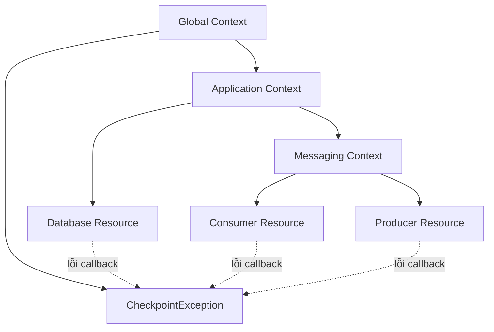

# Đọc `CheckpointException`, `RestoreException` và suppressed exceptions

Khi một thao tác checkpoint/restore thất bại, exception ở ngoài cùng thường chỉ cho biết pha nào không hoàn tất. Nguyên nhân cụ thể có thể nằm trong nhiều `Resource` khác nhau: một callback không đóng socket, một worker không dừng, một connection pool không thể mở lại hoặc một file descriptor vẫn còn tồn tại. CRaC gom những lỗi phát sinh trong quá trình thông báo cho resource thành **suppressed exceptions** bên trong `CheckpointException` hoặc `RestoreException`.

Vì vậy, chỉ đọc `getMessage()` hoặc `getCause()` của exception ngoài cùng thường chưa đủ. Cần đọc cả `getSuppressed()`, lần theo `cause` của từng lỗi con và xem toàn bộ stack trace. Cũng cần hiểu đúng khác biệt giữa lỗi checkpoint và lỗi restore: `CheckpointException` thường được ném trong JVM ban đầu, còn `RestoreException` được ném trong JVM đã được phục hồi.

## 1. Hai exception tổng hợp của CRaC

API `org.crac` định nghĩa hai exception để báo lỗi trong hai pha khác nhau:

| Exception | Pha liên quan | Ý nghĩa khi `Core.checkpointRestore()` ném ra |
|---|---|---|
| `CheckpointException` | Checkpoint notification và các lỗi liên quan đến thao tác checkpoint | Có lỗi khi chuẩn bị checkpoint; luồng thực thi tiếp tục trong JVM ban đầu |
| `RestoreException` | Restore notification | Checkpoint đã được tạo và tiến trình mới được phục hồi, nhưng một hoặc nhiều callback sau restore thất bại |

Cả hai đều là checked exception kế thừa `java.lang.Exception`. Chúng hoạt động như exception tổng hợp: lỗi của các resource được lưu trong danh sách suppressed thay vì chỉ chọn một lỗi duy nhất làm cause.

`Core.checkpointRestore()` khai báo hai loại exception này:

Chữ ký phương thức được dùng trực tiếp trong ứng dụng:

```java
import org.crac.CheckpointException;
import org.crac.Core;
import org.crac.RestoreException;

void requestCheckpoint() throws CheckpointException, RestoreException {
    Core.checkpointRestore();
}
```

CRaC API cũng có trong namespace `jdk.crac` ở CRaC-enabled JDK. Nếu ứng dụng compile bằng compatibility library `org.crac:crac`, hãy dùng nhất quán `org.crac.Core`, `org.crac.Resource`, `org.crac.CheckpointException` và `org.crac.RestoreException`; không trộn các kiểu `org.crac` với `jdk.crac` trong cùng một luồng xử lý.

## 2. `CheckpointException`: lỗi trong quá trình chuẩn bị checkpoint

Trước khi runtime chụp trạng thái tiến trình, global `Context` thông báo cho các resource bằng callback `beforeCheckpoint`. Một resource có thể đóng socket, flush dữ liệu, dừng thread, giải phóng lock hoặc đưa thành phần về trạng thái an toàn.

Nếu một hay nhiều callback thất bại, context ghi nhận các exception đó. Context vẫn tiếp tục thông báo cho những resource còn lại để chúng có cơ hội hoàn tất công việc dọn dẹp. Sau khi notification kết thúc, thao tác checkpoint không tạo image như dự định và `Core.checkpointRestore()` ném `CheckpointException` trong JVM ban đầu.

Ví dụ một resource không thể đóng kết nối:

```java
import org.crac.Context;
import org.crac.Resource;

public final class DatabaseResource implements Resource {
    private final DatabasePool pool;

    public DatabaseResource(DatabasePool pool) {
        this.pool = pool;
    }

    @Override
    public void beforeCheckpoint(Context<? extends Resource> context)
            throws Exception {
        pool.closeForCheckpoint();
    }

    @Override
    public void afterRestore(Context<? extends Resource> context)
            throws Exception {
        pool.reopen();
    }
}
```

Nếu `closeForCheckpoint()` ném `IOException`, global context bắt exception từ callback và đưa nó vào suppressed list của `CheckpointException`. Ứng dụng có thể thấy một lỗi tổng hợp dù có nhiều resource độc lập cùng gặp lỗi.

### 2.1. Điểm đặc biệt: `afterRestore` có thể chạy dù image chưa được tạo

Khi lỗi phát sinh trong checkpoint notification, CRaC cần đưa các resource trở lại trạng thái hoạt động ban đầu. Vì vậy, restore notification được chạy ngay trong JVM ban đầu mà không tạo image. Những lỗi xảy ra trong quá trình `afterRestore` phục hồi này cũng được đưa vào `CheckpointException`.

Điều đó có nghĩa `CheckpointException` không nhất thiết chỉ chứa lỗi từ `beforeCheckpoint`. Nó có thể chứa:

- Lỗi một resource không thể chuẩn bị trước checkpoint.
- Lỗi resource khác trong cùng pha checkpoint.
- Lỗi khi một resource cố khôi phục lại hoạt động sau khi checkpoint bị hủy.

Ví dụ, worker A đóng được executor trong `beforeCheckpoint`, nhưng worker B không thể flush trạng thái nên checkpoint bị hủy. Khi CRaC gọi `afterRestore` để phục hồi JVM ban đầu, executor của worker A không thể khởi động lại. Cả lỗi flush của worker B và lỗi restart của worker A có thể xuất hiện trong suppressed tree của cùng `CheckpointException`.

Không gọi thủ công toàn bộ `afterRestore` lần thứ hai chỉ vì bắt được `CheckpointException`. Nếu runtime đã thực hiện restore notification để rollback sau lỗi checkpoint, việc gọi lặp lại có thể tạo worker hoặc kết nối trùng. Hãy đọc lỗi, kiểm tra trạng thái resource và chỉ thực hiện thao tác phục hồi bổ sung nếu lifecycle của ứng dụng yêu cầu rõ ràng.

## 3. `RestoreException`: lỗi sau khi tiến trình được phục hồi

Nếu checkpoint notification thành công và runtime tạo image, tiến trình ban đầu sẽ kết thúc. Sau đó một JVM mới được tạo từ image và tiếp tục tại điểm đã checkpoint. CRaC gửi callback `afterRestore` cho các resource để chúng mở lại socket, kết nối database, đăng ký watcher, refresh token hoặc làm mới trạng thái phụ thuộc môi trường.

Nếu một hay nhiều callback `afterRestore` thất bại, global context gom lỗi và ném `RestoreException` trong tiến trình đã restore. JVM mới đã tồn tại, nhưng ứng dụng có thể chưa sẵn sàng phục vụ.

Ví dụ:

```java
public final class RemoteClientResource implements Resource {
    private final RemoteClient client;

    public RemoteClientResource(RemoteClient client) {
        this.client = client;
    }

    @Override
    public void beforeCheckpoint(Context<? extends Resource> context)
            throws Exception {
        client.close();
    }

    @Override
    public void afterRestore(Context<? extends Resource> context)
            throws Exception {
        client.connect();
        client.validateConnection();
    }
}
```

Nếu `connect()` thất bại vì dịch vụ bên ngoài chưa sẵn sàng, lỗi có thể trở thành một suppressed exception của `RestoreException`. Các resource khác vẫn được thông báo, vì chúng cũng cần cơ hội hoàn tất phục hồi hoặc báo lỗi riêng.

Không đánh dấu ứng dụng Ready chỉ vì JVM đã restore. Nếu một dependency bắt buộc không kết nối được, readiness cần tiếp tục false; tùy chính sách, tiến trình có thể thử phục hồi có giới hạn hoặc dừng để orchestration tạo instance mới. Không nên tiếp tục nhận request với connection pool hoặc client đang ở trạng thái nửa phục hồi.

## 4. So sánh cause và suppressed exception

Java `Throwable` có hai quan hệ khác nhau:

- **Cause (`getCause()`)** mô tả nguyên nhân trực tiếp khiến exception hiện tại được tạo ra. Đây là quan hệ nhân quả.
- **Suppressed (`getSuppressed()`)** chứa những exception độc lập khác xảy ra trong lúc xử lý cùng một thao tác và không thể trở thành exception được ném chính.

Ví dụ, một thao tác ghi file thất bại và việc đóng stream cũng thất bại. Exception ghi file được ném ra; lỗi đóng stream được gắn vào bằng `addSuppressed()`. Đây là lý do suppressed exception được dùng trong try-with-resources.

CRaC dùng cùng cơ chế để giữ nhiều lỗi callback. Một `CheckpointException` có thể không có cause nhưng có nhiều suppressed exceptions. Nếu chỉ gọi `e.getCause()`, chương trình có thể nhận `null` và bỏ qua toàn bộ nguyên nhân thực tế.

| API | Dùng để làm gì | Điều cần nhớ |
|---|---|---|
| `getMessage()` | Lấy thông điệp của exception hiện tại | Thường chỉ là mô tả tổng quát |
| `getCause()` | Lấy nguyên nhân được liên kết trực tiếp | Có thể `null` dù có suppressed exceptions |
| `getSuppressed()` | Lấy các lỗi độc lập được gom vào exception | Đây là nơi cần đọc đầu tiên với wrapper CRaC |
| `getStackTrace()` | Lấy stack trace của exception hiện tại | Stack trace của lỗi con nằm trong chính exception con |
| `printStackTrace()` | In exception, cause và suppressed tree | Hữu ích khi điều tra thủ công nếu log giữ đủ output |

Một suppressed exception cũng có thể có cause và suppressed exceptions riêng. Vì vậy, cấu trúc lỗi có thể là một cây nhiều tầng chứ không chỉ là một danh sách phẳng.

## 5. Đọc stack trace của một `CheckpointException`

Một stack trace điển hình có dạng:

```text
Exception in thread "main" org.crac.CheckpointException
    at org.crac.Core.checkpointRestore(Core.java:...)
    at com.example.CheckpointController.request(CheckpointController.java:42)
    Suppressed: java.io.IOException: Connection pool still has active leases
        at com.example.db.DatabasePool.closeForCheckpoint(DatabasePool.java:88)
        at com.example.db.DatabaseResource.beforeCheckpoint(DatabaseResource.java:24)
        ...
    Suppressed: java.lang.IllegalStateException: Worker did not stop before deadline
        at com.example.jobs.WorkerLifecycle.beforeCheckpoint(WorkerLifecycle.java:61)
        ...
```

Đọc theo thứ tự:

1. Dòng đầu cho biết loại wrapper và thông điệp tổng quát.
2. Các frame đầu cho biết nơi ứng dụng yêu cầu checkpoint.
3. Mỗi nhánh `Suppressed:` là một lỗi được thu thập từ callback hoặc context.
4. Stack trace bên dưới nhánh đó cho biết resource nào và dòng code nào ném lỗi.
5. Nếu nhánh con có `Caused by:` hoặc `Suppressed:` riêng, tiếp tục đọc sâu hơn.

Không mặc định suppressed exception đầu tiên là lỗi gốc duy nhất. Nhiều resource có thể thất bại độc lập. Thứ tự hiển thị thường phản ánh thứ tự lỗi được thu thập trong quá trình notification, nhưng nên dùng class/resource và stack trace để xác định nguyên nhân thay vì phụ thuộc vào vị trí chỉ số.

## 6. Đọc stack trace của một `RestoreException`

Một stack trace restore có thể trông như sau:

```text
Exception in thread "main" org.crac.RestoreException
    at org.crac.Core.checkpointRestore(Core.java:...)
    at com.example.Application.main(Application.java:19)
    Suppressed: java.net.ConnectException: Connection refused
        at java.base/sun.nio.ch.Net.pollConnect(...)
        at com.example.remote.RemoteClient.connect(RemoteClient.java:73)
        at com.example.remote.RemoteClientResource.afterRestore(RemoteClientResource.java:31)
        ...
    Suppressed: java.io.IOException: Could not refresh credentials
        at com.example.security.TokenProvider.refresh(TokenProvider.java:55)
        at com.example.security.TokenResource.afterRestore(TokenResource.java:28)
        ...
```

Ở ví dụ này, JVM đã được restore nhưng remote service chưa nhận kết nối và token refresh cũng thất bại. Hai lỗi là hai nhánh độc lập. Sửa riêng lỗi connection refused không bảo đảm ứng dụng đã sẵn sàng nếu credential vẫn chưa được refresh.

Khi chẩn đoán restore, cần xác định resource nào là dependency bắt buộc và resource nào có thể phục hồi nền. Không phải lỗi nào cũng cần dừng toàn bộ ứng dụng, nhưng quyết định đó phải được thể hiện trong readiness và chính sách vận hành.

## 7. Duyệt suppressed exceptions bằng Java

Để log toàn bộ lỗi, không nên chỉ ghi `exception.getMessage()`. Có thể dùng `printStackTrace()` để in cây lỗi chuẩn của Java:

```java
try {
    Core.checkpointRestore();
} catch (CheckpointException e) {
    e.printStackTrace(System.err);
} catch (RestoreException e) {
    e.printStackTrace(System.err);
}
```

Nếu hệ thống logging cần ghi riêng từng nhánh để lọc theo resource, có thể duyệt `getSuppressed()` và `getCause()` đệ quy:

```java
import java.util.Collections;
import java.util.IdentityHashMap;
import java.util.Set;

public final class ThrowableTreeLogger {
    private ThrowableTreeLogger() {
    }

    public static void log(Throwable error) {
        Set<Throwable> visited = Collections.newSetFromMap(
                new IdentityHashMap<>());
        visit(error, "root", visited);
    }

    private static void visit(
            Throwable error,
            String relation,
            Set<Throwable> visited) {
        if (error == null || !visited.add(error)) {
            return;
        }

        System.err.println(relation + ": "
                + error.getClass().getName() + ": " + error.getMessage());
        for (StackTraceElement frame : error.getStackTrace()) {
            System.err.println("    at " + frame);
        }

        Throwable[] suppressed = error.getSuppressed();
        for (int i = 0; i < suppressed.length; i++) {
            visit(suppressed[i], "suppressed[" + i + "]", visited);
        }

        if (error.getCause() != null) {
            visit(error.getCause(), "cause", visited);
        }
    }
}
```

`IdentityHashMap` được dùng để tránh duyệt lặp cùng một object `Throwable` nếu exception graph có tham chiếu lặp. Mã ví dụ ghi ra `System.err`; trong ứng dụng thật, hãy thay bằng logger có cấu trúc, gắn checkpoint ID, phase và resource name. Giữ đầy đủ stack trace, cause và suppressed tree.

## 8. Bắt exception đúng tại điểm yêu cầu checkpoint

Nếu ứng dụng chủ động gọi `Core.checkpointRestore()`, hãy phân biệt ba trường hợp chính:

```java
import org.crac.CheckpointException;
import org.crac.Core;
import org.crac.RestoreException;

public final class CheckpointService {
    public void requestCheckpoint() {
        try {
            Core.checkpointRestore();
            // Dòng này tiếp tục trong JVM đã restore khi thành công.
            System.out.println("Checkpoint restored successfully");
        } catch (CheckpointException e) {
            System.err.println("Checkpoint did not complete");
            ThrowableTreeLogger.log(e);
            // JVM ban đầu tiếp tục; kiểm tra resource đã trở lại trạng thái an toàn.
        } catch (RestoreException e) {
            System.err.println("Restore completed with resource failures");
            ThrowableTreeLogger.log(e);
            // JVM mới đã restore nhưng chưa chắc sẵn sàng phục vụ.
            throw new IllegalStateException(
                    "Application cannot become ready after restore", e);
        } catch (UnsupportedOperationException e) {
            System.err.println("CRaC is not supported by this runtime");
            ThrowableTreeLogger.log(e);
        }
    }
}
```

Ví dụ này minh họa cách phân loại lỗi. Ứng dụng thật cần chọn chính sách rõ ràng:

- Với `CheckpointException`, JVM ban đầu tiếp tục. Nếu nguyên nhân là lỗi checkpoint notification, CRaC đã thực hiện restore notification để các resource phục hồi trạng thái ban đầu; hãy kiểm tra health của các resource trước khi tiếp tục nhận công việc.
- Với `RestoreException`, JVM mới đã phục hồi nhưng một hoặc nhiều `afterRestore` thất bại. Nếu dependency bắt buộc chưa sẵn sàng, giữ readiness false và thường nên fail fast để orchestration thay thế instance.
- Với `UnsupportedOperationException`, runtime không hỗ trợ dịch vụ checkpoint/restore và không có notification nào được thực hiện. Đây không phải lỗi của một callback resource.

Không nuốt `RestoreException` rồi tiếp tục mở traffic như bình thường. Nếu cần retry một kết nối tạm thời, hãy thực hiện theo deadline và retry policy rõ ràng, đồng thời chỉ chuyển Ready sau khi dependency đạt trạng thái hợp lệ.

## 9. Vì sao context vẫn gọi các resource khác khi một callback lỗi?

Giả sử ứng dụng đăng ký ba resource theo thứ tự `database`, `worker`, `listener`. Khi checkpoint, callback được gọi theo thứ tự ngược đăng ký: listener, worker, database. Nếu listener dừng thành công nhưng worker ném exception, database vẫn cần được thông báo để đóng connection pool hoặc flush dữ liệu theo hợp đồng lifecycle.

Nếu context dừng ngay tại lỗi đầu tiên, database có thể vẫn giữ socket hoặc file descriptor không hợp lệ trong checkpoint. Vì vậy, global context thu thập exception và tiếp tục thông báo cho resource khác. Sau đó, exception tổng hợp cho biết toàn bộ callback nào gặp vấn đề.

Với restore, resource được thông báo theo thứ tự đăng ký. Nếu database mở lại thất bại, worker và listener vẫn được thông báo để chúng có thể giải phóng phần đã khởi tạo hoặc ghi nhận lỗi. Việc tất cả callback được gọi không có nghĩa ứng dụng được phép tiếp tục phục vụ; nó chỉ giúp quá trình thu thập lỗi và phục hồi từng thành phần đầy đủ hơn.

## 10. Nested Context và suppressed exception nhiều tầng

Ứng dụng có thể tạo context con để nhóm resource theo subsystem. Một context cũng là một `Resource`, vì vậy nó có thể được đăng ký trong context cha. Khi một context con tổng hợp lỗi và ném `CheckpointException` hoặc `RestoreException`, context cha tiếp tục xử lý exception đó theo pha tương ứng.

Trong hierarchy, lỗi có thể xuất hiện ở nhiều tầng. API CRaC quy định các exception bị suppress trong context con được chuyển tiếp vào exception tổng hợp của context cha theo loại notification. Vì vậy, khi đọc stack trace, có thể thấy wrapper của context hoặc exception resource nằm trong suppressed tree. Hãy duyệt đệ quy, không giả định chỉ có một cấp `getSuppressed()`.

Sơ đồ khái quát:



Sơ đồ biểu diễn quan hệ tổng hợp logic; cấu trúc object `Throwable` cụ thể phụ thuộc cách context và runtime chuyển tiếp exception. Hãy đọc stack trace và `getSuppressed()` thực tế thay vì dựa vào số tầng cố định.

## 11. Ví dụ: nhiều lỗi trong cùng một lần checkpoint

Giả sử một ứng dụng có ba resource:

| Resource | `beforeCheckpoint` | Kết quả |
|---|---|---|
| `HttpListenerResource` | Ngừng accept request | Thành công |
| `DatabasePoolResource` | Đóng pool | Ném `IOException` vì còn connection lease |
| `FileWatcherResource` | Dừng watcher | Ném `IllegalStateException` vì worker không dừng đúng hạn |

Global context vẫn thông báo cho cả ba resource. Kết quả có thể có dạng:

```text
org.crac.CheckpointException
    Suppressed: java.io.IOException: Active connection lease remains
        at com.example.db.DatabasePoolResource.beforeCheckpoint(...)
    Suppressed: java.lang.IllegalStateException: Watch worker did not stop
        at com.example.fs.FileWatcherResource.beforeCheckpoint(...)
```

Ở đây không có một lỗi duy nhất cần sửa. Cần xử lý connection lease và worker watcher. Sau đó chạy lại checkpoint để xác nhận mọi resource có thể đưa hệ thống về trạng thái an toàn.

Nếu `afterRestore` rollback trong JVM ban đầu cũng gặp lỗi, các lỗi phục hồi có thể xuất hiện thêm trong suppressed tree của `CheckpointException`. Khi đó, cần xác định resource nào còn đóng hoặc chưa sẵn sàng trước khi tiếp tục phục vụ.

## 12. Chẩn đoán file descriptor còn mở

Một lỗi checkpoint phổ biến là file descriptor còn mở khi runtime yêu cầu tiến trình cô lập khỏi môi trường bên ngoài. Debugging guide của CRaC có ví dụ một `CheckpointException` chứa suppressed `CheckpointOpenFileException` với thông tin descriptor và đường dẫn file.

Ví dụ rút gọn:

```text
org.crac.CheckpointException
    Suppressed: jdk.crac.impl.CheckpointOpenFileException:
        FileDescriptor 4 left open: /var/lib/app/state.db (regular)
        Use -Djdk.crac.collect-fd-stacktraces=true to find the source.
```

Thông tin quan trọng là:

- Loại exception cụ thể cho biết runtime phát hiện file descriptor còn mở.
- Số descriptor giúp đối chiếu với công cụ hệ điều hành.
- Đường dẫn hoặc loại tài nguyên giúp tìm subsystem sở hữu.
- Gợi ý `-Djdk.crac.collect-fd-stacktraces=true` cho phép thu thập stack trace nơi descriptor được tạo trong Java.

Khi cần tìm nguồn mở file, chạy lại ứng dụng với tùy chọn chẩn đoán phù hợp:

```bash
java -Djdk.crac.collect-fd-stacktraces=true \
  -XX:CRaCCheckpointTo=./checkpoint \
  -jar app.jar
```

Tùy chọn này là diagnostic flag của CRaC-enabled JDK, không phải property Java chung cho mọi runtime. Kiểm tra tài liệu của bản JDK đang dùng. Stack trace tạo descriptor có thể chỉ ra `FileInputStream`, `FileReader` hoặc thư viện nào đã mở file nhưng không đóng trước checkpoint.

## 13. Chẩn đoán descriptor được mở từ native code

Một descriptor có thể được tạo bởi JNI hoặc thư viện native mà không có Java `FileDescriptor` tương ứng. CRaC vẫn có thể phát hiện descriptor, nhưng không thể chỉ ra stack trace Java nơi nó được mở.

Trong trường hợp này, suppressed exception có thể là `CheckpointOpenResourceException` và cung cấp loại descriptor hoặc native path. Hãy lần theo thư viện native, driver hoặc system call tạo descriptor. Trên Linux, `strace` có thể giúp xác định tiến trình gọi `open`, `socket`, `pipe` hoặc syscall liên quan:

```bash
strace -f -o /tmp/crac-strace.log java \
  -XX:CRaCCheckpointTo=./checkpoint \
  -jar app.jar
```

`-f` theo dõi các process/thread được tạo; file log cần được bảo vệ và có thể rất lớn. Dùng trace trong môi trường chẩn đoán, không nhất thiết bật thường trực trong production.

## 14. Khi stack trace Java không đủ thông tin

Không phải lỗi checkpoint/restore nào cũng có nguyên nhân đầy đủ trong suppressed exceptions. Khi lỗi phát sinh ở native checkpoint engine hoặc CRIU, stack trace Java có thể chỉ hiển thị vị trí gọi `Core.checkpointRestore()` và một exception tổng quát.

Khi đó:

1. Đọc output của runtime và CRIU tại thời điểm lỗi.
2. Kiểm tra thư mục checkpoint được cấu hình bằng `-XX:CRaCCheckpointTo`; một số runtime ghi log native như `dump4.log` ở đó.
3. Kiểm tra quyền và capabilities cần thiết cho checkpoint trong container hoặc host.
4. Phân biệt lỗi checkpoint notification của Java Resource với lỗi native engine.
5. Nếu restore thất bại, đọc log CRIU/restore engine thay vì chỉ dựa vào `RestoreException`.

Ví dụ, lỗi PID conflict trong container có thể xuất hiện trong log CRIU với thông báo không thể fork vì PID đã tồn tại. Đây là lỗi namespace/process restore, không phải lỗi `Resource.afterRestore`. Tương tự, thiếu quyền ghi `ns_last_pid` hoặc thiếu capability có thể khiến native restore thất bại dù suppressed list của Java không chứa resource callback nào.

Không nên tự suy luận nguyên nhân native từ tên `CheckpointException` hoặc `RestoreException`. Kết hợp wrapper, suppressed tree, runtime console và log engine.

## 15. Phân biệt exception của CRaC với exception của ứng dụng

Một callback có thể ném `IOException`, `SQLException`, `TimeoutException` hoặc exception nghiệp vụ. Global context thu thập chúng vào wrapper CRaC. Cần phân biệt lớp ngoài cùng và lớp lỗi cụ thể:

| Lớp exception | Vai trò | Hành động chẩn đoán |
|---|---|---|
| `CheckpointException` | Tổng hợp lỗi pha checkpoint | Đọc toàn bộ suppressed tree và xác định callback thất bại |
| `RestoreException` | Tổng hợp lỗi pha restore | Đọc toàn bộ suppressed tree và kiểm tra readiness |
| `IOException` | Lỗi I/O từ resource | Kiểm tra file, socket, permission và trạng thái filesystem |
| `SQLException` | Lỗi database | Kiểm tra pool, transaction, server và credential |
| `TimeoutException` | Hết thời gian chờ | Xác định thao tác nào timeout và deadline có hợp lý không |
| `UnsupportedOperationException` | Runtime không hỗ trợ dịch vụ được gọi | Kiểm tra CRaC-enabled JDK và implementation đang chạy |
| Exception native/runtime cụ thể | Lỗi ở checkpoint engine hoặc runtime | Đọc log engine và tài liệu vendor/runtime |

Đừng bắt mọi exception rồi chỉ ghi `Checkpoint failed`. Hãy giữ nguyên loại exception con, stack trace và quan hệ suppressed/cause để có thể tìm subsystem sở hữu.

## 16. Những lỗi thường gặp khi đọc exception tree

### Chỉ đọc `getMessage()`

Message của `CheckpointException` có thể rỗng hoặc tổng quát. Lỗi thật nằm trong `getSuppressed()`. Luôn ghi toàn bộ stack trace hoặc duyệt exception tree.

### Chỉ đọc `getCause()`

Suppressed exception không phải cause. `getCause()` có thể `null` dù có nhiều lỗi resource. Duyệt cả hai quan hệ.

### Chỉ sửa suppressed exception đầu tiên

Một thao tác checkpoint có thể thất bại ở nhiều resource. Sửa lỗi đầu tiên có thể chỉ làm lộ lỗi thứ hai ở lần chạy tiếp theo. Đọc hết danh sách và nhóm theo resource.

### Coi `CheckpointException` luôn có nghĩa callback `beforeCheckpoint` là nguyên nhân duy nhất

Khi checkpoint notification thất bại, restore notification có thể chạy ngay để rollback trong cùng JVM; lỗi của pha phục hồi đó cũng được tổng hợp. Ngoài ra, native engine có thể ghi thêm chi tiết ở log riêng.

### Coi `RestoreException` là lỗi checkpoint chưa tạo image

`RestoreException` báo lỗi trong notification sau restore. Tiến trình mới đã được phục hồi nhưng một số resource chưa sẵn sàng.

### Nuốt `RestoreException`

Nếu ứng dụng vẫn mở readiness, request có thể đi vào một tiến trình có dependency chưa phục hồi. Hãy giữ readiness false hoặc dừng tiến trình theo chính sách.

### Mất suppressed exceptions khi wrap lại

Đoạn code `throw new RuntimeException(e.getMessage())` làm mất cause và suppressed tree. Nếu cần wrap, truyền exception gốc làm cause: `new IllegalStateException("CRaC operation failed", e)`.

### Log thiếu context

Stack trace cần được liên kết với checkpoint ID, phase, resource name, Pod/process identity và thời điểm. Không ghi token, password, private key hoặc dữ liệu nhạy cảm từ message/cause vào log.

## 17. Quy trình điều tra sự cố

Khi gặp `CheckpointException` hoặc `RestoreException`, có thể đi theo các bước:

1. Xác định wrapper là `CheckpointException` hay `RestoreException`.
2. Ghi lại phiên bản JDK/CRaC, runtime vendor, checkpoint ID và nơi gọi `Core.checkpointRestore()`.
3. In toàn bộ stack trace, suppressed exceptions và cause chain.
4. Phân nhóm lỗi theo resource hoặc subsystem: file, socket, database, worker, scheduler, credential, native descriptor.
5. Nếu lỗi nằm trong `beforeCheckpoint`, kiểm tra thứ tự dừng, drain và đóng resource.
6. Nếu lỗi nằm trong `afterRestore`, kiểm tra kết nối lại, token, DNS, lease, volume và readiness.
7. Nếu stack trace không chỉ ra nguồn, bật diagnostic option hoặc thu thập log native/CRIU theo runtime.
8. Sửa nguyên nhân ở resource sở hữu, không chỉ catch wrapper ở điểm gọi checkpoint.
9. Thử lại checkpoint/restore và xác nhận không còn suppressed error.
10. Ghi lại kết quả theo checkpoint ID để so sánh các lần thử.

## 18. Logging và metric khuyến nghị

Mỗi lần thất bại nên ghi nhận:

- Loại wrapper và phase: checkpoint hay restore.
- Checkpoint ID, application version và runtime version.
- Số lượng suppressed exception ở từng tầng.
- Class name, message và stack trace của từng lỗi con.
- Resource/subsystem liên quan và callback `beforeCheckpoint` hoặc `afterRestore`.
- Kết quả rollback/cleanup sau lỗi checkpoint.
- Readiness và trạng thái phục hồi sau lỗi restore.
- Đường dẫn log native hoặc CRIU liên quan, nếu có.

Metric có thể gồm `crac_checkpoint_failures_total`, `crac_restore_failures_total`, `crac_resource_callback_failures_total` và `crac_suppressed_exceptions`. Dùng nhãn có cardinality thấp như phase, resource type và error category; không dùng exception message hoặc file path động làm metric label.

## 19. Checklist đọc exception

- [ ] Đã xác định đúng `CheckpointException` hay `RestoreException`.
- [ ] Đã đọc `getSuppressed()` chứ không chỉ `getMessage()` hoặc `getCause()`.
- [ ] Đã lần theo cause và suppressed exception nhiều tầng.
- [ ] Đã giữ nguyên stack trace và loại exception gốc khi log hoặc wrap.
- [ ] Đã xác định resource/subsystem sở hữu từng lỗi.
- [ ] Với checkpoint notification failure, đã kiểm tra trạng thái sau restore notification rollback.
- [ ] Với restore failure, readiness vẫn false cho tới khi dependency bắt buộc sẵn sàng.
- [ ] Đã phân biệt callback exception với lỗi native checkpoint/restore engine.
- [ ] Đã dùng diagnostic flag/log phù hợp khi thiếu stack trace nguồn.
- [ ] Đã thử lại và xác nhận exception tree không còn lỗi chưa xử lý.

## 20. Tài liệu tham khảo

- [CRaC API 1.5.0 — `CheckpointException`](https://javadoc.io/static/org.crac/crac/1.5.0/org/crac/CheckpointException.html): exception tổng hợp lỗi checkpoint notification.
- [CRaC API 1.5.0 — `RestoreException`](https://javadoc.io/static/org.crac/crac/1.5.0/org/crac/RestoreException.html): exception tổng hợp lỗi restore notification.
- [CRaC API 1.5.0 — `Core`](https://javadoc.io/static/org.crac/crac/1.5.0/org/crac/Core.html): hợp đồng `checkpointRestore()` và các exception có thể được ném.
- [CRaC API 1.5.0 — Package `org.crac`](https://javadoc.io/static/org.crac/crac/1.5.0/org/crac/package-summary.html): quy tắc global context, callback order và cách gom exception.
- [CRaC Debugging Failures](https://crac.org/reference/debugging/): ví dụ suppressed exception cho file descriptor và cách tìm nguồn lỗi Java/native.
- [Java `Throwable`](https://docs.oracle.com/en/java/javase/21/docs/api/java.base/java/lang/Throwable.html): `getCause()`, `getSuppressed()`, `addSuppressed()` và cách Java in exception tree.

`CheckpointException` và `RestoreException` là các exception tổng hợp, không phải lúc nào cũng chứa nguyên nhân thực tế trong message hoặc cause. Hãy đọc toàn bộ suppressed tree, lần theo cause của từng nhánh và liên kết lỗi với resource đã ném exception. `CheckpointException` thường để lại JVM ban đầu tiếp tục sau lỗi checkpoint; nếu checkpoint notification thất bại, restore notification có thể chạy ngay để rollback và lỗi của cả hai pha được gom lại. `RestoreException` xuất hiện trong JVM mới khi callback sau restore thất bại, vì vậy readiness phải tiếp tục false cho tới khi các dependency bắt buộc phục hồi thành công.
