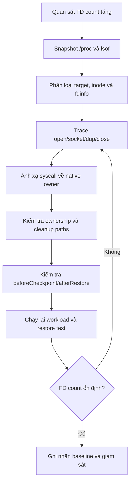

# Chẩn đoán file descriptor phát sinh từ mã native

Ứng dụng Java có thể mở file descriptor (FD) không chỉ qua `FileInputStream`, `SocketChannel` hoặc các API Java tiêu chuẩn. Thư viện native được gọi qua JNI, JNA, Panama hoặc một dependency bên thứ ba cũng có thể mở file, socket, pipe, eventfd, epoll descriptor và nhiều tài nguyên khác trực tiếp bằng API của hệ điều hành.

Những descriptor này thuộc bảng file descriptor của tiến trình. JVM không nhất thiết biết descriptor nào được tạo bởi thư viện nào, và một object Java còn tồn tại không chứng minh descriptor bên dưới vẫn hợp lệ. Khi ứng dụng chạy lâu, FD bị rò rỉ có thể làm tiến trình chạm giới hạn `ulimit -n`, khiến thao tác mở file hoặc kết nối mới thất bại. Với CRaC, descriptor native còn cần được xem xét trong vòng đời checkpoint/restore: một số loại có thể được cơ chế hệ điều hành phục hồi, một số cần đóng và tạo lại, và một số phụ thuộc trạng thái bên ngoài nên không thể được giữ nguyên về mặt nghiệp vụ.

Chẩn đoán hiệu quả cần đi từ inventory của `/proc`, `lsof` và `fdinfo` tới việc truy dấu các syscall `open`, `socket`, `dup` và `close`, sau đó ánh xạ descriptor về mã Java hoặc thư viện native sở hữu nó. Khi đã xác định được owner, cần kiểm tra đường đi thành công, đường lỗi, thao tác bất đồng bộ và callback CRaC để bảo đảm descriptor được đóng hoặc khôi phục đúng một lần.

## 1. File descriptor là gì?

Trên Linux, file descriptor là một số nguyên không âm đại diện cho một mục trong bảng descriptor của tiến trình. Kernel dùng mục đó để tham chiếu tới một open file description hoặc một loại tài nguyên kernel khác.

Các API native phổ biến tạo descriptor gồm:

| API | Loại tài nguyên thường tạo |
| --- | --- |
| `open()`, `openat()` | File hoặc thiết bị |
| `socket()` | Socket mạng hoặc Unix domain socket |
| `accept()`, `accept4()` | Socket cho kết nối được chấp nhận |
| `pipe()`, `pipe2()` | Hai đầu pipe |
| `dup()`, `dup2()`, `dup3()` | Descriptor mới tham chiếu cùng open file description |
| `eventfd()` | Event notification descriptor |
| `epoll_create1()` | Epoll instance |
| `inotify_init1()` | Inotify instance |
| `timerfd_create()` | Timer descriptor |
| `memfd_create()` | File ẩn trong memory-backed filesystem |
| `signalfd()` | Descriptor nhận signal |

Một FD không nhất thiết trỏ tới một file thông thường. Khi đọc `/proc/<pid>/fd`, có thể gặp các dạng:

```text
0 -> /dev/null
1 -> pipe:[421103]
2 -> pipe:[421104]
7 -> /var/log/service/native.log
8 -> socket:[421205]
9 -> anon_inode:[eventpoll]
10 -> anon_inode:[eventfd]
11 -> /memfd:runtime-cache (deleted)
```

Đây là ví dụ minh họa. Tên và cách hiển thị phụ thuộc kernel và loại descriptor.

### 1.1. FD number không phải identity bền vững

Kernel thường cấp lại số FD đã đóng. Ví dụ, descriptor `12` có thể được mở cho một socket, đóng lại rồi được cấp cho một file khác. Vì vậy, chỉ ghi nhận “FD 12 bị rò rỉ” là chưa đủ để xác định cùng một tài nguyên qua nhiều snapshot.

Khi so sánh, nên ghi cả:

- PID và FD number tại thời điểm quan sát.
- Loại descriptor và target hiển thị trong `/proc/<pid>/fd`.
- Inode hoặc socket inode nếu có.
- Nội dung `fdinfo`.
- Thời điểm snapshot và hoạt động tạo/đóng descriptor.

PID và FD number có thể thay đổi sau restore. Không nên dùng chúng làm ID nghiệp vụ hoặc ID lâu dài của tài nguyên.

### 1.2. Descriptor được chia sẻ giữa các thread

Các thread trong cùng tiến trình Linux thông thường chia sẻ bảng file descriptor. Một native thread có thể mở FD và một thread khác có thể sử dụng hoặc đóng FD đó. Vì vậy, việc chỉ tìm trong thread đang thực hiện request có thể bỏ sót owner thật.

Nếu một thư viện native chạy worker thread riêng, descriptor do worker mở vẫn xuất hiện trong `/proc/<pid>/fd` của tiến trình. Cần kiểm tra cả lifecycle của worker và cách thư viện truyền quyền sở hữu descriptor.

## 2. Phân biệt descriptor do Java và native code quản lý

Các API Java tiêu chuẩn thường bọc descriptor trong object như `FileInputStream`, `FileOutputStream`, `Socket`, `SocketChannel` hoặc lớp triển khai của thư viện NIO. Khi đóng object đúng cách, Java thường đóng tài nguyên bên dưới theo hợp đồng API.

Native code có thể mở FD mà không tạo một object Java tương ứng. Ví dụ, thư viện JNI gọi `open()` rồi lưu số nguyên trong struct C; Java chỉ giữ một `long` đại diện cho native handle. Trong trường hợp này, garbage collector không tự biết lúc nào cần đóng FD, trừ khi thư viện đã thiết kế một cơ chế cleanup cụ thể.

| Cách tạo FD | Owner thường gặp | Cách đóng |
| --- | --- | --- |
| `new FileInputStream(...)` | Object Java hoặc wrapper của nó | `close()` hoặc cơ chế cleanup được API hỗ trợ |
| `SocketChannel.open()` | Java NIO channel | `close()` |
| JNI gọi `open()` | Native wrapper hoặc đối tượng native được Java quản lý | Native method gọi `close()` đúng owner |
| JNA gọi `socket()` | Code JNA hoặc thư viện dùng FD | Gọi API đóng tương ứng, ví dụ `close()` |
| Thư viện native tạo worker nội bộ | Thư viện native | Stop/join worker và gọi cleanup theo API thư viện |
| `dup()` tạo descriptor thứ hai | Owner của từng descriptor | Mỗi FD phải được đóng đúng một lần |

Không nên suy luận nguồn gốc FD chỉ từ target của `/proc`. Một socket có thể được mở từ Java, JNI hoặc thư viện native. Cần kết hợp inventory với syscall tracing, log và source code.

### 2.1. Quyền sở hữu cần rõ ràng

Mỗi FD cần có một quy tắc ownership:

- Ai tạo descriptor?
- Ai có quyền sử dụng descriptor?
- Ai chịu trách nhiệm đóng descriptor?
- Có descriptor được duplicate không?
- Có API nào chuyển ownership từ native sang Java hoặc ngược lại không?
- Khi khởi tạo thất bại giữa chừng, ai cleanup các FD đã tạo?

Nếu Java wrapper và native library cùng nghĩ mình là owner, descriptor có thể bị đóng hai lần. Nếu cả hai nghĩ bên kia chịu trách nhiệm, descriptor có thể bị rò rỉ. Hãy ghi rõ ownership trong API và tên method, chẳng hạn `adoptFd`, `duplicateFd` hoặc `closeOwnedFd`.

## 3. Vì sao native FD quan trọng với CRaC?

Checkpoint/restore làm việc ở cấp tiến trình và hệ điều hành. Cơ chế như CRIU có thể xử lý một số loại file descriptor, nhưng khả năng phụ thuộc loại tài nguyên, kernel, CRIU version, namespace, trạng thái socket và cấu hình runtime.

Một descriptor có thể thuộc một trong các nhóm:

1. **Có thể phục hồi theo cơ chế checkpoint:** ví dụ một số file descriptor hoặc loại tài nguyên được CRIU hỗ trợ trong môi trường tương ứng.
2. **Cần phối hợp với bên ngoài:** ví dụ socket TCP, kết nối tới database hoặc broker mà peer bên ngoài có trạng thái riêng.
3. **Cần đóng và tạo lại:** ví dụ client native giữ session hoặc handle phụ thuộc dịch vụ bên ngoài.
4. **Không được hỗ trợ trong môi trường hiện tại:** checkpoint có thể thất bại hoặc restore không thể khôi phục descriptor đó.

Không được mặc định rằng mọi FD native đều bị mất khi restore, cũng không được mặc định rằng mọi FD đều được phục hồi chính xác. Cần kiểm tra tài liệu của JDK CRaC, CRIU và loại descriptor cụ thể, sau đó thử checkpoint/restore bằng đúng môi trường triển khai.

### 3.1. Descriptor được phục hồi không đồng nghĩa kết nối còn hợp lệ

Một socket descriptor có thể tồn tại sau restore nhưng kết nối tới dịch vụ bên ngoài không còn ở trạng thái ứng dụng mong muốn. Peer có thể đã timeout, server đã đóng session, credential hết hạn hoặc giao thức cần handshake lại.

Vì vậy, đối với kết nối native tới database, broker hoặc dịch vụ mạng, cách an toàn thường là:

- Ngừng sử dụng và drain các operation đang chạy.
- Đóng client/FD theo callback `beforeCheckpoint` nếu thư viện yêu cầu.
- Sau restore tạo client/FD mới trong `afterRestore`.
- Xác minh kết nối, xác thực và trạng thái giao thức trước khi mở lại traffic.

Chỉ giữ nguyên descriptor qua checkpoint khi thư viện, runtime và môi trường đã được xác nhận hỗ trợ, đồng thời semantics của dịch vụ bên ngoài vẫn an toàn.

## 4. Đếm số descriptor đang mở

Trên Linux, `/proc/<pid>/fd` là điểm bắt đầu nhanh để kiểm tra descriptor của tiến trình.

```bash
PID=12345
ls -1 "/proc/$PID/fd" | wc -l
```

Lệnh đếm số entry trong thư mục FD. Đây là snapshot tức thời; descriptor có thể được mở hoặc đóng ngay trong lúc đọc. Khi đo xu hướng, lấy nhiều snapshot theo khoảng thời gian và so sánh sau khi workload đã ổn định.

Có thể xem danh sách target:

```bash
ls -l "/proc/$PID/fd"
```

Hoặc dùng `lsof`:

```bash
lsof -nP -p "$PID"
```

`lsof` hiển thị FD, loại file, device/inode, mode và tên/path tùy loại descriptor. Tùy chọn `-nP` tránh phân giải hostname và port thành tên, giúp output nhanh và dễ so sánh.

### 4.1. So sánh trước và sau một workload

Một lần đo đơn lẻ khó chứng minh có leak. Hãy thực hiện quy trình:

1. Khởi chạy ứng dụng và để startup hoàn tất.
2. Chạy một workload warm-up cố định để loại bỏ các FD được mở lazy lần đầu.
3. Ghi số lượng và inventory FD làm baseline.
4. Chạy một số lượng operation xác định, ví dụ 100 hoặc 1.000 lần.
5. Chờ task và cleanup hoàn tất.
6. Ghi inventory lần nữa.
7. Lặp lại cùng workload để xem số FD có tiếp tục tăng hay đạt plateau.

Nếu mỗi vòng lặp để lại thêm một FD cùng loại hoặc cùng thư viện, có thể có đường cleanup bị thiếu. Nếu số FD tăng lúc đầu rồi ổn định, đó có thể là cache hoặc pool có giới hạn, không nhất thiết là leak.

### 4.2. Script snapshot inventory

Có thể lưu danh sách FD để so sánh:

```bash
PID=12345
OUT="fd-snapshot-$(date +%s).txt"

for path in /proc/"$PID"/fd/*; do
    fd="${path##*/}"
    target=$(readlink "$path" 2>/dev/null || true)
    printf '%s\t%s\n' "$fd" "$target"
done | sort -n > "$OUT"

cat "$OUT"
```

Đây là snapshot thô. Khi so sánh nhiều lần, nên bổ sung `fdinfo` và thông tin inode. FD number có thể được tái sử dụng nên không chỉ so sánh số cột đầu.

## 5. Đọc `/proc/<pid>/fdinfo`

Mỗi FD thường có một file tương ứng trong `/proc/<pid>/fdinfo/<fd>`. File này cung cấp metadata phụ thuộc loại descriptor.

```bash
PID=12345
FD=17
cat "/proc/$PID/fdinfo/$FD"
```

Với file thông thường, output có thể gồm:

```text
pos:    4096
flags:  0100002
mnt_id: 35
ino:    812345
```

Các trường thường gặp:

- `pos`: vị trí file hiện tại nếu loại descriptor hỗ trợ.
- `flags`: flags mở file theo biểu diễn của kernel.
- `mnt_id`: mount ID liên quan.
- `ino`: inode.

Với descriptor đặc biệt, có thể xuất hiện trường riêng như thông tin epoll hoặc eventfd. Không giả định mọi loại FD có cùng định dạng.

### 5.1. Phân biệt FD cùng inode

Nếu hai FD được tạo bằng `dup()`, chúng có thể tham chiếu cùng open file description. Với file thông thường, chúng có thể có cùng inode và chia sẻ file offset. Với socket, các FD duplicate có thể tham chiếu cùng socket kernel.

Điều này quan trọng khi chẩn đoán leak: một thư viện có thể duplicate FD và đóng bản gốc nhưng quên đóng bản sao. Inventory chỉ nhìn target có thể cho thấy nhiều descriptor cùng inode; cần trace `dup`, `dup2`, `dup3` hoặc `fcntl(F_DUPFD...)` để xác định nguồn.

## 6. Phân loại descriptor bằng `lsof`

`lsof` giúp xác định loại tài nguyên đang chiếm FD:

```bash
lsof -nP -p "$PID"
```

Một số cột hữu ích:

| Cột | Ý nghĩa |
| --- | --- |
| `COMMAND` | Tên tiến trình |
| `PID` | Process ID |
| `FD` | Số descriptor và mode, ví dụ `17r`, `18u` |
| `TYPE` | Loại tài nguyên, ví dụ `REG`, `IPv4`, `IPv6`, `unix`, `FIFO`, `a_inode` |
| `DEVICE` | Device hoặc thông tin tương đương |
| `SIZE/OFF` | Kích thước hoặc offset nếu áp dụng |
| `NODE` | Inode hoặc định danh kernel |
| `NAME` | Path, socket endpoint hoặc target |

Lọc một số loại thường gặp:

```bash
lsof -nP -p "$PID" | grep -E 'IPv4|IPv6|unix|FIFO|REG|a_inode'
```

Nếu nghi ngờ thư viện native mở file log, tìm path liên quan. Nếu nghi ngờ socket leak, nhóm theo `TYPE` và endpoint. Nếu nghi ngờ event loop, kiểm tra `anon_inode:[eventpoll]`, `eventfd` và socket liên quan.

### 6.1. Socket inode và kết nối mạng

`/proc/<pid>/fd` thường hiển thị socket dạng `socket:[inode]`. Có thể đối chiếu inode đó với các bảng trong `/proc/net` hoặc công cụ `ss`/`lsof` để tìm endpoint.

```bash
ss -tanp
ss -xap
```

`ss -tanp` giúp quan sát TCP socket; `ss -xap` giúp quan sát Unix domain socket. Quyền truy cập có thể cần quyền của owner process hoặc quyền quản trị. Socket không hiện đầy đủ process information nếu hệ thống giới hạn quyền.

### 6.2. File đã bị xóa nhưng vẫn mở

Một FD có thể trỏ tới file đã bị xóa khỏi thư mục nhưng vẫn còn mở. `lsof` có thể hiển thị hậu tố `(deleted)`; `/proc/<pid>/fd/<fd>` cũng có thể cho biết target đã bị unlink.

File vẫn chiếm tài nguyên cho tới khi descriptor cuối cùng được đóng. Nếu native library tạo file tạm rồi unlink ngay nhưng giữ FD, đây có thể là hành vi có chủ đích. Nếu số lượng tăng liên tục, cần kiểm tra cleanup.

## 7. Kiểm tra giới hạn FD của tiến trình và hệ thống

Một tiến trình có thể chạm giới hạn số FD trước khi hệ thống hết tài nguyên toàn cục.

Kiểm tra giới hạn của đúng tiến trình:

```bash
grep -i 'Max open files' "/proc/$PID/limits"
```

Kiểm tra giới hạn shell hiện tại:

```bash
ulimit -n
```

Lưu ý: `ulimit -n` của shell không nhất thiết là giới hạn của process đang chạy. `/proc/<pid>/limits` là thông tin cần đối chiếu với PID mục tiêu.

Kiểm tra bộ đếm file handle toàn hệ thống:

```bash
cat /proc/sys/fs/file-nr
cat /proc/sys/fs/file-max
```

`file-nr` cho biết số file handle được cấp phát và giới hạn theo cách biểu diễn của kernel; ý nghĩa từng trường phụ thuộc kernel version. `file-max` là giới hạn file handle toàn hệ thống. Lỗi `Too many open files` thường cần kiểm tra cả per-process limit và mức sử dụng toàn hệ thống.

### 7.1. Nhận diện lỗi cạn FD

Một số dấu hiệu:

- Native `open()` hoặc `socket()` trả `EMFILE`: process đã chạm giới hạn FD.
- Syscall trả `ENFILE`: hệ thống đã chạm giới hạn file handle toàn cục.
- Java báo `Too many open files` khi mở file hoặc socket.
- Connection pool không tạo được kết nối mới.
- Native library báo lỗi I/O không rõ nguyên nhân do bỏ qua errno.

Khi gặp lỗi, ghi lại `errno`, syscall và descriptor count. Không chỉ tăng `ulimit -n` để che vấn đề nếu số FD tiếp tục tăng theo thời gian.

## 8. Truy dấu syscall tạo và đóng FD

Sau khi xác định loại FD tăng, cần biết đoạn code nào gọi syscall tạo nó và có gọi đóng tương ứng hay không.

### 8.1. Dùng `strace`

`strace` có thể attach vào tiến trình và ghi lại syscall liên quan:

```bash
strace -ff -ttT -yy \
  -e trace=open,openat,close,dup,dup2,dup3,fcntl,socket,accept,accept4,pipe,pipe2,eventfd2,epoll_create1,inotify_init1,timerfd_create,memfd_create \
  -p "$PID" \
  -o /tmp/native-fd-trace
```

Các tùy chọn:

- `-f`: theo dõi thread/process con theo khả năng attach của `strace`.
- `-ff`: tách output theo thread/process ID.
- `-ttT`: ghi timestamp và thời gian syscall.
- `-yy`: cố gắng giải thích FD thành path hoặc endpoint.
- `-e trace=...`: chỉ theo dõi nhóm syscall liên quan.
- `-p`: attach vào PID đang chạy.
- `-o`: ghi trace ra file.

`strace` có thể tạo overhead và làm thay đổi timing. Nên dùng trong môi trường thử nghiệm hoặc một cửa sổ chẩn đoán ngắn. Việc attach cũng có thể bị chặn bởi quyền ptrace, container security policy hoặc cấu hình hệ thống.

### 8.2. Đọc cặp open/close

Ví dụ trace:

```text
openat(AT_FDCWD, "/var/lib/app/native-cache", O_RDONLY|O_CLOEXEC) = 17
read(17, "...", 4096) = 4096
close(17) = 0
```

Đường đi này tạo FD 17 rồi đóng nó. Nếu trace cho thấy nhiều `openat(...) = 17`, `18`, `19` nhưng không có `close()` tương ứng, có thể tồn tại leak hoặc descriptor được giữ có chủ đích.

Đừng chỉ ghép theo FD number khi phân tích trace dài. Một FD có thể được đóng rồi cấp lại cho tài nguyên khác. Hãy dùng timestamp, syscall sequence, target và inode để theo dõi từng vòng đời.

### 8.3. Theo dõi `dup` và `fcntl`

Một FD có thể được nhân bản bằng:

```text
dup(17) = 21
dup3(17, 22, O_CLOEXEC) = 22
fcntl(17, F_DUPFD_CLOEXEC, 30) = 30
```

Mỗi descriptor mới cần có owner và cleanup riêng. Đóng FD 17 không tự đóng các bản duplicate 21, 22 hoặc 30. Nếu native wrapper chỉ lưu số FD ban đầu, các bản sao có thể bị bỏ quên.

### 8.4. Lấy stack trace native khi cần

Một số phiên bản `strace` hỗ trợ `-k` để ghi stack trace khi syscall xảy ra, nếu môi trường có hỗ trợ unwind phù hợp:

```bash
strace -k -f -ttT -e trace=openat,close,dup,dup2,dup3,socket,accept4 \
  -p "$PID" -o /tmp/native-fd-stacks
```

Stack trace có thể giúp xác định thư viện hoặc hàm native gọi syscall. Để có symbol hữu ích, binary cần debug symbols hoặc thông tin symbol phù hợp. Nếu không có stack trace, có thể kết hợp `perf`, eBPF uprobes hoặc instrument trực tiếp wrapper native.

## 9. Ánh xạ descriptor về thư viện native

Sau khi biết một nhóm FD bị tăng, bước tiếp theo là tìm owner.

### 9.1. Xem thư viện native đã nạp

```bash
grep -E '\.so([.0-9]*)?$' "/proc/$PID/maps" | sort -u
```

Danh sách này cho biết shared library được map vào process. Nó không chứng minh thư viện nào mở FD cụ thể, nhưng giúp lập danh sách candidate.

### 9.2. Dùng trace và symbol

Nếu `strace -k` hoặc công cụ tracing cung cấp stack, tìm frame thuộc thư viện như `libfoo.so`, `libbar.so` hoặc native module của ứng dụng. Sau đó:

1. Xác định symbol/hàm gọi `open`, `socket`, `dup` hoặc API tương đương.
2. Tìm call site trong source hoặc symbol map.
3. Kiểm tra đường success và mọi đường error.
4. Kiểm tra ai sở hữu FD sau khi hàm trả về.
5. Kiểm tra cleanup khi exception, cancellation và shutdown.

Nếu thư viện là binary đóng, dùng tài liệu API, debug symbols do vendor cung cấp hoặc hỏi nhà cung cấp về lifecycle contract. Không tự đóng một FD mà thư viện vẫn đang dùng.

### 9.3. Instrument wrapper native

Nếu ứng dụng kiểm soát mã JNI/JNA, hãy ghi log khi tạo, duplicate và đóng descriptor. Log nên chứa resource name, FD number, loại tài nguyên, thread ID, thời điểm và một operation ID.

Ví dụ C đơn giản:

```c
int open_native_file(const char *path) {
    int fd = open(path, O_RDONLY | O_CLOEXEC);
    if (fd < 0) {
        log_native_error("open", path, errno);
        return -1;
    }

    log_fd_event("open", fd, path);
    return fd;
}

int close_native_fd(int fd) {
    if (fd < 0) {
        return 0;
    }

    int result = close(fd);
    if (result < 0) {
        log_native_error("close", NULL, errno);
        return -1;
    }

    log_fd_event("close", fd, NULL);
    return 0;
}
```

Đoạn mã minh họa cách ghi nhận event; cần bổ sung header, logger thread-safe và chính sách error handling của ứng dụng. Trên Linux, không nên lặp lại `close(fd)` một cách mù quáng sau một lỗi `EINTR`, vì FD có thể đã được giải phóng và tái sử dụng. Hãy tuân theo semantics của nền tảng và thư viện đang dùng.

## 10. Các nguyên nhân native FD leak thường gặp

### 10.1. Thiếu `close()` trên đường lỗi

Mã native mở FD rồi thực hiện nhiều bước. Nếu bước thứ hai thất bại và hàm return sớm mà không đóng FD, mỗi lần retry sẽ để lại một descriptor.

Ví dụ có lỗi:

```c
int load_state(const char *path) {
    int fd = open(path, O_RDONLY | O_CLOEXEC);
    if (fd < 0) {
        return -1;
    }

    if (validate_header(fd) != 0) {
        return -1; /* FD bị rò rỉ */
    }

    close(fd);
    return 0;
}
```

Phải đóng descriptor trước khi return ở nhánh lỗi:

```c
int load_state(const char *path) {
    int fd = open(path, O_RDONLY | O_CLOEXEC);
    if (fd < 0) {
        return -1;
    }

    int result = validate_header(fd);
    int saved_errno = errno;
    close(fd);
    errno = saved_errno;
    return result;
}
```

Ví dụ trên minh họa cleanup tập trung. Trong code thực tế, nếu cần dùng FD sau validation thì chỉ đóng tại điểm hoàn tất; nếu nhiều tài nguyên được mở, dùng một cleanup path hoặc wrapper RAII để không bỏ sót.

### 10.2. Ownership không rõ giữa Java và native

Một native method trả về số FD cho Java nhưng không quy định ai đóng nó. Java wrapper có thể bỏ qua cleanup vì nghĩ thư viện native tự quản lý; thư viện native lại giữ descriptor vì nghĩ Java sẽ đóng.

Giải pháp là ghi rõ contract:

- Method trả FD mới và chuyển ownership cho caller.
- Method trả borrowed FD, caller không được đóng.
- Method trả duplicate FD, caller sở hữu bản duplicate.
- Method nhận FD và adopt ownership.

Không để API chỉ trả một `int` mà không mô tả ownership.

### 10.3. Duplicate descriptor nhưng chỉ đóng bản gốc

`dup()` tạo descriptor mới tham chiếu cùng open file description. Nếu code chỉ đóng FD gốc mà quên FD duplicate, tài nguyên vẫn còn mở.

Kiểm tra mọi call site của `dup`, `dup2`, `dup3` và `fcntl(F_DUPFD*)`. Mỗi kết quả thành công phải được gán owner và đóng đúng một lần.

### 10.4. Exception hoặc cancellation trong JNI/JNA

Một JNI method có thể mở FD rồi gọi Java callback. Callback ném exception, hoặc native code phát hiện pending exception rồi return mà không cleanup. Tương tự, một tác vụ JNA có thể bị cancel giữa chừng.

Native code cần kiểm tra exception state và thực hiện cleanup trước khi trả về. Java code cần dùng `try/finally` hoặc `AutoCloseable` để giải phóng ownership đã nhận.

### 10.5. Worker thread giữ FD sau khi Java object đóng

Một thư viện native có thể tạo worker thread và chuyển FD cho thread đó. Java wrapper gọi `close()` nhưng worker vẫn đang đọc/ghi hoặc chờ event. Việc đóng FD từ thread khác trong lúc I/O đang diễn ra có thể tạo race hoặc hành vi phụ thuộc syscall.

Lifecycle đúng thường là yêu cầu worker dừng, wake-up nếu đang block, join thread, rồi đóng descriptor theo contract của thư viện.

### 10.6. FD bị giữ bởi callback hoặc registry

Một callback native, event loop hoặc registry global có thể giữ pointer tới object quản lý FD. Java object có vẻ không còn được dùng nhưng native registry vẫn giữ descriptor. Cần kiểm tra deregistration và shutdown hook của thư viện.

### 10.7. `FD_CLOEXEC` bị thiếu

Nếu process tạo child process hoặc thực thi `exec`, FD không có close-on-exec có thể bị kế thừa ngoài ý muốn. Điều này có thể khiến FD vẫn mở sau khi process cha dự kiến đã đóng hoặc làm tài nguyên tồn tại lâu hơn.

Trên Linux, ưu tiên tạo FD với flag close-on-exec ngay từ đầu:

```c
int fd = open(path, O_RDONLY | O_CLOEXEC);
int s = socket(AF_INET, SOCK_STREAM | SOCK_CLOEXEC, 0);
int p[2];
pipe2(p, O_CLOEXEC);
```

Với API không hỗ trợ flag này, có thể dùng `fcntl(fd, F_SETFD, FD_CLOEXEC)` nhưng cần xử lý race với thread khác đang gọi `fork/exec`. Các biến thể atomic như `accept4` hoặc `pipe2` giúp tránh cửa sổ race.

## 11. Quản lý ownership bằng RAII ở C/C++

Trong C++, RAII giúp gắn vòng đời FD với vòng đời object. Destructor đóng FD khi object bị hủy; move semantics chuyển ownership; copy bị cấm để tránh hai object cùng nghĩ mình sở hữu một FD.

```cpp
#include <unistd.h>
#include <utility>

class UniqueFd {
public:
    explicit UniqueFd(int fd = -1) noexcept : fd_(fd) {}

    ~UniqueFd() {
        reset();
    }

    UniqueFd(const UniqueFd&) = delete;
    UniqueFd& operator=(const UniqueFd&) = delete;

    UniqueFd(UniqueFd&& other) noexcept
        : fd_(std::exchange(other.fd_, -1)) {}

    UniqueFd& operator=(UniqueFd&& other) noexcept {
        if (this != &other) {
            reset(std::exchange(other.fd_, -1));
        }
        return *this;
    }

    int get() const noexcept {
        return fd_;
    }

    int release() noexcept {
        return std::exchange(fd_, -1);
    }

    void reset(int next = -1) noexcept {
        if (fd_ >= 0) {
            ::close(fd_);
        }
        fd_ = next;
    }

private:
    int fd_;
};
```

`UniqueFd` là ví dụ tối giản. Trong thư viện production, cần quy định rõ cách báo lỗi khi `close()` thất bại, cách xử lý signal interruption theo nền tảng và việc destructor không thể ném exception. Không copy FD owner; dùng `release()` khi chuyển quyền sở hữu sang API khác và `reset()` khi thay descriptor.

Với C thuần, có thể dùng một cleanup label hoặc helper tương đương để mọi nhánh lỗi đóng các descriptor đã mở. Với Rust hoặc ngôn ngữ khác, ưu tiên abstraction ownership/Drop tương ứng.

## 12. Wrapper Java cho native descriptor

Nếu Java giữ một native FD, wrapper nên thể hiện rõ trạng thái đã mở/đóng và cung cấp thao tác cleanup deterministic. Không nên chỉ dựa vào finalizer hoặc Cleaner để đóng tài nguyên trước checkpoint; thời điểm chạy cleanup không được bảo đảm.

Ví dụ đơn giản với `AutoCloseable`:

```java
public final class NativeFile implements AutoCloseable {

    private int fd = -1;

    public NativeFile(String path) throws IOException {
        this.fd = openNative(path);
        if (fd < 0) {
            throw new IOException("Cannot open native file");
        }
    }

    public synchronized int read(byte[] target) throws IOException {
        ensureOpen();
        return readNative(fd, target);
    }

    @Override
    public synchronized void close() throws IOException {
        if (fd >= 0) {
            int current = fd;
            fd = -1;
            closeNative(current);
        }
    }

    private void ensureOpen() throws IOException {
        if (fd < 0) {
            throw new IOException("Native file is closed");
        }
    }

    private static native int openNative(String path) throws IOException;
    private static native int readNative(int fd, byte[] target)
            throws IOException;
    private static native void closeNative(int fd) throws IOException;
}
```

Ví dụ này bảo đảm thao tác `read` và `close` của wrapper được tuần tự hóa bằng monitor. Nó không đủ nếu native library còn dùng FD từ worker thread riêng hoặc giữ alias/duplicate. Khi đó cần dừng và join worker trước khi đóng FD. Nếu native API cho phép thao tác đồng thời, có thể dùng operation gate thay vì giữ monitor trong suốt I/O.

### 12.1. Đưa native descriptor vào CRaC lifecycle

Nếu descriptor cần đóng trước checkpoint và mở lại sau restore, có thể tạo resource quản lý wrapper:

```java
import java.io.IOException;
import org.crac.Context;
import org.crac.Core;
import org.crac.Resource;

public final class NativeFileResource implements Resource {

    private final String path;
    private NativeFile nativeFile;

    public NativeFileResource(String path) throws IOException {
        this.path = path;
        this.nativeFile = new NativeFile(path);
        Core.getGlobalContext().register(this);
    }

    @Override
    public synchronized void beforeCheckpoint(
            Context<? extends Resource> context) throws Exception {
        if (nativeFile != null) {
            nativeFile.close();
            nativeFile = null;
        }
    }

    @Override
    public synchronized void afterRestore(
            Context<? extends Resource> context) throws Exception {
        NativeFile restored = new NativeFile(path);
        try {
            restored.verifyUsable();
            nativeFile = restored;
        } catch (Exception ex) {
            try {
                restored.close();
            } catch (Exception closeFailure) {
                ex.addSuppressed(closeFailure);
            }
            throw ex;
        }
    }
}
```

`verifyUsable()` là method kiểm tra do wrapper ứng dụng định nghĩa. Ví dụ minh họa resource sở hữu native file; trong code thật cần có method này và bảo vệ mọi thao tác dùng `nativeFile` bằng cùng một cơ chế đồng bộ.

Sau `beforeCheckpoint`, field `nativeFile` là `null` trong trạng thái được lưu. `afterRestore` tạo một wrapper và descriptor mới. Không lưu số FD cũ rồi cố dùng lại vì FD number có thể đã được kernel cấp cho tài nguyên khác.

### 12.2. Xử lý trường hợp checkpoint bị hủy

Nếu `beforeCheckpoint` đã đóng native FD nhưng quá trình checkpoint sau đó thất bại, không thể giả định `afterRestore` sẽ được gọi trong tiến trình hiện tại. `afterRestore` dành cho tiến trình được khôi phục từ ảnh.

Lifecycle manager của ứng dụng cần có đường rollback riêng nếu checkpoint bị hủy: mở lại resource đã đóng, xác minh descriptor mới và chỉ sau đó mới mở admission/readiness. Nếu không thể rollback an toàn, giữ instance ở trạng thái chưa sẵn sàng và để quy trình phục hồi xử lý.

## 13. Theo dõi descriptor qua nhiều chu kỳ CRaC

Để xác định FD leak có liên quan tới checkpoint hay không, so sánh inventory ở các mốc:

1. Sau startup và warm-up.
2. Sau khi workload kết thúc nhưng trước `beforeCheckpoint`.
3. Sau khi tất cả resource hoàn tất `beforeCheckpoint`.
4. Sau restore và hoàn tất `afterRestore`.
5. Sau khi instance xử lý cùng workload như trước.
6. Sau nhiều chu kỳ checkpoint/restore.

Một mẫu inventory có thể như sau:

| Mốc | Tổng FD | Socket | File thường | anon_inode/khác |
| --- | ---: | ---: | ---: | ---: |
| Sau warm-up | 42 | 12 | 8 | 22 |
| Sau drain và beforeCheckpoint | 25 | 3 | 5 | 17 |
| Sau restore và afterRestore | 41 | 11 | 8 | 22 |
| Sau workload lần 2 | 42 | 12 | 8 | 22 |

Các số liệu chỉ minh họa. Mục tiêu là xác định số FD trở về mức dự kiến và không tăng không giới hạn qua mỗi chu kỳ.

### 13.1. Phân biệt FD được CRIU phục hồi với FD được ứng dụng mở lại

Một descriptor xuất hiện sau restore có thể là:

- Descriptor được CRIU phục hồi.
- Descriptor mới được resource callback tạo trong `afterRestore`.
- Descriptor do JVM hoặc thư viện mở trong quá trình tiếp tục chạy.
- Descriptor được tạo lazy bởi request đầu tiên sau restore.

Không so sánh chỉ bằng FD number vì PID và số descriptor có thể khác. Dùng target, inode, loại tài nguyên và trace callback để xác định nguồn. Với resource được thiết kế đóng/mở lại, nên ghi log rõ event close trước checkpoint và open sau restore.

### 13.2. Kiểm tra log CRIU và JVM

Nếu checkpoint hoặc restore thất bại liên quan tới descriptor, lưu log của JVM CRaC và CRIU. Tìm các thông báo về unsupported FD, socket, file, mount, permission hoặc resource không thể phục hồi. Nội dung log và mức chi tiết phụ thuộc phiên bản CRIU/JDK.

`criu check` giúp kiểm tra một số khả năng của môi trường nhưng không chứng minh mọi descriptor mà ứng dụng đang mở đều có thể được dump/restore. Cần kiểm thử với đúng loại descriptor và workload thật.

## 14. Những loại descriptor cần chú ý

### 14.1. File và file tạm

Kiểm tra path, mount, inode, permission và việc file có bị xóa trong khi vẫn mở hay không. Sau restore, path có thể trỏ tới nội dung khác nếu volume thay đổi. Nếu file được dùng làm lock hoặc coordination primitive, cần xác minh semantics bên ngoài.

### 14.2. TCP socket

Socket TCP phụ thuộc peer và trạng thái kết nối ở hai đầu. Kiểm tra endpoint, trạng thái TCP và khả năng peer tiếp tục session. Với database/broker connection, thường nên đóng client và reconnect trong `afterRestore` theo hướng dẫn của thư viện.

### 14.3. Unix domain socket

Unix socket phụ thuộc path hoặc namespace. Sau restore, socket path có thể không còn, bị tạo lại hoặc trỏ tới server khác. Kiểm tra file socket, mount namespace và lifecycle của server.

### 14.4. Pipe và FIFO

Pipe có thể gắn với tiến trình khác. Nếu peer đã kết thúc hoặc descriptor bị giữ ngoài dự kiến, thao tác đọc/ghi có thể block hoặc trả EOF/EPIPE. Cần xác định cả hai đầu và lifecycle của peer.

### 14.5. epoll, eventfd và timerfd

Các descriptor này thường do event loop hoặc thư viện native tạo. Chúng có thể liên kết với thread, callback và descriptor khác. Không đóng riêng eventfd/epoll FD khi event loop vẫn đang dùng. Hãy dừng event loop, join thread và cleanup theo API của thư viện.

### 14.6. Device và descriptor đặc biệt

Descriptor tới `/dev/*`, GPU, accelerator hoặc thiết bị khác có thể phụ thuộc driver và trạng thái phần cứng. Không giả định CRIU có thể phục hồi chúng. Thường cần đóng trước checkpoint và khởi tạo lại sau restore theo tài liệu của vendor.

## 15. Quy trình chẩn đoán FD native leak

Một quy trình thực tế có thể chia thành các bước sau:

### Bước 1: Xác nhận có tăng FD thật

Đo số FD qua nhiều vòng workload sau khi warm-up. Đối chiếu với `/proc/<pid>/limits` và loại tài nguyên đang tăng. Nếu số lượng đạt plateau, kiểm tra xem đó có phải pool/cache có giới hạn.

### Bước 2: Phân loại FD tăng

Dùng `ls -l /proc/<pid>/fd`, `fdinfo` và `lsof`. Nhóm theo file path, socket, pipe, anon_inode, deleted file và inode.

### Bước 3: Xác định syscall tạo FD

Attach `strace` trong môi trường thử nghiệm hoặc dùng instrumentation/eBPF để theo dõi `openat`, `socket`, `accept`, `dup`, `fcntl` và `close`.

### Bước 4: Ánh xạ về owner

Dùng native stack, symbol, `/proc/<pid>/maps`, source code và API documentation để xác định thư viện hoặc module tạo descriptor. Kiểm tra ownership contract.

### Bước 5: Kiểm tra mọi đường cleanup

Xem đường success, error, exception, cancellation, timeout, worker shutdown và callback CRaC. Đặc biệt kiểm tra duplicate FD và worker thread giữ descriptor.

### Bước 6: Kiểm tra CRaC lifecycle

Phân loại FD nào được giữ, FD nào cần đóng trước checkpoint và FD nào phải tạo lại sau restore. Xác minh callback resource và log CRIU.

### Bước 7: Lặp lại thử nghiệm

Chạy nhiều vòng create/use/close và nhiều chu kỳ checkpoint/restore. Số FD phải ổn định trong giới hạn dự kiến; không tăng đều sau mỗi vòng.



## 16. Kiểm thử tự động để phát hiện leak

Một test leak nên lặp lại cùng một thao tác đủ nhiều lần và đo descriptor count sau khi mọi công việc hoàn tất. Không nên assert số FD bằng một hằng số tuyệt đối vì JVM, test runner và hệ điều hành có thể mở descriptor khác nhau.

Ví dụ chiến lược:

1. Khởi tạo ứng dụng và chạy một vòng warm-up.
2. Chụp baseline FD count.
3. Thực hiện N lần tạo, sử dụng và đóng native resource.
4. Chờ worker kết thúc và cleanup hoàn tất.
5. Chụp FD count lần nữa.
6. Lặp lại một batch khác và so sánh delta.
7. Đặt ngưỡng tăng tối đa hợp lý và báo lỗi nếu số FD tăng tuyến tính.

Pseudo test:

```java
@Test
void repeatedNativeOpenCloseDoesNotGrowFdCount() throws Exception {
    long baseline = countProcessFileDescriptors();

    for (int i = 0; i < 1_000; i++) {
        try (NativeFile file = new NativeFile(testPath)) {
            file.read(sampleBuffer);
        }
    }

    awaitNativeCleanup();
    long after = countProcessFileDescriptors();

    assertTrue(after - baseline <= allowedTransientDescriptors);
}
```

`countProcessFileDescriptors()` và `awaitNativeCleanup()` là helper của test. Trên Linux có thể đếm entry trong `/proc/self/fd`; lưu ý chính thao tác liệt kê thư mục có thể tạm thời mở một FD, vì vậy cần đóng stream/directory handle trước khi lấy kết quả cuối hoặc tính đến sai số nhỏ.

Test tự động nên chạy trên cùng loại OS/runtime mục tiêu. Ngoài unit test, cần có integration test dùng thư viện native thật vì fake wrapper không thể phát hiện leak bên trong binary dependency.

## 17. Công cụ quan sát bổ sung

### 17.1. `perf trace`

`perf trace` có thể quan sát syscall tương tự strace trong một số môi trường:

```bash
perf trace -p "$PID"
```

Khả năng sử dụng phụ thuộc kernel, perf permissions và cấu hình hệ thống. Đây là lựa chọn bổ sung khi cần quan sát trong môi trường đã cấu hình perf.

### 17.2. eBPF

eBPF có thể theo dõi syscall hoặc tracepoint liên quan tới file descriptor mà không cần attach ptrace theo cách của strace. Có thể thu thập PID/TID, command, syscall, return value và timestamp, sau đó nhóm các lần open/close.

Các chương trình eBPF cần được xây dựng và kiểm tra theo kernel, BTF, quyền CAP_BPF/CAP_PERFMON hoặc policy tương ứng. Không dùng một script eBPF không rõ nguồn trong production; ưu tiên công cụ được tổ chức phê duyệt và giới hạn thời gian/volume dữ liệu.

### 17.3. Native Memory Tracking không phải FD tracker

HotSpot Native Memory Tracking (NMT) giúp quan sát một số vùng native memory do JVM theo dõi, ví dụ thread, class, code, GC và internal allocation. Có thể bật bằng `-XX:NativeMemoryTracking=summary` hoặc `detail` và truy vấn qua `jcmd`:

```bash
jcmd "$PID" VM.native_memory summary
```

NMT không phải công cụ liệt kê mọi file descriptor và không đảm bảo theo dõi FD được mở bởi thư viện native bên thứ ba. Dùng NMT để điều tra native memory; dùng `/proc`, `lsof`, syscall tracing hoặc instrumentation để điều tra FD.

## 18. Metric và cảnh báo vận hành

Ứng dụng có thể xuất một số metric về descriptor:

- Tổng số FD đang mở.
- Số FD theo nhóm loại tài nguyên.
- Giới hạn FD của process.
- Tỷ lệ sử dụng `open files limit`.
- Số lần syscall mở FD thất bại do `EMFILE` hoặc `ENFILE`.
- Số lần tạo/đóng native resource theo loại.
- Số descriptor được mở lại sau restore.
- Thời gian đóng và khởi tạo native resource trong callback CRaC.

Một cảnh báo đơn giản có thể dùng tỷ lệ:

\[
\text{FD usage ratio} =
\frac{\text{Open FD count}}
{\text{Process open-file limit}}
\]

Ngưỡng cảnh báo nên dựa trên baseline và headroom cần thiết. Không đợi tới 100% mới cảnh báo vì ứng dụng có thể cần mở thêm socket, log file hoặc descriptor tạm trong lúc tải tăng.

Khi xuất metric, không dùng FD number làm label vì số lượng label sẽ tăng và FD number có thể được tái sử dụng. Dùng nhãn có cardinality thấp như resource type, library hoặc subsystem.

## 19. Những lỗi thường gặp khi chẩn đoán

| Lỗi | Vì sao gây hiểu nhầm | Cách xử lý |
| --- | --- | --- |
| Chỉ đếm FD một lần | Không phân biệt leak với descriptor mở lazy | So sánh nhiều snapshot sau warm-up |
| Chỉ nhìn FD number | Kernel có thể tái sử dụng số FD | So sánh target, inode, fdinfo và timestamp |
| Nghĩ mọi socket do Java mở | Native library cũng có thể gọi `socket()` | Trace syscall và ánh xạ stack |
| Chỉ xem heap dump | Heap dump không liệt kê đầy đủ FD native | Dùng `/proc`, `lsof` và syscall tracing |
| Chỉ xem NMT | NMT không phải FD inventory | Dùng công cụ chuyên về descriptor |
| Đóng FD từ bên ngoài khi chưa biết owner | Có thể làm hỏng event loop hoặc thư viện đang dùng | Xác định ownership và cleanup API trước |
| Bỏ qua `dup()` | Descriptor duplicate vẫn mở sau khi đóng bản gốc | Trace `dup*` và `F_DUPFD*` |
| Dựa vào Cleaner để đóng trước checkpoint | Cleaner không chạy đúng thời điểm mong muốn | Dùng close deterministic và CRaC Resource |
| Giữ socket native qua restore mà không verify | Peer có thể đã đóng hoặc session hết hạn | Reconnect và xác minh giao thức |
| Đếm FD ngay khi startup | Nhiều descriptor hệ thống được mở lazy | Warm-up trước khi lấy baseline |
| Chỉ tăng `ulimit -n` | Che leak mà không sửa nguyên nhân | Xác định nguồn tăng và cleanup |
| Giả định CRIU hỗ trợ mọi FD | Khả năng phụ thuộc loại descriptor và môi trường | Kiểm tra log và thử đúng runtime/kernel |

## 20. Checklist điều tra một FD leak native

Khi thấy số descriptor tăng, có thể ghi nhận theo trình tự:

- [ ] Xác định PID, thời điểm và process open-file limit.
- [ ] Lấy snapshot `/proc/<pid>/fd` và `fdinfo`.
- [ ] Dùng `lsof -nP -p <pid>` để phân loại tài nguyên.
- [ ] So sánh nhiều vòng workload sau warm-up.
- [ ] Xác định nhóm FD hoặc inode tăng đều.
- [ ] Trace syscall tạo, duplicate và đóng FD.
- [ ] Ánh xạ call stack về thư viện native hoặc module ứng dụng.
- [ ] Xác định owner và contract chuyển quyền sở hữu.
- [ ] Kiểm tra mọi nhánh lỗi, exception, cancellation và worker shutdown.
- [ ] Kiểm tra `FD_CLOEXEC` và descriptor được kế thừa nếu có fork/exec.
- [ ] Xác định descriptor được CRIU phục hồi hay cần đóng/mở lại.
- [ ] Kiểm tra callback `beforeCheckpoint` và `afterRestore`.
- [ ] Chạy lại test lặp và nhiều chu kỳ checkpoint/restore.
- [ ] Xác nhận FD count ổn định và còn đủ headroom trước khi phát hành.

Checklist này hỗ trợ thu thập bằng chứng kỹ thuật. Không đóng descriptor thủ công chỉ dựa trên tên path hoặc số FD khi chưa xác định owner.

## 21. Kết luận

File descriptor phát sinh từ mã native là tài nguyên cấp tiến trình và có thể không được biểu diễn trực tiếp bằng một object Java dễ nhận biết. Để chẩn đoán, hãy bắt đầu bằng `/proc/<pid>/fd`, `fdinfo`, `lsof` và giới hạn trong `/proc/<pid>/limits`; sau đó theo dõi syscall `open`, `socket`, `dup` và `close` bằng `strace`, `perf`, eBPF hoặc instrumentation native. So sánh inventory qua nhiều vòng workload để phân biệt leak với descriptor được giữ có chủ đích.

Khi đã tìm được owner, cần xác định rõ quyền sở hữu, xử lý mọi đường lỗi và đóng từng descriptor đúng một lần. Trong CRaC, phân loại descriptor theo khả năng phục hồi và semantics bên ngoài: đóng các native handle cần tạo lại trong `beforeCheckpoint`, mở và xác minh handle mới trong `afterRestore`, đồng thời xử lý rollback nếu checkpoint bị hủy. Kiểm thử trên đúng JDK, CRIU, kernel và loại descriptor thực tế để bảo đảm số FD ổn định và instance chỉ phục vụ khi tài nguyên native đã sẵn sàng.
