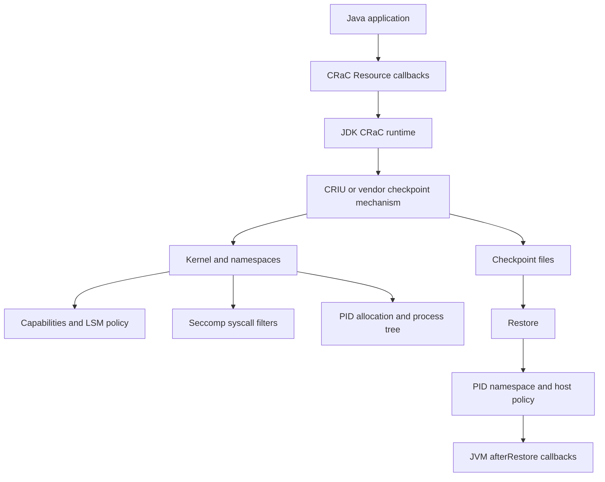

# Chẩn đoán thiếu quyền, seccomp và xung đột PID

Khi checkpoint hoặc restore một ứng dụng Java CRaC trên Linux, lỗi không phải lúc nào cũng xuất phát từ code Java. JVM cần phối hợp với kernel, CRIU, process namespace, filesystem và chính sách bảo mật của host/container. Một lệnh checkpoint có thể thất bại với `Operation not permitted`, `Permission denied`, lỗi `ptrace` hoặc thông báo liên quan đến syscall. Restore có thể thất bại vì không đặt lại được PID, tiến trình nguồn vẫn chiếm PID trong namespace, hoặc một process khác đã dùng tài nguyên mà snapshot cần khôi phục.

Để chẩn đoán hiệu quả, cần phân biệt ba nhóm nguyên nhân:

- **Thiếu quyền:** user, capability, user namespace hoặc quyền truy cập `/proc` không cho phép thao tác cần thiết.
- **Seccomp và security policy:** syscall bị lọc hoặc thao tác bị AppArmor/SELinux từ chối.
- **Xung đột PID/process namespace:** JVM, CRIU hoặc container runtime nhìn thấy PID khác nhau, PID cần khôi phục đã bị chiếm hoặc tiến trình được restore vào namespace không phù hợp.

Không nên khắc phục bằng cách bật `--privileged`, tắt toàn bộ seccomp hoặc chạy mọi container bằng root ngay từ đầu. Hãy xác định syscall/thao tác bị từ chối, kiểm tra lớp quyền tương ứng rồi cấp đúng quyền tối thiểu cần thiết.

## 1. Nhận diện dấu hiệu theo nhóm lỗi

Thông báo lỗi thường chỉ ra tầng cần điều tra đầu tiên, nhưng không phải lúc nào cũng xác định chính xác nguyên nhân. Ví dụ `Operation not permitted` có thể đến từ capability, seccomp, LSM policy hoặc giới hạn namespace.

| Dấu hiệu | Nhóm nguyên nhân có thể gặp | Kiểm tra đầu tiên |
|---|---|---|
| `Operation not permitted` (`EPERM`) | Thiếu capability, seccomp trả lỗi, LSM policy, namespace restriction | Kernel log, audit log, capability và seccomp status |
| `Permission denied` (`EACCES`) | Unix permission, mount option, SELinux/AppArmor, `/proc` restriction | Owner/mode, mount, audit denial |
| `ptrace: Operation not permitted` | Thiếu `CAP_SYS_PTRACE`, Yama, user namespace hoặc seccomp | `ptrace_scope`, capability, `/proc` và security profile |
| Không đọc được `/proc/<pid>/...` | PID namespace, `hidepid`, quyền user, process đã thoát | PID namespace, mount procfs, UID và PID thực tế |
| `jcmd` không attach được JVM | Sai PID/namespace, khác user, attach bị disable, `/tmp` hoặc procfs hạn chế | Chạy `jcmd -l` trong đúng namespace và kiểm tra JVM flags |
| Không thể restore PID hoặc `EEXIST` | PID đã tồn tại trong namespace đích hoặc namespace không phù hợp | Tiến trình nguồn, PID namespace và container sharing |
| `Address already in use` | Port TCP/UDP hoặc Unix socket đã bị chiếm | Socket listener và tiến trình đang sở hữu port/path |
| Restore báo thiếu quyền khi đặt PID | Thiếu quyền checkpoint/restore hoặc quyền namespace | Capability `CAP_CHECKPOINT_RESTORE`, quyền CRIU và host |
| Checkpoint thành công nhưng restore thất bại | Môi trường restore, namespace, PID, quyền, kernel hoặc artifact | So sánh host/runtime và log restore đầy đủ |

`EPERM` và `EACCES` là mã lỗi hệ thống, không phải tên của một nguyên nhân duy nhất. Cần đối chiếu log JVM/CRIU với audit log của kernel để biết chính xác thao tác nào bị chặn.

## 2. Phân tầng đường đi checkpoint/restore

Trong một ứng dụng Java chạy trên Linux, luồng xử lý thường gồm:

1. Ứng dụng yêu cầu checkpoint qua API hoặc công cụ điều khiển như `jcmd`.
2. JDK CRaC gọi cơ chế checkpoint/restore mà bản phân phối hỗ trợ.
3. Runtime phối hợp với CRIU hoặc thành phần tương ứng để dump trạng thái process.
4. Kernel kiểm tra quyền, namespace, syscall và khả năng truy cập tài nguyên.
5. Checkpoint artifact được ghi vào thư mục đích.
6. Khi restore, runtime/CRIU tạo lại process tree, memory, file descriptor và các trạng thái hệ thống được hỗ trợ.
7. JVM gọi callback `afterRestore()` để ứng dụng phục hồi tài nguyên bên ngoài.



Khi lỗi xảy ra, xác định nó xuất hiện ở bước nào. Nếu `beforeCheckpoint()` ném exception, hãy kiểm tra lifecycle ứng dụng. Nếu CRIU báo syscall bị từ chối, điều tra kernel/security policy. Nếu dump thành công nhưng restore không tạo được PID, tập trung vào process namespace và các tiến trình đang tồn tại trong namespace đích.

## 3. Thu thập thông tin trước khi thay đổi cấu hình

Trước khi thay capability hoặc security profile, lưu lại trạng thái của host và container. Điều này giúp so sánh lần chạy thành công với lần thất bại và tránh thay đổi nhiều biến cùng lúc.

### 3.1. Thông tin runtime và hệ điều hành

Chạy trên đúng host hoặc trong đúng container đang gặp lỗi:

```bash
java -version
java -XshowSettings:properties -version
uname -a
uname -m
cat /etc/os-release
criu --version
criu check
```

Ghi nhận JDK vendor, distribution, version/build, kiến trúc CPU, Linux distribution, kernel và CRIU. Nếu JDK vendor cung cấp công cụ kiểm tra riêng, chạy thêm theo tài liệu của vendor. `criu check` chỉ là một phần preflight; kết quả của nó không thay thế một lần checkpoint/restore thực tế bằng đúng JDK.

### 3.2. Danh tính user và capability

```bash
id
grep -E '^(Uid|Gid|CapInh|CapPrm|CapEff|CapBnd|CapAmb|NoNewPrivs|Seccomp|Seccomp_filters):' /proc/self/status
```

Các trường trong `/proc/self/status` cho biết UID/GID và các capability mask của tiến trình hiện tại. `Seccomp: 0` thường biểu thị không có seccomp filter; `Seccomp: 2` biểu thị filter mode. Giá trị này không cho biết rule cụ thể nào đang chặn syscall.

Nếu có công cụ `capsh`, có thể giải mã effective capability:

```bash
capsh --print
```

Chạy lệnh trong đúng container và dưới đúng user chạy JVM. Kết quả từ một shell root khác không đại diện cho capability của Java process.

### 3.3. Namespace và PID

```bash
printf 'shell pid: %s\n' "$$"
printf 'namespace pid: %s\n' "$(readlink /proc/self/ns/pid)"
printf 'namespace user: %s\n' "$(readlink /proc/self/ns/user)"
printf 'namespace mount: %s\n' "$(readlink /proc/self/ns/mnt)"
cat /proc/self/status | grep '^NSpid:'
ps -ef
```

`NSpid` có thể hiển thị chuỗi PID từ namespace bên ngoài vào namespace hiện tại nếu kernel cung cấp thông tin đó. `readlink /proc/.../ns/pid` cho biết inode định danh namespace để so sánh hai process có cùng PID namespace hay không.

Ghi lại PID mà host nhìn thấy, PID bên trong container và PID mà `jcmd -l` hiển thị. Đừng giả định ba giá trị luôn giống nhau.

## 4. Chẩn đoán thiếu capability

Linux capability chia quyền quản trị truyền thống thành các quyền nhỏ hơn. CRIU cần một số quyền tùy thao tác, loại tài nguyên, kernel, namespace và cách chạy. Không có một danh sách capability duy nhất áp dụng cho mọi ứng dụng CRaC.

### 4.1. `CAP_CHECKPOINT_RESTORE`

Linux bổ sung `CAP_CHECKPOINT_RESTORE` từ kernel 5.9. Capability này cho phép một số thao tác phục vụ checkpoint/restore, chẳng hạn:

- Ghi `ns_last_pid` trong PID namespace phù hợp.
- Dùng `clone3()` với `set_tid` theo các điều kiện kernel quy định.
- Đọc một số thông tin `/proc/<pid>/map_files` theo quyền tương ứng.

Capability này không tự động thay thế mọi quyền mà CRIU cần. Việc dump/restore còn có thể đòi hỏi quyền liên quan đến ptrace, network namespace, mount, file ownership hoặc các tài nguyên khác. Trên kernel cũ hơn, cách cấp quyền và yêu cầu có thể khác; một số thao tác có thể cần `CAP_SYS_ADMIN` hoặc quyền rộng hơn theo phiên bản CRIU.

Không thêm `CAP_CHECKPOINT_RESTORE` rồi cho rằng mọi lỗi CRIU sẽ biến mất. Hãy xem syscall và thao tác cụ thể trong log.

### 4.2. `CAP_SYS_PTRACE`

CRIU có thể cần đọc hoặc điều khiển trạng thái process, thread và memory. `CAP_SYS_PTRACE` có liên quan đến nhiều thao tác ptrace và kiểm tra tiến trình, nhưng việc cấp capability này vẫn có thể bị giới hạn bởi user namespace, Yama, seccomp hoặc LSM policy.

Nếu log chỉ ra lỗi ptrace, kiểm tra:

- CRIU có chạy dưới user/capability phù hợp không.
- Process đích có cùng user namespace hoặc có quan hệ quyền phù hợp không.
- `kernel.yama.ptrace_scope` có hạn chế attach không.
- Seccomp có chặn `ptrace`, `process_vm_readv` hoặc syscall liên quan không.
- `/proc` có được mount với tùy chọn hạn chế như `hidepid` không.
- AppArmor/SELinux có audit denial cho thao tác đó không.

### 4.3. Capability bounding set và user namespace

Một container có thể được cấp capability ở cấu hình runtime nhưng capability đó vẫn bị giới hạn bởi bounding set hoặc user namespace. User namespace map UID/GID bên trong container sang UID/GID trên host. Root trong container không nhất thiết là root có quyền tương ứng trên host.

Kiểm tra `CapBnd` và `CapEff` trong `/proc/self/status`. Nếu capability không có trong bounding set, việc chạy `setcap` hoặc yêu cầu thêm capability bên trong container không tự nâng quyền vượt qua giới hạn host/runtime.

Trong rootless container, khả năng checkpoint/restore phụ thuộc hỗ trợ của kernel, CRIU và runtime. Không giả định root bên trong user namespace có thể thao tác process thuộc user namespace khác hoặc ghi `ns_last_pid` ở phạm vi không được phép.

### 4.4. Kiểm tra capability mà không cấp quyền quá rộng

Có thể kiểm tra cấu hình container từ host:

```bash
docker inspect <container-name-or-id>
```

Xem các trường liên quan như `CapAdd`, `CapDrop`, `Privileged`, `SecurityOpt`, user và PID mode. Với Pod Kubernetes, kiểm tra `securityContext`, `runAsUser`, `allowPrivilegeEscalation`, `capabilities`, `seccompProfile`, `hostPID` và cấu hình runtime class nếu có.

Khi cần thử một capability, tạo một môi trường test cô lập, thêm đúng capability được vendor/CRIU yêu cầu rồi lặp lại cùng kịch bản. Ghi lại khác biệt trước/sau. Không giữ `--privileged` như một biện pháp sửa lỗi production nếu chưa chứng minh cần thiết và chưa đánh giá tác động bảo mật.

## 5. Chẩn đoán quyền ptrace và procfs

Một số thao tác của CRIU hoặc công cụ attach JVM cần đọc trạng thái process. Linux kiểm soát việc này bằng UID/GID, capability, ptrace access checks, procfs mount option và LSM.

### 5.1. Yama `ptrace_scope`

Trên một số Linux distribution có LSM Yama, giá trị `kernel.yama.ptrace_scope` hạn chế process nào có thể attach hoặc inspect process khác.

Kiểm tra:

```bash
cat /proc/sys/kernel/yama/ptrace_scope
```

Giá trị và ý nghĩa cụ thể phụ thuộc kernel/Yama; các mức thường gặp từ hạn chế theo quan hệ parent-child đến hạn chế mạnh hơn. Không tự động đặt về `0` trên host production. Nếu log xác nhận Yama là nguyên nhân, đánh giá phạm vi cần thiết và dùng cấu hình riêng cho node/runner CRaC theo chính sách bảo mật.

### 5.2. Procfs và `hidepid`

`/proc` có thể được mount với `hidepid` hoặc cấu hình khác khiến user không nhìn thấy thông tin của process khác. Kiểm tra:

```bash
findmnt -no TARGET,FSTYPE,OPTIONS /proc
mount | grep ' on /proc '
```

Nếu `hidepid` hoặc mount namespace hạn chế khả năng quan sát process, xác định CRIU/JDK cần truy cập PID nào và có cách chạy trong cùng namespace hay không. Không remount `/proc` toàn host để mở quyền rộng nếu chỉ một container cần thao tác.

### 5.3. JVM Attach API và `jcmd`

`jcmd` cần attach được đúng JVM. Nếu `jcmd -l` không liệt kê process hoặc lệnh checkpoint báo không attach được, kiểm tra:

- `jcmd` thuộc cùng JDK vendor/version/build với JVM đích.
- Công cụ và JVM chạy dưới user tương thích.
- Công cụ chạy trong đúng PID namespace.
- `/tmp` hoặc thư mục attach socket dùng chung đúng cách và có quyền phù hợp.
- JVM không được khởi chạy với `-XX:+DisableAttachMechanism` nếu quy trình cần attach.
- Procfs và security policy không chặn attach mechanism.
- PID được truyền vào là PID trong namespace mà `jcmd` đang nhìn thấy.

Ví dụ:

```bash
"$JAVA_HOME/bin/jcmd" -l
"$JAVA_HOME/bin/jcmd" <java-pid> VM.version
```

Chỉ sau khi `VM.version` attach thành công mới thử lệnh checkpoint. Nếu `jcmd` không attach được, hãy xử lý vấn đề attach trước; lỗi đó chưa chứng minh CRIU thiếu quyền.

## 6. Chẩn đoán seccomp

Seccomp là cơ chế lọc syscall của Linux. Container runtime thường áp dụng seccomp profile để giới hạn các syscall mà process được gọi. Một profile có thể cho phép ứng dụng Java chạy bình thường nhưng chặn syscall mà CRIU cần trong lúc dump hoặc restore.

### 6.1. Dấu hiệu seccomp chặn syscall

Các dấu hiệu thường gặp:

- Lỗi `EPERM` khi gọi một syscall mà process bình thường được phép gọi.
- Kernel/audit log ghi nhận seccomp violation.
- `/proc/<pid>/status` cho thấy `Seccomp: 2`.
- Cùng image và JDK chạy được trên host nhưng thất bại trong container có profile hạn chế.
- Test thành công khi dùng profile rộng hơn nhưng thất bại với profile production.

`Seccomp: 2` chỉ cho biết process đang ở filter mode; không chỉ ra syscall cụ thể bị chặn hoặc action của rule. Cần xem audit/kernel log, profile thực tế và syscall trace nếu được phép.

### 6.2. Kiểm tra Docker seccomp profile

Xem cấu hình container:

```bash
docker inspect <container-name-or-id>
```

Kiểm tra `HostConfig.SecurityOpt`, `CapAdd`, `CapDrop` và cấu hình runtime. Nếu dùng default seccomp profile, xác nhận phiên bản Docker/container runtime và profile đang áp dụng; profile có thể thay đổi theo runtime version.

Không kết luận rằng Docker default profile luôn chặn một syscall cụ thể trên mọi phiên bản. Hãy đối chiếu syscall bị từ chối với đúng profile được dùng trên host.

### 6.3. Kiểm tra seccomp trong Kubernetes

Pod có thể khai báo seccomp ở Pod-level hoặc container-level qua `securityContext.seccompProfile`. Giá trị phổ biến gồm `RuntimeDefault`, `Localhost` và `Unconfined` (tùy phiên bản Kubernetes và runtime).

Ví dụ cấu hình tường minh:

```yaml
apiVersion: v1
kind: Pod
metadata:
  name: crac-integration-test
spec:
  securityContext:
    seccompProfile:
      type: RuntimeDefault
  containers:
    - name: app
      image: registry.example/app:crac-test
      securityContext:
        allowPrivilegeEscalation: false
        capabilities:
          drop:
            - ALL
```

Đây là cấu hình minh họa mức hạn chế, không phải profile đã được xác nhận đủ cho CRaC. Nếu CRIU cần syscall hoặc capability bổ sung, phải dùng profile `Localhost` được quản lý và kiểm thử theo yêu cầu của vendor/platform. Không chuyển thẳng sang `Unconfined` trong production chỉ để làm test qua.

### 6.4. Xác định syscall bị chặn

Nếu có audit log, tìm record seccomp theo thời điểm xảy ra lỗi. Trên host có systemd/journald:

```bash
journalctl -k --since "10 minutes ago"
dmesg --ctime | tail -n 200
```

Nếu auditd được bật:

```bash
ausearch -m SECCOMP -ts recent
```

Tên trường và cách truy vấn phụ thuộc distribution/auditd. Có thể cần quyền quản trị host để đọc log kernel/audit.

Nếu có thể tái hiện trong môi trường cô lập, `strace` giúp quan sát syscall và errno:

```bash
strace -ff -o /tmp/crac-strace \
  -e trace=process,ptrace,prctl,seccomp,clone,clone3,unshare,setns \
  <vendor-documented-crac-command>
```

Không phải mọi syscall đều xuất hiện trong mọi phiên bản CRIU; danh sách trace chỉ là điểm bắt đầu. `strace` có thể cần quyền ptrace và có thể làm thay đổi timing hoặc hành vi tiến trình. Không chạy trace trên production nếu chưa đánh giá ảnh hưởng.

### 6.5. Xây dựng profile riêng theo bằng chứng

Khi đã xác định syscall bị chặn:

1. Ghi nhận syscall, PID, thời điểm và errno từ audit/trace.
2. Đối chiếu syscall với đúng phiên bản CRIU/JDK và thao tác dump/restore.
3. Kiểm tra profile hiện tại có rule nào chặn syscall hoặc trả action không phù hợp.
4. Thêm ngoại lệ tối thiểu vào profile riêng của workload CRaC.
5. Chạy lại checkpoint/restore cùng bộ test và security profile.
6. Kiểm tra các syscall khác không bị mở rộng ngoài nhu cầu.

Không sao chép một seccomp profile rộng từ Internet mà không hiểu từng rule. Không tắt seccomp toàn cluster để sửa lỗi của một workload.

## 7. AppArmor, SELinux và các lớp bảo vệ khác

Seccomp không phải lớp bảo vệ duy nhất. AppArmor và SELinux có thể từ chối truy cập file, `/proc`, signal, ptrace, mount hoặc thao tác liên quan namespace.

### 7.1. AppArmor

Kiểm tra trạng thái và profile:

```bash
aa-status
```

Tìm denial trong kernel log hoặc audit log. Tên profile thường được ghi trong record. Nếu AppArmor từ chối một thao tác CRIU, điều chỉnh profile dành riêng cho workload và chỉ cho phép path/operation cần thiết.

Không chuyển toàn bộ host sang complain mode hoặc disable AppArmor như giải pháp lâu dài. Có thể dùng chế độ chẩn đoán trên môi trường test để xác định rule bị thiếu, sau đó cập nhật profile và kiểm thử lại ở enforce mode.

### 7.2. SELinux

Trên hệ thống dùng SELinux, kiểm tra mode và audit denial:

```bash
getenforce
ausearch -m AVC,USER_AVC -ts recent
```

Một lỗi `Permission denied` có thể đến từ SELinux dù Unix mode và owner của file trông đúng. Xem source/target context, type enforcement và path mount. Nếu cần tạo policy, dùng công cụ phân tích audit theo quy trình của distribution; không tạo rule allow rộng chỉ bằng cách pipe mọi denial vào policy mà chưa xem xét.

### 7.3. Mount option và filesystem permission

Checkpoint directory có thể nằm trên volume với owner, mode hoặc mount option không phù hợp. Kiểm tra:

```bash
id
namei -l /path/to/checkpoint
findmnt -T /path/to/checkpoint
df -h /path/to/checkpoint
df -i /path/to/checkpoint
```

Xác nhận user chạy JVM có quyền traverse directory và ghi file. Kiểm tra filesystem còn dung lượng và inode. Một mount `ro`, NFS policy, root squash hoặc quyền SELinux context có thể gây lỗi dù container thấy đường dẫn tồn tại.

## 8. Chẩn đoán xung đột PID

PID là định danh của process trong một PID namespace. Cùng một process có thể có PID khác nhau khi nhìn từ host và từ container. Khi restore, CRIU/JDK cần khôi phục process tree theo trạng thái đã lưu và điều kiện namespace tương ứng.

Xung đột có thể xảy ra khi:

- Process nguồn vẫn sống trong PID namespace mà restore cần sử dụng.
- Một process khác đã chiếm PID cần khôi phục.
- Hai workload dùng chung PID namespace hoặc chạy với `hostPID`.
- Test runner truyền host PID cho `jcmd` bên trong container hoặc ngược lại.
- Runtime tạo namespace mới hoặc gắn namespace hiện có không đúng như lúc checkpoint.
- Service manager khởi chạy thêm một instance của ứng dụng.
- PID file cũ khiến startup script hoặc supervisor hiểu nhầm tiến trình đang chạy.

### 8.1. PID namespace

Linux PID namespace cô lập không gian PID. Một process có thể có PID `1` trong container nhưng mang PID khác trên host. Nếu container dùng PID namespace riêng, hai container có thể cùng có PID `1` mà không xung đột với nhau.

Ngược lại, container chạy với `--pid=host` hoặc Pod bật `hostPID: true` chia sẻ PID namespace của host. Khi đó, PID được restore có thể xung đột với process host hoặc workload khác. Việc chia sẻ PID namespace cũng làm tăng khả năng quan sát và tác động đến process khác.

Kiểm tra namespace:

```bash
readlink /proc/1/ns/pid
readlink /proc/self/ns/pid
cat /proc/self/status | grep '^NSpid:'
```

Chạy các lệnh trên cả host và trong container. Nếu hai đường dẫn namespace khác nhau, process đang ở PID namespace khác. Khi so sánh process cụ thể, kiểm tra `/proc/<pid>/ns/pid` trên đúng phía nhìn thấy PID đó.

### 8.2. Host PID và container PID

Giả sử Java có PID `1` trong container nhưng PID `24831` trên host. Nếu chạy:

```bash
jcmd 24831 JDK.checkpoint
```

trong container có PID namespace riêng, `jcmd` có thể không tìm thấy process `24831`. Ngược lại, từ host, PID `1` có thể là systemd chứ không phải Java trong container.

Hãy xác định nơi chạy công cụ điều khiển:

- Chạy `jcmd` bên trong container: dùng PID mà container nhìn thấy.
- Chạy `jcmd` trên host: dùng host PID và bảo đảm user/capability/attach access phù hợp.
- Dùng container runtime exec: kiểm tra PID namespace mà lệnh exec tham gia.

Không lấy PID từ `docker inspect`, `docker top` hoặc host `ps` rồi truyền vào công cụ bên trong container mà không chuyển đổi namespace.

### 8.3. Process nguồn còn sống sau checkpoint

Một số quy trình checkpoint có thể để process nguồn tiếp tục chạy sau khi snapshot đã hoàn tất; hành vi chính xác phụ thuộc JDK/vendor và công cụ điều khiển. Nếu restore image vào cùng PID namespace trong khi source process vẫn chiếm PID cần dùng, restore có thể thất bại.

Trước khi restore, xác nhận trạng thái process nguồn theo tài liệu runtime. Nếu cần dừng process nguồn, chỉ thực hiện sau khi checkpoint đã hoàn tất và artifact được xác nhận hợp lệ. Không giết source process trước khi lệnh checkpoint kết thúc hoặc trước khi runtime xác nhận snapshot hoàn tất.

Nếu cần chạy source và restored process song song để so sánh, hãy dùng PID namespace riêng cho tiến trình restore theo cách được vendor/container runtime hỗ trợ. Không ép hai process tree dùng cùng PID trong cùng namespace.

### 8.4. Restore cùng image nhiều lần

Một checkpoint image có thể được dùng làm nguồn cho nhiều instance trong kiến trúc scale-out, nhưng mỗi instance cần môi trường process namespace phù hợp. Nếu restore nhiều bản sao vào cùng PID namespace, các PID trong snapshot có thể va chạm.

Thông thường, mỗi container/pod cần PID namespace riêng nếu workload được thiết kế để chạy độc lập. Nếu platform có cơ chế restore với PID remapping hoặc namespace riêng, hãy theo tài liệu cụ thể; không tự sửa PID trong checkpoint files.

## 9. Phân biệt PID conflict với port conflict và stale PID file

Không phải lỗi nào có chữ “already in use” cũng là PID collision.

### 9.1. Port conflict

Nếu log có `Address already in use` hoặc `EADDRINUSE`, kiểm tra port:

```bash
ss -lntup
ss -lx
```

Lệnh đầu liệt kê TCP/UDP socket đang listen; lệnh sau liệt kê Unix domain socket. Một service khác có thể đã bind port mà ứng dụng cần sau restore. Đây là xung đột socket/network, dù nguyên nhân vận hành có thể là một process khác đang chạy.

### 9.2. PID file cũ

Một số daemon ghi PID vào file như `/run/app/app.pid`. Sau restore hoặc sau khi process nguồn bị dừng không đúng cách, file có thể còn lại nhưng PID đó không tồn tại hoặc đã thuộc process khác.

Kiểm tra:

```bash
cat /run/app/app.pid
ps -p "$(cat /run/app/app.pid)" -o pid,ppid,comm,args
```

Không xóa PID file chỉ dựa trên nội dung. Xác nhận process được ghi trong file có thực sự là instance của service hay không. Nếu file là stale, xóa theo lifecycle của service trước khi khởi động mới. Nếu PID hiện tại thuộc process khác, không được kill process đó để giải phóng PID một cách mù quáng.

### 9.3. Unix socket và lock file

Thư viện có thể dùng Unix domain socket, lock file hoặc file marker để bảo đảm singleton. Sau restore, path/socket có thể đã tồn tại từ source process hoặc filesystem volume. Kiểm tra owner, inode, listener và lifecycle của service.

Không xóa file socket hoặc lock file khi chưa xác định process sở hữu nó. Một file tồn tại có thể là dấu vết hợp lệ của service đang chạy, không phải file rác.

## 10. PID 1, signal và process supervisor

Trong container, process chính thường chạy với PID `1` bên trong PID namespace. Nếu shell script không dùng `exec`, shell có thể giữ PID 1 và Java trở thành process con. Điều này ảnh hưởng cách nhận signal, xử lý shutdown và quan sát process.

Một entrypoint đơn giản nên thay shell bằng Java:

```sh
#!/bin/sh
set -eu
exec java "$@"
```

Nếu ứng dụng cần xử lý checkpoint bằng `jcmd`, hãy xác định PID Java thực tế trong namespace. Không giả định PID 1 luôn là Java nếu có init process hoặc supervisor.

### 10.1. Supervisor có thể tạo process trùng

Systemd, supervisord hoặc một entrypoint custom có thể tự khởi động lại Java sau khi process nguồn kết thúc. Nếu restore cũng được khởi chạy, hai instance có thể cùng hoạt động, tranh port hoặc tạo duplicate consumer.

Khi dùng checkpoint/restore, cần xác định process nào được supervisor quản lý và ai chịu trách nhiệm restore. Tắt cơ chế auto-restart trong đúng giai đoạn nếu nó xung đột với quy trình restore; không tắt toàn bộ supervision nếu production cần nó để quản lý lỗi.

### 10.2. Signal và trạng thái process

Container runtime thường gửi signal tới PID 1 khi dừng container. Nếu shell giữ PID 1 và không forward signal, Java có thể không nhận tín hiệu đúng cách. Điều này có thể làm test cleanup hoặc shutdown bị treo, khiến PID cũ còn sống và gây xung đột cho lần restore sau.

Dùng `exec`, hoặc một init/supervisor được thiết kế để forward signal và reap child process. Kiểm thử cả đường dừng thông thường và đường checkpoint để phân biệt process còn sống do signal handling với lỗi CRIU.

## 11. PID namespace trong Docker và Kubernetes

### 11.1. Docker

Docker mặc định thường tạo PID namespace riêng cho container, nhưng có thể cấu hình `--pid=host` hoặc chia sẻ namespace với container khác. Kiểm tra cấu hình thực tế:

```bash
docker inspect <container-name-or-id>
docker top <container-name-or-id>
```

Xem `HostConfig.PidMode` và các cấu hình liên quan. Với CRaC, ưu tiên một PID namespace được quản lý riêng cho workload nếu kiến trúc cho phép. Tránh `--pid=host` chỉ để làm cho `jcmd` nhìn thấy process; xử lý đúng namespace và quyền attach sẽ an toàn hơn.

### 11.2. Kubernetes

Kubernetes có thể dùng PID namespace riêng cho Pod hoặc chia sẻ PID namespace trong Pod tùy cấu hình. `hostPID: true` cho phép Pod chia sẻ PID namespace của host và làm tăng nguy cơ quan sát/xung đột với process khác.

Kiểm tra manifest Pod:

```yaml
spec:
  hostPID: false
  shareProcessNamespace: false
```

Đây là cấu hình minh họa. `shareProcessNamespace` có ý nghĩa khi các container trong cùng Pod cần nhìn thấy process của nhau; nó không đồng nghĩa với chia sẻ PID namespace của host. Cần xác minh hành vi theo phiên bản Kubernetes và runtime đang dùng.

Nếu CRaC platform yêu cầu restore trong một namespace cụ thể, cấu hình Pod/CRI runtime phải tuân thủ hướng dẫn của nền tảng. Không bật `hostPID` như biện pháp sửa lỗi mặc định.

## 12. Quy trình chẩn đoán từng bước

Khi checkpoint/restore thất bại, dùng một trình tự cố định để tránh thay đổi nhiều lớp cùng lúc.

### Bước 1: Xác định pha thất bại

Ghi rõ lỗi xảy ra ở startup, `jcmd` attach, `beforeCheckpoint`, CRIU dump, ghi checkpoint files, CRIU restore hay `afterRestore`. Dùng log timestamp và run ID để liên kết các sự kiện.

### Bước 2: Xác nhận đúng runtime và process

Chạy `java -version`, `jcmd -l`, xác nhận JDK vendor/build và PID. Đảm bảo công cụ `jcmd` thuộc đúng JDK và chạy trong namespace nhìn thấy JVM đích.

### Bước 3: Thu thập quyền và namespace

Lấy `id`, `CapEff`, `CapBnd`, `NoNewPrivs`, `Seccomp`, PID namespace, user namespace và mount namespace. So sánh giữa host, container và process Java.

### Bước 4: Đọc log kernel và security

Tìm `EPERM`, `EACCES`, seccomp record, AppArmor denial hoặc SELinux AVC ở đúng thời điểm. Xác định syscall/path/process bị chặn.

### Bước 5: Kiểm tra PID và tài nguyên đang chiếm

Kiểm tra source process còn sống không, PID namespace có được chia sẻ không, PID cần khôi phục đã bị dùng chưa, service manager có khởi động instance khác không và port/Unix socket có bị chiếm không.

### Bước 6: Thay đổi một điều kiện nhỏ

Thử đúng capability hoặc rule cần thiết trong môi trường test. Nếu thay đổi seccomp profile, giữ nguyên các yếu tố khác để biết thay đổi nào làm lỗi biến mất.

### Bước 7: Chạy lại checkpoint và restore thật

Không dừng ở việc lệnh checkpoint trả thành công. Restore image, kiểm tra callback, readiness và một thao tác nghiệp vụ. Lưu lại cấu hình đã thành công làm baseline.

## 13. Bảng quyết định nhanh

| Nếu thấy | Hãy kiểm tra | Hướng xử lý thường gặp |
|---|---|---|
| `jcmd` không tìm thấy JVM | PID, namespace, user, attach socket, `DisableAttachMechanism` | Chạy công cụ đúng JDK/user/namespace và sửa attach access |
| `ptrace` bị từ chối | `CAP_SYS_PTRACE`, Yama, seccomp, procfs, LSM | Cấp quyền tối thiểu và policy đúng cho workload |
| CRIU báo `EPERM` khi thao tác PID | `CAP_CHECKPOINT_RESTORE`, kernel, user namespace | Dùng capability/runtime được hỗ trợ và đúng namespace |
| CRIU báo `EPERM` ở syscall khác | Seccomp/LSM/capability tương ứng | Đối chiếu audit/trace rồi sửa đúng rule |
| `EACCES` ở checkpoint path | Owner/mode, mount, SELinux/AppArmor, read-only | Sửa quyền và context của volume cụ thể |
| Restore báo PID đã tồn tại | Source process, PID namespace, supervisor, hostPID | Dừng source theo quy trình hoặc restore trong namespace riêng |
| `EADDRINUSE` | Listener/port và Unix socket | Xác định process sở hữu socket; quản lý listener theo lifecycle |
| Restore chạy nhưng readiness thất bại | `afterRestore`, dependency, worker, credential | Giữ readiness false và sửa resource recreation |

## 14. Ví dụ thu thập diagnostic bundle

Có thể tạo một thư mục chẩn đoán chứa metadata và log mà không copy checkpoint memory files vào đó:

```bash
#!/usr/bin/env bash
set -u

OUT="${1:-/tmp/crac-diagnostics}"
mkdir -p "$OUT"

java -version >"$OUT/java-version.txt" 2>&1
java -XshowSettings:properties -version >"$OUT/java-properties.txt" 2>&1
uname -a >"$OUT/uname.txt" 2>&1
uname -m >"$OUT/architecture.txt" 2>&1
cat /etc/os-release >"$OUT/os-release.txt" 2>&1
id >"$OUT/identity.txt" 2>&1
grep -E '^(Uid|Gid|CapInh|CapPrm|CapEff|CapBnd|CapAmb|NoNewPrivs|Seccomp|Seccomp_filters|NSpid):' \
  /proc/self/status >"$OUT/process-status.txt" 2>&1
readlink /proc/self/ns/pid >"$OUT/pid-namespace.txt" 2>&1
readlink /proc/self/ns/user >"$OUT/user-namespace.txt" 2>&1
findmnt -no TARGET,FSTYPE,OPTIONS /proc >"$OUT/proc-mount.txt" 2>&1
criu --version >"$OUT/criu-version.txt" 2>&1
criu check >"$OUT/criu-check.txt" 2>&1
ps -ef >"$OUT/processes.txt" 2>&1
ss -lntup >"$OUT/listeners.txt" 2>&1

echo "Diagnostic metadata written to $OUT"
```

Script cần chạy trong đúng môi trường và user cần chẩn đoán. Một số lệnh có thể không có trong runtime image hoặc không đủ quyền; giữ lại lỗi của chúng để biết trường thông tin nào chưa thu thập được. Kernel/audit log thường phải thu thập riêng từ host bằng danh tính có quyền quản trị.

Không tự động copy `/proc/<pid>/mem`, core dump, checkpoint directory hoặc environment đầy đủ vào diagnostic bundle. Những dữ liệu đó có thể chứa secret và nội dung ứng dụng. Chỉ thu thập khi có quy trình bảo mật, quyền truy cập và retention phù hợp.

## 15. Các biện pháp khắc phục theo nguyên tắc least privilege

Khi đã tìm ra nguyên nhân, thay đổi cấu hình theo phạm vi nhỏ nhất:

1. **Thiếu capability:** chỉ thêm capability được CRIU/JDK yêu cầu cho đúng workload; xác nhận kernel hỗ trợ và quyền không bị bounding set loại bỏ.
2. **Ptrace bị hạn chế:** chạy công cụ dưới user phù hợp, kiểm tra Yama/procfs và chỉ điều chỉnh policy trên node/runner dành cho workload.
3. **Seccomp chặn syscall:** tạo profile riêng dựa trên audit/trace, chỉ mở syscall cần thiết cho đúng container.
4. **AppArmor/SELinux denial:** cập nhật profile/type policy cụ thể, giữ chế độ enforce sau khi kiểm thử.
5. **Checkpoint directory bị từ chối:** sửa owner, mode, mount và security context của volume; không cấp quyền ghi toàn filesystem.
6. **PID collision:** tách PID namespace, dừng source process theo quy trình hoặc loại bỏ supervisor khởi chạy trùng; không kill process không rõ ownership.
7. **Host không tương thích:** chuyển workload sang node/runner đáp ứng yêu cầu kernel, CRIU, architecture và JDK.

Sau mỗi thay đổi, chạy lại cùng test và lưu cấu hình. Nếu cần tạm thời nới policy để khoanh vùng, thực hiện trên môi trường cô lập, giới hạn thời gian và hoàn nguyên sau khi xác định rule cần thiết.

## 16. Những lỗi thường gặp

**Cho rằng mọi `Operation not permitted` đều do thiếu `CAP_SYS_ADMIN`.** Lỗi có thể do seccomp, Yama, user namespace hoặc LSM. Đọc audit/trace trước khi thêm capability.

**Chỉ thêm `CAP_CHECKPOINT_RESTORE` rồi bỏ qua quyền khác.** Capability này hỗ trợ một số thao tác checkpoint/restore nhưng không thay thế toàn bộ quyền CRIU cần.

**Chạy `jcmd` từ host với container PID.** PID có thể khác giữa namespace. Xác định namespace của công cụ và process trước khi attach.

**Dùng `--privileged` như giải pháp production.** Cấu hình đó cấp phạm vi quyền rất rộng và che khuất nguyên nhân thực tế. Xác định capability và syscall cần thiết.

**Tắt seccomp trên toàn cluster.** Chỉ một workload CRaC có thể cần profile riêng. Tạo profile có giới hạn và kiểm thử theo đúng runner.

**Chỉ nhìn `Seccomp: 2` rồi kết luận syscall bị chặn.** Filter mode không chỉ ra rule nào đã từ chối. Cần audit log hoặc trace.

**Tắt SELinux/AppArmor để sửa `Permission denied`.** Lỗi có thể chỉ liên quan một path hoặc operation. Điều chỉnh policy cụ thể và giữ enforce mode.

**Restore nhiều bản sao vào cùng PID namespace.** PID trong process tree có thể va chạm. Dùng namespace riêng cho từng instance theo kiến trúc triển khai.

**Giết process đang giữ PID mà không xác định ownership.** Có thể làm hỏng workload khác hoặc host service. Kiểm tra process tree và chủ sở hữu trước khi dừng.

**Nhầm `EADDRINUSE` với PID collision.** Đây thường là port/socket đã được bind. Kiểm tra `ss` và process sở hữu listener.

**Xóa PID file hoặc socket file mù quáng.** File có thể thuộc service đang chạy. Xác minh process, inode và lifecycle trước khi cleanup.

**Cho rằng checkpoint thành công đồng nghĩa restore sẽ thành công.** Restore còn phụ thuộc PID namespace, host policy, kernel, CRIU và artifact. Luôn chạy restore thật.

## 17. Tự kiểm tra mức độ hiểu

1. **Vì sao `EPERM` chưa đủ để kết luận thiếu capability?** Vì seccomp, LSM, namespace hoặc ptrace policy cũng có thể từ chối syscall.
2. **`CAP_CHECKPOINT_RESTORE` giải quyết điều gì?** Nó cấp quyền cho một số thao tác kernel phục vụ checkpoint/restore như đặt `ns_last_pid` và các thao tác liên quan, nhưng không thay thế mọi quyền CRIU cần.
3. **`CAP_SYS_PTRACE` có thể liên quan đến bước nào?** Đọc/điều khiển trạng thái process và memory; vẫn có thể bị giới hạn bởi Yama, namespace, seccomp hoặc LSM.
4. **`Seccomp: 2` chứng minh điều gì?** Process đang ở filter mode; nó không cho biết syscall cụ thể nào bị chặn.
5. **Vì sao host PID khác container PID?** Vì process có định danh PID riêng trong từng PID namespace.
6. **Tại sao restore cùng image nhiều lần có thể gây PID conflict?** Các process tree có thể cần PID trùng trong cùng namespace; mỗi instance cần namespace hoặc cơ chế remapping được hỗ trợ.
7. **`EADDRINUSE` thường chỉ ra vấn đề gì?** Port hoặc Unix socket đã được process khác bind, không nhất thiết là PID allocation failure.
8. **Vì sao không nên dùng `--privileged` làm cách sửa mặc định?** Nó mở rộng quyền quá mức và không xác định được policy cụ thể đang gây lỗi.
9. **Bằng chứng nào giúp phân biệt seccomp với AppArmor/SELinux?** Audit/kernel log có record tương ứng, kết hợp profile và syscall/path bị từ chối.

## Kết luận

Thiếu quyền, seccomp và xung đột PID là ba nhóm sự cố khác nhau nhưng có thể cùng biểu hiện bằng `EPERM`, `EACCES` hoặc restore thất bại. Hãy bắt đầu bằng việc xác định pha lỗi, thu thập JDK/CRIU/kernel metadata, capability, seccomp mode, security audit và PID namespace. Dùng log kernel, audit và syscall trace để tìm thao tác bị từ chối thay vì nới toàn bộ quyền.

Với lỗi quyền, kiểm tra capability, user namespace, ptrace và procfs; với seccomp, xác định syscall rồi tạo profile riêng; với PID conflict, phân biệt host/container PID, kiểm tra source process và dùng PID namespace phù hợp cho từng instance. Đồng thời tách port conflict và stale PID file khỏi lỗi cấp phát PID. Sau khi sửa, chạy lại checkpoint và restore thật trên cấu hình gần production, xác nhận callback, readiness và nghiệp vụ hoạt động. Mọi thay đổi quyền cần giữ ở mức tối thiểu và có thể truy vết.
