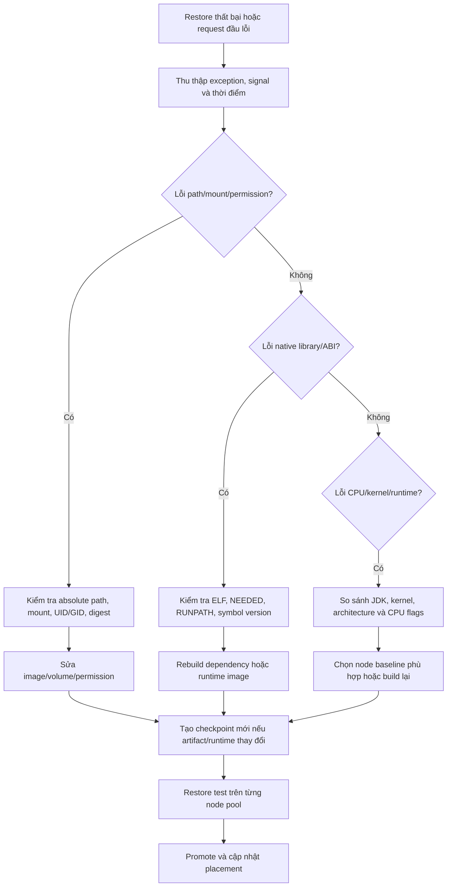

# Chẩn đoán đường dẫn, thư viện hoặc CPU không tương thích

Một checkpoint CRaC được tạo từ một tiến trình Java đã khởi tạo trong một môi trường cụ thể. Khi restore trên môi trường khác, JVM và ứng dụng có thể gặp lỗi nếu đường dẫn, mount, quyền truy cập file, thư viện native hoặc tập lệnh CPU không còn tương thích. Những lỗi này có thể xuất hiện ngay khi restore, trong callback `afterRestore()`, hoặc chỉ xuất hiện khi request đầu tiên gọi đến một nhánh code chưa từng chạy.

Không nên kết luận mọi lỗi restore đều do checkpoint bị hỏng. Một `NoSuchFileException` có thể do volume chưa mount hoặc đường dẫn tương đối thay đổi; `UnsatisfiedLinkError` có thể do thiếu thư viện phụ thuộc, sai kiến trúc hoặc ABI; `SIGILL` có thể do mã máy sử dụng instruction CPU mà node restore không hỗ trợ. Cần xác định lỗi xảy ra ở lớp nào và so sánh môi trường tạo checkpoint với môi trường restore.

Nguyên tắc chẩn đoán là thu thập bằng chứng trước khi thay đổi môi trường: xác nhận runtime/JDK, kiểm tra đường dẫn và mount, kiểm tra quyền file, phân tích native library và ABI, sau đó đối chiếu CPU architecture/instruction set. Dùng cùng một checkpoint và cùng một artifact khi thử nghiệm để mỗi lần chỉ thay đổi một yếu tố.

## 1. Những lớp tương thích cần kiểm tra

Một ứng dụng Java có thể phụ thuộc vào nhiều thứ ngoài bytecode:

| Lớp | Ví dụ | Dấu hiệu lỗi thường gặp |
|---|---|---|
| Checkpoint/runtime | JDK CRaC build, công cụ checkpoint/restore, kernel/runtime | Restore bị từ chối, lỗi runtime hoặc lỗi phục hồi tài nguyên |
| Filesystem path | File cấu hình, thư mục tạm, Unix socket, thư mục native library | `NoSuchFileException`, `FileNotFoundException`, `AccessDeniedException` |
| Mount/namespace | PVC, `emptyDir`, bind mount, container mount namespace | File có trên host nhưng không có trong container; đường dẫn bị volume che khuất |
| File descriptor/resource | File đang mở, socket, pipe, device, mmap | File handle không hợp lệ, lỗi I/O sau restore hoặc callback resource thất bại |
| Native library | JNI/JNA, Netty native transport, compression codec, driver native | `UnsatisfiedLinkError`, `dlopen` failure, symbol not found |
| ABI/runtime library | glibc/musl, `libstdc++`, OpenSSL, SONAME và symbol version | `GLIBC_x.y not found`, `undefined symbol`, version mismatch |
| CPU architecture | `x86_64`, `aarch64`, 32/64-bit, endianness | ELF class/machine mismatch hoặc không thể nạp thư viện |
| CPU instruction set | AVX, AVX2, AVX-512, NEON, AES, CRC hoặc extension khác | `SIGILL`, lỗi native code hoặc JVM/runtime không tương thích |
| Hệ điều hành/kernel | Kernel feature, page size, syscall, namespace | Lỗi restore hoặc native component hoạt động khác trên node mới |

Hãy kiểm tra cả môi trường tạo checkpoint và môi trường restore. Nếu chỉ thu thập thông tin sau restore, có thể thiếu bằng chứng về thư viện, path hoặc CPU features đã có khi tạo image.

## 2. Phân biệt lỗi xảy ra ở thời điểm nào

Thời điểm lỗi xuất hiện giúp thu hẹp phạm vi tìm kiếm.

| Thời điểm | Khả năng cần kiểm tra trước |
|---|---|
| Runtime từ chối bắt đầu restore | JDK/CRaC build, định dạng checkpoint, kernel, CPU/architecture và điều kiện runtime |
| Restore bắt đầu nhưng thất bại trước khi ứng dụng tiếp tục | File checkpoint, filesystem, mount, quyền truy cập, file descriptor hoặc runtime state |
| `afterRestore()` thất bại | Callback resource, config path, secret/certificate, native client hoặc dependency chưa sẵn sàng |
| Ứng dụng báo ready nhưng request đầu tiên thất bại | Lazy class loading, lazy native library load, file chỉ mở khi dùng, DNS hoặc endpoint |
| Chỉ một số node thất bại | Khác biệt kernel, CPU flags, architecture, mount, storage driver hoặc thư viện hệ thống |
| Chỉ một replica thất bại | Volume/permission riêng, node placement, file hỏng, thiếu disk/inode hoặc cấu hình instance |

Ghi nhận chính xác thời điểm và stack trace đầu tiên. Lỗi ở request đầu tiên có thể không liên quan đến restore core; nó có thể chỉ là lần đầu ứng dụng gọi `System.loadLibrary()`, đọc một file hoặc chạy code native trên CPU mới.

## 3. So sánh môi trường tạo checkpoint và restore

Trước khi thay đổi cấu hình, tạo một manifest môi trường ở cả hai phía. Manifest nên chứa thông tin đủ để so sánh nhưng không ghi secret.

Các thông tin quan trọng:

- Application build ID và digest của JAR/container image.
- JDK vendor, version, build và bản phân phối có CRaC.
- JVM startup options quan trọng.
- OS distribution, kernel version, architecture và page size.
- CPU model và flags liên quan.
- glibc hoặc musl version.
- Các native library và SONAME mà ứng dụng cần.
- Giá trị đường dẫn quan trọng, mount point và filesystem type.
- UID/GID, file mode và quyền truy cập thư mục.
- Phiên bản volume/secret/config được mount khi chạy.

Một số lệnh Linux hữu ích:

```bash
java -version
uname -a
uname -m
getconf LONG_BIT
getconf PAGESIZE
lscpu
ldd --version
```

Để xem thông tin CPU chi tiết hơn trên Linux:

```bash
grep -m1 -E '^(model name|Hardware|Features|flags)' /proc/cpuinfo
```

Lệnh và output có thể khác giữa x86_64, ARM64 và các bản phân phối Linux. Trong container, một số thông tin được phản ánh từ host kernel hoặc virtualized CPU. Hãy thu thập manifest từ đúng container/node mà tiến trình tạo checkpoint và đúng node mà tiến trình restore.

Không đưa toàn bộ `env` hoặc system properties vào log một cách không chọn lọc: chúng có thể chứa password, token hoặc connection string. Chỉ ghi allowlist các thuộc tính cần chẩn đoán và che giá trị nhạy cảm.

## 4. Chẩn đoán đường dẫn file không tồn tại hoặc thay đổi

### Đường dẫn tuyệt đối và tương đối

Đường dẫn tương đối được giải quyết dựa trên working directory của tiến trình hoặc cách API được gọi. Nếu ứng dụng được chạy từ `/opt/app` khi tạo checkpoint nhưng restore entrypoint chạy từ `/`, một đường dẫn như `config/runtime.yml` có thể trỏ đến vị trí khác.

Ví dụ:

```java
Path configured = Path.of("config/runtime.yml");
Path resolved = configured.toAbsolutePath().normalize();

System.out.println("user.dir=" + System.getProperty("user.dir"));
System.out.println("resolved config=" + resolved);
System.out.println("exists=" + Files.exists(resolved));
System.out.println("readable=" + Files.isReadable(resolved));
```

Với file bắt buộc, nên cấu hình đường dẫn tuyệt đối rõ ràng hoặc resolve từ một application home cố định. Đừng dựa vào working directory ngầm của shell, Dockerfile hay process supervisor.

### File có trên host nhưng không có trong container

Container có mount namespace riêng. Một file ở `/srv/config/app.yml` trên host không tự xuất hiện ở cùng đường dẫn bên trong container. File chỉ có thể được truy cập nếu nó nằm trong image filesystem hoặc được mount vào container.

Trong Kubernetes, volume mount có thể che khuất nội dung đã có trong image tại mount path. Ví dụ image chứa `/opt/app/config/default.yml`, nhưng PVC được mount vào `/opt/app/config`; nếu PVC rỗng, file `default.yml` trong image có thể không còn nhìn thấy từ container.

Hãy kiểm tra:

```bash
pwd
findmnt -T /opt/app/config
mount
df -h /opt/app/config
df -i /opt/app/config
```

`findmnt -T` cho biết filesystem chứa đường dẫn cụ thể. `df -h` kiểm tra dung lượng, còn `df -i` kiểm tra inode. Hết inode có thể khiến ứng dụng không tạo được file dù dung lượng byte vẫn còn.

### Symlink và path traversal

Một symlink có thể trỏ tới target khác sau khi volume hoặc image thay đổi. Hãy kiểm tra target thực tế:

```bash
readlink -f /opt/app/lib/libcodec.so
namei -l /opt/app/lib/libcodec.so
stat /opt/app/lib/libcodec.so
```

`namei -l` hiển thị quyền của từng thành phần thư mục trên đường dẫn. Để truy cập file, tiến trình cần quyền execute/search trên các thư mục cha và quyền phù hợp trên file. Chỉ kiểm tra `ls -l` của file cuối cùng có thể bỏ sót thư mục cha không cho phép traverse.

### Nội dung file khác dù path giống nhau

Một đường dẫn tuyệt đối giống nhau không bảo đảm file có cùng nội dung. Volume có thể được cập nhật, symlink có thể trỏ sang release khác hoặc init container có thể copy nhầm artifact. Với file cấu hình, thư viện native hoặc resource quan trọng, ghi nhận digest:

```bash
sha256sum /opt/app/config/runtime.yml
sha256sum /opt/app/lib/libcodec.so
```

So sánh digest với manifest của checkpoint. Không thay file hoặc mount bên dưới một tiến trình đã checkpoint để cố sửa lỗi; hãy tạo artifact/version mới và kiểm tra lại.

## 5. Kiểm tra quyền file và thư mục

`AccessDeniedException` hoặc `Permission denied` có thể do UID/GID khác nhau giữa builder và runtime, quyền thư mục cha, ACL, SELinux, AppArmor hoặc mount read-only.

Kiểm tra danh tính tiến trình:

```bash
id
id appuser
ps -o pid,uid,gid,comm -p <PID>
```

Kiểm tra quyền của đường dẫn:

```bash
namei -l /var/lib/app/checkpoint/metadata
stat -c '%A %a %U:%G %n' /var/lib/app/checkpoint
getfacl /var/lib/app/checkpoint
```

Nếu dùng Kubernetes, xem `runAsUser`, `runAsGroup`, `fsGroup`, `readOnlyRootFilesystem`, `volumeMounts.readOnly` và CSI driver. `fsGroup` không được mọi loại volume xử lý giống nhau; cần xác minh quyền thực tế bên trong container bằng đúng UID chạy JVM.

Các nguyên tắc:

- Thư mục cần traverse phải có quyền `x` cho user/group phù hợp.
- File cấu hình/native library cần quyền read.
- Thư mục tạm hoặc runtime cần quyền write nếu ứng dụng tạo file ở đó.
- Checkpoint nguồn bất biến nên được mount read-only nếu runtime cho phép.
- Nếu runtime cần working directory writable, tách bản copy/working directory khỏi artifact nguồn.
- Không dùng `chmod -R 777` để xử lý lỗi quyền; xác định đúng owner/group và mode cần thiết.

Với SELinux/AppArmor, file mode có thể trông đúng nhưng policy vẫn chặn truy cập. Kiểm tra audit log của host và policy label tương ứng thay vì vô hiệu hóa cơ chế bảo vệ trên toàn node.

## 6. File descriptor và resource phụ thuộc filesystem

Một tiến trình có thể giữ file descriptor mở trước checkpoint. Sau restore, ứng dụng có thể tiếp tục dùng descriptor đã được phục hồi theo khả năng runtime, nhưng đường dẫn có thể đã đổi, mount có thể khác hoặc resource cần được mở lại theo lifecycle.

Những resource thường cần xem xét:

- File log và file audit đang mở.
- Unix domain socket hoặc named pipe.
- File lock và lock file.
- File memory-mapped (`MappedByteBuffer`).
- File tạm do thư viện tạo.
- Device file hoặc mount đặc biệt.
- File chứa credential, certificate hoặc cấu hình được reload.

Trên Linux, có thể quan sát descriptor của một process đang chạy:

```bash
ls -l /proc/<PID>/fd
cat /proc/<PID>/maps
```

`/proc/<PID>/fd` hiển thị descriptor đang mở và target mà kernel báo cáo; `maps` cho biết vùng memory mapping, trong đó có thể thấy thư viện native đã map. Đây là dữ liệu chẩn đoán tại thời điểm lệnh chạy, không phải bằng chứng rằng mọi descriptor sẽ được restore hợp lệ.

Nếu ứng dụng dùng file lock để điều phối nhiều instance, cần xác minh lock semantics sau restore. Một lock trong heap hoặc một file lock đã mở không nên được coi là lease phân tán còn hiệu lực. Với tài nguyên bên ngoài, dùng CRaC `Resource` callback hoặc integration được hỗ trợ để đóng trước checkpoint và mở/đăng ký lại sau restore.

Ví dụ resource quản lý file handle:

```java
import org.crac.Context;
import org.crac.Core;
import org.crac.Resource;

import java.nio.channels.FileChannel;
import java.nio.file.Path;
import java.nio.file.StandardOpenOption;

public final class FileResource implements Resource {

    private final Path file;
    private FileChannel channel;

    public FileResource(Path file) throws Exception {
        this.file = file.toAbsolutePath().normalize();
        this.channel = openChannel();
        Core.getGlobalContext().register(this);
    }

    private FileChannel openChannel() throws Exception {
        return FileChannel.open(file,
                StandardOpenOption.READ,
                StandardOpenOption.WRITE);
    }

    @Override
    public void beforeCheckpoint(Context<? extends Resource> context)
            throws Exception {
        if (channel != null && channel.isOpen()) {
            channel.close();
            channel = null;
        }
    }

    @Override
    public void afterRestore(Context<? extends Resource> context)
            throws Exception {
        channel = openChannel();
    }
}
```

Ví dụ minh họa cho file mà ứng dụng có thể mở lại bằng path. Nếu file được thay đổi trong lúc tiến trình tạm dừng, ứng dụng cần kiểm tra version/digest hoặc semantics nghiệp vụ trước khi tiếp tục. Với file log, database file hoặc file lock, dùng cơ chế riêng của thư viện thay vì áp dụng nguyên mẫu này.

## 7. Chẩn đoán lỗi nạp thư viện native

Java bytecode có tính portable hơn mã native, nhưng ứng dụng có thể phụ thuộc vào thư viện `.so` trên Linux thông qua JNI, JNA hoặc thư viện trung gian. Ví dụ thường gặp:

- JDBC driver có thành phần native hoặc phụ thuộc OpenSSL.
- Netty native transport như epoll/kqueue.
- Compression codec, image processing hoặc cryptography native.
- Thư viện gọi JNI/JNA do ứng dụng hoặc vendor cung cấp.
- Native agent hoặc profiler.

Lỗi thường thấy là `java.lang.UnsatisfiedLinkError`, nhưng nguyên nhân có thể rất khác nhau:

| Dấu hiệu | Khả năng |
|---|---|
| `no foo in java.library.path` | JVM không tìm thấy file `libfoo.so` theo cơ chế tìm library của Java |
| `libbar.so: cannot open shared object file` | Tìm thấy thư viện chính nhưng dynamic loader không tìm thấy dependency `libbar.so` |
| `wrong ELF class` | 32-bit/64-bit không khớp |
| `ELF file data encoding not little-endian` hoặc machine mismatch | Sai architecture/endianness |
| `undefined symbol` | Thư viện phụ thuộc thiếu symbol hoặc không tương thích ABI/version |
| `GLIBC_x.y not found` | Thư viện được build yêu cầu glibc mới hơn môi trường restore |
| `version 'OPENSSL_x' not found` | OpenSSL ABI/version không phù hợp |
| `SIGILL` khi gọi native method | Có thể native binary dùng CPU instruction không được hỗ trợ |

### Java library path và dynamic loader path là hai lớp khác nhau

`System.loadLibrary("codec")` dùng cơ chế tìm thư viện native của JVM, liên quan đến `java.library.path` và quy tắc tên thư viện nền tảng, ví dụ `libcodec.so` trên Linux. Sau khi tìm được thư viện chính, dynamic loader của hệ điều hành còn phải tìm các thư viện phụ thuộc mà file ELF khai báo.

Do đó, `java.library.path` đúng chưa chắc đủ. Thư viện chính có thể tồn tại nhưng dependency như `libstdc++.so.6`, `libssl.so` hoặc một SONAME riêng không có trong runtime image.

Kiểm tra từ Java:

```java
System.out.println("java.library.path=" +
        System.getProperty("java.library.path"));
System.out.println("os.name=" + System.getProperty("os.name"));
System.out.println("os.arch=" + System.getProperty("os.arch"));
System.out.println("java.home=" + System.getProperty("java.home"));
```

Kiểm tra file native:

```bash
file /opt/app/lib/libcodec.so
readelf -h /opt/app/lib/libcodec.so
readelf -d /opt/app/lib/libcodec.so
```

`readelf -h` cho biết ELF class, machine và encoding. `readelf -d` cho biết `NEEDED`, `RPATH` hoặc `RUNPATH`. Đây là cách kiểm tra metadata ELF mà không cần thực thi binary.

`ldd` có thể hữu ích với binary tin cậy để hiển thị dependency được resolve trong môi trường hiện tại:

```bash
ldd /opt/app/lib/libcodec.so
```

Không dùng `ldd` một cách mù quáng với binary không tin cậy; tùy loại executable và hệ thống, cách triển khai có thể tương tác với loader. Với artifact chưa tin cậy, ưu tiên `readelf -d` hoặc công cụ phân tích ELF tĩnh trước.

### Kiểm tra dependency bị thiếu

Trên Linux, dynamic loader có thể tìm thư viện theo các nguồn như `RPATH`/`RUNPATH`, `LD_LIBRARY_PATH`, cache `ldconfig` và các thư mục mặc định. Thứ tự chi tiết phụ thuộc loader, loại tag và cách thư viện được nạp.

Các lệnh:

```bash
ldconfig -p | grep -E 'libssl|libcrypto|libstdc\+\+'
readelf -d /opt/app/lib/libcodec.so | grep -E 'NEEDED|RPATH|RUNPATH'
```

Nếu cần quan sát loader tìm thư viện thế nào, có thể chạy một tiến trình chẩn đoán mới với `LD_DEBUG=libs`:

```bash
LD_DEBUG=libs java -jar app.jar
```

Đây là biến môi trường cần có khi process được khởi chạy. Không nên kỳ vọng có thể bật nó cho một tiến trình đã restore bằng cách đổi shell environment bên ngoài. Output có thể rất lớn và chứa path nội bộ; chỉ bật trong môi trường test, lưu log có kiểm soát.

### Kiểm tra ABI và symbol version

Một thư viện có thể đúng architecture nhưng vẫn không tương thích ABI. Ví dụ, binary build trên distribution mới có thể tham chiếu `GLIBC_2.xx`, trong khi runtime image có glibc cũ hơn. Hoặc library yêu cầu symbol của OpenSSL/libstdc++ mà bản runtime không cung cấp.

Có thể kiểm tra version requirement bằng:

```bash
readelf --version-info /opt/app/lib/libcodec.so
objdump -T /opt/app/lib/libcodec.so | grep -E 'GLIBC_|GLIBCXX_|OPENSSL_'
```

Đối chiếu yêu cầu trong binary với thư viện thật có trong runtime image. Không giải quyết bằng cách copy ngẫu nhiên một file `.so` từ máy khác vào production; hãy build hoặc chọn package tương thích với base image và khóa dependency.

## 8. Sai kiến trúc hoặc định dạng native binary

Một thư viện build cho `x86_64` không thể được nạp trực tiếp trong tiến trình `aarch64`, và ngược lại. Tương tự, ELF 32-bit và 64-bit cần ABI tương ứng.

Kiểm tra architecture của tiến trình và thư viện:

```bash
uname -m
file /opt/app/lib/libcodec.so
readelf -h /opt/app/lib/libcodec.so | grep -E 'Class:|Data:|Machine:'
```

Các cặp phổ biến:

| Runtime/host | Native binary cần tương thích |
|---|---|
| Linux `x86_64` | ELF 64-bit, machine AMD x86-64 |
| Linux `aarch64` | ELF 64-bit, machine AArch64 |
| Linux `i686`/x86 32-bit | ELF 32-bit x86 và ABI 32-bit tương ứng |
| ARM 32-bit | ARM ELF/ABI phù hợp với CPU và user space |

Không chỉ kiểm tra architecture của container image manifest. Kiểm tra cả binary native được đóng gói bên trong JAR, thư mục `lib`, thư viện được tải từ plugin hoặc file được mount runtime. Một multi-architecture image có thể có manifest đúng nhưng vẫn chứa một `.so` chỉ build cho architecture khác.

Nếu ứng dụng hỗ trợ nhiều architecture, hãy build và kiểm thử native library riêng cho từng architecture, hoặc dùng thư viện thuần Java khi phù hợp. Không giả định emulation layer làm cho checkpoint portable giữa hai kiến trúc; trạng thái tiến trình và mã máy đã tạo có thể phụ thuộc CPU/runtime thực tế.

## 9. CPU instruction set không tương thích

Hai node đều có thể báo `x86_64` nhưng không hỗ trợ cùng tập instruction. Một node có AVX2, node khác không có; một node có AVX-512, node khác chỉ có AVX; CPU ARM có thể khác extension. Nếu JIT hoặc native library tạo mã dùng instruction không được CPU restore hỗ trợ, tiến trình có thể gặp `SIGILL` (illegal instruction) khi thực thi đoạn code đó.

Đây là một nguyên nhân quan trọng khiến checkpoint không nên được phân phối tùy tiện giữa các node cùng architecture nhưng khác CPU feature set.

Kiểm tra CPU trên Linux:

```bash
lscpu
grep -m1 -E '^(flags|Features)' /proc/cpuinfo
```

Trên x86, chú ý các flag liên quan như `sse4_2`, `avx`, `avx2`, `avx512*`, `aes` hoặc những extension mà native library yêu cầu. Trên ARM64, chú ý `asimd`/NEON, crypto hoặc extension liên quan. Tên flag và cách kernel hiển thị có thể khác nhau.

### Phân biệt architecture với instruction set

- `uname -m` cho biết kiến trúc mà kernel/container đang báo.
- ELF `Machine` cho biết kiến trúc binary được build.
- CPU flags cho biết các instruction/extension có thể được hỗ trợ trên host.
- JDK/JIT quyết định cách sử dụng feature CPU theo runtime và cấu hình.
- Native library có thể tự phát hiện feature hoặc chứa code path yêu cầu feature cụ thể.

Tất cả các lớp này cần phù hợp. Chỉ thấy `x86_64` ở hai nơi không chứng minh hai node có cùng tập instruction.

### Xử lý `SIGILL`

Nếu process dừng với `Illegal instruction` hoặc exit do signal 4, cần xác định địa chỉ instruction gây lỗi và thư viện chứa code đó. Dùng core dump, debugger hoặc symbolized stack nếu môi trường cho phép. So sánh CPU flags của node tạo checkpoint và node restore. Nếu lỗi xuất hiện trong JIT code, kiểm tra JDK build và các tùy chọn CPU mà JVM hỗ trợ. Nếu lỗi nằm trong native library, kiểm tra cách thư viện dispatch instruction và yêu cầu CPU.

Không tự thêm JVM flag như `-XX:UseAVX=0` để chữa mọi `SIGILL`. Tùy chọn và mức hỗ trợ phụ thuộc JDK/architecture; nó có thể ảnh hưởng hiệu năng nhưng không sửa một native library tự phát lệnh AVX2. Hãy dùng baseline CPU được hỗ trợ hoặc build native library với feature target phù hợp.

## 10. JDK, kernel và môi trường restore

Checkpoint có thể phụ thuộc JDK CRaC build, kernel feature và cách runtime tích hợp với cơ chế checkpoint/restore. Khi restore thất bại trên một node, so sánh tối thiểu:

- JDK vendor/version/build ở builder và runtime.
- CRaC API/runtime implementation và các option được dùng.
- Kernel version và cấu hình liên quan.
- Container runtime, CRIU hoặc helper tương ứng nếu triển khai sử dụng.
- CPU architecture và feature set.
- Page size, memory layout và các giới hạn hệ thống có liên quan.
- Native libraries và ABI trong image.

Không giả định checkpoint tạo bởi một JDK CRaC có thể được restore bởi bất kỳ JDK cùng major version nào. Dùng đúng runtime được hỗ trợ và khóa digest của base image. Nếu nâng JDK, kernel hoặc thư viện native, tạo checkpoint mới và chạy restore test trên node pool mục tiêu.

## 11. Dùng Java để in thông tin chẩn đoán an toàn

Một endpoint nội bộ hoặc startup diagnostic có thể in một số thông tin môi trường không nhạy cảm để đối chiếu. Không expose endpoint này công khai và không in environment variable/system property không được allowlist.

```java
import java.nio.file.Files;
import java.nio.file.Path;
import java.util.List;

public final class RuntimeDiagnostics {

    public static void print() {
        System.out.println("java.version=" + System.getProperty("java.version"));
        System.out.println("java.vendor=" + System.getProperty("java.vendor"));
        System.out.println("java.home=" + System.getProperty("java.home"));
        System.out.println("os.name=" + System.getProperty("os.name"));
        System.out.println("os.arch=" + System.getProperty("os.arch"));
        System.out.println("user.dir=" + System.getProperty("user.dir"));
        System.out.println("java.library.path=" +
                System.getProperty("java.library.path"));

        List<Path> requiredPaths = List.of(
                Path.of("/opt/app/config/runtime.yml"),
                Path.of("/opt/app/lib/libcodec.so"),
                Path.of("/var/lib/app/runtime"));

        for (Path path : requiredPaths) {
            Path resolved = path.toAbsolutePath().normalize();
            System.out.printf("path=%s exists=%s readable=%s writable=%s%n",
                    resolved,
                    Files.exists(resolved),
                    Files.isReadable(resolved),
                    Files.isWritable(resolved));
        }
    }
}
```

Các path trong ví dụ là placeholder cần thay bằng danh sách allowlist của ứng dụng. `Files.isReadable()`/`isWritable()` là phép kiểm tra tại thời điểm gọi; chúng không bảo đảm thao tác sau đó chắc chắn thành công vì mount hoặc quyền có thể thay đổi. Với file bắt buộc, nên thử mở file theo cách ứng dụng thực sự sử dụng và xử lý lỗi cụ thể.

Không in `System.getenv()` toàn bộ, `System.getProperties()` toàn bộ hoặc command line đầy đủ nếu chúng có thể chứa secret. Nên ghi build ID, checkpoint ID và node identity đã được làm sạch để liên kết log.

## 12. Quy trình chẩn đoán theo từng bước

Khi restore lỗi, hãy làm theo thứ tự để tránh thay đổi quá nhiều yếu tố cùng lúc.

### Bước 1: Ghi lại lỗi gốc và thời điểm lỗi

- Thu thập exit code, signal, exception đầu tiên và stack trace đầy đủ.
- Xác định lỗi xảy ra trong runtime restore, callback, startup tiếp tục hay request đầu tiên.
- Ghi checkpoint ID, application build, JDK build và node/Pod identity.
- Giữ lại log trước và sau checkpoint; tránh chỉ lấy phần cuối đã bị mất nguyên nhân ban đầu.

### Bước 2: Xác nhận đúng artifact và runtime

- Kiểm tra application digest và checkpoint ID mà Pod thực sự sử dụng.
- Xác nhận JDK vendor/build, option restore và đường dẫn checkpoint.
- So sánh runtime/container image với môi trường đã tạo checkpoint.
- Xác nhận không có tag mutable hoặc volume path trỏ nhầm release.

### Bước 3: Kiểm tra path, mount và permission

- In `user.dir` và resolve các path tương đối thành absolute path.
- Dùng `findmnt -T`, `namei -l`, `stat`, `df -h` và `df -i`.
- Xác nhận volume mount đã sẵn sàng và không che khuất file trong image.
- Xác nhận UID/GID, mode, ACL và policy LSM.
- So sánh digest của config/native file với manifest.

### Bước 4: Kiểm tra native library

- Dùng `file` và `readelf -h` xác nhận ELF class/machine.
- Dùng `readelf -d` xem `NEEDED`, `RPATH`, `RUNPATH`.
- Dùng `ldd` chỉ với binary tin cậy để xem dependency được resolve.
- Dùng `readelf --version-info` hoặc `objdump -T` để kiểm tra ABI/symbol version.
- Xác nhận thư viện và dependency tồn tại trong đúng container filesystem.

### Bước 5: Kiểm tra CPU và kernel

- So sánh `uname -m`, `lscpu`, `/proc/cpuinfo` giữa node tạo và node restore.
- Kiểm tra CPU flags mà native library/JIT code yêu cầu.
- Nếu có `SIGILL`, xác định instruction và thư viện/đoạn code phát sinh.
- So sánh kernel, page size và runtime/CRIU compatibility.

### Bước 6: Tạo phép thử tối thiểu

- Restore cùng checkpoint trên node tương thích đã biết để xác định lỗi có gắn với node hay không.
- Chạy application artifact mới theo cold start trên node lỗi để phân biệt lỗi ứng dụng với lỗi checkpoint.
- Dùng cùng image/checkpoint, chỉ thay một biến: mount, library path, node pool hoặc runtime.
- Ghi lại kết quả trước khi thay đổi tiếp.

### Bước 7: Khắc phục ở nguồn và tạo image mới nếu cần

- Sửa Dockerfile/base image, dependency package, mount hoặc quyền.
- Build lại native library cho đúng ABI/architecture/CPU baseline.
- Nếu thay code, JDK, native library hoặc cấu hình startup quan trọng, tạo checkpoint mới.
- Chạy restore test trên tất cả nhóm node được phép nhận workload.
- Cập nhật node affinity/placement để ngăn checkpoint chạy trên node chưa tương thích.

## 13. Bảng ánh xạ lỗi sang hướng điều tra

| Thông báo/dấu hiệu | Kiểm tra đầu tiên | Hướng khắc phục thường gặp |
|---|---|---|
| `NoSuchFileException` | Absolute path, `user.dir`, mount và volume path | Sửa path, mount đúng volume hoặc đóng gói file cần thiết |
| `Permission denied` | UID/GID, `namei -l`, ACL, SELinux/AppArmor, read-only mount | Cấp đúng quyền cho file/thư mục hoặc sửa policy mount |
| File có trên host nhưng mất trong container | Mount namespace và `findmnt -T` | Mount file/volume đúng vị trí; kiểm tra volume có che nội dung image không |
| `no ... in java.library.path` | `java.library.path`, tên file, architecture | Đưa thư viện chính vào path đúng hoặc cấu hình loader phù hợp |
| `cannot open shared object file` | Dependency `NEEDED`, loader path, `ldconfig` | Cài package dependency đúng phiên bản trong runtime image |
| `wrong ELF class` | `file`, `readelf -h`, 32/64-bit | Build/chọn native binary đúng ABI |
| `Exec format error` hoặc machine mismatch | ELF `Machine`, architecture | Dùng binary đúng architecture và image manifest tương ứng |
| `undefined symbol` | SONAME, symbol table, ABI/version | Đồng bộ dependency; rebuild native library với ABI tương thích |
| `GLIBC_x.y not found` | glibc version và symbol requirement | Build trên baseline tương thích hoặc cập nhật runtime base image |
| `Illegal instruction` / `SIGILL` | CPU flags, core dump, instruction và native library | Giới hạn node vào CPU baseline phù hợp hoặc build code target thấp hơn |
| Chỉ một node restore thất bại | CPU, kernel, mount, storage, node labels | Sửa node pool hoặc ràng buộc scheduling |
| Chỉ request đầu tiên thất bại | Lazy native load, file/resource mở muộn | Warm-up/validate dependency hoặc xử lý lazy initialization sau restore |

Thông báo lỗi có thể được bọc bởi framework hoặc native wrapper. Luôn tìm exception/cause gốc thay vì chỉ dựa vào thông điệp ngoài cùng.

## 14. Kiểm tra đường dẫn trong container và Kubernetes

Với Kubernetes, một số lỗi path chỉ xảy ra trên Pod cụ thể do PVC, `subPath`, init container hoặc `securityContext`.

Các câu hỏi cần trả lời:

- Volume đã được attach và mount trước khi container restore chưa?
- Init container đã tải/copy checkpoint hoàn tất chưa?
- `mountPath` có trùng thư mục chứa application resource trong image không?
- `subPath` có trỏ tới thư mục đúng release không?
- PVC có access mode phù hợp với số replica và node không?
- `readOnly: true` có khiến runtime không ghi được file phụ cần thiết không?
- `runAsUser`, `runAsGroup` và `fsGroup` có khớp ownership trên volume không?
- Pod có bị schedule sang node khác architecture/CPU/kernel baseline không?

Đối với volume checkpoint nguồn, nên dùng thư mục versioned bất biến và mount read-only nếu runtime hỗ trợ. Nếu runtime cần ghi, copy checkpoint vào working directory riêng của Pod. Không để nhiều replica đồng thời sửa một checkpoint directory chung.

Ví dụ kiểm tra trong Pod:

```bash
id
pwd
findmnt -T /opt/app/checkpoint
namei -l /opt/app/checkpoint
df -h /opt/app/checkpoint
df -i /opt/app/checkpoint
find /opt/app/checkpoint -maxdepth 2 -type f -printf '%m %u:%g %p\n' | head -50
```

Lệnh `find` ở đây chỉ liệt kê metadata file; không in nội dung checkpoint. Hạn chế quyền exec/debug vào production Pod và tuân thủ chính sách truy cập vận hành.

## 15. Kiểm tra native library được nạp lười

Một số thư viện chỉ gọi `System.loadLibrary()` khi một tính năng được dùng lần đầu. Vì vậy, ứng dụng có thể restore và báo ready thành công, nhưng request đầu tiên dùng codec hoặc native transport mới gặp `UnsatisfiedLinkError`.

Để phát hiện sớm:

- Xác định native feature nào được sử dụng trên các route quan trọng.
- Chạy smoke test sau restore để kích hoạt các feature đó.
- Kiểm tra thư viện native và dependency trên đúng base image production.
- Ghi nhận library version và architecture trong startup manifest.
- Không chỉ warm-up Java method nếu native library chưa được load.

Không nhất thiết load mọi native library trong mọi replica. Chỉ chuẩn bị những feature thuộc phạm vi phục vụ và bảo đảm việc load không tạo side effect hoặc resource không thể phục hồi.

## 16. CPU heterogeneity trong cluster

Cluster có thể gồm nhiều thế hệ CPU hoặc nhiều loại instance. Scheduler thường chỉ biết label architecture như `amd64`/`arm64`; nó không nhất thiết biết node có AVX2, AVX-512 hoặc extension cụ thể mà checkpoint cần.

Một chiến lược vận hành:

1. Xác định CPU feature baseline được hỗ trợ cho checkpoint.
2. Gắn label node pool theo loại CPU/feature đã kiểm chứng.
3. Chạy restore test trên từng node pool.
4. Dùng node affinity/selector hoặc scheduler policy để chỉ đặt Pod lên node phù hợp.
5. Nếu cần hỗ trợ nhiều baseline, tạo checkpoint/runtime image riêng cho từng nhóm và đặt metadata rõ ràng.
6. Theo dõi lỗi `SIGILL` và node placement sau mỗi lần thay đổi node pool.

Ví dụ Kubernetes node selector theo label do cluster quản lý:

```yaml
spec:
  nodeSelector:
    kubernetes.io/arch: amd64
    crac.cpu-baseline: x86-64-v2
```

Label `crac.cpu-baseline` là ví dụ; cluster cần gắn nó dựa trên inventory và kiểm thử thực tế. Không nên tự gắn label chỉ dựa vào tên instance hoặc một CPU flag quan sát trên một node.

Nếu checkpoint được tạo với CPU feature cao hơn baseline của node restore, chọn node phù hợp hoặc tạo checkpoint mới trên baseline thấp hơn đã được hỗ trợ. Không có tùy chọn Java chung nào có thể chuyển mọi đoạn mã máy đã lưu sang một CPU architecture khác.

## 17. Kiểm thử tương thích trước khi phát hành checkpoint

Checkpoint nên được kiểm tra trên toàn bộ nhóm môi trường mà deployment có thể sử dụng.

Một ma trận thử nghiệm tham khảo:

| Thành phần | Builder | Restore target | Assertion |
|---|---|---|---|
| JDK/CRaC | Build cụ thể đã pin | Cùng build được hỗ trợ | Restore thành công và runtime version đúng |
| OS/kernel | Node pool tạo image | Từng node pool mục tiêu | Restore và callback resource thành công |
| Architecture | `amd64` hoặc `arm64` | Cùng architecture được hỗ trợ | ELF và JVM architecture phù hợp |
| CPU baseline | Feature set đã ghi | Node có baseline bằng/cao hơn theo policy | Không `SIGILL`; native/JIT smoke test thành công |
| Filesystem | Checkpoint staging | Image layer/PVC/working copy | File đủ, path đúng, digest khớp |
| Permission | Builder UID/GID | Runtime UID/GID | Đọc được checkpoint và tạo được file runtime cần thiết |
| Native dependency | Bộ `.so` đã khóa | Runtime base image | Không thiếu SONAME/symbol/ABI |

Các test nên chạy trước khi artifact được promote. Nếu một node pool không tương thích, loại nó khỏi placement policy hoặc tạo artifact riêng; không để lỗi chỉ xuất hiện khi autoscaler đưa replica tới node đó.

## 18. Các lỗi thường gặp

### Chỉ kiểm tra file có tồn tại

`Files.exists()` không chứng minh file đọc được, đúng nội dung hoặc đúng filesystem. Kiểm tra path, permission, digest và thử thao tác thực tế.

### Giả định path giống nhau nghĩa là cùng file

Volume có thể che thư mục image, symlink có thể trỏ sang target khác và nội dung có thể đã thay đổi. Kiểm tra mount source và checksum.

### Chỉ kiểm tra `java.library.path`

Thư viện chính có thể được tìm thấy nhưng dependency của nó thiếu hoặc ABI không khớp. Phân tích ELF `NEEDED`, RUNPATH và symbol version.

### Copy `.so` từ một host khác để chữa lỗi

File có thể khác glibc, OpenSSL, libstdc++, architecture hoặc ABI. Build/package dependency từ base image tương thích và khóa version.

### Coi mọi node `x86_64` là tương đương

Instruction set có thể khác. Dùng CPU baseline đã xác minh và node placement phù hợp.

### Chỉ test startup, không test request đầu tiên

Native library hoặc file có thể được load lười. Chạy smoke test các route/feature quan trọng sau restore.

### Thay file dưới checkpoint đang dùng

Tiến trình có thể giữ class, mapping hoặc descriptor cũ trong khi lần đọc mới thấy nội dung khác. Dùng artifact bất biến và tạo checkpoint mới sau thay đổi.

### Sửa lỗi bằng quyền root hoặc privileged rộng

Điều đó che khuất nguyên nhân và mở rộng phạm vi ảnh hưởng. Xác định đúng UID/GID, capability và filesystem policy cần thiết.

### Chỉ thử trên một node

Không phát hiện CPU/kernel/mount khác biệt trong cluster. Kiểm tra trên mọi node pool được phép nhận checkpoint.

## 19. Quy trình khắc phục và phát hành lại

Khi xác định checkpoint không tương thích với một path, library hoặc CPU baseline, hãy sửa nguyên nhân ở artifact/runtime và tạo image mới nếu trạng thái tiến trình hoặc dependency đã thay đổi.



Nếu chỉ là volume mount tạm thời bị thiếu, có thể sửa deployment và thử lại cùng checkpoint sau khi xác minh artifact vẫn nguyên vẹn và runtime hỗ trợ môi trường mới. Nếu thay JDK, native library, code, resource đóng gói hoặc startup configuration, hãy tạo checkpoint mới từ tiến trình đã khởi tạo với các thành phần đó.

## 20. Checklist chẩn đoán

- [ ] Ghi nhận lỗi gốc, thời điểm lỗi và checkpoint/application build ID.
- [ ] Xác nhận JDK/CRaC vendor, version, build và runtime option.
- [ ] So sánh OS/kernel, architecture, page size và CPU flags.
- [ ] Xác nhận working directory và resolve path tương đối.
- [ ] Xác nhận volume đã mount đúng và không che khuất file trong image.
- [ ] Kiểm tra symlink, owner, mode, ACL, SELinux/AppArmor và read-only mount.
- [ ] Kiểm tra dung lượng và inode của filesystem.
- [ ] So sánh checksum của config, checkpoint và native library.
- [ ] Dùng `file`/`readelf` kiểm tra ELF class, machine, NEEDED, RPATH/RUNPATH.
- [ ] Kiểm tra dependency loader, glibc/musl và symbol version.
- [ ] Nếu có `SIGILL`, xác định instruction và đối chiếu CPU baseline.
- [ ] Chạy smoke test các tính năng có lazy native loading sau restore.
- [ ] Kiểm thử trên mọi node pool mà scheduler có thể chọn.
- [ ] Tạo checkpoint mới nếu code/runtime/native dependency hoặc startup environment đã thay đổi.
- [ ] Không ghi secret hoặc nội dung heap nhạy cảm vào log chẩn đoán.

## 21. Kết luận

Lỗi đường dẫn, thư viện hoặc CPU sau CRaC restore thường xuất phát từ khác biệt giữa môi trường đã tạo checkpoint và môi trường đang phục hồi. Đường dẫn có thể thay đổi do working directory, mount namespace, symlink hoặc permission. Native library có thể thiếu dependency, sai ELF architecture, không khớp glibc/ABI hoặc yêu cầu symbol không có trong runtime. Hai node cùng `x86_64` vẫn có thể khác CPU instruction set và gây `SIGILL` khi JVM hoặc native code thực thi.

Hãy chẩn đoán theo lớp: xác định thời điểm lỗi, so sánh runtime manifest, kiểm tra path/mount/permission, phân tích native dependency và đối chiếu CPU/kernel. Dùng `namei`, `findmnt`, `stat`, `file`, `readelf`, `ldd` trên binary tin cậy, `lscpu` và `/proc/cpuinfo` để thu thập bằng chứng. Giữ application/checkpoint artifact bất biến, kiểm thử trên từng node pool và ràng buộc scheduling theo baseline tương thích. Khi thay code, JDK, native library hoặc môi trường startup, tạo checkpoint mới từ đúng artifact và runtime đã được xác minh.
