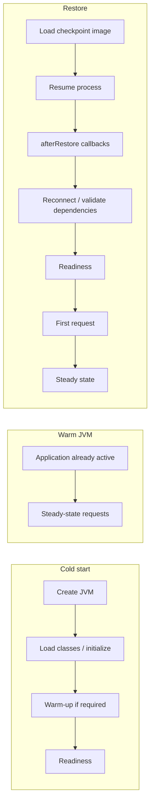

# So sánh khởi động lạnh, JVM đã làm nóng và tiến trình vừa restore

Khi đánh giá CRaC, thời gian JVM bắt đầu chạy không phải chỉ số duy nhất cần quan tâm. Một tiến trình có thể restore rất nhanh nhưng vẫn cần thời gian kết nối lại database, mở HTTP client, nạp cache hoặc chờ worker sẵn sàng. Ngược lại, một JVM đã chạy lâu và được làm nóng có thể phục vụ request rất nhanh, nhưng trạng thái đó không đại diện cho thời gian khởi động của một instance mới.

Để đánh giá đúng, cần so sánh ba trạng thái riêng biệt:

1. **Khởi động lạnh (cold start):** tạo JVM mới và khởi tạo ứng dụng từ đầu, không sử dụng trạng thái tiến trình đã checkpoint.
2. **JVM đã làm nóng (warm JVM):** cùng ứng dụng đang chạy, đã nạp class, thực thi workload đại diện, làm nóng JIT và cache; tiến trình vẫn hoạt động liên tục.
3. **Tiến trình vừa restore:** khôi phục từ checkpoint được tạo sau giai đoạn chuẩn bị/warm-up; JVM tiếp tục từ trạng thái đã lưu và thực hiện các bước phục hồi tài nguyên.

Ba trạng thái này trả lời ba câu hỏi khác nhau. Cold start cho biết chi phí tạo instance mới. Warm JVM cho biết mức hiệu năng khi ứng dụng đã ổn định. Restore cho biết có thể đưa một instance đã chuẩn bị trước trở lại phục vụ nhanh đến đâu và phải trả thêm chi phí gì để khôi phục tài nguyên.

## 1. Phân biệt ba trạng thái trước khi đo

### 1.1. Khởi động lạnh

Cold start bắt đầu khi tiến trình JVM mới được tạo. Ứng dụng phải thực hiện các công việc như:

- Khởi tạo JVM và runtime libraries.
- Nạp class, tạo metadata và khởi tạo static state.
- Tạo ApplicationContext hoặc container của framework.
- Tạo singleton, proxy, serializer, mapper và component.
- Đọc cấu hình, secret và remote configuration.
- Tạo connection pool hoặc kết nối tới dependency nếu startup yêu cầu.
- Chạy warm-up cần thiết trước khi readiness được bật.

Cold start không nhất thiết có nghĩa toàn bộ máy vật lý vừa reboot hoặc OS page cache hoàn toàn rỗng. Trong benchmark ứng dụng, thường nên định nghĩa cold start là **JVM/process mới và trạng thái ứng dụng chưa được warm-up**, còn trạng thái cache của OS được giữ hoặc kiểm soát nhất quán. Nếu muốn đo cold host thật, đó là một kịch bản khác và cần ghi rõ.

### 1.2. JVM đã làm nóng

Warm JVM là tiến trình đang sống và đã chạy workload đủ đại diện để những thành phần quan trọng đi qua giai đoạn khởi tạo ban đầu. Tùy ứng dụng, trạng thái warm có thể gồm:

- Class và metadata đã được nạp.
- Framework đã tạo bean, proxy và cấu trúc nội bộ.
- Các method nóng đã được JIT biên dịch ở một số mức tối ưu.
- Cache ứng dụng đã có dữ liệu thường dùng.
- Connection pool, HTTP client và thread pool đang hoạt động.
- DNS, TLS session hoặc các trạng thái kết nối có thể đang được dùng lại.
- Background worker và scheduler đã chạy ổn định.

Warm JVM là baseline hữu ích để đo latency/throughput khi ứng dụng hoạt động ổn định. Tuy nhiên, nó không phải một lần khởi động mới. Không nên lấy thời gian request của warm JVM rồi so trực tiếp với thời gian cold start mà không tách rõ hai loại chỉ số.

### 1.3. Tiến trình vừa restore

Restore bắt đầu từ checkpoint được tạo ở một trạng thái ứng dụng đã chuẩn bị trước. JVM và tiến trình được khôi phục từ image; các Resource callback thực hiện việc đóng/mở, kiểm tra hoặc tạo lại tài nguyên theo thiết kế.

Một tiến trình vừa restore có thể giữ lại nhiều trạng thái có ích như heap, object đã khởi tạo, class metadata và trạng thái runtime mà JDK CRaC hỗ trợ khôi phục. Tuy nhiên, không nên mặc định mọi trạng thái đều còn hợp lệ:

- Socket tới database hoặc HTTP service có thể đã bị peer đóng.
- Credential/token có thể hết hạn.
- Cache có thể đã cũ trong thời gian checkpoint.
- Scheduler hoặc worker có thể cần resume hoặc tạo lại.
- Native resource và thư viện bên ngoài có thể cần lifecycle riêng.
- Việc giữ lại và sử dụng code JIT đã biên dịch phụ thuộc JDK CRaC, runtime và nền tảng cụ thể; cần đo trên đúng build.

Restore không tự động bảo đảm ứng dụng đã sẵn sàng nhận request. Thời điểm tiến trình được khôi phục, thời điểm callback hoàn tất và thời điểm readiness được bật có thể khác nhau đáng kể.

## 2. Các mốc thời gian cần đo

Một benchmark có ý nghĩa phải định nghĩa rõ điểm bắt đầu và điểm kết thúc. Chỉ ghi “startup time” hoặc “restore time” sẽ khiến các kết quả khó so sánh.

| Chỉ số | Điểm bắt đầu | Điểm kết thúc | Ý nghĩa |
|---|---|---|---|
| Cold start to readiness | JVM process được tạo | Ứng dụng đạt readiness | Thời gian đưa instance mới tới trạng thái có thể nhận traffic. |
| Warm-up duration | Bắt đầu workload warm-up | Đạt tiêu chí warm-up đã định | Chi phí chuẩn bị class, JIT, cache và dependency. |
| Warm steady-state latency | Request được gửi tới JVM đã ổn định | Response hoàn tất | Hiệu năng request khi ứng dụng đã nóng. |
| Checkpoint preparation | Bắt đầu yêu cầu checkpoint | Tất cả `beforeCheckpoint(...)` hoàn tất | Chi phí drain và chuẩn bị Resource. |
| Checkpoint duration | Engine bắt đầu dump | Image/metadata được tạo xong | Chi phí tạo checkpoint image. |
| Restore engine duration | Engine bắt đầu restore | Process được khôi phục và tiếp tục theo mốc runtime | Chi phí đọc image và khôi phục tiến trình. |
| Restore callback duration | Bắt đầu `afterRestore(...)` | Các callback hoàn tất | Chi phí tạo lại và xác minh Resource. |
| Restore to readiness | Restore được kích hoạt | Readiness được bật | Thời gian thực tế trước khi instance nhận traffic. |
| First-request latency | Gửi request đầu tiên sau readiness | Response đầu tiên hoàn tất | Phát hiện lazy initialization hoặc cache miss còn sót lại. |
| Post-restore steady-state latency | Workload sau restore đã ổn định | Đo trong cửa sổ steady state | Hiệu năng sau khi recovery và warm-up bổ sung hoàn tất. |



Sơ đồ thể hiện các mốc cần quan sát. Tùy engine và cách kích hoạt, một số bước có thể chạy trong cùng process hoặc do thành phần điều phối bên ngoài thực hiện.

## 3. Không trộn restore time với time-to-readiness

Đây là lỗi đo phổ biến nhất. Engine có thể khôi phục process trong thời gian ngắn, nhưng ứng dụng vẫn cần thời gian chạy callback và reconnect dependency.

Ví dụ, một hệ thống có thể có:

- Restore engine: 300 ms.
- `afterRestore(...)` và tái tạo connection pool: 500 ms.
- Kiểm tra database, nạp credential và chờ broker: 700 ms.
- Mở readiness và nhận request đầu tiên: sau tổng cộng 1,5 giây kể từ khi bắt đầu restore.

Các con số trên chỉ minh họa cách tách mốc, không phải kết quả benchmark thực tế. Nếu chỉ báo “restore 300 ms”, người vận hành có thể hiểu nhầm rằng instance sẵn sàng sau 300 ms.

Nên báo cáo ít nhất hai con số:

1. **Restore engine/process duration:** thời gian runtime cần để khôi phục tiến trình theo mốc mà engine cung cấp.
2. **Restore-to-ready duration:** thời gian từ lúc yêu cầu restore tới lúc ứng dụng thực sự nhận traffic.

Nếu nền tảng không cung cấp mốc engine đáng tin cậy, hãy ghi rõ phương pháp đo và chỉ công bố time-to-readiness ở cấp ứng dụng. Không suy ra thời gian engine từ thời điểm log callback nếu chưa biết chính xác ranh giới của các event.

## 4. So sánh hiệu năng request giữa ba trạng thái

Thời gian khởi động và latency request là hai nhóm chỉ số riêng. Để hiểu lợi ích của CRaC, cần đo cả hai.

| Chỉ số | Cold JVM | Warm JVM | Vừa restore |
|---|---|---|---|
| Class loading | Phần lớn diễn ra trong startup và request đầu. | Đa số class quan trọng đã nạp. | Nhiều class/metadata đã được giữ trong trạng thái tiến trình, tùy runtime. |
| JIT compilation | Các method nóng có thể chưa đạt mức tối ưu. | Có thể đã đạt steady state theo workload. | Có thể giữ lại hoặc cần bổ sung compilation tùy JDK/restore. |
| Application cache | Thường rỗng hoặc mới nạp. | Đã có dữ liệu warm. | Có thể giữ cache từ checkpoint nhưng cần kiểm tra freshness. |
| Connection pool | Tạo mới và có thể cần warm connection. | Đang hoạt động, có thể tái sử dụng kết nối. | Cần xác minh; thường phải tạo lại hoặc reconnect. |
| First-request latency | Có thể cao do lazy initialization. | Thường thấp hơn sau warm-up. | Có thể tăng nếu còn lazy init hoặc dependency recovery. |
| Throughput | Có thể dao động trong giai đoạn warm-up. | Đại diện cho mức ổn định. | Có thể đạt mức tương đương sau recovery, nhưng phải đo. |
| Bộ nhớ | Tăng theo quá trình khởi tạo và warm-up. | Có live set và cache ổn định hơn. | Khôi phục live set từ image, có thể cần thêm memory headroom. |

Không giả định restore luôn có request latency bằng warm JVM. Nếu cache hoặc connection pool được tạo lại, request đầu tiên sau restore có thể chậm hơn. Ngược lại, nếu trạng thái cần thiết được giữ và dependency reconnect nhanh, restore có thể gần với warm state.

### 4.1. Đo latency theo percentile

Không chỉ dùng average latency. Average có thể che giấu request đầu tiên rất chậm hoặc một số request bị timeout.

Nên báo cáo:

- p50: latency của request điển hình.
- p90/p95: phần đuôi latency thường ảnh hưởng trải nghiệm.
- p99 hoặc p99.9 nếu workload đủ lớn: tail latency.
- Error rate và timeout rate.
- Throughput (request/second) ở concurrency xác định.
- First-request latency riêng biệt.

Đối với cold start và restore, cần giữ một cửa sổ riêng cho request đầu tiên và giai đoạn ngay sau readiness. Sau đó mới đo steady state. Nếu gộp toàn bộ request vào một percentile, số liệu có thể bị chi phối bởi số lượng request trong từng giai đoạn.

### 4.2. Đo workload đại diện

Chọn cùng một workload cho cả ba trạng thái:

- Cùng endpoint/use case và payload.
- Cùng concurrency và tốc độ gửi request.
- Cùng dữ liệu đầu vào và trạng thái backend.
- Cùng tỷ lệ đọc/ghi và phân bố request.
- Cùng timeout, retry và connection pool limits.

Với thao tác ghi dữ liệu, cần reset dataset hoặc dùng idempotency để mỗi lần chạy không tạo trạng thái backend khác nhau. Không dùng một lượt benchmark tạo nhiều đơn hàng hoặc message production mà không có kế hoạch làm sạch.

## 5. Thiết kế benchmark công bằng

So sánh cold start, warm JVM và restore rất dễ bị nhiễu bởi môi trường. Hãy kiểm soát những yếu tố có thể làm kết quả khác nhau ngoài CRaC.

### 5.1. Giữ môi trường giống nhau

Trong các lần chạy so sánh, cố định hoặc ghi nhận:

- JDK vendor, version, build và JVM flags.
- Cùng application artifact, dependency và cấu hình.
- CPU architecture, CPU feature baseline và giới hạn CPU.
- Memory limit, heap sizing, GC và container limit.
- OS/kernel, container runtime và checkpoint engine.
- Database, broker, cache và HTTP dependency.
- Network path, DNS, proxy và TLS configuration.
- Dataset, cache source và workload.
- Security context, UID/GID, filesystem và storage class.

Nếu cold JVM chạy với heap 2 GB nhưng restore chạy với heap 4 GB hoặc CPU quota khác, kết quả không thể quy hoàn toàn cho CRaC.

### 5.2. Phân biệt process-cold với host-cold

Một JVM mới trên host đang chạy có thể hưởng lợi từ OS page cache, container image layer cache và filesystem cache. Đây vẫn có thể được gọi là cold process start, nhưng không phải cold host start.

Hãy ghi rõ benchmark đang đo loại nào:

- **Cold process:** tạo process JVM mới; OS và host có thể đã nóng.
- **Cold container:** tạo container mới; image layer có thể đã nằm trên node.
- **Cold host:** host vừa boot hoặc cache hệ điều hành được kiểm soát; chi phí này thường thuộc benchmark hạ tầng.

Không cần xóa OS cache trong mọi lần chạy để benchmark ứng dụng. Việc đó có thể yêu cầu quyền đặc biệt và tạo điều kiện không giống production. Quan trọng là dùng cùng phương pháp cho các lần đo và ghi rõ trạng thái cache.

### 5.3. Lặp lại và báo cáo phân bố

Chạy nhiều lần cho từng kịch bản, không kết luận từ một lượt thành công. Thứ tự thử nghiệm nên được xen kẽ hoặc ngẫu nhiên hóa khi có thể để giảm ảnh hưởng do CPU temperature, background load, network fluctuation hoặc backend load.

Với mỗi kịch bản, lưu:

- Số lần chạy.
- Median và percentile phù hợp.
- Min/max hoặc độ phân tán.
- Error/timeout count.
- Những lần chạy bị loại và lý do.
- Môi trường và image/checkpoint identifier.

Nếu số lần chạy ít, không nên trình bày p99 như một kết luận chắc chắn. Với startup benchmark, phân bố của từng lần chạy và median thường hữu ích hơn một số liệu duy nhất.

### 5.4. Không để benchmark tool trở thành nút thắt

Load generator nên chạy ngoài tiến trình được đo nếu mục tiêu là đo startup hoặc restore. Nếu load generator chạy trong cùng JVM, nó có thể bị checkpoint, làm nóng hoặc khôi phục cùng ứng dụng và gây sai lệch.

Đảm bảo load generator có đủ CPU/network capacity để duy trì offered load. Ghi lại latency ở cả phía client và server nếu có thể để phát hiện queueing ở load generator.

## 6. Xây dựng ba kịch bản benchmark

### 6.1. Kịch bản A: cold start

1. Khởi chạy JVM mới từ application artifact.
2. Ghi timestamp khi process được tạo.
3. Ứng dụng khởi tạo, kết nối dependency và chạy warm-up cần thiết.
4. Readiness probe chuyển sang ready.
5. Ghi thời gian cold start-to-ready.
6. Gửi workload request và ghi first-request latency.
7. Tiếp tục cùng workload tới khi đạt steady state rồi đo latency/throughput.

Định nghĩa rõ warm-up có nằm trong cold-start-to-ready hay không. Nếu ứng dụng chỉ được coi là ready sau warm-up, thời gian warm-up phải được tính vào startup latency. Nếu readiness được bật sớm hơn, hãy đo thêm thời gian tới performance-ready.

### 6.2. Kịch bản B: warm JVM

1. Khởi chạy JVM bình thường.
2. Đợi ứng dụng đạt readiness.
3. Chạy workload warm-up tới khi các tiêu chí ổn định được thỏa mãn.
4. Không checkpoint tiến trình; giữ JVM hoạt động.
5. Đo request latency và throughput trong cùng cửa sổ workload.
6. Ghi heap, GC, CPU, RSS và cache hit rate.

Warm JVM là baseline hiệu năng steady state. Không tính thời gian đã chạy trước đó vào latency của từng request; nếu cần đánh giá chi phí tổng thể, hãy báo cáo thời gian warm-up riêng.

### 6.3. Kịch bản C: restore từ checkpoint đã warm-up

1. Khởi chạy ứng dụng trong môi trường tương thích.
2. Chạy đúng workload warm-up như kịch bản B.
3. Chờ các tác vụ warm-up hoàn tất và Resource đạt trạng thái an toàn.
4. Đóng/drain những tài nguyên cần xử lý trong `beforeCheckpoint(...)`.
5. Tạo checkpoint image và ghi thời gian/image size.
6. Restore image bằng engine và môi trường mục tiêu.
7. Ghi thời gian restore engine/process nếu có thể đo đáng tin cậy.
8. Ghi thời gian `afterRestore(...)`, reconnect dependency và readiness.
9. Gửi request đầu tiên, ghi latency riêng.
10. Chạy workload steady state và so sánh với warm JVM.

Checkpoint cần được tạo từ đúng artifact và cấu hình sẽ triển khai. Nếu thay đổi JDK, CPU baseline, native library hoặc cấu hình dependency, hãy tạo image mới và chạy lại benchmark.

## 7. Đo chi phí warm-up và checkpoint

CRaC chuyển một phần công việc khởi tạo sang giai đoạn chuẩn bị checkpoint. Vì vậy, chỉ nhìn thời gian restore sẽ bỏ qua chi phí warm-up và tạo image.

Các chi phí cần ghi nhận:

| Chi phí | Ý nghĩa |
|---|---|
| Warm-up time | Thời gian chạy workload để tạo trạng thái có ích. |
| Checkpoint preparation | Thời gian dừng worker, drain request, flush và đóng Resource. |
| Checkpoint engine time | Thời gian tạo image. |
| Image storage | Dung lượng image và metadata, chi phí lưu trữ/truyền tải. |
| Restore engine time | Thời gian khôi phục tiến trình. |
| Post-restore recovery | Tạo lại pool/client, xác minh cache và dependency. |
| Time-to-ready | Tổng thời gian từ restore request tới readiness. |
| Runtime memory | RSS, heap, native memory và memory headroom sau restore. |

### 7.1. Lợi ích khi tạo một image rồi restore nhiều lần

Nếu một checkpoint được tạo một lần rồi dùng để khởi chạy nhiều replica, chi phí warm-up/checkpoint có thể được phân bổ cho nhiều lần restore. Nhưng cần tính thêm storage, copy image, restore overhead và chi phí tạo lại resource.

Một mô hình đơn giản:

\[
T_{cold,total}(N) = N \times T_{cold}
\]

\[
T_{crac,total}(N) = T_{warmup} + T_{checkpoint} + T_{distribution} + N \times T_{restore-ready}
\]

Trong đó:

- (N) là số instance được tạo từ cùng một image.
- (T_{cold}) là thời gian cold start-to-ready cho một instance.
- (T_{warmup}) là chi phí tạo trạng thái warm ban đầu.
- (T_{checkpoint}) là chi phí tạo image.
- (T_{distribution}) là chi phí lưu/copy image tới nơi restore, nếu có.
- (T_{restore-ready}) là thời gian từ lúc restore được yêu cầu tới readiness.

Đây là mô hình tổng thời gian đơn giản để suy nghĩ về amortization, không phải mô hình capacity đầy đủ. Trong hệ thống thực, các instance có thể khởi động song song, backend có giới hạn tải và image distribution có thể bị cache.

### 7.2. Tính mức giảm thời gian tới readiness

Nếu đo được cold start-to-ready và restore-to-ready trên cùng điều kiện, mức tăng tốc có thể biểu diễn:

\[
Speedup = \frac{T_{cold-ready}}{T_{restore-ready}}
\]

Tỷ lệ giảm thời gian:

\[
Reduction(\%) = \frac{T_{cold-ready} - T_{restore-ready}}{T_{cold-ready}} \times 100
\]

Không đưa warm JVM steady-state latency vào công thức này vì đó là chỉ số request trong trạng thái ổn định, không phải thời gian startup.

### 7.3. Điểm hòa vốn

Nếu một image chỉ được dùng cho một instance, chi phí warm-up và checkpoint có thể lớn hơn phần thời gian startup tiết kiệm được. Nếu image được dùng cho nhiều lần restore, lợi ích có thể tăng.

Điểm hòa vốn có thể ước tính bằng cách so sánh:

\[
N \times (T_{cold-ready} - T_{restore-ready})
\]

với tổng chi phí warm-up, checkpoint và phân phối image. Chỉ số này nên được tính cùng tài nguyên CPU/memory và chi phí vận hành, không chỉ wall-clock time.

## 8. Đo bộ nhớ và kích thước checkpoint

Một restore nhanh nhưng cần image lớn hoặc memory footprint cao có thể không phù hợp với môi trường bị giới hạn RAM.

Nên thu thập:

- Heap used, committed và max.
- Live set sau warm-up.
- Metaspace và code cache.
- Direct/native memory.
- Số thread và thread stack.
- RSS của process/container.
- Checkpoint image size và thời gian đọc/ghi.
- Memory peak trong checkpoint/restore.
- OOM, GC pause và container eviction nếu có.

### 8.1. So sánh memory theo cùng mốc

Đo cold JVM ngay sau readiness có thể không công bằng với warm JVM sau khi cache đã nạp. Hãy ghi memory ở nhiều mốc:

1. Sau startup và readiness.
2. Sau warm-up.
3. Ngay trước checkpoint.
4. Sau restore và callback.
5. Sau một cửa sổ steady state sau restore.

Điều này giúp thấy cache và object nào được giữ lại, resource nào được tạo lại và memory peak có tăng trong quá trình recovery hay không.

### 8.2. Image size không phải memory footprint

Kích thước checkpoint image không nhất thiết bằng heap used hoặc RSS. Cách image được tạo, page sharing, compression, memory mapping và checkpoint engine ảnh hưởng đến kích thước lưu trữ. Hãy báo cáo image size như một chỉ số riêng và đo RSS/container memory khi restore.

## 9. Đánh giá JIT và hiệu năng request đầu tiên

Một lý do quan trọng để warm-up trước checkpoint là giảm công việc cần làm ở lần request đầu. Tuy nhiên, cần đo trực tiếp thay vì mặc định JIT state được giữ nguyên hoàn toàn.

### 9.1. Những yếu tố ảnh hưởng

- Method đã được JIT biên dịch trước checkpoint hay chưa.
- Runtime có giữ và sử dụng lại code cache sau restore theo cách nào.
- Có deoptimization hoặc compilation mới sau restore không.
- CPU feature baseline của môi trường restore có tương thích không.
- Workload sau restore có đi qua cùng code path với warm-up không.
- Các dependency lazy-init có bị kích hoạt ở request đầu không.

JIT compilation phụ thuộc workload. Chạy một endpoint đơn giản nhiều lần không làm nóng mọi module. Cần chọn workload đại diện và theo dõi compilation/deoptimization khi cần.

### 9.2. Đo first-request riêng

Sau khi readiness bật, gửi một request có payload và đường xử lý xác định. Ghi:

- Latency của request đầu tiên.
- Latency của một nhóm request tiếp theo.
- Số class được nạp thêm nếu có thể quan sát.
- Compilation activity và GC trong cửa sổ đó.
- Cache miss, pool creation và remote call.

Nếu request đầu tiên chậm nhưng những request sau nhanh, có thể còn lazy initialization hoặc cache miss. Nếu tất cả request sau restore đều chậm, hãy kiểm tra connection pool, CPU quota, JIT state và dependency.

## 10. Instrumentation và công cụ đo

Kết hợp nhiều nguồn dữ liệu để tách thời gian của process, runtime và ứng dụng.

| Công cụ | Dùng để đo |
|---|---|
| Orchestrator/process supervisor | Thời điểm tạo process, yêu cầu restore và readiness ở cấp instance. |
| Readiness probe | Thời điểm instance đủ điều kiện nhận traffic. |
| Application metrics | Startup phase, callback duration, dependency reconnect và request latency. |
| Java Flight Recorder (JFR) | CPU, allocation, GC, class loading, compilation và thread activity, theo khả năng của JDK. |
| GC logs | GC count, pause, heap occupancy và collector behavior. |
| `jcmd` | JVM info, flags, thread dump và diagnostic data được runtime hỗ trợ. |
| Load generator bên ngoài | Offered load, latency, throughput và error rate. |
| CRaC/CRIU logs | Checkpoint/restore phase, engine errors và thời gian ở mức runtime nếu được cung cấp. |
| Container metrics | CPU throttling, RSS, memory peak, I/O và restart/eviction. |

Không dùng một công cụ duy nhất để suy ra toàn bộ startup duration. Ví dụ, JFR bắt đầu sau khi JVM đã chạy sẽ không đo được toàn bộ thời gian tạo process; orchestrator có thể đo process lifetime nhưng không biết callback nào đang chiếm thời gian.

### 10.1. Đo duration trong callback

Có thể dùng `System.nanoTime()` để đo khoảng thời gian trong cùng một callback invocation:

```java
@Override
public void afterRestore(Context<? extends Resource> context)
        throws Exception {
    long started = System.nanoTime();
    try {
        recreateDatabasePool();
        reconnectTelemetry();
        validateRequiredDependencies();
    } finally {
        long elapsedNanos = System.nanoTime() - started;
        metrics.recordAfterRestoreDuration(elapsedNanos);
    }
}
```

Đây là ví dụ minh họa. Nếu một bước ném exception, metric vẫn được ghi trong `finally`; cần ghi thêm trạng thái thành công/thất bại để không diễn giải duration lỗi như duration thành công.

`System.nanoTime()` phù hợp đo elapsed time bên trong cùng tiến trình và cùng đoạn thực thi. Để đo khoảng thời gian qua process creation, restore engine hoặc giữa hai process khác nhau, hãy dùng clock của hệ thống điều phối/benchmark harness hoặc timestamp có quy tắc đồng bộ rõ ràng. Không trừ hai giá trị `nanoTime()` lấy từ hai JVM khác nhau.

### 10.2. Ghi timestamp và correlation ID

Mỗi lần tạo checkpoint và restore nên có ID để liên kết log:

- `checkpointId` hoặc image ID.
- `sourceInstanceId` và `restoredInstanceId` nếu nền tảng có khái niệm này.
- JDK/runtime fingerprint.
- Thời điểm warm-up bắt đầu/kết thúc.
- Thời điểm checkpoint request, callback và engine hoàn tất.
- Thời điểm restore request, callback và readiness.

Không ghi secret hoặc payload nhạy cảm vào benchmark logs. Đảm bảo log của process nguồn và process restore có thể liên kết dù PID thay đổi.

## 11. Ví dụ bảng kết quả benchmark

Hãy lưu kết quả theo từng lần chạy và tổng hợp sau. Bảng dưới đây là template, không chứa số đo mẫu:

| Chỉ số | Cold JVM | Warm JVM | Restored process |
|---|---:|---:|---:|
| Startup/restore to readiness (ms) | — | N/A (đã chạy) | — |
| Warm-up duration (ms) | — | — | Đã trả trước checkpoint |
| Checkpoint preparation (ms) | N/A | N/A | — |
| Checkpoint engine duration (ms) | N/A | N/A | — |
| Restore engine duration (ms) | N/A | N/A | — |
| `afterRestore` duration (ms) | N/A | N/A | — |
| First-request p50/p95 (ms) | — | — | — |
| Steady-state p50/p95/p99 (ms) | — | — | — |
| Throughput (req/s) | — | — | — |
| Error/timeout rate (%) | — | — | — |
| Heap live set (MB) | — | — | — |
| RSS (MB) | — | — | — |
| Checkpoint image size (MB) | N/A | N/A | — |

Với warm JVM, startup-to-readiness là N/A vì tiến trình đã chạy. Nếu muốn so sánh “thời gian từ khi bắt đầu benchmark tới khi sẵn sàng đo request”, hãy đặt một mốc benchmark riêng và không gọi đó là startup time.

### 11.1. Ví dụ cách diễn giải kết quả

Giả sử benchmark cho thấy:

- Cold start-to-ready giảm đáng kể khi dùng checkpoint restore.
- Restore engine nhanh, nhưng callback reconnect database chiếm phần lớn thời gian còn lại.
- First request sau restore vẫn chậm hơn warm JVM do cache hoặc lazy initialization.
- Steady-state throughput sau một thời gian ổn định gần bằng warm JVM.

Kết luận phù hợp là CRaC cải thiện thời gian đưa instance tới readiness, nhưng ứng dụng vẫn cần tối ưu callback/reconnect và first-request path. Không nên nói “restore nhanh hơn warm JVM” vì warm JVM không trải qua startup/restore.

Nếu restore-to-ready nhanh nhưng first-request latency cao, cần tách readiness khỏi performance readiness hoặc warm thêm các đường code quan trọng trước checkpoint. Nếu first-request nhanh nhưng throughput thấp, hãy điều tra giới hạn CPU, connection pool, GC hoặc backend thay vì chỉ tập trung vào startup.

## 12. Các yếu tố làm benchmark sai lệch

### 12.1. Warm-up workload không giống production

Nếu warm-up chỉ chạy một endpoint, JIT và cache của các đường code khác có thể vẫn lạnh. Benchmark sau restore phải dùng workload đại diện và so sánh cùng đường code.

### 12.2. Backend không ở cùng trạng thái

Database cache, broker backlog, connection limit hoặc remote service load có thể thay đổi giữa các lần thử. Hãy reset hoặc cố định trạng thái backend phù hợp, đồng thời ghi nhận các metric phía backend.

### 12.3. Đếm readiness không giống nhau

Cold JVM có thể đánh dấu ready sau khi web server start nhưng trước khi cache nạp xong. Restore có thể giữ readiness false tới khi mọi Resource hoàn tất. So sánh hai con số này sẽ không công bằng nếu readiness contract khác nhau.

Định nghĩa một readiness contract chung: những dependency và chức năng nào phải hoạt động trước khi instance nhận traffic? Nếu có trạng thái performance-ready riêng, đo cả hai.

### 12.4. Bỏ qua callback và resource recovery

Một benchmark chỉ đo thời gian engine restore có thể bỏ qua việc tạo lại pool, token refresh, cache validation và worker start. Đo từ yêu cầu restore tới readiness để phản ánh trải nghiệm vận hành.

### 12.5. Không tính checkpoint creation cost

Checkpoint image phải được tạo từ một tiến trình đã warm-up và chuẩn bị Resource. Warm-up/checkpoint có thể tốn CPU, memory và storage. Hãy ghi nhận chi phí này và xác định nó được amortize qua bao nhiêu lần restore.

### 12.6. So sánh `simengine` với cold start

`simengine` mô phỏng chu kỳ callback trong cùng process mà không tạo/đọc checkpoint image thật. Nó phù hợp kiểm tra logic callback, không phù hợp đo restore performance. Dùng engine tạo image thật trên môi trường mục tiêu để benchmark thời gian restore.

## 13. Đánh giá theo mục tiêu triển khai

Không phải ứng dụng nào cũng cần tối ưu cùng một chỉ số.

| Mục tiêu | Chỉ số ưu tiên | Điều cần đánh đổi |
|---|---|---|
| Scale-out nhanh | Restore-to-ready, số instance/giây, image distribution time | Storage, CPU warm-up và tải backend khi nhiều instance restore đồng thời. |
| Giảm cold start cho serverless/job | Time-to-first-useful-work, first-request latency | Chi phí tạo image, freshness và memory footprint. |
| Latency thấp ngay từ request đầu | First-request p95/p99, cache/JIT readiness | Warm-up lâu hơn và image lớn hơn. |
| Tiết kiệm RAM | RSS, heap live set, native memory, image size | Có thể cần warm-up ít hơn hoặc nạp cache lazy. |
| Tối ưu throughput | Steady-state throughput, CPU/request, GC | Có thể cần warm-up lâu hơn; không đồng nghĩa startup nhanh hơn. |
| Triển khai nhiều CPU profile | Restore success rate theo profile, JIT/native compatibility | Cần checkpoint image riêng hoặc baseline CPU chung. |

### 13.1. Scale-out đồng thời

Khi nhiều instance restore cùng lúc, image distribution, storage throughput và backend reconnect có thể trở thành bottleneck. Một image nhỏ và restore engine nhanh không bảo đảm scale-out nhanh nếu tất cả instance cùng kết nối database hoặc broker.

Hãy đo:

- Restore-to-ready theo từng instance và theo cả nhóm.
- Số instance sẵn sàng mỗi giây.
- Storage read throughput và image fetch latency.
- Connection attempt rate tới database/broker.
- Retry, throttling và backend saturation.
- CPU/memory peak trên node khi restore đồng thời.

Có thể giới hạn concurrency restore, phân tán thời điểm reconnect và dùng backoff/jitter để tránh tạo đột biến lên dependency.

## 14. Quy trình benchmark thực hành

Một quy trình có thể lặp lại:

1. Ghi lại JDK, OS/kernel, CPU, container limits, artifact và dependency versions.
2. Định nghĩa readiness contract và workload đại diện.
3. Chạy nhiều lần cold start, đo process-to-ready và first-request latency.
4. Chạy warm-up trên JVM bình thường tới khi tiêu chí ổn định đạt được; ghi warm-up duration.
5. Đo warm JVM steady-state latency, throughput, GC, heap và RSS.
6. Tạo checkpoint sau khi Resource đã ở trạng thái an toàn; ghi preparation time, engine time và image size.
7. Restore bằng engine thật trên môi trường mục tiêu; ghi restore duration và callback duration.
8. Đo restore-to-ready, first-request latency và post-restore steady state.
9. Lặp lại theo cùng điều kiện và tổng hợp median/percentile/error rate.
10. Tính speedup và mức giảm startup-to-ready; báo cáo riêng chi phí warm-up/checkpoint.
11. Thử scale-out nhiều instance nếu đó là mục tiêu production.
12. Lặp lại khi thay đổi JDK, CPU baseline, kernel, CRIU, native library hoặc cấu hình Resource.

## 15. Checklist đọc kết quả

- [ ] Cold start được định nghĩa là cold process hay cold host.
- [ ] Warm JVM đã chạy cùng workload đại diện và đạt steady state.
- [ ] Checkpoint được tạo từ trạng thái warm-up đã xác định.
- [ ] Readiness contract giống nhau giữa cold start và restore.
- [ ] Restore engine duration được tách khỏi restore-to-ready.
- [ ] `beforeCheckpoint` và `afterRestore` duration được ghi riêng.
- [ ] First-request latency được đo riêng khỏi steady-state latency.
- [ ] p50/p95/p99, throughput và error rate được báo cáo phù hợp với số lượng mẫu.
- [ ] JDK, CPU, OS, memory limit và backend được kiểm soát.
- [ ] Heap, RSS, native memory và checkpoint image size được đo.
- [ ] Warm-up và checkpoint creation cost được tính vào đánh giá tổng thể.
- [ ] Không dùng simengine làm số liệu restore thật.
- [ ] Không so startup time với warm JVM request latency như cùng một chỉ số.
- [ ] Benchmark có nhiều lần lặp và ghi lại các lần chạy lỗi.
- [ ] Nếu scale-out đồng thời, đã đo image distribution và tải backend.

## 16. Thuật ngữ cần nhớ

- **Cold start:** thời gian tạo JVM và khởi tạo ứng dụng từ đầu tới mốc readiness đã định.
- **Cold process:** tiến trình JVM mới, nhưng host/OS cache có thể vẫn nóng.
- **Warm-up:** chạy workload có chủ đích để nạp class, tạo cache và giúp JIT tối ưu đường code nóng.
- **Warm JVM:** tiến trình đang hoạt động với trạng thái runtime và ứng dụng đã ổn định theo workload.
- **Steady state:** giai đoạn các chỉ số như latency, throughput và allocation tương đối ổn định.
- **Checkpoint preparation:** thời gian Resource dừng/drain và chuẩn bị tài nguyên trước khi dump.
- **Checkpoint duration:** thời gian engine tạo checkpoint image.
- **Restore duration:** thời gian engine khôi phục trạng thái tiến trình theo mốc đo đã xác định.
- **Time-to-readiness:** thời gian từ lúc bắt đầu startup/restore tới khi instance được phép nhận traffic.
- **First-request latency:** thời gian xử lý request đầu tiên sau khi readiness bật.
- **Tail latency:** latency ở các percentile cao như p95/p99.
- **Amortization:** phân bổ chi phí warm-up/checkpoint ban đầu cho nhiều lần restore.
- **Image distribution:** thời gian và tài nguyên để đưa checkpoint image tới nơi cần restore.
- **Performance readiness:** trạng thái ứng dụng không chỉ nhận request được mà còn đạt mục tiêu hiệu năng đã định.

Đánh giá CRaC cần đặt cold start, warm JVM và tiến trình vừa restore vào đúng ngữ cảnh. Cold start đo chi phí tạo instance mới; warm JVM cung cấp baseline hiệu năng steady state; restore đo khả năng đưa trạng thái đã chuẩn bị trở lại phục vụ. Hãy đo riêng engine duration, callback/recovery, time-to-readiness, first-request và steady state, đồng thời tính chi phí warm-up, checkpoint, image storage và memory. Khi các mốc và workload được định nghĩa nhất quán, kết quả mới cho biết CRaC thực sự cải thiện phần nào của vòng đời ứng dụng.

## Tài liệu tham khảo

- [CRaC — About CRaC](https://crac.org/about/about-crac/): mục tiêu checkpoint/restore và cách tiếp cận khởi tạo trước để giảm thời gian khởi động.
- [CRaC — Checkpoint and restore](https://crac.org/use/checkpoint-and-restore/): quy trình tạo checkpoint, restore và các cách kích hoạt.
- [CRaC — Best practices](https://crac.org/reference/best-practices/): chuẩn bị Resource, quản lý thread và tài nguyên trước/sau checkpoint.
- [OpenJDK — Java Flight Recorder](https://docs.oracle.com/en/java/javase/21/jfapi/): thu thập dữ liệu runtime phục vụ phân tích hiệu năng.
- [OpenJDK — HotSpot VM Performance Enhancements](https://docs.oracle.com/en/java/javase/21/vm/java-hotspot-virtual-machine-performance-enhancements.html): JIT compilation và các yếu tố ảnh hưởng hiệu năng JVM.
