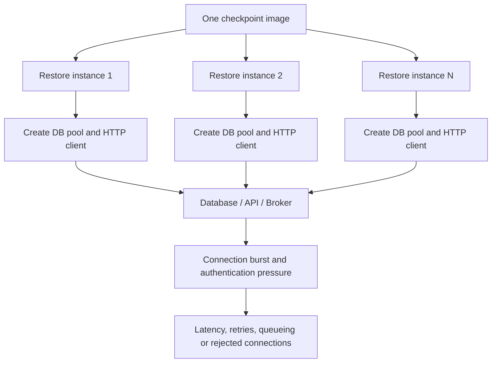

# Đánh giá khả năng mở rộng đồng thời và tải tái kết nối

Checkpoint/restore có thể rút ngắn thời gian khởi động một ứng dụng Java, nhưng tốc độ restore của một tiến trình đơn lẻ chưa nói lên khả năng mở rộng của cả hệ thống. Khi nhiều instance được restore cùng lúc, chúng thường đồng loạt khởi tạo connection pool, mở HTTP/TLS connection, xác thực credential, đăng ký message consumer và làm nóng cache. Nếu tất cả hoạt động này xảy ra trong một khoảng thời gian ngắn, dependency bên ngoài có thể nhận một đợt tải lớn hơn nhiều so với tải ổn định hằng ngày.

Vì vậy, đánh giá hiệu năng CRaC cần xem xét hai khía cạnh cùng lúc: **khả năng xử lý request khi số instance tăng** và **khả năng phục hồi dependency khi nhiều instance kết nối lại sau restore**. Một hệ thống có thể restore JVM rất nhanh nhưng mất nhiều phút mới phục hồi database pool hoặc message consumer. Ngược lại, một hệ thống có thể tái kết nối nhanh nhưng tạo ra quá nhiều connection đồng thời, làm database hoặc broker quá tải.

## 1. Phân biệt tốc độ restore và tốc độ phục hồi toàn hệ thống

Một lần restore thường gồm nhiều mốc thời gian:

1. Runtime đọc checkpoint image và khôi phục trạng thái tiến trình.
2. JVM tiếp tục thực thi và gọi `afterRestore()`.
3. Resource tạo lại connection, client, worker và tài nguyên phụ thuộc môi trường.
4. Ứng dụng kiểm tra dependency và chuyển readiness sang thành công.
5. Instance bắt đầu nhận traffic.
6. Hệ thống đạt throughput và latency ổn định.

Chỉ đo thời gian từ lúc gọi lệnh restore đến lúc process tồn tại sẽ bỏ sót phần lớn chi phí phục hồi. Cần đo ít nhất ba khoảng:

| Khoảng thời gian | Bắt đầu | Kết thúc | Ý nghĩa |
|---|---|---|---|
| Restore duration | Yêu cầu restore | JVM tiếp tục chạy | Chi phí khôi phục process/runtime |
| Restore-to-ready | Yêu cầu restore | Readiness thành công | Thời gian instance có thể nhận traffic |
| Recovery-to-steady-state | Yêu cầu restore hoặc mở traffic | Latency/throughput ổn định | Thời gian toàn hệ thống phục hồi hiệu năng |

Ví dụ, JVM có thể restore trong 300 ms, nhưng mất 8 giây để tạo database pool và 20 giây để broker hoàn tất consumer group rebalance. Nếu chỉ báo cáo 300 ms, đánh giá sẽ không phản ánh trải nghiệm thực tế.

## 2. Hai bài toán tải cần đánh giá

### 2.1. Khả năng mở rộng đồng thời

Đây là khả năng hệ thống xử lý nhiều request, job hoặc message cùng lúc khi tăng số instance hoặc số worker. Cần xác định throughput có tăng tương ứng không, latency có tăng đột biến không và dependency có trở thành nút thắt hay không.

Các yếu tố thường ảnh hưởng:

- Số instance được restore và số request mỗi instance nhận.
- Số worker thread và giới hạn concurrency trong ứng dụng.
- Connection pool size của database và HTTP client.
- CPU, memory, GC và thread scheduling.
- Lock contention, queue length và backpressure.
- Giới hạn connection, request rate và concurrency của dependency.

### 2.2. Tải tái kết nối sau restore

Đây là tải phát sinh khi nhiều instance cần thiết lập lại tài nguyên ngoài tiến trình trong một khoảng thời gian ngắn. Ví dụ:

- Nhiều HikariCP pool cùng mở connection đến database.
- Nhiều HTTP client cùng thực hiện TCP connect, TLS handshake và xác thực.
- Nhiều message consumer cùng đăng ký lại subscription và kích hoạt rebalance.
- Nhiều instance cùng lấy secret, refresh token hoặc đăng ký lease.
- Nhiều cache cùng tải dữ liệu nền sau khi khởi động.

Đợt tải này thường được gọi là *reconnection storm* hoặc *thundering herd*. Nó có thể xảy ra ngay cả khi traffic nghiệp vụ chưa được mở.

## 3. Vì sao restore đồng thời tạo reconnection storm?

Giả sử có 40 instance cùng được restore từ một checkpoint image. Mỗi instance có database pool tối đa 20 connection và HTTP client tạo tối đa 10 connection trong giai đoạn warm-up.

Nếu tất cả pool được khởi tạo cùng lúc và nhanh chóng đạt kích thước tối đa, database có thể nhận tới 800 connection mới; HTTP service có thể nhận thêm 400 TCP/TLS connection. Đây là ví dụ giới hạn trên, không phải số connection chắc chắn được tạo: số thực tế phụ thuộc pool có eager-fill hay lazy-create, số request warm-up và cách client quản lý connection.



Những hoạt động sau restore có thể đồng bộ vì các instance dùng cùng image, cùng cấu hình và cùng thời điểm rollout. Nếu tất cả đều retry theo cùng một chu kỳ cố định, mỗi lần dependency phục hồi lại có thể tạo thêm một đợt burst mới.

## 4. Xác định mô hình tải trước khi benchmark

Một kết quả benchmark chỉ có ý nghĩa khi biết cách tải được tạo ra. Cần phân biệt số request đồng thời, tốc độ request đến và số instance restore đồng thời.

| Mô hình | Cách tạo tải | Phù hợp để đo |
|---|---|---|
| Fixed concurrency | Giữ số virtual user/request worker cố định | Throughput và latency ở một mức concurrency |
| Constant arrival rate | Gửi số request mỗi giây ổn định | Khả năng phục vụ khi tốc độ đến được kiểm soát |
| Ramp-up | Tăng concurrency hoặc arrival rate theo thời gian | Điểm bắt đầu bão hòa và ngưỡng lỗi |
| Burst | Tăng tải mạnh trong thời gian ngắn | Khả năng chịu đợt traffic hoặc reconnect đột ngột |
| Restore fan-out | Restore nhiều process/replica cùng lúc | Áp lực tái kết nối và thời gian fleet đạt readiness |
| Mixed workload | Kết hợp traffic nghiệp vụ với restore/reconnect | Tác động của phục hồi lên người dùng đang hoạt động |

Đừng dùng một con số “concurrent users” để thay thế tất cả mô hình. 100 virtual users có thể tạo tốc độ request rất khác nhau tùy thời gian phản hồi và thời gian think time. Restore fan-out lại đo số process khởi động cùng lúc, không phải số request.

### 4.1. Closed-loop và open-loop load

Trong mô hình closed-loop, mỗi virtual user gửi request tiếp theo sau khi request trước hoàn thành. Khi hệ thống chậm, tốc độ request tự giảm. Điều này có thể che khuất tình trạng quá tải vì load generator tự giảm áp lực đúng lúc hệ thống yếu đi.

Trong mô hình open-loop, request được phát theo arrival rate định trước, độc lập với thời gian phản hồi. Mô hình này phù hợp để quan sát queueing và latency khi hệ thống phải đối mặt với một tốc độ đến cố định. Cần bảo đảm load generator đủ tài nguyên để duy trì arrival rate; nếu không, kết quả sẽ không phản ánh tải dự kiến.

Với hệ thống phục hồi sau restore, nên dùng cả hai:

- Fixed concurrency để hiểu throughput tối đa ở các mức số worker.
- Constant arrival rate để xem latency và error rate khi traffic không giảm theo tốc độ xử lý.
- Burst/restore fan-out để đo riêng đợt tái kết nối.

### 4.2. Little's Law để kiểm tra tính hợp lý

Trong hệ thống ổn định, Little's Law mô tả quan hệ giữa số công việc trung bình trong hệ thống (L), tốc độ hoàn tất trung bình λ và thời gian ở trong hệ thống (W):

\[
L = \lambda W
\]

Ví dụ, nếu hệ thống xử lý trung bình 500 request/giây và thời gian phản hồi trung bình là 0,2 giây, số request đang nằm trong hệ thống trung bình xấp xỉ 100. Đây là kiểm tra tính hợp lý cho steady state; không dùng trực tiếp để suy ra tải trong một burst ngắn hoặc khi queue đang tăng không ổn định.

## 5. Thiết kế benchmark theo nhiều mức scale

Không nên chỉ đo một cấu hình nhỏ và ngoại suy tuyến tính. Hãy tăng số instance, concurrency và tốc độ request theo từng nấc để tìm điểm bão hòa.

Một ma trận minh họa:

| Kịch bản | Số instance | Restore đồng thời | Request concurrency | Mục tiêu |
|---|---:|---:|---:|---|
| Baseline | 1 | 1 | Thấp | Xác định chi phí một instance |
| Scale-out nhỏ | 4 | 1 mỗi đợt | Trung bình | Đo hiệu năng khi tăng replica |
| Restore burst | 8 | 8 | 0 lúc đầu | Đo reconnect storm riêng |
| Restore fan-out | 16 | 4 mỗi đợt | 0 lúc đầu | Đo hiệu quả stagger/batch |
| Concurrent traffic | 8 | 0 | Tăng dần | Tìm throughput và latency saturation |
| Mixed recovery | 8 | 2 mỗi đợt | Cao | Đo ảnh hưởng restore lên traffic hiện tại |
| Dependency degradation | 8 | 2 mỗi đợt | Trung bình | Đo retry, timeout và readiness khi DB/API chậm |

Các số trên chỉ là ví dụ để thiết kế ma trận. Hãy thay bằng quy mô production dự kiến và giới hạn của môi trường test. Nếu production có hàng trăm replica, cần benchmark theo từng batch và mô phỏng giới hạn dependency tương ứng.

### 5.1. Giữ nguyên các yếu tố so sánh

Khi so sánh cold start với CRaC restore hoặc so sánh các cấu hình pool, giữ cố định:

- JDK vendor/version/build và JVM options.
- Application build, cấu hình và dataset.
- CPU/memory limit và loại máy.
- Database, broker và HTTP service test.
- Network path, TLS configuration và DNS.
- Số request, payload, thời gian test và warm-up policy.
- Load generator và vị trí chạy.

Nếu thay đổi nhiều yếu tố cùng lúc, khó xác định cải thiện đến từ CRaC, pool size, network hoặc tài nguyên host.

## 6. Capacity planning cho connection pool

Connection pool là nguồn tạo tải tái kết nối dễ thấy nhất. Nếu mỗi instance có pool tối đa (C) connection và có (N) instance hoạt động, giới hạn connection tiềm năng từ ứng dụng là:

\[
Connections_{max} = N \times C
\]

Tổng connection còn phải cộng thêm các ứng dụng khác, migration, monitoring, admin session và replica phụ:

\[
Connections_{total} = \sum_i (N_i \times C_i) + C_{other}
\]

Nếu database có giới hạn connection (D), cần giữ headroom cho thao tác quản trị và biến động tải:

\[
\sum_i (N_i \times C_i) + C_{other} \leq D - H
\]

Trong đó (H) là headroom được xác định theo vận hành, không nên đặt bằng 0. Đây là phép tính giới hạn trên; pool lazy có thể chỉ mở một phần connection nếu workload không yêu cầu toàn bộ.

### 6.1. Ví dụ tính giới hạn

Giả sử:

- Database cho phép 600 connection.
- Các dịch vụ khác đang dùng 180 connection.
- Dự trữ 60 connection cho migration, admin và biến động.
- Ứng dụng CRaC dự kiến chạy 20 replica.

Số connection tối đa còn lại cho ứng dụng:

\[
600 - 180 - 60 = 360
\]

Giới hạn pool trung bình trên mỗi replica là:

\[
360 / 20 = 18
\]

Pool 18 là giới hạn số học ban đầu, chưa phải cấu hình tối ưu. Cần đo connection acquisition time, transaction duration và throughput để xác định pool thực tế. Tăng pool vượt quá khả năng xử lý của database có thể làm contention và latency tệ hơn.

### 6.2. Đánh giá pool eager và lazy

Pool eager hoặc cấu hình duy trì `minimumIdle` cao có thể tạo nhiều connection ngay khi instance restore. Điều này giúp request đầu tiên ít phải chờ tạo connection nhưng làm tăng reconnect burst.

Pool lazy hoặc `minimumIdle` thấp giảm số connection khởi tạo cùng lúc, nhưng request đầu tiên có thể phải chờ mở connection. Cần so sánh:

- Thời gian restore-to-ready.
- Số connection mới trong mỗi giây.
- Connection acquisition latency.
- Request p95/p99 trong vài phút đầu.
- CPU/database load trong giai đoạn pool tạo connection.

Với HikariCP, các thuộc tính như `maximumPoolSize`, `minimumIdle`, `connectionTimeout` và cách ứng dụng tạo pool ảnh hưởng đến hành vi. Ví dụ cấu hình minh họa:

```yaml
spring:
  datasource:
    hikari:
      maximum-pool-size: 18
      minimum-idle: 2
      connection-timeout: 3000
```

Các giá trị trên không phải khuyến nghị dùng chung. Hãy chọn theo giới hạn database và workload. `minimumIdle` thấp hơn `maximumPoolSize` có thể làm pool co giãn; nó không bảo đảm mọi lần restore chỉ mở đúng hai connection trong mọi thời điểm. Kiểm tra hành vi theo phiên bản HikariCP và cấu hình ứng dụng.

## 7. Đo tốc độ tái kết nối

Nếu mỗi instance trong số (N) instance tạo (K) connection mới trong khoảng thời gian (T), tốc độ mở connection trung bình là:

\[
ReconnectRate = \frac{N \times K}{T}
\]

Ví dụ 20 instance, mỗi instance mở 10 connection trong 5 giây tạo tốc độ trung bình 40 connection/giây. Thực tế có thể tập trung thành burst ngắn hơn nhiều, nên cần đo histogram hoặc time series theo giây, không chỉ lấy trung bình toàn bài test.

Các chỉ số cần thu thập:

- Connection open attempts/second.
- Connection success/failure rate.
- Concurrent active connections và idle connections.
- TLS handshake count, duration và failure.
- Authentication request rate và token refresh rate.
- Database connection wait/acquisition time.
- Số connection bị từ chối hoặc reset.
- Số retry và thời gian retry.
- Thời gian từ restore đến dependency-ready.

Nếu chỉ đo số connection hiện tại, có thể bỏ lỡ burst vì connection mở rồi đóng rất nhanh. Thu thập cả counter tổng số lần mở, lỗi và tốc độ theo thời gian.

## 8. Giới hạn reconnect concurrency

Một cách giảm burst là giới hạn số thao tác kết nối đồng thời. Có thể dùng semaphore hoặc executor có giới hạn trong mỗi process.

Ví dụ semaphore giới hạn số lần reconnect đồng thời trong một JVM:

```java
import java.time.Duration;
import java.util.concurrent.Semaphore;
import java.util.concurrent.TimeUnit;

public final class ReconnectGate {
    private final Semaphore permits;
    private final Duration acquireTimeout;

    public ReconnectGate(int maxConcurrent, Duration acquireTimeout) {
        if (maxConcurrent <= 0) {
            throw new IllegalArgumentException("maxConcurrent must be positive");
        }
        this.permits = new Semaphore(maxConcurrent);
        this.acquireTimeout = acquireTimeout;
    }

    public void reconnect(CheckedRunnable operation) throws Exception {
        boolean acquired = permits.tryAcquire(
                acquireTimeout.toMillis(), TimeUnit.MILLISECONDS);
        if (!acquired) {
            throw new IllegalStateException("Reconnect admission timed out");
        }

        try {
            operation.run();
        } finally {
            permits.release();
        }
    }

    @FunctionalInterface
    public interface CheckedRunnable {
        void run() throws Exception;
    }
}
```

Nếu thread bị interrupt trong lúc `tryAcquire`, `InterruptedException` được truyền lên; caller cần xử lý theo lifecycle và giữ nguyên ý nghĩa interrupt. Gate này chỉ giới hạn concurrency trong một JVM. Nếu 20 replica đều có semaphore cho phép 2 kết nối, toàn hệ thống vẫn có thể mở 40 kết nối đồng thời.

Để giới hạn toàn fleet, cần thêm điều phối ở tầng triển khai hoặc dependency:

- Restore theo batch với giới hạn số instance đồng thời.
- Distributed token bucket hoặc lease nếu cần giới hạn toàn cluster.
- API gateway/connection proxy có giới hạn concurrency.
- Pool budget phân bổ theo số replica.
- Broker/database quota được thiết kế cho peak reconnect.

Không dựa vào một semaphore local để bảo vệ giới hạn connection toàn database.

## 9. Backoff và jitter khi kết nối lại

Nếu dependency chưa sẵn sàng, tất cả instance retry sau đúng 1 giây có thể tạo ra một burst mới ở giây tiếp theo. Exponential backoff làm khoảng chờ tăng dần; jitter phân tán thời điểm retry giữa các instance.

Với full jitter, giới hạn delay ở lần retry (a) có thể được tính:

\[
cap_a = \min(maxDelay, baseDelay \times 2^a)
\]

Sau đó chọn ngẫu nhiên:

\[
delay_a \sim Uniform(0, cap_a)
\]

Ví dụ Java:

```java
import java.time.Duration;
import java.util.concurrent.ThreadLocalRandom;

public final class RetryDelay {
    private RetryDelay() { }

    public static Duration fullJitter(
            int attempt,
            Duration baseDelay,
            Duration maxDelay) {
        if (attempt < 0 || baseDelay.isNegative() || baseDelay.isZero()
                || maxDelay.compareTo(baseDelay) < 0) {
            throw new IllegalArgumentException("Invalid retry configuration");
        }

        long base = baseDelay.toMillis();
        long max = maxDelay.toMillis();
        long ceiling = base;

        for (int i = 0; i < attempt && ceiling < max; i++) {
            ceiling = ceiling > max / 2 ? max : Math.min(max, ceiling * 2);
        }

        long delay = ThreadLocalRandom.current().nextLong(ceiling + 1);
        return Duration.ofMillis(delay);
    }
}
```

Đoạn code minh họa full jitter với thời gian millisecond trong phạm vi cấu hình thông thường. Trong code production, cần giới hạn `maxDelay` ở giá trị không gây overflow khi cộng 1, thêm deadline tổng và xử lý `Retry-After` nếu dependency trả về. Không retry vô hạn; phân loại lỗi tạm thời với lỗi cấu hình hoặc xác thực.

### 9.1. Jitter không thay thế admission control

Jitter phân tán retry theo thời gian nhưng không bảo đảm số kết nối đồng thời nằm dưới giới hạn. Khi dependency vừa phục hồi, nhiều request vẫn có thể cùng thành công và tạo burst. Kết hợp backoff+jitter với concurrency limit, bounded queue và restore batching.

### 9.2. Deadline và retry budget

Một reconnect operation cần deadline tổng. Nếu ứng dụng retry mãi trong `afterRestore`, callback có thể treo vô hạn và instance không bao giờ readiness. Hãy xác định:

- Số lần retry tối đa hoặc deadline tổng.
- Loại lỗi nào được retry.
- Timeout mỗi lần connect/handshake.
- Backoff và jitter.
- Cách hủy retry khi instance bị dừng.
- Hành vi khi hết retry budget: fail restore/readiness, hoặc để controller retry theo chính sách.

Lỗi như credential sai, certificate hết hạn hoặc hostname cấu hình sai thường không được giải quyết bằng retry liên tục. Cần báo lỗi rõ ràng và không mở traffic.

## 10. Stagger restore và rollout theo batch

Nếu có thể kiểm soát thời điểm restore, không cần khôi phục toàn bộ fleet trong cùng một giây. Chia thành các batch và chờ mỗi batch đạt điều kiện trước khi tiếp tục.

Ví dụ:

```text
Fleet: 24 instances

Batch 1: restore 4 -> reconnect -> readiness
Batch 2: restore 4 -> reconnect -> readiness
Batch 3: restore 4 -> reconnect -> readiness
Batch 4: restore 4 -> reconnect -> readiness
Batch 5: restore 4 -> reconnect -> readiness
Batch 6: restore 4 -> reconnect -> readiness
```

Batch size cần dựa trên connection budget, capacity của dependency và SLA phục hồi. Chờ readiness đơn thuần có thể chưa đủ nếu connection pool mới chỉ tạo một phần; có thể cần một readiness condition bổ sung cho dependency quan trọng hoặc giới hạn reconnect toàn fleet.

Khi dùng Kubernetes, các thông số như `maxSurge`, `maxUnavailable`, rollout strategy, startup/readiness probe và controller riêng có thể ảnh hưởng số Pod khởi động đồng thời. Tuy nhiên, Pod restart hoặc rollout không tự động restore CRaC image; cần tích hợp đúng cơ chế restore của platform.

## 11. Message broker và consumer rebalance

Tải tái kết nối không chỉ là database connection. Khi nhiều consumer cùng khôi phục, broker có thể phải xử lý:

- Nhiều TCP/TLS connection mới.
- Authentication và authorization request.
- Consumer group membership update.
- Partition reassignment và rebalance.
- Subscription và offset coordination.
- Retry khi broker hoặc coordinator chưa sẵn sàng.

Nếu consumer được resume đồng loạt, thời gian rebalance có thể tăng và throughput xử lý message giảm tạm thời. Hãy đo số lần rebalance, thời gian rebalance, số partition được gán, lag và thời gian từ restore đến khi consumer xử lý message ổn định.

Có thể stagger việc resume consumer sau khi connection đã sẵn sàng. Cần bảo đảm consumer không nhận message trước khi application state và dependency cần thiết được phục hồi. Cũng cần kiểm tra semantics at-least-once/exactly-once, idempotency và duplicate processing trong giai đoạn chuyển tiếp.

## 12. HTTP client, TLS và DNS

Một HTTP client có thể giữ connection pool và TLS session state. Sau restore, socket cũ có thể không còn hợp lệ hoặc cần được đóng và tạo lại. Nếu hàng chục instance cùng thực hiện TLS handshake, CPU và authentication service có thể trở thành nút thắt.

Đo riêng:

- DNS lookup rate và latency.
- TCP connect latency và reset.
- TLS handshake latency, CPU và lỗi certificate.
- OAuth/token endpoint request rate.
- Connection pool pending/acquire time.
- HTTP 429, 5xx và timeout.
- Retry count theo endpoint.

Tránh để tất cả instance refresh cùng một token hoặc cùng tải một cấu hình khi restore. Dùng token cache có lifecycle phù hợp, jitter refresh và cơ chế cấp phát/refresh có giới hạn. Không lưu token ngắn hạn vào image rồi giả định token vẫn hợp lệ khi restore sau nhiều giờ.

## 13. Cache warm-up và cache stampede

Sau restore, cache trong heap có thể được khôi phục cùng snapshot nhưng dữ liệu bên ngoài có thể đã thay đổi. Nếu ứng dụng chủ động invalidate cache và tất cả instance cùng tải lại một tập dữ liệu lớn, database hoặc cache backend có thể nhận một đợt tải bất thường.

Các chiến lược giảm stampede:

- Warm-up theo batch hoặc theo key có mức độ quan trọng.
- Dùng single-flight để nhiều request trong một instance cùng chờ một lần tải.
- Dùng distributed lock/lease nếu cần phối hợp giữa nhiều instance.
- Thêm jitter vào lịch refresh cache.
- Giới hạn số lần tải đồng thời và bounded queue.
- Dùng stale-while-revalidate nếu nghiệp vụ cho phép.
- Chỉ công bố readiness sau khi cache bắt buộc đã sẵn sàng; không chờ toàn bộ cache tùy chọn.

Single-flight trong một JVM không ngăn 20 replica cùng tải một key. Nếu cache backend bị giới hạn, cần coordination hoặc quota ở phạm vi toàn fleet.

## 14. Thiết kế workload benchmark

Một bài benchmark tốt tách rõ các pha:

1. **Baseline:** đo cold start thông thường và một instance CRaC restore.
2. **Warm-up:** chuẩn bị ứng dụng và xác nhận đường xử lý đại diện.
3. **Checkpoint:** tạo image từ tiến trình đã warm-up.
4. **Single restore:** restore một instance và đo restore-to-ready.
5. **Fan-out:** restore nhiều bản sao theo batch hoặc đồng thời.
6. **Reconnect observation:** đo connection/auth/broker/cache load.
7. **Traffic ramp:** tăng request rate sau khi từng batch ready.
8. **Mixed load:** tiếp tục traffic trong khi batch tiếp theo restore.
9. **Steady state:** duy trì tải đủ lâu để đo throughput/latency ổn định.
10. **Recovery:** dừng load và quan sát pool/queue/cache trở lại bình thường.

Mỗi pha cần timestamp và run ID để liên kết log ứng dụng, database, broker, load generator và orchestration.

### 14.1. Ví dụ k6 cho traffic sau restore

k6 có thể tạo traffic với arrival rate được kiểm soát để đo ứng dụng sau khi fleet restore. Script này không tự thực hiện CRaC restore; bước orchestration phải restore instance trước và chỉ chạy test khi endpoint đã sẵn sàng.

```javascript
import http from 'k6/http';
import { check } from 'k6';

export const options = {
  scenarios: {
    post_restore_traffic: {
      executor: 'ramping-arrival-rate',
      startRate: 20,
      timeUnit: '1s',
      preAllocatedVUs: 50,
      maxVUs: 300,
      stages: [
        { target: 50, duration: '1m' },
        { target: 100, duration: '2m' },
        { target: 200, duration: '2m' },
        { target: 200, duration: '3m' },
        { target: 0, duration: '30s' },
      ],
    },
  },
  thresholds: {
    http_req_failed: ['rate<0.01'],
    http_req_duration: ['p(95)<500', 'p(99)<1200'],
  },
};

export default function () {
  const response = http.get(`${__ENV.BASE_URL}/api/orders/health-sample`);
  check(response, {
    'status is successful': (r) => r.status === 200,
  });
}
```

Các rate, duration và threshold chỉ là ví dụ. Thay endpoint, payload, SLA và arrival profile theo ứng dụng. Theo dõi `dropped_iterations` và tài nguyên load generator; nếu generator không tạo được arrival rate yêu cầu, bài test không hợp lệ. Dùng endpoint nghiệp vụ đại diện thay cho health endpoint nếu mục tiêu là đo throughput xử lý thật.

### 14.2. Tách test reconnect khỏi test request

Để đo riêng reconnect storm, có thể restore fleet nhưng chưa mở traffic nghiệp vụ. Thu thập connection metrics ở database/broker/API. Sau khi tất cả instance ready, mới chạy k6 để đo request capacity.

Sau đó chạy mixed-load test: giữ traffic ổn định trong khi restore một batch mới. Điều này cho biết reconnect burst có làm giảm hiệu năng của người dùng hiện tại hay không.

## 15. Metrics cần thu thập

Không chỉ dựa vào CPU hoặc average latency. Cần quan sát cả ứng dụng và dependency.

| Nhóm | Metrics | Điều cần phát hiện |
|---|---|---|
| Restore | Restore duration, restore success/failure, time-to-ready | JVM restore nhanh hay chậm, instance nào bị kẹt |
| Request | RPS, p50/p95/p99, error rate, timeout | Tác động tới người dùng và điểm bão hòa |
| Concurrency | Active requests, worker count, queue depth, rejected tasks | Backpressure và thread saturation |
| Database | Active/idle connections, connect attempts, acquisition wait, query latency | Pool storm và database saturation |
| HTTP/TLS | TCP connects, handshake duration, auth rate, 429/5xx | Áp lực lên dịch vụ phụ thuộc |
| Broker | Consumer count, rebalance count/time, lag, message rate | Khả năng phục hồi consumer group |
| Cache | Miss rate, load requests, refresh concurrency, backend latency | Cache stampede |
| JVM | CPU, heap, GC pause, thread count, class loading | Chi phí warm-up và contention |
| Host | CPU, memory, network, file descriptors, disk I/O | Nút thắt ở node và checkpoint storage |
| Retry | Attempts, delay, exhaustion, circuit state | Retry storm hoặc phục hồi kéo dài |

### 15.1. Percentile quan trọng hơn average

Average latency có thể che giấu một nhóm request rất chậm trong lúc pool đang tạo lại. Ghi nhận p50, p95, p99 và max; với hệ thống quan trọng, theo dõi histogram theo từng giai đoạn restore và steady state.

Không cộng các percentile của nhiều instance bằng cách lấy trung bình đơn giản. Hãy dùng histogram có bucket tương thích hoặc dữ liệu request-level từ load generator để tính percentile fleet đúng cách.

### 15.2. Quan sát theo thời gian

Một biểu đồ tổng hợp hữu ích đặt cùng trục thời gian:

- Số instance bắt đầu restore và số instance ready.
- Connection attempts/second và active connection count.
- Request rate và p95/p99.
- Database CPU/queue và broker lag.
- Retry rate và lỗi kết nối.

Khi các đường tăng cùng thời điểm, có thể nhận diện quan hệ giữa restore fan-out và áp lực dependency. Đừng chỉ xem snapshot metrics cuối bài test.

## 16. Xác định ngưỡng mở rộng và điểm bão hòa

Tăng dần số instance hoặc request rate cho đến khi một trong các điều kiện sau xuất hiện:

- Throughput không còn tăng tương ứng với tải.
- p95/p99 tăng nhanh dù throughput gần như không đổi.
- Error/timeout rate vượt ngưỡng.
- Connection acquisition wait tăng mạnh.
- Database/broker đạt giới hạn connection hoặc CPU.
- Queue depth tăng liên tục và không giảm về baseline.
- CPU throttling hoặc GC pause làm mất khả năng đáp ứng.
- Thời gian restore-to-ready vượt SLA.

Điểm bão hòa không nhất thiết là CPU 100%. Database connection limit, TLS handshake CPU, broker coordinator hoặc một lock trong ứng dụng có thể bão hòa trước.

### 16.1. Tính capacity có headroom

Không lấy mức throughput cao nhất vừa đo được làm capacity production. Xác định mức vận hành an toàn thấp hơn điểm bão hòa, có headroom cho traffic burst, retry và các workload khác.

Ví dụ, nếu tại 8 replica hệ thống đạt 4.000 RPS nhưng p99 đã vượt SLA, còn tại 6 replica đạt 3.200 RPS với latency ổn định, 6 replica có thể là điểm vận hành an toàn hơn. Quyết định phải dựa trên SLA và dữ liệu thực tế, không chỉ số RPS lớn nhất.

### 16.2. Ước lượng thời gian phục hồi fleet

Nếu có (N) instance và mỗi batch có (B) instance, số batch xấp xỉ:

\[
BatchCount = \left\lceil \frac{N}{B} \right\rceil
\]

Nếu mỗi batch cần thời gian restore (T_r), reconnect (T_c), verify/readiness (T_v), và các pha diễn ra tuần tự, thời gian phục hồi gần đúng là:

\[
T_{fleet} \approx BatchCount \times (T_r + T_c + T_v)
\]

Đây là ước lượng bảo thủ cho các batch tuần tự. Trong thực tế, các pha có thể overlap và thời gian phụ thuộc tải; dùng số đo percentile và mô phỏng rollout để lập kế hoạch.

## 17. So sánh cold start và CRaC dưới cùng tải

CRaC thường giúp giảm chi phí khởi tạo JVM và ứng dụng, nhưng không loại bỏ chi phí kết nối dependency. So sánh nên có các cột:

| Chỉ số | Cold start | CRaC single restore | CRaC restore fan-out |
|---|---:|---:|---:|
| Process start/restore duration | Đo thực tế | Đo thực tế | Đo theo từng instance và fleet |
| Time-to-ready | Đo thực tế | Đo thực tế | Đo instance cuối cùng đạt ready |
| First request p95/p99 | Đo thực tế | Đo thực tế | Đo trong giai đoạn batch restore |
| Connection attempts/second | Đo thực tế | Đo thực tế | Đo burst lớn nhất |
| Database active connections | Đo thực tế | Đo thực tế | Đo peak toàn fleet |
| Error/retry rate | Đo thực tế | Đo thực tế | Đo khi dependency chịu reconnect burst |
| Steady-state throughput | Đo thực tế | Đo thực tế | Đo sau khi fleet ổn định |

Không so sánh cold start một instance với CRaC restore của một fleet mà không chuẩn hóa tổng tài nguyên. Cần đo cùng số replica, cùng traffic và cùng dependency capacity để xác định lợi ích thực tế.

## 18. Những lỗi thường gặp khi đánh giá

**Chỉ đo thời gian JVM restore.** Ứng dụng có thể chưa kết nối database hoặc broker. Đo restore-to-ready và recovery-to-steady-state.

**Chỉ benchmark một instance.** Không phát hiện reconnect storm hoặc giới hạn toàn fleet. Thử nhiều replica restore đồng thời và theo batch.

**Dùng average latency.** Percentile cao có thể tăng mạnh trong lúc pool tạo lại. Theo dõi p95/p99 và histogram theo thời gian.

**Không tính tổng connection từ mọi replica.** Pool size nhân với replica count có thể vượt database limit. Lập connection budget toàn hệ thống.

**Giới hạn reconnect bằng semaphore local rồi cho rằng đã bảo vệ database.** Mỗi JVM có semaphore riêng. Dùng rollout batching hoặc distributed admission nếu cần giới hạn toàn cluster.

**Retry cùng một khoảng cố định.** Nhiều instance có thể đồng bộ retry và tạo burst lặp lại. Dùng exponential backoff với jitter và retry budget.

**Cho readiness thành công trước khi dependency sẵn sàng.** Traffic đến sớm làm tăng lỗi và retry. Chỉ mở traffic sau khi resource bắt buộc được xác minh.

**Chỉ kiểm tra reconnect thành công mà không đo tốc độ.** 100% instance cuối cùng kết nối được vẫn có thể che giấu database bị quá tải trong 30 giây đầu. Đo attempts/second, peak concurrency và latency.

**Load generator không đủ công suất.** Generator không duy trì arrival rate làm hệ thống trông khỏe hơn thực tế. Theo dõi dropped iterations và tài nguyên generator.

**Không chạy mixed-load test.** Reconnect có thể làm chậm traffic đang phục vụ. Giữ traffic ổn định trong khi restore batch mới.

**Dùng môi trường dependency lớn hơn production.** Test có thể không phát hiện giới hạn connection hoặc quota. Cấu hình test phải mô phỏng giới hạn production.

## 19. Tự kiểm tra mức độ hiểu

1. **Restore duration khác restore-to-ready thế nào?** Restore duration đo thời gian JVM khôi phục; restore-to-ready tính cả việc tạo lại dependency và kiểm tra readiness.
2. **Vì sao nhiều instance restore cùng lúc có thể làm database quá tải?** Các pool có thể đồng loạt mở connection, thực hiện authentication và warm-up.
3. **Công thức giới hạn trên của connection pool fleet là gì?** Tổng gần đúng là số replica nhân maximum pool size của từng loại ứng dụng, cộng các nguồn connection khác.
4. **Semaphore trong một JVM có giới hạn reconnect toàn cluster không?** Không. Nó chỉ giới hạn concurrency trong process đó; cần batching hoặc distributed admission để giới hạn toàn fleet.
5. **Exponential backoff cần jitter để làm gì?** Phân tán thời điểm retry, tránh nhiều instance retry cùng một thời điểm.
6. **Vì sao cần đo connection attempts/second thay vì chỉ active connections?** Connection có thể mở/đóng nhanh; số active tại một thời điểm không thể hiện đầy đủ burst.
7. **Closed-loop load có thể che giấu điều gì?** Khi hệ thống chậm, tốc độ phát request giảm theo, khiến áp lực thực tế thấp hơn arrival rate cố định.
8. **Khi nào nên mở readiness?** Khi các dependency bắt buộc đã được phục hồi và xác minh; cache tùy chọn có thể tiếp tục warm-up nếu chính sách ứng dụng cho phép.
9. **Vì sao cần mixed-load test?** Để đo tác động của reconnect lên request đang phục vụ trong lúc fleet mở rộng hoặc phục hồi.

## Kết luận

Đánh giá khả năng mở rộng CRaC cần đo cả throughput khi tăng concurrency và tải tái kết nối khi nhiều instance restore cùng lúc. Hãy tách restore duration, restore-to-ready và recovery-to-steady-state; tính connection budget toàn fleet; đo tốc độ mở connection, TLS/authentication, broker rebalance, cache warm-up và retry theo thời gian.

Để tránh reconnect storm, kết hợp pool sizing, giới hạn concurrency, restore theo batch, exponential backoff với jitter, retry deadline và readiness gate. Benchmark cần có single restore, restore fan-out, traffic ramp, mixed load, dependency degradation và nhiều lần lặp. Dùng p95/p99, error rate, queue depth và metrics của dependency để tìm điểm bão hòa. Chỉ kết luận hệ thống mở rộng tốt khi fleet không chỉ restore nhanh mà còn phục hồi dependency và đạt hiệu năng ổn định trong giới hạn SLA.
