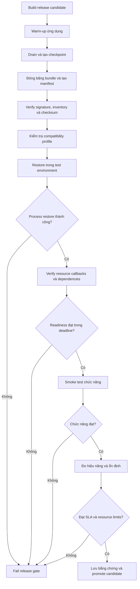
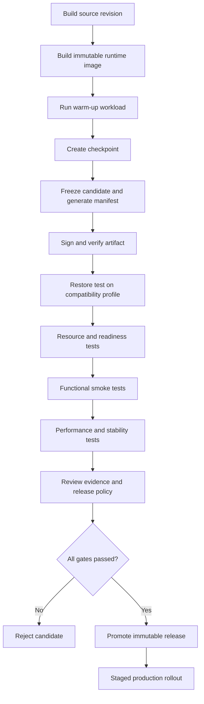

# Chỉ phát hành ảnh đã vượt qua kiểm thử restore

Checkpoint CRaC là trạng thái của một tiến trình Java tại thời điểm tạo ảnh. Một lệnh checkpoint trả về thành công chỉ chứng minh quá trình tạo ảnh đã hoàn tất theo runtime và công cụ đang dùng; nó chưa chứng minh ảnh có thể được triển khai an toàn, khôi phục trên môi trường đích hoặc phục vụ workload thực tế.

Vì vậy, trong vận hành production, checkpoint cần được xem như một artifact phát hành có điều kiện. Chỉ promote ảnh sau khi đã restore thử bằng đúng JDK, application build, dependency, container image và môi trường tương thích; các callback CRaC phải hoàn tất; resource phải được phục hồi; readiness phải đạt; và ứng dụng phải vượt qua các kiểm tra chức năng cùng tiêu chí hiệu năng đã định.

Quy tắc phát hành nên là: **checkpoint chưa có bằng chứng restore thành công trên compatibility profile dự kiến thì chưa được đưa vào production**. Nếu thay đổi JDK, ứng dụng, thư viện native, JVM flags, base image hoặc cấu hình CRIU/kernel nằm ngoài phạm vi đã kiểm thử, release cần chạy lại các kiểm tra liên quan trước khi được promote.

## 1. Vì sao phải kiểm thử restore trước khi phát hành?

Checkpoint có thể được tạo thành công nhưng vẫn thất bại ở giai đoạn restore hoặc sau khi tiến trình đã được phục hồi.

Một số tình huống thường gặp:

- JDK hoặc build JVM dùng để restore không khớp với runtime đã tạo checkpoint.
- Checkpoint thiếu file, bị hỏng trong quá trình copy hoặc được ghép với application image khác.
- Kernel, CRIU, container runtime, namespace hoặc quyền hệ thống không đáp ứng điều kiện restore.
- Callback `afterRestore` không tạo lại được database pool, broker client, socket hoặc native resource.
- Ứng dụng restore được nhưng readiness chuyển accepting quá sớm.
- Background consumer hoặc scheduler chạy trước khi dependency sẵn sàng.
- Request đầu tiên gặp lỗi do cache stale, credential hết hạn hoặc trạng thái instance chưa được làm mới.
- Hiệu năng sau restore không đạt mục tiêu dù process khởi động nhanh.

Các lỗi này có thể không xuất hiện trong quá trình build hoặc tạo checkpoint. Chúng chỉ lộ ra khi ảnh được restore trong môi trường gần với nơi sẽ chạy thật.

### 1.1. Phân biệt các mức thành công

| Mức | Bằng chứng | Có đủ để phát hành không? |
| --- | --- | --- |
| Build thành công | Application artifact và container image được tạo | Chưa |
| Warm-up thành công | Workload chuẩn bị đã chạy và đạt tiêu chí | Chưa |
| Checkpoint thành công | JVM/CRIU tạo được ảnh | Chưa |
| Restore process thành công | Tiến trình được dựng lại từ ảnh | Chưa |
| Resource restore thành công | Dependency và resource bắt buộc được tạo lại, xác minh | Chưa |
| Application ready | Readiness đạt và request thử được xử lý | Chưa đủ nếu chưa có kiểm tra chức năng/hiệu năng cần thiết |
| Release validation đạt | Restore, chức năng, hiệu năng và policy phát hành đều đạt | Có thể xem xét promote |

Không nên gộp các trạng thái này thành một boolean `checkpointSucceeded`. Pipeline cần lưu kết quả riêng để biết lỗi nằm ở build, checkpoint, restore, resource hay ứng dụng sau restore.

## 2. Xác định chính xác artifact sẽ được phát hành

Trước khi restore test, cần đóng băng release candidate. Một checkpoint phải được liên kết với đúng bộ thành phần đã tạo ra nó.

Release candidate thường gồm:

- Checkpoint directory và toàn bộ file liên quan.
- JDK vendor, version và build có hỗ trợ CRaC.
- Application JAR/WAR hoặc module build cụ thể.
- Dependency lockfile, runtime classpath và native libraries.
- Container image digest hoặc filesystem runtime bất biến.
- JVM flags và launch configuration.
- Metadata về OS, architecture, kernel và CRIU.
- Manifest, checksum và provenance của release.

Không kiểm thử một checkpoint rồi phát hành một checkpoint khác được tạo lại sau đó, kể cả khi cùng source revision. Mỗi lần tạo ảnh là một artifact riêng; cần gắn test result với đúng digest hoặc release ID của ảnh đã thử.

### 2.1. Dùng release ID và digest bất biến

Ví dụ cấu trúc release:

```text
orders-service/
  releases/
    1.8.0-build.412/
      manifest.yml
      application/
        app.jar
        dependencies.lock
      runtime/
        jvm-options.txt
        effective-flags.txt
      checkpoint/
        ... checkpoint files ...
      checksums/
        files.sha256
      validation/
        restore-test-result.json
```

Thư mục trên chỉ minh họa cách tổ chức. Checkpoint có thể được lưu riêng trong object storage và container image trong registry. Điều quan trọng là manifest liên kết chúng bằng digest bất biến.

Không dùng tag mutable như `latest` làm bằng chứng nhận diện runtime. Ghi container image digest, application checksum, checkpoint file inventory digest và JDK build đầy đủ.

### 2.2. Không sửa artifact sau khi kiểm thử

Nếu checkpoint được copy, nén, đổi permission hoặc đóng gói lại sau khi test, cần xác minh lại checksum và đảm bảo thao tác không làm thay đổi cấu trúc mà runtime cần. Nếu nội dung thay đổi, kết quả kiểm thử trước đó không còn gắn chắc chắn với artifact mới.

Release candidate nên được đặt ở vị trí staging bất biến sau khi tạo ảnh. Pipeline chỉ promote đúng candidate đã được kiểm thử và ký.

## 3. Xây dựng compatibility profile cho restore test

Restore thành công phụ thuộc môi trường. Vì vậy, trước khi chạy test cần xác định compatibility profile mà release sẽ hỗ trợ.

| Thành phần | Thông tin cần cố định hoặc ghi nhận |
| --- | --- |
| JDK | Vendor, version, build, CRaC support và JVM implementation |
| JVM flags | Heap sizing, GC, object layout, module options, agents và system properties quan trọng |
| Ứng dụng | Build ID, source revision và checksum |
| Dependencies | Lockfile, classpath digest, framework và native library versions |
| Container | Image digest, runtime configuration và mount points |
| Hệ điều hành | Linux distribution, architecture và kernel version/capabilities |
| CRIU | Version, configuration và kết quả kiểm tra capability |
| Tài nguyên | Memory/CPU limits, file descriptor limits, permissions và capabilities |
| External services | Database, broker, cache và secret provider được dùng trong test |

Compatibility profile phải đại diện cho môi trường đích. Nếu production chạy trên nhiều loại node hoặc kernel khác nhau, cần xác định tập profile được hỗ trợ và kiểm thử từng profile quan trọng.

### 3.1. Môi trường test phải đủ giống production

Một restore test trên máy developer không tự chứng minh checkpoint chạy được trong Kubernetes production. Khác biệt có thể đến từ:

- Kernel và CRIU version.
- Container runtime, namespace và capability.
- Cgroup và memory limit.
- CPU architecture hoặc CPU feature.
- Filesystem và mount layout.
- Quyền truy cập file, socket và device.
- Cách cấp secret, DNS và network policy.

Nên dùng một test environment được quản lý, có cấu hình tương đương production. Nếu không thể tạo môi trường hoàn toàn giống, ghi rõ khác biệt và xác định chúng có ảnh hưởng tới restore hay không.

### 3.2. Kiểm tra môi trường trước khi restore

Trước khi khởi chạy restore, pipeline có thể thu thập:

```bash
java -version
uname -a
criu --version
criu check
```

Các lệnh này cung cấp thông tin nền tảng và kiểm tra một số khả năng của CRIU. Chúng không thay thế việc restore thật bằng đúng checkpoint. Kết quả cần được lưu cùng test report để có thể truy vết khi môi trường thay đổi.

## 4. Các cổng kiểm thử bắt buộc

Một release gate có thể chia thành các nhóm độc lập. Mỗi nhóm có điều kiện đạt rõ ràng và bằng chứng gắn với release ID.

### 4.1. Gate về artifact và integrity

Trước khi restore:

- Manifest có chữ ký hợp lệ và signer được tin cậy.
- Checkpoint file inventory khớp manifest.
- Checksum của mọi file khớp.
- Application artifact, dependency set và container image digest đúng release.
- JDK và JVM flags khớp compatibility profile.
- Release chưa bị thu hồi hoặc vi phạm anti-rollback policy.
- Staging location không thể bị sửa trong khoảng từ verify tới restore.

Nếu bất kỳ điều kiện nào không đạt, pipeline phải dừng trước khi chạy JVM restore.

### 4.2. Gate về restore runtime

Restore test phải xác nhận:

- Lệnh restore khởi chạy đúng JDK và đúng checkpoint path.
- JVM/CRIU hoàn tất quá trình phục hồi.
- Process không thoát bất thường.
- Không có lỗi restore chưa được xử lý.
- Các resource callback được gọi theo lifecycle dự kiến.
- Không có thread hoặc native resource quan trọng ở trạng thái lỗi.

Chỉ nhìn thấy PID mới không đủ để kết luận restore thành công. Cần chờ ứng dụng đi tới trạng thái có thể kiểm tra tiếp.

### 4.3. Gate về resource và readiness

Sau restore, xác nhận các thành phần bắt buộc đã hoạt động:

- Database pool tạo được connection và thực hiện thao tác kiểm tra.
- Broker client xác thực và có thể thực hiện thao tác cần thiết.
- Cache được xác minh version hoặc refresh theo policy.
- Native client, socket và file handle được tạo lại hoặc xác minh.
- Scheduler/consumer chỉ resume sau khi dependency sẵn sàng.
- HTTP listener có thể nhận kết nối trên cổng phục vụ thực tế.
- Readiness chỉ chuyển sang `ACCEPTING_TRAFFIC` sau cùng.

Liveness và readiness cần được kiểm tra riêng. Một process còn sống nhưng readiness đang từ chối traffic trong lúc reconnect dependency có thể là hành vi đúng. Pipeline không được coi trạng thái này là failure ngay lập tức nếu nó còn trong deadline restore đã định.

### 4.4. Gate về chức năng

Sau khi readiness đạt, chạy smoke test đại diện:

- Endpoint đọc dữ liệu quan trọng.
- Luồng ghi có side effect trong môi trường test an toàn.
- Serialization/deserialization.
- Authentication và authorization.
- Database transaction.
- Message publish/consume nếu thuộc phạm vi release.
- Background job cần thiết.
- Các luồng có native library hoặc tài nguyên hệ điều hành.

Smoke test nên kiểm tra kết quả nghiệp vụ, không chỉ HTTP 200. Ví dụ, request tạo dữ liệu cần xác nhận record được ghi đúng; message consumer cần xác nhận message được xử lý đúng semantics.

### 4.5. Gate về hiệu năng và ổn định

Tối thiểu cần đo:

- Thời gian từ bắt đầu restore tới readiness.
- Thời gian từ readiness tới request đầu tiên thành công.
- Latency p50/p95/p99 của workload đại diện.
- Throughput và error rate.
- CPU và memory footprint sau restore.
- GC pause và allocation behavior.
- Số FD và trạng thái native resource nếu ứng dụng sử dụng native code.

Ngưỡng phải được xác định theo SLA và baseline của ứng dụng. Không dùng một con số chung cho mọi dịch vụ. Một checkpoint có thể restore rất nhanh nhưng sau đó có latency cao hoặc memory footprint vượt giới hạn; release gate cần bao gồm cả giai đoạn sau readiness.

## 5. Quy trình restore test end-to-end

Một restore test nên chạy từ artifact đã được đóng băng, không dùng một checkpoint tạm khác.



### 5.1. Test một checkpoint mới tạo

Quy trình tối thiểu:

1. Build application và container image.
2. Khởi chạy ứng dụng bằng đúng JDK CRaC.
3. Chạy warm-up workload theo policy.
4. Drain request và background task.
5. Hoàn tất `beforeCheckpoint` và tạo ảnh.
6. Chờ checkpoint hoàn tất và đóng tiến trình theo quy trình công cụ.
7. Tính checksum, tạo manifest và đóng băng release candidate.
8. Khởi chạy restore test từ đúng candidate.
9. Chờ callback và readiness.
10. Chạy smoke test và workload đo hiệu năng.
11. Lưu report gắn với digest của candidate.

### 5.2. Test restore sau khi artifact được truyền tải

Nếu production sẽ tải checkpoint từ artifact store hoặc registry, nên kiểm thử đúng đường đi đó:

1. Publish candidate vào staging repository.
2. Tải candidate bằng deployment identity tương tự production.
3. Verify signature và checksum sau khi tải.
4. Mount hoặc copy vào restore location.
5. Verify lại nếu có bước copy làm thay đổi vị trí hoặc metadata.
6. Restore bằng image digest được manifest chỉ định.

Điều này phát hiện lỗi permission, file ownership, path, transfer và packaging mà một restore ngay tại máy tạo ảnh có thể bỏ sót.

## 6. Kiểm tra callback và thứ tự phục hồi resource

Một checkpoint chỉ được xem là sẵn sàng khi các resource bắt buộc đã hoàn thành lifecycle. Hãy ghi nhận thời điểm bắt đầu/kết thúc callback và trạng thái dependency.

Ví dụ thứ tự:

| Giai đoạn | Thành phần | Kết quả cần xác nhận |
| --- | --- | --- |
| Trước checkpoint | Consumer | Ngừng nhận message mới và drain message đang xử lý |
| Trước checkpoint | Service | Ngừng admission và hoàn tất operation đang chạy |
| Trước checkpoint | Database pool | Đóng sau khi service không còn dùng |
| Sau restore | Database pool | Tạo pool mới và xác minh connection |
| Sau restore | Service | Xác minh database và mở trạng thái nội bộ |
| Sau restore | Consumer | Kết nối broker và resume sau cùng |

Thứ tự cụ thể phụ thuộc dependency graph của ứng dụng. Với các resource trong cùng context CRaC, cần tuân thủ thứ tự callback được runtime quy định và đăng ký dependency trước thành phần phụ thuộc. Nếu framework sở hữu resource, tránh đăng ký hoặc đóng/mở cùng tài nguyên lần thứ hai.

### 6.1. Không chỉ kiểm tra callback đã được gọi

Log `afterRestore started` không chứng minh resource đã sẵn sàng. Test cần kiểm tra kết quả thực tế:

- Database: lấy connection và chạy truy vấn kiểm tra có timeout.
- Broker: xác thực, kiểm tra metadata hoặc thực hiện thao tác an toàn.
- File/native handle: xác minh descriptor mới hoạt động.
- Listener: kết nối tới cổng phục vụ thật và gửi request.
- Cache: xác minh version hoặc dữ liệu cần thiết.

Nếu một resource thất bại, readiness phải tiếp tục ở trạng thái từ chối traffic. Không bắt exception rồi đánh dấu release pass.

## 7. Kiểm thử chức năng sau restore

Smoke test sau restore nên có phạm vi đủ nhỏ để chạy nhanh nhưng bao phủ các đường quan trọng.

Ví dụ một bộ test cho dịch vụ Spring Boot:

| Nhóm | Test | Bằng chứng đạt |
| --- | --- | --- |
| Health | Đọc liveness và readiness | Liveness correct; readiness accepting sau restore |
| HTTP | Gọi route chính | Response đúng schema và status |
| Database | Đọc và ghi record thử | Transaction commit/rollback đúng |
| Cache | Đọc key đã warm-up và key mới | Cache hợp lệ hoặc refresh đúng |
| Messaging | Publish và consume message thử | Message được xử lý đúng, không ack sớm |
| Security | Xác thực request và kiểm tra quyền | Credential/identity hiện hành được dùng |
| Native integration | Gọi chức năng JNI/JNA cần thiết | Handle hoạt động và cleanup đúng |
| Background work | Chạy một job thử | Executor và scheduler hoạt động đúng policy |

Smoke test phải dùng dữ liệu thử cô lập. Không để kiểm thử restore gửi email, thanh toán, publish message production hoặc cập nhật dữ liệu người dùng thật.

### 7.1. Kiểm tra request đầu tiên

Một số lỗi chỉ xuất hiện ở request đầu tiên sau restore vì code path lazy chưa được chạy, class chưa được nạp hoặc cache chưa được tạo. Vì vậy, ngoài việc chờ readiness, cần gửi ít nhất một request đại diện cho mỗi nhóm operation quan trọng.

Nếu request đầu tiên có latency cao nhưng các request tiếp theo ổn định, có thể có lazy initialization còn sót lại. Hãy quyết định đây có phải điều kiện chặn phát hành hay cần bổ sung workload warm-up trước checkpoint.

## 8. Kiểm thử hiệu năng sau restore

Mục tiêu của CRaC thường là giảm thời gian đưa instance vào phục vụ và cải thiện trải nghiệm request ban đầu. Vì vậy, kiểm thử không nên dừng ở việc process restore thành công.

Các mốc thời gian cần đo:

- `T_restore_start`: bắt đầu yêu cầu restore.
- `T_process_available`: tiến trình đã được phục hồi và có thể quan sát.
- `T_afterRestore_done`: callback phục hồi tài nguyên hoàn tất.
- `T_ready`: readiness chuyển accepting.
- `T_first_success`: request nghiệp vụ đầu tiên thành công.

Từ đó tính:

\[
T_{restore\rightarrow ready} = T_{ready} - T_{restore\_start}
\]

\[
T_{ready\rightarrow first\ success} = T_{first\ success} - T_{ready}
\]

Đo cả hai khoảng giúp phân biệt thời gian phục hồi resource với thời gian ứng dụng xử lý request đầu tiên.

### 8.1. So sánh với baseline

Nên so sánh ít nhất ba trường hợp trên cùng phần cứng và workload:

1. Khởi động JVM bình thường không dùng checkpoint.
2. Restore checkpoint nhưng chưa có traffic thật.
3. Restore checkpoint rồi chạy workload đại diện.

Các metric cần so sánh:

- Startup-to-ready hoặc restore-to-ready.
- p50/p95/p99 latency.
- Throughput.
- Error/timeout rate.
- Heap và process memory.
- CPU và GC behavior.
- Số FD và native memory nếu có.

Một release có thể được restore nhanh nhưng tốn nhiều memory hơn hoặc có tail latency cao. Cần đánh giá theo mục tiêu vận hành tổng thể.

### 8.2. Ngưỡng phải gắn với SLA

Ví dụ policy minh họa:

```yaml
restoreValidation:
  readinessDeadlineSeconds: 20
  firstRequestDeadlineMillis: 500
  smokeTestErrorRate: 0
  performance:
    maxP95LatencyMillis: 150
    maxErrorRate: 0.001
  resources:
    maxContainerMemoryPercent: 85
```

Các con số chỉ minh họa cấu trúc policy, không phải mặc định phù hợp cho mọi hệ thống. Giá trị thực tế phải lấy từ SLA, baseline, memory limit và loại workload. Pipeline nên lưu cả metric thô và kết quả đánh giá để có thể giải thích vì sao gate đạt hoặc thất bại.

## 9. Kiểm thử lỗi và timeout

Một release chỉ vượt qua restore test khi ứng dụng xử lý đúng các tình huống lỗi được xem là quan trọng. Không cần mô phỏng mọi lỗi có thể xảy ra, nhưng phải có các trường hợp đại diện cho dependency và lifecycle.

| Tình huống | Kết quả mong đợi |
| --- | --- |
| Database chậm khởi động | Readiness tiếp tục refusing; retry trong deadline |
| Broker không kết nối được | Consumer không resume; readiness theo policy dependency |
| Cache bắt buộc stale | Không nhận request phụ thuộc cache cho tới khi refresh xong |
| Native resource không mở lại được | Callback báo lỗi; instance không ready |
| Callback vượt timeout | Restore validation thất bại; không promote release |
| Listener chưa bind | Readiness không accepting |
| Request đầu tiên lỗi | Smoke test thất bại và lưu log/correlation ID |
| Thiếu file checkpoint | Preflight từ chối trước khi restore |
| Checksum sai | Artifact bị từ chối trước khi restore |
| JDK/image digest không khớp | Compatibility gate từ chối candidate |

### 9.1. Kiểm tra readiness không mở quá sớm

Trong test environment, có thể trì hoãn một dependency bắt buộc để xác nhận readiness không chuyển accepting trước khi dependency đó sẵn sàng.

Trình tự kiểm tra:

1. Restore checkpoint.
2. Giữ database hoặc dependency ở trạng thái chưa sẵn sàng.
3. Xác nhận liveness vẫn phản ánh process còn hoạt động.
4. Xác nhận readiness vẫn từ chối traffic.
5. Cho dependency hoạt động.
6. Xác nhận resource reconnect và verify.
7. Xác nhận readiness chỉ accepting sau khi mọi điều kiện bắt buộc đạt.

Không dùng liveness failure để biểu diễn một dependency tạm thời chưa sẵn sàng nếu tiến trình vẫn có thể tự phục hồi.

### 9.2. Kiểm tra checkpoint bị hủy hoặc preparation thất bại

Restore test không thay thế kiểm tra đường tạo checkpoint thất bại. Cần xác nhận pipeline không publish artifact khi:

- `beforeCheckpoint` thất bại.
- Drain timeout.
- Checkpoint command trả lỗi.
- Checkpoint directory không hoàn chỉnh.
- Manifest hoặc checksum không tạo được.

Nếu checkpoint bị hủy và tiến trình tạo ảnh tiếp tục chạy, lifecycle manager phải phục hồi resource đã đóng trước đó theo chính sách. Không để pipeline coi một thư mục checkpoint dở dang là release candidate.

## 10. Kiểm thử nhiều lần và nhiều instance

Một lần restore thành công chưa đủ để đánh giá tính ổn định. Nên lặp lại test để phát hiện lỗi phụ thuộc timing hoặc tài nguyên.

Các thử nghiệm hữu ích:

- Restore cùng release nhiều lần trong các container mới.
- Restore trên từng compatibility profile được hỗ trợ.
- Tạo nhiều instance từ cùng checkpoint nếu kiến trúc triển khai cho phép.
- Kiểm tra instance ID và credential được làm mới riêng.
- Xác nhận scheduler/leader lease không bị nhân bản ngoài ý muốn.
- Kiểm tra consumer group và phân phối message.
- Đo FD, thread và memory sau mỗi chu kỳ.

Nếu nhiều instance được tạo từ cùng checkpoint, các trạng thái mutable trong heap được nhân bản theo tiến trình. Test cần xác nhận local lock không bị dùng như distributed lock, identity không trùng và công việc độc quyền được điều phối bằng lease hoặc cơ chế bên ngoài.

### 10.1. Kiểm tra lặp để phát hiện leak

Sau nhiều chu kỳ restore, theo dõi:

- Số file descriptor.
- Số thread.
- Heap và native memory.
- Connection pool size.
- Socket và client còn mở.
- Số worker/scheduler được khởi tạo.
- Số consumer đang active.

Nếu các giá trị tăng đều qua mỗi chu kỳ mà không đạt plateau theo thiết kế, có thể có resource bị tạo trùng hoặc cleanup không hoàn chỉnh.

## 11. Release pipeline với các gate rõ ràng

Pipeline nên phân biệt artifact creation, validation và promotion. Không tự động publish production chỉ vì bước tạo checkpoint thành công.

Một pipeline khái quát:



### 11.1. Ví dụ release pipeline dạng YAML

```yaml
stages:
  - build
  - warmup
  - checkpoint
  - package
  - verify
  - restore-test
  - functional-test
  - performance-test
  - promote

jobs:
  build:
    stage: build
    script:
      - build-application
      - build-runtime-image
      - record-runtime-digests

  warmup:
    stage: warmup
    needs: [build]
    script:
      - start-application
      - run-warmup-workload
      - verify-warmup-policy

  checkpoint:
    stage: checkpoint
    needs: [warmup]
    script:
      - drain-application
      - create-crac-checkpoint
      - verify-checkpoint-command

  package:
    stage: package
    needs: [checkpoint]
    script:
      - generate-release-manifest
      - generate-checksums
      - sign-release-manifest
      - freeze-release-candidate

  verify:
    stage: verify
    needs: [package]
    script:
      - verify-signature
      - verify-file-inventory
      - verify-checksums
      - verify-compatibility-profile

  restore-test:
    stage: restore-test
    needs: [verify]
    script:
      - restore-exact-release-candidate
      - verify-resource-callbacks
      - wait-for-readiness

  functional-test:
    stage: functional-test
    needs: [restore-test]
    script:
      - run-post-restore-smoke-tests

  performance-test:
    stage: performance-test
    needs: [functional-test]
    script:
      - run-post-restore-performance-tests
      - verify-resource-limits

  promote:
    stage: promote
    needs: [performance-test]
    when: manual
    script:
      - promote-tested-release-id
```

Các lệnh trong ví dụ là tên bước giả định của pipeline, không phải command chuẩn của CRaC. Hệ thống CI/CD cần triển khai chúng bằng công cụ nội bộ. Điều kiện `needs` đảm bảo promotion chỉ có thể chạy sau khi các gate trước đã thành công. Với release production, có thể yêu cầu phê duyệt riêng sau khi mọi bằng chứng đã sẵn sàng.

### 11.2. Không để test report trỏ tới candidate khác

Mỗi test report cần chứa:

- Release ID.
- Checkpoint digest hoặc file inventory digest.
- Application checksum.
- JDK build và image digest.
- Compatibility profile.
- Test suite version.
- Thời điểm test và test environment.
- Kết quả từng gate và log/artifact tham chiếu.

Nếu checkpoint được tạo lại, cần release ID mới và chạy lại restore test. Không tái sử dụng report của candidate cũ chỉ vì source code không thay đổi.

## 12. Tiêu chí pass/fail phải được định nghĩa trước

Nếu chỉ quyết định đạt hay không sau khi xem kết quả, release gate dễ bị nới lỏng tùy tiện. Hãy định nghĩa ngưỡng trước khi chạy test.

Ví dụ bảng policy:

| Gate | Điều kiện pass | Điều kiện fail |
| --- | --- | --- |
| Integrity | Signature, checksum và inventory đều hợp lệ | Có file sai hash, thiếu file hoặc signer không tin cậy |
| Compatibility | Runtime tuple khớp profile | JDK, image, architecture hoặc flags không khớp |
| Restore | Process và JVM restore hoàn tất trong deadline | Restore error, process exit hoặc timeout |
| Resource | Mọi resource bắt buộc verify thành công | Callback thất bại hoặc dependency không sẵn sàng |
| Readiness | Accepting trong deadline sau khi resource ready | Readiness mở sớm hoặc không đạt deadline |
| Function | Tất cả smoke test critical đạt | Bất kỳ luồng critical nào sai |
| Performance | Latency, throughput và resource usage nằm trong SLA | Vượt ngưỡng đã định |
| Stability | Các lần restore lặp đạt và không có leak tăng dần | Lỗi không ổn định hoặc resource tăng không kiểm soát |

Một gate critical nên fail closed: thiếu dữ liệu hoặc test không chạy được được xem là chưa đủ bằng chứng, không tự động coi là pass. Nếu một test được miễn, cần có exception được ghi nhận, lý do và thời hạn.

## 13. Lưu bằng chứng restore test

Kết quả kiểm thử cần đủ để người vận hành và người phê duyệt có thể xác nhận release đã được thử bằng đúng artifact.

Một report có thể lưu:

```json
{
  "releaseId": "orders-service-1.8.0-build.412",
  "checkpointDigest": "<checkpoint-inventory-digest>",
  "applicationSha256": "<application-sha256>",
  "imageDigest": "sha256:<image-digest>",
  "jdk": "<vendor-version-build>",
  "compatibilityProfile": "linux-amd64-prod-like-v3",
  "restore": {
    "status": "PASSED",
    "durationMillis": 820,
    "readinessDurationMillis": 3100
  },
  "tests": {
    "resourceLifecycle": "PASSED",
    "readiness": "PASSED",
    "functionalSmoke": "PASSED",
    "performance": "PASSED"
  },
  "validatedAt": "2026-11-13T07:30:00Z"
}
```

Các giá trị chỉ là ví dụ. Report thực tế cần được tạo tự động và lưu log/test artifact tương ứng. Không ghi token, password, connection string có secret hoặc dữ liệu nhạy cảm từ heap vào report.

### 13.1. Lưu cả failure evidence

Khi test thất bại, giữ lại:

- Log JVM và CRaC.
- Log CRIU.
- Callback trace.
- Health/readiness timeline.
- Container events và resource usage.
- Checkpoint manifest và digest.
- Test case thất bại cùng correlation ID.

Giữ failure evidence giúp phân biệt lỗi artifact, môi trường, callback hoặc ứng dụng. Không xóa staging ngay sau failure nếu cần điều tra; áp dụng retention có giới hạn và bảo vệ dữ liệu nhạy cảm.

## 14. Phát hành theo từng giai đoạn

Ngay cả khi restore test trong CI đạt, production vẫn có thể có khác biệt về tải, network và dependency. Nên triển khai theo từng giai đoạn để quan sát release trước khi mở rộng.

Một chiến lược:

1. **Pre-production:** restore và chạy test trên môi trường tương đương production.
2. **Canary:** triển khai một số ít instance bằng checkpoint đã kiểm thử.
3. **Observation:** theo dõi restore-to-ready, error rate, latency, memory, GC và dependency reconnect.
4. **Progressive rollout:** tăng tỷ lệ instance khi metric nằm trong giới hạn.
5. **Complete:** chỉ hoàn tất rollout khi không có regression đáng kể.

Trong canary, so sánh instance CRaC với baseline phù hợp. Nếu ứng dụng hỗ trợ chạy cả cold-start và CRaC restore, có thể giữ một nhóm đối chứng để xác định lợi ích và regression.

### 14.1. Điều kiện dừng rollout

Tạm dừng rollout nếu:

- Restore failure rate vượt ngưỡng.
- Readiness không đạt trong deadline.
- Request đầu tiên hoặc route critical có error tăng.
- p95/p99 latency vượt SLA.
- Memory hoặc FD usage tăng bất thường.
- Callback resource timeout hoặc reconnect thất bại.
- Consumer/scheduler chạy trùng hoặc mất công việc.

Không tiếp tục mở rộng chỉ vì các instance đầu tiên đã restore được. Quan sát sau khi nhận tải thực tế là một phần của release validation.

## 15. Rollback và xử lý release không đạt

Nếu checkpoint không vượt qua gate, không promote nó. Giữ release hiện tại đang phục vụ và điều tra candidate thất bại.

Nếu lỗi chỉ xuất hiện sau khi canary đã chạy, rollback cần khôi phục cả runtime và checkpoint tương ứng. Không chỉ thay container image hoặc chỉ thay checkpoint path vì hai thành phần phải khớp cùng release.

Quy trình rollback:

1. Dừng rollout mới.
2. Đưa traffic về release đã biết là tốt.
3. Drain instance đang chạy candidate lỗi nếu cần.
4. Xác minh release cũ vẫn có bundle và artifact đầy đủ.
5. Restore hoặc khởi chạy lại release cũ theo quy trình đã kiểm thử.
6. Xác nhận readiness và chức năng.
7. Lưu failure report của candidate mới.

Nếu schema database hoặc format dữ liệu đã thay đổi, rollback ứng dụng có thể cần tương thích ngược. Restore checkpoint cũ không tự đảo ngược thay đổi đã commit vào hệ thống bên ngoài. Cần thiết kế migration và rollback dữ liệu riêng.

## 16. Chính sách thay đổi phải chạy lại restore test

Không phải mọi thay đổi trong repository đều tác động tới checkpoint như nhau. Tuy nhiên, các thay đổi ảnh hưởng trạng thái runtime hoặc resource lifecycle cần kích hoạt lại kiểm thử phù hợp.

| Thay đổi | Kiểm thử cần chạy lại |
| --- | --- |
| JDK vendor/version/build | Tạo checkpoint mới và restore test đầy đủ |
| JVM heap/GC/object layout flags | Tạo checkpoint mới, restore và performance test |
| Application code hoặc framework | Tạo checkpoint mới và functional restore test |
| Java dependency/classpath | Tạo checkpoint mới và restore test |
| Native library/agent | Tạo checkpoint mới; test native resource và restore |
| Base image/OS package | Kiểm tra compatibility; restore trên image mới |
| Kernel/CRIU/container runtime | Restore test trên profile mới |
| CRaC callback/resource order | Unit test và integration restore test |
| Readiness/lifecycle policy | Test readiness timing và failure scenarios |
| Chỉ thay tài liệu không ảnh hưởng runtime | Theo policy CI; không nhất thiết phải tạo ảnh mới |

Nếu thay đổi được chứng minh không ảnh hưởng runtime artifact hoặc restore behavior, có thể giữ kết quả test trước đó theo policy. Ngoại lệ cần được ghi nhận thay vì tự bỏ qua gate.

## 17. Các lỗi thường gặp khi phát hành checkpoint

| Lỗi | Hậu quả | Cách xử lý |
| --- | --- | --- |
| Chỉ kiểm tra lệnh checkpoint trả thành công | Không biết ảnh có restore được không | Bắt buộc restore test trên candidate đã đóng băng |
| Chỉ kiểm tra process xuất hiện | Resource có thể chưa sẵn sàng | Chờ callback, readiness và smoke test |
| Test một ảnh, phát hành ảnh khác | Bằng chứng không còn gắn với artifact | Dùng digest/release ID và artifact bất biến |
| Restore trên môi trường khác xa production | Bỏ sót lỗi kernel, CRIU, permission hoặc mount | Dùng compatibility profile tương đương |
| Chỉ kiểm tra health endpoint | Chưa chứng minh nghiệp vụ hoạt động | Chạy smoke test theo route/operation critical |
| Bỏ qua request đầu tiên | Lazy initialization lỗi hoặc latency cao bị bỏ sót | Kiểm tra first-request behavior |
| Không đo memory sau restore | Instance có thể OOM dưới tải | Đo heap, native memory và container usage |
| Không thử dependency chậm/lỗi | Readiness có thể mở sai thời điểm | Fault injection có kiểm soát trong test environment |
| Dùng test report của release khác | Phát hành artifact chưa được kiểm thử | Gắn report với checkpoint và image digest |
| Promote tự động sau checkpoint | Candidate chưa qua restore gate | Chỉ promote sau toàn bộ gate và policy |
| Không giữ release cũ | Rollback khó hoặc không thể thực hiện | Retain immutable bundle theo policy |
| Không quan sát canary | Regression chỉ lộ ra khi rollout rộng | Progressive rollout và stop conditions |

## 18. Checklist phát hành ảnh CRaC

Trước khi promote, có thể dùng checklist sau trong release pipeline:

- [ ] Release candidate có ID bất biến.
- [ ] Manifest liên kết đúng checkpoint, JDK, application, dependencies và image digest.
- [ ] Signature, signer identity và checksum đều hợp lệ.
- [ ] Checkpoint inventory đầy đủ, không có file lạ hoặc file thiếu.
- [ ] Compatibility profile khớp môi trường restore dự kiến.
- [ ] Restore test dùng đúng candidate sẽ phát hành.
- [ ] JVM và CRIU hoàn tất restore trong deadline.
- [ ] Mọi resource bắt buộc được phục hồi và xác minh.
- [ ] Readiness chỉ accepting sau khi listener và dependency sẵn sàng.
- [ ] Liveness và readiness được kiểm tra riêng.
- [ ] Smoke test chức năng critical đạt.
- [ ] Request đầu tiên sau restore hoạt động đúng.
- [ ] Performance và resource usage nằm trong SLA/limits.
- [ ] Test lặp không phát hiện leak hoặc callback trùng.
- [ ] Failure evidence và test report được lưu theo release ID.
- [ ] Rollback bundle của release hiện tại vẫn có thể sử dụng.
- [ ] Canary rollout và điều kiện dừng đã được xác định.

Checklist nên được chuyển thành các gate tự động trong CI/CD. Những bước không thể tự động hóa cần có bằng chứng và người chịu trách nhiệm rõ ràng.

## 19. Kết luận

Chỉ phát hành checkpoint CRaC sau khi đã restore thử đúng artifact trong môi trường tương thích. Kiểm tra cần bao gồm integrity và compatibility của bundle, khả năng restore của JVM/CRIU, callback và resource lifecycle, readiness, smoke test chức năng, hiệu năng và hành vi qua nhiều lần restore. Một process được phục hồi chưa đủ để chứng minh ứng dụng có thể phục vụ an toàn.

Hãy đóng băng release candidate bằng digest, gắn mọi test report với đúng checkpoint, JDK, application và container image, rồi chỉ promote khi toàn bộ gate bắt buộc đạt. Sau khi phát hành, triển khai theo canary/progressive rollout, theo dõi restore-to-ready và workload thực tế, đồng thời giữ một release bundle đã biết là tốt để rollback. Quy trình này biến checkpoint từ một file tạo ra trong build pipeline thành một artifact production có bằng chứng tương thích, khả năng phục hồi và tiêu chí vận hành rõ ràng.
