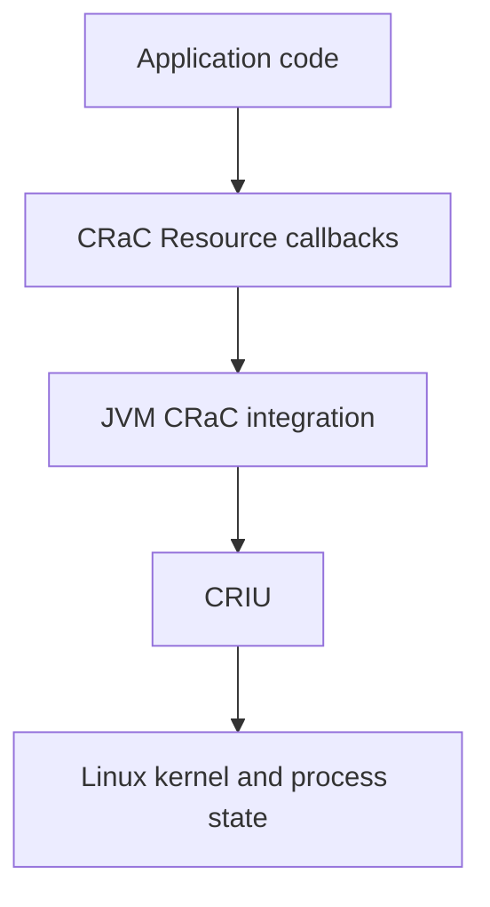
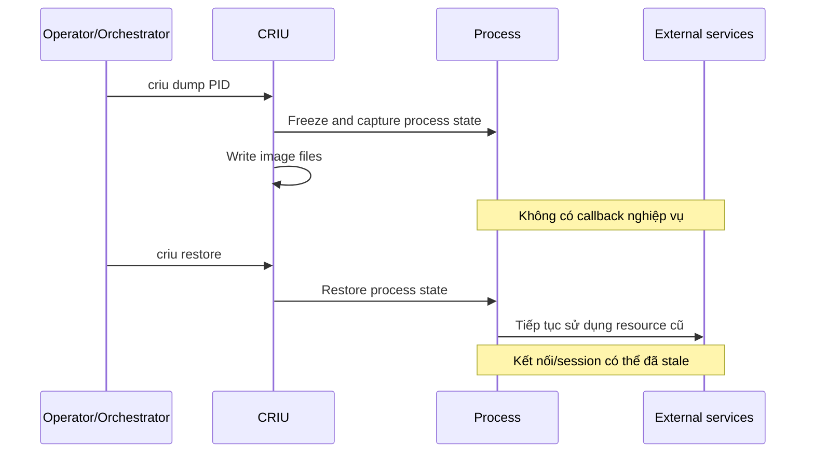
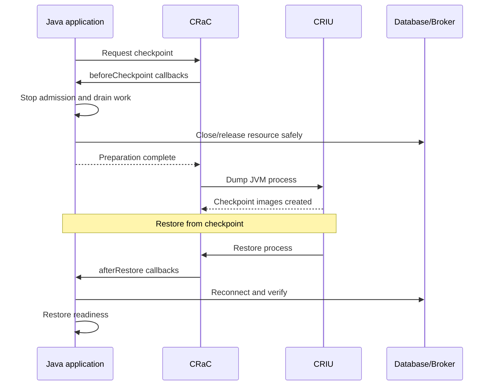

# CRaC và checkpoint tiến trình bằng CRIU không có phối hợp ứng dụng

CRIU (Checkpoint/Restore In Userspace) là công cụ Linux có thể lưu trạng thái của một tiến trình hoặc nhóm tiến trình rồi khôi phục chúng sau đó. CRIU làm việc ở mức hệ điều hành: nó thu thập trạng thái bộ nhớ, thread, file descriptor, socket và những tài nguyên kernel mà phiên bản CRIU cùng kernel hỗ trợ. Có thể dùng CRIU để checkpoint một tiến trình mà không cần sửa mã nguồn hoặc thêm callback vào ứng dụng.

CRaC (Coordinated Restore at Checkpoint) giải quyết một vấn đề khác ở cấp ứng dụng. Với Java, CRaC cung cấp API để ứng dụng chủ động chuẩn bị tài nguyên trước checkpoint và khôi phục chúng sau restore. Trên Linux, một bản phân phối JDK CRaC có thể sử dụng CRIU làm cơ chế checkpoint tiến trình ở tầng dưới. Nhờ callback, ứng dụng có thể dừng nhận công việc mới, drain request, đóng connection pool, giải phóng socket và tạo lại các resource sau restore.

Điểm khác biệt quan trọng là **CRIU có thể chụp và phục hồi trạng thái tiến trình mà không hiểu ý nghĩa nghiệp vụ của trạng thái đó; CRaC cho phép ứng dụng phối hợp để trạng thái được lưu và tiếp tục ở những ranh giới an toàn hơn**. Một ảnh CRIU có thể hợp lệ ở cấp process nhưng vẫn không bảo đảm transaction, message, lease, session hoặc kết nối tới dịch vụ bên ngoài có thể tiếp tục đúng.

## 1. CRIU checkpoint tiến trình ở cấp hệ điều hành

CRIU là công cụ userspace trên Linux dùng để dump trạng thái của tiến trình và restore từ các image đã tạo. Khi dump, CRIU thu thập những thông tin cần thiết để dựng lại tiến trình, ví dụ:

- Không gian địa chỉ và nội dung bộ nhớ của tiến trình.
- Thread, register state và một số trạng thái kernel liên quan.
- File descriptor và tài nguyên mà CRIU hỗ trợ.
- Socket, pipe, file, namespace và các đối tượng kernel theo khả năng của phiên bản đang dùng.
- Quan hệ giữa tiến trình cha/con trong phạm vi dump.
- Metadata cần thiết để khôi phục các tài nguyên đã ghi nhận.

CRIU không cần biết tiến trình đang chạy một web server, database client, Java application hay worker. Nó nhìn tiến trình như một tập trạng thái hệ điều hành có thể dump/restore.

### 1.1. Vì sao gọi là checkpoint không có phối hợp ứng dụng?

Một quy trình CRIU thuần có thể được điều khiển từ bên ngoài:

1. Người vận hành hoặc script xác định PID cần dump.
2. CRIU yêu cầu kernel và tiến trình đi vào trạng thái cần thiết để chụp ảnh.
3. CRIU lưu trạng thái tiến trình và tài nguyên hỗ trợ vào image directory.
4. Sau đó, một lệnh restore dựng lại tiến trình từ các image.

Trong quy trình này, CRIU không tự hỏi ứng dụng:

- Request hiện tại đã hoàn tất chưa?
- Database transaction đã commit hay rollback chưa?
- Message đã được acknowledge chưa?
- Scheduler có đang chạy job định kỳ không?
- Connection pool có cần đóng và tạo lại không?
- Credential hoặc lease có còn hợp lệ sau khoảng thời gian checkpoint được lưu không?

CRIU có thể dừng các thread tại thời điểm dump để ghi nhận trạng thái bộ nhớ nhất quán ở cấp tiến trình theo cơ chế của nó. Tuy nhiên, việc dừng thread không đồng nghĩa với việc hoàn tất một giao dịch nghiệp vụ hoặc phối hợp với hệ thống bên ngoài.

### 1.2. CRIU không chỉ là copy RAM

Checkpoint tiến trình không thể được thực hiện bằng cách đơn giản copy vùng RAM đang dùng. Tiến trình còn có file descriptor, memory mapping, thread state, signal state và tài nguyên kernel. CRIU phải lưu đủ thông tin để phục hồi những thành phần được hỗ trợ.

Ví dụ, nếu tiến trình có một socket TCP đang mở, image có thể chứa metadata cần thiết để CRIU xử lý socket đó. Nhưng khả năng phục hồi socket phụ thuộc loại socket, trạng thái kết nối, peer, network namespace, kernel và tùy chọn CRIU. Một socket được phục hồi ở cấp kernel cũng không chứng minh giao thức ứng dụng hoặc phiên làm việc ở server bên kia vẫn còn hiệu lực.

## 2. CRaC bổ sung phối hợp ở cấp ứng dụng

CRaC cung cấp một hợp đồng lifecycle cho ứng dụng. Trong Java, ứng dụng có thể triển khai `org.crac.Resource` và đăng ký resource vào context. Runtime gọi callback trước checkpoint và sau restore.

```java
import org.crac.Context;
import org.crac.Core;
import org.crac.Resource;

public final class DatabaseResource implements Resource {

    private DatabasePool pool;

    public DatabaseResource() throws Exception {
        pool = DatabasePool.connect();
        Core.getGlobalContext().register(this);
    }

    @Override
    public void beforeCheckpoint(Context<? extends Resource> context)
            throws Exception {
        pool.close();
        pool = null;
    }

    @Override
    public void afterRestore(Context<? extends Resource> context)
            throws Exception {
        pool = DatabasePool.connect();
        pool.verifyConnection();
    }
}
```

`DatabasePool` là lớp minh họa của ứng dụng. Trong code thực tế, cần drain operation đang dùng pool trước khi đóng, bảo vệ trạng thái bằng admission gate và chỉ đánh dấu resource sẵn sàng sau khi kết nối được xác minh.

### 2.1. Phối hợp có ý nghĩa gì?

Ứng dụng hiểu được ý nghĩa của tài nguyên mà nó đang dùng. Vì vậy, nó có thể:

- Ngừng nhận request hoặc message mới.
- Chờ request, task và transaction đang chạy hoàn tất.
- Flush buffer hoặc ghi tiến độ nghiệp vụ bền vững.
- Đóng connection pool, socket và client không nên giữ qua checkpoint.
- Tạm dừng scheduler và background consumer.
- Sau restore, tạo lại resource và xác minh dependency.
- Chỉ mở readiness sau khi ứng dụng thực sự sẵn sàng.

CRIU không tự thực hiện các quyết định nghiệp vụ này. CRaC cho ứng dụng một nơi để phối hợp chúng với lifecycle checkpoint.

### 2.2. CRaC và CRIU có thể cùng xuất hiện trong một kiến trúc

Trên một môi trường Linux được hỗ trợ, JDK CRaC có thể điều phối callback Java rồi sử dụng CRIU để dump/restore tiến trình. Có thể hình dung các lớp:



Khi checkpoint, ứng dụng chuẩn bị resource trước; JVM phối hợp với CRIU để lưu trạng thái tiến trình. Khi restore, tiến trình được phục hồi ở tầng dưới, sau đó lifecycle restore của CRaC cho phép ứng dụng tạo lại resource và tiếp tục.

Chi tiết triển khai, command line và mức hỗ trợ phụ thuộc JDK distribution, phiên bản CRaC/CRIU và môi trường Linux. Không nên giả định mọi JDK đều tích hợp CRIU theo cùng cách.

## 3. So sánh CRIU thuần và CRaC trong Java

| Tiêu chí | CRIU không có phối hợp ứng dụng | Java CRaC |
| --- | --- | --- |
| Lớp hoạt động | Process, thread và kernel resources | Lifecycle ứng dụng/JVM kết hợp checkpoint tiến trình |
| Cần sửa mã ứng dụng | Không nhất thiết | Thường cần tích hợp resource lifecycle để xử lý tài nguyên |
| Hiểu request và transaction | Không | Ứng dụng có thể phối hợp tại ranh giới nghiệp vụ |
| Quản lý connection pool | Không tự hiểu pool; chỉ xử lý FD theo khả năng | Callback có thể đóng và tạo lại pool |
| Drain background work | Không tự biết semantics task | Ứng dụng có thể dừng producer và chờ task |
| Khôi phục resource | Phục hồi trạng thái kernel được hỗ trợ | Callback có thể tái tạo và xác minh resource |
| Readiness | Cần cơ chế bên ngoài | Ứng dụng có thể điều khiển availability/readiness |
| Portability | Phụ thuộc Linux, kernel và CRIU | Cũng phụ thuộc runtime/platform; API ứng dụng tạo lifecycle rõ hơn |
| Phù hợp | Tiến trình có thể đóng băng/tiếp tục mà không cần logic ứng dụng | Ứng dụng Java cần kiểm soát resource và tính đúng đắn sau restore |

CRIU thuần có ưu điểm là có thể checkpoint nhiều loại tiến trình mà không cần sửa source. CRaC có ưu điểm là ứng dụng chủ động xử lý các tài nguyên và trạng thái mà kernel không thể hiểu về mặt nghiệp vụ.

Không nên xem hai lựa chọn là hai công cụ thay thế hoàn toàn. CRaC trên Linux có thể sử dụng CRIU ở tầng thấp; sự khác biệt nằm ở việc ứng dụng có tham gia chuẩn bị và phục hồi hay không.

## 4. Tính nhất quán của process không đồng nghĩa nhất quán nghiệp vụ

Giả sử một Java service đang xử lý đơn hàng:

1. Nhận message `order-123` từ broker.
2. Ghi đơn hàng vào database.
3. Commit transaction.
4. Gửi acknowledgment tới broker.

Nếu checkpoint xảy ra sau bước 3 nhưng trước bước 4, process có thể được dump trong khi message vẫn chưa được ack. Sau restore, broker có thể giao lại message. Nếu handler không idempotent, đơn hàng có thể được xử lý hai lần.

CRIU không biết rằng bước 3 đã commit và bước 4 còn thiếu. Nó chỉ ghi lại trạng thái tiến trình tại thời điểm dump. CRaC cho phép ứng dụng drain message hoặc hoàn tất ranh giới nghiệp vụ trước checkpoint.

### 4.1. Ví dụ request HTTP đang xử lý

Một request có thể đang ở giữa các bước:

```text
HTTP request received
    -> validate input
    -> update database
    -> publish event
    -> write HTTP response
```

Nếu chỉ đóng băng process ở giữa chuỗi này, trạng thái bộ nhớ có thể được lưu khi request còn dở. Sau restore, request thread có thể tiếp tục thực thi, nhưng database và message broker ở bên ngoài không nhất thiết quay lại cùng trạng thái. Event có thể đã publish, transaction có thể đã commit hoặc connection có thể đã bị server đóng.

Đối với ứng dụng có side effect, nên sử dụng admission gate và drain trước checkpoint. Nếu không thể drain trong deadline, checkpoint nên thất bại hoặc task phải được chuyển về trạng thái durable có thể retry.

### 4.2. Process freeze không thay thế transaction boundary

CRIU cần tạm dừng thread để chụp trạng thái. Đây là cơ chế snapshot process, không phải transaction coordinator cho database, broker, object storage hoặc dịch vụ ngoài.

Để bảo đảm tính đúng đắn, ứng dụng vẫn cần:

- Commit hoặc rollback transaction trước checkpoint.
- Chỉ acknowledge message sau khi side effect bền vững.
- Dùng idempotency key hoặc unique constraint để chống giao lại.
- Lưu tiến độ job dài tại ranh giới bền vững.
- Không giữ transaction hoặc lock phân tán qua khoảng thời gian ảnh được lưu.

## 5. Những loại tài nguyên CRIU có thể và không thể tự xử lý

Khả năng dump/restore của CRIU phụ thuộc loại tài nguyên và môi trường. Không nên dùng một bảng đơn giản để kết luận mọi tài nguyên cùng loại đều được hỗ trợ.

| Tài nguyên | Góc nhìn CRIU | Vấn đề ứng dụng cần xem xét |
| --- | --- | --- |
| Anonymous memory | Có thể lưu trạng thái memory mapping được hỗ trợ | Object trong heap có còn hợp lệ về mặt nghiệp vụ không? |
| Thread/process | Lưu trạng thái thread và quan hệ tiến trình được hỗ trợ | Thread có đang ở ranh giới an toàn không? |
| Regular file FD | Có thể ghi nhận descriptor và metadata theo điều kiện | File path, mount và nội dung có còn đúng sau restore? |
| TCP socket | Có hỗ trợ trong một số điều kiện và tùy chọn | Peer có còn giữ kết nối/session không? |
| Unix socket | Phụ thuộc socket type, namespace và endpoint | Server và socket path có tồn tại đúng không? |
| Pipe/FIFO | Phụ thuộc cả hai đầu và trạng thái peer | Peer còn sống hay đã kết thúc? |
| epoll/eventfd | Phụ thuộc cách tạo và hỗ trợ của CRIU/kernel | Event loop và thread owner có thể tiếp tục đúng không? |
| Device/GPU handle | Thường phụ thuộc driver và loại device | Vendor có hỗ trợ dump/restore không? |
| Database transaction | CRIU không hiểu transaction semantics | Phải commit/rollback hoặc phục hồi qua ứng dụng |
| Distributed lock/lease | CRIU không xác nhận quyền sở hữu ở hệ thống ngoài | Phải lấy lại lease sau restore |
| Credential/token | Có thể nằm trong memory snapshot | Có hết hạn hoặc bị thu hồi khi ảnh được lưu không? |

Đối với một số loại FD, CRIU có thể cần các tùy chọn riêng hoặc điều kiện môi trường cụ thể. Cần xem tài liệu phiên bản CRIU và thử nghiệm bằng đúng kernel, namespace và loại tài nguyên của ứng dụng.

## 6. Vì sao checkpoint không phối hợp có thể nguy hiểm với Java?

Java process có nhiều tầng trạng thái:

- Heap object và object graph.
- JVM internal structures.
- Java thread và native thread.
- JIT code và code cache.
- Garbage collector metadata.
- JNI/JNA native handle.
- File descriptor do JVM hoặc thư viện native mở.
- Connection pool, client session và background executor.

CRIU có thể ghi lại trạng thái process mà nó hỗ trợ, nhưng không hiểu hợp đồng lifecycle của Java library. Ví dụ, một database driver có thể giữ socket, thread heartbeat, timeout scheduler và trạng thái protocol. Phục hồi FD không đảm bảo database server vẫn coi session đó là hợp lệ.

### 6.1. Thread đang chờ hoặc giữ lock

Một thread có thể đang chờ monitor, condition, native mutex hoặc I/O. Snapshot có thể giữ thread state và lock state ở cấp process, nhưng khi restore, các thread khác hoặc hệ thống bên ngoài có thể không còn ở trạng thái tương ứng.

Các tình huống cần xem xét:

- Thread đang giữ lock trong lúc gọi native method.
- Worker đang block trên socket tới peer đã đóng.
- Thread đang chờ callback từ một event loop không còn hoạt động.
- Thread giữ transaction hoặc resource lease có thời hạn.
- Thread pool có task đã nhận nhưng chưa bắt đầu.

Ứng dụng cần dừng nhận công việc mới và đưa các task về ranh giới an toàn trước checkpoint. Không dựa vào việc process freeze sẽ tự giải quyết deadlock hoặc lock ownership.

### 6.2. Native library và descriptor

JNI/JNA library có thể mở FD, tạo thread hoặc giữ native pointer. Nếu thư viện không có hợp đồng checkpoint/restore, CRIU có thể phục hồi một phần process state nhưng thư viện vẫn không biết cần reconnect, reinitialize hoặc validate handle như thế nào.

Với native resource quan trọng, hãy dùng CRaC `Resource` hoặc một lifecycle coordinator để gọi API shutdown trước checkpoint và khởi tạo lại sau restore.

## 7. Ví dụ checkpoint một tiến trình bằng CRIU thuần

CRIU cung cấp các lệnh `dump` và `restore`. Cú pháp cụ thể và yêu cầu quyền phụ thuộc phiên bản CRIU và cách triển khai. Một ví dụ đơn giản trên Linux:

```bash
mkdir -p /var/tmp/criu-images

# Dump process có PID đã xác định vào image directory
sudo criu dump \
  -t 12345 \
  -D /var/tmp/criu-images \
  --shell-job
```

Trong ví dụ, `12345` là PID minh họa. `--shell-job` có thể cần khi tiến trình gắn với job control/terminal của shell. Không phải mọi tiến trình đều cần tùy chọn này. CRIU có thể yêu cầu quyền root hoặc capabilities và các điều kiện kernel/namespace phù hợp.

Restore:

```bash
sudo criu restore \
  -D /var/tmp/criu-images \
  --shell-job
```

Các lệnh trên chỉ minh họa luồng cơ bản. Với một workload thực tế, cần đọc `criu help dump`, `criu help restore`, kiểm tra `criu check`, xem log và xác định những tùy chọn phù hợp. Một số tài nguyên như TCP socket established có thể cần xử lý hoặc tùy chọn riêng. Không copy nguyên lệnh mẫu vào production mà chưa kiểm tra môi trường.

### 7.1. Những điều lệnh CRIU không làm thay ứng dụng

Lệnh `criu dump` không tự:

- Gọi một method Java để dừng HTTP admission.
- Chờ transaction database hoàn tất.
- Pause consumer và commit offset theo semantics nghiệp vụ.
- Hủy scheduler trigger hoặc lưu tiến độ job.
- Refresh credential sau khoảng thời gian checkpoint.
- Kiểm tra readiness trước khi load balancer gửi traffic.

Nếu cần các thao tác này, phải có phối hợp từ ứng dụng hoặc một giao thức điều phối bên ngoài. External orchestration có thể gọi admin endpoint, gửi signal hoặc chạy script trước/sau CRIU, nhưng đó là logic do hệ thống triển khai bổ sung; CRIU không tự hiểu các thao tác đó.

### 7.2. `--leave-running` và tính nhất quán

CRIU có tùy chọn giữ tiến trình tiếp tục chạy sau dump trong một số workflow. Khi dùng, cần hiểu rằng process gốc và checkpoint image có thể tiếp tục đi theo hai nhánh trạng thái khác nhau. Sau thời điểm dump, process gốc có thể tiếp tục tạo side effect trong khi image giữ trạng thái cũ.

Không dùng ảnh được tạo bằng cách để process gốc tiếp tục chạy như một bản snapshot đồng bộ với trạng thái bên ngoài. Nếu muốn test restore độc lập, cần cô lập môi trường hoặc bảo đảm các side effect không gây xung đột. Đối với production, phải có kế hoạch rõ ràng về process gốc, dữ liệu ngoài và quyền sở hữu resource.

## 8. Ví dụ Java CRaC phối hợp trước checkpoint

Với CRaC, ứng dụng có thể đăng ký resource và gọi thao tác đóng/mở phù hợp. Ví dụ dưới đây minh họa một server có admission gate:

```java
import org.crac.Context;
import org.crac.Core;
import org.crac.Resource;

public final class ServerResource implements Resource {

    private final RequestGate requestGate;
    private final ServerLifecycle server;

    public ServerResource(RequestGate requestGate,
                          ServerLifecycle server) {
        this.requestGate = requestGate;
        this.server = server;
        Core.getGlobalContext().register(this);
    }

    @Override
    public void beforeCheckpoint(Context<? extends Resource> context)
            throws Exception {
        requestGate.stopAccepting();
        requestGate.awaitDrained();
        server.stopAndCloseResources();
    }

    @Override
    public void afterRestore(Context<? extends Resource> context)
            throws Exception {
        server.reopenResources();
        server.verifyReady();
        requestGate.resume();
    }
}
```

`RequestGate` và `ServerLifecycle` là abstraction minh họa. Code production cần timeout, xử lý interruption, rollback khi checkpoint bị hủy, và chỉ mở gate sau khi listener cùng dependency đã được xác minh. Với framework server có CRaC integration riêng, cần dùng đúng lifecycle của framework để tránh đóng/mở listener hai lần.

### 8.1. Khác biệt về trách nhiệm

Ở mô hình CRIU thuần, người vận hành hoặc script chịu trách nhiệm đảm bảo tiến trình đã ở trạng thái phù hợp trước khi gọi `criu dump`. Ở mô hình CRaC, callback cho phép chính ứng dụng phối hợp việc đó trong lifecycle checkpoint.

CRaC không tự động làm cho mọi resource an toàn. Ứng dụng vẫn phải đăng ký và triển khai đúng resource lifecycle. Nếu không có callback hoặc library không hỗ trợ, resource có thể vẫn gây vấn đề.

## 9. Phối hợp bên ngoài khi không thể sửa ứng dụng

Có những ứng dụng legacy không thể thay đổi source code hoặc thêm CRaC API. Có thể xây dựng một lớp orchestration bên ngoài, nhưng cần hiểu giới hạn của cách làm này.

Ví dụ một quy trình:

1. Load balancer ngừng gửi request mới tới instance.
2. Orchestrator gọi admin endpoint hoặc gửi tín hiệu mà ứng dụng đã hỗ trợ.
3. Chờ request/task đang chạy kết thúc theo metric hoặc endpoint trạng thái.
4. Dừng producer hoặc scheduler nếu có cơ chế quản trị bên ngoài.
5. Xác minh dependency và process ở trạng thái có thể dump.
6. Gọi CRIU dump.
7. Khi restore, gọi script hoặc admin endpoint để reconnect/validate resource.
8. Chỉ đưa instance vào load balancer sau health check.

Cách này có thể hữu ích khi không thể sửa ứng dụng, nhưng nó chỉ hiệu quả nếu ứng dụng đã có giao diện quản trị đủ tin cậy. Nếu không có cách xác định request đang chạy, transaction hoặc worker state, orchestrator không thể suy ra một cách an toàn chỉ từ số thread hay CPU usage.

### 9.1. Signal không phải transaction boundary

Gửi `SIGSTOP` hoặc dùng cơ chế freeze process sẽ dừng thread, nhưng không yêu cầu ứng dụng hoàn tất transaction hoặc ghi tiến độ. Signal handler cũng không thể tùy ý thực hiện mọi thao tác phức tạp và an toàn trong mọi ngữ cảnh.

Nếu ứng dụng hỗ trợ signal để chuyển sang drain mode, hãy dùng một handler tối giản để báo hiệu cho main lifecycle manager. Manager mới thực hiện việc drain, đóng resource và báo trạng thái sẵn sàng cho orchestrator.

### 9.2. Admin endpoint hoặc control channel

Một admin endpoint có thể cung cấp các thao tác:

- `POST /admin/quiesce`: ngừng nhận công việc mới.
- `GET /admin/status`: trả số request/task đang hoạt động.
- `POST /admin/prepare-checkpoint`: flush và đóng resource theo policy.
- `POST /admin/resume`: phục hồi hoạt động nếu checkpoint bị hủy.
- `POST /admin/after-restore`: kiểm tra hoặc khởi động thành phần sau restore nếu không dùng CRaC callback.

Đây là API do ứng dụng tự xây dựng, không phải endpoint mặc định của CRIU. Cần xác thực và giới hạn quyền truy cập, vì các thao tác này có thể ảnh hưởng trực tiếp tới trạng thái process.

## 10. Tác động tới database, broker và dịch vụ bên ngoài

Checkpoint process không chụp trạng thái đồng bộ của tất cả hệ thống mà process đang giao tiếp. Database, broker, cache và service ngoài tiếp tục vận hành độc lập.

### 10.1. Database connection

Một socket có thể được lưu trong process image, nhưng database server có thể đã đóng session hoặc transaction timeout trong lúc checkpoint được lưu. Driver có thể còn giữ object connection trong heap nhưng object đó không đảm bảo còn dùng được.

Với Java application, thường nên:

- Ngừng nhận query mới.
- Chờ transaction đang chạy hoàn tất.
- Đóng connection pool theo hướng dẫn driver.
- Sau restore tạo pool mới.
- Chạy validation query có timeout.
- Chỉ mở traffic khi pool sẵn sàng.

### 10.2. Message broker

Consumer có thể đã nhận message nhưng chưa ack. Nếu process được restore từ trạng thái trước ack trong khi broker đã giao message lại cho consumer khác, có thể xảy ra xử lý trùng.

Trước checkpoint, pause consumer và chờ message đang xử lý đạt ranh giới an toàn. Nếu không thể hoàn tất, để broker redeliver theo semantics đã định. Handler cần idempotent.

### 10.3. Distributed lock và lease

Một lock object trong heap hoặc FD tới một service không chứng minh quyền sở hữu lease vẫn còn sau restore. Lease có thể hết hạn và được cấp cho instance khác trong lúc checkpoint được lưu.

Sau restore, cần yêu cầu lease mới, kiểm tra fencing token hoặc ownership version rồi mới chạy công việc độc quyền.

### 10.4. Credential và session

Token có thể hết hạn hoặc bị thu hồi trong thời gian checkpoint được lưu. Không nên giữ session cũ chỉ vì object token vẫn còn trong heap. Hãy refresh credential qua identity provider hoặc secret manager trước khi mở readiness.

## 11. Khi nào checkpoint không phối hợp có thể chấp nhận?

Checkpoint process không có phối hợp ứng dụng có thể phù hợp nếu tiến trình có trạng thái đơn giản, có thể đóng băng và tiếp tục mà không vi phạm semantics của tài nguyên bên ngoài.

Một số trường hợp có thể xem xét:

- Worker tính toán thuần, input đã được lưu bền vững và output chưa commit.
- Tiến trình xử lý dữ liệu theo chunk có checkpoint nghiệp vụ độc lập.
- Tool hoặc job ngắn chạy trong môi trường cô lập.
- Ứng dụng legacy có protocol quản trị bên ngoài đã được kiểm chứng.
- Workload thử nghiệm hoặc nghiên cứu, nơi có thể chấp nhận khởi động lại khi restore thất bại.

Ngay cả trong các trường hợp này, cần xác minh tài nguyên kernel và external state. Nếu process có socket, lock, database transaction hoặc device handle, vẫn cần test cụ thể.

## 12. Khi nào nên dùng CRaC hoặc phối hợp ứng dụng?

Nên ưu tiên phối hợp ứng dụng khi:

- Ứng dụng phục vụ HTTP request hoặc RPC có request đang chạy.
- Có database transaction hoặc connection pool.
- Có message consumer, scheduler hoặc background worker.
- Có native library và file descriptor đặc biệt.
- Có distributed lock, lease hoặc leader election.
- Credential/session có thời hạn.
- Cần readiness chính xác trước khi nhận traffic.
- Cần bảo đảm không mất hoặc xử lý trùng side effect.

Trong những hệ thống này, việc process snapshot thành công chưa đủ. Cần một lifecycle hiểu tài nguyên và nghiệp vụ. CRaC cung cấp API Java để triển khai điều đó; một orchestration layer bên ngoài cũng có thể thực hiện nếu ứng dụng có control interface đủ tin cậy.

## 13. Kiểm thử CRIU thuần

Nếu chọn CRIU mà không có application callback, cần xây dựng test chứng minh tiến trình có thể dump/restore trong điều kiện thực tế.

### 13.1. Kiểm thử process đơn giản

Bắt đầu bằng một chương trình thử không giữ tài nguyên ngoài phức tạp, ví dụ process ghi counter vào memory và định kỳ log trạng thái. Thực hiện dump, restore và xác nhận process tiếp tục.

Sau đó tăng dần độ phức tạp:

1. Nhiều thread.
2. File descriptor tới file.
3. Pipe và event descriptor.
4. TCP socket.
5. Child process.
6. Native library.
7. Database/broker client trong môi trường test.

Mỗi loại tài nguyên cần có test riêng vì khả năng hỗ trợ và semantics khác nhau.

### 13.2. Kiểm tra external consistency

Ngoài việc kiểm tra process tiếp tục chạy, hãy xác nhận:

- Database không có transaction bị bỏ dở.
- Message không bị mất hoặc xử lý trùng ngoài policy.
- Peer socket còn hoạt động hoặc ứng dụng xử lý disconnect.
- File lock và lease không bị giữ sai.
- Process không tạo side effect trùng sau restore.

Nếu không có cách quan sát các trạng thái này, chưa đủ bằng chứng để dùng checkpoint không phối hợp cho production.

## 14. Kiểm thử CRaC

Với CRaC, test cần bao phủ cả resource callbacks và kết quả restore.

Một bộ test cơ bản:

| Kiểm tra | Kết quả mong đợi |
| --- | --- |
| `beforeCheckpoint` | Ngừng admission và drain task |
| Đóng resource | Không còn thao tác đang sử dụng connection/socket cần đóng |
| Checkpoint | Runtime tạo ảnh thành công |
| Restore | JVM được phục hồi từ đúng image và runtime |
| `afterRestore` | Dependency và resource được tạo lại, xác minh |
| Readiness | Chỉ accepting sau khi listener và dependency sẵn sàng |
| Smoke test | Request và job đại diện hoạt động đúng |
| Lặp restore | Không tạo resource trùng hoặc leak |

Không nên chỉ assert callback được gọi. Test cần kiểm tra kết quả thực tế, ví dụ database query thành công, broker consumer resume đúng, file descriptor được tạo lại và readiness chuyển trạng thái đúng thời điểm.

## 15. So sánh quy trình vận hành

### 15.1. CRIU không có phối hợp ứng dụng



### 15.2. CRaC có phối hợp ứng dụng



Hai sơ đồ mô tả cách phối hợp khái quát. Thứ tự chính xác giữa JVM, CRaC implementation và CRIU phụ thuộc JDK distribution và môi trường triển khai.

## 16. Quyết định giữa CRIU thuần, CRaC và orchestration bên ngoài

Có thể dùng bảng sau để định hướng lựa chọn:

| Điều kiện ứng dụng | Hướng phù hợp để đánh giá |
| --- | --- |
| Process đơn giản, không giữ external session quan trọng | CRIU thuần có thể đủ sau khi test |
| Không thể sửa ứng dụng nhưng có admin/drain interface tin cậy | Orchestration bên ngoài kết hợp CRIU |
| Java service có nhiều resource cần đóng/mở lại | CRaC Resource lifecycle |
| Ứng dụng có request, transaction và consumer | CRaC hoặc coordination layer có semantics nghiệp vụ |
| Native library không hỗ trợ checkpoint | Đóng và khởi tạo lại qua lifecycle nếu có API; nếu không, không dùng checkpoint cho tài nguyên đó |
| Kernel/CRIU không hỗ trợ loại resource bắt buộc | Thay đổi thiết kế/resource hoặc không dùng checkpoint cho workload đó |
| Không thể kiểm tra external consistency | Chưa đủ cơ sở để phát hành checkpoint không phối hợp |

Lựa chọn cuối cùng phải dựa trên test của workload cụ thể. Không nên quyết định chỉ từ việc CRIU có thể dump một PID thành công.

## 17. Rủi ro bảo mật và vận hành

Checkpoint có thể chứa toàn bộ dữ liệu trong memory, bao gồm token, password, session và thông tin người dùng. Cả CRIU và CRaC đều cần bảo vệ artifact checkpoint.

Các yêu cầu nên có:

- Hạn chế quyền đọc/ghi checkpoint directory.
- Lưu artifact trong repository hoặc object store có authentication và audit.
- Mã hóa khi truyền và lưu trữ theo chính sách.
- Xác minh checksum và nguồn gốc artifact trước restore.
- Gắn checkpoint với đúng JDK, application build và môi trường tương thích.
- Có retention policy và quy trình xóa artifact hết hạn.
- Không đưa nội dung heap hoặc credential vào log.
- Kiểm soát quyền CRIU, ptrace, capabilities và quyền truy cập namespace.

Đối với CRIU thuần, quyền thực thi dump/restore có thể rất nhạy cảm vì công cụ thao tác trực tiếp với trạng thái process. Chỉ cấp quyền cho identity vận hành được phép và giới hạn PID, namespace hoặc workload theo policy.

## 18. Các lỗi thường gặp khi dùng CRIU không phối hợp

| Lỗi | Hậu quả | Cách xử lý |
| --- | --- | --- |
| Cho rằng dump thành công nghĩa là ứng dụng nhất quán | Transaction hoặc message có thể đang dở | Drain và kiểm tra ranh giới nghiệp vụ |
| Giữ database socket qua thời gian dài | Server có thể đóng session hoặc timeout | Đóng pool và reconnect sau restore |
| Không pause message consumer | Message có thể được giao lại hoặc xử lý trùng | Pause, drain và dùng idempotency |
| Không kiểm tra socket peer | FD được phục hồi nhưng giao thức không còn hợp lệ | Verify hoặc reconnect |
| Dùng `SIGSTOP` thay cho quiesce | Thread bị dừng giữa side effect | Dùng application drain protocol |
| Không kiểm tra FD/native handle | Restore thất bại hoặc library dùng handle stale | Inventory và test từng loại resource |
| Restore trên kernel/CRIU khác | Thiếu capability hoặc resource không tương thích | Pin compatibility profile và test target |
| Để process gốc tiếp tục chạy sau dump mà không cô lập | External state diverges khỏi checkpoint | Quản lý process gốc và side effect rõ ràng |
| Không kiểm tra readiness | Traffic tới process chưa phục hồi resource | Readiness gate trước khi đưa vào load balancer |
| Không bảo vệ checkpoint | Lộ dữ liệu runtime hoặc bị thay thế | ACL, encryption, signature và audit |

## 19. Quy trình vận hành đề xuất

Nếu dùng CRIU thuần cho một process có thể tiếp tục an toàn, quy trình tối thiểu nên gồm:

1. Xác định process, process tree và các resource đang mở.
2. Kiểm tra kernel, CRIU, namespace, capability và quyền cần thiết.
3. Đảm bảo ứng dụng đã ở trạng thái có thể dump theo hợp đồng vận hành.
4. Tạo checkpoint trong staging location.
5. Xác minh image files, metadata và checksum.
6. Restore trong môi trường tương thích.
7. Xác nhận process, FD, thread và external connection hoạt động.
8. Chạy workload kiểm thử và quan sát error/latency.
9. Chỉ phát hành sau khi restore test đạt.

Nếu dùng CRaC cho Java service, bổ sung:

1. Đăng ký `Resource` cho các thành phần sở hữu tài nguyên.
2. Đóng admission và drain request/task trong `beforeCheckpoint`.
3. Đóng resource cần tạo lại theo thứ tự dependency.
4. Tạo checkpoint bằng JDK CRaC tương thích.
5. Sau restore, tạo lại dependency và resource trong `afterRestore`.
6. Xác minh listener, readiness và smoke test.
7. Mở traffic sau khi ứng dụng thực sự sẵn sàng.

## 20. Kết luận

CRIU có thể checkpoint và restore tiến trình Linux mà không cần ứng dụng triển khai callback. Cách làm này hữu ích với process đơn giản hoặc workload đã có một giao thức điều phối bên ngoài đáng tin cậy. Tuy nhiên, CRIU chỉ làm việc với trạng thái process và tài nguyên kernel mà nó hỗ trợ; nó không hiểu transaction, request, message acknowledgment, cache freshness, lease hoặc session nghiệp vụ.

CRaC bổ sung cơ chế phối hợp ở cấp ứng dụng Java thông qua `Resource` callbacks. Ứng dụng có thể ngừng nhận công việc, drain task, đóng resource trước checkpoint và tạo lại chúng sau restore. Trên Linux, CRaC implementation có thể dùng CRIU ở tầng dưới, vì vậy hai công nghệ có thể bổ sung cho nhau.

Hãy chọn CRIU thuần chỉ khi đã chứng minh process có thể tiếp tục đúng mà không cần application coordination. Với Java service có kết nối, background task hoặc side effect, hãy dùng CRaC hoặc một coordination layer có semantics rõ ràng, kiểm thử trên đúng kernel/CRIU/JDK và chỉ phát hành sau khi restore, resource và readiness đều đạt.
