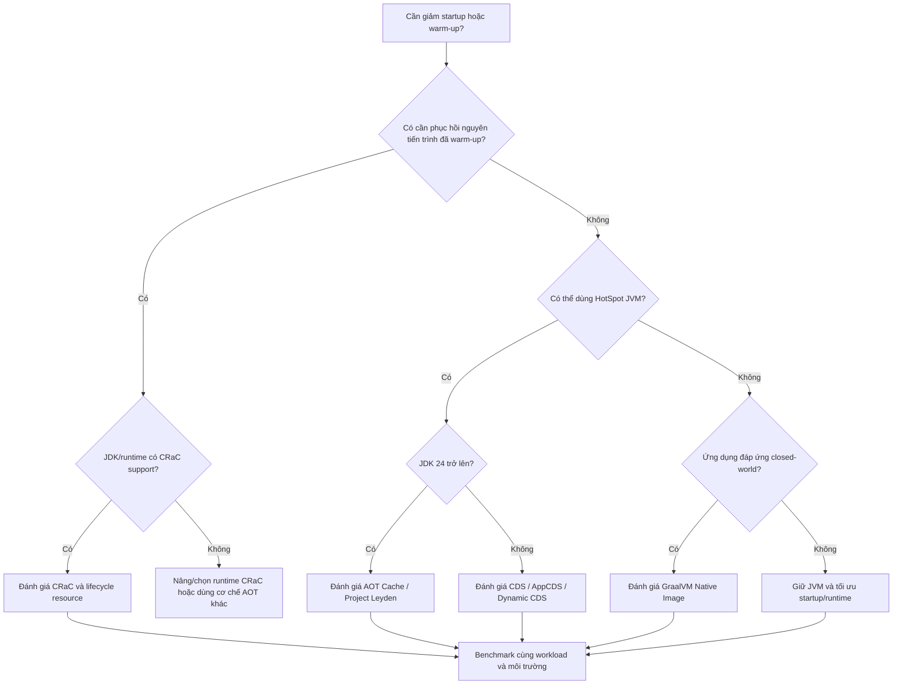

# CRaC và các cơ chế AOT của JDK: kiểm tra theo phiên bản

CRaC, Class Data Sharing (CDS), Application CDS (AppCDS), AOT Cache của Project Leyden và GraalVM Native Image đều có thể cải thiện thời gian khởi động Java, nhưng chúng làm việc ở những lớp khác nhau. Khi chọn giải pháp, cần xác định chính xác JDK đang dùng, bản phân phối, build, hệ điều hành, CPU và loại artifact được tạo. Một tùy chọn từng tồn tại trong JDK cũ có thể đã bị loại bỏ; một cơ chế AOT mới có thể chỉ xuất hiện từ JDK 24 hoặc 25; còn CRaC thường phụ thuộc bản JDK/runtime có tích hợp checkpoint/restore.

Điểm phân biệt quan trọng nhất là:

- **CRaC chụp trạng thái của một tiến trình Java đang chạy.** JVM và ứng dụng được khởi tạo, có thể đã warm-up và chạy JIT; checkpoint lưu trạng thái tiến trình để restore tiếp tục từ điểm đã chụp.
- **CDS/AppCDS lưu dữ liệu class đã chuẩn bị.** JVM mới vẫn khởi động bình thường, nhưng có thể nạp metadata class nhanh hơn và chia sẻ một số vùng read-only giữa nhiều JVM.
- **AOT Cache của Project Leyden lưu những artifact đã chuẩn bị trước cho HotSpot.** Tùy JDK, cache có thể chứa class đã load/link, heap object được cache và method profile; mỗi lần chạy vẫn tạo JVM mới và đi qua startup của ứng dụng.
- **GraalVM Native Image biên dịch ứng dụng thành executable native theo mô hình phân tích tĩnh.** Ứng dụng chạy bằng native runtime thay vì khởi động một HotSpot JVM truyền thống.

Do đó, không nên xem CRaC là một tên gọi khác của AOT. CRaC phục hồi một tiến trình đã tồn tại; các cơ chế AOT chuẩn bị một phần công việc trước khi một lần chạy mới bắt đầu. Chúng có thể cùng hướng tới startup nhanh, nhưng khác nhau về trạng thái được giữ, ràng buộc tương thích và cách triển khai.

## 1. Bản đồ các cơ chế

| Cơ chế | Chuẩn bị trước điều gì? | Khi chạy ứng dụng | Có phục hồi nguyên tiến trình đã chạy không? |
|---|---|---|---|
| CDS | Metadata của các class nền tảng trong archive | JVM mới memory-map archive và nạp class từ dữ liệu đã chuẩn bị | Không |
| AppCDS | Thêm class của ứng dụng và thư viện vào archive | JVM mới sử dụng archive phù hợp với classpath/module path | Không |
| Dynamic CDS | Tự ghi archive từ các class đã được nạp trong lần chạy trước | JVM mới dùng archive được tạo từ lần chạy đó | Không |
| AOT Cache / Project Leyden | Class loading/linking, một số heap object và method profile theo phiên bản JDK | HotSpot JVM mới dùng cache để giảm startup/warm-up | Không |
| `jaotc` đời cũ | Biên dịch AOT thử nghiệm thành mã máy | JVM dùng cơ chế AOT thử nghiệm của JDK cũ | Không |
| GraalVM Native Image | Phân tích reachable code và biên dịch executable native | Chạy executable native, không cần HotSpot JVM riêng | Không theo cơ chế CRaC HotSpot |
| CRaC | Trạng thái một JVM và ứng dụng đang chạy, gồm trạng thái đã warm-up được runtime hỗ trợ | Restore tiếp tục từ điểm checkpoint | Có |

Các cơ chế có thể kết hợp trong một pipeline, nhưng không tự động thay thế nhau. Ví dụ, AppCDS có thể giảm chi phí class loading của cold start; AOT Cache có thể chuẩn bị thêm trạng thái class/object/profile; CRaC có thể bỏ qua phần lớn startup bằng cách phục hồi tiến trình đã chuẩn bị. Native Image là một lựa chọn triển khai khác với mô hình runtime khác.

## 2. Lịch sử theo phiên bản JDK

Tên “AOT” đã được dùng cho nhiều công nghệ khác nhau qua các thế hệ JDK. Khi đọc tài liệu cũ, cần kiểm tra JEP và phiên bản cụ thể thay vì giả định mọi tính năng AOT đều còn trong JDK hiện tại.

| Phiên bản | Mốc đáng chú ý | Ý nghĩa khi lựa chọn |
|---|---|---|
| JDK 8 và cũ hơn | CDS đã tồn tại trong HotSpot; chủ yếu chia sẻ class metadata của JDK | Có thể dùng CDS theo khả năng của bản phân phối |
| JDK 9 | JEP 295 giới thiệu `jaotc` AOT compiler dạng thử nghiệm | Đây là cơ chế AOT đời cũ, không phải AOT Cache hiện đại |
| JDK 10 | JEP 310 mở rộng AppCDS cho class ứng dụng và đưa tính năng này vào OpenJDK | AppCDS trở thành lựa chọn rộng rãi hơn, không còn chỉ là tính năng thương mại riêng |
| JDK 13 | JEP 350 giới thiệu Dynamic CDS Archives | Có thể tạo archive từ các class đã được nạp khi ứng dụng thoát |
| JDK 16 | `jaotc` và Java-based Graal JIT thử nghiệm bị loại khỏi bản JDK | Không xây quy trình mới dựa vào `jaotc` |
| JDK 17 | Tài liệu migration xác nhận các thành phần AOT/Graal JIT thử nghiệm đã bị loại ở JDK 16 | Các JDK hiện đại không có `jaotc` đời cũ; CDS/AppCDS vẫn tiếp tục |
| JDK 21 | CDS/AppCDS tiếp tục có trong JDK; AOT Cache Leyden chưa được đưa vào JDK chuẩn | Với JDK 21, đánh giá CDS/AppCDS hoặc CRaC runtime riêng; không giả định có `-XX:AOTCache` |
| JDK 24 | JEP 483 đưa AOT Cache của Project Leyden vào HotSpot | Có workflow training, assembly và production để chuẩn bị class loading/linking và object |
| JDK 25 | JEP 514 đơn giản hóa tạo cache; JEP 515 bổ sung method profiling từ training run | AOT Cache hỗ trợ startup và warm-up tốt hơn; có thể tạo cache bằng một lệnh tiện dụng |
| JDK 26 | JEP 516 cập nhật object caching để hỗ trợ mọi GC, gồm ZGC | Hạn chế object cache phụ thuộc GC được tháo gỡ; có định dạng object trung lập GC |
| JDK 27 | AOT Cache và các workflow của Leyden tiếp tục hiện diện; JDK 27 có thay đổi riêng đối với JVMCI/Graal JIT | Kiểm tra release notes của đúng vendor/build; không suy diễn từ tên tính năng AOT chung |

### Lưu ý về JDK 16 và JDK 17

`jaotc` được giới thiệu trong JDK 9 theo JEP 295. Đây là AOT compiler thử nghiệm của HotSpot, với giới hạn nền tảng và vận hành riêng. Thành phần này cùng Java-based Graal JIT thử nghiệm bị loại khỏi các bản JDK từ JDK 16. JDK 17 migration guide vẫn liệt kê chúng trong nhóm thành phần đã bị loại ở JDK 16.

Việc loại `jaotc` không có nghĩa Java không còn AOT. CDS/AppCDS tiếp tục tồn tại, Project Leyden sau này đưa AOT Cache vào JDK 24, còn GraalVM Native Image là một công nghệ riêng. GraalVM Native Image không bị loại chỉ vì JDK đã bỏ `jaotc`.

## 3. CDS, AppCDS và Dynamic CDS

CDS là cơ chế chia sẻ dữ liệu class. JVM có thể lưu metadata class ở định dạng đã được HotSpot chuẩn bị, sau đó memory-map archive khi khởi động. Nhiều JVM trên cùng host có thể chia sẻ một số trang read-only, giúp giảm công việc nạp class và footprint.

AppCDS mở rộng archive để bao gồm class của ứng dụng và thư viện. Dynamic CDS giúp tạo archive từ các class thực tế được nạp trong một lần chạy, giảm việc phải tự xây class list cho từng ứng dụng.

### Các mốc phiên bản

- **CDS:** đã có từ các phiên bản HotSpot trước JDK 9; trong Oracle JDK, archive CDS mặc định được đóng gói sẵn từ JDK 12.
- **AppCDS:** được mở rộng và đưa vào OpenJDK ở JDK 10 qua JEP 310.
- **Dynamic CDS:** được giới thiệu ở JDK 13 qua JEP 350.
- **JDK 21/25/27:** CDS và AppCDS vẫn là cơ chế class-data sharing; cách sử dụng cụ thể và các giới hạn archive phụ thuộc phiên bản.

### Tạo Dynamic CDS archive

Ví dụ trên JDK có hỗ trợ `-XX:ArchiveClassesAtExit`:

```bash
java \
  -XX:ArchiveClassesAtExit=app.jsa \
  -cp app.jar \
  com.example.Main
```

Khi ứng dụng kết thúc bình thường, JVM tạo archive từ các class phù hợp đã được nạp. Dùng archive ở lần chạy sau:

```bash
java \
  -XX:SharedArchiveFile=app.jsa \
  -cp app.jar \
  com.example.Main
```

Đây là ví dụ cơ bản; classpath, JDK, module options và archive phải thỏa các điều kiện tương thích của CDS. Không sửa JAR hoặc dependency sau khi tạo archive rồi kỳ vọng archive vẫn hợp lệ. Hãy tạo lại archive khi application artifact hoặc cấu hình class loading thay đổi.

### Khi nào CDS/AppCDS phù hợp?

CDS/AppCDS phù hợp khi muốn giảm chi phí class loading trong một lần JVM khởi động mới, đặc biệt khi có nhiều JVM cùng chạy một ứng dụng trên một host. Đây là lựa chọn tương đối ít xâm lấn vì ứng dụng vẫn chạy trên HotSpot và vẫn đi qua quy trình startup bình thường.

CDS không lưu toàn bộ trạng thái nghiệp vụ, connection pool, cache động hoặc trạng thái thread của một lần chạy. Nó không thay thế warm-up JIT và không phục hồi một tiến trình đã chạy như CRaC.

## 4. `jaotc` đời cũ: không áp dụng cho JDK hiện đại

JEP 295 giới thiệu AOT compiler thử nghiệm `jaotc` trong JDK 9. Công cụ này có thể biên dịch một số class thành mã máy trước khi chạy. Nó thuộc giai đoạn thử nghiệm của HotSpot và không phải workflow AOT Cache của Project Leyden.

Từ JDK 16, `jaotc` và Java-based Graal JIT thử nghiệm đã bị loại. Vì vậy:

- Không viết hướng dẫn production mới dựa trên `jaotc` cho JDK 17, 21, 24, 25, 26 hoặc 27.
- Không nhầm `jaotc` với `-XX:AOTCache`.
- Không nhầm Java-based Graal JIT thử nghiệm trong HotSpot với GraalVM Native Image.
- Nếu tài liệu cũ có `jaotc`, kiểm tra xem nó đang nói về JDK 9/10/11 hay một bản vendor đã backport riêng.

Lệnh kiểm tra nhanh trên JDK hiện tại:

```bash
java -version
jaotc --help
```

Trên JDK hiện đại, `jaotc` thường không còn được cung cấp. Không nên coi việc một vendor có một công cụ cùng tên là bằng chứng rằng nó tương đương tính năng JEP 295.

## 5. AOT Cache của Project Leyden từ JDK 24

JEP 483 giới thiệu AOT Cache trong JDK 24. Đây là cơ chế của HotSpot để lưu các artifact đã chuẩn bị trước, giúp giảm công việc trong giai đoạn startup và warm-up của lần chạy tiếp theo.

Các phần chính của workflow gồm:

1. **Training:** chạy ứng dụng với workload đại diện để JVM ghi nhận class loading/linking và trạng thái liên quan.
2. **Assembly:** dùng dữ liệu training để tạo AOT Cache.
3. **Production:** khởi chạy JVM mới với cache để tái sử dụng artifact phù hợp.

Cache được gắn với một tổ hợp cụ thể:

- Ứng dụng và classpath/module path.
- JDK release/build tương thích.
- Hệ điều hành và CPU architecture.
- Các tùy chọn JVM và điều kiện class loading được hỗ trợ.

Khi application artifact, dependency, JDK release, OS hoặc CPU architecture thay đổi, cần tạo cache mới. Cache không phải một artifact portable giữa mọi JDK hoặc mọi kiến trúc.

### Workflow ba bước trong JDK 24

Ví dụ sau minh họa cách tách training và assembly:

```bash
# 1. Training: chạy ứng dụng với workload đại diện
java \
  -XX:AOTMode=record \
  -XX:AOTConfiguration=app.aotconfig \
  -cp app.jar \
  com.example.Main

# 2. Assembly: tạo AOT Cache từ dữ liệu training
java \
  -XX:AOTMode=create \
  -XX:AOTConfiguration=app.aotconfig \
  -XX:AOTCache=app.aot \
  -cp app.jar

# 3. Production: chạy JVM mới với cache
java \
  -XX:AOTMode=on \
  -XX:AOTCache=app.aot \
  -cp app.jar \
  com.example.Main
```

Ở giai đoạn assembly, JVM đọc file cấu hình training và tạo cache; ứng dụng không cần chạy lại như một production run. Tùy bản JDK, cú pháp option và chi tiết workflow có thể khác; đối chiếu danh sách mode và option trong tài liệu `java` command của đúng build.

### Lưu ý về workload training

Training cần thực thi những đường chạy đại diện cho production. Nếu chỉ gọi health endpoint, cache có thể thiếu class và nhánh xử lý quan trọng. Nếu chạy toàn bộ test suite nặng, cache có thể chứa class không cần thiết và training tốn nhiều tài nguyên.

Một training run phù hợp nên:

- Dùng cùng application artifact và dependency với production.
- Thực thi startup path và use case phổ biến.
- Bao phủ các serializer, mapper, framework và module quan trọng.
- Dùng dữ liệu fixture an toàn, không tạo side effect production.
- Tránh thay đổi classpath, JAR timestamp hoặc JVM options giữa training và production.
- Ghi lại manifest gồm JDK build, application digest, OS, CPU và workload version.

## 6. JDK 25: AOT command-line ergonomics và method profiling

JDK 25 bổ sung hai cải tiến quan trọng cho AOT Cache.

### JEP 514: đơn giản hóa tạo cache

JEP 514 cho phép workflow thông dụng tạo cache bằng một option:

```bash
# Training run và tạo cache khi JVM kết thúc
java \
  -XX:AOTCacheOutput=app.aot \
  -cp app.jar \
  com.example.Main

# Production run
java \
  -XX:AOTCache=app.aot \
  -cp app.jar \
  com.example.Main
```

Trong workflow một bước, JVM ghi dữ liệu training rồi khởi chạy một JVM phụ để assembly cache khi tiến trình kết thúc. Vì vậy, môi trường tạo cache cần đủ memory và CPU cho cả training lẫn tiến trình assembly. Nếu giới hạn tài nguyên chặt, workflow tách training/assembly vẫn hữu ích: training trên môi trường gần production, assembly trên máy có nhiều CPU/RAM hơn.

### JEP 515: Ahead-of-Time Method Profiling

JEP 515 bổ sung method execution profile từ training run vào AOT Cache. Khi JVM mới khởi động, JIT có thể sử dụng profile đã có để bắt đầu biên dịch các method nóng sớm hơn, thay vì phải đợi thu thập toàn bộ profile trong lần chạy hiện tại.

Điều này tập trung vào **warm-up** và thời gian đạt hiệu năng tốt, bên cạnh lợi ích class loading/linking ở JEP 483. JVM vẫn có thể tiếp tục profiling và điều chỉnh tối ưu trong runtime; profile training không bảo đảm workload production luôn giống training.

### Production mode và fallback

Với JDK 25 trở lên, `-XX:AOTMode=auto` thường là lựa chọn phù hợp cho production vì JVM có thể tiếp tục chạy bình thường nếu cache không tồn tại hoặc không tương thích. Chế độ fail-fast như `on`/`required` hữu ích khi kiểm thử cache, nhưng có thể làm ứng dụng không khởi động nếu một option hoặc agent làm cache không thể dùng.

Ví dụ chẩn đoán:

```bash
java \
  -XX:AOTMode=auto \
  -XX:AOTCache=app.aot \
  -Xlog:aot \
  -cp app.jar \
  com.example.Main
```

Hãy xem log để xác nhận cache được nạp hay bị bỏ qua. Đừng chỉ nhìn thấy file `.aot` tồn tại rồi kết luận JVM đã sử dụng nó.

## 7. JDK 26: AOT object caching với mọi GC

JEP 516 cập nhật cách lưu và nạp object trong AOT Cache để hỗ trợ mọi garbage collector HotSpot, bao gồm ZGC. Trước JDK 26, một số phần object cache phụ thuộc định dạng bộ nhớ của GC và không hoạt động với mọi collector.

JDK 26 bổ sung cách biểu diễn object trung lập GC, cho phép JVM nạp object theo luồng vào heap thay vì chỉ dựa trên memory mapping một định dạng gắn với collector cụ thể. Điều này mở rộng khả năng sử dụng AOT Cache khi ứng dụng chọn ZGC hoặc cấu hình GC khác.

Một số build JDK 26 có tùy chọn nâng cao `-XX:+AOTStreamableObjects` để yêu cầu định dạng object streamable/GC-agnostic. Không giả định tùy chọn này có ở mọi vendor hoặc mọi update; kiểm tra `java -XX:+PrintFlagsFinal -version` và tài liệu của đúng build trước khi dùng. Nếu không có yêu cầu đặc biệt, bắt đầu bằng cấu hình mặc định và đo hiệu quả thực tế.

JEP 516 không làm AOT Cache trở thành checkpoint của toàn bộ tiến trình. Nó vẫn là cache artifact phục vụ một JVM mới, không lưu toàn bộ thread, socket và trạng thái ứng dụng đang chạy như CRaC.

## 8. JDK 27: kiểm tra build và trạng thái tính năng thực tế

JDK 27 tiếp tục cung cấp workflow AOT Cache của HotSpot. Tuy nhiên, tài liệu command-line và release notes có thể mô tả các phần cache ở mức khái quát khác nhau; tính năng và option cụ thể cần được xác nhận trên bản JDK vendor/build đang triển khai.

Đối với JDK 27, hãy xác minh:

- JDK có AOT Cache và các option `AOTMode`, `AOTCache`, `AOTCacheOutput` tương ứng hay không.
- Cache được tạo bởi đúng JDK release/build, OS và CPU architecture.
- GC đang dùng và định dạng object cache được chọn.
- Các method profile theo JEP 515 có được ghi/nạp trên đúng bản phân phối không.
- `-Xlog:aot` cho biết cache đã được nạp hay fallback.
- JVMCI/Graal JIT option còn được hỗ trợ hay đã bị loại trong release đó.

JDK 27 có thay đổi lớn liên quan JVMCI: các thành phần JVMCI, module `jdk.graal.compiler` và option `-XX:+UseGraalJIT` thuộc HotSpot đã bị loại khỏi JDK 27. Điều này không đồng nghĩa GraalVM Native Image biến mất; đó là sản phẩm/công cụ riêng với vòng đời và phiên bản riêng. Khi nâng JDK 25/26 lên 27, kiểm tra các agent hoặc launcher đang phụ thuộc JVMCI.

Không suy luận hỗ trợ AOT hoặc CRaC chỉ từ số major version. Các vendor có thể phát hành build, backport, flag hoặc CRaC runtime khác nhau. Ghi chính xác output `java -version` và kiểm tra release notes của vendor.

## 9. GraalVM Native Image: AOT thành executable native

GraalVM Native Image sử dụng mô hình khác với AOT Cache của HotSpot. Công cụ `native-image` phân tích tĩnh ứng dụng từ entry point, xác định code có thể reachable và biên dịch thành executable native dành cho một nền tảng cụ thể.

Ví dụ:

```bash
native-image -jar app.jar app
./app
```

Executable native không cần ship một HotSpot JVM riêng để chạy. Đổi lại, quá trình build dựa trên closed-world assumption: các class, method, reflection, resource, serialization và dynamic proxy cần thiết phải được biết hoặc khai báo ở build time.

### Những khác biệt quan trọng

| Khía cạnh | HotSpot + CRaC | HotSpot + AOT Cache | GraalVM Native Image |
|---|---|---|---|
| Artifact | Checkpoint của tiến trình | File cache `.aot` và application artifact | Executable native |
| Runtime | JVM HotSpot có CRaC support | JVM HotSpot có AOT Cache | Native runtime của Native Image |
| Class loading | Trạng thái tiến trình đã được phục hồi | JVM sử dụng class đã chuẩn bị trong cache | Phần lớn code được xác định ở build time |
| JIT | Trạng thái JIT đã warm-up có thể được phục hồi theo runtime | JIT dùng profile đã lưu và tiếp tục hoạt động | Không dùng HotSpot JIT theo mô hình JVM thông thường |
| Dynamic features | Có thể giữ runtime behavior, nhưng cần xử lý resource khi checkpoint | Vẫn là ứng dụng JVM thông thường; classpath/config phải tương thích cache | Reflection/resource/proxy cần hint; dynamic class loading bị giới hạn |
| Startup | Rất nhanh khi restore thành công | Nhanh hơn JVM cold start | Thường rất nhanh |
| Memory | Phụ thuộc heap và trạng thái tiến trình đã checkpoint | Vẫn có JVM heap và runtime | Thường có footprint nhỏ hơn, tùy ứng dụng |
| Portability | Phụ thuộc runtime/kernel/CPU/checkpoint engine | Phụ thuộc app, JDK, OS và CPU | Executable phụ thuộc OS/architecture/ABI |

### Khi nào Native Image phù hợp?

Native Image đáng cân nhắc khi:

- Cần executable độc lập, startup rất nhanh và footprint nhỏ.
- Ứng dụng có thể đáp ứng các ràng buộc closed-world.
- Có thể cung cấp reflection/resource/proxy/JNI hints cần thiết.
- Build native theo từng nền tảng và kiểm thử đúng runtime production.

Nếu ứng dụng phụ thuộc nhiều vào class loading động, plugin, reflection không khai báo hoặc cấu hình runtime thay đổi sâu, cần đánh giá chi phí thích ứng trước khi chọn Native Image. Native Image không phải một flag AOT có thể bật cho mọi JAR.

## 10. CRaC: checkpoint một JVM đã chạy

CRaC (Coordinated Restore at Checkpoint) là cơ chế phối hợp giữa ứng dụng và runtime để tạo checkpoint của một Java instance đang chạy. Ứng dụng có thể khởi tạo framework, tải cấu hình, chạy warm-up và thực thi các đường code quan trọng trước checkpoint. Khi restore, tiến trình tiếp tục từ điểm đã chụp.

CRaC có hai callback lifecycle quan trọng:

- `beforeCheckpoint()`: ứng dụng dừng công việc mới, drain task, đóng socket/file/connection hoặc giải phóng resource không thể giữ qua checkpoint.
- `afterRestore()`: ứng dụng kết nối lại dependency, refresh credential/configuration, khôi phục scheduler và xác minh readiness.

Ví dụ khái niệm:

```java
import org.crac.Context;
import org.crac.Core;
import org.crac.Resource;

public final class ClientResource implements Resource {

    private final ClientFactory factory;
    private Client client;

    public ClientResource(ClientFactory factory) {
        this.factory = factory;
        this.client = factory.open();
        Core.getGlobalContext().register(this);
    }

    @Override
    public void beforeCheckpoint(Context<? extends Resource> context)
            throws Exception {
        stopNewCallsAndDrain();
        if (client != null) {
            client.close();
            client = null;
        }
    }

    @Override
    public void afterRestore(Context<? extends Resource> context)
            throws Exception {
        client = factory.open();
        verify(client);
    }

    private void stopNewCallsAndDrain() throws Exception { /* ... */ }
    private void verify(Client value) throws Exception { /* ... */ }
}
```

`ClientFactory` và `Client` là abstraction của ứng dụng. Trong thực tế, ưu tiên CRaC integration do thư viện/framework cung cấp nếu phiên bản đó hỗ trợ. Không đóng/mở cùng một client hai lần bởi cả integration của thư viện và callback tự viết.

### CRaC không phải một tính năng có sẵn đồng nhất trong mọi JDK

CRaC API không phải Java SE API chuẩn. Một số runtime cung cấp `jdk.crac`; thư viện tương thích `org.crac` giúp ứng dụng biên dịch/chạy trên runtime có hoặc không có implementation, nhưng việc thêm dependency `org.crac` không tự làm cho JDK thường có khả năng checkpoint.

Trước khi chọn CRaC, kiểm tra:

- Bản phân phối JDK có implementation CRaC hay không.
- Phiên bản `jdk.crac`/`org.crac` API và runtime có tương thích không.
- Checkpoint engine, kernel, container runtime và quyền hệ điều hành cần thiết.
- CPU architecture/features và giới hạn di chuyển checkpoint giữa node.
- Framework, JDBC driver, messaging client và thư viện native có CRaC support hay cần callback riêng.

### CRaC và AOT có thể kết hợp không?

Về mục tiêu, hai cơ chế có thể bổ sung nhau: AOT Cache có thể giảm thời gian khởi chạy tiến trình dùng để training hoặc tạo checkpoint; CRaC có thể giữ trạng thái đã khởi tạo và warm-up để những lần restore sau bỏ qua phần startup đó.

Tuy nhiên, không được mặc định mọi JDK CRaC đều hỗ trợ AOT Cache hoặc mọi tổ hợp flag đều tương thích. Hãy kiểm tra đúng vendor/build, GC, checkpoint engine và lệnh restore. Nếu AOT Cache chỉ giúp quá trình tạo checkpoint nhanh hơn nhưng không làm restore nhanh hơn, hãy tính lợi ích theo lifecycle thực tế thay vì cộng các tỷ lệ cải thiện một cách máy móc.

## 11. Bảng chọn giải pháp theo mục tiêu

| Mục tiêu chính | Cơ chế nên đánh giá trước | Lý do |
|---|---|---|
| Giảm class loading của JVM mới | CDS/AppCDS | Dễ thử nghiệm, ít thay đổi mô hình runtime |
| Archive class thực sự được nạp mà không tự tạo class list | Dynamic CDS | Thu thập class từ một lần chạy đại diện |
| Giảm startup và warm-up của HotSpot trên JDK 24+ | AOT Cache / Project Leyden | Cache class/object; JDK 25 bổ sung method profile |
| Dùng ZGC cùng object caching AOT | JDK 26+ với JEP 516 | Hỗ trợ object cache trung lập GC, gồm ZGC |
| Khởi động nhanh và phục hồi trạng thái một instance đã warm-up | CRaC | Restore tiến trình thay vì khởi động JVM mới |
| Executable native, không cần HotSpot JVM | GraalVM Native Image | Biên dịch trước theo mô hình closed-world |
| Dùng tài liệu `jaotc` cũ trên JDK hiện đại | Không chọn `jaotc` | Công cụ AOT thử nghiệm đã bị loại từ JDK 16 |

### Ví dụ lựa chọn theo kiểu ứng dụng

- **Ứng dụng CLI nhỏ:** CDS hoặc AOT Cache có thể đủ; Native Image đáng thử nếu cần executable độc lập.
- **Spring Boot API có nhiều bean và class loading:** thử AOT Cache trên JDK 24+; cân nhắc CRaC nếu runtime và thư viện hỗ trợ tốt.
- **Dịch vụ có warm-up JIT dài và scale-out thường xuyên:** CRaC có thể đem lại lợi ích lớn vì giữ trạng thái đã warm-up.
- **Function cần footprint thấp:** so sánh Native Image với CRaC/AOT bằng cùng workload và cold-start metric.
- **Ứng dụng plugin/reflection động:** CDS/AOT Cache/CRaC thường giữ mô hình JVM linh hoạt hơn Native Image; vẫn cần kiểm tra tính tương thích của từng cơ chế.

## 12. Quy trình kiểm tra theo đúng phiên bản JDK

Không bắt đầu bằng việc copy một lệnh AOT trên blog rồi chạy trong production. Hãy kiểm tra runtime đang thực sự chạy.

### Bước 1: xác định vendor và build

```bash
java -version
java -XshowSettings:properties -version
```

Ghi nhận vendor, full version string, build number, `java.home`, OS và architecture. Hai runtime cùng báo Java 25 nhưng khác vendor/build có thể khác backport, flag hoặc integration.

### Bước 2: kiểm tra option có tồn tại

```bash
java -XX:+PrintFlagsFinal -version 2>&1 \
  | grep -Ei 'AOT|CRaC|SharedArchive|UseGraalJIT|JVMCI'
```

Trên Windows có thể thay `grep` bằng `findstr`. Lệnh này giúp quan sát các flag được runtime công bố, nhưng không thay thế release notes hoặc kiểm thử thực tế. Một API compatibility library có thể hiện diện trong classpath mà runtime vẫn không hỗ trợ checkpoint.

### Bước 3: kiểm tra CDS/AOT logging

```bash
# Quan sát CDS
java -Xlog:cds=info -version

# Quan sát AOT cache khi chạy ứng dụng
java -Xlog:aot \
  -XX:AOTMode=auto \
  -XX:AOTCache=app.aot \
  -jar app.jar
```

Nếu cache không tương thích, xem log để biết JVM bỏ qua cache hay dừng khởi động. Dùng `AOTMode=auto` trong production nếu muốn fallback an toàn; dùng mode fail-fast trong test để phát hiện cache không được nạp.

### Bước 4: kiểm tra CRaC riêng

Xác minh tài liệu của bản phân phối JDK có CRaC, checkpoint engine và các yêu cầu hệ điều hành. Chạy smoke test trong môi trường cô lập bằng lệnh checkpoint/restore được tài liệu runtime chỉ định. Không suy ra CRaC support chỉ từ việc source code import được `org.crac.Resource`.

### Bước 5: tạo cache/checkpoint từ đúng build

Ghi manifest cho từng artifact:

```yaml
application:
  buildId: orders-2.1.0-build1842
  artifactDigest: sha256:REPLACE_WITH_REAL_DIGEST

runtime:
  vendor: recorded-jdk-vendor
  version: recorded-full-jdk-version
  os: recorded-os
  architecture: amd64
  gc: G1

optimization:
  mechanism: leyden-aot-cache
  trainingManifest: warmup-v7
  cacheId: orders-aot-1842
```

Đây là metadata minh họa. Với CRaC, ghi thêm checkpoint ID, kernel/runtime compatibility, checkpoint engine và thời điểm tạo. Không lưu secret hoặc token trong manifest.

### Bước 6: đo từng mục tiêu riêng

Đo ít nhất:

- Thời gian process start/restore đến readiness.
- Latency của request đầu tiên và 100 request đầu.
- Thời gian đạt steady-state/JIT warm-up.
- Throughput, p95/p99 và error rate khi đã ổn định.
- RSS/heap/native memory và GC behavior.
- Chi phí training, assembly, tạo checkpoint, storage và phân phối artifact.

Không so sánh AOT Cache, Native Image và CRaC chỉ bằng một số “startup time” nếu phạm vi đo khác nhau. CRaC có thể bỏ qua nhiều bước startup; AOT Cache vẫn khởi tạo JVM; Native Image có startup/runtime model riêng.

## 13. Các giới hạn tương thích cần nhớ

### AOT Cache không phải cache dùng chung cho mọi build

AOT Cache phụ thuộc application/classpath, JDK release, OS và CPU architecture. Khi build ứng dụng mới hoặc nâng JDK, tạo cache mới. Training và production cần dùng các đầu vào tương thích; nếu thay đổi JAR timestamp, classpath hoặc một số JVM option, cache có thể không dùng được.

### CDS archive cũng phụ thuộc classpath/module path

Class path hoặc module path khác lúc tạo archive có thể làm archive bị vô hiệu hóa một phần hoặc toàn bộ. Thay JAR sau khi archive được tạo cũng có thể làm archive không được nạp. Dùng artifact bất biến và tạo lại archive sau thay đổi.

### CRaC checkpoint phụ thuộc runtime và môi trường

Checkpoint không phải file portable giữa mọi kernel, CPU và JDK. Socket, file, timer, lease và connection cần được xử lý bằng lifecycle callbacks. Khi thay JDK, native library, application build hoặc môi trường tương thích, tạo checkpoint mới và restore test lại.

### Native Image phụ thuộc target platform và closed-world hints

Executable native phải được build cho OS/architecture/ABI mục tiêu. Reflection, resource, serialization, proxy, JNI và dynamic access cần hint phù hợp. Đừng lấy executable Linux x86_64 rồi giả định có thể chạy trên ARM64 hoặc Windows.

## 14. Những lỗi thường gặp

### Gọi mọi cơ chế là AOT

CDS, AOT Cache, `jaotc`, Native Image và CRaC giải quyết các vấn đề khác nhau. Xác định artifact nào được tạo và runtime nào sử dụng nó.

### Dùng `jaotc` trên JDK 17 hoặc mới hơn

`jaotc` đời cũ đã bị loại. Chọn CDS/AppCDS, AOT Cache của JDK 24+ hoặc Native Image tùy mục tiêu.

### Nghĩ AOT Cache thay thế CRaC

AOT Cache giúp JVM mới làm ít việc hơn khi khởi động; nó không phục hồi nguyên tiến trình đã chạy. Nếu cần giữ trạng thái đã warm-up, đánh giá CRaC.

### Nghĩ `org.crac` dependency có nghĩa JDK hỗ trợ checkpoint

Compatibility API cho phép code biên dịch trên nhiều runtime, nhưng checkpoint thật cần CRaC implementation trong runtime và checkpoint engine tương thích.

### Tạo AOT Cache từ workload không đại diện

Training không chạy các route hoặc method nóng sẽ tạo cache kém hữu ích. Dùng workload gần production, fixture an toàn và manifest có version.

### Dùng cache sau khi thay JAR hoặc JDK

Cache gắn với ứng dụng và runtime cụ thể. Tạo lại sau khi thay application artifact, dependency, JDK, OS hoặc architecture.

### Dùng AOT mode fail-fast trong production mà không kiểm soát command line

Cache không tương thích có thể làm JVM không khởi động. Dùng chế độ fallback phù hợp và theo dõi `-Xlog:aot`; giữ fail-fast cho validation nếu chính sách cho phép.

### Cho rằng AOT cache object hoạt động giống nhau với mọi GC ở JDK cũ

JEP 516 mở rộng object caching cho mọi GC từ JDK 26. Nếu dùng JDK 24/25 hoặc vendor build khác, kiểm tra hỗ trợ GC cụ thể.

### Nhầm GraalVM Native Image với Graal JIT của HotSpot

GraalVM Native Image tạo executable native. Graal JIT là compiler runtime; các module JVMCI/Graal JIT trong OpenJDK có lịch sử và vòng đời riêng. JDK 27 loại JVMCI khỏi HotSpot nhưng không đồng nghĩa Native Image bị loại.

## 15. Cây quyết định lựa chọn



## 16. Kết luận

CRaC và AOT cùng hướng tới startup nhanh nhưng làm việc ở những lớp khác nhau. CRaC checkpoint một tiến trình JVM đã khởi tạo và warm-up, sau đó restore tiếp tục từ trạng thái đã lưu. CDS/AppCDS chia sẻ class metadata; AOT Cache của Project Leyden chuẩn bị class loading/linking, object và method profile theo phiên bản JDK; GraalVM Native Image tạo executable native theo mô hình closed-world.

Khi kiểm tra theo phiên bản, hãy nhớ các mốc chính: AppCDS được mở rộng trong JDK 10, Dynamic CDS trong JDK 13, `jaotc` thử nghiệm bị loại từ JDK 16, AOT Cache xuất hiện trong JDK 24, JDK 25 bổ sung CLI ergonomics và method profiling, JDK 26 mở rộng object caching cho mọi GC. JDK 27 và các bản vendor có thể khác về build, option hoặc backport, vì vậy luôn kiểm tra `java -version`, release notes, flag thực tế và log AOT/CRaC trên đúng runtime.

Không chọn giải pháp chỉ theo tên “AOT” hoặc một con số startup. Hãy xác định trạng thái cần giữ, ràng buộc ứng dụng, runtime target, GC, CPU/OS, khả năng refresh dependency và chi phí training/restore. Sau đó benchmark cold start, first request, steady-state và scale-out dưới cùng workload. Cách kiểm tra theo phiên bản và mục tiêu như vậy giúp chọn đúng cơ chế thay vì áp dụng một tính năng không tồn tại hoặc không tương thích với JDK đang chạy.

## Tài liệu tham khảo

- [JEP 295: Ahead-of-Time Compilation](https://openjdk.org/jeps/295)
- [JEP 310: Application Class-Data Sharing](https://openjdk.org/jeps/310)
- [JEP 350: Dynamic CDS Archives](https://openjdk.org/jeps/350)
- [JEP 410: Remove the Experimental AOT and JIT Compiler](https://openjdk.org/jeps/410)
- [JEP 483: Ahead-of-Time Class Loading & Linking](https://openjdk.org/jeps/483)
- [JEP 514: Ahead-of-Time Command-Line Ergonomics](https://openjdk.org/jeps/514)
- [JEP 515: Ahead-of-Time Method Profiling](https://openjdk.org/jeps/515)
- [JEP 516: Ahead-of-Time Object Caching with Any GC](https://openjdk.org/jeps/516)
- [Oracle JDK 17: Removed Tools and Components](https://docs.oracle.com/en/java/javase/17/migrate/removed-tools-and-components.html)
- [Oracle JDK 25: Class Data Sharing](https://docs.oracle.com/en/java/javase/25/vm/class-data-sharing.html)
- [Oracle JDK 25: The `java` Command and AOT Cache](https://docs.oracle.com/en/java/javase/25/docs/specs/man/java.html)
- [Oracle JDK 26: Significant Changes](https://docs.oracle.com/en/java/javase/26/migrate/significant-changes-jdk-26-release.html)
- [Oracle JDK 27: Release Notes](https://www.oracle.com/java/technologies/javase/27-relnote-issues.html)
- [CRaC: What is CRaC?](https://crac.org/about/about-crac/)
- [Spring Boot: Introducing GraalVM Native Images](https://docs.spring.io/spring-boot/reference/packaging/native-image/introducing-graalvm-native-images.html)
- [Inside Java: Run Into the New Year with Java’s AOT Cache Optimizations](https://inside.java/2026/01/09/run-aot-cache/)
