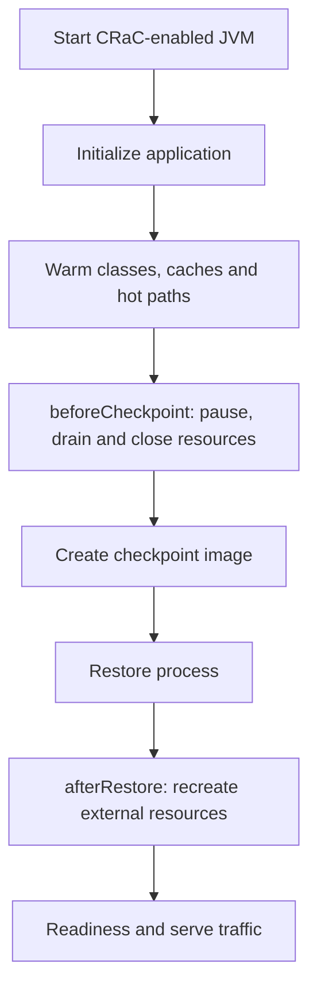
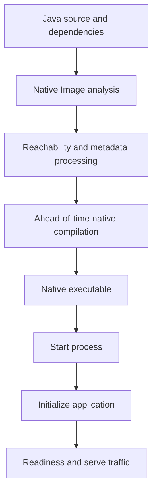

# CRaC và GraalVM Native Image: đánh đổi khởi động, tính tương thích và vận hành

Khi một ứng dụng Java cần khởi động rất nhanh, hai hướng thường được cân nhắc là **CRaC** và **GraalVM Native Image**. Cả hai đều có thể giảm thời gian từ lúc triển khai đến khi ứng dụng sẵn sàng, nhưng giải quyết vấn đề theo hai cách khác nhau.

CRaC chạy ứng dụng trên một JVM có hỗ trợ checkpoint/restore. Ứng dụng được khởi động, warm-up và đưa các tài nguyên về trạng thái an toàn; sau đó JVM tạo checkpoint image. Khi cần instance mới, runtime khôi phục trạng thái tiến trình đã lưu. GraalVM Native Image biên dịch ứng dụng Java ahead-of-time thành executable native trước khi triển khai. Khi chạy, executable không cần khởi động một JVM HotSpot đầy đủ như ứng dụng Java thông thường.

Vì vậy, quyết định không chỉ là so sánh con số startup. Cần xem xét khả năng tương thích thư viện, reflection và dynamic class loading, throughput sau khi chạy lâu, bộ nhớ, quy trình build, nền tảng triển khai, cách debug và chi phí vận hành. Một lựa chọn tốt là lựa chọn phù hợp với workload và năng lực của đội ngũ, không phải công nghệ có kết quả tốt nhất trong một benchmark đơn lẻ.

## 1. Hai cách giảm thời gian khởi động

### 1.1. CRaC: khôi phục một tiến trình JVM đã được chuẩn bị

Với CRaC, ứng dụng vẫn chạy trên JVM. Thay vì lặp lại toàn bộ quá trình startup cho mỗi instance, một tiến trình được khởi động một lần, nạp class, tạo metadata và warm-up các đường xử lý quan trọng. Sau khi các Resource đã chuẩn bị trạng thái an toàn, runtime tạo checkpoint image.

Khi restore, JVM tiếp tục từ trạng thái đã lưu. Các tài nguyên phụ thuộc môi trường như database connection, socket, token hoặc worker cần được đóng trước checkpoint và tạo lại sau restore thông qua lifecycle callback.



Lợi ích là ứng dụng giữ được môi trường thực thi JVM và phần lớn hệ sinh thái Java hiện có. Chi phí là phải vận hành checkpoint image, dùng đúng JDK CRaC và host tương thích, đồng thời quản lý vòng đời tài nguyên cẩn thận.

### 1.2. GraalVM Native Image: biên dịch ứng dụng thành executable native

Native Image phân tích ứng dụng và các dependency trong quá trình build, sau đó biên dịch phần mã có thể tiếp cận thành executable native cho nền tảng mục tiêu. Khi chạy executable, ứng dụng không cần khởi tạo HotSpot JVM theo cách thông thường.



Lợi ích là startup thường rất nhanh và footprint có thể thấp hơn một ứng dụng JVM tương đương. Chi phí là build phức tạp hơn, một số tính năng Java động cần metadata hoặc thay đổi code, và executable gắn với OS/CPU target cùng các thư viện native cần thiết.

## 2. So sánh tổng quan

| Tiêu chí | CRaC | GraalVM Native Image |
|---|---|---|
| Cách thực hiện | Snapshot và restore tiến trình JVM đã warm-up | Biên dịch ahead-of-time thành executable native |
| Runtime | Cần JDK có hỗ trợ CRaC | Chạy executable native; không cần HotSpot JVM đầy đủ |
| Startup | Thường rất nhanh sau restore; còn thời gian phục hồi Resource | Thường rất nhanh; vẫn phải khởi tạo application và dependency |
| Warm-up | Có thể thực hiện trước checkpoint | Không dựa vào warm-up HotSpot JIT theo cách JVM thông thường; có thể dùng PGO trong build |
| Tương thích Java | Gần với hành vi JVM thông thường, nhưng image phụ thuộc runtime và host | Phụ thuộc reachability analysis, metadata và hỗ trợ tính năng của Native Image |
| Reflection/dynamic loading | Thường hoạt động theo JVM; vẫn phải quản lý trạng thái trong checkpoint | Cần cấu hình metadata hoặc thiết kế phù hợp với closed-world analysis |
| Artifact triển khai | OCI runtime image cộng checkpoint artifact | Native executable cộng shared libraries/config cần thiết |
| Nền tảng | JDK CRaC, kernel, CRIU và môi trường restore tương thích | Binary được build cho OS/architecture và ABI mục tiêu |
| Vận hành | Quản lý checkpoint, Resource lifecycle và tương thích restore | Quản lý native build, metadata, native dependency và chẩn đoán executable |
| Phù hợp | Ứng dụng JVM hiện hữu cần restore nhanh và dùng nhiều tính năng động | Ứng dụng cần startup/footprint nhỏ và có thể đáp ứng ràng buộc Native Image |

Các từ “thường” và “có thể” rất quan trọng. Kết quả thực tế phụ thuộc ứng dụng, framework, JDK/GraalVM version, cấu hình GC, workload và dependency. Không có một tỷ lệ cải thiện cố định áp dụng cho mọi dự án.

## 3. Đánh đổi về startup và thời gian đến readiness

### 3.1. Đo đúng mốc thời gian

Với CRaC, cần tách thời gian restore process khỏi thời gian tạo lại tài nguyên. Với Native Image, cần tách thời gian tạo process khỏi thời gian khởi tạo framework và dependency. Cả hai phải được đo đến cùng một readiness condition.

Các mốc nên ghi nhận:

- Process start hoặc restore request.
- JVM/native runtime tiếp tục thực thi.
- Application context hoàn tất.
- Database, HTTP client và broker sẵn sàng.
- Readiness thành công.
- Request đầu tiên hoàn tất.
- Throughput và latency đạt steady state.

Ví dụ, Native Image có thể tạo process rất nhanh nhưng vẫn mất thời gian kết nối database. CRaC có thể restore heap nhanh nhưng `afterRestore()` phải refresh token, mở pool và đăng ký consumer. Nếu chỉ đo đến lúc PID xuất hiện, kết quả sẽ thiên lệch.

### 3.2. CRaC chuyển một phần chi phí sang giai đoạn tạo checkpoint

CRaC trả trước chi phí khởi động và warm-up khi tạo image. Việc nạp class, tạo proxy, serializer cache và thực thi đường code quan trọng diễn ra trước checkpoint. Những lần restore sau có thể tái sử dụng phần trạng thái đã chuẩn bị.

Đổi lại, cần tính cả:

- Thời gian khởi động tiến trình nguồn.
- Warm-up và chuẩn bị Resource.
- Thời gian checkpoint và kích thước artifact.
- Thời gian lưu trữ/truyền checkpoint image.
- Thời gian restore và tạo lại dependency.

Nếu checkpoint image được tái sử dụng nhiều lần, chi phí tạo image có thể được phân bổ cho nhiều instance. Nếu workload chỉ chạy một lần hoặc image thay đổi liên tục, lợi ích này có thể nhỏ hơn.

### 3.3. Native Image trả chi phí nhiều hơn ở build time

Native Image thực hiện phân tích reachability và native compilation trong pipeline build. Thời gian build có thể dài hơn đáng kể so với tạo JAR. Khi executable đã được tạo, startup runtime thường nhanh mà không cần khôi phục một JVM snapshot.

Chi phí build cần được tính vào vòng đời phát hành:

- Build native executable.
- Xử lý reflection/resource/proxy metadata.
- Chạy test trên executable thật.
- Tối ưu profile nếu dùng PGO.
- Tạo artifact theo từng OS/architecture target.

Với ứng dụng deploy nhiều lần từ cùng một artifact, build cost có thể chấp nhận được. Với ứng dụng thay đổi thường xuyên hoặc có nhiều target, thời gian build và ma trận artifact có thể trở thành chi phí đáng kể.

## 4. Throughput và hiệu năng sau khi khởi động

CRaC giữ ứng dụng trong JVM. Nếu workload đã được warm-up phù hợp, ứng dụng có thể bắt đầu từ trạng thái có profile thực thi và cache đã chuẩn bị. Tuy nhiên, kết quả còn phụ thuộc cách JDK CRaC xử lý trạng thái compiler/code cache, GC và các giới hạn runtime của phiên bản đang dùng. Không nên giả định mọi tối ưu JIT đều được bảo toàn giống nhau trên mọi JDK.

Native Image biên dịch code ahead-of-time. Nó không dùng HotSpot C2 JIT theo cách một ứng dụng JVM thông thường dùng. Hiệu năng có thể rất tốt, nhưng không tự động nhanh hơn JVM ở mọi workload. Những workload dài, có nhiều nhánh hoặc phụ thuộc profile runtime có thể có kết quả khác với workload ngắn.

GraalVM Native Image có các cơ chế tối ưu như Profile-Guided Optimization (PGO) trong build. PGO dùng dữ liệu profile để hướng dẫn tối ưu native executable; nó khác với việc JVM liên tục JIT compile dựa trên profile của tiến trình đang chạy.

Nên benchmark:

- Throughput sau khi ứng dụng đã ổn định.
- p50/p95/p99 latency.
- CPU time trên mỗi request.
- Allocation rate và GC pause.
- Memory resident set size (RSS) và peak memory.
- Hiệu năng khi tải tăng và khi dependency chậm.
- First request latency sau startup/restore.

Không dùng startup benchmark để kết luận throughput. Một ứng dụng có thể khởi động nhanh nhưng xử lý request chậm hơn trong steady state; ngược lại, ứng dụng có startup lâu hơn có thể đạt throughput cao hơn sau warm-up.

## 5. Bộ nhớ và footprint

Native Image thường có lợi thế về footprint trong nhiều ứng dụng vì không cần toàn bộ HotSpot runtime và có thể chỉ chứa phần code/data được phân tích là reachable. Tuy nhiên, mức tiết kiệm phụ thuộc dependency, native runtime, GC và cách ứng dụng sử dụng memory.

CRaC lưu trạng thái heap đã warm-up. Điều này có thể làm checkpoint image lớn hơn nếu warm-up tạo nhiều cache hoặc object mà instance không thực sự cần. Sau restore, heap và cache tiếp tục chiếm memory như trạng thái đã snapshot; việc giảm thời gian startup không tự động làm giảm footprint.

Khi so sánh, đo cùng workload và cùng giới hạn container:

| Chỉ số | Ý nghĩa |
|---|---|
| RSS sau readiness | Bộ nhớ resident thực tế của process |
| Heap used/committed | Phần heap JVM sử dụng và đã commit với CRaC |
| Native memory | Stack, direct buffer, native library và runtime allocation |
| Peak memory trong startup/restore | Nhu cầu bộ nhớ lớn nhất trong giai đoạn khởi động |
| Checkpoint artifact size | Dung lượng cần lưu/truyền với CRaC |
| Native executable size | Dung lượng binary và thư viện đi kèm với Native Image |

Không so sánh kích thước JAR với kích thước native executable rồi kết luận memory runtime. Artifact size và RSS là hai chỉ số khác nhau.

## 6. Tương thích thư viện và mô hình Java động

Đây thường là khác biệt kỹ thuật quan trọng nhất khi chọn giữa hai hướng.

### 6.1. CRaC giữ mô hình thực thi JVM

CRaC chạy bytecode trên JVM. Những tính năng như reflection, proxy động, class loading, resource lookup và framework runtime thường hoạt động theo mô hình JVM hiện có.

Tuy vậy, CRaC không làm mọi ứng dụng tự động tương thích. Ứng dụng vẫn phải xử lý resource lifecycle, thread, socket, file descriptor, credential và trạng thái phụ thuộc host. Checkpoint image còn phụ thuộc JDK vendor/build và môi trường restore đã được hỗ trợ.

Nếu framework hiện tại dựa nhiều vào reflection hoặc dynamic class loading, CRaC thường đòi hỏi ít thay đổi kiến trúc hơn Native Image, miễn là các tài nguyên runtime có thể được chuẩn bị và phục hồi an toàn.

### 6.2. Native Image dùng closed-world analysis

Native Image phân tích code và dependency để xác định những class, method, resource và thành phần cần có trong executable. Vì việc phân tích diễn ra ở build time, những thứ chỉ được tìm thấy động khi runtime chạy có thể không được nhận diện tự động.

Các trường hợp cần chú ý:

- Reflection dựa trên tên class/field/method được tạo từ chuỗi.
- Dynamic proxy hoặc proxy class được tạo lúc chạy.
- Class được nạp qua plugin hoặc class loader tùy chỉnh.
- Resource được tìm bằng pattern hoặc tên được tạo động.
- Serialization dựa trên metadata runtime.
- JNI/JNA và native library được tải theo điều kiện.
- Framework quét classpath hoặc annotation trong runtime.

Những tính năng này có thể được hỗ trợ nếu cung cấp metadata, dùng cơ chế được Native Image hỗ trợ hoặc thay đổi cách triển khai. Nhưng cần kiểm thử executable native, không chỉ chạy unit test trên JVM.

### 6.3. Reflection metadata và tracing agent

Native Image có thể cần metadata mô tả những thành phần phải truy cập bằng reflection hoặc dynamic proxy. GraalVM cung cấp tracing agent để quan sát các đường chạy trên JVM và tạo metadata gợi ý.

Agent chỉ ghi nhận những gì test đã thực thi. Nếu test không đi qua một plugin, serializer hoặc nhánh cấu hình, metadata có thể thiếu. Không nên coi việc chạy agent một lần với smoke test là bằng chứng đầy đủ.

Ví dụ cách chạy ứng dụng trên JVM với agent, tùy phiên bản GraalVM:

```bash
java \
  -agentlib:native-image-agent=config-output-dir=./native-image-config \
  -jar application.jar
```

Sau đó chạy bộ test bao phủ các tính năng reflection/resource/dynamic loading cần hỗ trợ và kiểm tra metadata được sinh. Cú pháp, output format và cách merge metadata có thể thay đổi theo GraalVM version; theo tài liệu của bản đang dùng.

### 6.4. Metadata cần được quản lý như source code

Metadata Native Image nên được review, version control và kiểm thử. Không xóa metadata chỉ vì executable build được thành công; một số lỗi chỉ xuất hiện ở nhánh runtime hiếm.

Ví dụ file reflection metadata ở định dạng JSON mới có thể mô tả class cần reflection:

```json
[
  {
    "name": "com.example.orders.OrderRequest",
    "allDeclaredConstructors": true,
    "allDeclaredFields": true
  }
]
```

Định dạng metadata chính xác phụ thuộc phiên bản Native Image và cơ chế metadata được sử dụng. Hãy dùng schema/tooling của GraalVM tương ứng, tránh copy cấu hình cũ mà không kiểm tra.

## 7. Framework và hệ sinh thái

Một số framework có hỗ trợ Native Image tốt hơn nhờ build-time processing, AOT transformation và metadata được duy trì sẵn. Framework khác có thể phụ thuộc nhiều vào runtime scanning, reflection hoặc class loader.

Khi đánh giá framework, kiểm tra:

- Phiên bản framework có công bố hỗ trợ Native Image không.
- Các starter/module đang dùng có hỗ trợ hay có giới hạn không.
- Có cần AOT processing hoặc plugin build riêng không.
- Reflection/proxy/resource metadata được cung cấp bởi framework hay ứng dụng phải tự viết.
- Có thư viện bên thứ ba chưa hỗ trợ native không.
- Test suite có chạy được trên executable native không.
- Có yêu cầu thay đổi serialization, logging, security hoặc dependency injection không.

Với CRaC, kiểm tra framework có hỗ trợ checkpoint/restore lifecycle không. Các pool, scheduler, web server và client có cần Resource integration hay không. Một số framework hoặc thư viện có tích hợp sẵn; thành phần còn lại có thể cần adapter riêng.

Không quyết định chỉ dựa vào tuyên bố “framework hỗ trợ GraalVM” hoặc “framework hỗ trợ CRaC”. Cần kiểm tra đúng version và đúng tập dependency mà ứng dụng thực sự sử dụng.

## 8. Build pipeline và thời gian phát hành

### 8.1. Pipeline CRaC

Pipeline CRaC thường gồm:

1. Build JAR và runtime container image với JDK CRaC đã pin.
2. Chạy ứng dụng trên host tương thích.
3. Warm-up class, cache và đường xử lý quan trọng.
4. Chuẩn bị Resource: drain, đóng tài nguyên và dừng worker.
5. Tạo checkpoint image.
6. Lưu manifest JDK, build ứng dụng, OS, kernel, CRIU và kiến trúc.
7. Restore thử bằng runtime đích.
8. Kiểm tra callback, readiness và nghiệp vụ.
9. Ký, lưu trữ và phát hành OCI image cùng checkpoint artifact.

Pipeline phụ thuộc môi trường Linux/CRIU và có thể cần runner chuyên biệt. Nếu thay JDK hoặc host baseline, phải xác nhận lại ma trận tương thích và thường tạo checkpoint image mới.

### 8.2. Pipeline Native Image

Pipeline Native Image thường gồm:

1. Build application và dependency.
2. Chạy AOT processing hoặc framework-specific native preparation.
3. Cung cấp reflection/resource/proxy metadata cần thiết.
4. Biên dịch executable cho OS/architecture target.
5. Chạy test trên executable native.
6. Scan dependency/native library và tạo SBOM.
7. Đóng gói executable cùng shared libraries/config cần thiết.
8. Ký và phát hành artifact theo target.

Build native có thể tốn CPU, RAM và thời gian hơn build JAR. Có thể cần runner riêng hoặc build cache. Đổi GraalVM version, compiler option, libc hoặc target architecture có thể yêu cầu build và kiểm thử lại.

### 8.3. So sánh chi phí pipeline

| Hạng mục | CRaC | Native Image |
|---|---|---|
| Compile application | Build JAR thông thường | Build native executable, thường tốn tài nguyên hơn |
| Chuẩn bị runtime | Cài JDK CRaC và host tương thích | Cài GraalVM Native Image/toolchain phù hợp |
| Chuẩn bị trước phát hành | Warm-up và checkpoint | Metadata/AOT và native compilation |
| Test bắt buộc | Checkpoint/restore thật | Test executable native thật |
| Artifact | OCI image + checkpoint image + manifest | Native executable/image + metadata/SBOM |
| Nâng runtime | Tạo/kiểm thử checkpoint với JDK build mới | Build lại executable bằng toolchain mới |

## 9. Tính tương thích nền tảng và artifact

### 9.1. CRaC gắn với runtime và môi trường restore

Checkpoint image chứa trạng thái tiến trình JVM và các tài nguyên hệ thống được snapshot. Nó không phải artifact portable như JAR. Cần ràng buộc image với JDK vendor/build, OS, kernel, architecture, CRIU và điều kiện container/host đã kiểm thử.

Một image tạo trên JDK CRaC build X không mặc nhiên restore được bằng build Y hoặc vendor khác. Khi nâng JDK, cách an toàn là tạo checkpoint image mới trừ khi vendor công bố rõ cặp version được hỗ trợ.

### 9.2. Native Image gắn với target binary

Native executable được build cho target OS/architecture và ABI cụ thể. Binary Linux x86-64 không tự chạy trên ARM64 hoặc Windows. Các shared library, libc và native dependency cũng phải tương thích.

Native Image tránh yêu cầu checkpoint/restore host, nhưng cần phát hành artifact riêng cho mỗi target cần hỗ trợ. Với container, vẫn phải kiểm tra base OS, shared libraries và runtime security policy.

### 9.3. Ma trận artifact

| Câu hỏi | CRaC | Native Image |
|---|---|---|
| Có thể copy artifact sang host khác không? | Chỉ trong ma trận runtime/host được hỗ trợ | Có thể nếu host đúng OS/arch/ABI và dependency |
| Đổi JDK có cần tạo lại artifact không? | Thường cần tạo checkpoint mới và xác nhận tương thích | Thường cần build lại native executable bằng toolchain mới |
| Đổi architecture? | Không giả định checkpoint image portable | Build binary riêng cho architecture đích |
| Cần kernel/CRIU đặc thù? | Có thể cần, tùy JDK/platform | Không cần CRIU để chạy native executable |
| Cần native libraries? | Có nếu ứng dụng sử dụng JNI/JNA/driver | Có thể cần; phải được link/đóng gói đúng target |

## 10. Debugging, observability và chẩn đoán production

### 10.1. CRaC giữ công cụ JVM quen thuộc

Ứng dụng sau restore vẫn chạy trên JVM, nên nhiều công cụ quan sát JVM hiện có tiếp tục hữu ích: JFR, JMX, thread dump, heap dump và các công cụ chẩn đoán tương thích với JDK đang dùng.

Tuy nhiên, cần phân biệt trạng thái trước và sau restore. Log, metric và trace có thể mang timestamp hoặc connection state cũ nếu ứng dụng không reset đúng cách. Resource callback nên làm mới exporter, socket và client cần thiết. Checkpoint image có thể chứa dữ liệu nhạy cảm, nên heap dump và checkpoint cần được bảo vệ.

### 10.2. Native Image có mô hình chẩn đoán khác

Native executable không có toàn bộ HotSpot diagnostic surface. Cách thu thập thread dump, heap profile, JFR-like events hoặc crash information phụ thuộc GraalVM version, edition, cấu hình build và runtime feature được bật.

Một số công cụ JVM quen thuộc có thể không hoạt động giống khi chạy trên HotSpot. Cần kiểm tra khả năng observability trước khi chuyển production: logging, metrics, tracing, profiling, heap analysis, native crash dump và symbol/debug information.

Native crash có thể cần symbol file và thông tin build để phân tích stack trace. Nếu strip symbol để giảm kích thước binary, lưu symbol artifact riêng theo release.

### 10.3. Logging và tracing

Cả hai lựa chọn cần bảo đảm:

- Log timestamp phản ánh thời gian hiện tại sau restore.
- Trace exporter kết nối lại backend sau checkpoint.
- Metric không đếm sai do counter được khôi phục từ snapshot.
- Instance ID và resource identity không bị nhân bản giữa các replica.
- Readiness không báo thành công trước khi telemetry pipeline cần thiết sẵn sàng.

Với CRaC, state trong heap được khôi phục nên counter, scheduled task và exporter có thể tiếp tục từ giá trị cũ. Với Native Image, instrumentation phải tương thích với Native Image và metadata/build constraints. Cần test telemetry trên artifact cuối cùng.

## 11. Quản lý tài nguyên và lifecycle

CRaC yêu cầu ứng dụng chuẩn bị tài nguyên trước checkpoint và phục hồi sau restore. Điều này làm tăng trách nhiệm lifecycle nhưng cho phép tái sử dụng phần lớn ứng dụng JVM hiện có.

Ví dụ Resource tối giản:

```java
import org.crac.Context;
import org.crac.Resource;

public final class ClientResource implements Resource {
    private final ClientHandle client;

    public ClientResource(ClientHandle client) {
        this.client = client;
    }

    @Override
    public void beforeCheckpoint(Context<? extends Resource> context)
            throws Exception {
        client.stopAccepting();
        client.awaitDrained();
        client.closeConnections();
    }

    @Override
    public void afterRestore(Context<? extends Resource> context)
            throws Exception {
        client.reconnect();
        client.verifyReady();
    }
}
```

Đây là ví dụ hợp đồng ứng dụng; method cụ thể phải dựa trên client thật. Không gọi `close()` tùy tiện nếu client không thể mở lại. Nếu cần tạo instance mới, dùng factory và facade ổn định.

Native Image không có checkpoint callback tương ứng trong quy trình chạy thông thường. Nó vẫn cần lifecycle ứng dụng thông thường để tạo và đóng connection, worker, scheduler và client. Vì không khôi phục một heap snapshot, ứng dụng khởi tạo runtime state mới khi process bắt đầu.

Do đó, nếu mục tiêu chính là tránh phải viết Resource cho nhiều thư viện không hỗ trợ CRaC, Native Image có thể giảm phần công việc lifecycle checkpoint. Đổi lại, dự án phải giải quyết tương thích Native Image ở build time.

## 12. Security và chuỗi cung ứng artifact

Hai lựa chọn có artifact và rủi ro bảo mật khác nhau.

**CRaC:** checkpoint image có thể chứa token, credential và dữ liệu người dùng trong heap. Cần mã hóa storage, giới hạn quyền tải, ký manifest, kiểm tra runtime compatibility, đặt retention và thu hồi artifact khi cần. Restore chỉ được phép với checkpoint từ nguồn phát hành tin cậy.

**Native Image:** executable là binary native có thể chứa code và thư viện được biên dịch. Cần pin GraalVM/toolchain, base image, dependency và native library; tạo SBOM/provenance, scan và ký digest. Không có checkpoint heap không có nghĩa binary không chứa secret nếu build đã nhúng secret vào artifact.

| Kiểm soát | CRaC | Native Image |
|---|---|---|
| Artifact integrity | Ký OCI image và checkpoint manifest/bundle | Ký native executable hoặc OCI image digest |
| Sensitive data | Bảo vệ heap snapshot và checkpoint storage | Không nhúng secret vào build; bảo vệ config runtime |
| Runtime identity | Pin JDK CRaC build và host compatibility | Pin GraalVM build, target OS/arch và native dependencies |
| Provenance | Ghi nguồn JAR, runtime image và môi trường tạo checkpoint | Ghi source, builder, metadata và native toolchain |
| Rollback | Giữ checkpoint cùng runtime tương thích | Giữ executable và dependency bundle theo release |

## 13. Chi phí vận hành và độ phức tạp

### 13.1. Những việc đội ngũ CRaC phải sở hữu

- Duy trì JDK CRaC và Linux runner/host tương thích.
- Xây dựng quy trình warm-up có thể lặp lại.
- Viết và đăng ký Resource cho tài nguyên cần quản lý.
- Kiểm tra thread, socket, file descriptor, native resource và dependency ngoài.
- Lưu trữ, ký, phân quyền và thu hồi checkpoint image.
- Test restore khi nâng JDK, kernel, CRIU hoặc container runtime.
- Quản lý reconnect storm khi restore nhiều replica.

### 13.2. Những việc đội ngũ Native Image phải sở hữu

- Duy trì GraalVM Native Image toolchain và build runner đủ CPU/RAM.
- Quản lý reachability metadata, reflection, proxy và resource configuration.
- Xử lý thư viện hoặc framework chưa hỗ trợ native.
- Build và test riêng cho từng target OS/architecture.
- Quản lý shared libraries, ABI và native crash diagnostics.
- Đảm bảo logging, metrics, tracing và profiling hoạt động trên executable.
- Build lại và kiểm thử khi nâng GraalVM hoặc native dependency.

### 13.3. So sánh gánh nặng vận hành

| Hoạt động | CRaC | Native Image |
|---|---|---|
| Chuẩn bị startup | Warm-up và checkpoint | Native compilation trước deploy |
| Tích hợp thư viện | Resource lifecycle cho tài nguyên cần đóng/mở | Metadata/AOT compatibility cho tính năng động |
| Nâng runtime | Tạo và kiểm thử checkpoint với JDK/host mới | Rebuild/test executable bằng toolchain mới |
| Scale-out | Restore image và kiểm soát reconnect fan-out | Start native executable; vẫn cần quản lý reconnect và dependency |
| Debug | Chủ yếu công cụ JVM, cộng chẩn đoán CRaC/CRIU | Công cụ native, symbol và tính năng observability được hỗ trợ |
| Artifact storage | OCI image cộng checkpoint snapshot nhạy cảm | Native executable/image và metadata build |

Không có lựa chọn nào loại bỏ vận hành. CRaC chuyển một phần độ phức tạp sang runtime checkpoint/restore; Native Image chuyển một phần sang build-time analysis và native toolchain.

## 14. Khi nào nên chọn CRaC?

CRaC thường là ứng viên tốt khi:

- Ứng dụng hiện tại chạy ổn định trên JVM và cần giảm startup mà không muốn chuyển toàn bộ sang native compilation.
- Framework hoặc thư viện dùng reflection, proxy, dynamic class loading hoặc plugin ở runtime.
- Ứng dụng có thể được warm-up một lần và tái sử dụng checkpoint image cho nhiều instance.
- JDK CRaC và môi trường Linux/CRIU tương thích có thể được chuẩn hóa.
- Đội ngũ có thể quản lý Resource lifecycle và test restore thật.
- Throughput/behavior trên JVM quan trọng và muốn giữ mô hình runtime quen thuộc.

CRaC ít phù hợp hơn nếu workload chạy trên nền tảng không hỗ trợ checkpoint/restore, phụ thuộc nhiều vào tài nguyên không thể drain/close an toàn, hoặc checkpoint image không thể được bảo vệ và phân phối phù hợp.

## 15. Khi nào nên chọn GraalVM Native Image?

Native Image thường là ứng viên tốt khi:

- Startup và footprint nhỏ là yêu cầu quan trọng, ví dụ serverless, scale-to-zero hoặc CLI.
- Ứng dụng và framework có hỗ trợ Native Image tốt.
- Dependency graph tương đối ổn định và có thể mô tả đầy đủ ở build time.
- Có thể kiểm soát reflection, dynamic proxy, resource và native library.
- Đội ngũ có pipeline native build, test và observability phù hợp.
- Muốn triển khai executable native mà không cần JDK CRaC, CRIU hoặc checkpoint storage.

Native Image ít phù hợp hơn khi ứng dụng phụ thuộc mạnh vào class loading động, plugin tùy ý hoặc thư viện không thể cấu hình metadata; hoặc khi thời gian build, ma trận target và chẩn đoán native binary vượt quá năng lực vận hành hiện tại.

## 16. Ma trận quyết định

Có thể dùng ma trận dưới đây làm điểm bắt đầu cho workshop kiến trúc:

| Câu hỏi | Nghiêng về CRaC | Nghiêng về Native Image |
|---|---|---|
| Ứng dụng dùng nhiều reflection/runtime scanning? | Thường phù hợp hơn với mô hình JVM | Cần xác minh metadata và framework support kỹ |
| Cần giữ nguyên hành vi HotSpot/JVM? | Phù hợp hơn | Cần benchmark và xác minh khác biệt runtime |
| Muốn executable nhỏ, không cần JDK runtime? | Không phải mục tiêu chính | Phù hợp hơn |
| Có host Linux/CRIU được chuẩn hóa? | Điều kiện thuận lợi | Không cần CRIU để chạy |
| Muốn tránh checkpoint storage và restore orchestration? | Cần các thành phần này | Có thể đơn giản hơn ở runtime |
| Có thể đầu tư vào AOT metadata và build native? | Không bắt buộc theo cách Native Image | Điều kiện quan trọng |
| Cần scale-out nhanh từ trạng thái warm-up? | Có lợi thế nếu restore pipeline ổn định | Startup native có thể đáp ứng mà không snapshot |
| Cần nhiều target OS/architecture? | Cần ma trận checkpoint/runtime/host | Cần build executable riêng theo target |
| Có nhiều thư viện native/JNI? | Vẫn phải xử lý native resource trong checkpoint | Phải kiểm tra ABI/linking và hỗ trợ Native Image |

Không nên cộng điểm cơ học rồi chọn công nghệ. Hãy xác định yêu cầu bắt buộc trước, ví dụ startup-to-ready dưới một ngưỡng, p99 dưới SLA, footprint tối đa, nền tảng triển khai và tập thư viện phải giữ nguyên.

## 17. Ví dụ đánh giá hai phương án cho một dịch vụ Spring Boot

Giả sử một dịch vụ Spring Boot có các đặc điểm:

- Dùng Spring Data/JPA, Jackson, validation và một số proxy runtime.
- Kết nối PostgreSQL, Redis và message broker.
- Chạy nhiều replica trong Kubernetes.
- Cần scale-out nhanh khi có burst traffic.
- Có một số thư viện nội bộ chưa công bố hỗ trợ GraalVM Native Image.

### Phương án A: CRaC

1. Chọn JDK CRaC và Linux node baseline được hỗ trợ.
2. Khởi động Spring context và warm-up serializer, repository metadata, validator và đường xử lý chính.
3. Viết Resource để drain request, dừng consumer, đóng connection pool và client không thể giữ qua checkpoint.
4. Tạo checkpoint image và kiểm thử restore trong Kubernetes-like environment.
5. Khi scale-out, restore theo batch, tạo lại pool/client và chờ readiness.

Ưu điểm là giữ phần lớn mô hình JVM và có thể tái sử dụng trạng thái đã warm-up. Rủi ro là Resource lifecycle phức tạp, checkpoint storage nhạy cảm và reconnect storm khi tăng replica.

### Phương án B: Native Image

1. Kiểm tra từng Spring module và dependency có hỗ trợ Native Image ở đúng version không.
2. Chạy AOT processing và tạo reflection/resource/proxy metadata.
3. Build executable native cho target Linux/architecture.
4. Chạy test trên executable thật với PostgreSQL, Redis và broker test.
5. Đo startup, memory, throughput và observability.

Ưu điểm là không cần checkpoint image hoặc CRIU trong runtime deployment. Rủi ro là dependency chưa hỗ trợ, metadata thiếu và thời gian build/test native lớn hơn.

### Cách quyết định

Nếu thư viện nội bộ không thể chạy trên Native Image và việc thay đổi chúng quá tốn kém, CRaC có thể là con đường thực tế hơn. Nếu dependency được hỗ trợ đầy đủ và mục tiêu chính là footprint nhỏ cùng startup nhanh trên nhiều môi trường Linux, Native Image đáng được thử nghiệm nghiêm túc.

Đừng quyết định chỉ từ một endpoint đơn giản. Chọn một luồng nghiệp vụ có repository, serializer, validation, security proxy và message consumer để benchmark đại diện.

## 18. Chiến lược thử nghiệm và benchmark công bằng

Để so sánh có ý nghĩa, tạo ba artifact từ cùng một source revision:

1. JAR chạy trên JVM thông thường làm baseline.
2. JAR chạy trên JDK CRaC và checkpoint image.
3. GraalVM Native Image executable.

Giữ cùng business logic, dataset, dependency, CPU/memory limit, network path và request profile. Nếu Native Image cần metadata hoặc thay đổi code, ghi rõ các thay đổi đó để hiểu chi phí migration.

### 18.1. Các bài test nên chạy

| Bài test | Điều cần đo |
|---|---|
| Cold start | Startup-to-ready của JVM và Native Image |
| Single restore | Restore-to-ready của CRaC |
| First request | Latency request đầu tiên sau khi ready |
| Steady-state load | Throughput và p95/p99 sau warm-up |
| Memory | RSS, heap/native memory và peak memory |
| Scale-out | Thời gian fleet đạt readiness khi tăng replica |
| Dependency outage | Retry, backoff và phục hồi khi DB/broker tạm unavailable |
| Long-running workload | Throughput, GC, memory growth và stability |
| Observability | JFR/JMX hoặc native diagnostics, logs, metrics, traces |
| Release pipeline | Build duration, artifact size và test duration |

### 18.2. Chuẩn hóa cách đo

- Dùng cùng số replica và cùng mức request arrival rate.
- Đo nhiều lần, báo median và percentile thay vì chỉ một lần chạy.
- Tách thời gian tạo checkpoint khỏi thời gian restore.
- Tính cả Resource recreation và dependency readiness.
- Kiểm tra load generator không bị bão hòa.
- Chạy native executable trong đúng container/OS target dự kiến.
- Dùng đúng JDK CRaC/host baseline dự kiến cho production.
- Ghi version đầy đủ của framework, JDK, GraalVM và dependency.

Không so sánh một CRaC image đã warm-up với một Native Image chưa được cấu hình metadata hoặc chưa tối ưu build rồi kết luận về công nghệ. Cần cho mỗi phương án một quy trình build/test đại diện và công bố cả chi phí đạt được kết quả đó.

## 19. Lộ trình áp dụng có kiểm soát

Một cách giảm rủi ro là thử nghiệm theo lát cắt nhỏ:

1. Chọn một service có startup chậm và workload đại diện.
2. Thiết lập baseline JVM thông thường: startup, memory, throughput và p99.
3. Tạo nhánh thử nghiệm CRaC, liệt kê tài nguyên cần Resource callback và đo restore-to-ready.
4. Tạo nhánh thử nghiệm Native Image, kiểm tra dependency support và xử lý metadata.
5. Chạy cùng bộ integration/contract test trên cả hai artifact.
6. Đánh giá build pipeline, debug, security, upgrade và rollback.
7. Thử nghiệm scale-out và dependency outage trong môi trường staging.
8. Chọn phương án đáp ứng SLA với chi phí vận hành có thể duy trì.
9. Triển khai canary và theo dõi readiness, latency, error rate, memory và reconnect load.
10. Giữ đường rollback về artifact JVM hiện tại cho đến khi phương án mới ổn định.

Không cần chuyển toàn bộ hệ thống cùng lúc. Một số service có thể phù hợp với CRaC, trong khi service khác phù hợp với Native Image hoặc JVM thông thường. Quyết định có thể khác nhau theo workload.

## 20. Những lỗi thường gặp khi lựa chọn

**Chỉ so sánh startup time của process.** Readiness còn phụ thuộc framework và dependency. Đo đến cùng một readiness condition.

**Cho rằng Native Image luôn nhanh hơn JVM về throughput.** AOT và JIT có hành vi tối ưu khác nhau. Benchmark steady state theo workload thật.

**Cho rằng CRaC loại bỏ mọi startup work.** Resource callback vẫn phải tái tạo connection, token, worker và các dependency bên ngoài.

**Cho rằng CRaC image portable như JAR.** Checkpoint phụ thuộc JDK build, OS, kernel, CRIU, architecture và môi trường được hỗ trợ.

**Cho rằng Native Image chạy được mọi thư viện Java mà không cần cấu hình.** Reflection, proxy, resource và dynamic class loading có thể cần metadata hoặc thay đổi code.

**Dùng tracing agent với một smoke test rồi chốt metadata.** Agent chỉ thấy đường chạy đã được thực thi. Cần test các nhánh runtime quan trọng.

**Chỉ đo kích thước executable để kết luận footprint.** Đo RSS và peak memory dưới cùng workload.

**Bỏ qua observability khi chọn Native Image.** Công cụ JVM quen thuộc có thể không hoạt động giống trên native executable. Kiểm tra profiling và crash diagnostics trước production.

**Bỏ qua reconnect storm khi chọn CRaC.** Restore nhiều replica có thể làm dependency quá tải. Đo connection burst và dùng batching/backoff.

**Không tính chi phí build và release.** Native compilation và checkpoint pipeline có chi phí khác nhau. Đo build duration, artifact handling và test matrix.

## 21. Tự kiểm tra mức độ hiểu

1. **CRaC và Native Image giảm startup bằng cách nào?** CRaC khôi phục tiến trình JVM đã warm-up; Native Image biên dịch ứng dụng thành executable native trước khi chạy.
2. **Vì sao CRaC vẫn cần Resource callback?** Socket, connection, token và worker phụ thuộc môi trường có thể không hợp lệ sau restore.
3. **Vì sao Native Image cần reachability metadata?** Một số class, method hoặc resource chỉ được truy cập động nên phân tích build-time không tự nhận diện.
4. **Tracing agent có bảo đảm metadata đầy đủ không?** Không. Nó chỉ ghi nhận các đường code được thực thi trong lần chạy quan sát.
5. **Native Image có luôn có throughput cao hơn JVM không?** Không. Kết quả phụ thuộc workload và tối ưu AOT/PGO so với JIT.
6. **CRaC image có portable giữa các JDK vendor không?** Không được mặc định. Cần ma trận tương thích được vendor hỗ trợ và kiểm thử.
7. **Vì sao phải đo restore-to-ready?** Vì callback và dependency recreation có thể tốn thời gian sau khi JVM đã restore.
8. **Khi nào Native Image là lựa chọn hấp dẫn?** Khi startup/footprint nhỏ quan trọng, framework/dependency hỗ trợ tốt và đội ngũ có thể duy trì native build pipeline.
9. **Khi nào CRaC có lợi thế?** Khi cần giữ mô hình JVM hiện tại, ứng dụng dùng nhiều tính năng động và có thể chuẩn hóa môi trường checkpoint/restore.
10. **Có nhất thiết toàn hệ thống phải dùng một công nghệ không?** Không. Có thể chọn theo từng service và workload nếu chuỗi build/deploy được quản lý rõ ràng.

## Kết luận

CRaC và GraalVM Native Image đều có thể rút ngắn thời gian khởi động, nhưng tối ưu ở hai điểm khác nhau. CRaC tái sử dụng trạng thái của một tiến trình JVM đã được chuẩn bị; Native Image chuyển phần phân tích và biên dịch sang build time để tạo executable native. CRaC thường giữ được mô hình tương thích JVM tốt hơn nhưng cần JDK/host hỗ trợ, checkpoint artifact và Resource lifecycle. Native Image có thể giảm startup và footprint, nhưng yêu cầu kiểm soát reachability, reflection metadata, native dependency, target platform và công cụ chẩn đoán.

Hãy đánh giá cả startup-to-ready, throughput, p95/p99, RSS, build time, compatibility và chi phí vận hành. Chạy cùng workload trên JVM baseline, CRaC và Native Image; kiểm tra dependency outage, scale-out, observability và rollback. Chọn công nghệ theo yêu cầu bắt buộc của từng service, khả năng hỗ trợ của framework và mức độ mà đội ngũ có thể duy trì pipeline trong dài hạn.
