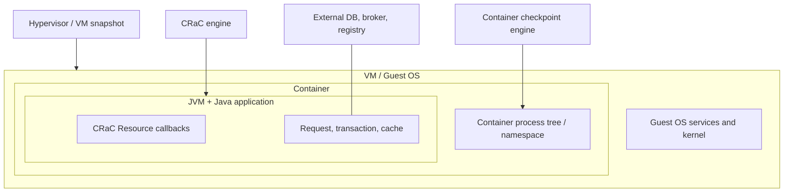

# CRaC và snapshot của máy ảo hoặc container: ranh giới trách nhiệm

CRaC, container checkpoint và virtual machine (VM) snapshot đều có thể giúp một ứng dụng tiếp tục từ trạng thái đã được chuẩn bị trước đó. Tuy nhiên, chúng hoạt động ở các lớp khác nhau và giao trách nhiệm cho những thành phần khác nhau.

**CRaC tập trung vào vòng đời của ứng dụng Java và các resource mà ứng dụng quản lý. Container checkpoint tập trung vào trạng thái process tree và môi trường container. VM snapshot tập trung vào trạng thái của cả máy ảo, gồm hệ điều hành khách và trạng thái phần cứng ảo.** Không có cơ chế nào trong ba cơ chế tự động bảo đảm database, message broker, service registry hoặc dịch vụ bên ngoài được khôi phục về cùng một thời điểm nhất quán.

Muốn chọn đúng giải pháp, cần biết chính xác snapshot đang bao phủ lớp nào, ai chịu trách nhiệm chuẩn bị và phục hồi resource, và lớp nào phải được kiểm tra sau khi restore. Nếu không xác định ranh giới này, hai lớp có thể cùng đóng/mở một resource, bỏ sót một resource, hoặc cùng restore một trạng thái cũ trong khi dịch vụ bên ngoài đã tiếp tục thay đổi.

## 1. Ba cơ chế nằm ở ba lớp khác nhau

### CRaC: phối hợp trạng thái của ứng dụng Java

CRaC cung cấp API để ứng dụng đăng ký resource và tham gia vào vòng đời checkpoint/restore. Trước checkpoint, runtime gọi `beforeCheckpoint(...)` để ứng dụng đưa các thành phần do nó quản lý về trạng thái an toàn. Sau restore, runtime gọi `afterRestore(...)` để ứng dụng tạo lại hoặc xác minh những resource cần thiết.

CRaC hiểu các ranh giới của ứng dụng Java tốt hơn một snapshot ở lớp thấp hơn. Ví dụ, ứng dụng biết request nào đang chạy, transaction nào cần hoàn tất, scheduler nào cần dừng, cache nào cần refresh và readiness chỉ nên mở khi dependency đã sẵn sàng.

CRaC không tự chụp toàn bộ VM hoặc host. Việc lưu trạng thái process thực tế vẫn cần một checkpoint engine và môi trường hệ điều hành hỗ trợ. CRaC API điều phối phần ứng dụng; engine và nền tảng chịu trách nhiệm thực hiện thao tác checkpoint/restore ở lớp process/hệ điều hành.

### Container checkpoint: lưu trạng thái process trong container

Container checkpoint thường dùng một công cụ như CRIU để lưu trạng thái process tree chạy trong container cùng những thành phần hệ điều hành được hỗ trợ. Tùy runtime, kernel và cấu hình, image checkpoint có thể chứa memory mapping, register/thread state, file descriptor, namespace-related state và thông tin cần để tiếp tục process.

Container checkpoint không đồng nghĩa với container image. Container image cung cấp filesystem layer và cấu hình để tạo container; checkpoint là trạng thái runtime của container đang chạy. Khi restore, nền tảng cần kết hợp đúng filesystem/image, checkpoint artifact, cấu hình container, namespace, cgroup, mount, network và quyền cần thiết.

Container checkpoint không hiểu đầy đủ ý nghĩa nghiệp vụ của Java application. Nó không biết transaction nào nên commit, cache nào đã stale, instance ID nào cần đổi hay lease nào đã hết hạn. Ứng dụng phải chuẩn bị những trạng thái đó, hoặc một lớp điều phối khác phải chịu trách nhiệm.

### VM snapshot: lưu trạng thái cả máy ảo

VM snapshot thường được thực hiện ở lớp hypervisor hoặc nền tảng ảo hóa. Tùy sản phẩm và loại snapshot, nó có thể lưu trạng thái virtual CPU, RAM, thiết bị ảo và một hoặc nhiều trạng thái disk. Một số snapshot chỉ lưu disk state; một số hỗ trợ memory snapshot để VM tiếp tục gần như từ trạng thái đang chạy.

VM snapshot bao phủ nhiều thành phần hơn một Java process: guest OS, process, kernel state, filesystem cache, network stack và các process khác trong VM. Tuy nhiên, phạm vi chính xác phụ thuộc sản phẩm. Snapshot disk-only không tương đương snapshot memory; snapshot memory không tự bảo đảm dữ liệu ở remote database hoặc block storage bên ngoài đã được đồng bộ.

VM snapshot cũng không hiểu transaction nghiệp vụ hoặc semantics của ứng dụng. Nếu VM được chụp khi một request đang xử lý hoặc database transaction đang mở, snapshot ở lớp hypervisor không tự quyết định cách xử lý nghiệp vụ khi VM được resume.

## 2. So sánh phạm vi snapshot

| Khía cạnh | CRaC | Container checkpoint | VM snapshot |
|---|---|---|---|
| Lớp chính | Ứng dụng Java/JVM | Process tree và môi trường container | Toàn bộ VM/guest OS |
| Cơ chế phối hợp ứng dụng | Có API `Resource` với callback trước/sau checkpoint | Không tự hiểu lifecycle Java; cần ứng dụng hoặc integration phối hợp | Không tự hiểu lifecycle Java; cần guest agent hoặc ứng dụng phối hợp |
| Heap Java | Nằm trong trạng thái process được checkpoint | Có thể được lưu như memory của process | Nằm trong RAM snapshot nếu loại snapshot có memory |
| Thread/process | JVM và các thread của process được xử lý bởi engine bên dưới | Process tree trong phạm vi container theo khả năng engine | Các process trong guest OS |
| Kernel/guest OS | Không snapshot kernel/host | Dùng kernel của host; không mang theo toàn bộ kernel host | Guest OS và trạng thái VM được snapshot |
| Filesystem | Không tự quản lý toàn bộ filesystem của ứng dụng | Thường cần filesystem/container image và checkpoint artifact phù hợp | Có thể gồm disk state tùy loại snapshot |
| Socket/descriptor | Ứng dụng chuẩn bị; engine/nền tảng quyết định khả năng checkpoint | Engine xử lý các loại descriptor được hỗ trợ; có giới hạn | Có thể giữ trạng thái thiết bị/network trong guest, nhưng peer bên ngoài không bị snapshot |
| Dependency bên ngoài | Ứng dụng phải reconnect/refresh | Ứng dụng hoặc platform phải xử lý | Ứng dụng hoặc platform phải xử lý |
| Identity khi clone | Ứng dụng cần tạo incarnation riêng | Platform/container orchestration và ứng dụng cần identity riêng | Cloud/VM orchestration và ứng dụng cần identity riêng |
| Tính portable | Gắn với JDK, engine và môi trường tương thích | Gắn với kernel, CRIU/runtime, filesystem và cấu hình container | Gắn với hypervisor, VM hardware version, guest và storage/network topology |

Các dòng trong bảng mô tả ranh giới trách nhiệm tổng quát. Chi tiết cụ thể phụ thuộc CRaC JDK, checkpoint engine, container runtime, hypervisor và loại snapshot đang sử dụng.

## 3. Điều gì được snapshot và điều gì không?

Một lỗi thiết kế phổ biến là nghĩ rằng snapshot ở một lớp sẽ bao phủ toàn bộ hệ thống. Trên thực tế, snapshot thường chỉ bao phủ trạng thái nằm trong phạm vi quản lý của lớp đó.

### Trạng thái thường nằm trong phạm vi

| Trạng thái | CRaC | Container checkpoint | VM snapshot |
|---|---|---|---|
| Object Java và static field | Có, trong process state | Có, như memory của process | Có nếu RAM được snapshot |
| JVM runtime state | Có, trong process checkpoint | Có, như trạng thái process | Có nếu memory snapshot |
| Process khác trong cùng container | Không thuộc mục tiêu CRaC của một JVM | Có thể nằm trong process tree/container scope | Có nếu process nằm trong VM |
| Guest OS process khác | Không | Không | Có |
| Host kernel | Không | Không | Không; host/hypervisor vẫn ở ngoài guest snapshot |
| Container image filesystem | Không tự snapshot toàn bộ image | Image/filesystem được quản lý riêng hoặc đi cùng checkpoint theo runtime | Có thể nằm trong disk snapshot nếu filesystem ở disk của VM |
| Remote database | Không | Không | Không |
| Message broker bên ngoài | Không | Không | Không |
| DNS/service registry/lease service | Không | Không | Không |
| Remote object storage | Không | Không | Không |

### Những trạng thái cần xử lý riêng

- **Database transaction:** phải commit/rollback hoặc áp dụng cơ chế recovery/idempotency. Snapshot process không thể buộc remote database quay về đúng trạng thái tại cùng thời điểm.
- **Message delivery:** message có thể đã được broker gửi hoặc ack trong lúc snapshot/restore. Cần xử lý offset, ack, redelivery và idempotency.
- **Lease và distributed lock:** thời hạn lease tiếp tục trôi qua khi process dừng. Sau restore, phải xác minh hoặc giành lease mới.
- **Credential và token:** token có thể hết hạn hoặc bị thu hồi trong khoảng downtime. Cần refresh theo identity provider.
- **Network connection:** peer có thể đã đóng socket hoặc đổi địa chỉ. Cần reconnect hoặc xác minh kết nối.
- **Timer và deadline:** thời gian thực tiếp tục trôi qua trong khi process/VM không chạy. Cần tính lại deadline theo clock và dữ liệu bền vững.
- **Instance identity:** clone cùng một snapshot có thể tạo nhiều bản sao có cùng ID, counter hoặc cờ leader. Mỗi instance cần incarnation riêng.

## 4. Ranh giới trách nhiệm giữa các đội

Snapshot chỉ đáng tin khi có người chịu trách nhiệm rõ ràng cho từng lớp. Một mô hình phân chia trách nhiệm thường dùng:

| Chủ thể | Trách nhiệm trước snapshot | Trách nhiệm sau restore |
|---|---|---|
| Đội ứng dụng Java | Drain request/transaction/job, flush telemetry, đóng hoặc chuẩn bị resource, ghi trạng thái cần thiết | Refresh config/secret, tạo lại client, đăng ký identity, kiểm tra dependency và readiness |
| Đội container/platform | Chuẩn bị image, namespace, cgroup, mount, network và quyền checkpoint | Kết hợp đúng image/checkpoint, tạo container, khôi phục namespace/network, kiểm tra runtime |
| Đội VM/hypervisor | Quiesce guest nếu cần, xác định loại snapshot, phối hợp disk và memory consistency | Restore VM, virtual device, disk và network theo cấu hình được hỗ trợ |
| Đội database/data platform | Cung cấp transaction/backup/replication guarantees và chính sách recovery | Xác nhận database sẵn sàng, xử lý failover và kiểm tra dữ liệu |
| Đội messaging/integration | Định nghĩa ack/offset/consumer ownership và idempotency | Tạo session mới, rejoin group, xử lý redelivery và duplicate |
| Đội vận hành/deployment | Quản lý artifact, version, compatibility matrix, rollout và rollback | Cấp instance identity, traffic routing, health gate và thay thế instance lỗi |
| Đội bảo mật | Quy định quyền truy cập, mã hóa, retention và secret policy | Xác minh provenance, rotate/revoke credential và audit restore |

Một đội có thể đảm nhiệm nhiều vai trò trong tổ chức nhỏ. Điều quan trọng là trách nhiệm không bị bỏ trống hoặc hai thành phần cùng sở hữu một lifecycle mà không có điều phối.

## 5. Ranh giới giữa CRaC và container checkpoint

CRaC và container checkpoint có thể bổ sung cho nhau. CRaC cung cấp cơ hội để ứng dụng Java chuẩn bị trước khi process tree được dump; container checkpoint engine thực hiện việc lưu process và môi trường container.

Ví dụ, một ứng dụng Java trong container có thể:

1. Đóng readiness và ngừng nhận request.
2. Drain request, transaction và background task.
3. Đóng database pool hoặc socket không thể giữ.
4. Flush log/metrics/tracing.
5. Hoàn tất `beforeCheckpoint(...)`.
6. Để container checkpoint engine dump process/container theo cơ chế của nền tảng.
7. Khi restore, runtime khôi phục container process.
8. CRaC gọi `afterRestore(...)` để ứng dụng tạo lại dependency và mở readiness.

Trong mô hình này, CRaC sở hữu **ý nghĩa lifecycle của ứng dụng Java**; container runtime/checkpoint engine sở hữu **cơ chế dump/restore process trong container**. Hai lớp cần phối hợp theo một hợp đồng đã kiểm chứng.

Không nên tự động giả định mọi container checkpoint runtime sẽ gọi CRaC callback. Integration phải được hỗ trợ và cấu hình rõ. Nếu engine chỉ dump process mà không kích hoạt callback CRaC, ứng dụng có thể giữ socket/transaction không an toàn. Ngược lại, nếu callback CRaC đã đóng resource nhưng container platform lại có một hook khác đóng cùng resource, có thể xảy ra double-close hoặc race.

### Ví dụ phân công theo resource

| Resource | Chủ sở hữu logic | Cơ chế thực hiện |
|---|---|---|
| HTTP request đang chạy | Ứng dụng/Spring | Admission gate, graceful shutdown và request drain |
| JDBC transaction | Ứng dụng/data layer | Transaction manager, commit/rollback và pool lifecycle |
| JVM heap và thread state | CRaC contract + checkpoint engine | CRaC resource coordination rồi engine dump/restore process |
| Container namespace/cgroup | Container runtime/platform | Container checkpoint/restore API |
| Host kernel | Platform/host operator | Kernel và checkpoint engine compatibility; CRaC không snapshot host kernel |
| Pod identity/service endpoint | Orchestrator + ứng dụng | Cấp identity mới, service registration và readiness |

## 6. Ranh giới giữa CRaC và VM snapshot

VM snapshot có phạm vi rộng hơn: nó có thể giữ trạng thái của guest OS và nhiều process cùng lúc. Điều này hữu ích khi workload gồm nhiều process phụ thuộc lẫn nhau hoặc khi muốn phục hồi một appliance/VM gần như nguyên trạng.

Tuy nhiên, VM snapshot thường không biết ứng dụng Java đang ở ranh giới nghiệp vụ nào. Nếu chụp VM trong lúc ứng dụng có request đang chạy, snapshot có thể giữ request thread và transaction context trong RAM, nhưng database bên ngoài vẫn có thể commit, rollback hoặc timeout trong lúc VM không chạy.

CRaC có thể bổ sung một lớp phối hợp trước khi hypervisor chụp VM:

1. CRaC callback đưa ứng dụng Java về trạng thái an toàn.
2. Guest agent xác nhận các service quan trọng đã quiesce.
3. Hypervisor snapshot VM theo chính sách consistency.
4. Khi VM resume, CRaC/guest lifecycle phục hồi ứng dụng và kiểm tra dependency.

Nhưng cần xác định liệu VM snapshot có chụp đúng process sau khi CRaC đã chuẩn bị hay không, và cách callback được xử lý khi VM resume. Một VM snapshot không tự động tương đương một CRaC checkpoint. Nếu VM resume đúng trạng thái RAM cũ, runtime có thể không đi qua cùng đường `afterRestore` như CRaC process restore; cần dựa vào semantics của integration thực tế.

### Snapshot VM memory và snapshot disk

Hai loại này cần được phân biệt:

- **Disk snapshot:** lưu trạng thái disk/volume theo semantics của hypervisor/storage. Nó không nhất thiết lưu RAM hoặc CPU state. Guest thường phải boot lại từ disk snapshot.
- **Memory/VM snapshot:** có thể lưu RAM và trạng thái thiết bị ảo để resume VM. Nó có thể giữ cả process state, nhưng không khôi phục trạng thái remote service hoặc đảm bảo transaction phân tán.

Một snapshot có memory có thể giúp resume VM nhanh, nhưng chi phí lưu trữ và phân phối thường lớn hơn disk snapshot. Nếu mục tiêu chỉ là giảm cold start một JVM, snapshot cả VM có thể mang theo nhiều state không cần thiết.

## 7. Có nên lồng nhiều lớp snapshot không?

Có thể kết hợp CRaC với container checkpoint hoặc VM snapshot, nhưng không nên làm chỉ vì cả hai cơ chế đều có thể lưu trạng thái. Mỗi lớp bổ sung làm tăng số artifact, dependency, compatibility constraint và lifecycle callback cần điều phối.

Trước khi lồng nhiều lớp, trả lời các câu hỏi:

1. Lớp nào là nguồn sự thật cho process state?
2. Lớp nào gọi `beforeCheckpoint` và `afterRestore`?
3. Resource nào được đóng ở tầng ứng dụng, container hay guest OS?
4. Nếu outer snapshot resume nguyên trạng RAM, callback CRaC có chạy lại không?
5. Nếu container restore tạo process mới, container runtime có kích hoạt CRaC integration không?
6. Ai chịu trách nhiệm cấp instance ID, network identity và lease mới?
7. Khi một lớp thất bại, lớp nào quyết định fallback?

### Ví dụ kết hợp có chủ đích

**CRaC + container checkpoint:** phù hợp khi cần ứng dụng Java drain/refresh resource nhưng nền tảng vẫn cần dump process tree và container namespace. CRaC xử lý callback Java; container engine xử lý process/container state.

**CRaC + VM snapshot:** có thể phù hợp với VM appliance có nhiều process, trong đó Java app cần chuẩn bị nghiệp vụ trước khi VM snapshot. Cần guest orchestration xác định thứ tự quiesce/resume và tránh giả định callback CRaC tự chạy khi VM chỉ resume memory.

**Container checkpoint bên trong VM snapshot:** có thể dùng trong một nền tảng phức tạp, nhưng thường cần xác định rõ snapshot nào được dùng để khôi phục và snapshot nào chỉ là backup. Nếu cả hai đều là nguồn phục hồi, dễ tạo hai process hoặc hai bản sao cùng identity.

### Tránh double snapshot không cần thiết

Nếu mục tiêu là restore nhanh một JVM, tạo CRaC checkpoint có thể đủ. Nếu mục tiêu là khôi phục nhiều process và guest OS, VM snapshot có thể phù hợp hơn. Nếu cần di chuyển một container process tree giữa host tương thích, container checkpoint có thể là lớp phù hợp. Chỉ kết hợp khi mỗi lớp giải quyết một yêu cầu riêng có thể đo lường.

## 8. Ai chịu trách nhiệm cho consistency của dữ liệu?

Đây là ranh giới quan trọng nhất: snapshot memory không phải transaction snapshot của toàn bộ hệ thống phân tán.

Giả sử Java service đang xử lý đơn hàng:

1. Service ghi order vào database.
2. Service gửi message `OrderCreated` tới broker.
3. Service cập nhật cache và giữ trạng thái request trong heap.
4. VM hoặc container được checkpoint.
5. Trong lúc process dừng, database/broker tiếp tục hoạt động.
6. Process restore và tiếp tục từ state cũ.

Nếu snapshot được tạo ở thời điểm giữa các bước, ứng dụng có thể replay một hành động, bỏ lỡ một message hoặc giữ state không còn đồng bộ với database. CRaC callback có thể yêu cầu drain và hoàn tất transaction trước checkpoint, nhưng không thể tự tạo atomic snapshot trên nhiều dịch vụ độc lập.

Các biện pháp cần ở tầng ứng dụng/data platform:

- Dừng nhận công việc mới trước snapshot.
- Chờ transaction commit/rollback.
- Dùng transactional outbox hoặc cơ chế tương đương khi cần đồng bộ database và event.
- Dùng idempotency key để retry không tạo side effect trùng.
- Chỉ ack message khi xử lý nghiệp vụ đã hoàn tất theo semantics broker.
- Lưu tiến độ công việc dài hạn vào storage bền vững.
- Sau restore, kiểm tra trạng thái remote và reconcile nếu cần.

Đừng coi snapshot VM nhất quán ở lớp disk là bảo đảm cho transaction ở database remote. Tương tự, container checkpoint hoàn chỉnh không chứng minh message offset và database record được snapshot đồng thời.

## 9. Network và identity khi restore hoặc clone

Snapshot ở mọi lớp có thể giữ một số trạng thái network, nhưng network bên ngoài tiến trình vẫn tiếp tục thay đổi.

Sau restore, cần xem xét:

- IP/hostname có còn thuộc instance không?
- Listener cần bind lại hay có thể giữ socket theo nền tảng?
- Advertise address trong service registry có đúng không?
- DNS cache và HTTP connection pool có stale không?
- TLS session, certificate và token có còn hợp lệ không?
- Lease và distributed lock có hết hạn không?
- Instance ID có bị trùng nếu nhiều bản restore cùng snapshot không?

CRaC thường giúp ứng dụng xử lý các câu hỏi này trong `afterRestore`. Container platform và VM orchestration chịu trách nhiệm cấp network/identity ở lớp tương ứng. Ứng dụng cần đọc lại thông tin hiện tại và đăng ký endpoint đúng.

Nếu một checkpoint được nhân bản thành nhiều instance, mỗi bản sao phải có incarnation ID riêng. Không dùng singleton/static field được snapshot làm nguồn ID duy nhất toàn cụm. Cũng không giữ cờ leader hoặc lease ownership cũ trong heap rồi tiếp tục ghi dữ liệu sau restore.

## 10. Compatibility và portability

Các cơ chế snapshot có ma trận tương thích khác nhau:

| Yếu tố | CRaC | Container checkpoint | VM snapshot |
|---|---|---|---|
| Runtime/JDK | JDK vendor/build và CRaC integration | Cần image/process binary phù hợp | Guest JDK nằm trong VM state; hypervisor quản lý VM compatibility |
| Kernel | Engine và kernel phải hỗ trợ process state | Kernel host và CRIU/container runtime | Guest kernel được snapshot; host hypervisor phải hỗ trợ VM state |
| CPU | Process/native state phụ thuộc kiến trúc/features | Host CPU và checkpoint engine | Virtual CPU compatibility và hypervisor/host CPU policy |
| Filesystem | Path/native resources phải sẵn sàng | Container rootfs, mounts và volume | Virtual disk, datastore và disk format |
| Network | App phải refresh peer/identity | Namespace, IP, bridge/CNI và socket behavior | Virtual NIC, network mapping và external route |
| Platform | CRaC JDK/engine | Container runtime và orchestrator | Hypervisor/cloud VM platform |

Không có một khái niệm portability chung cho mọi snapshot. Một checkpoint CRaC có thể restore trên một nhóm host Linux đã kiểm thử nhưng không có nghĩa nó restore được trên mọi JDK hoặc architecture. Container checkpoint có thể phụ thuộc chặt vào kernel/CRIU. VM snapshot có thể chỉ resume được trên cùng hypervisor family hoặc hardware compatibility level.

Hãy ghi manifest cho artifact, xác định nhóm host được hỗ trợ và kiểm thử trên đúng node pool. Checksum chứng minh bytes không đổi; nó không chứng minh môi trường đích tương thích.

## 11. Bảo mật và quyền sở hữu artifact

Snapshot có thể chứa nhiều dữ liệu hơn application image thông thường:

- Token, password, private key và session.
- Nội dung request, user data và cache.
- Database URL, endpoint và thông tin kết nối.
- Log/trace buffer hoặc dữ liệu debug.
- Memory của process khác trong cùng container/VM nếu snapshot bao phủ chúng.

Phạm vi dữ liệu nhạy cảm tăng theo lớp snapshot. Container checkpoint có thể chứa memory của nhiều process trong container; VM memory snapshot có thể chứa dữ liệu của toàn bộ guest OS và nhiều ứng dụng khác.

Do đó:

- Phân loại checkpoint theo mức độ nhạy cảm của dữ liệu trong memory.
- Hạn chế quyền đọc/ghi artifact theo role và service account.
- Mã hóa khi lưu và truyền theo policy.
- Không dùng credential production trong môi trường tạo ảnh nếu có thể cấp lại khi restore.
- Rotate/revoke credential nếu artifact cũ bị lộ hoặc không còn được tin cậy.
- Dùng retention và revocation policy cho từng generation.
- Ghi audit cho việc tạo, tải, restore và xóa snapshot.

Đội ứng dụng chịu trách nhiệm không đưa secret không cần thiết vào heap; đội platform chịu trách nhiệm bảo vệ storage/distribution; đội security định nghĩa policy và audit. Không một lớp snapshot nào tự mã hóa hoặc loại bỏ mọi dữ liệu nhạy cảm theo ý nghĩa nghiệp vụ.

## 12. Readiness và health sau restore

Process sống không đồng nghĩa service đã sẵn sàng. Một VM có thể boot/resume thành công nhưng application chưa reconnect database. Container có thể restore process tree nhưng listener chưa nhận traffic. JVM có thể hoàn tất `afterRestore` nhưng cache hoặc credential chưa được refresh đầy đủ.

Hãy tách các trạng thái:

| Trạng thái | Ai kiểm tra chính | Điều kiện |
|---|---|---|
| VM resumed | Hypervisor/platform | Guest OS và virtual device hoạt động |
| Container restored | Container runtime/platform | Process tree, namespace, filesystem và cgroup ở trạng thái mong đợi |
| JVM/application restored | Ứng dụng/CRaC integration | `afterRestore` và resource recreation hoàn tất |
| Dependencies ready | Ứng dụng và chủ dịch vụ ngoài | Database, broker, registry, secret provider có thể dùng |
| Traffic ready | Orchestrator/load balancer và ứng dụng | Listener khỏe, readiness thành công, identity được đăng ký |

Readiness gate phải được mở ở tầng ứng dụng sau khi dependency bắt buộc đã khỏe. Orchestrator có thể điều khiển traffic, nhưng không thể tự biết business cache hoặc transaction manager đã sẵn sàng nếu ứng dụng không cung cấp health signal phù hợp.

## 13. Lựa chọn giải pháp theo mục tiêu

| Mục tiêu | Cơ chế nên xem xét trước | Lý do |
|---|---|---|
| Giảm cold start của một ứng dụng Java | CRaC | Ứng dụng có thể chuẩn bị class, cache và resource theo semantics Java |
| Di chuyển/khôi phục nhiều process trong một container | Container checkpoint | Phạm vi process tree và container runtime phù hợp |
| Khôi phục một VM appliance gồm nhiều service | VM snapshot | Bao phủ guest OS và các process trong VM |
| Đảm bảo request/transaction an toàn trước checkpoint | CRaC hoặc application lifecycle hook | Chỉ ứng dụng biết ranh giới nghiệp vụ và trạng thái request |
| Khôi phục cả guest OS và Java service đã chuẩn bị | VM snapshot kết hợp application coordination | VM quản lý guest state; ứng dụng phải tự quiesce/refresh |
| Scale nhiều container từ trạng thái đã warm-up | CRaC + container platform integration nếu được hỗ trợ | Tái sử dụng trạng thái Java nhưng vẫn cần identity/resource riêng |

Lựa chọn phụ thuộc vào đơn vị cần phục hồi, yêu cầu startup, phạm vi process, khả năng nền tảng và chi phí vận hành. Không chọn snapshot rộng hơn chỉ vì nó có vẻ giữ được nhiều trạng thái hơn; phạm vi lớn hơn cũng kéo theo artifact lớn hơn, rủi ro dữ liệu và trách nhiệm compatibility rộng hơn.

## 14. Ví dụ kiến trúc: Java service trong container trên VM

Giả sử một Java service chạy trong container, container nằm trên VM và được triển khai bằng orchestrator. Các lớp có thể được phân công như sau:

Trong một quy trình CRaC + container checkpoint:

1. Orchestrator ngừng route traffic tới pod/container.
2. Java app đóng admission gate và drain request.
3. CRaC callback đóng hoặc chuẩn bị Java resources.
4. Container engine dump process tree/container state.
5. Artifact được lưu cùng container image digest và metadata.
6. Khi restore, container runtime tạo lại container state.
7. CRaC callback phục hồi Java dependency.
8. Ứng dụng xác minh database/broker và đăng ký identity mới.
9. Orchestrator mở traffic sau readiness.

Nếu thay container checkpoint bằng VM memory snapshot, bước dump process tree có thể được thay bằng hypervisor snapshot toàn VM. Nhưng khi resume VM, guest OS và process có thể tiếp tục từ trạng thái cũ; cần một guest/application hook được hỗ trợ để xử lý downtime và external dependencies. Không thể mặc định CRaC `afterRestore` chạy chỉ vì hypervisor resume VM.

## 15. Các lỗi thiết kế do nhầm ranh giới trách nhiệm

### Nghĩ CRaC snapshot cả container hoặc VM

CRaC API điều phối resource của ứng dụng Java; engine bên dưới có thể checkpoint process. Nó không thay thế container image, namespace management hay VM snapshot.

### Nghĩ container checkpoint biết transaction nào an toàn

Engine có thể dump process memory và file descriptor nhưng không hiểu transaction nghiệp vụ. Ứng dụng phải drain/commit/rollback trước checkpoint hoặc có recovery semantics.

### Nghĩ VM snapshot đồng bộ database bên ngoài

VM snapshot không đóng băng remote database hoặc message broker. Phải dùng transaction, backup/replication và application-level consistency phù hợp.

### Để nhiều lớp cùng đóng một resource

CRaC callback, Spring lifecycle, container hook và guest agent cùng gọi `close()` hoặc shutdown có thể gây race/double-close. Chọn một lifecycle owner cho từng resource và điều phối các lớp theo thứ tự.

### Không làm mới identity sau clone

Nhiều VM/container/process restore từ cùng snapshot có thể cùng giữ hostname, instance ID, lease hoặc counter. Cấp identity mới và xác minh quyền sở hữu distributed resource.

### Mở traffic quá sớm

Hypervisor báo VM resumed hoặc container runtime báo process restored không có nghĩa database, listener và cache đã sẵn sàng. Readiness phải được kiểm tra ở tầng ứng dụng.

### Dùng artifact không tương thích

Checkpoint process/container/VM có thể phụ thuộc runtime, kernel, CPU, hypervisor, filesystem và network. Quản lý manifest và compatibility matrix cho đúng lớp snapshot.

## 16. Kiểm thử theo từng lớp

Không nên dùng một smoke test duy nhất để tuyên bố toàn bộ stack snapshot hoạt động. Hãy kiểm thử từng lớp và các điểm nối giữa chúng.

### Kiểm thử CRaC/application

- `beforeCheckpoint` được gọi và drain đúng.
- Không còn request/transaction/job ở trạng thái không an toàn.
- `afterRestore` tạo lại client, pool, listener và telemetry.
- Identity, endpoint, lease và cache được refresh.
- Readiness chỉ mở sau dependency health check.

### Kiểm thử container checkpoint

- Container image và checkpoint artifact được ghép đúng version.
- Runtime có kernel/CRIU/permission phù hợp.
- Process tree, namespace, mount và cgroup được phục hồi.
- Network và file descriptor được xử lý đúng theo khả năng engine.
- Container restored chạy smoke test và không có process trùng.

### Kiểm thử VM snapshot

- Loại snapshot (disk-only hay memory) đúng với mục tiêu.
- Hypervisor/host compatibility được xác nhận.
- Guest OS và virtual device resume đúng.
- Disk/storage consistency và network mapping phù hợp.
- Guest/application phục hồi dependency và identity.

### Kiểm thử end-to-end

- Database và broker tiếp tục hoạt động độc lập trong thời gian snapshot.
- Không có duplicate side effect hoặc message bị mất ngoài semantics đã chọn.
- Nhiều replica không dùng chung identity/lease.
- Traffic chỉ chuyển tới instance đã healthy.
- Có fallback cold start hoặc rollback khi restore thất bại.

## 17. Ma trận quyết định và ownership trước khi triển khai

Trước khi chọn giải pháp, hãy viết một bảng ownership cụ thể cho service:

| Câu hỏi | Chủ sở hữu cần trả lời |
|---|---|
| Đơn vị snapshot là JVM, container hay VM? | Kiến trúc/platform |
| Ai dừng request và transaction? | Đội ứng dụng |
| Ai thực hiện dump/restore native? | Container/VM platform |
| Ai quản lý filesystem, mount và image digest? | Container/VM platform |
| Ai cấp instance identity và network address mới? | Orchestrator + ứng dụng |
| Ai xác minh database/message state? | Đội ứng dụng + data platform |
| Ai mở readiness và route traffic? | Ứng dụng + deployment platform |
| Ai quản lý checkpoint artifact và retention? | Release/platform/security |
| Ai chịu trách nhiệm rollback/fallback? | Đội vận hành/service owner |

Nếu một câu hỏi không có owner, thiết kế chưa đủ rõ để triển khai an toàn. Nếu hai owner cùng trả lời “chúng tôi quản lý”, cần xác định API và thứ tự phối hợp cụ thể.

## 18. Checklist lựa chọn và vận hành

- [ ] Đã xác định rõ cần snapshot JVM, container process tree hay toàn bộ VM.
- [ ] Đã phân biệt application/container image với checkpoint/snapshot artifact.
- [ ] Đã xác định engine và phạm vi trạng thái mà engine thực sự lưu.
- [ ] Ứng dụng có lifecycle hook để drain request, transaction và background work.
- [ ] Mỗi resource có một lifecycle owner rõ ràng.
- [ ] Container/VM platform chịu trách nhiệm namespace, mount, kernel hoặc hypervisor compatibility tương ứng.
- [ ] External database, broker, registry và object storage có consistency/recovery plan riêng.
- [ ] Instance ID, network identity, lease và credential được refresh sau clone/restore.
- [ ] Readiness chỉ mở sau khi application và dependency bắt buộc khỏe.
- [ ] Artifact có version, digest, provenance, retention và access control.
- [ ] Đã kiểm thử từng lớp snapshot và end-to-end trên môi trường đích.
- [ ] Có fallback cold start hoặc rollback đã được diễn tập.

## 19. Kết luận

CRaC, container checkpoint và VM snapshot không phải ba tên gọi cho cùng một thao tác. CRaC cung cấp hợp đồng lifecycle để ứng dụng Java chuẩn bị và phục hồi resource. Container checkpoint lưu trạng thái process tree trong phạm vi container theo khả năng của kernel/runtime. VM snapshot lưu trạng thái guest VM ở lớp hypervisor, có thể bao gồm RAM và thiết bị ảo tùy loại snapshot.

Ranh giới quan trọng là phần nào hiểu semantics ứng dụng và phần nào chỉ lưu trạng thái hệ thống. Ứng dụng chịu trách nhiệm drain transaction, refresh cache, credential, network identity và readiness. Container/VM platform chịu trách nhiệm process, namespace, filesystem, kernel hoặc hypervisor state. Database, broker và dịch vụ bên ngoài vẫn cần consistency và recovery policy riêng.

Hãy chọn lớp snapshot theo đơn vị cần phục hồi, phân công một lifecycle owner cho từng resource và kiểm thử các điểm nối giữa các lớp. Khi kết hợp CRaC với container hoặc VM snapshot, xác định rõ ai gọi callback, ai dump/restore process và cách ứng dụng biết rằng nó thực sự đã đi qua một restore. Điều đó giúp tránh double-close, stale connection, duplicate identity và traffic được mở trước khi service sẵn sàng.
