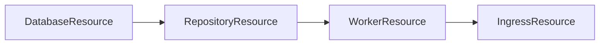

# Quan sát thứ tự callback của các Resource phụ thuộc nhau

Trong một ứng dụng Java dùng CRaC, nhiều `Resource` có quan hệ phụ thuộc: database pool cung cấp kết nối cho repository, worker sử dụng repository để xử lý công việc, còn listener hoặc ingress tạo công việc cho worker. Nếu đóng database trước khi worker dừng, worker có thể truy cập một pool đã đóng. Nếu mở listener trước khi worker sẵn sàng sau restore, request mới có thể được đưa vào một hệ thống chưa thể xử lý.

Bài thực hành này xây dựng bốn `Resource` có quan hệ phụ thuộc, đăng ký chúng vào cùng một CRaC `Context`, rồi quan sát thứ tự `beforeCheckpoint` và `afterRestore` qua log. Kết quả mong đợi là **dừng theo chiều consumer trước provider, khởi động theo chiều provider trước consumer**.

## 1. Mục tiêu thực hành

Sau bài này, bạn có thể:

- Vẽ dependency graph giữa các resource trong ứng dụng.
- Đăng ký `Resource` theo đúng thứ tự trong một `Context`.
- Quan sát thứ tự callback trước checkpoint và sau restore.
- Dùng log và trạng thái giả lập để phát hiện resource bị dừng hoặc khởi động sai thứ tự.
- Phân biệt thứ tự đăng ký resource với thứ tự tạo object hoặc thứ tự gọi constructor.
- Kiểm tra cách xử lý khi một callback thất bại.

Bài lab dùng một global context và bốn resource giả lập. Các resource chỉ thay đổi cờ trạng thái và ghi log, không mở database hoặc listener thật. Sau khi hiểu thứ tự, có thể thay phần giả lập bằng resource thực tế của ứng dụng.

## 2. Dependency graph của bài lab

Giả sử ứng dụng có bốn thành phần:

| Resource | Vai trò | Phụ thuộc vào |
|---|---|---|
| `DatabaseResource` | Mở và đóng database pool | Không phụ thuộc resource nào trong bài lab |
| `RepositoryResource` | Chuẩn bị repository và metadata truy cập dữ liệu | Database |
| `WorkerResource` | Xử lý công việc nền thông qua repository | Repository |
| `IngressResource` | Nhận request/message và gửi task cho worker | Worker |

Dependency graph:



Mũi tên đi từ provider sang consumer: repository cần database, worker cần repository, ingress cần worker. Vì vậy:

- Trước checkpoint, dừng ingress trước, rồi worker, repository và cuối cùng database.
- Sau restore, mở database trước, rồi repository, worker và cuối cùng ingress.

## 3. Quy tắc thứ tự callback của `Context`

Trong cùng một CRaC `Context`, resource nhận callback theo thứ tự sau:

| Callback | Thứ tự | Mục đích |
|---|---|---|
| `beforeCheckpoint` | Ngược thứ tự đăng ký | Dừng consumer trước khi dừng provider |
| `afterRestore` | Theo thứ tự đăng ký | Phục hồi provider trước khi phục hồi consumer |

Do đó, hãy đăng ký theo chiều dependency từ provider tới consumer:

```java
Context<? extends Resource> context = Core.getGlobalContext();
context.register(databaseResource);
context.register(repositoryResource);
context.register(workerResource);
context.register(ingressResource);
```

Với thứ tự này, `beforeCheckpoint` chạy từ `IngressResource` về `DatabaseResource`; `afterRestore` chạy từ `DatabaseResource` tới `IngressResource`.

Thứ tự được quyết định bởi thao tác `register()` trong context, không phải thứ tự object được tạo bằng `new`, thứ tự constructor chạy hay thứ tự field xuất hiện trong class. Bài lab đăng ký tất cả resource vào cùng global context để kết quả dễ quan sát. Khi ứng dụng dùng nhiều context lồng nhau, cần xem xét cả quan hệ giữa context cha và context con, rồi kiểm chứng bằng log trên runtime thực tế.

## 4. Chuẩn bị project

Ví dụ dùng Java 17 trở lên và CRaC API tương thích `org.crac`. Với Maven, thêm dependency:

```xml
<dependency>
    <groupId>org.crac</groupId>
    <artifactId>crac</artifactId>
    <version>1.5.0</version>
</dependency>
```

Phiên bản `1.5.0` là phiên bản minh họa. Hãy chọn phiên bản API phù hợp với CRaC-enabled JDK và runtime mà dự án sử dụng. Chỉ thêm dependency này không làm một JDK thông thường có khả năng checkpoint/restore; cần chạy bằng runtime hỗ trợ CRaC.

Tạo class `ResourceOrderLab.java`. Trong bài, các resource được lồng trong cùng class để dễ chạy thử bằng một file.

Đặt các import và phần khai báo class ở đầu file. Những đoạn code ở các mục tiếp theo là các thành viên được thêm lần lượt vào phần thân class này:

```java
import java.time.Instant;
import java.util.concurrent.atomic.AtomicInteger;

import org.crac.CheckpointException;
import org.crac.Context;
import org.crac.Core;
import org.crac.Resource;
import org.crac.RestoreException;

public final class ResourceOrderLab {
    // Thêm các nested class, field và method ở những bước tiếp theo.
```

## 5. Tạo state dùng chung để kiểm tra dependency

Trước khi viết callback, tạo một object giữ trạng thái của bốn thành phần. Khi bắt đầu, mọi thành phần đều sẵn sàng. Khi checkpoint, từng resource đổi trạng thái sang stopped. Sau restore, chúng được bật lại theo đúng thứ tự dependency.

```java
static final class LabState {
    volatile boolean databaseReady = true;
    volatile boolean repositoryReady = true;
    volatile boolean workerRunning = true;
    volatile boolean ingressAccepting = true;

    void require(boolean condition, String message) {
        if (!condition) {
            throw new IllegalStateException(message);
        }
    }

    boolean allReady() {
        return databaseReady
                && repositoryReady
                && workerRunning
                && ingressAccepting;
    }
}
```

Các cờ `volatile` giúp trạng thái được nhìn thấy giữa các thread nếu callback hoặc thành phần thực tế dùng nhiều thread. Trong bài lab, các callback được quan sát theo thứ tự của context; `volatile` vẫn làm rõ ý nghĩa của trạng thái dùng chung.

Phương thức `require()` tạo một điều kiện kiểm tra. Nếu một resource bị gọi sai thứ tự, callback ném `IllegalStateException` và log sẽ cho biết dependency nào chưa ở trạng thái hợp lệ.

## 6. Tạo lớp cơ sở ghi log

Mỗi callback sẽ ghi tên resource và pha đang chạy. Thêm timestamp để có thể đối chiếu log nếu output từ checkpoint và restore xuất hiện ở các process hoặc container log khác nhau.

```java
abstract static class LoggedResource implements Resource {
    protected final LabState state;
    private final String name;

    LoggedResource(String name, LabState state) {
        this.name = name;
        this.state = state;
    }

    protected void log(String callback) {
        System.out.printf("%s %-18s %s%n",
                Instant.now(), name, callback);
    }
}
```

Lớp cơ sở chỉ hỗ trợ log và chia sẻ trạng thái. Mỗi resource con sẽ định nghĩa hành vi `beforeCheckpoint` và `afterRestore` của riêng nó.

## 7. Triển khai `DatabaseResource`

Database là provider nền tảng trong dependency graph. Trước checkpoint, database chỉ được đóng sau khi repository đã dừng. Sau restore, database được mở đầu tiên để repository có thể khởi động.

```java
static final class DatabaseResource extends LoggedResource {
    DatabaseResource(LabState state) {
        super("Database", state);
    }

    @Override
    public void beforeCheckpoint(Context<? extends Resource> context) {
        state.require(!state.repositoryReady,
                "Repository must stop before database");
        log("beforeCheckpoint");
        state.databaseReady = false;
    }

    @Override
    public void afterRestore(Context<? extends Resource> context) {
        log("afterRestore");
        state.databaseReady = true;
    }
}
```

Trong ứng dụng thật, `beforeCheckpoint` có thể drain connection lease, đóng pool hoặc dùng CRaC integration của thư viện database. `afterRestore` tạo pool mới, kiểm tra kết nối và xác nhận database đã sẵn sàng.

## 8. Triển khai `RepositoryResource`

Repository phụ thuộc database. Nó phải dừng trước database và chỉ được khởi động lại sau khi database đã sẵn sàng.

```java
static final class RepositoryResource extends LoggedResource {
    RepositoryResource(LabState state) {
        super("Repository", state);
    }

    @Override
    public void beforeCheckpoint(Context<? extends Resource> context) {
        state.require(!state.workerRunning,
                "Worker must stop before repository");
        log("beforeCheckpoint");
        state.repositoryReady = false;
    }

    @Override
    public void afterRestore(Context<? extends Resource> context) {
        state.require(state.databaseReady,
                "Database must start before repository");
        log("afterRestore");
        state.repositoryReady = true;
    }
}
```

Trong một ứng dụng thực tế, repository có thể giữ metadata, statement cache hoặc adapter. Hãy xác định phần nào có thể giữ trong heap và phần nào phải tạo lại khi database pool được mở lại.

## 9. Triển khai `WorkerResource`

Worker sử dụng repository để xử lý công việc. Khi checkpoint, ingress phải ngừng gửi task mới và worker phải drain task đang chạy trước khi repository bị dừng. Sau restore, worker chỉ chạy khi repository đã sẵn sàng.

```java
static final class WorkerResource extends LoggedResource {
    WorkerResource(LabState state) {
        super("Worker", state);
    }

    @Override
    public void beforeCheckpoint(Context<? extends Resource> context) {
        state.require(!state.ingressAccepting,
                "Ingress must stop before worker");
        log("beforeCheckpoint");
        state.workerRunning = false;
    }

    @Override
    public void afterRestore(Context<? extends Resource> context) {
        state.require(state.repositoryReady,
                "Repository must start before worker");
        log("afterRestore");
        state.workerRunning = true;
    }
}
```

Worker thật có thể quản lý `ExecutorService`, consumer hoặc scheduler. `beforeCheckpoint` cần đóng admission, drain task trong deadline và shutdown executor nếu executor không thể tái sử dụng. `afterRestore` tạo executor hoặc consumer mới rồi mới báo running.

## 10. Triển khai `IngressResource`

Ingress là consumer ngoài cùng của worker trong ví dụ này: nó đưa request hoặc message vào worker. Vì vậy, ingress dừng đầu tiên và khởi động cuối cùng.

```java
static final class IngressResource extends LoggedResource {
    IngressResource(LabState state) {
        super("Ingress", state);
    }

    @Override
    public void beforeCheckpoint(Context<? extends Resource> context) {
        log("beforeCheckpoint");
        state.ingressAccepting = false;
    }

    @Override
    public void afterRestore(Context<? extends Resource> context) {
        state.require(state.workerRunning,
                "Worker must start before ingress");
        log("afterRestore");
        state.ingressAccepting = true;
    }
}
```

Trong hệ thống thật, ingress có thể là HTTP listener, message consumer, scheduler hoặc một producer nội bộ. Dừng ingress cần ngừng nhận công việc mới, không chỉ thay đổi cờ trong heap. Nếu có request đang xử lý, cần drain hoặc chuyển trạng thái sang durable queue trước khi các dependency bị đóng.

## 11. Đăng ký resource theo chiều provider tới consumer

Tạo một class điều phối giữ tham chiếu tới tất cả resource và đăng ký đúng một lần:

```java
private final LabState state = new LabState();

private final DatabaseResource database = new DatabaseResource(state);
private final RepositoryResource repository = new RepositoryResource(state);
private final WorkerResource worker = new WorkerResource(state);
private final IngressResource ingress = new IngressResource(state);

private boolean registered;

private void registerResources() {
    if (registered) {
        throw new IllegalStateException("Resources already registered");
    }

    Context<? extends Resource> context = Core.getGlobalContext();
    context.register(database);
    context.register(repository);
    context.register(worker);
    context.register(ingress);

    registered = true;
    System.out.println("Registration order: Database -> Repository -> Worker -> Ingress");
}
```

Điểm quan trọng là thứ tự `register()` được viết tường minh. Không đăng ký resource trong constructor của từng resource nếu điều đó khiến thứ tự phụ thuộc vào cách khởi tạo object. Cũng không đăng ký cùng một instance nhiều lần. Giữ tham chiếu tới resource trong suốt vòng đời ứng dụng để lifecycle được quản lý rõ ràng.

## 12. Chạy checkpoint/restore và quan sát log

Thêm phần `main()` vào class điều phối. Khi `Core.checkpointRestore()` thành công, tiến trình đã được checkpoint sẽ kết thúc và luồng thực thi tiếp tục trong tiến trình được restore. Dòng log sau lời gọi sẽ xuất hiện sau khi các callback `afterRestore` hoàn tất.

```java
public static void main(String[] args) throws Exception {
    ResourceOrderLab lab = new ResourceOrderLab();
    lab.registerResources();

    System.out.println("Application is ready for checkpoint");

    try {
        Core.checkpointRestore();
        System.out.println("checkpointRestore returned after restore");
        System.out.println("All resources ready: " + lab.state.allReady());
    } catch (CheckpointException e) {
        System.err.println("Checkpoint notification failed");
        e.printStackTrace(System.err);
        throw e;
    } catch (RestoreException e) {
        System.err.println("A resource failed during restore notification");
        e.printStackTrace(System.err);
        throw e;
    } catch (UnsupportedOperationException e) {
        System.err.println("This runtime does not support CRaC checkpoint/restore");
        throw e;
    }
}
}
```

Đoạn code này giả định các class và field ở những phần trước nằm trong cùng `ResourceOrderLab`. Đặt cấu hình checkpoint theo hướng dẫn của CRaC-enabled JDK đang dùng, ví dụ với runtime hỗ trợ option `-XX:CRaCCheckpointTo`:

```bash
java -XX:CRaCCheckpointTo=./target/checkpoint \
  -cp target/classes \
  com.example.ResourceOrderLab
```

Lệnh cụ thể phụ thuộc bản phân phối JDK và cách chạy CRaC của môi trường. `Core.checkpointRestore()` yêu cầu runtime thực hiện checkpoint/restore; nếu runtime không hỗ trợ, lời gọi có thể ném `UnsupportedOperationException`. Không chạy bài lab này trên JDK thường rồi kết luận thứ tự callback không hoạt động.

## 13. Kết quả mong đợi

Với thứ tự đăng ký `Database → Repository → Worker → Ingress`, log thành công có thứ tự:

```text
Registration order: Database -> Repository -> Worker -> Ingress
Application is ready for checkpoint
Ingress            beforeCheckpoint
Worker             beforeCheckpoint
Repository         beforeCheckpoint
Database           beforeCheckpoint
Database           afterRestore
Repository         afterRestore
Worker             afterRestore
Ingress            afterRestore
checkpointRestore returned after restore
All resources ready: true
```

Timestamp thực tế sẽ khác. Output có thể được chia giữa log của tiến trình trước checkpoint và tiến trình sau restore, tùy container runtime và cách thu thập stdout. Khi điều tra, hãy đối chiếu timestamp, checkpoint ID và process ID thay vì yêu cầu mọi dòng phải nằm trong một file log duy nhất.

Khối output phía trên lược bỏ timestamp để dễ đọc; mỗi dòng thực tế bắt đầu bằng giá trị `Instant.now()` do `LoggedResource.log()` ghi. Nếu ứng dụng có thư viện khác cũng đăng ký resource vào global context, callback của chúng cũng có thể xuất hiện trong log; thứ tự minh họa là thứ tự của bốn resource trong bài lab.

Diễn giải:

1. `Ingress.beforeCheckpoint` chạy trước để ngừng tạo công việc mới.
2. `Worker.beforeCheckpoint` chạy sau khi ingress dừng, drain và dừng worker.
3. `Repository.beforeCheckpoint` chạy khi worker không còn sử dụng repository.
4. `Database.beforeCheckpoint` chạy cuối cùng khi repository đã dừng.
5. Sau restore, database mở trước.
6. Repository được phục hồi khi database đã sẵn sàng.
7. Worker khởi động sau repository.
8. Ingress mở cuối cùng, khi worker đã có thể nhận task.

## 14. Thí nghiệm đảo ngược thứ tự đăng ký

Để thấy tác động của thứ tự, có thể đổi phần đăng ký thành:

```java
context.register(ingress);
context.register(worker);
context.register(repository);
context.register(database);
```

Thứ tự callback lúc này bị đảo so với dependency mong muốn:

| Pha | Callback khi đăng ký sai | Vấn đề |
|---|---|---|
| `beforeCheckpoint` | Database → Repository → Worker → Ingress | Database callback chạy khi repository còn hoạt động; precondition từ chối trước khi đóng database |
| `afterRestore` | Ingress → Worker → Repository → Database | Consumer nhận callback trước provider; nếu provider chưa được phục hồi, ingress có thể mở quá sớm |

Các `require()` trong ví dụ sẽ ném `IllegalStateException` khi điều kiện dependency không thỏa. Context thu thập lỗi callback và tiếp tục thông báo các resource còn lại; lỗi có thể được tổng hợp thành `CheckpointException` hoặc `RestoreException` tùy pha.

Chỉ chạy thí nghiệm đảo thứ tự trong môi trường lab riêng. Khi callback thất bại, hãy đọc toàn bộ suppressed exceptions và không coi trạng thái giả lập là đã sẵn sàng. Khôi phục code đăng ký đúng trước khi tiếp tục bài thực hành.

## 15. Quan sát thứ tự bằng sequence number

Khi nhiều resource và thread cùng ghi log, timestamp có thể không đủ rõ để xác định thứ tự. Có thể thêm bộ đếm tăng dần:

```java
static final class CallbackTrace {
    private final AtomicInteger sequence = new AtomicInteger();

    void record(String resource, String callback) {
        int number = sequence.incrementAndGet();
        System.out.printf("%02d %-18s %s%n", number, resource, callback);
    }
}
```

Truyền cùng một `CallbackTrace` vào các resource và gọi `record()` trong từng callback. Bộ đếm nằm trong heap nên giá trị trước checkpoint cũng được lưu trong snapshot; sau restore, sequence tiếp tục từ giá trị đã có. Nếu muốn phân biệt rõ process cũ và process được restore, thêm một `processRunId` được tạo lại trong `afterRestore` hoặc ghi nhận PID hiện tại cùng mỗi event.

Không dùng sequence number làm bằng chứng duy nhất khi có nhiều context độc lập hoặc nhiều process. Hãy gắn tên context, resource, checkpoint ID và process identity để log có thể đối chiếu.

## 16. Kiểm tra dependency bằng precondition

Trong bài lab, precondition được kiểm tra ngay trong callback:

| Callback | Điều kiện trước khi chạy |
|---|---|
| `Ingress.beforeCheckpoint` | Không có dependency phía sau cần kiểm tra; đây là consumer ngoài cùng |
| `Worker.beforeCheckpoint` | `ingressAccepting == false` |
| `Repository.beforeCheckpoint` | `workerRunning == false` |
| `Database.beforeCheckpoint` | `repositoryReady == false` |
| `Database.afterRestore` | Có thể mở database độc lập |
| `Repository.afterRestore` | `databaseReady == true` |
| `Worker.afterRestore` | `repositoryReady == true` |
| `Ingress.afterRestore` | `workerRunning == true` |

Các precondition biến thứ tự callback thành điều kiện có thể kiểm chứng thay vì chỉ nhìn log rồi phỏng đoán. Trong ứng dụng thực tế, precondition có thể kiểm tra connection pool đã mở, worker executor đã khởi tạo, consumer subscription đã xác nhận hoặc readiness dependency đã đạt.

## 17. Khi một callback thất bại

Để quan sát exception aggregation, có thể thêm một lỗi có chủ đích trong một resource, ví dụ ném `IllegalStateException` từ `WorkerResource.beforeCheckpoint`. Khi đó:

- Context ghi nhận lỗi của worker.
- Context vẫn thông báo cho các resource khác để chúng có cơ hội thực hiện callback.
- Nếu checkpoint notification không thành công, checkpoint bị hủy và restore notification được gọi trong JVM ban đầu để các resource phục hồi trạng thái.
- `CheckpointException` tổng hợp lỗi checkpoint và các lỗi có thể xảy ra trong quá trình phục hồi.

Nếu lỗi xảy ra trong `afterRestore` của tiến trình mới, các lỗi callback được tổng hợp trong `RestoreException`. Khi đó JVM đã restore nhưng ứng dụng có thể chưa Ready.

Khi chạy thí nghiệm này, hãy in toàn bộ stack trace:

```java
catch (CheckpointException e) {
    e.printStackTrace(System.err);
    for (Throwable suppressed : e.getSuppressed()) {
        suppressed.printStackTrace(System.err);
    }
}
```

`printStackTrace()` của Java đã hiển thị cause và suppressed tree đệ quy; vòng lặp chỉ hữu ích nếu muốn ghi từng lỗi vào một hệ thống logging riêng. Không bỏ qua exception chỉ để bài lab tiếp tục chạy.

## 18. Mở rộng bài lab với dependency thật

Sau khi thứ tự giả lập hoạt động, thay từng resource bằng thành phần thật:

| Resource lab | Thành phần thật có thể thay thế | Việc cần quan sát |
|---|---|---|
| `DatabaseResource` | HikariCP/JDBC pool hoặc database client | Pool đóng sau khi consumer drain; kết nối mới được tạo sau restore |
| `RepositoryResource` | Repository có prepared metadata hoặc cache | Không còn query khi pool đóng; metadata được refresh đúng lúc |
| `WorkerResource` | Executor, scheduled job hoặc message consumer | Không nhận task mới, task đang chạy hoàn tất, worker được tạo lại |
| `IngressResource` | HTTP listener, broker listener hoặc scheduler producer | Ngừng admission trước checkpoint và mở lại sau khi worker ready |

Nếu thư viện đã có CRaC integration, ưu tiên dùng integration đó. Tránh đóng cùng một pool hoặc executor hai lần bởi cả integration của thư viện và resource tự viết. Mỗi tài nguyên nên có một lifecycle owner rõ ràng.

## 19. Những lỗi thường gặp khi quan sát callback

### Đăng ký theo thứ tự consumer trước provider

Khi đó callback trước checkpoint có thể dừng provider trước khi consumer kết thúc. Hãy đăng ký provider trước consumer trong cùng context.

### Nhầm thứ tự tạo object với thứ tự đăng ký

Các object có thể được tạo theo bất kỳ thứ tự nào. Thứ tự callback phụ thuộc các lệnh `context.register()`.

### Đăng ký cùng resource nhiều lần

Một resource bị đăng ký nhiều lần có thể nhận callback lặp. Đặt registration tại một coordinator và bảo đảm mỗi instance chỉ được đăng ký một lần.

### Chỉ log `beforeCheckpoint`

Nếu không log `afterRestore`, bạn không xác nhận được thứ tự khởi động và việc dependency đã sẵn sàng trước consumer.

### Cho rằng queue rỗng đồng nghĩa worker đã dừng

Worker có thể đang xử lý task hoặc callback bất đồng bộ. Cần drain cả in-flight work và continuation trước khi đóng repository/database.

### Mở ingress trước khi worker sẵn sàng

Request có thể được nhận rồi thất bại khi dispatch. Hãy mở ingress sau cùng.

### Chạy trên runtime không hỗ trợ CRaC

Chỉ compile được `org.crac` API không chứng minh runtime có thể checkpoint. Hãy chạy trên CRaC-enabled JDK và kiểm tra log runtime.

### Chỉ xem log mà không kiểm tra state

Log cho biết callback được gọi; precondition và trạng thái sau restore giúp xác nhận dependency thực sự đúng.

## 20. Câu hỏi thực hành

Sau khi chạy thành công, hãy tự trả lời:

1. Vì sao `DatabaseResource` được đăng ký trước `RepositoryResource`?
2. Vì sao `IngressResource.beforeCheckpoint` phải chạy trước `WorkerResource.beforeCheckpoint`?
3. Tại sao `DatabaseResource.afterRestore` chạy trước `RepositoryResource.afterRestore`?
4. Nếu repository khởi động thất bại, ingress có nên mở không? Vì sao?
5. Nếu hai resource không phụ thuộc nhau, có cần đặt chúng theo thứ tự nào không? Bạn sẽ xác định điều đó bằng cách nào?
6. Nếu resource nằm trong các context con khác nhau, cần quan sát thêm điều gì để xác nhận thứ tự?
7. Khi callback thất bại, vì sao phải đọc suppressed exceptions thay vì chỉ đọc message ngoài cùng?

## 21. Checklist hoàn thành bài lab

- [ ] Đã tạo bốn resource theo dependency graph Database → Repository → Worker → Ingress.
- [ ] Đã đăng ký theo đúng thứ tự provider trước consumer.
- [ ] Đã ghi log trong cả `beforeCheckpoint` và `afterRestore`.
- [ ] Đã xác nhận callback trước checkpoint chạy theo thứ tự ngược đăng ký.
- [ ] Đã xác nhận callback sau restore chạy theo thứ tự đăng ký.
- [ ] Các precondition không thất bại trong lần chạy đúng.
- [ ] Trạng thái cuối sau restore cho thấy mọi resource đã sẵn sàng.
- [ ] Đã thử đảo thứ tự trong môi trường lab và quan sát lỗi dependency.
- [ ] Đã kiểm tra stack trace và suppressed exceptions khi callback thất bại.
- [ ] Đã chạy bằng CRaC-enabled runtime tương thích.

## 22. Tài liệu tham khảo

- [CRaC API — `Context`](https://javadoc.io/doc/org.crac/crac/latest/org/crac/Context.html): đăng ký và quản lý các resource trong context.
- [CRaC API — `Resource`](https://javadoc.io/doc/org.crac/crac/latest/org/crac/Resource.html): hợp đồng `beforeCheckpoint` và `afterRestore`.
- [CRaC API — `Core`](https://javadoc.io/doc/org.crac/crac/latest/org/crac/Core.html): global context và yêu cầu checkpoint/restore.
- [CRaC Project](https://crac.org/): tổng quan runtime và quy trình checkpoint/restore.

Kết quả cần quan sát là callback `beforeCheckpoint` đi ngược thứ tự đăng ký để consumer dừng trước provider, còn `afterRestore` đi theo thứ tự đăng ký để provider sẵn sàng trước consumer. Đăng ký resource theo chiều dependency, ghi log ở cả hai pha và đặt precondition trong callback sẽ giúp phát hiện sớm lỗi thứ tự trước khi áp dụng cùng mô hình cho database pool, worker, scheduler và ingress thực tế.
