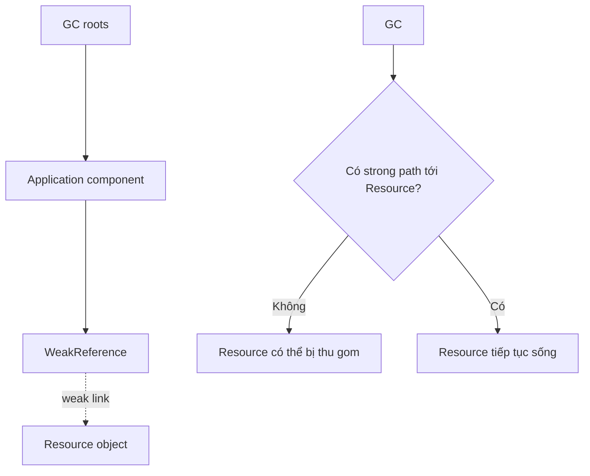

# Tái hiện lỗi Resource bị thu gom do chỉ còn tham chiếu yếu

Trong Java, garbage collector (GC) chỉ giữ lại object nếu object còn reachable từ một GC root thông qua chuỗi tham chiếu mạnh. `WeakReference` không giữ object sống. Khi một `Resource` chỉ còn được trỏ tới bởi weak reference, GC có thể thu gom resource trước khi CRaC gọi `beforeCheckpoint` hoặc `afterRestore`.

Lỗi này thường xuất hiện khi ứng dụng tự quản lý resource bằng một registry chỉ lưu `WeakReference`, hoặc component giữ resource trong một field yếu vì muốn tránh giữ object lâu. Registry vẫn còn entry, nên log có thể cho thấy resource từng được đăng ký, nhưng `WeakReference.get()` trả về `null` sau khi object bị thu gom. Khi đó, callback không còn object để gọi và tài nguyên có thể không được đóng hoặc khôi phục theo kế hoạch.

Điểm cần phân biệt là weak reference do ứng dụng giữ và cơ chế registration của CRaC. Nếu resource được đăng ký trực tiếp vào một `Context` có implementation giữ strong reference, registration đó có thể giữ resource sống. Không nên suy đoán hành vi nội bộ của mọi JDK hoặc CRaC distribution. Cách thiết kế an toàn là để một thành phần sống đủ lâu giữ strong reference tới mỗi resource trong toàn bộ lifecycle, đồng thời kiểm thử hành vi của đúng runtime đang dùng.

## 1. Reachability và vòng đời của object

GC không thu gom object chỉ vì một biến local ra khỏi scope theo cách nhìn cú pháp đơn giản. GC xét reachability tại thời điểm collection dựa trên các reference còn có thể được sử dụng.

Các nhóm reference chính trong Java:

| Loại reference | Có giữ referent sống không? | Hành vi khi GC xử lý |
| --- | --- | --- |
| Strong reference | Có | Object còn reachable qua strong reference sẽ không bị thu gom |
| `SoftReference` | Có điều kiện | GC có thể xóa soft reference trước khi thu gom object, thường dựa trên memory pressure |
| `WeakReference` | Không | GC có thể xóa weak reference khi referent không còn strong reachable |
| `PhantomReference` | Không | Dùng để nhận biết object đã đi tới giai đoạn phantom reachable, thường kết hợp `ReferenceQueue` cho cleanup đặc biệt |

Một field kiểu `WeakReference<Resource>` không phải là owner của resource. Nó chỉ cho phép kiểm tra xem object còn sống hay không.

### 1.1. Strong reachability

Giả sử một application component giữ resource như sau:

```java
public final class ResourceOwner {

    private final CacheResource resource;

    public ResourceOwner(CacheResource resource) {
        this.resource = resource;
    }

    public CacheResource resource() {
        return resource;
    }
}
```

Nếu `ResourceOwner` còn reachable từ application context hoặc một GC root, field `resource` tạo ra strong reference. GC không thể thu gom `CacheResource` trong khi owner còn giữ field đó.

### 1.2. Weak-only reachability

Thay field strong bằng weak reference:

```java
import java.lang.ref.WeakReference;

public final class WeakResourceOwner {

    private final WeakReference<CacheResource> resource;

    public WeakResourceOwner(CacheResource resource) {
        this.resource = new WeakReference<>(resource);
    }

    public CacheResource resource() {
        return resource.get();
    }
}
```

Nếu caller không giữ `CacheResource` ở nơi nào khác, object có thể trở thành weakly reachable và được GC thu gom. Sau đó `resource()` trả về `null`.



Một registry có thể còn sống và vẫn chứa weak reference, trong khi object mà nó định quản lý đã biến mất. Đây là khác biệt giữa vòng đời của registry và vòng đời của resource.

## 2. Vì sao lỗi này nguy hiểm với CRaC Resource?

Một CRaC resource thường quản lý tài nguyên có lifecycle quan trọng, ví dụ:

- Database connection pool.
- HTTP client hoặc socket.
- Message consumer.
- Scheduler hoặc executor.
- Native handle và file descriptor.
- Cache cần flush hoặc xác minh sau restore.
- Server listener hoặc resource do framework tạo.

Nếu resource bị thu gom trước checkpoint, callback `beforeCheckpoint` có thể không chạy trên object đó. Nếu resource được tạo lại hoặc được kỳ vọng tồn tại cho callback sau restore nhưng reference duy nhất đã mất, `afterRestore` cũng không có đối tượng để gọi.

Hậu quả phụ thuộc tài nguyên:

- Connection hoặc socket không được đóng theo quy trình ứng dụng.
- Background worker không được pause/drain.
- Buffer hoặc state chưa được flush.
- Resource không được tạo lại sau restore.
- Readiness có thể chuyển accepting dù một thành phần chưa được phục hồi.
- Lỗi chỉ xuất hiện trong checkpoint hoặc restore, khó tái hiện bằng luồng chạy bình thường.

GC không biết `Resource` có ý nghĩa đặc biệt đối với CRaC. Nếu object không còn strong reachable, GC không giữ nó sống chỉ vì class implements `org.crac.Resource`.

## 3. Xác định đúng vị trí weak reference gây lỗi

Không phải cứ nhìn thấy một `WeakReference` trong ứng dụng là có bug. Weak reference có thể được dùng hợp lý cho cache hoặc metadata không sở hữu vòng đời resource. Vấn đề xuất hiện khi weak reference là đường tham chiếu duy nhất tới object cần tồn tại.

Hãy kiểm tra:

1. Ai tạo `Resource`?
2. Ai giữ strong reference sau khi constructor hoặc factory trả về?
3. Registry lưu trực tiếp `Resource` hay chỉ lưu `WeakReference<Resource>`?
4. Resource có được đăng ký trực tiếp vào CRaC `Context` không?
5. Có component nào giữ resource trong field strong xuyên suốt vòng đời không?
6. Có đoạn code nào gán field owner thành `null`, thay registry hoặc unregister quá sớm không?
7. Resource có được tạo trong method local rồi method kết thúc mà không chuyển ownership không?
8. Có callback, lambda hoặc inner class vô tình giữ object hay ngược lại không giữ object như người viết mong đợi?

### 3.1. Phân biệt weak application registry và CRaC Context

Ví dụ sau minh họa một registry do ứng dụng tự viết:

```java
final class ApplicationResourceRegistry {
    private final List<WeakReference<Resource>> resources =
            new ArrayList<>();
}
```

Registry này chỉ lưu weak reference. Nếu không có strong owner khác, resource có thể bị GC thu gom.

Trong khi đó, CRaC API cung cấp registration qua `Context.register(resource)`. Hành vi lưu giữ resource bên trong context phụ thuộc implementation và hợp đồng của runtime/API cụ thể. Không nên dùng một weak-only application registry rồi giả định CRaC context chắc chắn sẽ bù lại strong ownership, trừ khi tài liệu của runtime xác nhận điều đó. Giữ một field strong ở application owner là cách rõ ràng và dễ kiểm thử.

### 3.2. Không nhầm việc callback chưa chạy với việc resource đã bị GC

Callback có thể không xuất hiện vì nhiều nguyên nhân khác:

- Resource chưa được đăng ký.
- Đăng ký vào context khác với context đang checkpoint.
- Đăng ký bị lỗi hoặc bị unregister.
- Checkpoint không đi qua lifecycle CRaC mà dùng cơ chế khác.
- Callback thất bại trước khi ghi log hoàn tất.
- Resource đã bị thu gom do chỉ còn weak reference.

Để kết luận có GC collection, cần bằng chứng như `ReferenceQueue`, log cleanup, heap dump hoặc quan sát weak reference trả `null`. Chỉ thiếu một dòng log callback chưa chứng minh resource bị GC.

## 4. Tạo chương trình tái hiện lỗi bằng WeakReference

Ví dụ dưới đây mô phỏng một registry chỉ giữ weak reference. Resource được tạo trong một method, đăng ký vào registry rồi không có strong owner nào giữ lại.

```java
import java.lang.ref.ReferenceQueue;
import java.lang.ref.WeakReference;
import java.util.ArrayList;
import java.util.Iterator;
import java.util.List;

interface ManagedResource {
    void beforeCheckpoint() throws Exception;
}

final class DemoResource implements ManagedResource {

    private final String name;

    DemoResource(String name) {
        this.name = name;
    }

    @Override
    public void beforeCheckpoint() {
        System.out.println("beforeCheckpoint: " + name);
    }
}

final class WeakOnlyRegistry {

    private final ReferenceQueue<ManagedResource> collected =
            new ReferenceQueue<>();
    private final List<WeakReference<ManagedResource>> entries =
            new ArrayList<>();

    void register(ManagedResource resource) {
        entries.add(new WeakReference<>(resource, collected));
    }

    void invokeBeforeCheckpoint() throws Exception {
        for (Iterator<WeakReference<ManagedResource>> it =
                entries.iterator(); it.hasNext();) {
            ManagedResource resource = it.next().get();
            if (resource == null) {
                it.remove();
                continue;
            }
            resource.beforeCheckpoint();
        }
    }

    int entryCount() {
        return entries.size();
    }

    int liveCount() {
        int count = 0;
        for (WeakReference<ManagedResource> entry : entries) {
            if (entry.get() != null) {
                count++;
            }
        }
        return count;
    }

    boolean awaitCollected(long timeoutMillis) throws InterruptedException {
        return collected.remove(timeoutMillis) != null;
    }
}

public final class WeakResourceReproduction {

    private static void createAndRegister(WeakOnlyRegistry registry) {
        ManagedResource resource = new DemoResource("native-client");
        registry.register(resource);
        // Method kết thúc; không có strong reference nào khác được giữ.
    }

    public static void main(String[] args) throws Exception {
        WeakOnlyRegistry registry = new WeakOnlyRegistry();
        createAndRegister(registry);

        System.out.println("entries=" + registry.entryCount());
        System.out.println("live before GC=" + registry.liveCount());

        System.gc(); // Chỉ là yêu cầu GC, không phải bảo đảm collection.

        boolean collected = registry.awaitCollected(5_000);
        System.out.println("reference enqueued=" + collected);
        System.out.println("live after GC=" + registry.liveCount());

        registry.invokeBeforeCheckpoint();
    }
}
```

Kết quả thường thấy khi GC thu gom resource:

```text
entries=1
live before GC=1
reference enqueued=true
live after GC=0
```

Khi `invokeBeforeCheckpoint()` chạy, registry không còn resource để gọi. Dòng `beforeCheckpoint: native-client` không xuất hiện.

`System.gc()` chỉ là yêu cầu GC. JVM có thể bỏ qua yêu cầu hoặc chọn thời điểm collection khác. Vì vậy, kết quả thực tế phụ thuộc GC, heap pressure và cách chương trình được biên dịch. Chương trình trên là reproduction có quan sát, không phải phép chứng minh rằng mọi lần chạy đều phải thu gom ngay sau lệnh `System.gc()`.

## 5. Dùng ReferenceQueue để chứng minh referent đã bị thu gom

`ReferenceQueue` cho phép nhận thông báo khi reference được GC xử lý. Đây là cách hữu ích để xác nhận weak reference đã được enqueue.

```java
ReferenceQueue<ManagedResource> queue = new ReferenceQueue<>();
WeakReference<ManagedResource> weak =
        new WeakReference<>(resource, queue);
```

Khi referent được thu gom, reference có thể được đưa vào queue. Code quan sát:

```java
Reference<? extends ManagedResource> reference = queue.remove(5_000);
if (reference != null) {
    System.out.println("Resource was collected");
}
```

Không dùng `ReferenceQueue` như một cơ chế thay thế ownership. Queue chỉ thông báo referent đã bị xử lý; nó không khôi phục resource và cũng không thể chạy callback CRaC trên object đã bị thu gom.

### 5.1. Vì sao phải tránh strong reference ẩn trong test?

Một reproduction có thể không xảy ra nếu test vô tình giữ resource sống:

```java
ManagedResource resource = new DemoResource("client");
WeakReference<ManagedResource> weak = new WeakReference<>(resource);
System.gc();
```

Trong đoạn này, biến `resource` vẫn có thể được sử dụng ở phía sau nên JIT có thể giữ strong reachability. Để kiểm tra weak-only behavior, hãy tạo resource trong helper method rồi chỉ trả về weak reference hoặc để registry giữ weak reference.

Không nên dựa vào việc biến local “đã ra khỏi block” để kết luận chắc chắn object đã unreachable. Compiler và runtime có thể tối ưu lifetime của local variable theo reachability thực tế.

## 6. Reproduction với Resource thật của CRaC

Để mô phỏng lifecycle CRaC, resource có thể triển khai `org.crac.Resource`. Ví dụ sau dùng một application registry weak-only để minh họa lỗi ownership.

```java
import java.lang.ref.ReferenceQueue;
import java.lang.ref.WeakReference;
import java.util.ArrayList;
import java.util.Iterator;
import java.util.List;

import org.crac.Context;
import org.crac.Resource;

final class WeakCracResourceRegistry {

    private final ReferenceQueue<Resource> queue = new ReferenceQueue<>();
    private final List<WeakReference<Resource>> resources = new ArrayList<>();

    synchronized void add(Resource resource) {
        resources.add(new WeakReference<>(resource, queue));
    }

    synchronized void beforeCheckpoint(
            Context<? extends Resource> context) throws Exception {
        for (Iterator<WeakReference<Resource>> it =
                resources.iterator(); it.hasNext();) {
            Resource resource = it.next().get();
            if (resource == null) {
                it.remove();
            } else {
                resource.beforeCheckpoint(context);
            }
        }
    }

    synchronized void afterRestore(
            Context<? extends Resource> context) throws Exception {
        for (Iterator<WeakReference<Resource>> it =
                resources.iterator(); it.hasNext();) {
            Resource resource = it.next().get();
            if (resource == null) {
                it.remove();
            } else {
                resource.afterRestore(context);
            }
        }
    }
}
```

Đây là registry tự viết để tái hiện lỗi; nó không phải implementation của CRaC `Context`. Nếu chỉ registry này giữ resource, GC có thể thu gom object và callback không được gọi.

Resource thử nghiệm:

```java
import org.crac.Context;
import org.crac.Resource;

final class LoggingCracResource implements Resource {

    private final String id;

    LoggingCracResource(String id) {
        this.id = id;
    }

    @Override
    public void beforeCheckpoint(Context<? extends Resource> context) {
        System.out.println(id + ": beforeCheckpoint");
    }

    @Override
    public void afterRestore(Context<? extends Resource> context) {
        System.out.println(id + ": afterRestore");
    }
}
```

Factory chỉ tạo weak-only ownership:

```java
static void registerWeakOnly(WeakCracResourceRegistry registry) {
    Resource resource = new LoggingCracResource("resource-A");
    registry.add(resource);
}
```

Sau khi `registerWeakOnly()` kết thúc, nếu không có strong reference nào khác, resource có thể bị GC thu gom. Khi registry duyệt danh sách, `get()` có thể trả `null` và callback bị bỏ qua.

### 6.1. Phân biệt test registry và test CRaC Context

Đoạn code trên chứng minh weak-only application registry không giữ resource sống. Nó không chứng minh `Core.getGlobalContext().register(resource)` của mọi CRaC runtime giữ weak reference.

Nếu muốn kiểm tra registration trực tiếp vào CRaC context:

1. Dùng đúng JDK CRaC distribution dự kiến triển khai.
2. Đăng ký resource qua API `Context.register` theo tài liệu của runtime.
3. Chỉ giữ thêm weak reference phục vụ quan sát.
4. Bỏ mọi strong reference ứng dụng khác một cách có chủ đích.
5. Tạo GC pressure có kiểm soát và quan sát weak reference.
6. Chạy checkpoint/restore integration test và ghi nhận callback.
7. Đối chiếu kết quả với hợp đồng registration của runtime.

Nếu context giữ strong reference, weak reference quan sát sẽ không bị xóa trong khi resource còn đăng ký. Nếu resource bị thu gom, cần kiểm tra xem registration có thực sự diễn ra, có bị unregister hoặc context có dùng semantics lưu giữ khác hay không. Dù kết quả thế nào, application owner mạnh vẫn là cách thiết kế dễ hiểu và ít phụ thuộc implementation nhất.

## 7. Sửa lỗi bằng strong ownership

Giải pháp trực tiếp là giữ strong reference tới resource trong một component sống đủ lâu. Ví dụ:

```java
import org.crac.Core;

public final class CracResourceOwner {

    private final LoggingCracResource resource;

    public CracResourceOwner() {
        this.resource = new LoggingCracResource("resource-A");
        Core.getGlobalContext().register(resource);
    }
}
```

Field `resource` giữ strong reference trong suốt vòng đời của `CracResourceOwner`. Nếu owner là singleton bean hoặc application lifecycle component, resource sẽ tiếp tục reachable trong thời gian ứng dụng hoạt động.

### 7.1. Registry strong-reference

Nếu ứng dụng cần registry quản lý nhiều resource, registry nên lưu trực tiếp object:

```java
import java.util.ArrayList;
import java.util.List;
import org.crac.Resource;

public final class StrongResourceRegistry {

    private final List<Resource> resources = new ArrayList<>();

    public synchronized void register(Resource resource) {
        resources.add(resource);
    }

    public synchronized void unregister(Resource resource) {
        resources.remove(resource);
    }

    public synchronized List<Resource> snapshot() {
        return List.copyOf(resources);
    }
}
```

Registry strong-reference làm rõ rằng registry sở hữu resource. Khi resource không còn cần thiết, ứng dụng phải unregister và cleanup rõ ràng. Strong reference cần được quản lý có chủ đích để tránh memory leak; không nên chuyển mọi object vào global static list rồi giữ vĩnh viễn.

### 7.2. Đăng ký một lần và giữ ownership

Một owner có thể vừa giữ field strong vừa đăng ký với CRaC:

```java
public final class NativeClientLifecycle {

    private final NativeClientResource resource;

    public NativeClientLifecycle(NativeClientFactory factory) {
        this.resource = new NativeClientResource(factory);
        Core.getGlobalContext().register(resource);
    }

    public NativeClientResource resource() {
        return resource;
    }
}
```

Không tạo resource trong method local rồi chỉ gọi một hàm đăng ký vào registry weak-only. Hãy chuyển ownership vào một field strong trước khi method kết thúc.

## 8. So sánh cách giữ resource

| Cách lưu | Resource có được giữ sống? | Phù hợp cho lifecycle resource? |
| --- | --- | --- |
| Field strong trong singleton owner | Có, khi owner reachable | Có |
| `List<Resource>` trong registry strong | Có, khi registry reachable | Có, nếu unregister/cleanup đúng |
| `Map<String, Resource>` | Có, khi map reachable | Có, nếu quản lý ownership rõ |
| `WeakReference<Resource>` | Không bảo đảm | Không nếu đây là tham chiếu duy nhất |
| `WeakHashMap<Resource, Metadata>` | Key có thể bị thu gom khi không còn strong ref | Không dùng làm owner của Resource |
| `SoftReference<Resource>` | Không bảo đảm lâu dài | Không phù hợp để giữ lifecycle resource |
| `PhantomReference<Resource>` | Không giữ object sống | Chỉ phù hợp cho notification/cleanup đặc biệt, không gọi callback trên object đã mất |

Weak reference phù hợp cho cache có thể tái tạo hoặc association phụ trợ mà việc mất entry không ảnh hưởng tính đúng đắn. Resource CRaC thường cần tồn tại chính xác qua một giai đoạn lifecycle, nên cần owner strong.

## 9. Không dùng Cleaner hoặc finalizer thay cho lifecycle CRaC

`Cleaner` và finalization không bảo đảm chạy tại thời điểm ứng dụng cần chuẩn bị checkpoint. Chúng cũng không phải nơi phù hợp để thực hiện logic cần hoàn tất trước khi checkpoint.

Ví dụ không nên dựa vào:

```java
private static final Cleaner CLEANER = Cleaner.create();

private final Cleaner.Cleanable cleanable =
        CLEANER.register(this, this::closeNativeHandle);
```

Cleaner có thể hữu ích như một lớp bảo vệ cuối cùng cho tài nguyên khi caller quên đóng, nhưng không thay thế `close()` deterministic hoặc CRaC callback. Runnable cleanup của Cleaner cũng không nên giữ strong reference ngược tới object cần được thu gom, nếu không nó có thể ngăn chính việc thu gom đó.

Với CRaC, resource owner nên chủ động đóng tài nguyên trong `beforeCheckpoint` và tạo lại hoặc xác minh trong `afterRestore`. Cleaner có thể là fallback theo thiết kế của thư viện, không phải nguồn đảm bảo callback sẽ được gọi.

## 10. Kiểm thử hồi quy: weak-only thất bại, strong owner giữ resource

Một bộ test nên có hai mục tiêu:

1. Chứng minh weak-only registry có thể mất resource khi referent được GC.
2. Chứng minh strong registry hoặc owner giữ resource reachable cho tới khi chủ động unregister.

### 10.1. Test yếu: xác nhận entry có thể mất referent

Không nên viết test phụ thuộc vào một lần `System.gc()` rồi luôn assert object đã bị thu gom. GC là best-effort. Có thể kiểm tra logic registry một cách xác định bằng cách xóa weak reference trong test:

```java
import static org.junit.jupiter.api.Assertions.assertEquals;
import static org.junit.jupiter.api.Assertions.assertNull;

import java.lang.ref.WeakReference;
import org.junit.jupiter.api.Test;

class WeakRegistryTest {

    @Test
    void weakOnlyEntryDoesNotOwnResource() throws Exception {
        WeakOnlyRegistry registry = new WeakOnlyRegistry();
        ManagedResource resource = new DemoResource("temporary");
        WeakReference<ManagedResource> weak =
                new WeakReference<>(resource);

        registry.register(resource);
        resource = null;

        // Test có thể giữ reference để mô phỏng trạng thái sau collection.
        weak.clear();

        assertNull(weak.get());
        assertEquals(0, registry.liveCount());
        registry.invokeBeforeCheckpoint();
    }
}
```

Test này xác nhận semantics của weak registry sau khi referent không còn. Nó không chứng minh GC tự thu gom trong lần chạy đó, vì `clear()` được gọi trực tiếp để làm cho kết quả xác định.

### 10.2. Test strong owner

Với strong registry, registry tiếp tục giữ resource sau khi caller bỏ reference local:

```java
import static org.junit.jupiter.api.Assertions.assertNotNull;

import java.lang.ref.ReferenceQueue;
import java.lang.ref.WeakReference;
import org.junit.jupiter.api.Test;

class StrongRegistryTest {

    @Test
    void registryKeepsResourceStronglyReachable() {
        StrongResourceRegistry registry = new StrongResourceRegistry();
        ReferenceQueue<Resource> queue = new ReferenceQueue<>();

        Resource resource = new LoggingCracResource("owned");
        WeakReference<Resource> observer =
                new WeakReference<>(resource, queue);

        registry.register(resource);
        resource = null;

        assertNotNull(observer.get());
        assertEquals(1, registry.snapshot().size());
    }
}
```

Trong test này, `registry.snapshot()` tạo một list strong tạm thời; điều đó cũng giữ resource sống trong lúc snapshot tồn tại. Điểm quan trọng là registry vẫn giữ object ngay cả sau khi biến local được gán `null`.

Để test lifecycle cleanup, gọi `unregister` bằng một khóa hoặc handle ổn định do registry quản lý, rồi kiểm tra resource có thể trở nên unreachable sau khi không còn strong owner nào khác. Tránh để test giữ lại object trong field hoặc lambda ngoài ý muốn.

### 10.3. Test GC thực tế có timeout

Một integration-style test có thể dùng `ReferenceQueue` và đợi trong giới hạn thời gian:

```java
static boolean awaitCollection(
        WeakReference<?> reference,
        ReferenceQueue<?> queue,
        Duration timeout) throws InterruptedException {

    long deadline = System.nanoTime() + timeout.toNanos();
    while (System.nanoTime() < deadline) {
        if (reference.get() == null) {
            return true;
        }

        System.gc();
        queue.remove(100);
    }
    return reference.get() == null;
}
```

Helper này chờ có giới hạn và không giả định GC phải chạy ngay. Test cần tạo object trong helper method để tránh strong local reference còn sống. Nếu test không quan sát được collection, báo kết quả inconclusive thay vì kết luận weak reference giữ object sống.

## 11. Tái hiện trong một CRaC integration test

Unit test weak registry giúp xác nhận nguyên nhân ở application code. Để kiểm tra tác động thực tế tới checkpoint, cần chạy với JDK CRaC tương thích.

Một test flow có thể là:

1. Khởi động ứng dụng test với resource recorder.
2. Đăng ký resource theo cách đang được nghi ngờ, ví dụ weak-only registry.
3. Giữ một `WeakReference` và `ReferenceQueue` để quan sát referent.
4. Bỏ strong reference do test hoặc factory giữ.
5. Tạo GC pressure có kiểm soát và đợi bounded timeout.
6. Ghi lại việc weak reference có bị enqueue hay không.
7. Yêu cầu checkpoint bằng cơ chế CRaC của đúng JDK.
8. Quan sát callback trace và trạng thái resource.
9. Lặp lại với strong owner để so sánh.

Kết quả nên ghi rõ JDK vendor/version/build, GC, heap size, cách tạo pressure và trạng thái reference. Không kết luận từ một lần chạy duy nhất nếu GC chưa xảy ra.

### 11.1. Hai nhánh thí nghiệm

| Nhánh | Ownership | Kết quả mong đợi |
| --- | --- | --- |
| A – weak-only | Chỉ còn weak reference trong registry ứng dụng | Resource có thể bị thu gom; callback registry không còn gọi được |
| B – strong owner | Component sống lâu giữ field strong | Resource còn reachable và callback có thể được gọi theo lifecycle |

Nếu resource được đăng ký trực tiếp với CRaC Context, cần ghi nhận thêm tác động của context implementation. Không gộp kết quả weak-only registry với kết luận về cách CRaC Context giữ resource.

## 12. Quan sát bằng heap dump và công cụ JVM

Khi lỗi chỉ xuất hiện trong môi trường lớn, có thể dùng heap dump để xác định đường tham chiếu tới resource.

Các câu hỏi cần trả lời:

- Resource còn tồn tại trong heap không?
- Nếu còn, GC root nào giữ nó sống?
- Nếu không còn, weak reference nào từng trỏ tới nó?
- Registry còn entry nhưng `get()` trả `null` không?
- Có strong owner nào bị gán `null` hoặc unregister sớm không?
- Có nhiều instance resource được tạo nhưng chỉ một instance được đăng ký không?

Có thể dùng `jcmd` để tạo heap dump hoặc lấy thông tin class histogram theo JDK đang chạy:

```bash
jcmd <pid> GC.class_histogram
jcmd <pid> GC.heap_dump /tmp/application-heap.hprof
```

Các lệnh có thể tạo pause hoặc tiêu tốn dung lượng đáng kể. Dùng trong môi trường test hoặc theo quy trình vận hành đã được chấp thuận. Heap dump có thể chứa dữ liệu nhạy cảm trong heap; bảo vệ file và xóa theo retention policy.

### 12.1. Heap dump không phải lúc nào cũng cho thấy weak reference đã bị xóa

Sau khi GC xử lý weak reference, referent có thể không còn trong heap dump. Vì vậy, nên kết hợp:

- Log lúc tạo và đăng ký resource.
- Resource identity ổn định trong log.
- `ReferenceQueue` event.
- Số lượng entry và live referent trong registry.
- Callback trace.
- Heap dump trước và sau GC nếu cần.

Không dùng `System.identityHashCode()` làm định danh bền vững xuyên process restore. Nó chỉ hữu ích cho chẩn đoán trong cùng một lần chạy.

## 13. Các lỗi thiết kế thường gặp

| Lỗi | Hậu quả | Cách xử lý |
| --- | --- | --- |
| Registry chỉ lưu `WeakReference<Resource>` | Resource có thể bị GC trước callback | Lưu strong reference trong owner sống lâu |
| Tạo resource trong method local rồi method kết thúc | Không còn owner strong | Chuyển resource vào field hoặc strong registry |
| Dùng `WeakHashMap<Resource, Metadata>` làm registry lifecycle | Key có thể biến mất khi không còn strong reference | Dùng map strong và unregister rõ ràng |
| Nghĩ `implements Resource` tự ngăn GC | Interface không tạo strong reference | Thiết kế ownership tường minh |
| Chỉ kiểm tra registry entry count | Entry có thể còn nhưng `get()` đã `null` | Kiểm tra live referent và ReferenceQueue |
| Dựa vào Cleaner/finalizer | Cleanup không đúng thời điểm checkpoint | Dùng `close()` deterministic và CRaC callback |
| Giữ resource bằng static map không có cleanup | Resource cũ bị giữ vô thời hạn | Quản lý unregister và shutdown |
| Unregister trước checkpoint ngoài ý muốn | Callback không còn được dispatch | Chỉ unregister khi lifecycle resource thực sự kết thúc |
| Cho rằng CRaC Context luôn giữ strong reference mà không kiểm tra | Giả định sai giữa các implementation | Xem API contract và test đúng runtime; giữ owner strong |
| Test chỉ gọi `System.gc()` một lần | Test flaky hoặc kết luận sai | Dùng ReferenceQueue, bounded wait và test logic xác định |

## 14. Quy tắc ownership cho CRaC Resource

Một resource nên có owner rõ ràng từ lúc tạo đến lúc lifecycle kết thúc.

| Giai đoạn | Ownership cần có |
| --- | --- |
| Tạo resource | Factory hoặc component nhận ownership ngay sau khi tạo |
| Đăng ký CRaC | Owner giữ strong reference và đăng ký đúng context |
| Trước checkpoint | Owner vẫn giữ resource trong lúc callback được dispatch |
| Sau restore | Cùng owner hoặc lifecycle coordinator tiếp tục quản lý resource |
| Thay thế resource | Tạo resource mới, chuyển ownership có kiểm soát và cleanup resource cũ |
| Kết thúc ứng dụng | Unregister/close theo API và giải phóng strong reference khi không còn cần |

Nếu resource có thể được tạo động, hãy quản lý nó trong một registry strong-reference có thao tác register/unregister thread-safe. Không dùng weak reference làm cơ chế tự động loại bỏ resource có lifecycle bắt buộc.

### 14.1. Giữ strong owner không có nghĩa giữ mọi tài nguyên mở

Strong reference giữ object Java sống; nó không yêu cầu socket hoặc connection phải luôn mở. Resource có thể vẫn tồn tại trong heap trong khi `beforeCheckpoint` đóng handle native và đặt field handle thành `null`. Sau restore, cùng resource object có thể tạo handle mới trong `afterRestore`.

Đây là cách tách hai khái niệm:

- **Object lifetime:** resource object cần sống để nhận callback.
- **Underlying resource lifetime:** socket, pool hoặc native handle có thể đóng/mở theo checkpoint lifecycle.

Không dùng weak reference để giải quyết việc muốn đóng tài nguyên trước checkpoint. Hãy giữ object sống và đóng tài nguyên bên trong callback.

## 15. Lưu ý với lambda, inner class và callback

Java closure có thể giữ strong reference tới object bên ngoài, nhưng không nên dựa vào capture tình cờ để quản lý lifecycle.

Ví dụ một lambda capture owner:

```java
Resource resource = new LoggingCracResource("cache");
Runnable callback = () -> System.out.println(resource);
```

Lambda có thể giữ resource sống vì capture nó. Nhưng nếu lambda bị thay thế hoặc không còn reachable, resource lại có thể bị thu gom. Việc giữ sống chỉ vì một callback phụ không phải ownership contract rõ ràng.

Tương tự, non-static inner class giữ tham chiếu ngầm tới outer instance. Điều này có thể vô tình giữ cả object graph lớn sống lâu. Với CRaC resource, nên dùng owner field hoặc registry explicit để quan hệ sở hữu dễ hiểu và dễ test.

## 16. Kiểm tra unregister và thay thế resource

Strong reference cần có cleanup để tránh leak. Khi resource hết vòng đời, owner phải:

1. Ngừng sử dụng resource.
2. Đợi operation đang chạy hoàn tất.
3. Gọi API cleanup/close.
4. Unregister khỏi CRaC context nếu resource không còn tham gia các chu kỳ tiếp theo.
5. Xóa strong reference khỏi owner/registry.

Nếu thay thế resource khi ứng dụng vẫn chạy, cần tránh khoảng thời gian cả resource cũ và mới cùng nhận callback hoặc cùng sở hữu một socket. Chuyển ownership theo một transaction nội bộ: tạo và verify resource mới, chuyển traffic, rồi cleanup và unregister resource cũ.

Không unregister một resource chỉ vì nó tạm thời đóng handle trong `beforeCheckpoint`; object vẫn cần tồn tại để nhận `afterRestore` nếu lifecycle đó yêu cầu.

## 17. Checklist tái hiện và sửa lỗi

Khi nghi ngờ resource bị GC do chỉ còn weak reference, có thể thực hiện các bước:

- [ ] Xác định nơi tạo `Resource` và nơi giữ nó sau khi factory trả về.
- [ ] Tìm `WeakReference`, `SoftReference`, `WeakHashMap` và các registry tương tự.
- [ ] Kiểm tra có strong owner xuyên suốt lifecycle không.
- [ ] Kiểm tra resource có được đăng ký trực tiếp vào đúng CRaC context không.
- [ ] Thêm `ReferenceQueue` để quan sát collection.
- [ ] Ghi resource ID khi tạo, register, callback và cleanup.
- [ ] Tái hiện weak-only case trong test cô lập.
- [ ] So sánh với strong-owner case.
- [ ] Kiểm tra callback trước checkpoint và sau restore.
- [ ] Kiểm tra exception, timeout và unregister.
- [ ] Chạy integration test bằng đúng JDK CRaC distribution.
- [ ] Xác nhận strong reference được giải phóng khi resource thực sự hết vòng đời.

## 18. Kết luận

`WeakReference` không giữ referent sống. Nếu một `Resource` chỉ còn được tham chiếu yếu trong registry hoặc owner của ứng dụng, GC có thể thu gom object trước khi CRaC gọi callback. Registry vẫn có thể tồn tại nhưng `WeakReference.get()` trả về `null`, khiến callback bị bỏ qua.

Để tái hiện, tạo resource trong helper method, chỉ lưu `WeakReference`, quan sát bằng `ReferenceQueue` và chạy GC trong một khoảng chờ có giới hạn. Vì `System.gc()` không bảo đảm collection, hãy kết hợp test GC thực tế với test xác định dùng `WeakReference.clear()` để kiểm tra logic registry. Khi sửa, giữ strong reference trong một owner sống lâu hoặc strong registry, đăng ký resource đúng context và chỉ unregister khi lifecycle thật sự kết thúc. Object `Resource` cần sống qua callback; các socket, pool và native handle bên trong nó vẫn có thể được đóng và tạo lại theo `beforeCheckpoint`/`afterRestore`.
