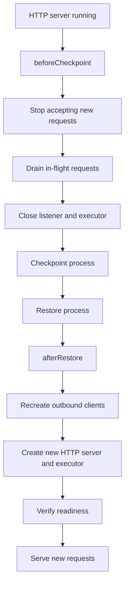

# Tạm dừng máy chủ HTTP và tái lập kết nối sau restore

Một máy chủ HTTP thường giữ listening socket, các kết nối TCP đang mở, worker thread và trạng thái của những request đang xử lý. Khi ứng dụng Java được checkpoint, các tài nguyên này có thể không còn hợp lệ sau khi tiến trình được restore. Vì vậy, ứng dụng cần dừng nhận request mới, cho request đang chạy hoàn tất, đóng máy chủ trước checkpoint và tạo lại listener sau restore.

Bài thực hành này dùng `com.sun.net.httpserver.HttpServer` của JDK để minh họa vòng đời đó. Một `Resource` sẽ quản lý máy chủ, executor và số request đang chạy. Trong `beforeCheckpoint()`, Resource dừng listener và chờ worker kết thúc. Trong `afterRestore()`, Resource tạo một `HttpServer` cùng executor mới và bind lại địa chỉ cũ.

Mục tiêu là kiểm chứng một chu kỳ hoàn chỉnh:

1. Khởi động HTTP server và gửi request.
2. Tạo một request chạy chậm để kiểm tra drain.
3. Yêu cầu checkpoint khi request đang xử lý.
4. Xác nhận server đã dừng trước khi snapshot.
5. Restore tiến trình bằng cùng runtime CRaC tương thích.
6. Xác nhận server mới bind lại port và phục vụ request.
7. Kiểm tra các kết nối outbound hoặc client phụ thuộc môi trường được tạo lại sau restore.

## 1. Vì sao phải dừng HTTP server trước checkpoint?

Một HTTP server thường quản lý nhiều loại trạng thái:

- Listening socket đang bind vào IP và port.
- TCP connection đang mở với client.
- Request đang được đọc hoặc xử lý.
- Worker thread và executor queue.
- Timer, scheduler hoặc callback nội bộ.
- Client kết nối ra ngoài như database, HTTP API hoặc message broker.

Nếu checkpoint khi server còn nhận request, snapshot có thể chứa request đang chạy dở hoặc listener/socket gắn với trạng thái mạng cũ. Sau restore, port có thể không bind được, client giữ keep-alive connection cũ có thể nhận lỗi, hoặc worker tiếp tục dùng dependency đã hết hạn.

Quy trình nên có hai pha:

**Trước checkpoint:** ngừng nhận kết nối mới, drain request đang xử lý, đóng listener và dừng executor. Sau khi callback hoàn tất, tiến trình mới ở trạng thái an toàn để snapshot.

**Sau restore:** tạo lại executor và HTTP server, bind lại địa chỉ, tái lập outbound client, xác nhận dependency và chỉ mở readiness khi server cùng các dependency bắt buộc đã sẵn sàng.



## 2. Chuẩn bị project thực hành

Ví dụ dùng Java 21 và API `org.crac`. Hãy chọn JDK CRaC-enabled và phiên bản API tương thích với bản phân phối đang sử dụng. Thư viện `org.crac` cung cấp interface để ứng dụng đăng ký Resource; nó không biến một JDK thông thường thành JVM có khả năng checkpoint/restore.

Một cấu trúc project đơn giản:

```text
http-crac-lab/
├── pom.xml
└── src/
    └── main/
        └── java/
            └── com/example/crac/
                ├── HttpServerResource.java
                └── HttpServerDemo.java
```

Ví dụ dependency Maven:

```xml
<dependencies>
    <dependency>
        <groupId>org.crac</groupId>
        <artifactId>crac</artifactId>
        <version>${crac.version}</version>
    </dependency>
</dependencies>
```

Định nghĩa `${crac.version}` theo phiên bản được JDK/framework của dự án hỗ trợ. Nếu vendor cung cấp API theo distribution riêng, làm theo hướng dẫn của vendor và tránh đóng gói các lớp API xung đột.

`HttpServer` thuộc module `jdk.httpserver`. Với project dùng `module-info.java`, khai báo:

```java
module com.example.crac {
    requires jdk.httpserver;
    requires org.crac;
}
```

Tên module của API CRaC cần được xác nhận theo dependency đang dùng. Nếu chạy trên classpath, không cần tạo `module-info.java`.

## 3. Xác định lifecycle contract

Trước khi viết Resource, xác định rõ trạng thái và hành động:

| Trạng thái | HTTP listener | Executor | Hành động |
|---|---|---|---|
| `NEW` | Chưa bind | Chưa tạo | Khởi tạo ban đầu |
| `RUNNING` | Đang nhận request | Đang xử lý | Trạng thái phục vụ bình thường |
| `STOPPING` | Đang dừng nhận request | Đang drain | Chờ exchange hiện tại kết thúc |
| `STOPPED` | Đã đóng | Đã shutdown | Trạng thái được checkpoint |
| `FAILED` | Không được xem là sẵn sàng | Có thể còn worker lỗi | Dừng readiness và báo lỗi |

Không thể gọi `start()` trên một `HttpServer` đã `stop()` rồi giả định listener sẽ hoạt động lại. Thực hành này tạo một `HttpServer` mới sau restore. Tương tự, executor đã shutdown không thể được dùng lại; cần tạo executor mới.

## 4. Viết Resource quản lý HTTP server

Tạo file `HttpServerResource.java`:

```java
package com.example.crac;

import com.sun.net.httpserver.HttpExchange;
import com.sun.net.httpserver.HttpHandler;
import com.sun.net.httpserver.HttpServer;
import org.crac.Context;
import org.crac.Resource;

import java.io.IOException;
import java.io.OutputStream;
import java.net.InetSocketAddress;
import java.nio.charset.StandardCharsets;
import java.time.Duration;
import java.util.concurrent.ExecutorService;
import java.util.concurrent.Executors;
import java.util.concurrent.TimeUnit;
import java.util.concurrent.atomic.AtomicInteger;

public final class HttpServerResource implements Resource, AutoCloseable {
    private enum State {
        NEW,
        RUNNING,
        STOPPING,
        STOPPED,
        FAILED
    }

    private final InetSocketAddress bindAddress;
    private final int backlog;
    private final int workerCount;
    private final int stopDelaySeconds;
    private final Duration executorWait;
    private final HttpHandler applicationHandler;
    private final AtomicInteger activeRequests = new AtomicInteger();

    private volatile HttpServer server;
    private volatile ExecutorService executor;
    private volatile State state = State.NEW;

    public HttpServerResource(
            InetSocketAddress bindAddress,
            int backlog,
            int workerCount,
            int stopDelaySeconds,
            Duration executorWait,
            HttpHandler applicationHandler) {
        if (workerCount <= 0 || stopDelaySeconds < 0
                || executorWait.isNegative() || executorWait.isZero()) {
            throw new IllegalArgumentException("Invalid server lifecycle configuration");
        }
        this.bindAddress = bindAddress;
        this.backlog = backlog;
        this.workerCount = workerCount;
        this.stopDelaySeconds = stopDelaySeconds;
        this.executorWait = executorWait;
        this.applicationHandler = applicationHandler;
    }

    public synchronized void startInitial() throws IOException {
        if (state != State.NEW) {
            throw new IllegalStateException("Initial start is invalid in state " + state);
        }
        startNewServer();
    }

    private void startNewServer() throws IOException {
        HttpServer newServer = HttpServer.create(bindAddress, backlog);
        ExecutorService newExecutor = Executors.newFixedThreadPool(workerCount);

        newServer.setExecutor(newExecutor);
        newServer.createContext("/", exchange -> {
            activeRequests.incrementAndGet();
            try {
                applicationHandler.handle(exchange);
            } finally {
                exchange.close();
                activeRequests.decrementAndGet();
            }
        });

        try {
            newServer.start();
            server = newServer;
            executor = newExecutor;
            state = State.RUNNING;
        } catch (RuntimeException failure) {
            newExecutor.shutdownNow();
            throw failure;
        }
    }

    @Override
    public synchronized void beforeCheckpoint(Context<? extends Resource> context)
            throws Exception {
        if (state != State.RUNNING) {
            throw new IllegalStateException(
                    "Cannot checkpoint HTTP server in state " + state);
        }

        state = State.STOPPING;
        HttpServer oldServer = server;
        ExecutorService oldExecutor = executor;

        try {
            // Stops accepting new exchanges and waits up to the configured delay.
            oldServer.stop(stopDelaySeconds);

            oldExecutor.shutdown();
            if (!oldExecutor.awaitTermination(
                    executorWait.toMillis(), TimeUnit.MILLISECONDS)) {
                oldExecutor.shutdownNow();
                if (!oldExecutor.awaitTermination(2, TimeUnit.SECONDS)) {
                    throw new IllegalStateException(
                            "HTTP worker executor did not terminate");
                }
                throw new IllegalStateException(
                        "HTTP worker executor exceeded its graceful shutdown timeout");
            }

            if (activeRequests.get() != 0) {
                throw new IllegalStateException(
                        "HTTP requests remain active: " + activeRequests.get());
            }

            server = null;
            executor = null;
            state = State.STOPPED;
        } catch (InterruptedException interrupted) {
            Thread.currentThread().interrupt();
            state = State.FAILED;
            throw interrupted;
        } catch (Exception failure) {
            state = State.FAILED;
            throw failure;
        }
    }

    @Override
    public synchronized void afterRestore(Context<? extends Resource> context)
            throws Exception {
        if (state != State.STOPPED) {
            throw new IllegalStateException(
                    "Cannot restore HTTP server in state " + state);
        }

        try {
            startNewServer();
        } catch (Exception failure) {
            state = State.FAILED;
            throw failure;
        }
    }

    public boolean isReady() {
        return state == State.RUNNING && server != null && executor != null;
    }

    public int activeRequests() {
        return activeRequests.get();
    }

    @Override
    public synchronized void close() {
        if (state == State.RUNNING) {
            server.stop(0);
            executor.shutdownNow();
            server = null;
            executor = null;
            state = State.STOPPED;
        }
    }

    public static void send(
            HttpExchange exchange,
            int status,
            String body) throws IOException {
        byte[] bytes = body.getBytes(StandardCharsets.UTF_8);
        exchange.getResponseHeaders().set(
                "Content-Type", "text/plain; charset=utf-8");
        exchange.sendResponseHeaders(status, bytes.length);
        try (OutputStream output = exchange.getResponseBody()) {
            output.write(bytes);
        }
    }
}
```

Các điểm chính trong implementation:

- `HttpServer.stop(delay)` đóng listening socket, ngừng nhận exchange mới và chờ exchange hiện tại trong thời gian tối đa theo tham số `delay` tính bằng giây.
- Sau khi listener dừng, executor được shutdown và chờ các worker hoàn tất.
- `activeRequests` giúp phát hiện handler vẫn còn chạy khi callback chuẩn bị checkpoint.
- `server` và `executor` được đặt về `null` sau khi dừng thành công để tránh vô tình sử dụng object cũ.
- Sau restore, `startNewServer()` tạo server và executor mới rồi mới công bố trạng thái `RUNNING`.
- Nếu drain hoặc shutdown thất bại, Resource báo lỗi và chuyển sang `FAILED`; không cho ứng dụng giả vờ sẵn sàng.

Đây là implementation thực hành có timeout hữu hạn. Khi server đã bị `stop()`, không thể khôi phục listener cũ nếu callback thất bại. Vì vậy, lỗi drain/shutdown được xem là lỗi nghiêm trọng: checkpoint phải bị từ chối và ứng dụng cần giữ readiness thất bại để supervisor xử lý. Trong hệ thống production, có thể bổ sung một recovery strategy riêng, nhưng chỉ restart listener sau khi đã chứng minh không còn handler cũ đang sử dụng tài nguyên.

## 5. Tạo HTTP handler có endpoint kiểm thử

Tạo file `HttpServerDemo.java`:

```java
package com.example.crac;

import com.sun.net.httpserver.HttpExchange;
import org.crac.Core;

import java.io.IOException;
import java.net.InetSocketAddress;
import java.time.Duration;
import java.util.concurrent.CountDownLatch;

public final class HttpServerDemo {
    private HttpServerDemo() { }

    public static void main(String[] args) throws Exception {
        int port = Integer.parseInt(
                System.getenv().getOrDefault("HTTP_PORT", "8080"));

        HttpServerResource http = new HttpServerResource(
                new InetSocketAddress("0.0.0.0", port),
                128,
                8,
                10,
                Duration.ofSeconds(5),
                HttpServerDemo::handle);

        http.startInitial();
        Core.getGlobalContext().register(http);

        Runtime.getRuntime().addShutdownHook(new Thread(http::close));

        System.out.println("HTTP server ready on port " + port);
        new CountDownLatch(1).await();
    }

    private static void handle(HttpExchange exchange) throws IOException {
        String path = exchange.getRequestURI().getPath();

        switch (path) {
            case "/health" -> HttpServerResource.send(
                    exchange, 200, "ready");
            case "/hello" -> HttpServerResource.send(
                    exchange, 200, "hello after restore");
            case "/slow" -> handleSlow(exchange);
            default -> HttpServerResource.send(
                    exchange, 404, "not found");
        }
    }

    private static void handleSlow(HttpExchange exchange) throws IOException {
        int millis = 3000;
        String query = exchange.getRequestURI().getRawQuery();
        if (query != null && query.startsWith("ms=")) {
            try {
                millis = Math.min(8000, Math.max(0,
                        Integer.parseInt(query.substring(3))));
            } catch (NumberFormatException invalid) {
                HttpServerResource.send(exchange, 400, "invalid ms parameter");
                return;
            }
        }

        try {
            Thread.sleep(millis);
            HttpServerResource.send(
                    exchange, 200, "slow request completed after " + millis + " ms");
        } catch (InterruptedException interrupted) {
            Thread.currentThread().interrupt();
            throw new IOException("Slow request interrupted", interrupted);
        }
    }
}
```

Các endpoint:

| Endpoint | Hành vi | Mục đích |
|---|---|---|
| `GET /health` | Trả `200 ready` | Kiểm tra listener hoạt động |
| `GET /hello` | Trả thông điệp | Kiểm tra request mới sau restore |
| `GET /slow?ms=3000` | Giữ worker trong vài giây rồi trả response | Kiểm tra drain request đang chạy |

`CountDownLatch` giữ main thread sống trong ví dụ console. Trong ứng dụng Spring Boot, lifecycle của ApplicationContext đã giữ tiến trình; không cần latch này. `Runtime` shutdown hook phục vụ shutdown thông thường, còn callback CRaC vẫn do Resource quản lý.

## 6. Đăng ký Resource đúng thứ tự

Trong ví dụ chỉ có một Resource. Ứng dụng thật thường có thêm database pool, outbound HTTP client, message consumer và scheduler.

Nếu HTTP server là ingress nhận request và sử dụng các dependency đó, thứ tự callback nên bảo đảm:

- Trước checkpoint: HTTP server dừng nhận request trước, sau đó dependency mới đóng.
- Sau restore: dependency được tạo lại trước, HTTP server chỉ mở listener sau khi dependency đã sẵn sàng.

Với các Resource trong cùng context, thứ tự callback phụ thuộc thứ tự đăng ký: `beforeCheckpoint()` chạy ngược thứ tự đăng ký và `afterRestore()` chạy theo thứ tự đăng ký. Vì vậy có thể đăng ký dependency trước rồi HTTP server sau:

```java
Core.getGlobalContext().register(databaseResource);
Core.getGlobalContext().register(outboundClientResource);
Core.getGlobalContext().register(httpServerResource);
```

Thứ tự này giúp server dừng trước dependency và khởi động sau dependency. Hãy kiểm tra thứ tự callback của phiên bản `org.crac`/JDK đang dùng và tránh đăng ký cùng một tài nguyên nhiều lần.

## 7. Biên dịch và chạy ứng dụng

Build JAR theo công cụ của project. Sau đó chọn JDK CRaC-enabled đã được xác nhận trên Linux. Ví dụ các biến môi trường:

```bash
export JAVA_HOME=/opt/jdk-crac
export PATH="$JAVA_HOME/bin:$PATH"
export HTTP_PORT=8080

java -version
```

Khởi chạy với checkpoint directory riêng:

```bash
RUN_DIR="$(mktemp -d /tmp/http-crac.XXXXXX)"
CHECKPOINT_DIR="$RUN_DIR/checkpoint"
mkdir -p "$CHECKPOINT_DIR"
chmod 0700 "$RUN_DIR" "$CHECKPOINT_DIR"

java "-XX:CRaCCheckpointTo=$CHECKPOINT_DIR" \
  -jar target/http-crac-lab.jar \
  > "$RUN_DIR/application.log" 2>&1 &

APP_PID=$!
```

Tên option `-XX:CRaCCheckpointTo` được dùng trên các JDK CRaC hỗ trợ option này. Hãy dùng đúng cú pháp theo tài liệu của vendor. Cần chạy trên Linux host có kernel, CRIU và quyền tương thích; chỉ có `org.crac` dependency là chưa đủ.

Kiểm tra server:

```bash
curl --fail http://127.0.0.1:8080/health
curl --fail http://127.0.0.1:8080/hello
```

Kết quả mong đợi là HTTP 200 và nội dung tương ứng. Nếu server không bind được, kiểm tra port, quyền bind, firewall và process đang sử dụng port trước khi tiếp tục.

## 8. Tạo request đang chạy để kiểm tra drain

Mở Terminal B và gửi request chậm:

```bash
curl --fail "http://127.0.0.1:8080/slow?ms=4000" \
  > /tmp/http-slow-response.txt &

SLOW_CURL_PID=$!
```

Đợi khoảng nửa giây. Khi request đang chạy, chuyển sang Terminal A (terminal đã khởi chạy JVM) và yêu cầu checkpoint:

```bash
"$JAVA_HOME/bin/jcmd" "$APP_PID" JDK.checkpoint
```

`jcmd` cần attach đúng JVM trong cùng PID namespace và dùng công cụ tương thích với JDK đang chạy. Nếu Java chạy trong container, hãy thực thi lệnh trong đúng container/PID namespace hoặc dùng cơ chế điều khiển của platform.

Trong `beforeCheckpoint()`, `HttpServer.stop(10)` ngừng nhận exchange mới và chờ exchange hiện tại trong thời gian tối đa 10 giây. Request `/slow` mất khoảng 4 giây nên có thể hoàn tất trong khoảng chờ. Sau đó executor được shutdown và Resource xác nhận không còn request đang chạy.

Sau khi lệnh checkpoint ở Terminal A hoàn tất, quay lại Terminal B để chờ và đọc kết quả request. Biến `SLOW_CURL_PID` được giữ trong chính shell đã khởi chạy `curl`:

```bash
wait "$SLOW_CURL_PID"
cat /tmp/http-slow-response.txt
```

Kết quả mong đợi là response `slow request completed after 4000 ms`. Điều này cho thấy request đang xử lý có cơ hội hoàn tất trước khi server dừng.

### 8.1. Kiểm tra server đã dừng

Sau khi callback hoàn tất, thử gọi `/health` từ client. Kết nối mới phải thất bại vì listener đã đóng. Không coi lỗi kết nối ở thời điểm này là lỗi test; đó là trạng thái mong đợi trong giai đoạn checkpoint.

Không gửi thêm traffic trong khoảng server đang dừng. Trong production, load balancer hoặc ingress cần ngừng route traffic tới instance trước hoặc đồng thời với quá trình checkpoint.

## 9. Restore tiến trình và bind lại HTTP port

Dùng đúng JDK CRaC và checkpoint directory đã tạo:

```bash
java "-XX:CRaCRestoreFrom=$CHECKPOINT_DIR"
```

`-XX:CRaCRestoreFrom` là option phổ biến trên các bản JDK CRaC hỗ trợ; hãy xác nhận theo tài liệu vendor. Restore không chạy lại `main()` như một lần startup mới. JVM khôi phục trạng thái đã checkpoint rồi gọi `afterRestore()`.

Resource kiểm tra state `STOPPED`, tạo `HttpServer` mới, tạo executor mới, đăng ký handler và bind lại `0.0.0.0:8080`. Sau khi `start()` thành công, state chuyển sang `RUNNING`.

Kiểm tra:

```bash
curl --fail http://127.0.0.1:8080/health
curl --fail http://127.0.0.1:8080/hello
```

Kết quả mong đợi là cả hai request trả HTTP 200. Đây là bằng chứng server đã bind lại và nhận request mới sau restore.

### 9.1. Xử lý tiến trình nguồn sau checkpoint

Hành vi tiến trình nguồn sau checkpoint phụ thuộc JDK CRaC và quy trình vendor. Một số quy trình để process nguồn tiếp tục chạy sau khi snapshot hoàn tất. Nếu source process vẫn giữ port 8080, tiến trình restore có thể gặp `Address already in use` khi bind lại.

Trước khi restore, xác nhận trạng thái source process theo tài liệu runtime. Nếu cần dừng source process, chỉ làm sau khi checkpoint hoàn tất và artifact đã được xác nhận. Hoặc restore trong PID/network namespace riêng theo mô hình mà platform hỗ trợ. Không kill source process trước khi snapshot hoàn tất.

## 10. Tái lập kết nối outbound sau restore

HTTP listener là kết nối inbound. Một ứng dụng web thực tế còn có outbound connection đến database, Redis, HTTP API hoặc broker. Những kết nối đó cần được quản lý riêng.

Ví dụ một client handle có factory:

```java
public interface OutboundClient extends AutoCloseable {
    void verifyReady() throws Exception;
    String callHealthEndpoint() throws Exception;

    @Override
    void close() throws Exception;
}

public interface OutboundClientFactory {
    OutboundClient create() throws Exception;
}
```

Resource cho outbound client có thể đóng instance cũ và tạo instance mới:

```java
import org.crac.Context;
import org.crac.Resource;

public final class OutboundClientResource implements Resource {
    private final OutboundClientFactory factory;
    private volatile OutboundClient client;

    public OutboundClientResource(OutboundClientFactory factory)
            throws Exception {
        this.factory = factory;
        this.client = createReadyClient();
    }

    @Override
    public synchronized void beforeCheckpoint(
            Context<? extends Resource> context) throws Exception {
        OutboundClient old = client;
        if (old != null) {
            old.close();
            client = null;
        }
    }

    @Override
    public synchronized void afterRestore(
            Context<? extends Resource> context) throws Exception {
        if (client != null) {
            throw new IllegalStateException("Outbound client is already installed");
        }
        client = createReadyClient();
    }

    private OutboundClient createReadyClient() throws Exception {
        OutboundClient created = factory.create();
        try {
            created.verifyReady();
            return created;
        } catch (Exception failure) {
            try {
                created.close();
            } catch (Exception cleanupFailure) {
                failure.addSuppressed(cleanupFailure);
            }
            throw failure;
        }
    }

    public String callHealthEndpoint() throws Exception {
        OutboundClient current = client;
        if (current == null) {
            throw new IllegalStateException("Outbound client is unavailable");
        }
        return current.callHealthEndpoint();
    }
}
```

Đây là adapter minh họa. Trong production cần có admission/drain gate để không đóng client khi request đang sử dụng nó. Consumer nên gọi qua facade ổn định thay vì giữ reference trực tiếp đến client cũ. Với database pool, dùng API của pool để ngừng nhận connection mới, chờ transaction kết thúc và đóng pool theo lifecycle được hỗ trợ.

Không tái sử dụng socket hoặc token đã snapshot nếu chúng phụ thuộc vào thời điểm, host hoặc lease. Factory nên đọc cấu hình và credential hiện hành khi tạo client mới.

## 11. Xử lý client keep-alive và retry

Khi HTTP server dừng, các TCP connection hiện tại có thể bị đóng sau khi exchange hoàn tất hoặc khi hết thời gian drain. Client giữ connection pool cũ có thể nhận reset hoặc lỗi I/O sau khi server được restore.

Client cần có cơ chế:

- Phát hiện connection đã đóng hoặc stale.
- Tạo connection mới tới endpoint sau khi server sẵn sàng.
- Retry lỗi kết nối tạm thời với exponential backoff và jitter.
- Có deadline và số lần retry tối đa.
- Không retry vô hạn các request có side effect nếu chưa có idempotency key.
- Chỉ báo thành công sau khi response hợp lệ.

Với load balancer/ingress, health check cần loại instance khỏi pool trước checkpoint và đưa lại sau khi readiness thành công. Không gửi traffic vào server trong thời gian `STOPPING` hoặc `STOPPED`.

## 12. Kiểm thử timeout khi request không drain kịp

Thay `ms=4000` bằng thời gian dài hơn `stopDelaySeconds`, ví dụ:

```bash
curl --fail "http://127.0.0.1:8080/slow?ms=15000" &
```

Sau đó yêu cầu checkpoint. `HttpServer.stop(10)` chỉ chờ tối đa 10 giây. Nếu worker chưa kết thúc, executor có thể vượt thời hạn chờ và Resource báo lỗi. Checkpoint phải bị từ chối.

Trong ví dụ này, server đã bị stop trước khi timeout được phát hiện. Resource chuyển sang `FAILED` để ứng dụng không báo readiness thành công với listener đã đóng. Trong production cần có chính sách phục hồi rõ ràng: có thể restart một server mới sau khi chắc chắn handler cũ đã dừng, hoặc để supervisor restart process. Không tự động mở listener mới trong khi worker cũ vẫn đang chạy và sử dụng dependency.

Test cần xác nhận:

- Callback báo lỗi khi drain vượt thời hạn.
- Checkpoint artifact không được công bố như một image hợp lệ.
- Ứng dụng không báo readiness thành công khi server ở `FAILED`.
- Log chỉ ra timeout và số request còn hoạt động.
- Quy trình phục hồi hoặc restart được kích hoạt theo chính sách.

## 13. Tích hợp với Spring Boot embedded server

Trong Spring Boot, HTTP server có thể là Tomcat, Jetty hoặc Reactor Netty. Các server này có lifecycle riêng và cách stop/start không giống `com.sun.net.httpserver.HttpServer`.

Khi triển khai CRaC:

1. Kiểm tra phiên bản Spring Boot và server engine có CRaC integration chính thức hay không.
2. Ưu tiên integration được framework/vendor hỗ trợ.
3. Nếu tự quản lý, dùng API lifecycle chính thức của server và xác minh server có thể restart sau stop hay cần tạo instance mới.
4. Dừng nhận request mới ở connector trước khi đóng dependency mà handler đang sử dụng.
5. Chờ request đang chạy hoàn tất theo timeout.
6. Sau restore, phục hồi dependency trước rồi mới mở connector/readiness.
7. Test trên đúng embedded server và version đang chạy production.

Không giả định gọi `WebServer.stop()` rồi `WebServer.start()` luôn hoạt động với mọi server implementation. Một số implementation hoặc cấu hình cần tạo lại server/context. Cũng không tự tạo thêm một HTTP listener bên cạnh embedded server nếu chưa xác định rõ port, lifecycle và ownership.

## 14. Quan sát và log lifecycle

Nên ghi log có timestamp và instance ID ở các điểm:

| Sự kiện | Thông tin nên ghi |
|---|---|
| Server started | Bind address, port, worker count |
| Checkpoint requested | Run ID, số request đang chạy |
| Stop accepting | Thời điểm ngừng nhận request |
| Drain completed | Thời gian drain, active request cuối cùng |
| Server stopped | Listener/executor đã đóng |
| Restore callback entered | Runtime/instance context cần thiết |
| Outbound client recreated | Dependency và kết quả verify, không ghi secret |
| HTTP server rebound | Bind address, port và thời gian khởi tạo |
| Readiness enabled | Dependency bắt buộc đã sẵn sàng |

Metrics hữu ích:

- `http_server_active_requests`.
- `http_server_drain_duration_seconds`.
- `http_server_stop_timeout_total`.
- `http_server_rebind_duration_seconds`.
- `outbound_client_reconnect_total`.
- `outbound_client_reconnect_duration_seconds`.
- `crac_restore_to_ready_seconds`.
- Số lần bind thất bại và connection refused.

Không ghi access token, password, cookie hoặc payload nhạy cảm vào log lifecycle.

## 15. Checklist hoàn thành bài thực hành

- [ ] Dùng đúng JDK CRaC-enabled trên Linux.
- [ ] HTTP server bind được port và trả lời `/health`.
- [ ] Endpoint `/slow` tạo được request đang chạy.
- [ ] Resource được đăng ký với CRaC global context một lần.
- [ ] `beforeCheckpoint()` ngừng nhận request mới.
- [ ] Request đang chạy được drain trong timeout.
- [ ] Listener và executor cũ được đóng.
- [ ] Checkpoint artifact được tạo đầy đủ.
- [ ] Restore dùng đúng JDK/runtime tương thích.
- [ ] `afterRestore()` tạo HTTP server và executor mới.
- [ ] Server bind lại đúng port và trả lời `/health`.
- [ ] Outbound client/database pool được tạo lại và verify.
- [ ] Readiness chỉ thành công sau khi dependency sẵn sàng.
- [ ] Test timeout xác nhận checkpoint bị từ chối khi request không drain.
- [ ] Không có source process khác giữ port trong lúc restore.

## 16. Những lỗi thường gặp

**Chỉ đóng socket mà không drain request.** Handler đang chạy có thể bị cắt giữa chừng. Dừng nhận request mới và chờ exchange hoàn tất trong giới hạn thời gian.

**Dùng lại `HttpServer` sau `stop()`.** Listener đã dừng không được giả định có thể start lại. Tạo một instance mới trong `afterRestore()`.

**Dùng lại executor đã shutdown.** Executor cũ không thể nhận task mới. Tạo executor mới cùng server mới.

**Checkpoint khi còn request đang chạy.** Snapshot có thể chứa xử lý dở dang. Kiểm tra drain và active request trước khi callback hoàn tất.

**Bỏ qua timeout.** Một handler treo có thể làm checkpoint kéo dài vô hạn. Dùng timeout hữu hạn và báo lỗi khi không drain được.

**Mở HTTP listener trước khi dependency sẵn sàng.** Request mới có thể gặp database/client chưa kết nối. Phục hồi dependency trước và mở listener/readiness sau.

**Giữ outbound socket cũ qua restore.** Kết nối TCP/TLS hoặc lease có thể đã hết hiệu lực. Đóng trước checkpoint và tạo lại sau restore.

**Restore trong khi source process vẫn giữ port.** Server mới không bind được và báo `Address already in use`. Xử lý source process theo tài liệu runtime hoặc dùng namespace riêng.

**Chỉ kiểm tra PID tồn tại.** JVM có thể chạy nhưng listener chưa bind hoặc dependency chưa sẵn sàng. Gửi request HTTP thực tế và kiểm tra readiness.

**Tự restart server khi worker cũ còn hoạt động.** Hai thế hệ handler có thể cùng dùng dependency hoặc port. Chỉ phục hồi khi đã xác nhận worker cũ kết thúc.

## 17. Tự kiểm tra mức độ hiểu

1. **Vì sao cần dừng HTTP server trước checkpoint?** Để ngừng nhận request mới, drain exchange đang chạy và đóng listener/socket trước khi snapshot.
2. **`HttpServer.stop(delay)` làm gì?** Đóng listening socket, ngừng nhận exchange mới và chờ exchange hiện tại tối đa số giây được chỉ định trước khi đóng kết nối còn lại.
3. **Vì sao phải tạo `HttpServer` mới sau restore?** Instance cũ đã bị stop; không nên giả định nó có thể bind/listen lại.
4. **Vì sao executor phải được tạo lại?** Executor đã shutdown không thể được dùng để xử lý task mới.
5. **Làm thế nào kiểm tra drain?** Tạo request `/slow`, yêu cầu checkpoint khi request đang chạy và xác nhận response hoàn tất trước khi callback kết thúc.
6. **Vì sao cần tái lập outbound client?** Socket, TLS session, connection pool hoặc token có thể không còn hợp lệ sau restore.
7. **Khi nào readiness được bật lại?** Sau khi listener bind thành công và mọi dependency bắt buộc đã được phục hồi, xác thực.
8. **Điều gì gây `Address already in use` khi restore?** Một process nguồn hoặc process khác vẫn đang giữ port trong cùng network namespace.
9. **Có thể áp dụng code `HttpServer` này trực tiếp cho Tomcat/Netty không?** Không. Cần dùng lifecycle API hoặc CRaC integration được hỗ trợ của server engine cụ thể và kiểm thử trên đúng version.

## Kết luận

Để tạm dừng máy chủ HTTP an toàn trước checkpoint, hãy ngừng nhận request mới, chờ request đang chạy hoàn tất, đóng listener và shutdown executor. Sau restore, tạo server cùng executor mới, bind lại port và chỉ mở readiness sau khi các outbound client và dependency bắt buộc đã kết nối, xác thực thành công.

Bài thực hành dùng `HttpServer.stop(delay)` để drain request, theo dõi active request và quản lý state `RUNNING`, `STOPPING`, `STOPPED`, `FAILED`. Bài test `/slow` giúp quan sát request đang chạy trong lúc checkpoint; `/health` và `/hello` xác nhận listener đã hoạt động trở lại sau restore. Với Spring Boot embedded server, hãy dùng lifecycle API hoặc integration được hỗ trợ của Tomcat, Jetty hay Reactor Netty thay vì giả định mọi server có thể restart cùng một object. Chỉ coi bài thực hành hoàn tất khi checkpoint, restore, rebind, reconnect và readiness đều được xác nhận trên đúng JDK CRaC cùng môi trường Linux mục tiêu.
