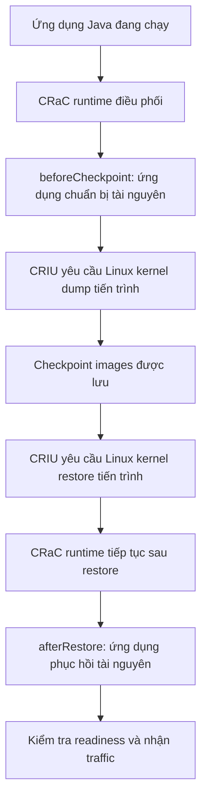

# Vai trò của CRIU trong cơ chế checkpoint dựa trên Linux

CRIU là viết tắt của **Checkpoint/Restore In Userspace**. Đây là công cụ mã nguồn mở dành cho Linux, có khả năng ghi lại trạng thái của một tiến trình đang chạy vào các tệp checkpoint và khôi phục tiến trình đó từ những tệp đã lưu. Trong các triển khai CRaC trên Linux có sử dụng CRIU, CRIU đảm nhiệm phần thao tác checkpoint và restore ở cấp tiến trình của hệ điều hành, còn CRaC cung cấp cơ chế để ứng dụng Java chuẩn bị và phục hồi tài nguyên của chính nó.

Hai thành phần này giải quyết hai lớp vấn đề khác nhau. CRaC giúp JVM và ứng dụng phối hợp đúng thời điểm chụp, chẳng hạn đóng connection pool hoặc tạm dừng scheduler trước checkpoint. CRIU làm việc với trạng thái tiến trình Linux như bộ nhớ, thread, thanh ghi, file descriptor và các tài nguyên hệ điều hành mà nó hỗ trợ. Nhờ sự phối hợp đó, một ứng dụng Java có thể được chuẩn bị trước, chụp trạng thái trên Linux rồi khôi phục để tiếp tục chạy.

## 1. CRIU là gì và nằm ở đâu trong kiến trúc CRaC?

CRIU là một chương trình chạy ở user space. Nó không phải một API Java, không phải một tính năng riêng của Spring Boot và cũng không phải một định dạng lưu object của Java. CRIU sử dụng các giao diện và khả năng do Linux kernel cung cấp để thu thập trạng thái của tiến trình, ghi trạng thái đó thành các image và tái tạo tiến trình khi restore.

Trong một quy trình CRaC điển hình trên Linux có tích hợp CRIU, các thành phần có vai trò như sau:

| Thành phần | Trách nhiệm |
|---|---|
| Ứng dụng Java | Xác định tài nguyên nào cần dừng, đóng, flush hoặc khởi tạo lại |
| CRaC API và runtime trong JDK | Điều phối callback `beforeCheckpoint` và `afterRestore`, chuẩn bị JVM cho việc chuyển trạng thái |
| CRIU | Ghi và khôi phục trạng thái tiến trình Linux theo yêu cầu của runtime |
| Linux kernel | Cung cấp các cơ chế cấp thấp để quan sát, dừng, đọc và khôi phục trạng thái tiến trình cùng tài nguyên hệ điều hành |
| Nền tảng triển khai | Chuẩn bị môi trường tương thích, lưu trữ checkpoint và khởi chạy tiến trình được restore |

Có thể hình dung mối quan hệ này qua sơ đồ:



Sơ đồ thể hiện ranh giới trách nhiệm ở mức khái niệm. Cách JDK gọi CRIU, vị trí lưu image, lệnh quản trị và chi tiết tích hợp phụ thuộc vào bản phân phối CRaC/JDK và môi trường triển khai. Không phải mọi cơ chế checkpoint trên mọi nền tảng đều bắt buộc dùng CRIU; nội dung ở đây tập trung vào con đường dựa trên Linux có CRIU làm backend.

## 2. Vì sao checkpoint một tiến trình Java cần CRIU?

Một JVM đang chạy không chỉ là một tập object nằm trong heap. Tiến trình còn có nhiều trạng thái ở cấp hệ điều hành và CPU, ví dụ:

- Các vùng bộ nhớ được ánh xạ vào không gian địa chỉ của tiến trình.
- Nội dung bộ nhớ heap, stack và các vùng nhớ khác mà cơ chế checkpoint hỗ trợ.
- Trạng thái các thread, bao gồm thông tin thực thi cần thiết để tiếp tục tiến trình.
- Thanh ghi CPU và trạng thái thực thi tại thời điểm chụp.
- File descriptor, pipe, socket và những tài nguyên hệ điều hành mà CRIU có thể lưu hoặc tái tạo.
- Thông tin tiến trình, quan hệ giữa tiến trình và thread, cùng một số trạng thái namespace, IPC hoặc cgroup tùy cấu hình và khả năng kernel.

Java Serialization chỉ chuyển đổi những object được ứng dụng chọn để serialize. Nó không tự ghi lại toàn bộ trạng thái của JVM, thread đang thực thi, native memory, file descriptor hay tiến trình hệ điều hành. Vì vậy, serialization không thể thay thế cơ chế checkpoint/restore cấp tiến trình.

CRIU giải quyết phần cấp hệ điều hành bằng cách phối hợp với Linux kernel để ghi trạng thái tiến trình ra các checkpoint image. Khi restore, CRIU dựng lại những trạng thái được hỗ trợ để tiến trình có thể tiếp tục từ điểm đã chụp. Các image này mô tả trạng thái tiến trình và tài nguyên liên quan; chúng không phải một bản sao toàn bộ máy ảo hay một bản backup nhất quán của mọi dịch vụ bên ngoài.

Đối với JVM, việc khôi phục trạng thái cấp tiến trình vẫn chưa đủ để bảo đảm ứng dụng hoạt động đúng. Một object đại diện cho database connection có thể còn trong heap, nhưng socket ở phía database có thể đã bị đóng. Một thread scheduler có thể được khôi phục, nhưng lease mà nó từng sở hữu có thể đã hết hạn. Vì vậy, CRIU cần phối hợp với cơ chế vòng đời ở cấp ứng dụng như CRaC.

## 3. CRIU thực hiện checkpoint trên Linux như thế nào?

Ở mức tổng quát, CRIU thực hiện một chuỗi thao tác: xác định tiến trình cần checkpoint, thu thập trạng thái, xử lý các tài nguyên liên quan, ghi dữ liệu thành image và kết thúc hoặc đóng băng tiến trình theo chế độ được yêu cầu. Các chi tiết phụ thuộc vào loại tài nguyên và phiên bản Linux/CRIU.

### 3.1. Xác định tiến trình và phạm vi cần chụp

CRIU cần biết tiến trình gốc và phạm vi tiến trình/thread có liên quan. Một ứng dụng Java thường là một tiến trình có nhiều thread. Nếu tiến trình tạo thêm tiến trình con, phạm vi checkpoint cần được xác định phù hợp để không bỏ sót một thành phần mà ứng dụng phụ thuộc.

CRIU sử dụng thông tin do Linux cung cấp, chẳng hạn dữ liệu trong `/proc`, để tìm hiểu cấu trúc tiến trình, bộ nhớ và file descriptor. Tùy thao tác, CRIU có thể sử dụng `ptrace` và những giao diện kernel khác để kiểm soát hoặc đọc trạng thái thực thi.

### 3.2. Thu thập trạng thái bộ nhớ và CPU

Để tiếp tục một tiến trình, hệ thống cần lưu được nội dung các vùng nhớ có liên quan và thông tin thực thi của thread. CRIU phối hợp với kernel để thu thập các memory mapping, page dữ liệu, trạng thái thread và thông tin CPU cần thiết. Các dữ liệu này được ghi vào image theo cấu trúc do CRIU quản lý.

Không nên hiểu rằng CRIU chỉ sao chép Java heap. Một JVM còn có metaspace, code cache, thread stack, native memory và những vùng nhớ do thư viện native ánh xạ. Khả năng lưu và khôi phục từng loại vùng nhớ phụ thuộc vào cách vùng nhớ được tạo, kernel, kiến trúc và hỗ trợ của CRIU. Một vùng nhớ được ánh xạ từ file hoặc thiết bị có thể cần file nguồn hay điều kiện môi trường tương ứng khi restore.

### 3.3. Ghi nhận file descriptor và tài nguyên hệ điều hành

Tiến trình có thể đang mở file, pipe, Unix domain socket, TCP socket hoặc các loại file descriptor khác. CRIU phải xác định tài nguyên nào có thể tái tạo, tài nguyên nào cần được cung cấp từ bên ngoài và tài nguyên nào không thể checkpoint theo cấu hình hiện tại.

Ví dụ, với file thông thường, việc restore thường cần đường dẫn và nội dung file phù hợp. Với socket, CRIU phải xử lý trạng thái mạng và điều kiện phía đối tác. Với thiết bị hoặc tài nguyên đặc biệt, có thể cần cấu hình bên ngoài hoặc không được hỗ trợ. Việc một file descriptor xuất hiện trong tiến trình không có nghĩa CRIU luôn có thể tự tạo lại tài nguyên tương ứng.

### 3.4. Tạo checkpoint image

Sau khi thu thập trạng thái, CRIU ghi dữ liệu ra thư mục image. Thư mục này có thể chứa nhiều tệp mô tả tiến trình, thread, bộ nhớ, file descriptor và các tài nguyên liên quan. Tên và cách tổ chức tệp cụ thể là chi tiết triển khai của CRIU, không nên được ứng dụng Java tự phân tích hoặc chỉnh sửa.

Checkpoint image phải được giữ nguyên vẹn và có quyền truy cập phù hợp. Nếu thiếu image, file phụ thuộc hoặc tài nguyên môi trường, restore có thể thất bại. Việc copy image cũng cần giữ đầy đủ cấu trúc và dữ liệu liên quan, không chỉ lấy một tệp bất kỳ trong thư mục.

## 4. CRIU thực hiện restore như thế nào?

Restore là quá trình dựng lại tiến trình từ checkpoint image. Ở mức khái niệm, CRIU đọc image, yêu cầu Linux tạo lại cấu trúc tiến trình và thread, khôi phục các vùng nhớ, nối hoặc tái tạo tài nguyên hệ điều hành được hỗ trợ, rồi phục hồi trạng thái thực thi để tiến trình tiếp tục.

Một trình tự khái quát gồm:

1. Đọc checkpoint image và xác định tiến trình, thread cùng tài nguyên cần dựng lại.
2. Tạo cấu trúc tiến trình và thread phù hợp trong môi trường restore.
3. Khôi phục memory mapping và dữ liệu bộ nhớ.
4. Khôi phục trạng thái CPU và thông tin thực thi cần thiết.
5. Mở lại hoặc gắn các file descriptor và tài nguyên bên ngoài theo image cùng cấu hình.
6. Hoàn tất việc phục hồi tiến trình để mã có thể tiếp tục thực thi.
7. Để CRaC runtime và ứng dụng chạy các bước sau restore, chẳng hạn callback `afterRestore`.

Ở góc nhìn ứng dụng, tiến trình được khôi phục tiếp tục từ trạng thái đã checkpoint. Nó không nhất thiết đi lại từ đầu qua `main()`, tạo lại toàn bộ object hoặc dựng lại Spring `ApplicationContext`. Đây là lý do CRaC có thể giảm thời gian khởi động. Tuy nhiên, các thành phần phụ thuộc vào môi trường hiện tại vẫn phải được kiểm tra và phục hồi.

### Image không phải bản backup của toàn bộ hệ thống

CRIU tập trung vào trạng thái tiến trình trong phạm vi hỗ trợ. Nó không tự checkpoint trạng thái của database server ở máy khác, message broker, Redis, object storage hoặc dịch vụ HTTP mà tiến trình đang gọi. Những hệ thống đó có vòng đời và cơ chế nhất quán riêng.

Ví dụ, nếu ứng dụng đang xử lý một giao dịch database khi checkpoint, image của tiến trình không thay thế transaction log hay snapshot của database. Ứng dụng phải bảo đảm giao dịch đã hoàn tất hoặc rollback theo chính sách trước khi cho phép checkpoint. Tương tự, một message đã nhận từ broker cần được xử lý và acknowledge theo quy tắc của consumer; image không thay thế cơ chế xác nhận message của broker.

## 5. CRaC phối hợp với CRIU ở những thời điểm nào?

CRaC bổ sung lớp điều phối ở cấp Java để việc dump/restore cấp tiến trình không làm hỏng tài nguyên ứng dụng. Một resource có thể đăng ký callback `beforeCheckpoint` và `afterRestore`.

```java
import org.crac.Context;
import org.crac.Core;
import org.crac.Resource;

public final class DatabaseClientResource implements Resource {

    private DatabaseClient client;

    public DatabaseClientResource(DatabaseClient client) {
        this.client = client;
    }

    @Override
    public void beforeCheckpoint(Context<? extends Resource> context)
            throws Exception {
        // Dừng hoạt động sử dụng client trước, sau đó đóng tài nguyên.
        if (client != null) {
            client.close();
            client = null;
        }
    }

    @Override
    public void afterRestore(Context<? extends Resource> context)
            throws Exception {
        // Kết nối lại với database trong môi trường hiện tại.
        client = DatabaseClient.connect();
    }

    public static void register(DatabaseClient client) {
        Core.getGlobalContext().register(new DatabaseClientResource(client));
    }
}
```

`DatabaseClient` là lớp minh họa, không phải API có sẵn của CRaC. Mã thực tế cần quản lý client theo đúng thư viện đang dùng và bảo đảm không còn thread sử dụng client khi callback đóng nó.

Vai trò của các lớp được phân chia như sau:

| Thời điểm | CRaC/JVM và ứng dụng | CRIU và Linux |
|---|---|---|
| Trước checkpoint | Dừng nhận việc mới, drain request, tạm dừng scheduler/consumer, flush dữ liệu và xử lý tài nguyên | Chuẩn bị dump tiến trình theo yêu cầu của runtime |
| Dump | JVM ở trạng thái đã được ứng dụng chuẩn bị | Thu thập trạng thái tiến trình và ghi checkpoint image |
| Restore | Runtime tiếp tục từ trạng thái được khôi phục | Dựng lại tiến trình và các tài nguyên hệ điều hành được hỗ trợ |
| Sau restore | Chạy callback, kết nối lại dịch vụ, làm mới token/lease và kiểm tra readiness | Hoàn tất phần phục hồi cấp tiến trình mà CRIU đảm nhiệm |

CRIU không tự biết một connection pool của ứng dụng nên đóng khi nào, một scheduler nên tạm dừng ra sao hoặc một token cần làm mới thế nào. Đó là trách nhiệm của ứng dụng và lớp CRaC. Ngược lại, callback Java không thể tự tái tạo toàn bộ trạng thái CPU, memory mapping và thread của một tiến trình; đó là phần việc của cơ chế checkpoint/restore cấp hệ điều hành.

## 6. Các yêu cầu và giới hạn từ Linux

CRIU phụ thuộc vào khả năng của Linux kernel. Cài được lệnh `criu` chưa có nghĩa môi trường chắc chắn checkpoint và restore được mọi ứng dụng. Khả năng thực tế phụ thuộc kernel, cấu hình kernel, kiến trúc CPU, quyền thực thi, namespace, cgroup và loại tài nguyên tiến trình đang sử dụng.

### 6.1. Kernel và cấu hình hệ thống

Một số thao tác cần các tính năng kernel liên quan đến checkpoint/restore, quản lý namespace, bộ nhớ và tiến trình. Cấu hình kernel như `CONFIG_CHECKPOINT_RESTORE` có thể là một trong các điều kiện cần; các yêu cầu cụ thể thay đổi theo phiên bản CRIU và kernel. CRIU cung cấp lệnh kiểm tra khả năng của môi trường, nhưng kết quả kiểm tra chung không bảo đảm một ứng dụng cụ thể sẽ dump/restore thành công.

Các giao diện Linux thường liên quan gồm:

- `/proc`: cung cấp thông tin về tiến trình, thread, bộ nhớ và file descriptor.
- `ptrace`: hỗ trợ kiểm soát và quan sát trạng thái thực thi của tiến trình trong các thao tác phù hợp.
- Namespace: cô lập các góc nhìn như PID, mount, network và IPC.
- Cgroup: quản lý và giới hạn tài nguyên của nhóm tiến trình.
- Các cơ chế bộ nhớ và socket của kernel: hỗ trợ thu thập hoặc phục hồi những trạng thái tương ứng.

Đây là các nhóm cơ chế tiêu biểu. Không phải mọi lệnh CRIU đều dùng tất cả cơ chế trên, và yêu cầu cụ thể phụ thuộc vào loại tài nguyên đang được checkpoint.

### 6.2. Quyền thực thi

Checkpoint/restore tác động sâu đến tiến trình và tài nguyên hệ điều hành. CRIU thường cần quyền cao hoặc tập capability phù hợp để đọc, dừng và tái tạo trạng thái tiến trình. Các capability và quyền cần thiết thay đổi theo kernel, namespace, loại tài nguyên và cách chạy CRIU. Trong container, cần kiểm tra cấu hình capability, seccomp, AppArmor/SELinux và quyền truy cập các mount liên quan.

Không nên giải quyết lỗi quyền bằng cách mặc định chạy mọi thành phần với quyền root rộng nhất. Hãy xác định quyền tối thiểu mà môi trường và phiên bản CRIU thực sự cần, sau đó cấu hình có chủ đích.

### 6.3. Tính tương thích giữa môi trường tạo và restore

Checkpoint gắn với trạng thái tiến trình và các giả định về môi trường. Restore có thể bị giới hạn bởi:

- Kiến trúc CPU và các tính năng CPU được tiến trình sử dụng.
- Phiên bản và khả năng của Linux kernel.
- Phiên bản CRIU và định dạng image.
- Đường dẫn file, mount, thư viện native và tài nguyên thiết bị.
- Cấu hình namespace, cgroup và network.
- Những socket hoặc tài nguyên bên ngoài không còn tồn tại hay không thể tái tạo.

Vì vậy, không nên coi một checkpoint là artifact có thể chuyển tùy ý giữa mọi máy Linux. Hãy tạo và kiểm thử checkpoint trên môi trường tương thích với môi trường restore dự kiến. Khi nâng cấp JDK, CRIU, kernel hoặc image hệ điều hành, cần kiểm tra lại quy trình tạo và khôi phục checkpoint.

## 7. Socket, kết nối mạng và tài nguyên bên ngoài

Socket là một trong những phần dễ gây nhầm lẫn khi nói về checkpoint tiến trình. Một socket nằm trong bảng file descriptor của tiến trình, nhưng trạng thái giao tiếp còn liên quan đến kernel, network namespace và đầu bên kia của kết nối.

CRIU có khả năng xử lý một số loại socket và kết nối mạng trong những điều kiện nhất định. Chẳng hạn, việc khôi phục một kết nối TCP đã thiết lập có thể cần các tính năng như `TCP_REPAIR` và sự phối hợp của môi trường mạng. Điều đó không có nghĩa mọi kết nối TCP, mọi giao thức hoặc mọi trạng thái kết nối đều có thể được chuyển sang một máy bất kỳ và tiếp tục nguyên trạng.

Với ứng dụng Java, cách thiết kế thường dễ vận hành hơn là chủ động xử lý các client bên ngoài qua callback CRaC:

- Trước checkpoint: ngừng request sử dụng client, chờ tác vụ đang chạy, đóng hoặc đưa client/pool về trạng thái mà thư viện hỗ trợ.
- Sau restore: tạo kết nối mới, xác thực lại, kiểm tra endpoint và xác nhận dependency hoạt động.
- Trước readiness: chỉ cho phép nhận traffic sau khi các dependency bắt buộc đã sẵn sàng.

Không nên chỉ dựa vào việc object Java vẫn còn trong heap để kết luận kết nối còn sử dụng được. Cũng không nên mặc định mọi socket đều phải đóng: một số môi trường và thư viện có hỗ trợ checkpoint tài nguyên cụ thể. Quyết định cần dựa trên hướng dẫn của CRIU, JDK và thư viện sở hữu tài nguyên.

Các tài nguyên bên ngoài khác cũng cần được xem xét riêng:

| Tài nguyên | Câu hỏi cần trả lời trước checkpoint |
|---|---|
| Database connection | Driver/pool có hỗ trợ CRaC không? Có nên đóng pool và tạo lại sau restore không? |
| HTTP client | Connection pool và TLS session có thể được tái sử dụng an toàn không? |
| Message consumer | Đã dừng nhận message và xử lý/acknowledge các message đang chạy chưa? |
| Scheduler | Làm thế nào để tránh cùng một tác vụ chạy ở nhiều bản restore? |
| File và mount | Đường dẫn, quyền, nội dung và mount có tồn tại ở môi trường restore không? |
| Lease hoặc token | Có hết hạn trong thời gian checkpoint không? Cần cấp lại ở bước nào? |
| Thiết bị hoặc IPC | CRIU và kernel có hỗ trợ loại tài nguyên đó trong cấu hình hiện tại không? |

## 8. CRIU trong container và môi trường triển khai

CRIU thường được dùng trong hệ sinh thái Linux container vì container cũng là một nhóm tiến trình chạy với namespace và cgroup. Tuy nhiên, container không phải một máy ảo hoàn chỉnh. Checkpoint một container vẫn phụ thuộc vào kernel của host và các tài nguyên mà container đang sử dụng.

Khi chạy CRIU trong container, cần phân biệt quyền của tiến trình bên trong container với quyền thực tế mà host cho phép. Namespace có thể làm tiến trình chỉ nhìn thấy một phần hệ thống, trong khi thao tác checkpoint cần truy cập thông tin hoặc tài nguyên ở phạm vi rộng hơn. Runtime container có thể phải hỗ trợ và cấu hình riêng cho checkpoint/restore.

Một quy trình triển khai cần xác định rõ:

1. Ai yêu cầu checkpoint: JDK/runtime, công cụ triển khai hay container runtime?
2. CRIU chạy trong host hay trong môi trường container?
3. Image được lưu ở đâu và tiến trình nào có quyền đọc/ghi?
4. Môi trường restore có cùng loại namespace, mount, cgroup và network cần thiết không?
5. Ai khởi chạy tiến trình sau restore và kiểm tra readiness?
6. Khi restore thất bại, nền tảng có thể quay về khởi động lạnh hay không?

Nếu dùng CRaC, hãy ưu tiên luồng checkpoint/restore được JDK và nền tảng triển khai hỗ trợ. Việc tự gọi CRIU ở bên ngoài mà bỏ qua callback CRaC có thể chụp JVM khi ứng dụng chưa chuẩn bị tài nguyên, dẫn đến trạng thái tiến trình được khôi phục nhưng ứng dụng không hoạt động đúng.

## 9. Thử CRIU ở mức công cụ Linux

CRIU cung cấp lệnh kiểm tra môi trường và các lệnh dump/restore ở cấp tiến trình. Ví dụ minh họa dưới đây cho thấy hình dạng thao tác cơ bản:

```bash
# Kiểm tra các tính năng checkpoint/restore mà môi trường hiện tại hỗ trợ.
sudo criu check

# Dump một tiến trình Linux có PID là 12345 vào thư mục image.
sudo criu dump -t 12345 -D /var/lib/criu/example-checkpoint

# Restore tiến trình từ thư mục image đó.
sudo criu restore -D /var/lib/criu/example-checkpoint
```

Các lệnh trên chỉ minh họa giao diện CRIU tổng quát. PID, quyền, tùy chọn, tài nguyên đang mở và cấu hình thực tế phải phù hợp với ứng dụng. Một tiến trình cụ thể có thể cần thêm cấu hình hoặc không thể checkpoint do loại tài nguyên nó sử dụng.

Đối với ứng dụng Java chạy với CRaC, không nên lấy ví dụ `criu dump` trực tiếp làm quy trình production. Hãy dùng cách checkpoint do JDK CRaC và bản phân phối đang triển khai hướng dẫn, để callback ứng dụng được chạy trước khi CRIU dump và sau khi tiến trình được restore. Chạy CRIU trực tiếp có thể bỏ qua bước điều phối đó.

## 10. Cách điều tra lỗi checkpoint/restore

Khi dump hoặc restore thất bại, cần xác định lỗi nằm ở lớp nào. Một trình tự điều tra hữu ích là:

1. **Ứng dụng/CRaC:** kiểm tra log callback, resource nào không đóng được, request hoặc thread nào chưa dừng, và callback nào thất bại.
2. **CRIU:** đọc thông báo lỗi và log của CRIU để xác định loại tài nguyên hoặc thao tác kernel bị từ chối.
3. **Kernel/quyền:** kiểm tra kernel version, cấu hình cần thiết, capability, namespace, cgroup, seccomp và chính sách bảo mật.
4. **Môi trường restore:** xác nhận image còn đầy đủ, đường dẫn/mount có sẵn, network và tài nguyên ngoài tiến trình tương thích.
5. **Tính tương thích:** so sánh JDK, CRIU, kernel, kiến trúc và image hệ điều hành giữa nơi tạo checkpoint và nơi restore.
6. **Readiness:** nếu restore đã thành công, kiểm tra việc kết nối lại dependency, làm mới token/lease và khởi động thread nền trước khi bật traffic.

Một số nhóm lỗi thường gặp:

| Triệu chứng | Nguyên nhân có thể | Hướng kiểm tra |
|---|---|---|
| `criu check` báo thiếu tính năng | Kernel hoặc môi trường không cung cấp tính năng cần thiết | Kiểm tra kernel, cấu hình và tài liệu CRIU tương ứng |
| Dump bị từ chối quyền | Thiếu capability hoặc bị seccomp/LSM chặn | Kiểm tra quyền thực tế trong host/container và chính sách bảo mật |
| Không thể khôi phục file descriptor | File, socket hoặc tài nguyên liên quan không thể tái tạo | Xác định tài nguyên cụ thể và cấu hình xử lý trước checkpoint |
| Restore thất bại do mount/path | Môi trường restore thiếu mount hoặc file phụ thuộc | Đồng bộ cấu trúc môi trường và xác nhận quyền truy cập |
| JVM restore nhưng request lỗi | Client, token hoặc dependency bên ngoài không còn hợp lệ | Kiểm tra callback `afterRestore` và readiness |
| Tác vụ chạy lặp sau restore | Scheduler/consumer/lease chưa được khởi động lại có kiểm soát | Xác lập lại quyền sở hữu và cơ chế chống xử lý trùng |

Không nên chỉ tăng quyền hoặc thay kernel ngay khi thấy lỗi. Trước hết cần đọc lỗi cụ thể để xác định CRIU đang thiếu tính năng, không truy cập được tài nguyên hay ứng dụng chưa chuẩn bị đúng vòng đời.

## 11. Những điều CRIU không đảm nhiệm

Để phân định trách nhiệm khi thiết kế hệ thống, cần nhớ các giới hạn sau:

- CRIU không thay thế CRaC API và không tự quyết định thời điểm ứng dụng Java nên dừng nhận request.
- CRIU không hiểu ý nghĩa nghiệp vụ của object Java, transaction, message hoặc cache.
- CRIU không tự tạo snapshot nhất quán cho database, broker hoặc dịch vụ ở máy khác.
- CRIU không bảo đảm mọi file descriptor, socket, thiết bị hay vùng nhớ đều có thể khôi phục.
- CRIU không làm checkpoint trở thành artifact tương thích với mọi kernel, kiến trúc và máy Linux.
- CRIU không tự bảo đảm ứng dụng đã sẵn sàng nhận traffic sau restore.

Vì vậy, một triển khai CRaC cần cả hai lớp: CRIU để xử lý trạng thái tiến trình ở Linux và CRaC/ứng dụng để xử lý vòng đời tài nguyên ở cấp JVM, thư viện và nghiệp vụ.

## 12. Checklist thiết kế và vận hành

Trước khi đưa checkpoint dựa trên CRIU vào môi trường triển khai, hãy xác định các điểm sau:

- **Nền tảng:** phiên bản Linux kernel, kiến trúc CPU, cấu hình kernel và phiên bản CRIU đã được xác định.
- **Quyền:** CRIU có đúng capability và quyền cần thiết; chính sách container/security không chặn thao tác bắt buộc.
- **Tài nguyên:** đã lập danh sách file, socket, thread, native resource, mount, IPC và các dependency bên ngoài.
- **Vòng đời ứng dụng:** callback `beforeCheckpoint` dừng công việc và chuẩn bị tài nguyên; `afterRestore` phục hồi những gì cần thiết.
- **Tính nhất quán:** request, transaction, message và tác vụ nền không bị bỏ dở hoặc thực hiện trùng do checkpoint.
- **Tương thích:** môi trường tạo image và restore đã được kiểm thử với phiên bản JDK, CRIU, kernel và cấu hình thực tế.
- **Lưu trữ:** checkpoint image được lưu đầy đủ, có quyền truy cập phù hợp và có chính sách xóa/luân chuyển.
- **Khôi phục lỗi:** có phương án khởi động lạnh hoặc rollback khi restore không thành công.
- **Readiness:** traffic chỉ được chuyển đến sau khi resource callback và kiểm tra dependency hoàn tất.
- **Quan sát:** log và metric phân biệt được thời gian dump, thời gian restore, thời gian phục hồi ứng dụng và thời gian đạt readiness.

Nên kiểm thử cả trường hợp thành công và thất bại có chủ đích: database không truy cập được sau restore, token hết hạn, thiếu mount, callback không hoàn tất, hoặc một dependency chỉ xuất hiện sau khi tiến trình được khôi phục. Những tình huống này cho thấy hệ thống có thể phục hồi có kiểm soát hay chỉ hoạt động trong một lần thử thuận lợi.

## 13. Kết luận

CRIU là lớp công cụ Linux giúp ghi lại và khôi phục trạng thái của tiến trình ở cấp hệ điều hành. Trong cơ chế CRaC dựa trên Linux có sử dụng CRIU, JDK/CRaC điều phối vòng đời của JVM và gọi cơ chế checkpoint/restore phù hợp; CRIU thu thập, lưu và dựng lại trạng thái tiến trình; ứng dụng chịu trách nhiệm xử lý các tài nguyên và dependency theo ngữ nghĩa của nó.

Khi phân tích một lỗi CRaC, hãy xác định trước lỗi thuộc lớp ứng dụng, CRaC runtime, CRIU hay Linux kernel. Sự phân chia này giúp tìm đúng nguyên nhân: CRIU có thể khôi phục tiến trình thành công trong khi ứng dụng vẫn cần kết nối lại database, hoặc ứng dụng đã chuẩn bị đúng nhưng kernel không hỗ trợ một tài nguyên cần thiết. Hiểu rõ vai trò của CRIU giúp thiết kế checkpoint có thể kiểm soát, kiểm thử được và phù hợp với môi trường Linux thực tế.
