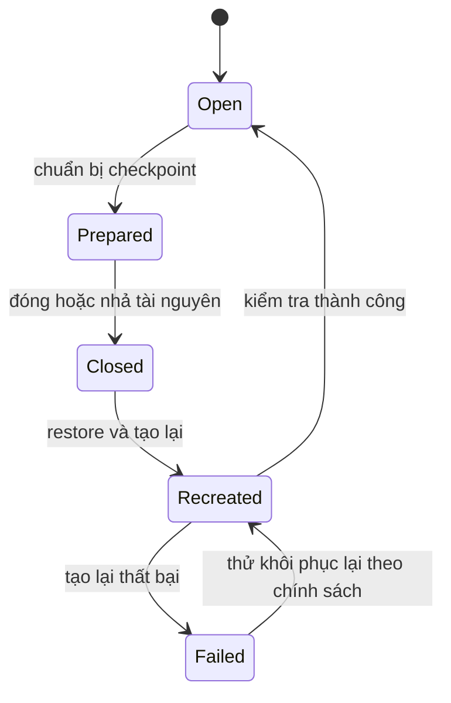
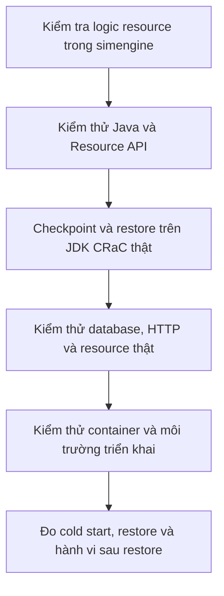

# Phạm vi mô phỏng bằng simengine và giới hạn của kết quả kiểm thử

Khi học CRaC, không phải lúc nào người học cũng có sẵn một môi trường Linux, JDK hỗ trợ CRaC và cấu hình checkpoint/restore phù hợp. Một simengine có thể giúp thực hành các luồng xử lý bằng cách mô hình hóa những trạng thái và sự kiện mà bài học quan tâm. Nhờ đó, người học có thể quan sát cách ứng dụng chuẩn bị trước checkpoint, khôi phục tài nguyên sau restore và phản ứng với các tình huống lỗi.

Tuy nhiên, kết quả của một mô phỏng chỉ có ý nghĩa trong phạm vi mô hình mà nó biểu diễn. Một kịch bản mô phỏng chạy thành công không tự chứng minh rằng JVM thật có thể tạo checkpoint, CRIU có thể khôi phục tiến trình trên kernel đang dùng, hoặc mọi kết nối bên ngoài sẽ hoạt động sau restore. Muốn đánh giá CRaC cho ứng dụng thực tế, cần kết hợp mô phỏng với kiểm thử trên đúng JDK, hệ điều hành, thư viện và dịch vụ phụ thuộc.

## 1. Vì sao cần mô phỏng khi học CRaC?

CRaC liên quan đến nhiều thành phần cùng lúc: ứng dụng Java, JVM, hệ điều hành, công cụ checkpoint/restore và các dịch vụ bên ngoài. Một lỗi sau restore có thể xuất phát từ logic của ứng dụng, cách quản lý tài nguyên, giới hạn của môi trường hoặc sự thay đổi ở hệ thống bên ngoài. Nếu bắt đầu bằng một môi trường thực tế có nhiều thành phần, việc xác định nguyên nhân có thể khó khăn.

Mô phỏng giúp thu nhỏ bài toán. Người học có thể tập trung vào một số câu hỏi cụ thể:

- Ứng dụng cần chuyển sang trạng thái nào trước khi checkpoint?
- Những resource nào cần được chuẩn bị, đóng hoặc tạm dừng?
- Khi restore, callback nào cần chạy và resource nào cần được kiểm tra hoặc tạo lại?
- Điều gì xảy ra nếu một bước chuẩn bị thất bại?
- Ứng dụng có được đánh dấu sẵn sàng trước khi tài nguyên bắt buộc hoạt động không?
- Một thao tác khôi phục được gọi lại có gây tạo tài nguyên trùng hoặc làm sai trạng thái không?

Trong bài này, `simengine` được xét như môi trường mô phỏng phục vụ thực hành các hành vi CRaC đã được mô hình hóa. Phạm vi chính xác phụ thuộc vào những trạng thái, resource, sự kiện và quy tắc mà phiên bản simengine đang cung cấp. Không nên suy ra rằng simulator mô phỏng toàn bộ JVM hoặc toàn bộ cơ chế checkpoint/restore của hệ điều hành nếu tài liệu và chức năng thực tế chưa xác nhận điều đó.

## 2. Mô hình mô phỏng biểu diễn những gì?

Một mô hình thường rút gọn hệ thống thực thành các thành phần có thể quan sát và kiểm tra. Với bài thực hành CRaC, có thể dùng bốn nhóm khái niệm để đọc và thiết kế kịch bản mô phỏng.

### 2.1. Vòng đời ứng dụng

Ứng dụng có thể được biểu diễn qua các giai đoạn khái niệm như:

| Giai đoạn | Ý nghĩa trong mô hình |
|---|---|
| Khởi động | Tạo trạng thái ban đầu và khởi tạo các thành phần được mô hình hóa. |
| Đang chạy | Ứng dụng thực hiện công việc và sử dụng resource. |
| Chuẩn bị checkpoint | Ứng dụng thực hiện các bước cần thiết trước khi lưu trạng thái. |
| Đã checkpoint | Mô hình ghi nhận rằng bước checkpoint đã được chấp nhận hoặc hoàn tất theo quy tắc mô phỏng. |
| Restore | Mô hình chuyển ứng dụng từ trạng thái đã checkpoint sang trạng thái được khôi phục. |
| Hoàn tất khôi phục | Ứng dụng đã xử lý các bước sau restore trong phạm vi mô hình. |
| Sẵn sàng | Các điều kiện sẵn sàng được mô hình kiểm tra đã thỏa mãn. |
| Thất bại | Một bước trong kịch bản không thể tiếp tục theo quy tắc mô hình. |

Đây là cách phân chia để suy nghĩ về quy trình, không phải cam kết rằng simengine dùng đúng các tên trạng thái hoặc có một enum tương ứng. Khi thực hành, hãy dùng trạng thái và thuật ngữ thực tế mà phiên bản công cụ cung cấp.

### 2.2. Resource và vòng đời resource

Một resource trong mô hình có thể đại diện cho kết nối database, HTTP client, socket, file, thread pool, scheduler hoặc một thành phần có vòng đời cần phối hợp với checkpoint/restore.

Ví dụ, một mô hình có thể biểu diễn resource theo các trạng thái khái niệm sau:

Mô hình này giúp đặt câu hỏi về thứ tự xử lý và kết quả mong đợi. Nó không khẳng định socket hoặc database connection ngoài đời thật có thể chuyển qua đúng các trạng thái đó bằng cùng một thao tác. Một resource thật có thể chịu ảnh hưởng từ server từ xa, timeout, quyền truy cập, giao thức mạng và nhiều điều kiện không được biểu diễn trong simulator.

### 2.3. Sự kiện và callback

Với API CRaC, hai điểm phối hợp thường được nhắc đến là `beforeCheckpoint(...)` và `afterRestore(...)` của `org.crac.Resource`. Mô hình có thể dùng các sự kiện tương ứng để kiểm tra ứng dụng có thực hiện công việc đúng giai đoạn hay không.

- Trước checkpoint: dừng hoặc tạm dừng công việc phù hợp, hoàn tất thao tác đang dang dở, đóng hoặc chuẩn bị lại tài nguyên theo yêu cầu.
- Sau restore: kiểm tra trạng thái resource, tạo kết nối mới nếu cần, khởi động lại thành phần phù hợp và chỉ báo sẵn sàng khi các điều kiện cần thiết đã đạt.

Simulator có thể kiểm tra rằng một hành động được yêu cầu trong kịch bản, hoặc callback được gọi theo luồng mô hình. Điều đó chưa chứng minh JVM thật gọi callback tại đúng thời điểm trong mọi điều kiện, cũng chưa chứng minh thư viện bên thứ ba xử lý nội bộ đúng cách.

### 2.4. Điều kiện và kết quả kiểm thử

Một kịch bản mô phỏng thường gồm điều kiện đầu vào, chuỗi sự kiện, hành vi được mô hình hóa và điều kiện kết thúc. Ví dụ:

1. Ứng dụng đang chạy và có một resource được đánh dấu là đang mở.
2. Kịch bản yêu cầu chuẩn bị checkpoint.
3. Mô hình kiểm tra hành vi chuẩn bị của ứng dụng.
4. Kịch bản chuyển sang giai đoạn restore.
5. Mô hình yêu cầu khôi phục resource.
6. Kết quả được so sánh với điều kiện mong đợi, chẳng hạn resource bắt buộc phải hoạt động trước khi ứng dụng sẵn sàng.

Kết quả chỉ có ý nghĩa với những điều kiện và hành vi đã được đưa vào mô hình. Nếu kịch bản không biểu diễn việc database server đóng kết nối trong thời gian checkpoint, kết quả thành công không cho biết ứng dụng sẽ xử lý được tình huống đó ngoài thực tế.

## 3. Những gì có thể kiểm thử bằng simengine

Phạm vi cụ thể tùy khả năng của simulator, nhưng các loại câu hỏi sau thường phù hợp với một mô hình vòng đời.

### 3.1. Thứ tự xử lý trong vòng đời

Có thể kiểm tra ứng dụng có thực hiện bước chuẩn bị trước checkpoint và bước khôi phục sau restore theo trình tự được mô hình quy định hay không. Ví dụ, ứng dụng không được đánh dấu sẵn sàng trước khi hoàn tất bước khôi phục resource bắt buộc.

Kết quả hữu ích là một dấu vết sự kiện (event trace) có thể đọc được, giúp xác định bước nào đã chạy, bước nào bị bỏ qua và tại đâu luồng xử lý dừng lại.

### 3.2. Quy tắc quản lý resource

Nếu simulator có mô hình resource tương ứng, có thể thử các tình huống như:

- Resource được chuẩn bị trước checkpoint.
- Resource cần tạo lại sau restore.
- Resource tùy chọn không khôi phục được nhưng ứng dụng vẫn có thể tiếp tục theo chính sách.
- Resource bắt buộc không khôi phục được và ứng dụng phải giữ trạng thái chưa sẵn sàng.
- Một bước khôi phục được gọi lại và cần tránh tạo tài nguyên trùng.

Những bài thực hành này giúp làm rõ hợp đồng vòng đời của ứng dụng. Chúng đặc biệt hữu ích khi thiết kế code quản lý resource sao cho có thể quan sát, xử lý lỗi và thử lại.

### 3.3. Nhánh lỗi đã được mô hình hóa

Mô phỏng có thể chủ động tạo lỗi tại một bước để quan sát ứng dụng phản ứng thế nào. Ví dụ: bước chuẩn bị thất bại, resource không thể tạo lại, hoặc một điều kiện sẵn sàng không được thỏa mãn.

Người học nên quan sát cả trạng thái cuối và các tác động trước khi lỗi xảy ra. Một kịch bản được coi là xử lý đúng khi ứng dụng không tuyên bố sẵn sàng sai thời điểm, không bỏ qua lỗi bắt buộc và có đường xử lý tiếp theo phù hợp với chính sách đã chọn.

### 3.4. Tính lặp lại của kịch bản

Nếu simengine cho phép chạy lại cùng một kịch bản với cùng đầu vào, có thể dùng điều đó để kiểm tra tính xác định của logic mô hình. Cùng điều kiện nên tạo ra cùng chuỗi sự kiện và kết quả, trừ khi kịch bản chủ ý đưa yếu tố ngẫu nhiên hoặc thời gian vào.

Tính lặp lại giúp so sánh thay đổi trong code và giảm khó khăn khi tái hiện lỗi. Nó không đồng nghĩa với việc môi trường thật sẽ luôn có kết quả giống nhau: mạng, scheduler, thời gian phản hồi, tải hệ thống và dịch vụ bên ngoài có thể thay đổi giữa các lần chạy.

## 4. Những gì kết quả mô phỏng không chứng minh được

Đây là giới hạn quan trọng nhất cần ghi nhớ khi đọc báo cáo từ simengine. Mô hình chỉ kiểm tra những gì đã được biểu diễn; các hành vi ngoài mô hình cần được kiểm thử ở lớp phù hợp.

| Nội dung | Mô phỏng có thể giúp kiểm tra | Cần kiểm thử thực tế để xác nhận |
|---|---|---|
| Logic ứng dụng | Trình tự xử lý và điều kiện chuyển trạng thái được mô hình hóa. | Hành vi của ứng dụng đang chạy trên JVM thật. |
| Resource | Quy tắc chuẩn bị, đóng, tạo lại hoặc đánh dấu lỗi trong mô hình. | File descriptor, socket, thread và resource thật có được xử lý đúng không. |
| Callback CRaC | Logic mà simulator gắn với các bước tương ứng. | JDK CRaC thật có gọi callback theo đúng vòng đời và xử lý lỗi như mong đợi không. |
| Checkpoint | Chuyển trạng thái mô phỏng sang giai đoạn được đánh dấu là checkpoint. | JVM và công cụ hệ điều hành có tạo được checkpoint image hợp lệ không. |
| Restore | Luồng mô hình sau sự kiện restore. | CRIU và kernel có khôi phục được tiến trình, memory mapping, thread và file descriptor không. |
| Database và broker | Phản ứng với kết quả giả lập nếu các tình huống đó được mô hình hóa. | Kết nối thật có được tạo lại, xác thực thành công và xử lý giao dịch chính xác không. |
| HTTP và mạng | Nhánh logic ứng dụng đối với các kết quả mạng giả lập. | Socket, cổng lắng nghe, DNS, TLS, timeout và kết nối thật hoạt động sau restore. |
| Hiệu năng | Có thể so sánh chi phí của các bước trong mô hình nếu công cụ đo chúng. | Thời gian cold start, restore, độ trễ yêu cầu, thông lượng và mức sử dụng tài nguyên trên môi trường mục tiêu. |
| Tương thích | Các giả định tương thích đã được khai báo trong mô hình. | Đúng JDK distribution, phiên bản Java, kernel, kiến trúc CPU, thư viện và cấu hình container. |

### 4.1. Mô phỏng không tạo checkpoint image thật

Một trạng thái được simulator ghi nhận là “đã checkpoint” có thể chỉ là trạng thái nội bộ của mô hình. Trừ khi công cụ thực sự gọi một cơ chế checkpoint/restore của hệ điều hành và tạo artifact tương ứng, kết quả đó không chứng minh rằng bộ nhớ tiến trình, thread, native state hay file descriptor đã được lưu.

Muốn xác nhận checkpoint thật, cần chạy ứng dụng với bản JDK hỗ trợ CRaC và môi trường checkpoint/restore tương thích, thực hiện thao tác theo hướng dẫn của bản phân phối đó, rồi xác minh tiến trình có thể được restore.

### 4.2. Resource giả lập không tương đương dịch vụ thật

Một database giả lập có thể trả về “kết nối thành công” theo quy tắc định sẵn. Database thật còn có xác thực, pool, giới hạn kết nối, transaction đang mở, timeout, failover và trạng thái dữ liệu. Tương tự, HTTP client mô phỏng không kiểm tra được đầy đủ DNS, TLS handshake, proxy, socket và trạng thái server từ xa.

Vì vậy, mô phỏng có thể kiểm tra code ứng dụng phản ứng với một kết quả lỗi đã biết, nhưng không thể tự chứng minh kết nối thật sẽ thành công hoặc dữ liệu nghiệp vụ không bị mất hay lặp.

### 4.3. Mô phỏng không thay thế kiểm thử concurrency và tải

Nếu simulator không mô hình hóa đầy đủ scheduler, thread, lock và tranh chấp tài nguyên, nó không thể xác nhận hành vi đồng thời của ứng dụng. Một luồng sự kiện chạy tuần tự trong mô hình có thể không bộc lộ race condition, deadlock hoặc lỗi khi nhiều yêu cầu đến cùng lúc.

Tương tự, thời gian thực thi của mô phỏng không nên được dùng làm số liệu hiệu năng của CRaC. Kết quả phụ thuộc vào cách simulator triển khai và độ chi tiết của mô hình, không phản ánh trực tiếp chi phí của JVM, kernel hoặc dịch vụ thật.

## 5. Ví dụ: mô phỏng khôi phục database connection

Giả sử ứng dụng dùng một connection pool để truy cập database. Trước checkpoint, ứng dụng cần xử lý các connection đang được sử dụng theo chính sách của mình. Sau restore, ứng dụng phải bảo đảm pool có thể cung cấp connection hợp lệ trước khi nhận yêu cầu cần database.

Một kịch bản mô phỏng đơn giản có thể đặt các điều kiện sau:

| Thời điểm | Hành vi được mô hình hóa | Điều cần quan sát |
|---|---|---|
| Trước checkpoint | Pool được đánh dấu đang hoạt động. | Ứng dụng nhận biết resource cần chuẩn bị. |
| Chuẩn bị checkpoint | Pool ngừng cấp connection mới và xử lý connection đang mượn theo chính sách mô hình. | Không còn thao tác được mô hình đánh dấu là đang sử dụng. |
| Restore | Mô hình đánh dấu connection cũ không còn đáng tin cậy. | Code không mặc định connection trước checkpoint vẫn dùng được. |
| Khôi phục | Pool thực hiện bước tạo lại hoặc kiểm tra resource. | Lỗi tạo pool được truyền tới trạng thái xử lý phù hợp. |
| Sẵn sàng | Điều kiện pool hoạt động được thỏa mãn. | Ứng dụng chỉ nhận traffic cần database sau khi pool sẵn sàng. |

Để kiểm tra nhánh lỗi, thay điều kiện ở bước khôi phục thành “database không truy cập được”. Kết quả mong đợi trong mô hình có thể là ứng dụng giữ trạng thái chưa sẵn sàng, ghi nhận nguyên nhân và thử lại theo chính sách. Nếu mô hình chỉ có một phản hồi thành công cố định, nó chưa thể kiểm tra nhánh lỗi này.

Mô phỏng trên giúp kiểm tra quyết định của code quản lý pool. Nó chưa kiểm tra được connection đang mượn có bị transaction dang dở, server có đóng socket, credential có hết hạn hay pool thật có tạo được connection mới. Những tình huống đó phải được kiểm thử bằng database và driver thật trên môi trường tương thích.

## 6. Cách thiết kế một kịch bản mô phỏng có giá trị

Một kịch bản tốt nên trả lời được câu hỏi cụ thể và nêu rõ điều kiện nào đang được giả định.

### 6.1. Xác định câu hỏi cần kiểm tra

Tránh đặt mục tiêu chung chung như “kiểm tra CRaC hoạt động”. Hãy chuyển thành câu hỏi có thể quan sát, chẳng hạn:

- Ứng dụng có chờ resource bắt buộc khôi phục trước khi báo sẵn sàng không?
- Nếu một resource không khôi phục được, ứng dụng có giữ trạng thái lỗi phù hợp không?
- Khi chạy lại bước khôi phục, code có tạo ra resource trùng không?
- Nếu resource tùy chọn không sẵn sàng, chức năng nào bị ảnh hưởng?

### 6.2. Ghi rõ giả định của mô hình

Trước khi chạy, ghi lại những điều simulator đang giả định. Ví dụ:

- Database được biểu diễn bằng một kết quả thành công/thất bại, không phải database server thật.
- Không có transaction đang mở tại thời điểm checkpoint.
- Các callback được mô hình gọi theo thứ tự xác định.
- Không mô phỏng mất gói tin, DNS thay đổi hoặc server restart.
- Không mô phỏng tranh chấp thread trừ khi kịch bản có khai báo cụ thể.

Đây chỉ là ví dụ về cách viết giả định; hãy thay bằng đúng khả năng và cấu hình của simengine đang dùng. Không ghi một khả năng là đã được kiểm tra nếu công cụ không biểu diễn nó.

### 6.3. Đặt điều kiện đầu vào và kết quả mong đợi

Mỗi kịch bản cần có trạng thái đầu vào rõ ràng, sự kiện kích hoạt, kết quả mong đợi và bằng chứng quan sát. Ví dụ:

| Thành phần | Giá trị ví dụ |
|---|---|
| Trạng thái ban đầu | Ứng dụng đang chạy; resource bắt buộc ở trạng thái hoạt động. |
| Sự kiện | Bắt đầu quy trình checkpoint rồi restore. |
| Biến thể | Resource tạo lại thành công hoặc thất bại. |
| Kết quả mong đợi khi thành công | Resource hoạt động và ứng dụng đạt điều kiện sẵn sàng. |
| Kết quả mong đợi khi thất bại | Ứng dụng chưa sẵn sàng; lỗi có thể quan sát và được xử lý theo chính sách. |
| Bằng chứng | Event trace, trạng thái cuối và thông tin lỗi do simulator cung cấp. |

### 6.4. Chạy riêng từng biến thể

Nên bắt đầu bằng luồng thành công, sau đó thêm từng lỗi riêng lẻ. Không thay đồng thời nhiều điều kiện vì khi kết quả khác mong đợi sẽ khó xác định nguyên nhân. Nếu simulator hỗ trợ lưu cấu hình kịch bản, hãy lưu lại đầu vào để có thể chạy lại và so sánh.

### 6.5. Ghi giới hạn cùng kết quả

Kết quả báo cáo nên nói rõ:

1. Phiên bản simengine và cấu hình được dùng.
2. Trạng thái ban đầu và các điều kiện đầu vào.
3. Những hành vi đã được mô hình hóa.
4. Kết quả quan sát và điều kiện pass/fail.
5. Những điều chưa được mô phỏng và cần kiểm thử ở môi trường thật.

Nếu chỉ ghi “CRaC test: PASS”, người đọc có thể hiểu quá rộng. Một cách ghi chính xác hơn là: “Kịch bản mô phỏng vòng đời resource PASS với các điều kiện đã khai báo; chưa xác minh checkpoint/restore trên JVM và CRIU thật.”

## 7. Đọc kết quả mô phỏng đúng cách

Khi xem output, hãy phân biệt ba loại thông tin:

- **Sự kiện đã xảy ra:** simulator ghi nhận callback hoặc bước xử lý nào đã chạy.
- **Điều kiện đã được kiểm tra:** assertion hoặc quy tắc nào đã được đánh giá.
- **Giả định chưa được kiểm chứng:** hành vi được thay bằng giá trị giả lập hoặc nằm ngoài phạm vi mô hình.

Một trạng thái `PASS` chỉ có nghĩa những điều kiện được cấu hình trong kịch bản đã đạt. Nó không có nghĩa mọi điều kiện khác của CRaC đều đúng. Ngược lại, `FAIL` trong mô phỏng có thể chỉ ra lỗi logic của mô hình hoặc code được kiểm tra; cần đọc event trace và cấu hình để xác định chính xác nguyên nhân.

Nếu simulator báo thành công nhưng ứng dụng thực tế thất bại, hãy so sánh hai môi trường theo từng khác biệt: JDK, OS/kernel, quyền, resource thật, phiên bản thư viện, dữ liệu đầu vào và thứ tự sự kiện. Đừng kết luận ngay rằng simulator sai hoặc ứng dụng sai trước khi xác định hành vi nào không được mô hình hóa.

## 8. Kết hợp mô phỏng với kiểm thử trên môi trường thật

Mô phỏng là một lớp kiểm tra trong quy trình, không phải điểm kết thúc. Có thể tổ chức xác minh theo các lớp sau:

### Lớp 1: Kiểm tra logic trong simengine

Dùng các kịch bản nhỏ để kiểm tra thứ tự, trạng thái, nhánh lỗi và điều kiện sẵn sàng trong phạm vi mô hình. Lưu lại event trace và giả định.

### Lớp 2: Kiểm thử code Java

Kiểm tra các class quản lý resource và logic callback bằng test phù hợp. Xác nhận cách code phản ứng với lỗi, việc gọi lặp, việc giải phóng tài nguyên và trạng thái sau khi khôi phục. Đây vẫn là kiểm thử code trong môi trường test, chưa chứng minh khả năng checkpoint của hệ điều hành.

### Lớp 3: Checkpoint/restore thật

Chạy ứng dụng trên JDK có hỗ trợ CRaC và hệ điều hành đáp ứng yêu cầu. Thực hiện checkpoint rồi restore tiến trình. Xác nhận ứng dụng tiếp tục hoạt động, callback thực sự được gọi và trạng thái quan sát được đúng như mong đợi.

### Lớp 4: Kiểm thử tích hợp

Kết nối database, message broker, cache và HTTP service thật hoặc môi trường tích hợp tương đương. Kiểm tra xác thực, connection pool, transaction, timeout, kết nối lại và hành vi khi dịch vụ bên ngoài thay đổi trong thời gian checkpoint.

### Lớp 5: Kiểm thử môi trường triển khai và hiệu năng

Chạy trong container hoặc máy đích với cấu hình gần production. Xác minh quyền, volume, cấu hình kernel, tài nguyên, health check và quy trình fallback. Đo cold start và restore bằng cùng điều kiện, sau đó gửi workload thực tế để kiểm tra latency, throughput và độ ổn định.

## 9. Ma trận lựa chọn loại kiểm thử

Bảng sau giúp chọn lớp kiểm thử phù hợp với câu hỏi cần trả lời:

| Câu hỏi | Loại kiểm thử phù hợp | Kết luận có thể đưa ra |
|---|---|---|
| Logic có gọi bước chuẩn bị và khôi phục theo quy tắc không? | Mô phỏng simengine hoặc unit test. | Logic được kiểm tra đáp ứng các điều kiện đã mô hình hóa. |
| Callback Java có thực hiện đúng code không? | Unit test hoặc integration test Java. | Code callback hoạt động với các dependency trong môi trường test. |
| JVM có tạo checkpoint image không? | Kiểm thử CRaC thật. | Môi trường cụ thể tạo được checkpoint theo lần chạy đã thử. |
| Tiến trình có restore được không? | Kiểm thử restore thật. | Checkpoint cụ thể có thể được khôi phục trong môi trường tương thích đã thử. |
| Database có hoạt động sau restore không? | Integration test với database thật. | Kết nối và thao tác đã thử hoạt động với cấu hình database đó. |
| Hệ thống có đạt mục tiêu startup/restore không? | Benchmark và kiểm thử tải trên môi trường đích. | Số liệu đo được trong điều kiện benchmark đã ghi nhận. |

Không có một loại kiểm thử duy nhất trả lời được mọi câu hỏi. Hãy chọn bằng chứng dựa trên điều cần khẳng định.

## 10. Những lỗi diễn giải thường gặp

**“simengine PASS nghĩa là CRaC chạy được trên máy này.”** Kết quả chỉ chứng minh kịch bản mô phỏng đạt điều kiện đã cấu hình. Khả năng checkpoint/restore trên máy phải được xác minh bằng JDK và cơ chế hệ điều hành thật.

**“Resource được đánh dấu restored nghĩa là kết nối thật đã hoạt động.”** Trạng thái đó có thể chỉ là trạng thái mô hình. Cần kiểm tra thao tác truy cập thực tế tới dịch vụ sau restore.

**“Mô phỏng chạy nhanh nên restore thật cũng nhanh.”** Thời gian mô phỏng không phải số đo hiệu năng JVM hoặc CRIU. Muốn so sánh phải đo trên cùng loại môi trường và workload thực tế.

**“Một kịch bản thành công đại diện cho mọi trường hợp.”** Một kịch bản chỉ bao phủ các trạng thái, đầu vào và nhánh lỗi đã đưa vào. Cần thêm biến thể để kiểm tra các điều kiện quan trọng khác.

**“Không thấy lỗi trong mô phỏng nghĩa là không có race condition.”** Điều này chỉ có thể kết luận nếu mô hình thật sự biểu diễn các lịch thực thi đồng thời liên quan và đã kiểm tra các interleaving cần thiết. Nếu không, cần kiểm thử concurrency trên môi trường phù hợp.

**“Kết quả mô phỏng có thể dùng làm bằng chứng production-ready.”** Mô phỏng hỗ trợ phát triển và kiểm tra logic. Quyết định triển khai cần thêm bằng chứng từ checkpoint/restore thật, kiểm thử tích hợp, kiểm thử vận hành và benchmark.

## 11. Checklist khi thực hành với simengine

- [ ] Xác định phiên bản và phạm vi chức năng của simengine đang sử dụng.
- [ ] Nêu rõ câu hỏi mà kịch bản cần kiểm tra.
- [ ] Ghi lại trạng thái ban đầu, đầu vào và giả định của mô hình.
- [ ] Chỉ dùng những trạng thái, resource và sự kiện mà công cụ thực sự hỗ trợ.
- [ ] Kiểm tra cả luồng thành công và các nhánh lỗi quan trọng.
- [ ] Đọc event trace và xác định assertion nào đã được đánh giá.
- [ ] Phân biệt kết quả mô phỏng với kết quả checkpoint/restore thật.
- [ ] Ghi rõ những hành vi chưa được mô phỏng.
- [ ] Lập bước kiểm thử tiếp theo trên JDK, OS và dịch vụ thật khi cần xác nhận khả năng triển khai.
- [ ] Không dùng thời gian mô phỏng làm số liệu cold start hoặc restore của ứng dụng thật.

## 12. Thuật ngữ cần nhớ

- **Simulation (mô phỏng):** biểu diễn có chủ đích một phần hành vi của hệ thống bằng mô hình có thể chạy và quan sát.
- **Simengine:** môi trường mô phỏng được dùng trong bài thực hành; phạm vi của nó phụ thuộc vào chức năng và cấu hình thực tế.
- **Model (mô hình):** tập hợp trạng thái, sự kiện, quy tắc và giả định được dùng để biểu diễn hệ thống.
- **Event trace:** dấu vết sự kiện cho biết các bước đã diễn ra theo thứ tự nào.
- **Assertion:** điều kiện được kiểm tra để xác định kết quả của kịch bản.
- **Integration test:** kiểm thử sự phối hợp giữa ứng dụng và dependency thực hoặc môi trường tích hợp tương đương.
- **Checkpoint image:** dữ liệu checkpoint phục vụ việc khôi phục tiến trình thật.
- **Fidelity:** mức độ mô hình phản ánh hành vi của hệ thống thật trong phạm vi đang nghiên cứu.

Khi sử dụng simengine, hãy xem mỗi kết quả như một phát biểu có điều kiện: code hoặc mô hình đã đáp ứng những quy tắc nào, trong trạng thái và giả định nào. Sau đó chọn kiểm thử Java, checkpoint/restore thật, tích hợp dịch vụ hoặc benchmark để xác nhận những hành vi mà mô phỏng không thể chứng minh. Cách diễn giải này giúp tận dụng mô phỏng để học và tìm lỗi sớm mà vẫn giữ kết luận kỹ thuật đúng với bằng chứng thu được.
