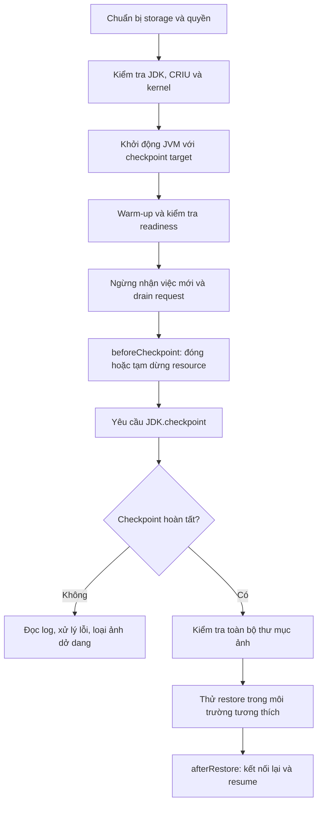

# Chuẩn bị thư mục ảnh và các điều kiện trước checkpoint

Checkpoint trong CRaC ghi lại trạng thái của một tiến trình JVM đang chạy để tiến trình có thể được khôi phục về sau. Trước khi yêu cầu checkpoint, cần chuẩn bị nơi lưu ảnh, quyền truy cập, dung lượng lưu trữ, môi trường hệ điều hành và trạng thái của ứng dụng. Một thư mục đích ghi được chỉ là điều kiện ban đầu: nếu ứng dụng vẫn đang xử lý request, giữ kết nối không thể khôi phục hoặc ghi dữ liệu dở dang, ảnh tạo ra có thể không dùng được theo cách mong muốn.

Quy trình nên được chuẩn bị như một thao tác vận hành có kiểm soát:

1. Chọn nơi lưu checkpoint ổn định và bảo vệ quyền truy cập.
2. Xác nhận JDK CRaC, CRIU, kernel và quyền của tiến trình đáp ứng yêu cầu.
3. Khởi động ứng dụng bằng cấu hình checkpoint phù hợp.
4. Đưa ứng dụng đến trạng thái sẵn sàng, dừng nhận công việc mới và xử lý các tài nguyên cần đóng.
5. Yêu cầu checkpoint, chờ thao tác hoàn tất và kiểm tra ảnh.
6. Thử restore trong môi trường tương thích trước khi đưa ảnh vào sử dụng.

## 1. Thư mục checkpoint dùng để làm gì?

Ảnh checkpoint là tập dữ liệu do JVM CRaC và cơ chế checkpoint của hệ điều hành tạo ra để khôi phục trạng thái tiến trình. Tùy JDK và công cụ được đóng gói cùng môi trường, ảnh có thể gồm nhiều tệp và thư mục con. Không nên giả định toàn bộ ảnh chỉ là một tệp duy nhất.

Đường dẫn checkpoint có hai vai trò:

- Khi tạo ảnh, JVM ghi dữ liệu checkpoint vào vị trí được cấu hình.
- Khi restore, JVM đọc dữ liệu đã tạo từ vị trí tương ứng.

Trong các bản phân phối CRaC hỗ trợ tùy chọn HotSpot thường gặp, có thể chỉ định đích checkpoint lúc khởi chạy JVM bằng `-XX:CRaCCheckpointTo`. Sau khi ứng dụng sẵn sàng, gửi lệnh checkpoint qua `jcmd`. Khi khởi chạy để khôi phục, sử dụng `-XX:CRaCRestoreFrom` với đường dẫn ảnh.

Ví dụ minh họa trên Linux:

```bash
java \
  -XX:CRaCCheckpointTo=/var/lib/myapp/crac/release-001 \
  -jar app.jar
```

Sau khi xác định PID của JVM:

```bash
jcmd <pid> JDK.checkpoint
```

Khởi chạy để restore ảnh đã tạo:

```bash
java -XX:CRaCRestoreFrom=/var/lib/myapp/crac/release-001
```

Tên tùy chọn và lệnh quản trị có thể khác theo bản phân phối JDK CRaC. Hãy kiểm tra tài liệu của đúng JDK đang sử dụng và các lệnh mà JVM công bố qua `jcmd <pid> help`. Các lệnh trên minh họa luồng phổ biến, không thay thế hướng dẫn của runtime cụ thể.

## 2. Chọn vị trí lưu ảnh

Thư mục checkpoint nên nằm ở một vị trí có thể ghi được, có đủ dung lượng và còn tồn tại khi cần restore. Nên dùng một thư mục chuyên dụng cho ứng dụng, tách khỏi thư mục mã nguồn, thư mục log và thư mục build.

### Dùng đường dẫn tuyệt đối, ổn định

Đường dẫn tuyệt đối giúp cấu hình tạo ảnh và khôi phục ảnh rõ ràng. Tránh phụ thuộc vào working directory hiện tại của tiến trình vì working directory có thể thay đổi theo cách chạy service, container hoặc script.

Ví dụ:

```text
/var/lib/myapp/
└── crac/
    ├── release-001/
    └── release-002/
```

Mỗi ảnh nên có một thư mục riêng. Không để hai tiến trình cùng ghi vào một đích checkpoint. Không dùng lại thư mục của một ảnh cũ khi chưa xác định rõ chính sách thay thế của JDK và công cụ checkpoint. Một lần checkpoint thất bại có thể để lại dữ liệu dở dang; không coi thư mục đó là ảnh hợp lệ.

Nên chuẩn bị thư mục cha trước khi khởi chạy JVM. Runtime có thể tự tạo thư mục đích hoặc yêu cầu đích ở một trạng thái cụ thể tùy bản phân phối. Hãy làm theo hợp đồng của JDK đang dùng; không tự động xóa một thư mục đích đang chứa ảnh có giá trị.

### Quyền sở hữu và quyền ghi

Tiến trình JVM phải có quyền tạo và ghi các tệp cần thiết trong vị trí checkpoint. Nếu ứng dụng chạy bằng user riêng, thư mục nên thuộc user/group đó. Không nên cấp quyền ghi rộng cho mọi user trên máy.

Ví dụ tạo thư mục cha trên Linux:

```bash
sudo install -d \
  -o myapp \
  -g myapp \
  -m 0700 \
  /var/lib/myapp/crac
```

Lệnh trên tạo thư mục cha với quyền truy cập dành cho owner. Hãy thay `myapp` bằng user và group thực tế của service. Nếu tiến trình chạy bằng user khác, quyền sở hữu phải khớp với user đó. Quyền cần thiết của thư mục đích cũng phải phù hợp với cách runtime tạo ảnh.

Không nên dùng `chmod -R 777` để xử lý lỗi quyền. Cách đó làm lộ nội dung ảnh và cho phép các tiến trình không liên quan sửa hoặc xóa trạng thái cần khôi phục.

### Dung lượng và inode

Ảnh checkpoint có thể lớn vì nó lưu trạng thái bộ nhớ và các dữ liệu tiến trình cần khôi phục. Dung lượng cần thiết phụ thuộc heap, native memory, số thread, mapping và định dạng ảnh. Không thể lấy riêng `-Xmx` để tính chính xác dung lượng cần cấp cho thư mục checkpoint.

Trước khi chạy, kiểm tra dung lượng filesystem và số inode còn trống:

```bash
df -h /var/lib/myapp/crac
df -i /var/lib/myapp/crac
```

Sau khi checkpoint hoàn tất, có thể xem dung lượng ảnh:

```bash
du -sh /var/lib/myapp/crac/release-001
find /var/lib/myapp/crac/release-001 -type f -maxdepth 2
```

Nếu cần so sánh kích thước logic của tệp với block thực tế được cấp phát, dùng thêm `ls -lh` hoặc công cụ phù hợp với filesystem. Sparse file có thể khiến kích thước logic và dung lượng đĩa khác nhau.

Hãy tính đến quota của user, quota của volume, dung lượng tạm thời trong lúc ghi và dung lượng cần giữ cho các ảnh trước đó. Filesystem đầy giữa quá trình checkpoint có thể làm thao tác thất bại hoặc để lại ảnh không hoàn chỉnh.

### Chọn filesystem và vòng đời lưu trữ

Ưu tiên filesystem cục bộ hoặc loại lưu trữ đã được kiểm chứng với JDK, CRIU và môi trường triển khai. Với filesystem mạng hoặc volume đặc biệt, cần thử cả thao tác tạo ảnh lẫn restore vì hiệu năng, quyền, file locking, sparse file và cách mount có thể ảnh hưởng đến quy trình.

Không nên đặt ảnh duy nhất trong thư mục tạm như `/tmp` hoặc filesystem chỉ tồn tại trong vòng đời container nếu ảnh cần dùng sau khi container bị thay thế. Với container, mount một volume bền vững vào đúng đường dẫn mà JVM sử dụng. Khi restore, volume và đường dẫn trong mount namespace phải sẵn sàng theo cách tương thích với ảnh.

Ví dụ cấu trúc:

```text
Container
  /var/lib/myapp/crac  ─────── volume bền vững
                                │
                                └── release-001/
```

Việc volume còn tồn tại là chưa đủ nếu đường dẫn mount, quyền user hoặc các đường dẫn tệp mà tiến trình đã mở thay đổi. Cần giữ cấu trúc filesystem phù hợp với môi trường đã tạo checkpoint.

## 3. Bảo vệ ảnh checkpoint

Ảnh checkpoint có thể chứa nội dung bộ nhớ của tiến trình tại thời điểm chụp. Trong bộ nhớ có thể tồn tại access token, mật khẩu, khóa, dữ liệu cá nhân, nội dung request, thông tin kết nối hoặc dữ liệu nghiệp vụ. Vì vậy, thư mục ảnh cần được xem như dữ liệu nhạy cảm của ứng dụng.

Các nguyên tắc nên áp dụng:

- Giới hạn quyền đọc, ghi và xóa cho user/service cần thiết.
- Dùng mã hóa ở tầng lưu trữ hoặc filesystem nếu chính sách triển khai yêu cầu.
- Áp dụng thời hạn lưu giữ và quy trình xóa ảnh cũ.
- Không commit ảnh vào Git, không đưa ảnh vào Docker build context và không tải ảnh lên nơi chia sẻ công khai.
- Bảo vệ bản sao lưu, artifact và đường truyền dùng để chuyển ảnh.
- Không ghi nội dung bí mật hoặc toàn bộ metadata nhạy cảm của ảnh vào log.

Nếu ảnh được chuyển giữa máy hoặc môi trường, kiểm tra quyền truy cập ở cả nguồn và đích. Chỉ copy ảnh sau khi checkpoint đã hoàn tất thành công; không đồng bộ thư mục khi runtime còn đang ghi. Khi lưu trữ hoặc phát hành ảnh, nên ghi nhận phiên bản ứng dụng, JDK, hệ điều hành và cấu hình tương ứng ở metadata triển khai bên ngoài ảnh.

## 4. Điều kiện ở hệ điều hành và runtime

CRaC cần hỗ trợ từ JDK và cơ chế checkpoint/restore của hệ điều hành. Với các môi trường Linux thông dụng, CRIU là thành phần quan trọng trong quá trình lưu và khôi phục trạng thái tiến trình. Cài JDK có API CRaC mà thiếu điều kiện hệ điều hành tương ứng vẫn chưa đủ để checkpoint thành công.

### JDK CRaC và CRIU

Trước khi triển khai, xác nhận:

- JDK đang chạy là bản phân phối có hỗ trợ CRaC.
- Phiên bản JDK có API và tùy chọn checkpoint/restore mà ứng dụng sử dụng.
- CRIU được cài đặt và tương thích với kernel, kiến trúc CPU và cấu hình hệ thống.
- Các lệnh kiểm tra của CRIU và tài liệu runtime không báo thiếu tính năng cần thiết.
- Các thư viện native mà ứng dụng sử dụng tương thích với môi trường restore.

Có thể xem phiên bản công cụ:

```bash
java -version
criu --version
```

Trong môi trường có CRIU, `criu check` là một bước kiểm tra hữu ích:

```bash
criu check
```

Kết quả kiểm tra cần được đọc cùng log của JVM và cấu hình container. Một lệnh kiểm tra thành công không chứng minh toàn bộ ứng dụng có thể checkpoint; ứng dụng còn có thể sử dụng socket, thiết bị, filesystem hoặc native resource không được môi trường hỗ trợ.

### Quyền của tiến trình và cấu hình container

Checkpoint/restore có thể cần các quyền kernel, namespace, khả năng truy cập thông tin tiến trình và cấu hình bảo mật phù hợp. Trong container, các giới hạn như capability, seccomp, AppArmor/SELinux, mount `/proc`, cgroup và user namespace có thể ảnh hưởng đến CRIU.

Không mặc định bật `--privileged` chỉ để làm cho checkpoint chạy được. Hãy xác định quyền cụ thể mà phiên bản CRIU và nền tảng triển khai yêu cầu, sau đó cấp đúng phạm vi cho container hoặc service. Kiểm tra cả môi trường tạo ảnh và môi trường restore; cấu hình ở hai phía phải tương thích.

### Tương thích giữa nơi tạo ảnh và nơi restore

Ảnh checkpoint chứa trạng thái phụ thuộc vào tiến trình và môi trường hệ thống. Không thể mặc định một ảnh tạo trên bất kỳ máy Linux nào cũng khôi phục được ở máy Linux khác.

Các yếu tố cần đối chiếu gồm:

| Yếu tố | Điều cần giữ hoặc xác minh |
|---|---|
| Kiến trúc CPU | Tương thích với kiến trúc đã tạo ảnh |
| Kernel và tính năng hệ điều hành | Đáp ứng yêu cầu của CRIU và định dạng ảnh |
| JDK CRaC | Bản phân phối và phiên bản tương thích với ảnh |
| Thư viện native | Có mặt đúng phiên bản hoặc tương thích |
| Đường dẫn và mount | Những filesystem mà tiến trình cần có được mount đúng vị trí |
| User/group và quyền | Phù hợp với quyền tiến trình và dữ liệu được khôi phục |
| Biến môi trường/cấu hình | Đáp ứng các giả định của ứng dụng sau restore |
| Tài nguyên bên ngoài | Endpoint, credential và dịch vụ phụ thuộc còn khả dụng |

Nếu cần di chuyển ảnh giữa host hoặc giữa các phiên bản hệ điều hành, hãy xác minh rõ khả năng được hỗ trợ và kiểm thử restore trên đúng đích. Không coi việc copy toàn bộ thư mục ảnh là bằng chứng về tính di động.

## 5. Chuẩn bị trạng thái ứng dụng trước checkpoint

Một ảnh có thể được tạo thành công về mặt kỹ thuật nhưng vẫn không phù hợp để phục vụ request sau restore. Trước checkpoint, ứng dụng cần ở trạng thái nhất quán và có kế hoạch rõ ràng cho từng tài nguyên.

### Khởi động và warm-up

Thông thường, nên đưa ứng dụng đến trạng thái đã hoàn tất khởi động và warm-up theo mục tiêu triển khai:

- Đã nạp cấu hình cần thiết.
- Đã khởi tạo các thành phần ứng dụng.
- Đã hoàn tất các tác vụ warm-up có chủ đích.
- Đã nạp cache mà ứng dụng muốn giữ lại sau restore.
- Đã kiểm tra readiness và các phụ thuộc cần thiết.

Không phải dữ liệu nào cũng nên đưa vào ảnh. Cache lớn có thể làm ảnh tăng đáng kể; cache không cần thiết có thể được tải lại sau restore. Quyết định giữ hay làm nóng lại cache cần dựa trên cân bằng giữa kích thước ảnh, thời gian restore và latency request đầu tiên.

### Dừng nhận công việc mới và xử lý request đang chạy

Trước khi chụp trạng thái, nên phối hợp với load balancer hoặc lớp điều phối để:

1. Đưa instance ra khỏi luồng nhận request mới.
2. Chờ các request đang xử lý hoàn tất trong giới hạn thời gian đã định.
3. Hoàn tất hoặc hủy có kiểm soát các tác vụ còn lại.
4. Chặn việc consumer hoặc scheduler nhận thêm công việc trong thời gian chuẩn bị checkpoint.

Mục tiêu là tránh chụp ứng dụng ở giữa một thao tác nghiệp vụ. Nếu một request đang cập nhật cơ sở dữ liệu hoặc gửi thông điệp mà trạng thái trong bộ nhớ chưa đồng bộ với hệ thống bên ngoài, restore có thể dẫn đến xử lý lặp hoặc mất nhất quán.

### Hoàn tất giao dịch và flush dữ liệu

Trước checkpoint, cần xác định dữ liệu nào đã bền vững và dữ liệu nào còn nằm trong buffer:

- Hoàn tất, commit hoặc rollback transaction theo quy tắc nghiệp vụ.
- Flush dữ liệu cần ghi ra file hoặc log.
- Đảm bảo các message đã nhận có trạng thái ack phù hợp.
- Lưu trạng thái công việc đang thực hiện nếu quy trình cho phép tiếp tục sau restore.
- Thiết kế thao tác có thể retry hoặc idempotent khi có nguy cơ được xử lý lại.

Không nên để một transaction bên ngoài ở trạng thái không rõ ràng rồi kỳ vọng checkpoint có thể tự giải quyết. CRaC khôi phục tiến trình; nó không thay thế cơ chế transaction, message delivery hay đồng bộ dữ liệu của ứng dụng.

## 6. Quản lý tài nguyên bằng CRaC Resource

Một số tài nguyên không nên được giữ nguyên qua checkpoint, đặc biệt là kết nối mạng và kết nối đến dịch vụ bên ngoài. Ứng dụng có thể đăng ký `Resource` để chuẩn bị tài nguyên trước checkpoint và thiết lập lại chúng sau restore.

Hai callback chính:

- `beforeCheckpoint`: được gọi khi chuẩn bị tạo ảnh. Ứng dụng đóng, tạm dừng hoặc đưa tài nguyên về trạng thái an toàn.
- `afterRestore`: được gọi sau khi tiến trình được khôi phục. Ứng dụng mở lại kết nối, kiểm tra phụ thuộc và tiếp tục công việc.

Ví dụ dưới đây minh họa vòng đời của một client bên ngoài. `ExternalClient` là lớp của ứng dụng; các phương thức `close()` và `reconnect()` cần được triển khai theo thư viện thực tế.

```java
import org.crac.Context;
import org.crac.Core;
import org.crac.Resource;

public final class ExternalClientResource implements Resource {

    private final ExternalClient client;

    public ExternalClientResource(ExternalClient client) {
        this.client = client;
        Core.getGlobalContext().register(this);
    }

    @Override
    public void beforeCheckpoint(Context<? extends Resource> context)
            throws Exception {
        client.close();
    }

    @Override
    public void afterRestore(Context<? extends Resource> context)
            throws Exception {
        client.reconnect();
    }
}
```

Đoạn mã chỉ mô tả ý tưởng, không phải một client có sẵn trong JDK. Trong ứng dụng thật, cần bảo đảm resource được đăng ký đúng một lần, việc đóng kết nối hoàn tất trước khi checkpoint và thao tác reconnect phù hợp với thư viện đang dùng.

### Những tài nguyên cần rà soát

| Tài nguyên | Việc chuẩn bị thường cần làm |
|---|---|
| JDBC/database connection | Kết thúc transaction, đóng connection cũ và tạo connection mới sau restore |
| HTTP client/socket | Đóng hoặc reset kết nối không thể tiếp tục; kết nối lại sau restore |
| Message consumer | Dừng nhận message, xử lý ack và khởi động lại consumer sau restore |
| Scheduled task | Tạm dừng scheduler hoặc bảo đảm task không chạy trùng sau restore |
| Thread pool | Ngừng nhận việc mới, xử lý queue và khởi động lại thành phần cần thiết |
| File hoặc file lock | Flush, đóng hoặc xác minh lại đường dẫn và lock theo môi trường |
| Native resource | Giải phóng hoặc chuẩn bị lại theo API của thư viện native |
| Credential/token | Xác minh thời hạn và khả năng lấy credential hợp lệ sau restore |

Không phải mọi tài nguyên đều bắt buộc phải đóng. Quyết định phụ thuộc khả năng hỗ trợ của CRaC, CRIU, hệ điều hành và thư viện cụ thể. Điều quan trọng là không giả định một socket hoặc connection đang mở sẽ luôn hoạt động bình thường sau khi khôi phục tiến trình.

Callback nên hoàn tất trong thời gian hợp lý, có log đủ để chẩn đoán và xử lý lỗi rõ ràng. Không nên bắt lỗi rồi âm thầm bỏ qua nếu việc đóng tài nguyên thất bại. Một resource chưa sẵn sàng có thể khiến checkpoint không hoàn tất hoặc tạo ra trạng thái không an toàn. Hãy xác minh hành vi lỗi của đúng JDK CRaC đang dùng.

## 7. Thread, background job và trạng thái nhất quán

Ứng dụng Java thường có thread phục vụ request, thread pool, scheduler, consumer và các tác vụ nền. Trước checkpoint, cần biết thread nào đang chạy và nó đang giữ tài nguyên gì.

Các câu hỏi nên được trả lời:

- Có thread nào đang giữ lock trong khi chờ một dịch vụ bên ngoài không?
- Có tác vụ nền đang ghi file hoặc cập nhật dữ liệu dở dang không?
- Có consumer nào đã nhận message nhưng chưa commit/ack không?
- Scheduler có thể chạy lại cùng một tác vụ sau restore không?
- Thread pool có thể tiếp tục an toàn hay cần dừng và tạo lại?
- Có thư viện native đang ở trong lời gọi hệ thống hoặc trạng thái không tương thích với checkpoint không?

Không có quy tắc chung rằng phải tự dừng tất cả thread Java trước mỗi checkpoint. CRaC và CRIU xử lý trạng thái tiến trình theo khả năng của runtime và hệ điều hành. Tuy nhiên, ứng dụng phải bảo đảm các thread do nó quản lý không ở giữa một thao tác nghiệp vụ không nhất quán và các thư viện đang dùng hỗ trợ vòng đời checkpoint/restore. Theo dõi cảnh báo từ JVM/CRIU thay vì giả định mọi trạng thái thread đều hợp lệ.

Đối với tác vụ có thể được thực hiện lại, dùng idempotency key, lease, checkpoint nghiệp vụ hoặc cơ chế deduplication phù hợp. Việc restore cùng trạng thái thread không thay thế sự phối hợp với hệ thống phân tán bên ngoài.

## 8. Quy trình chuẩn bị và tạo checkpoint

Một quy trình vận hành có thể chia thành các giai đoạn sau:



### Bước 1 — Chuẩn bị storage

Tạo thư mục cha, xác định user chạy JVM và kiểm tra filesystem:

```bash
sudo install -d -o myapp -g myapp -m 0700 /var/lib/myapp/crac
df -h /var/lib/myapp/crac
df -i /var/lib/myapp/crac
```

Chọn một tên đích riêng cho lần tạo ảnh. Xác minh volume sẽ tồn tại ở môi trường restore và user có quyền đọc ảnh.

### Bước 2 — Kiểm tra runtime

Ghi nhận phiên bản JDK, CRIU, kernel, kiến trúc CPU và các thư viện native quan trọng. Kiểm tra quyền hệ điều hành/container theo hướng dẫn của runtime. Đừng bắt đầu một quy trình phát hành ảnh nếu môi trường chưa vượt qua bước kiểm tra cơ bản.

### Bước 3 — Khởi động ứng dụng

Truyền đường dẫn checkpoint vào JVM ngay khi khởi động:

```bash
java \
  -XX:CRaCCheckpointTo=/var/lib/myapp/crac/release-001 \
  -jar app.jar
```

Ứng dụng nên tự đăng ký các `Resource` cần thiết trong quá trình khởi động. Ghi lại PID, phiên bản ứng dụng và cấu hình runtime để dùng khi đối chiếu.

### Bước 4 — Đưa ứng dụng đến trạng thái sẵn sàng

Chờ ứng dụng hoàn tất warm-up và kiểm tra readiness. Nạp dữ liệu cần thiết, xác định cache nào sẽ được giữ lại, sau đó ngừng nhận request mới. Drain các request đang chạy và dừng consumer/scheduler theo chính sách của ứng dụng.

### Bước 5 — Yêu cầu checkpoint

Gửi lệnh tới đúng JVM:

```bash
jcmd <pid> JDK.checkpoint
```

Theo dõi stdout, stderr, log ứng dụng, log JVM và log CRIU. Chờ đến khi runtime xác nhận thao tác hoàn tất. Không copy, di chuyển, nén hoặc restore thư mục khi công cụ vẫn đang ghi dữ liệu.

### Bước 6 — Xác minh ảnh

Sau khi checkpoint hoàn tất, kiểm tra:

- Thao tác kết thúc với trạng thái thành công theo runtime.
- Thư mục đích chứa đầy đủ các tệp do công cụ tạo.
- Kích thước và thời gian cập nhật tệp hợp lý.
- Quyền truy cập vẫn đúng với user dự kiến restore.
- Filesystem còn đủ dung lượng và ảnh không bị cắt cụt do quota.

Có thể dùng `du -sh` để ghi nhận dung lượng thư mục. Nếu cần chuyển ảnh, sao chép nguyên vẹn toàn bộ cấu trúc và bảo toàn quyền, symlink cùng metadata cần thiết. Không chỉ chọn một vài tệp có vẻ quan trọng.

### Bước 7 — Thử restore

Tạo một lần restore trên môi trường tương thích, dùng đúng đường dẫn ảnh và runtime phù hợp. Kiểm tra log callback `afterRestore`, kết nối lại database/message broker, readiness, request thực tế và các tác vụ nền.

Checkpoint thành công không đồng nghĩa restore chắc chắn thành công. Chỉ đưa ảnh vào quy trình phát hành sau khi đã kiểm tra restore và hành vi ứng dụng sau restore.

## 9. Lỗi thường gặp khi chuẩn bị checkpoint

| Hiện tượng | Nguyên nhân có thể | Hướng kiểm tra |
|---|---|---|
| Không tạo được thư mục ảnh | Parent path không tồn tại hoặc user thiếu quyền | Kiểm tra đường dẫn, owner, mode và log JVM |
| Lỗi ghi giữa checkpoint | Hết dung lượng, hết inode hoặc quota | Kiểm tra `df -h`, `df -i`, quota và log CRIU |
| CRIU không chạy được | Thiếu công cụ, kernel feature hoặc quyền | Kiểm tra phiên bản, `criu check`, capability và chính sách bảo mật |
| Checkpoint bị lỗi khi đóng tài nguyên | Callback `beforeCheckpoint` thất bại hoặc resource còn hoạt động | Kiểm tra log từng resource, timeout và thứ tự chuẩn bị |
| Restore không tìm thấy tệp | Đường dẫn hoặc volume khác môi trường tạo ảnh | Kiểm tra mount, path bên trong container và quyền đọc |
| Restore lỗi do môi trường | JDK, kernel, kiến trúc hoặc native library không tương thích | Đối chiếu manifest môi trường tạo ảnh và môi trường restore |
| Ứng dụng restore nhưng không sẵn sàng | Kết nối cũ, scheduler hoặc consumer chưa được phục hồi | Kiểm tra callback `afterRestore` và readiness |
| Tác vụ bị xử lý hai lần | Message hoặc transaction đang dở trước checkpoint | Kiểm tra ack/commit, idempotency và quy trình drain |
| Ảnh lớn hơn dự kiến | Heap, native memory, cache hoặc thread còn lớn | Đo heap, RSS, native memory và nội dung ảnh riêng biệt |

Không nên khắc phục lỗi bằng cách cấp quyền rộng, tắt toàn bộ chính sách bảo mật hoặc xóa thư mục checkpoint cũ khi chưa xác định quyền sở hữu. Trước tiên hãy tìm nguyên nhân trong log của JVM, CRIU và hệ điều hành.

## 10. Checklist trước khi checkpoint

### Storage và quyền

- [ ] Đã chọn đường dẫn tuyệt đối, ổn định và chuyên dụng cho ứng dụng.
- [ ] User chạy JVM có quyền ghi vào vị trí checkpoint và user restore có quyền đọc.
- [ ] Đích checkpoint được chuẩn bị theo đúng yêu cầu của JDK CRaC đang dùng.
- [ ] Đã kiểm tra dung lượng, inode, quota và chính sách lưu giữ ảnh cũ.
- [ ] Volume không bị mất khi container hoặc instance được thay thế.
- [ ] Thư mục ảnh được bảo vệ vì có thể chứa dữ liệu nhạy cảm trong bộ nhớ.

### Runtime và hệ điều hành

- [ ] Đã xác nhận JDK có hỗ trợ CRaC và đúng tùy chọn checkpoint/restore.
- [ ] CRIU, kernel, kiến trúc CPU và quyền tiến trình đáp ứng yêu cầu.
- [ ] Cấu hình container, namespace, capability và chính sách bảo mật đã được kiểm chứng.
- [ ] Môi trường restore có JDK, thư viện native, mount và cấu hình tương thích.

### Ứng dụng

- [ ] Ứng dụng đã khởi động, warm-up và đạt readiness.
- [ ] Đã ngừng nhận request mới và xử lý request đang chạy.
- [ ] Transaction, file buffer, log và message đã ở trạng thái nhất quán.
- [ ] Scheduler, consumer và background job đã được tạm dừng hoặc quản lý an toàn.
- [ ] Các CRaC Resource cần thiết đã được đăng ký.
- [ ] `beforeCheckpoint` đóng hoặc chuẩn bị tài nguyên thành công.
- [ ] Có kế hoạch reconnect và resume trong `afterRestore`.

### Sau checkpoint

- [ ] Lệnh checkpoint hoàn tất thành công và log không có lỗi chưa xử lý.
- [ ] Đã kiểm tra toàn bộ cấu trúc ảnh, kích thước và quyền truy cập.
- [ ] Không copy hoặc restore ảnh khi công cụ còn đang ghi.
- [ ] Đã thử restore và kiểm tra readiness cùng hành vi nghiệp vụ.

## 11. Kết luận vận hành

Chuẩn bị checkpoint gồm cả hạ tầng lưu ảnh và trạng thái bên trong ứng dụng. Thư mục cần ổn định, ghi được, đủ dung lượng và được bảo vệ; runtime cần tương thích với CRIU và hệ điều hành; ứng dụng cần dừng nhận việc mới, hoàn tất thao tác đang chạy và quản lý tài nguyên qua các callback CRaC. Sau khi tạo ảnh, phải kiểm tra toàn bộ dữ liệu và thử restore trong môi trường phù hợp. Chỉ khi cả quá trình tạo ảnh lẫn khôi phục đều thành công, checkpoint mới sẵn sàng được dùng trong triển khai.
