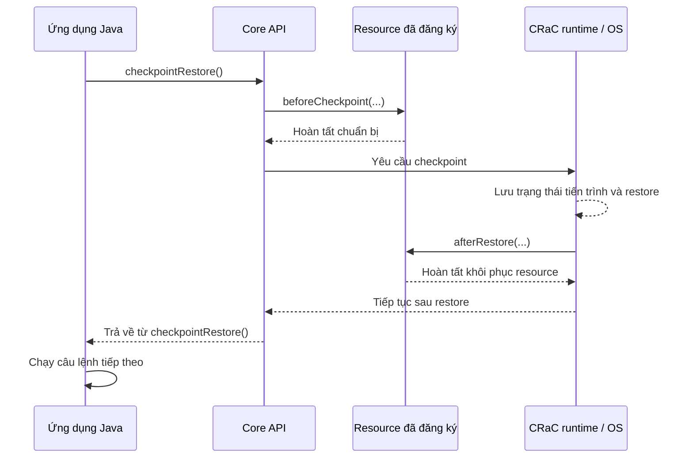

# Yêu cầu checkpoint trong chương trình bằng `Core.checkpointRestore()`

CRaC cho phép một ứng dụng Java chủ động yêu cầu checkpoint và restore ngay từ code thông qua API `org.crac.Core.checkpointRestore()`. Cách này giúp ứng dụng chọn một thời điểm phù hợp trong vòng đời của chính nó, chẳng hạn sau khi đã khởi tạo thành phần, nạp cấu hình và làm nóng những đoạn xử lý quan trọng.

Lời gọi này là một điểm chuyển tiếp trong luồng thực thi: ứng dụng yêu cầu runtime thực hiện checkpoint/restore, tiến trình tạm dừng trong quá trình đó, rồi tiếp tục từ trạng thái đã được khôi phục. Khi lời gọi trả về bình thường, code phía sau nó tiếp tục chạy trong tiến trình sau restore. Để sử dụng đúng API, cần hiểu thời điểm gọi, cách đăng ký và phối hợp Resource, cách xử lý lỗi, cũng như các điều kiện môi trường mà API phụ thuộc.

## 1. `Core.checkpointRestore()` dùng để làm gì?

`Core` là lớp facade của CRaC API trong package `org.crac`. Phương thức `checkpointRestore()` cho phép code Java yêu cầu checkpoint/restore tiến trình hiện tại. Ứng dụng không cần chờ một công cụ bên ngoài chọn thời điểm checkpoint; chính code có thể quyết định khi nào trạng thái đã sẵn sàng để lưu.

Ví dụ, một ứng dụng có thể thực hiện các công việc sau trước khi gọi API:

- Đọc cấu hình và khởi tạo các thành phần cần thiết.
- Tạo các object dùng chung và nạp dữ liệu ban đầu.
- Làm nóng ứng dụng bằng một số thao tác đại diện.
- Đăng ký các Resource cần phối hợp trước checkpoint và sau restore.
- Chuyển ứng dụng tới một điểm an toàn, không còn transaction hoặc công việc dở dang cần hoàn tất trước khi lưu trạng thái.

Sau đó, ứng dụng gọi `Core.checkpointRestore()`. Khi tiến trình được restore thành công, luồng code tiếp tục từ vị trí ngay sau lời gọi. Nhờ vậy, những công việc đã hoàn thành trước checkpoint có thể được giữ lại trong trạng thái tiến trình, giảm lượng khởi tạo phải thực hiện lại khi dùng checkpoint.

API này chỉ yêu cầu runtime thực hiện thao tác. Khả năng checkpoint/restore thực tế vẫn phụ thuộc JDK có hỗ trợ CRaC và môi trường hệ điều hành được cấu hình tương thích. Việc gọi phương thức không tự cài đặt CRIU, cấp quyền hệ điều hành, tạo cấu hình container hoặc bảo đảm mọi tài nguyên bên ngoài còn hợp lệ sau restore.

## 2. Luồng thực thi từ lúc gọi đến khi trả về

Ở góc nhìn của ứng dụng, có thể chia quy trình thành các giai đoạn sau:

1. Ứng dụng khởi động và chuẩn bị trạng thái muốn giữ lại.
2. Ứng dụng đăng ký các Resource cần tham gia vòng đời CRaC.
3. Code gọi `Core.checkpointRestore()` tại thời điểm đã chọn.
4. Các Resource được yêu cầu thực hiện công việc `beforeCheckpoint(...)`.
5. Runtime và cơ chế checkpoint/restore của môi trường thực hiện việc lưu trạng thái tiến trình.
6. Tiến trình được restore trong môi trường tương thích.
7. Các Resource thực hiện công việc `afterRestore(...)` để khôi phục hoặc kiểm tra tài nguyên.
8. Lời gọi `Core.checkpointRestore()` trả về và code tiếp tục ở câu lệnh kế tiếp.



Sơ đồ thể hiện mô hình phối hợp ở mức khái niệm. Chi tiết thực thi, xử lý lỗi và cơ chế hệ điều hành phụ thuộc JDK CRaC cùng phiên bản môi trường đang triển khai.

Điểm quan trọng là code sau `Core.checkpointRestore()` thuộc luồng tiếp tục sau restore. Ứng dụng không nên hiểu lời gọi này như một hàm ghi file thông thường trả về ngay sau khi lưu vài object. Trong quá trình checkpoint/restore, toàn bộ tiến trình chịu tác động; resource và trạng thái runtime cần được xử lý theo vòng đời CRaC.

## 3. Ví dụ gọi API trong chương trình Java

Ví dụ dưới đây minh họa vị trí gọi API trong một chương trình nhỏ. Chương trình khởi tạo ứng dụng, làm nóng một phần xử lý, yêu cầu checkpoint/restore rồi mới bắt đầu công việc phục vụ chính.

```java
import org.crac.Core;
import org.crac.CheckpointException;
import org.crac.RestoreException;

public final class Application {

    public static void main(String[] args)
            throws CheckpointException, RestoreException {

        initializeApplication();
        warmUpApplication();

        // Tiến trình sẽ tiếp tục từ đây sau khi restore thành công.
        Core.checkpointRestore();

        // Chỉ bắt đầu phục vụ sau khi lời gọi checkpoint/restore trả về.
        startServing();
    }

    private static void initializeApplication() {
        System.out.println("Initialize application");
    }

    private static void warmUpApplication() {
        System.out.println("Warm up application");
    }

    private static void startServing() {
        System.out.println("Application is ready");
    }
}
```

Đây là ví dụ minh họa cấu trúc gọi API; các hàm khởi tạo và phục vụ được rút gọn để tập trung vào điểm checkpoint. Khi chạy thực tế, cần dùng JDK CRaC tương thích và chuẩn bị môi trường checkpoint/restore theo tài liệu của bản JDK đó.

Trong ví dụ, `initializeApplication()` và `warmUpApplication()` chạy trước checkpoint. Sau khi restore, chương trình tiếp tục tại câu lệnh `startServing()`. Vì vậy, nếu mục tiêu là chỉ nhận traffic sau khi tài nguyên đã được khôi phục, việc đặt điểm bắt đầu phục vụ sau lời gọi này là một cách tổ chức dễ hiểu. Với ứng dụng có server hoặc scheduler được khởi động sớm hơn, cần quản lý readiness và vòng đời của các thành phần đó bằng Resource phù hợp.

### 3.1. Điều gì xảy ra với câu lệnh trước và sau lời gọi?

Giả sử code có cấu trúc:

```java
prepare();
Core.checkpointRestore();
continueWork();
```

Khi checkpoint/restore hoàn tất thành công:

- `prepare()` đã chạy trước checkpoint.
- Trạng thái tiến trình tại checkpoint được lưu theo cơ chế của runtime.
- Sau restore, luồng thực thi tiếp tục sau lời gọi `Core.checkpointRestore()`.
- `continueWork()` được thực hiện trong tiến trình đã restore.

Điều này giúp ứng dụng giữ lại trạng thái đã chuẩn bị. Tuy nhiên, không có nghĩa mọi trạng thái bên ngoài tiến trình cũng được giữ nguyên. Database server, message broker, dịch vụ HTTP hoặc hệ thống khác có vòng đời riêng; ứng dụng vẫn phải kiểm tra và khôi phục các kết nối liên quan.

## 4. Đăng ký Resource trước khi yêu cầu checkpoint

`Core.checkpointRestore()` yêu cầu checkpoint/restore, còn các Resource cho phép ứng dụng phối hợp xử lý tài nguyên trong vòng đời đó. Resource cần được đăng ký vào context trước khi thực hiện checkpoint để runtime có thể gọi các callback tương ứng.

Một Resource triển khai `org.crac.Resource` và cung cấp hai phương thức chính:

- `beforeCheckpoint(...)`: chuẩn bị tài nguyên trước khi trạng thái tiến trình được lưu.
- `afterRestore(...)`: kiểm tra, tạo lại hoặc hoàn tất khôi phục tài nguyên sau khi tiến trình được restore.

Ví dụ minh họa:

```java
import org.crac.Context;
import org.crac.Core;
import org.crac.Resource;

public final class ConnectionResource implements Resource {

    @Override
    public void beforeCheckpoint(Context<? extends Resource> context)
            throws Exception {
        pauseNewDatabaseWork();
        closeConnectionIfRequired();
    }

    @Override
    public void afterRestore(Context<? extends Resource> context)
            throws Exception {
        reconnectDatabase();
        verifyConnection();
        resumeDatabaseWork();
    }

    private void pauseNewDatabaseWork() {
        // Ngăn công việc mới sử dụng connection trong giai đoạn chuẩn bị.
    }

    private void closeConnectionIfRequired() {
        // Đóng hoặc đưa connection về trạng thái an toàn theo chính sách.
    }

    private void reconnectDatabase() {
        // Tạo lại connection hoặc khởi động lại pool sau restore.
    }

    private void verifyConnection() {
        // Kiểm tra khả năng sử dụng trước khi cho phép nhận công việc.
    }

    private void resumeDatabaseWork() {
        // Cho phép công việc sử dụng database tiếp tục.
    }
}
```

Đăng ký Resource vào global context trước khi gọi API:

```java
Core.getGlobalContext().register(new ConnectionResource());
Core.checkpointRestore();
```

Trong ứng dụng thực tế, nên đăng ký Resource ở nơi quản lý vòng đời của thành phần tương ứng, bảo đảm chỉ đăng ký đúng số lần cần thiết. Nếu có nhiều Resource, cần thiết kế quan hệ phụ thuộc và thứ tự chuẩn bị/khôi phục theo hợp đồng của API và ứng dụng; không nên dựa vào một thứ tự ngầm định chưa được xác nhận.

Ví dụ trên chỉ minh họa trách nhiệm của Resource. Việc đóng connection, khởi động lại pool hoặc tạm dừng worker phải dùng API thực tế của thư viện đang dùng. Không nên sao chép các hàm giả định trong ví dụ như thể đó là phương thức có sẵn của JDBC hoặc connection pool.

## 5. Chọn thời điểm gọi `Core.checkpointRestore()`

Vị trí gọi API ảnh hưởng trực tiếp đến trạng thái được lưu. Một điểm gọi phù hợp thường nằm sau khi ứng dụng đã hoàn thành phần khởi tạo muốn giữ lại và trước khi bắt đầu nhận công việc có thể làm thay đổi trạng thái theo cách khó kiểm soát.

### 5.1. Gọi sau khi khởi tạo và warm-up

Một trình tự thường dễ quản lý là:

```text
Khởi động JVM
    ↓
Khởi tạo cấu hình và thành phần
    ↓
Nạp dữ liệu ban đầu
    ↓
Warm-up các luồng xử lý quan trọng
    ↓
Đăng ký Resource
    ↓
Core.checkpointRestore()
    ↓
Khôi phục và kiểm tra resource
    ↓
Ứng dụng tiếp tục / bắt đầu phục vụ
```

Không phải ứng dụng nào cũng cần warm-up trước checkpoint. Việc warm-up có ích khi muốn giữ lại trạng thái đã nạp class hoặc tối ưu hóa runtime, nhưng cần cân nhắc thời gian tạo checkpoint, bộ nhớ và tính đại diện của workload. Chỉ nên chạy những thao tác khởi tạo an toàn, không tạo side effect nghiệp vụ ngoài ý muốn.

### 5.2. Tránh gọi giữa một thao tác nghiệp vụ chưa hoàn tất

Không nên tùy tiện gọi checkpoint khi ứng dụng đang giữ transaction chưa commit/rollback, đang ghi dữ liệu dở dang hoặc đang giữ khóa mà callback cần dùng. Trước khi gọi, hãy xác định:

- Có thao tác ghi dữ liệu nào cần hoàn tất không?
- Có transaction hoặc message acknowledgement nào đang dang dở không?
- Có worker đang xử lý công việc không thể tạm dừng an toàn không?
- Có lock nào đang được giữ và có thể gây chờ lẫn nhau với callback không?
- Có buffer hoặc file output nào cần flush/đóng không?

Checkpoint không tự hiểu ý nghĩa nghiệp vụ của transaction hoặc message. Ứng dụng phải chuẩn bị trạng thái nhất quán trước khi yêu cầu runtime lưu tiến trình.

### 5.3. Tránh gọi lặp ngoài chủ đích

Sau khi restore, code tiếp tục ngay sau lời gọi. Nếu điểm gọi nằm trong vòng lặp, scheduler hoặc đường xử lý được kích hoạt nhiều lần, ứng dụng có thể yêu cầu checkpoint nhiều lần ngoài dự kiến.

Ví dụ không phù hợp là đặt `Core.checkpointRestore()` trực tiếp trong một vòng lặp xử lý request mà không có điều kiện kiểm soát. Mỗi lần luồng đi qua điểm gọi đều có thể khởi tạo một chu kỳ checkpoint/restore mới.

Hãy chọn một điểm gọi có chủ đích, chẳng hạn giai đoạn startup một lần, và dùng trạng thái điều khiển phù hợp nếu luồng ứng dụng có thể quay lại đoạn code đó. Cần bảo đảm điều kiện điều khiển vẫn đúng sau restore vì trạng thái tiến trình được tiếp tục từ checkpoint.

## 6. Xử lý lỗi khi gọi API

Phương thức `Core.checkpointRestore()` khai báo các loại lỗi checkpoint và restore thông qua `CheckpointException` và `RestoreException`. Khi dùng API, cần xử lý các ngoại lệ này theo chính sách của ứng dụng.

Ví dụ để lỗi được truyền lên tầng gọi:

```java
import org.crac.CheckpointException;
import org.crac.Core;
import org.crac.RestoreException;

public final class CheckpointCoordinator {

    public void checkpointAtSafePoint()
            throws CheckpointException, RestoreException {
        Core.checkpointRestore();
    }
}
```

Nếu ứng dụng cần bắt lỗi tại chỗ, hãy ghi log đủ ngữ cảnh, giữ lại nguyên nhân và quyết định rõ có thể tiếp tục hay phải dừng khởi động:

```java
try {
    Core.checkpointRestore();
} catch (CheckpointException | RestoreException e) {
    // Ghi nhận lỗi và áp dụng chính sách vận hành của ứng dụng.
    throw e;
}
```

Không nên bắt ngoại lệ rồi bỏ qua. Nếu checkpoint thất bại, ứng dụng có thể chưa đạt trạng thái mà quy trình triển khai mong đợi. Nếu restore hoặc callback khôi phục thất bại, một số resource có thể chưa sẵn sàng. Tiếp tục phục vụ trong trạng thái không đầy đủ có thể dẫn đến lỗi dữ liệu hoặc lỗi kết nối khó phát hiện.

Khi phân tích lỗi, hãy xác định giai đoạn xảy ra:

| Giai đoạn | Câu hỏi cần kiểm tra |
|---|---|
| Chuẩn bị checkpoint | Resource nào thất bại trong `beforeCheckpoint(...)`? Có thao tác nào chưa hoàn tất không? |
| Tạo checkpoint | JDK, công cụ checkpoint/restore, kernel, quyền và cấu hình môi trường có đáp ứng yêu cầu không? |
| Restore tiến trình | Checkpoint có tương thích với môi trường khởi chạy không? Có lỗi từ hệ điều hành hoặc runtime không? |
| Khôi phục resource | Kết nối hoặc tài nguyên nào không được tạo lại? Dịch vụ bên ngoài có sẵn sàng không? |
| Sau khi API trả về | Ứng dụng có kiểm tra readiness và xử lý trạng thái chưa sẵn sàng đúng cách không? |

Không phải lỗi nào cũng có thể giải quyết bằng cách gọi lại `Core.checkpointRestore()`. Trước khi retry, cần xác định trạng thái của tiến trình và resource, tránh tạo thêm checkpoint hoặc tài nguyên trùng trong khi trạng thái trước đó chưa rõ ràng.

## 7. Phân biệt yêu cầu từ code và yêu cầu từ công cụ bên ngoài

Có thể khởi tạo chu kỳ checkpoint/restore từ code ứng dụng hoặc từ cơ chế quản lý tiến trình bên ngoài, tùy cách triển khai CRaC.

| Tiêu chí | Gọi `Core.checkpointRestore()` | Yêu cầu từ công cụ bên ngoài |
|---|---|---|
| Nơi quyết định thời điểm | Logic của ứng dụng Java. | Script, công cụ vận hành hoặc hệ thống quản lý tiến trình. |
| Điểm gọi | Một vị trí cụ thể trong luồng code. | Công cụ tác động tới tiến trình đang chạy theo cơ chế được hỗ trợ. |
| Ngữ cảnh ứng dụng | Code có thể chọn thời điểm sau một bước khởi tạo hoặc tại safe point. | Ứng dụng vẫn cần Resource để chuẩn bị và khôi phục tài nguyên. |
| Kiểm soát nghiệp vụ | Có thể gắn với điều kiện và trạng thái nội bộ của ứng dụng. | Cần cơ chế phối hợp để biết ứng dụng đã sẵn sàng checkpoint hay chưa. |
| Điều kiện môi trường | Vẫn cần JDK CRaC và môi trường tương thích. | Cũng cần JDK/runtime và môi trường checkpoint/restore tương thích. |

Gọi từ code không loại bỏ nhu cầu vận hành. Ứng dụng vẫn cần cấu hình nơi lưu checkpoint, quyền cần thiết, phiên bản runtime tương thích và quy trình restore. Ngược lại, yêu cầu từ công cụ bên ngoài cũng không loại bỏ trách nhiệm của ứng dụng trong việc quản lý Resource.

## 8. Những điều `Core.checkpointRestore()` không tự đảm nhiệm

Khi đọc code hoặc thiết kế kiến trúc, cần phân biệt trách nhiệm của API với trách nhiệm của ứng dụng và môi trường.

- **Không tự đăng ký Resource của thư viện:** ứng dụng phải bảo đảm các Resource cần thiết được đăng ký hoặc thư viện đã có tích hợp CRaC phù hợp.
- **Không tự biết trạng thái nghiệp vụ:** API không biết transaction nào cần commit, message nào cần acknowledge hoặc công việc nào có thể tạm dừng.
- **Không bảo đảm mọi kết nối vẫn hợp lệ:** database, broker, socket và HTTP service có thể thay đổi trạng thái trong thời gian tiến trình không hoạt động.
- **Không cài đặt hạ tầng hệ điều hành:** JDK CRaC và cơ chế checkpoint/restore cần môi trường tương thích, quyền và cấu hình phù hợp.
- **Không thay thế readiness check:** ứng dụng cần kiểm tra các resource bắt buộc trước khi nhận traffic.
- **Không phải cơ chế sao lưu dữ liệu nghiệp vụ:** checkpoint lưu trạng thái tiến trình theo cơ chế runtime, không thay thế backup database hoặc hệ thống lưu trữ bền vững.
- **Không bảo đảm checkpoint dùng được trên mọi phiên bản hoặc máy:** khả năng restore phụ thuộc các điều kiện tương thích của runtime và môi trường.

Các giới hạn này giúp tránh đặt quá nhiều trách nhiệm vào một lời gọi API. `Core.checkpointRestore()` là điểm yêu cầu chu kỳ checkpoint/restore; chất lượng khôi phục vẫn phụ thuộc thiết kế Resource và hệ thống xung quanh.

## 9. Kiểm thử lời gọi API theo từng lớp

Để kiểm tra việc tích hợp, nên tách câu hỏi thành các lớp bằng chứng:

1. **Kiểm tra code:** xác nhận chương trình gọi API ở đúng vị trí, Resource được đăng ký trước điểm gọi và các ngoại lệ được xử lý.
2. **Kiểm tra callback:** xác nhận `beforeCheckpoint(...)` và `afterRestore(...)` thực hiện đúng chính sách resource trong môi trường test phù hợp.
3. **Kiểm thử CRaC thật:** chạy trên JDK hỗ trợ CRaC và môi trường tương thích, gọi `Core.checkpointRestore()` rồi xác nhận tiến trình tiếp tục sau restore.
4. **Kiểm thử tích hợp:** xác nhận database, broker, HTTP client, file và các thành phần ngoài tiến trình hoạt động sau restore.
5. **Kiểm thử vận hành:** xác nhận health check, readiness, log, metric, quyền, nơi lưu checkpoint và phương án xử lý khi checkpoint/restore thất bại.

Một số tình huống nên có trong bộ kiểm thử:

| Tình huống | Điều cần xác nhận |
|---|---|
| Luồng checkpoint/restore thành công | Code tiếp tục ở câu lệnh sau `Core.checkpointRestore()`. |
| `beforeCheckpoint(...)` thất bại | Lỗi được quan sát và ứng dụng không giả định checkpoint đã thành công. |
| `afterRestore(...)` thất bại | Ứng dụng không báo sẵn sàng khi resource bắt buộc chưa hoạt động. |
| Dịch vụ database tạm thời không sẵn sàng | Chính sách kết nối lại và readiness hoạt động như dự kiến. |
| Điểm gọi bị kích hoạt ngoài dự kiến | Cơ chế điều khiển ngăn chu kỳ checkpoint lặp không mong muốn. |
| Chạy với môi trường không hỗ trợ | Ứng dụng phát hiện hoặc báo lỗi rõ ràng theo cách triển khai đã chọn. |

Không dùng một unit test giả lập lời gọi phương thức để kết luận rằng JVM có thể checkpoint/restore thật. Khả năng đó phải được xác nhận bằng một lần chạy trên môi trường CRaC tương thích.

## 10. Checklist khi sử dụng `Core.checkpointRestore()`

- [ ] JDK đang dùng có hỗ trợ CRaC và môi trường checkpoint/restore đã được chuẩn bị.
- [ ] Đã xác định trạng thái ứng dụng muốn giữ lại tại checkpoint.
- [ ] Các Resource cần thiết đã được đăng ký trước khi gọi API.
- [ ] Công việc nghiệp vụ, transaction và thao tác ghi đang dang dở đã được xử lý.
- [ ] Không gọi API trong lúc giữ lock hoặc tài nguyên có thể khiến callback bị chờ lẫn nhau.
- [ ] Điểm gọi nằm ở vị trí có chủ đích trong vòng đời ứng dụng.
- [ ] Code phía sau lời gọi chỉ bắt đầu công việc phù hợp sau khi restore hoàn tất.
- [ ] `CheckpointException` và `RestoreException` được xử lý theo chính sách rõ ràng.
- [ ] Resource được kiểm tra hoặc tạo lại trước khi ứng dụng nhận traffic.
- [ ] Đã kiểm thử checkpoint/restore thật và các dịch vụ phụ thuộc trong môi trường mục tiêu.

## 11. Thuật ngữ cần nhớ

- **`Core`:** lớp facade của CRaC API, cung cấp các thao tác và context dùng chung.
- **`Core.checkpointRestore()`:** phương thức yêu cầu checkpoint và restore tiến trình hiện tại từ code Java.
- **Global context:** context dùng để đăng ký các Resource tham gia vòng đời CRaC của ứng dụng.
- **Resource:** thành phần triển khai `org.crac.Resource`, phối hợp chuẩn bị trước checkpoint và khôi phục sau restore.
- **`beforeCheckpoint(...)`:** callback chuẩn bị tài nguyên trước khi lưu trạng thái tiến trình.
- **`afterRestore(...)`:** callback xử lý tài nguyên sau khi tiến trình được khôi phục.
- **Safe point:** thời điểm ứng dụng đã đưa công việc và tài nguyên về trạng thái phù hợp để checkpoint.
- **Readiness:** điều kiện xác định ứng dụng đã sẵn sàng nhận traffic hoặc công việc mới.
- **`CheckpointException` / `RestoreException`:** các loại ngoại lệ thể hiện lỗi trong quá trình checkpoint hoặc restore.

Khi gọi `Core.checkpointRestore()`, hãy xem đó là một ranh giới rõ ràng trong vòng đời ứng dụng: code chuẩn bị trạng thái trước lời gọi, Resource phối hợp xử lý tài nguyên, runtime thực hiện checkpoint/restore, rồi ứng dụng tiếp tục sau khi restore. Đặt lời gọi tại một thời điểm an toàn và kiểm tra đầy đủ tài nguyên sau restore sẽ giúp ứng dụng tận dụng trạng thái đã chuẩn bị mà vẫn giữ được tính đúng đắn khi vận hành.
