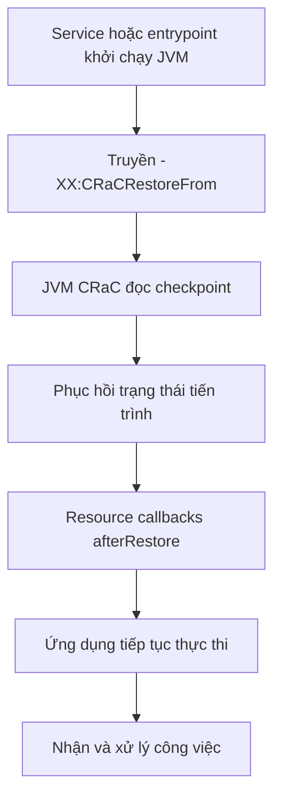

# Khôi phục ứng dụng bằng `-XX:CRaCRestoreFrom`

Trong Java CRaC (Coordinated Restore at Checkpoint), ứng dụng có thể được khôi phục từ một checkpoint đã tạo trước đó. Thay vì khởi động JVM rồi chạy lại toàn bộ mã khởi động của ứng dụng, một CRaC-enabled JVM đọc trạng thái tiến trình đã lưu và tiếp tục từ trạng thái đó. Tùy chọn JVM `-XX:CRaCRestoreFrom` chỉ định vị trí checkpoint mà JVM cần dùng để thực hiện quá trình khôi phục.

Đây là tùy chọn dành cho runtime có hỗ trợ CRaC. Thêm tùy chọn này vào một JDK thông thường không bổ sung khả năng restore. Ứng dụng cũng cần có checkpoint hợp lệ, được tạo bởi môi trường tương thích, và cần phục hồi các tài nguyên bên ngoài theo lifecycle CRaC trước khi tiếp tục phục vụ công việc.

## 1. `-XX:CRaCRestoreFrom` dùng để làm gì?

`-XX:CRaCRestoreFrom=<path>` yêu cầu JVM khởi tạo bằng cách khôi phục trạng thái từ checkpoint tại `<path>`. Đường dẫn trỏ tới thư mục checkpoint do một lần checkpoint CRaC trước đó tạo ra. Nó không phải đường dẫn tới file JAR hoặc file class của ứng dụng.

Cú pháp cơ bản:

```bash
java -XX:CRaCRestoreFrom=/absolute/path/to/checkpoint
```

Khi thực hiện restore thành công, JVM phục hồi tiến trình đã được chụp, bao gồm trạng thái heap và trạng thái thực thi được runtime lưu trong checkpoint. Ứng dụng tiếp tục từ thời điểm checkpoint theo mô hình CRaC; `main()` không được chạy lại như một lần khởi động ứng dụng mới. Các resource đã đăng ký được thông báo qua callback `afterRestore` để làm mới những tài nguyên cần thiết sau khi phục hồi.

Tùy chọn này thường được dùng trong lệnh khởi chạy tiến trình phục vụ từ checkpoint. Hãy dùng đúng cú pháp được runtime CRaC của dự án hỗ trợ. Ví dụ trên minh họa cách truyền đường dẫn tuyệt đối, không đại diện cho mọi chi tiết cấu hình của từng bản phân phối JDK.

## 2. Điều kiện cần trước khi restore

Trước khi chạy lệnh restore, cần bảo đảm các điều kiện sau:

1. **Có checkpoint hoàn chỉnh.** Thư mục được truyền cho `-XX:CRaCRestoreFrom` phải là checkpoint được tạo thành công bởi tiến trình Java và runtime CRaC tương ứng.
2. **Dùng runtime có hỗ trợ CRaC.** JVM phải nhận diện được tùy chọn `-XX:CRaCRestoreFrom`. JDK thông thường có thể báo tùy chọn không được nhận diện.
3. **Giữ tương thích môi trường.** Dùng phiên bản JDK/runtime, hệ điều hành, kiến trúc CPU, thư viện native và điều kiện kernel phù hợp với môi trường tạo checkpoint. Các yêu cầu cụ thể phụ thuộc bản phân phối CRaC và cách đóng gói ứng dụng.
4. **Đảm bảo quyền truy cập.** User chạy JVM restore phải đọc được checkpoint và các tệp liên quan. Nếu checkpoint nằm trên filesystem riêng, mount và quyền truy cập phải sẵn sàng trước khi khởi chạy.
5. **Chuẩn bị tài nguyên bên ngoài.** Kết nối mạng, database, socket, file descriptor, thread nền và các tài nguyên có vòng đời bên ngoài tiến trình cần được xử lý đúng trong callback CRaC.
6. **Giữ đúng phiên bản ứng dụng.** Nên restore bằng artifact, thư viện native và cấu hình triển khai tương thích với thời điểm checkpoint. Thay JAR hoặc thư viện sau khi tạo checkpoint có thể làm môi trường không còn nhất quán với trạng thái đã lưu.

Checkpoint lưu trạng thái tiến trình tại thời điểm tạo. Nó không tự cập nhật khi cấu hình, secret, chứng thư, DNS, endpoint hoặc dữ liệu bên ngoài thay đổi. Cần có quy trình xác định phần nào được giữ nguyên và phần nào phải làm mới sau restore.

## 3. Tạo checkpoint trước khi khôi phục

`-XX:CRaCRestoreFrom` chỉ sử dụng checkpoint đã tồn tại. Một chu trình thường có hai giai đoạn: khởi động ứng dụng trên CRaC-enabled JDK để chuẩn bị trạng thái và tạo checkpoint; sau đó chạy một JVM CRaC-enabled để restore từ thư mục đó.

Ví dụ, một ứng dụng đã được khởi động và warm-up có thể tạo checkpoint thông qua công cụ chẩn đoán của JDK nếu runtime cung cấp lệnh tương ứng:

```bash
jcmd <pid> JDK.checkpoint
```

Trong ví dụ, `<pid>` là PID của tiến trình Java cần checkpoint. Lệnh và quyền thực thi phụ thuộc runtime CRaC được cài đặt. Trước khi tạo checkpoint, ứng dụng phải hoàn tất các bước chuẩn bị và resource callbacks `beforeCheckpoint` cần đưa tài nguyên về trạng thái an toàn.

Sau khi checkpoint được tạo thành công, giữ nguyên cấu trúc thư mục checkpoint. Không xóa hoặc thay thế các tệp bên trong, không ghép dữ liệu từ nhiều checkpoint khác nhau và không dùng một thư mục tùy ý chỉ vì nó tồn tại.

## 4. Khởi chạy restore bằng tùy chọn JVM

Giả sử checkpoint nằm ở `/var/lib/myapp/checkpoints/ready`. Lệnh restore minh họa:

```bash
java -XX:CRaCRestoreFrom=/var/lib/myapp/checkpoints/ready
```

Tùy chọn phải được truyền cho JVM khi khởi chạy. Nó không phải system property Java nên không viết dưới dạng `-DCRaCRestoreFrom=...`, và không đặt sau tên class hoặc `-jar` như một tham số của ứng dụng.

Vì checkpoint chứa trạng thái tiến trình đã chạy, thao tác restore tiếp tục tiến trình đó thay vì yêu cầu launcher chạy lại một class `main` mới. Hãy tuân theo hướng dẫn khởi chạy restore của bản JDK đang dùng, đặc biệt nếu nền tảng cung cấp script hoặc wrapper riêng.

### 4.1. Dùng biến môi trường để quản lý đường dẫn

Trong script triển khai, có thể đưa đường dẫn checkpoint vào biến để tránh lặp lại literal:

```bash
CHECKPOINT_DIR=/var/lib/myapp/checkpoints/ready
exec java "-XX:CRaCRestoreFrom=${CHECKPOINT_DIR}"
```

`exec` thay thế tiến trình shell bằng JVM, giúp hệ thống quản lý tiến trình theo dõi JVM trực tiếp. Khi đường dẫn có khoảng trắng, hãy bảo đảm nó được truyền thành một đối số duy nhất bằng cơ chế quote phù hợp với shell.

Ví dụ PowerShell trên Windows về mặt truyền đối số:

```powershell
$checkpointDir = 'D:\crac\myapp\ready'
java "-XX:CRaCRestoreFrom=$checkpointDir"
```

Khả năng checkpoint/restore trên Windows phụ thuộc bản phân phối CRaC và nền tảng được hỗ trợ. Ví dụ PowerShell chỉ minh họa cách truyền một đối số có đường dẫn; hãy xác nhận runtime mục tiêu hỗ trợ nền tảng đó trước khi dùng trong triển khai.

### 4.2. Đưa tùy chọn vào cấu hình dịch vụ

Nếu ứng dụng được quản lý bởi service manager hoặc container entrypoint, lệnh khởi chạy restore phải truyền tùy chọn tới đúng JVM. Ví dụ một script entrypoint:

```bash
#!/usr/bin/env bash
set -eu

CHECKPOINT_DIR="${CHECKPOINT_DIR:-/var/lib/myapp/checkpoints/ready}"

if [ ! -d "$CHECKPOINT_DIR" ]; then
  echo "Checkpoint directory does not exist: $CHECKPOINT_DIR" >&2
  exit 1
fi

exec java "-XX:CRaCRestoreFrom=$CHECKPOINT_DIR"
```

Đây là ví dụ khung. Kiểm tra `-d` chỉ xác nhận đường dẫn là một thư mục; nó không chứng minh checkpoint hợp lệ. Việc xác thực checkpoint và kiểm tra tương thích vẫn cần được thực hiện trong quy trình build, đóng gói và triển khai.

Không đồng thời cấu hình entrypoint chạy một lần khởi động ứng dụng mới và một lệnh restore cho cùng tiến trình. Chọn đúng chế độ khởi chạy theo trạng thái triển khai: khởi tạo để tạo checkpoint hoặc restore từ checkpoint đã có.

## 5. Điều gì xảy ra trong quá trình restore?

Ở mức khái quát, quá trình khôi phục diễn ra như sau:



JVM cần đọc checkpoint và phục hồi trạng thái tiến trình trước khi ứng dụng có thể tiếp tục. Trong quá trình đó, các callback `afterRestore` được dùng để khôi phục những tài nguyên mà ứng dụng đã đăng ký. Khi các bước phục hồi hoàn tất, luồng thực thi tiếp tục tại trạng thái đã được lưu.

Do ứng dụng tiếp tục từ checkpoint, các đoạn mã startup trước thời điểm checkpoint không tự chạy lại. Những giá trị trong static field, object trên heap và trạng thái luồng được khôi phục theo snapshot. Điều này tiết kiệm công việc khởi động nhưng cũng có nghĩa dữ liệu cũ có thể tiếp tục tồn tại nếu ứng dụng không chủ động làm mới.

## 6. Dùng `afterRestore` để làm mới tài nguyên

Một ứng dụng có thể đăng ký `Resource` với CRaC để đóng tài nguyên trước checkpoint và tạo lại tài nguyên sau restore. Ví dụ dưới đây minh họa vòng đời của một client kết nối tới dịch vụ bên ngoài:

```java
import org.crac.Context;
import org.crac.Core;
import org.crac.Resource;

public final class ApiClientResource implements Resource {
    private ApiClient client;

    public ApiClientResource() {
        Core.getGlobalContext().register(this);
        this.client = ApiClient.connect();
    }

    @Override
    public void beforeCheckpoint(Context<? extends Resource> context)
            throws Exception {
        if (client != null) {
            client.close();
            client = null;
        }
    }

    @Override
    public void afterRestore(Context<? extends Resource> context)
            throws Exception {
        client = ApiClient.connect();
    }

    public ApiClient client() {
        if (client == null) {
            throw new IllegalStateException("API client is not ready");
        }
        return client;
    }
}
```

`ApiClient` là kiểu minh họa, cần thay bằng client thực tế của ứng dụng. Cần đồng bộ các luồng đang sử dụng client trước khi đóng, xử lý lỗi kết nối khi mở lại và không để request đi vào trước khi tài nguyên đã sẵn sàng.

Callback `afterRestore` cần hoàn tất công việc phục hồi cần thiết trước khi ứng dụng sử dụng tài nguyên tương ứng. Nếu một callback thất bại, ứng dụng phải xử lý như lỗi phục hồi nghiêm trọng theo chính sách của hệ thống; không nên âm thầm đánh dấu ứng dụng sẵn sàng trong khi kết nối bắt buộc vẫn chưa hoạt động.

Không nên dùng `afterRestore` để chạy lại toàn bộ logic khởi tạo ứng dụng. Những công việc thuần Java, an toàn và tốn thời gian có thể được chuẩn bị trước checkpoint. Callback sau restore tập trung vào tài nguyên và trạng thái cần làm mới.

## 7. Đường dẫn checkpoint và cấu hình triển khai

Đường dẫn truyền cho `-XX:CRaCRestoreFrom` cần trỏ tới đúng checkpoint mà tiến trình được tạo ra. Trong triển khai thực tế, nên cấu hình đường dẫn rõ ràng và kiểm soát quyền truy cập.

Các điểm cần lưu ý:

- **Ưu tiên đường dẫn tuyệt đối.** Đường dẫn tương đối phụ thuộc working directory của tiến trình. Service manager hoặc container có thể khởi chạy từ thư mục khác với lúc thử nghiệm.
- **Mount đúng dữ liệu.** Nếu checkpoint được lưu trên volume, volume phải được mount tại đúng đường dẫn trước khi JVM restore.
- **Không sửa checkpoint đang sử dụng.** Một tiến trình triển khai không nên đọc một thư mục đang được tiến trình khác ghi hoặc thay đổi.
- **Giữ quyền truy cập tối thiểu.** Checkpoint có thể chứa dữ liệu trong bộ nhớ như token, thông tin xác thực hoặc dữ liệu nghiệp vụ. Bảo vệ quyền đọc, quyền ghi và nơi lưu trữ theo mức nhạy cảm của ứng dụng.
- **Gắn checkpoint với phiên bản ứng dụng.** Ghi lại phiên bản JDK, artifact ứng dụng, cấu hình và thời điểm tạo checkpoint để tránh dùng nhầm snapshot.
- **Lập kế hoạch vòng đời.** Xác định khi nào checkpoint hết hạn, khi nào cần tạo lại và cách dọn dẹp checkpoint cũ sau khi không còn tiến trình nào phụ thuộc.

Không nên cập nhật một checkpoint bằng cách thay từng file bên trong. Khi cần thay đổi ứng dụng hoặc cấu hình nền tảng, hãy tạo checkpoint mới bằng quy trình đã kiểm thử và chuyển triển khai sang checkpoint mới theo cách có thể rollback.

## 8. Các lỗi thường gặp khi restore

### JVM báo không nhận diện tùy chọn

Nếu JVM báo `Unrecognized VM option 'CRaCRestoreFrom=...'`, runtime đang chạy có thể không hỗ trợ CRaC hoặc không hỗ trợ đúng tùy chọn này. Kiểm tra đường dẫn tới executable `java`, phiên bản JDK và tài liệu của bản phân phối CRaC. Đừng nhầm việc dependency `org.crac:crac` có mặt trên classpath với việc JVM hỗ trợ restore.

### Không tìm thấy checkpoint

Kiểm tra chính tả, đường dẫn tuyệt đối, working directory, mount volume và quyền đọc của user chạy JVM. Xác nhận thư mục được truyền chính là thư mục checkpoint đã tạo thành công, không phải thư mục cha hoặc một bản sao thiếu file.

### Checkpoint không tương thích runtime

Checkpoint phụ thuộc vào runtime và môi trường tạo ra nó. Khác biệt JDK, kiến trúc CPU, hệ điều hành, kernel hoặc thư viện native có thể khiến restore thất bại. Hãy tạo checkpoint trên nền tảng tương ứng với nơi sẽ restore và tuân theo ma trận hỗ trợ của runtime.

### Restore thành công nhưng ứng dụng không truy cập được dịch vụ

Tiến trình có thể được phục hồi trong khi socket hoặc connection pool đã cũ. Kiểm tra `beforeCheckpoint` đã đưa tài nguyên về trạng thái an toàn và `afterRestore` đã tạo lại chúng chưa. Kiểm tra thêm DNS, chứng thư, secret, endpoint và quyền truy cập tại thời điểm restore.

### Ứng dụng tiếp tục với cấu hình cũ

Checkpoint lưu trạng thái bộ nhớ tại thời điểm chụp. Nếu ứng dụng giữ cấu hình trong static field hoặc singleton, thay đổi file cấu hình sau checkpoint không tự cập nhật giá trị trong heap. Hãy xác định cấu hình nào cần đọc lại sau restore và triển khai cơ chế refresh có kiểm soát.

### Ứng dụng không trở nên sẵn sàng

Kiểm tra log restore và lỗi trong callback `afterRestore`. Có thể một resource không tạo lại được, một thread nền chưa khởi động lại hoặc một dependency bên ngoài chưa sẵn sàng. Readiness check nên chỉ thành công sau khi các thành phần bắt buộc phục hồi xong.

### Chạy nhầm chế độ khởi động mới

Nếu service vẫn chạy lệnh `java -jar app.jar` thông thường, tiến trình sẽ khởi động ứng dụng mới thay vì yêu cầu restore từ checkpoint. Kiểm tra cấu hình entrypoint, script và tham số JVM thực tế. Tùy chọn `-XX:CRaCRestoreFrom` phải được truyền cho đúng executable JVM.

## 9. Kiểm tra và quan sát sau restore

Không nên chỉ dựa vào việc JVM không báo lỗi để kết luận ứng dụng đã sẵn sàng. Cần kiểm tra cả trạng thái phục hồi và hành vi của ứng dụng.

Một quy trình kiểm tra có thể gồm:

1. Ghi nhận đường dẫn checkpoint, phiên bản JDK, phiên bản ứng dụng và cấu hình môi trường đã tạo checkpoint.
2. Khởi chạy restore bằng đúng CRaC-enabled runtime và `-XX:CRaCRestoreFrom` trỏ tới checkpoint đó.
3. Thu thập log JVM và log ứng dụng trong giai đoạn restore, đặc biệt là lỗi resource callbacks.
4. Xác nhận các kết nối bắt buộc, thread nền, cache cần refresh và các thành phần framework đã sẵn sàng.
5. Gửi request thử để xác nhận ứng dụng xử lý được công việc sau restore.
6. Đo thời gian từ lúc bắt đầu restore đến readiness và độ trễ request đầu tiên.
7. Lặp lại với checkpoint mới và kiểm tra nhiều chu kỳ để phát hiện tài nguyên bị rò rỉ hoặc trạng thái cũ tích lũy.

Nên phân biệt các mốc thời gian: thời gian JVM phục hồi snapshot, thời gian callback sau restore, thời gian ứng dụng đạt readiness và thời gian xử lý request đầu tiên. Các mốc này giúp xác định chi phí còn lại nằm ở runtime hay ở bước phục hồi tài nguyên của ứng dụng.

## 10. Quy trình triển khai restore có kiểm soát

Trong môi trường thực tế, có thể tổ chức quy trình theo các bước sau:

1. **Chuẩn bị checkpoint:** khởi chạy ứng dụng trên runtime phù hợp, tải cấu hình, khởi tạo thành phần và chạy warm-up cần thiết.
2. **Đưa tài nguyên về trạng thái an toàn:** dừng nhận công việc mới, đồng bộ luồng và thực hiện `beforeCheckpoint`.
3. **Tạo và lưu checkpoint:** dùng cơ chế checkpoint được runtime hỗ trợ, sau đó xác nhận thao tác hoàn tất và lưu metadata phiên bản.
4. **Kiểm thử restore:** chạy `java -XX:CRaCRestoreFrom=<checkpoint-path>` trong môi trường mục tiêu và xác nhận callback phục hồi thành công.
5. **Xác nhận readiness:** chỉ nhận traffic khi các tài nguyên bắt buộc đã được tạo lại và health check đạt yêu cầu.
6. **Chuyển traffic:** đưa tiến trình đã restore vào phục vụ theo cơ chế triển khai của hệ thống.
7. **Rollback khi cần:** giữ checkpoint hoặc phiên bản triển khai trước theo chính sách lưu trữ để có thể quay lại trạng thái đã kiểm chứng.

Không nên xóa checkpoint cũ ngay khi bắt đầu restore nếu quy trình rollback vẫn cần đến nó. Việc dọn dẹp cần dựa trên trạng thái triển khai và chính sách lưu trữ, không chỉ dựa vào tuổi của thư mục.

## 11. Checklist trước khi chạy `-XX:CRaCRestoreFrom`

- [ ] Đã xác nhận executable `java` là CRaC-enabled runtime phù hợp.
- [ ] Đã tạo checkpoint thành công bằng môi trường tương thích.
- [ ] Đường dẫn checkpoint trỏ đúng thư mục và dùng đường dẫn tuyệt đối trong môi trường triển khai.
- [ ] User chạy JVM có quyền đọc checkpoint và các volume cần thiết.
- [ ] Phiên bản JDK, artifact, thư viện native, hệ điều hành và kiến trúc phù hợp.
- [ ] Các resource đã đăng ký callback để xử lý trước checkpoint và sau restore.
- [ ] `afterRestore` tạo lại các kết nối và trạng thái phụ thuộc môi trường.
- [ ] Readiness check chờ các thành phần bắt buộc phục hồi xong.
- [ ] Log, thời gian restore và request đầu tiên được ghi nhận.
- [ ] Có chính sách giữ, thay thế và dọn dẹp checkpoint.

`-XX:CRaCRestoreFrom` là điểm vào để CRaC-enabled JVM phục hồi một tiến trình từ checkpoint đã lưu. Để dùng đúng, cần truyền đường dẫn checkpoint cho JVM khi khởi chạy, giữ runtime và môi trường tương thích, đồng thời triển khai callback `afterRestore` để làm mới tài nguyên. Sau khi restore, hãy xác nhận readiness và kiểm tra request thực tế trước khi đưa tiến trình trở lại phục vụ.
