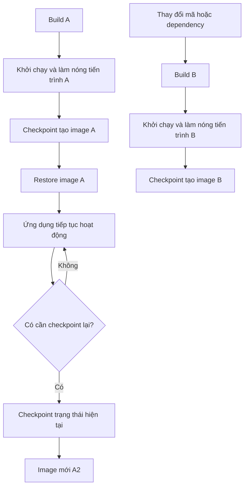

# Giới hạn của checkpoint lặp lại theo bản dựng và cơ chế tạo ảnh

Trong CRaC, checkpoint image được tạo từ trạng thái của một tiến trình Java đang chạy. Vì vậy, image gắn với chương trình đã được nạp vào JVM, phiên bản JDK, các dependency, cấu hình và môi trường hệ điều hành tại thời điểm checkpoint. Khi mã nguồn hoặc runtime thay đổi, image cũ không tự cập nhật theo bản dựng mới.

Điều này ảnh hưởng trực tiếp đến cách tổ chức chu kỳ checkpoint–restore. Nhóm phát triển cần xác định khi nào phải tạo image mới, một image có thể được restore bao nhiêu lần, điều gì xảy ra khi checkpoint lại từ một tiến trình đã restore và cách quản lý các image được tạo qua nhiều lần build. Cần hiểu rõ cơ chế này để tránh dùng nhầm image cũ, trộn trạng thái giữa các bản phát hành hoặc tạo ra nhiều instance có cùng dữ liệu định danh.

## 1. Checkpoint image là snapshot của tiến trình

Checkpoint image mô tả trạng thái của một tiến trình tại một thời điểm. Tùy cách triển khai, image có thể gồm nhiều tệp và metadata, trong đó có trạng thái bộ nhớ, thread, runtime JVM và những tài nguyên hệ điều hành được cơ chế checkpoint hỗ trợ.

Image không đơn thuần là bản sao của file JAR. Khi JVM đã khởi chạy ứng dụng, nó có thể đã nạp class, tạo object, khởi tạo framework, tạo thread, mở file và thiết lập các cấu trúc runtime. Một phần trạng thái đó nằm trong image. Restore tái tạo tiến trình từ snapshot, vì vậy các class và object đã tồn tại tại thời điểm checkpoint tiếp tục thuộc về trạng thái được khôi phục.

Ví dụ, một ứng dụng Spring Boot đã khởi tạo context và nạp `OrderService`. Sau đó nhóm phát triển sửa mã `OrderService`, build lại JAR và đặt JAR mới vào cùng đường dẫn. Checkpoint image được tạo trước khi sửa mã vẫn chứa trạng thái tiến trình của bản cũ. Thay file JAR trên filesystem không làm thay đổi class đã được nạp vào snapshot, cũng không biến image cũ thành image của bản build mới.

Do đó cần phân biệt ba artifact:

| Artifact | Nội dung và vai trò |
|---|---|
| Application build | JAR, dependency và tài nguyên ứng dụng được tạo từ một revision mã nguồn |
| Runtime/container image | Filesystem, JDK, thư viện hệ thống và cấu hình cần để chạy ứng dụng |
| CRaC checkpoint image | Trạng thái tiến trình đã chạy, được tạo từ application build trong một runtime và môi trường cụ thể |

Ba artifact có liên quan nhưng không thể thay thế lẫn nhau. Một container image có thể chứa JDK và JAR, còn checkpoint image lưu trạng thái của tiến trình được khởi chạy từ môi trường đó.

## 2. Quan hệ giữa bản dựng và checkpoint image

Một checkpoint image phải được gắn với danh tính của bản dựng đã tạo ra nó. Danh tính này nên bao gồm nhiều thông tin hơn số phiên bản hiển thị của ứng dụng:

- Git commit hoặc mã revision của source.
- Phiên bản ứng dụng và checksum của JAR/artifact đầu vào.
- Nhà cung cấp, phiên bản đầy đủ và build của CRaC-enabled JDK.
- Phiên bản dependency đã phân giải, bao gồm dependency lock.
- Digest của container/runtime image nếu dùng container.
- Hệ điều hành, kiến trúc CPU và các điều kiện tương thích liên quan đến kernel/CRIU.
- Profile cấu hình được dùng khi khởi chạy và làm nóng ứng dụng.
- Thời điểm tạo image và kết quả kiểm thử restore.

Không phải mọi giá trị đều cần được đưa vào tên thư mục. Tuy nhiên, chúng cần được lưu trong metadata đi kèm để có thể xác định image thuộc build và môi trường nào.

### 2.1. Khi nào phải tạo image mới?

Thông thường cần tạo lại checkpoint image khi có thay đổi làm thay đổi trạng thái tiến trình hoặc điều kiện restore, chẳng hạn:

| Thay đổi | Vì sao cần đánh giá hoặc tạo lại image |
|---|---|
| Mã nguồn ứng dụng hoặc JAR | Snapshot cũ vẫn chứa trạng thái thực thi của mã đã nạp trước đó |
| Dependency hoặc framework | Class, cấu trúc object và mã thư viện trong snapshot có thể không còn khớp với build mới |
| JDK hoặc bản build JVM | Trạng thái runtime và định dạng nội bộ có thể phụ thuộc phiên bản JDK |
| Thư viện native/JNI/agent | Runtime có thể phụ thuộc binary hoặc trạng thái native đã thay đổi |
| Cấu hình được đọc lúc khởi động | Giá trị cấu hình có thể đã nằm trong object của tiến trình được chụp |
| Profile hoặc dữ liệu warm-up | Image mới có thể cần trạng thái cache và dữ liệu chuẩn bị khác |
| Hệ điều hành, kiến trúc hoặc môi trường restore | Các điều kiện tương thích của tiến trình có thể thay đổi |

Một thay đổi cấu hình bên ngoài không nhất thiết luôn yêu cầu tạo image mới. Nếu ứng dụng đọc cấu hình đó sau restore và không lưu giá trị cũ trong snapshot, có thể xử lý bằng cấu hình runtime. Nhưng nếu cấu hình đã được đọc vào object, dùng để tạo bean, chọn endpoint hoặc thiết lập tài nguyên trước checkpoint, image có thể vẫn giữ giá trị cũ. Hãy xác định thời điểm đọc cấu hình và kiểm tra kết quả thực tế.

### 2.2. Image cũ không phải cách cập nhật ứng dụng

Restore không chạy lại toàn bộ quá trình khởi động như một JVM mới. Nó tiếp tục từ trạng thái đã chụp. Vì vậy, không thể dùng quy trình sau như một cách triển khai phiên bản mới:

1. Tạo checkpoint image từ build A.
2. Thay JAR bằng build B.
3. Restore image A và kỳ vọng ứng dụng chạy mã B.

Image vẫn đại diện cho trạng thái đã được tạo từ build A. Cách đúng là build B, khởi chạy build B bằng bộ runtime phù hợp, chuẩn bị trạng thái cần thiết rồi tạo checkpoint image B. Sau khi image B restore thành công, mới đưa nó vào danh mục artifact có thể triển khai.

## 3. Một lần checkpoint tạo ra một snapshot mới

Mỗi lần checkpoint là một lần chụp trạng thái tiến trình tại thời điểm yêu cầu. Snapshot mới phản ánh trạng thái thực tế lúc đó, bao gồm những thay đổi đã xảy ra kể từ lần restore hoặc khởi động trước.

Không nên mặc định checkpoint lặp lại sẽ chỉ ghi phần thay đổi vào image cũ, tự hợp nhất nhiều snapshot hoặc cập nhật image đã phát hành. Cơ chế CRaC/JDK và công cụ hệ điều hành có thể có cách lưu trữ nội bộ riêng, nhưng ở cấp quy trình ứng dụng, hãy xem mỗi lần tạo image là một lần sinh artifact mới với thư mục đích riêng. Chỉ dùng cơ chế incremental/pre-dump nếu đúng triển khai đang sử dụng công bố hỗ trợ và đã được kiểm thử riêng.

Ví dụ một chu kỳ có thể diễn ra như sau:



Image A2 là snapshot mới từ trạng thái tiến trình sau khi restore và tiếp tục hoạt động. Nó không phải image A được cập nhật tại chỗ. Image B lại được tạo từ một tiến trình chạy build B.

### 3.1. Checkpoint lại sau restore

Trong chu kỳ được hỗ trợ, một tiến trình đã restore có thể được chuẩn bị và checkpoint tiếp để tạo snapshot tiếp theo. Tuy nhiên, cách JVM xử lý yêu cầu checkpoint, trạng thái của tiến trình gốc sau khi chụp và cách khởi chạy restore phụ thuộc bản JDK/CRaC cùng công cụ nền tảng. Không nên giả định mọi bản phân phối có cùng hành vi hoặc cùng hỗ trợ mọi kiểu checkpoint lặp lại.

Hãy đọc hướng dẫn đúng phiên bản JDK và thử nghiệm chu kỳ đầy đủ: khởi chạy, checkpoint, restore, tiếp tục hoạt động, checkpoint lần nữa rồi restore image mới. Kiểm tra callback, tài nguyên và readiness ở cả hai chu kỳ. Nếu nhà cung cấp giới hạn một số cách dùng hoặc yêu cầu khởi tạo tiến trình mới ở một giai đoạn, cần tuân thủ giới hạn đó.

### 3.2. Snapshot sau restore có thể chứa trạng thái khác

Giả sử image A được tạo sau khi ứng dụng đã khởi tạo Spring context và làm nóng cache. Sau restore, ứng dụng xử lý request, cập nhật bộ đếm, thay đổi cache và tạo một số object mới. Nếu checkpoint lại, image A2 sẽ phản ánh trạng thái sau những hoạt động đó.

Điều này có thể hữu ích khi cần bảo tồn một trạng thái đã được chuẩn bị thêm. Nhưng nếu mục tiêu là tạo image nền dùng chung cho nhiều instance, checkpoint sau khi xử lý dữ liệu thật có thể đưa thông tin riêng của một instance hoặc một người dùng vào image. Vì vậy, cần chọn ranh giới checkpoint có chủ đích.

## 4. Restore nhiều lần từ cùng một image

Một checkpoint image có thể được dùng làm nguồn để khởi tạo các tiến trình restore theo khả năng của nền tảng và quy trình triển khai. Khi nhiều instance được restore từ cùng image, hãy hình dung mỗi instance bắt đầu từ cùng một snapshot ban đầu rồi tiếp tục độc lập.

Điều đó không có nghĩa các instance chia sẻ một heap Java. Mỗi tiến trình restore có trạng thái bộ nhớ riêng được tái tạo từ image. Tuy nhiên, chúng có thể mang theo cùng giá trị đã tồn tại trong snapshot:

- Cùng UUID hoặc node identifier đã được tạo trước checkpoint.
- Cùng tên consumer hoặc subscription.
- Cùng trạng thái bộ đếm trong bộ nhớ.
- Cùng dữ liệu cache đã được nạp trước đó.
- Cùng token, session hoặc lease đã được lưu trong heap.
- Cùng trạng thái nghiệp vụ đang chờ xử lý.

Nếu các giá trị này cần duy nhất theo instance hoặc có thời hạn, ứng dụng phải tạo mới hoặc xác thực lại sau restore. Nếu không, nhiều instance có thể đăng ký cùng một danh tính, dùng chung một lease đã hết hạn hoặc thực hiện lặp một tác dụng phụ.

### 4.1. Restore nhiều lần không nhân bản trạng thái bên ngoài một cách an toàn

Checkpoint image chỉ mô tả trạng thái tiến trình. Nó không tạo ra một transaction snapshot đồng bộ cho database, message broker hoặc dịch vụ từ xa. Nếu image chứa một object thể hiện rằng message đang chờ xác nhận, việc restore nhiều lần không khiến broker tự động nhân bản message theo đúng ý định nghiệp vụ.

Ví dụ, tiến trình đã gửi yêu cầu thanh toán và lưu một cờ `paymentSubmitted = true` trong heap trước khi checkpoint. Nếu trạng thái bên ngoài thay đổi trong lúc image được lưu, nhiều instance restore có thể cùng tiếp tục từ cờ đó. Ứng dụng vẫn cần kiểm tra trạng thái giao dịch bên ngoài và dùng idempotency key để tránh gửi thanh toán lặp.

### 4.2. Không dùng một image làm cơ chế đồng bộ các replica

Mỗi instance sau restore cần quản lý trạng thái riêng: định danh, kết nối, subscription, lịch chạy và readiness. Việc dùng cùng image không cung cấp khóa phân tán, leader election, điều phối lịch chạy hay đồng bộ dữ liệu giữa các replica. Những yêu cầu đó vẫn cần cơ chế ở tầng ứng dụng hoặc hạ tầng.

## 5. Callback và tài nguyên qua nhiều chu kỳ

CRaC Resource cho phép ứng dụng chuẩn bị trước checkpoint và phục hồi sau restore. Khi quy trình checkpoint–restore lặp lại, logic resource cũng có thể được gọi qua nhiều chu kỳ. Vì vậy, callback phải được thiết kế theo vòng đời thực tế, không giả định chúng chỉ chạy đúng một lần trong suốt đời ứng dụng.

Một số nguyên tắc quan trọng:

- `beforeCheckpoint` cần đưa tài nguyên về trạng thái an toàn cho mỗi lần checkpoint.
- `afterRestore` cần tạo lại hoặc xác thực tài nguyên cho mỗi lần restore.
- Việc đóng tài nguyên nên an toàn khi trạng thái đã được đóng hoặc chưa khởi tạo.
- Việc tạo tài nguyên cần tránh tạo trùng pool, thread, listener hoặc subscription.
- Trạng thái cờ nội bộ phải phản ánh đúng việc tài nguyên hiện đang mở, đóng hay đang phục hồi.
- Nếu callback thất bại, ứng dụng không nên công bố image chưa được xác nhận hoặc đánh dấu instance sẵn sàng khi tài nguyên bắt buộc chưa hoạt động.

Ví dụ minh họa một resource quản lý kết nối:

```java
import org.crac.Context;
import org.crac.Core;
import org.crac.Resource;

import javax.sql.DataSource;
import java.sql.Connection;
import java.sql.SQLException;

public final class DatabaseResource implements Resource {

    private final DataSource dataSource;
    private Connection connection;

    public DatabaseResource(DataSource dataSource) {
        this.dataSource = dataSource;
    }

    @Override
    public synchronized void beforeCheckpoint(
            Context<? extends Resource> context) throws SQLException {
        if (connection != null) {
            connection.close();
            connection = null;
        }
    }

    @Override
    public synchronized void afterRestore(
            Context<? extends Resource> context) throws SQLException {
        if (connection == null || connection.isClosed()) {
            connection = dataSource.getConnection();
        }
    }

    public synchronized Connection getConnection() {
        return connection;
    }
}
```

Resource cần được đăng ký một lần ở nơi quản lý vòng đời phù hợp:

```java
DatabaseResource resource = new DatabaseResource(dataSource);
Core.getGlobalContext().register(resource);
```

Ví dụ chỉ minh họa ý tưởng idempotent cho một kết nối đơn. Với connection pool thực tế, phải dùng API đóng/mở pool của thư viện và bảo đảm các thread nội bộ được xử lý đúng. Đồng thời, ứng dụng cần quản lý truy cập đồng thời đến resource; ví dụ trên không phải một connection manager hoàn chỉnh để dùng trực tiếp trong production.

Không đăng ký lại cùng resource mỗi lần callback chạy. Nếu sau restore ứng dụng khởi tạo thêm một resource mới mà resource cũ vẫn được đăng ký, callback có thể bị gọi trên nhiều đối tượng sở hữu cùng một tài nguyên. Cần đặt đăng ký ở đúng một điểm trong vòng đời và kiểm tra cách JDK đã chọn duy trì context qua restore.

## 6. Giới hạn của cơ chế tạo ảnh

### 6.1. Image là một tập artifact phụ thuộc triển khai

Checkpoint image có thể gồm nhiều file, không nhất thiết là một file duy nhất có thể đổi tên hoặc sao chép tùy ý. Cấu trúc, metadata và cách đọc image phụ thuộc JDK, CRIU và nền tảng. Không chỉnh sửa thủ công các file bên trong, không bỏ một số file vì nghĩ chúng là cache và không tự ghép nội dung từ hai lần checkpoint.

Hãy dùng đúng đường dẫn và cơ chế restore do bản JDK/CRaC yêu cầu. Nếu cần đóng gói hoặc vận chuyển image, giữ nguyên cấu trúc artifact và metadata theo hướng dẫn của triển khai đó.

### 6.2. Không giả định image được cập nhật theo kiểu incremental

Ở cấp quy trình build, hãy tạo image mới vào một thư mục staging riêng. Đừng ghi đè trực tiếp image đang được production sử dụng, cũng đừng trộn file còn sót lại từ một lần checkpoint trước với output của lần mới.

Một quy trình an toàn là:

1. Tạo thư mục staging mang mã build và lần tạo image.
2. Đảm bảo đường dẫn output không chứa artifact cũ.
3. Chạy ứng dụng và thực hiện checkpoint theo hướng dẫn của JDK.
4. Kiểm tra đầy đủ các file được tạo và lưu metadata tương ứng.
5. Restore thử từ đúng thư mục staging.
6. Chỉ sau khi kiểm tra thành công mới công bố artifact dưới mã phiên bản bất biến.
7. Dọn staging thất bại theo chính sách lưu trữ, không xóa image còn được deployment tham chiếu.

Không coi thao tác copy đè một thư mục image đang dùng là một lần cập nhật an toàn. Nếu cần chuyển phiên bản, hãy tạo image mới, xác minh, rồi cập nhật tham chiếu triển khai sang artifact mới theo một thao tác có kiểm soát.

### 6.3. Không phải môi trường nào cũng restore được image

Image phụ thuộc vào runtime và môi trường tạo ra nó. Các yếu tố như phiên bản JDK, kiến trúc CPU, kernel, thư viện native, filesystem, đường dẫn mount, quyền tiến trình, namespace và cấu hình mạng có thể ảnh hưởng đến restore.

Pin digest container image chỉ cố định nội dung filesystem của container. Kernel và nhiều điều kiện checkpoint/restore vẫn thuộc host. Vì vậy, phải kiểm tra image trên nền tảng đích hoặc trên môi trường có các điều kiện tương thích được xác nhận.

### 6.4. Image có thể lớn và tốn thời gian tạo

Image phản ánh trạng thái bộ nhớ và tài nguyên của tiến trình. Ứng dụng có heap lớn, nhiều thread, cache lớn hoặc nhiều trang bộ nhớ đã được chạm tới có thể tạo image lớn. Việc ghi image có thể tiêu thụ CPU, I/O và dung lượng lưu trữ; restore cũng cần thời gian để đọc và tái tạo trạng thái.

Vì thế, checkpoint lặp lại liên tục có thể tạo ra nhiều artifact, tăng chi phí lưu trữ và làm phức tạp việc quản lý phiên bản. Chỉ tạo checkpoint ở những thời điểm có giá trị rõ ràng, đo dung lượng và thời gian thực tế, rồi đặt chính sách lưu giữ image cũ.

### 6.5. Image có thể chứa dữ liệu nhạy cảm

Heap có thể chứa token, thông tin xác thực, dữ liệu người dùng, nội dung request, dữ liệu cache và object nghiệp vụ. Khi checkpoint, các dữ liệu đó có thể xuất hiện trong image. Image cần được bảo vệ như dữ liệu nhạy cảm: giới hạn quyền truy cập, mã hóa nơi lưu trữ và truyền tải theo chính sách, đặt thời hạn lưu giữ và xóa artifact không còn cần thiết.

Không tạo image dùng chung sau khi ứng dụng đã xử lý dữ liệu cá nhân hoặc giao dịch thật nếu trạng thái đó không được phép xuất hiện trong image. Hãy tạo image nền từ dữ liệu kiểm thử hoặc trạng thái khởi tạo đã kiểm soát.

## 7. Quy trình tạo và phát hành image theo từng build

Một quy trình có thể tái lập nên coi checkpoint image là output gắn với build, không phải artifact độc lập có thể dùng mãi. Có thể tổ chức pipeline theo các giai đoạn:

**Giai đoạn 1 — Build ứng dụng.** Checkout đúng revision, dùng Gradle Wrapper, JDK và dependency lock đã chốt. Tạo JAR và checksum. Lưu mã commit, version ứng dụng và thông tin dependency.

**Giai đoạn 2 — Chuẩn bị runtime.** Chạy JAR bằng CRaC-enabled JDK trong môi trường Linux và kiến trúc đã chọn. Xác nhận phiên bản JDK, CRIU và cấu hình hệ thống khớp ma trận đã kiểm chứng.

**Giai đoạn 3 — Khởi tạo và làm nóng.** Để ứng dụng tạo các thành phần cần thiết, nạp metadata và thực hiện những bước warm-up có thể tái sử dụng. Dùng cấu hình không chứa dữ liệu riêng của instance hoặc người dùng.

**Giai đoạn 4 — Chuẩn bị resource.** Dừng nhận công việc mới nếu cần, xử lý request đang chạy, hoàn tất transaction, đóng hoặc tạm dừng tài nguyên theo callback. Không tạo checkpoint giữa một nghiệp vụ chưa đạt ranh giới an toàn.

**Giai đoạn 5 — Tạo checkpoint.** Yêu cầu checkpoint và ghi output vào thư mục staging dành riêng cho build. Cách gọi cụ thể phụ thuộc bản JDK; nhiều bản CRaC hỗ trợ cấu hình đường dẫn checkpoint và lệnh chẩn đoán `JDK.checkpoint` qua `jcmd`.

**Giai đoạn 6 — Restore thử.** Khởi tạo tiến trình từ image theo hướng dẫn của JDK. Kiểm tra callback `afterRestore`, kết nối bắt buộc, health check và readiness. Không chỉ kiểm tra rằng lệnh restore kết thúc mà cần xác nhận ứng dụng thật sự phục vụ được.

**Giai đoạn 7 — Công bố artifact.** Gắn image với build ID, checksum JAR, phiên bản JDK, dependency và môi trường. Công bố image theo một định danh bất biến để deployment có thể tham chiếu chính xác.

**Giai đoạn 8 — Lưu giữ và dọn dẹp.** Giữ image của các bản phát hành còn được sử dụng hoặc cần rollback. Xóa staging lỗi và image hết thời hạn theo chính sách, sau khi xác nhận không có deployment nào còn tham chiếu.

Ví dụ về hình dạng một quy trình lệnh thường gặp trên JDK CRaC hỗ trợ các tùy chọn tương ứng:

```bash
# Khởi chạy ứng dụng và chỉ định thư mục đích checkpoint
java -XX:CRaCCheckpointTo=build/crac-image -jar build/libs/application.jar

# Yêu cầu JVM checkpoint (PID cần được lấy từ tiến trình đang chạy)
jcmd <pid> JDK.checkpoint

# Khởi chạy tiến trình từ checkpoint image
java -XX:CRaCRestoreFrom=build/crac-image
```

Đây là ví dụ về luồng thao tác, không phải lệnh dùng chung cho mọi bản JDK. Tên tùy chọn, điều kiện kích hoạt, cách tiến trình gốc kết thúc hoặc tiếp tục và cách gọi restore phải được xác nhận theo tài liệu của bản phân phối CRaC đang dùng. Đường dẫn `build/crac-image` trong ví dụ cũng nên được thay bằng thư mục staging mới cho từng build/lần tạo image.

## 8. Metadata để tránh dùng nhầm image

Nên lưu một manifest cùng image để công cụ triển khai có thể xác định artifact nào phù hợp. Ví dụ:

```yaml
checkpointImage:
  imageId: "orders-api-1.8.0-build-245"
  application:
    version: "1.8.0"
    gitCommit: "<commit-sha>"
    artifactSha256: "<jar-sha256>"
  jdk:
    vendor: "<vendor>"
    version: "<full-version-and-build>"
  dependencies:
    lockfileSha256: "<lockfile-sha256>"
  platform:
    os: "<distribution-and-version>"
    architecture: "amd64"
    criuVersion: "<tested-version>"
    containerDigest: "sha256:<digest>"
  checkpoint:
    createdAt: "<timestamp>"
    profile: "warmup-default"
    restoreValidation: "PASS"
```

Các placeholder phải được thay bằng giá trị thực tế. Manifest nên được tạo từ thông tin build/CI thay vì nhập tay những giá trị có thể lấy tự động. Nếu một trường chưa được xác định, ghi trạng thái chưa xác định rõ ràng; không gán một phiên bản suy đoán.

Trước khi restore, deployment có thể so sánh yêu cầu runtime với metadata image. Nếu image được tạo từ build khác, JDK khác hoặc kiến trúc không phù hợp, dừng rollout và yêu cầu tạo/chọn artifact đúng. Kiểm tra metadata không thay thế smoke test restore, nhưng giúp loại bỏ nhiều trường hợp dùng nhầm từ sớm.

## 9. Chiến lược đặt tên và lưu trữ image

Mỗi image nên có định danh duy nhất và bất biến. Có thể kết hợp tên ứng dụng, version, commit ngắn, kiến trúc và số lần tạo:

```text
orders-api/
  1.8.0/
    8f31c2a-amd64-build245/
      checkpoint-image/...
      manifest.yml
      checksums.txt
    8f31c2a-amd64-build246/
      checkpoint-image/...
      manifest.yml
      checksums.txt
```

Không dùng một thư mục `latest` làm nơi ghi trực tiếp checkpoint. `latest` nếu có chỉ nên là tham chiếu đến một image đã được tạo, kiểm tra và công bố thành công. Như vậy, một lần tạo image thất bại không làm hỏng artifact đang được deployment sử dụng.

Chính sách lưu trữ cần cân bằng giữa khả năng rollback và chi phí dung lượng. Có thể giữ image đang production, image của bản phát hành trước và một số image đã được kiểm thử. Trước khi xóa, kiểm tra manifest hoặc metadata deployment để chắc chắn không còn workload nào tham chiếu image đó.

## 10. Kiểm thử giới hạn của checkpoint lặp lại

Một bài kiểm thử chu kỳ cần chứng minh nhiều hơn khả năng tạo image lần đầu. Có thể dùng một ứng dụng thử nghiệm ghi nhận số lần callback và một giá trị trạng thái trong bộ nhớ:

1. Khởi chạy build A và ghi nhận mã build cùng trạng thái ban đầu.
2. Tạo checkpoint image A.
3. Restore image A, xác nhận mã build vẫn là A và callback `afterRestore` được gọi.
4. Thực hiện một thay đổi trạng thái có kiểm soát trong tiến trình đã restore.
5. Nếu JDK và quy trình triển khai hỗ trợ checkpoint tiếp, tạo image A2 vào thư mục mới.
6. Restore image A2 và xác nhận nó chứa trạng thái tại lần checkpoint thứ hai.
7. Tạo build B với thay đổi mã có thể quan sát được, sau đó tạo image B từ tiến trình B mới.
8. Xác nhận image B chạy build B và image A vẫn được nhận diện là artifact của build A.
9. Thử restore cùng image nền thành hai instance riêng, kiểm tra instance ID, kết nối và subscription không bị dùng chung ngoài ý muốn.
10. Thử trường hợp callback hoặc restore thất bại; xác nhận image chưa được công bố và readiness không chuyển thành thành công.

Nên thu thập các chỉ số:

| Chỉ số | Mục đích |
|---|---|
| Thời gian khởi động đến checkpoint | Đo chi phí chuẩn bị snapshot |
| Thời gian tạo image | Đánh giá chi phí checkpoint và I/O |
| Kích thước image | Ước lượng dung lượng lưu trữ và truyền tải |
| Thời gian restore | Đo thời gian tái tạo tiến trình |
| Restore đến readiness | Đo thời gian thực tế trước khi nhận traffic |
| Tỷ lệ checkpoint/restore thành công | Theo dõi độ ổn định của bộ môi trường |
| Số image theo build và dung lượng tồn | Theo dõi chi phí lưu giữ artifact |

Không so sánh chỉ thời gian restore. Nếu callback phải tạo lại connection pool, nạp cấu hình hoặc làm mới token, thời gian từ restore đến readiness mới phản ánh đúng lúc ứng dụng có thể phục vụ.

## 11. Những lỗi thường gặp

**Dùng image cũ sau khi build lại ứng dụng.** Snapshot vẫn chứa trạng thái của tiến trình đã nạp mã cũ. Hãy tạo image mới từ tiến trình chạy build mới.

**Checkpoint nhiều lần vào cùng một thư mục.** File cũ có thể còn sót hoặc cấu trúc output có thể không được ghi đè theo cách mong đợi. Hãy dùng staging directory mới cho từng lần tạo và chỉ công bố sau khi restore thử.

**Cho rằng checkpoint lần hai là incremental.** Không mặc định cơ chế lưu ảnh sẽ chỉ ghi phần thay đổi. Chỉ dựa vào incremental/pre-dump khi triển khai cụ thể hỗ trợ và đã kiểm thử.

**Restore cùng image cho nhiều replica mà giữ nguyên định danh.** Các tiến trình có thể khởi đầu với cùng UUID, token, lease hoặc subscription. Hãy tạo mới hay xác thực lại những trạng thái gắn với instance sau restore.

**Checkpoint sau khi đã xử lý dữ liệu thật.** Image có thể chứa dữ liệu nghiệp vụ, thông tin người dùng hoặc tác dụng phụ chưa được xác nhận. Chọn ranh giới checkpoint và dữ liệu warm-up được kiểm soát.

**Callback chỉ chạy đúng một lần theo giả định của lập trình viên.** Một chu kỳ mới có thể yêu cầu chuẩn bị và phục hồi tài nguyên lần nữa. Thiết kế callback an toàn khi gọi lặp và tránh đăng ký resource trùng.

**Xem image là backup database.** Image không lưu đồng bộ trạng thái của hệ thống bên ngoài. Dùng cơ chế transaction, backup và idempotency thích hợp cho dữ liệu nghiệp vụ.

**Công bố image trước khi restore thử.** Image được tạo thành công chưa chắc restore được trên môi trường đích. Chỉ đưa artifact vào danh mục phát hành sau khi xác nhận restore và readiness.

## 12. Tự kiểm tra mức độ hiểu

1. **Vì sao build lại JAR không cập nhật checkpoint image cũ?** Vì image chứa trạng thái tiến trình đã nạp mã và object tại thời điểm checkpoint; thay file trên filesystem không thay đổi snapshot đó.
2. **Checkpoint lặp lại có mặc nhiên cập nhật image cũ theo kiểu incremental không?** Không. Hãy xem mỗi lần tạo là artifact mới trừ khi triển khai cụ thể công bố hỗ trợ cơ chế incremental và đã được kiểm chứng.
3. **Image A2 được tạo sau khi restore image A có gì khác?** A2 phản ánh trạng thái tiến trình tại lần checkpoint mới, có thể gồm các thay đổi xảy ra sau restore A.
4. **Vì sao restore cùng image cho nhiều replica cần xử lý định danh?** Mỗi tiến trình có thể khởi đầu từ cùng giá trị đã lưu trong snapshot, dẫn đến trùng UUID, lease hoặc subscription.
5. **Có thể phát hành image ngay khi checkpoint command trả về thành công không?** Cần restore thử trên môi trường tương thích và kiểm tra callback cùng readiness trước khi công bố.
6. **Vì sao callback phải chịu được nhiều chu kỳ?** Resource có thể cần chuẩn bị trước mỗi checkpoint và phục hồi sau mỗi restore; giả định chỉ gọi một lần dễ gây rò rỉ hoặc tạo trùng tài nguyên.

## Kết luận

Checkpoint image là snapshot của một tiến trình đã chạy, gắn với bản dựng và môi trường đã tạo ra nó. Khi mã, dependency, JDK hoặc điều kiện restore thay đổi, cần đánh giá tính hợp lệ và thường phải tạo image mới từ tiến trình chạy bản dựng mới. Checkpoint tiếp theo tạo một snapshot mới của trạng thái hiện tại; không mặc định đó là thao tác cập nhật hoặc hợp nhất image cũ.

Để quản lý chu kỳ checkpoint–restore, hãy tạo artifact trong thư mục riêng theo build, lưu manifest nhận diện phiên bản, restore thử trước khi phát hành, thiết kế callback chịu được nhiều chu kỳ và làm mới dữ liệu định danh/tài nguyên theo instance. Những nguyên tắc này giúp tránh dùng nhầm image, kiểm soát chi phí lưu trữ và triển khai nhiều tiến trình từ cùng một snapshot an toàn hơn.
