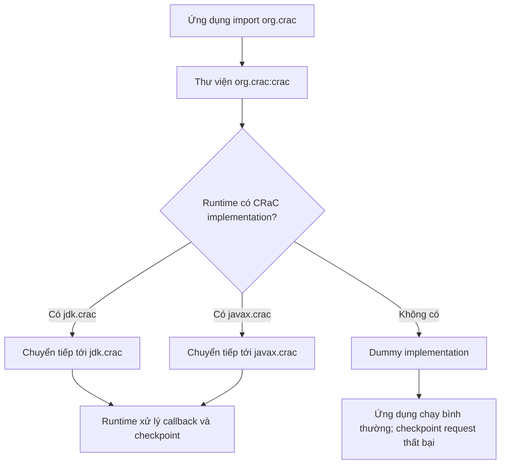

# Quan hệ giữa API tương thích `org.crac` và API `jdk.crac`

CRaC cần một API để ứng dụng thông báo những việc phải làm trước checkpoint và sau restore. Trong hệ sinh thái CRaC hiện có hai package thường gặp là `jdk.crac` và `org.crac`. Chúng mô tả cùng một mô hình phối hợp vòng đời, nhưng được cung cấp theo hai cách khác nhau.

`jdk.crac` là API được triển khai trực tiếp trong các bản CRaC JDK. `org.crac` là API tương thích độc lập, được thiết kế để ứng dụng có thể biên dịch và chạy trên nhiều loại Java runtime hơn. Thư viện `org.crac:crac` phản chiếu API của `jdk.crac` và `javax.crac` ở thời điểm biên dịch; khi chạy, nó dùng reflection để tìm implementation CRaC hiện có và chuyển tiếp lời gọi. Nếu runtime không có implementation, thư viện dùng implementation giả để ứng dụng vẫn có thể chạy ở chế độ thông thường.

Điểm quan trọng là **`org.crac` giúp mã nguồn tương thích với nhiều runtime, còn khả năng tạo checkpoint thật vẫn phải đến từ Java runtime và nền tảng triển khai có hỗ trợ CRaC**. Chỉ thêm dependency `org.crac:crac` không biến một JDK thông thường thành CRaC JDK.

## 1. Vì sao có hai package API?

API CRaC chưa thuộc Java SE Specification. Vì vậy, không thể giả định mọi JDK đều cung cấp sẵn cùng một package CRaC. Các runtime và giai đoạn phát triển khác nhau đã sử dụng những package API khác nhau.

Hai package thường gặp có vai trò như sau:

| Package | Nơi cung cấp | Mục đích chính |
|---|---|---|
| `jdk.crac` | CRaC JDK | API được triển khai trực tiếp trong runtime CRaC JDK để ứng dụng phối hợp checkpoint/restore |
| `org.crac` | Thư viện tương thích `org.crac:crac` | API độc lập để mã ứng dụng có thể biên dịch trên JDK thông thường và kết nối với implementation CRaC khi chạy |
| `javax.crac` | Một số implementation/runtime CRaC tương thích | Package API được thư viện `org.crac` nhận diện để chuyển tiếp lời gọi |

`javax.crac` ở đây là tên package của một API CRaC trong hệ sinh thái này. Không nên suy ra rằng nó là một API Java EE hoặc Jakarta EE.

CRaC tách hợp đồng phối hợp ứng dụng khỏi cơ chế chụp và khôi phục tiến trình. Hợp đồng API mô tả callback và cách đăng ký resource; runtime cùng checkpoint engine mới thực hiện việc tạo ảnh tiến trình. Cách phân tách này cho phép nhiều runtime hoặc vendor cung cấp khả năng CRaC theo cơ chế riêng, trong khi ứng dụng vẫn có thể dùng một mô hình lập trình chung.

## 2. `jdk.crac`: API được tích hợp trong CRaC JDK

Khi dùng trực tiếp `jdk.crac`, mã nguồn import các kiểu từ package thuộc runtime:

```java
import jdk.crac.Context;
import jdk.crac.Core;
import jdk.crac.Resource;

public final class CacheResource implements Resource {
    @Override
    public void beforeCheckpoint(Context<? extends Resource> context)
            throws Exception {
        // Dừng cập nhật cache và giải phóng tài nguyên không thể giữ qua checkpoint.
    }

    @Override
    public void afterRestore(Context<? extends Resource> context)
            throws Exception {
        // Làm mới cache hoặc kết nối cần được tạo lại sau restore.
    }
}

// Đăng ký resource trong global context của CRaC runtime.
Core.getGlobalContext().register(new CacheResource());
```

`Resource` nhận thông báo ở hai thời điểm:

- `beforeCheckpoint(...)`: ứng dụng chuẩn bị trạng thái, dừng công việc thích hợp và đóng hoặc giải phóng tài nguyên không thể tồn tại an toàn trong ảnh tiến trình.
- `afterRestore(...)`: ứng dụng khôi phục các tài nguyên cần thiết, làm mới thông tin phụ thuộc môi trường và đưa dịch vụ về trạng thái sẵn sàng.

`Context` quản lý tập resource được đăng ký và cách gửi thông báo. `Core` cung cấp điểm truy cập tới global context và chức năng điều phối CRaC. Đây là các thành phần cốt lõi mà cả hai package API đều hướng tới.

Ưu điểm của `jdk.crac` là ứng dụng làm việc trực tiếp với API do CRaC JDK cung cấp. Lựa chọn này hợp lý khi dự án chủ động khóa vào một CRaC JDK cụ thể và môi trường biên dịch cũng như triển khai đều kiểm soát được.

Giới hạn là JDK thông thường thường không chứa package `jdk.crac`. Nếu biên dịch trên một JDK không có package này, compiler không tìm thấy các kiểu `Context`, `Core` và `Resource`. Mã nguồn cũng phụ thuộc trực tiếp vào API của runtime được chọn, nên việc dùng cùng một artifact trên các runtime khác nhau cần được cân nhắc kỹ.

## 3. `org.crac`: API tương thích độc lập

Thư viện `org.crac:crac` cung cấp các kiểu cùng vai trò dưới package `org.crac`. Mã nguồn ví dụ tương đương sẽ import:

```java
import org.crac.Context;
import org.crac.Core;
import org.crac.Resource;

public final class CacheResource implements Resource {
    @Override
    public void beforeCheckpoint(Context<? extends Resource> context)
            throws Exception {
        // Dừng cập nhật cache và giải phóng tài nguyên không thể giữ qua checkpoint.
    }

    @Override
    public void afterRestore(Context<? extends Resource> context)
            throws Exception {
        // Làm mới cache hoặc kết nối cần được tạo lại sau restore.
    }
}

Core.getGlobalContext().register(new CacheResource());
```

Khác biệt nhìn thấy trong ví dụ chủ yếu là package import. Hợp đồng ở mức lập trình được thiết kế tương ứng: `org.crac.Context`, `org.crac.Core` và `org.crac.Resource` phản chiếu các kiểu tương ứng của `jdk.crac` và `javax.crac`.

Vì `org.crac` là thư viện độc lập, dự án phải khai báo dependency khi biên dịch và giữ thư viện đó trên runtime classpath/module path khi chạy. Ví dụ với Gradle:

```groovy
dependencies {
    implementation("org.crac:crac:<crac-version>")
}
```

Với Maven:

```xml
<dependency>
    <groupId>org.crac</groupId>
    <artifactId>crac</artifactId>
    <version>${crac.version}</version>
</dependency>
```

Hãy chọn phiên bản thư viện phù hợp với framework và runtime mà dự án hỗ trợ. Nếu framework đã quản lý phiên bản hoặc đưa dependency này vào dependency graph, kiểm tra dependency tree trước khi khai báo thêm một phiên bản khác.

### Cách thư viện chuyển tiếp lời gọi

Ở thời điểm biên dịch, compiler chỉ cần nhìn thấy các kiểu `org.crac` từ thư viện tương thích. Ứng dụng không cần một JDK có sẵn package `jdk.crac` để biên dịch các lớp sử dụng `org.crac`.

Khi chạy, thư viện `org.crac` dò tìm implementation CRaC được runtime cung cấp bằng reflection. Nếu tìm thấy implementation tương thích, thư viện chuyển tiếp các lời gọi API tới implementation đó. Runtime có thể cung cấp API dưới package `jdk.crac` hoặc `javax.crac`.

Nếu không tìm thấy implementation CRaC, thư viện dùng dummy implementation. Ở chế độ này:

- Ứng dụng vẫn có thể khởi động trên JDK thông thường.
- Resource vẫn có thể được đăng ký để ứng dụng giữ cùng cấu trúc quản lý vòng đời.
- Yêu cầu thực hiện checkpoint sẽ thất bại bằng exception vì runtime không có dịch vụ checkpoint/restore thực sự.

Nhờ vậy, một artifact được biên dịch với `org.crac` có thể dùng chung cho môi trường phát triển thông thường và môi trường production có CRaC, miễn là các dependency và runtime khác của ứng dụng cũng tương thích.



Dummy implementation chỉ giúp ứng dụng chạy trong môi trường không có CRaC. Nó không mô phỏng việc chụp ảnh tiến trình, không tạo checkpoint giả để dùng cho production và không thể làm cho lệnh restore hoạt động trên một JDK thông thường.

## 4. So sánh hai cách sử dụng

| Tiêu chí | Dùng trực tiếp `jdk.crac` | Dùng `org.crac` |
|---|---|---|
| Package trong mã nguồn | `jdk.crac.*` | `org.crac.*` |
| Nguồn API khi biên dịch | CRaC JDK có package `jdk.crac` | Dependency `org.crac:crac` |
| Biên dịch bằng JDK thông thường | Thường không được vì thiếu `jdk.crac` | Được, nếu dependency có trên compile classpath |
| Chạy trên CRaC JDK | Dùng implementation tích hợp của runtime | Thư viện phát hiện và chuyển tiếp tới implementation tương thích |
| Chạy trên JDK không có CRaC | Không có API/runtime tương ứng để dùng trực tiếp | Ứng dụng vẫn có thể chạy bằng dummy implementation; checkpoint không khả dụng |
| Khả năng dùng cùng artifact trên nhiều runtime | Phụ thuộc trực tiếp vào runtime/API mục tiêu | Được thiết kế để hỗ trợ nhiều runtime có hoặc không có implementation CRaC |
| Phù hợp khi | Hệ thống khóa vào một CRaC JDK cụ thể | Thư viện hoặc ứng dụng cần khả năng tương thích rộng hơn |

Không có lựa chọn nào tự tạo ra checkpoint engine. Dù dùng package nào, runtime triển khai vẫn phải hỗ trợ CRaC và nền tảng phải đáp ứng điều kiện checkpoint/restore của runtime đó.

## 5. Chọn API nào cho dự án?

Nên ưu tiên `org.crac` trong các trường hợp:

- Ứng dụng cần biên dịch bằng JDK thông thường trong CI hoặc trên máy lập trình viên.
- Cùng một artifact cần chạy ở môi trường phát triển không có CRaC và môi trường triển khai có CRaC.
- Một thư viện dùng chung muốn cung cấp hook CRaC mà không buộc tất cả consumer phải biên dịch bằng một CRaC JDK cụ thể.
- Dự án cần hỗ trợ nhiều runtime/vendor có implementation CRaC tương thích.

Có thể chọn trực tiếp `jdk.crac` khi:

- Dự án chỉ nhắm tới một CRaC JDK đã xác định.
- JDK dùng trong CI, build và production được quản lý đồng nhất.
- Việc phụ thuộc trực tiếp vào API của runtime là quyết định kiến trúc có chủ ý.
- Không cần biên dịch cùng mã nguồn trên JDK thông thường không có `jdk.crac`.

Với thư viện nền tảng hoặc ứng dụng doanh nghiệp được build một lần rồi triển khai ở nhiều môi trường, `org.crac` thường giảm ràng buộc ở giai đoạn biên dịch. Với một image triển khai chuyên biệt, dùng `jdk.crac` có thể phù hợp nếu toàn bộ chuỗi build và runtime cùng theo một CRaC JDK.

## 6. Chuyển mã nguồn từ `jdk.crac` sang `org.crac`

Nếu dự án đang import trực tiếp `jdk.crac`, việc chuyển sang API tương thích thường bắt đầu bằng thay package import và bổ sung dependency. Logic quản lý resource không cần thay đổi chỉ vì chuyển package, nếu dự án chỉ sử dụng các kiểu và phương thức có trong hợp đồng chung.

Ví dụ thay đổi import:

```diff
- import jdk.crac.Context;
- import jdk.crac.Core;
- import jdk.crac.Resource;
+ import org.crac.Context;
+ import org.crac.Core;
+ import org.crac.Resource;
```

Quy trình chuyển đổi nên thực hiện theo các bước:

1. **Kiểm kê API đang dùng.** Tìm các import `jdk.crac.*`, kiểu xuất hiện trong chữ ký phương thức, exception và module declaration liên quan.
2. **Thêm dependency tương thích.** Khai báo `org.crac:crac` ở cấu hình dependency phù hợp. Nếu mã ứng dụng cần nạp bridge lúc chạy, không đặt dependency ở chế độ chỉ có compile time.
3. **Đổi import nhất quán.** Chuyển các kiểu `Context`, `Core`, `Resource` và các kiểu CRaC liên quan sang package `org.crac` tương ứng.
4. **Kiểm tra ranh giới module và thư viện.** Nếu một module public API nhận hoặc trả về kiểu CRaC, các module consumer phải dùng cùng hệ kiểu. Kiểm tra `module-info.java`, cấu hình shading và dependency exclusions nếu dự án có sử dụng.
5. **Biên dịch bằng JDK thông thường.** Bước này xác nhận mã nguồn không còn phụ thuộc compile-time vào `jdk.crac` ngoài dự kiến.
6. **Chạy trên JDK thông thường.** Xác nhận ứng dụng khởi động và đường chạy không yêu cầu checkpoint vẫn hoạt động. Nếu thử gọi checkpoint, cần xử lý trường hợp runtime không hỗ trợ.
7. **Chạy trên CRaC JDK mục tiêu.** Kiểm tra thư viện nhận diện implementation, callback được gọi và checkpoint/restore thực sự thành công trên nền tảng triển khai.

### Tránh trộn hai hệ kiểu trong cùng một luồng API

Hai package có tên lớp và hợp đồng tương ứng, nhưng `org.crac.Resource` và `jdk.crac.Resource` vẫn là hai kiểu Java khác nhau vì tên đầy đủ của chúng khác nhau. Java không tự xem chúng là cùng một interface chỉ vì các phương thức có chữ ký tương tự.

Ví dụ, một class triển khai `org.crac.Resource` không thể được truyền trực tiếp vào một phương thức yêu cầu `jdk.crac.Resource`. Tương tự, một `org.crac.Context` không thể thay thế `jdk.crac.Context` trong chữ ký phương thức. Thư viện tương thích thực hiện việc kết nối ở ranh giới runtime; compiler không tự chuyển đổi các kiểu này.

Do đó, hãy chọn một package làm hợp đồng nhất quán cho phần mã ứng dụng. Tránh import cả `org.crac.*` lẫn `jdk.crac.*` trong cùng một lớp hoặc để public API của các module dùng lẫn hai hệ kiểu. Nếu thật sự cần tích hợp hai hệ API trong một thư viện adapter, hãy tạo lớp chuyển đổi rõ ràng và kiểm tra hành vi trên đúng runtime.

## 7. Ma trận kiểm tra runtime

Một dự án dùng `org.crac` nên được kiểm tra trên ít nhất hai loại môi trường:

| Môi trường | Kết quả mong đợi |
|---|---|
| JDK thông thường, không có CRaC | Ứng dụng biên dịch và khởi động; dummy implementation cho phép đăng ký resource; yêu cầu checkpoint báo không hỗ trợ |
| CRaC JDK có `jdk.crac` | Thư viện tương thích phát hiện implementation; callback được điều phối và checkpoint/restore có thể hoạt động nếu môi trường đáp ứng yêu cầu |
| Runtime có implementation `javax.crac` được hỗ trợ | Thư viện tương thích chuyển tiếp tới implementation đó; cần xác minh trên phiên bản runtime cụ thể |
| Runtime có CRaC nhưng nền tảng không đủ điều kiện checkpoint | API có thể được nhận diện, nhưng thao tác checkpoint/restore vẫn thất bại do giới hạn engine, quyền hệ thống hoặc môi trường |

Khi xác nhận môi trường CRaC hoạt động, đừng chỉ kiểm tra ứng dụng khởi động thành công. Hãy thực hiện một vòng checkpoint và restore thực tế, quan sát log callback, xác nhận tài nguyên được tạo lại và kiểm tra readiness trước khi nhận traffic.

Một số nguyên tắc kiểm tra quan trọng:

- Xác nhận dependency `org.crac:crac` thực sự có trên runtime classpath/module path.
- Kiểm tra phiên bản CRaC JDK, phiên bản thư viện tương thích và phiên bản framework đang sử dụng.
- Xác nhận runtime đang chạy là bản có CRaC; tên vendor hoặc số phiên bản Java đơn thuần không đủ để kết luận.
- Kiểm tra hệ điều hành, kiến trúc CPU, checkpoint engine, quyền hệ thống và các giới hạn của container.
- Thử cả đường chạy trên JDK thông thường để bảo đảm dummy implementation không làm hỏng chức năng không liên quan đến checkpoint.
- Kiểm tra lỗi checkpoint và restore được ghi nhận đầy đủ; không coi việc ứng dụng vẫn khởi động là bằng chứng checkpoint đã thành công.

## 8. Những hiểu nhầm thường gặp

**Thêm `org.crac:crac` là đã bật CRaC.** Không đúng. Dependency chỉ cung cấp API tương thích cho mã ứng dụng. Khả năng chụp và phục hồi tiến trình do runtime và nền tảng triển khai cung cấp.

**`org.crac` và `jdk.crac` là hai tên package có thể thay thế trực tiếp ở mọi nơi.** Không đúng ở cấp kiểu Java. Chúng có hợp đồng tương ứng nhưng class/interface thuộc hai package khác nhau. Hãy dùng nhất quán một hệ kiểu trong mã ứng dụng.

**Dummy implementation có thể tạo checkpoint để thử nghiệm.** Không đúng. Dummy implementation cho phép ứng dụng chạy và đăng ký resource; yêu cầu checkpoint thất bại vì không có implementation thực hiện thao tác.

**Dùng `jdk.crac` luôn tốt hơn vì nó nằm trong JDK.** Chỉ hợp lý khi dự án chủ động phụ thuộc vào một CRaC JDK cụ thể. Nếu cần build trên JDK thông thường hoặc chạy cùng artifact ở nhiều môi trường, `org.crac` được thiết kế cho mục tiêu đó.

**Dùng `org.crac` đồng nghĩa ứng dụng không cần kiểm tra runtime.** Không đúng. Ứng dụng vẫn phải xác minh implementation CRaC, checkpoint engine và điều kiện môi trường trước khi bật quy trình checkpoint trong production.

## 9. Tài liệu tham khảo

- [CRaC — What CRaC is](https://crac.org/about/about-crac/): giải thích vai trò của `jdk.crac`, thư viện tương thích `org.crac` và cơ chế dummy implementation.
- [CRaC documentation repository](https://github.com/CRaC/docs): tài liệu chính của dự án CRaC, bao gồm hướng dẫn API và thực hành checkpoint/restore.
- [Package `jdk.crac` Javadoc](https://crac.org/openjdk-builds/javadoc/api/java.base/jdk/crac/package-summary.html): mô tả `Core`, `Context`, `Resource` và hợp đồng callback của API trong CRaC JDK.
- [org.crac compatibility library](https://github.com/CRaC/org.crac): mã nguồn thư viện cung cấp package `org.crac`.

## 10. Kết luận

`jdk.crac` là API được tích hợp trong CRaC JDK; `org.crac` là API tương thích độc lập giúp ứng dụng dùng cùng mô hình lập trình trên nhiều runtime. Thư viện `org.crac:crac` phản chiếu các kiểu API ở thời điểm biên dịch, rồi dò tìm và chuyển tiếp tới implementation CRaC khi chạy. Nếu không có implementation, ứng dụng vẫn có thể hoạt động ở chế độ thông thường nhưng không thể tạo checkpoint.

Hãy chọn `org.crac` khi cần khả năng biên dịch và chạy rộng trên nhiều môi trường; chọn `jdk.crac` khi dự án chủ động gắn với một CRaC JDK cụ thể. Dù chọn cách nào, hãy giữ package nhất quán trong mã nguồn và xác minh checkpoint/restore trên runtime cùng nền tảng triển khai thực tế.
