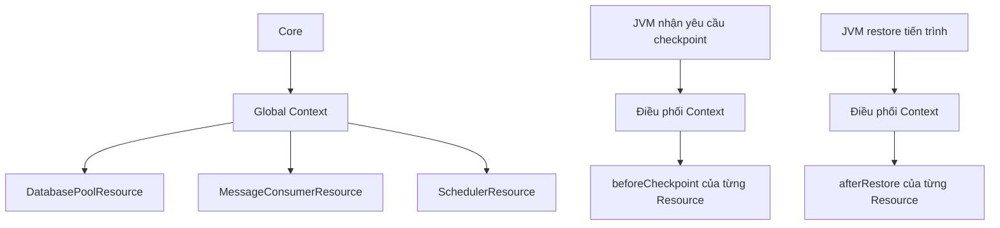
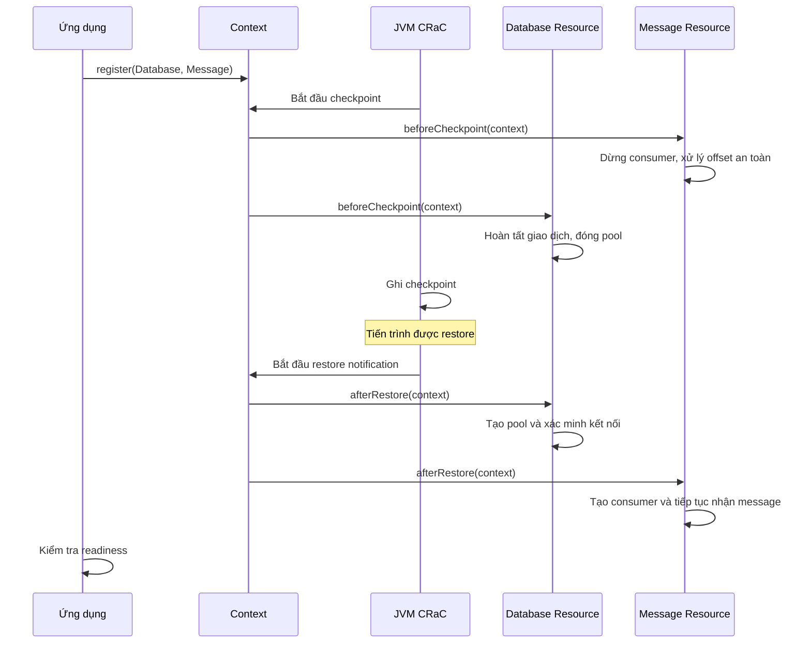

# Context: quản lý nhóm Resource và phân phối thông báo

Trong CRaC (Coordinated Restore at Checkpoint), `Resource` đại diện cho một thành phần của ứng dụng cần thực hiện công việc trước khi checkpoint và sau khi restore. `Context` quản lý tập hợp các resource đã đăng ký, còn JVM điều phối việc gửi thông báo vòng đời tới các resource đó.

Một ứng dụng thực tế có thể có nhiều tài nguyên cần phối hợp: connection pool, client của message broker, socket, bộ lập lịch, file handle hoặc cache phụ thuộc hệ thống bên ngoài. Nếu mỗi thành phần tự xử lý vòng đời mà không được đăng ký với CRaC, JVM không biết cần gọi thành phần nào khi checkpoint hoặc restore. `Context` cung cấp nơi đăng ký để các resource tham gia vào cùng một quy trình.

Nội dung này tập trung vào ba việc: hiểu vai trò của `Context`, tổ chức các `Resource` thành một nhóm có thể quản lý, và hiểu cách thông báo `beforeCheckpoint` / `afterRestore` được phân phối trong vòng đời CRaC.

## 1. Ba thành phần trong API CRaC

API CRaC có ba thành phần thường gặp khi tích hợp vòng đời tài nguyên:

| Thành phần | Vai trò | Cách sử dụng |
| --- | --- | --- |
| `Core` | Điểm truy cập tới context toàn cục của JVM | Lấy context gốc bằng `Core.getGlobalContext()` |
| `Context` | Quản lý các `Resource` đã đăng ký trong một phạm vi | Đăng ký hoặc hủy đăng ký resource; cung cấp phạm vi mà resource tham gia nhận thông báo |
| `Resource` | Đại diện cho một thành phần cần xử lý vòng đời checkpoint/restore | Cài đặt `beforeCheckpoint(...)` và `afterRestore(...)` |

Mối quan hệ có thể hình dung như sau:



`Core` cung cấp context toàn cục. Ứng dụng đăng ký những resource cần tham gia vào context đó. Khi có yêu cầu checkpoint hoặc restore, JVM sử dụng các đăng ký này để điều phối callback tương ứng.

## 2. Context là phạm vi quản lý Resource

`Context` có thể được hiểu là một registry có quản lý vòng đời. Mỗi resource được đăng ký vào một context sẽ trở thành thành viên của phạm vi đó và được CRaC thông báo tại các mốc vòng đời tương ứng.

Hai thao tác cơ bản là:

- `register(resource)`: thêm một resource vào context để resource tham gia quy trình checkpoint/restore.
- `unregister(resource)`: loại resource khỏi context khi resource không còn thuộc phạm vi quản lý hoặc đã kết thúc vòng đời.

Ứng dụng thường dùng context toàn cục:

```java
import org.crac.Core;

public final class DatabasePoolResource implements Resource {

    public DatabasePoolResource() {
        Core.getGlobalContext().register(this);
    }

    // Các callback được trình bày ở phần sau.
}
```

Khi constructor đăng ký `this`, instance đó được đưa vào global context. Sau đó JVM có thể gọi callback trên chính instance đã đăng ký. Vì vậy, resource cần được khởi tạo và đăng ký đúng vòng đời; không nên đăng ký một đối tượng tạm thời rồi bỏ mất tham chiếu tới đối tượng đang quản lý tài nguyên.

### 2.1. Context toàn cục

`Core.getGlobalContext()` là điểm đăng ký phổ biến cho các resource thuộc ứng dụng. Những resource độc lập như database pool, broker client và scheduler có thể cùng đăng ký vào context này.

```java
import org.crac.Core;

public final class CracResourceRegistration {

    public CracResourceRegistration(
            DatabasePoolResource database,
            MessageConsumerResource consumer,
            SchedulerResource scheduler) {

        Core.getGlobalContext().register(database);
        Core.getGlobalContext().register(consumer);
        Core.getGlobalContext().register(scheduler);
    }
}
```

Ví dụ trên dùng một điểm đăng ký tập trung để thể hiện rõ nhóm tài nguyên mà ứng dụng muốn quản lý. Các lớp `DatabasePoolResource`, `MessageConsumerResource` và `SchedulerResource` cần triển khai `Resource` và định nghĩa callback riêng.

Không bắt buộc phải tạo một registrar riêng nếu ứng dụng hoặc framework đã có cơ chế đăng ký resource phù hợp. Điều quan trọng là mỗi resource được quản lý đúng một lần và thuộc đúng context trong suốt vòng đời cần thiết.

### 2.2. Context không phải event bus nghiệp vụ

`Context` phục vụ các thông báo vòng đời CRaC. Nó không phải một event bus tổng quát để gửi sự kiện nghiệp vụ như `OrderCreated`, `PaymentCompleted` hoặc `UserRegistered`.

| Cơ chế | Mục đích |
| --- | --- |
| CRaC `Context` | Tập hợp resource cần nhận thông báo trước checkpoint và sau restore |
| Event bus của ứng dụng | Phân phối sự kiện nghiệp vụ giữa các thành phần |
| Dependency injection container | Tạo, cấu hình và quản lý dependency của object |
| Scheduler | Lập lịch và thực thi công việc theo thời gian |

Một ứng dụng có thể dùng đồng thời các cơ chế trên. Ví dụ, một bean Spring quản lý message consumer có thể được tạo bởi dependency injection container, nhận sự kiện từ broker và đồng thời đăng ký một resource với CRaC để đóng consumer trước checkpoint, tạo lại consumer sau restore.

`Context` cũng không tự đóng kết nối hoặc tự hiểu cách khôi phục tài nguyên. Nó quản lý thành viên và tham gia phân phối thông báo; từng `Resource` chịu trách nhiệm thực hiện công việc phù hợp với tài nguyên của mình.

## 3. Đăng ký và hủy đăng ký Resource

Một resource nên được đăng ký khi instance quản lý tài nguyên đã được tạo và sẵn sàng tham gia vòng đời CRaC. Việc đăng ký cần gắn với vòng đời thật của thành phần.

Ví dụ:

```java
import org.crac.Core;
import org.crac.Resource;

public final class MessageConsumerResource implements Resource {

    private MessageConsumer consumer;

    public MessageConsumerResource() {
        this.consumer = createConsumer();
        Core.getGlobalContext().register(this);
    }

    private MessageConsumer createConsumer() {
        // Tạo client/consumer theo cấu hình của ứng dụng.
        return new MessageConsumer();
    }

    // beforeCheckpoint và afterRestore được cài đặt bên dưới.
}
```

Đăng ký sau khi đối tượng đã được tạo giúp tránh trường hợp JVM gửi callback tới một resource chưa hoàn tất khởi tạo. Nếu việc tạo tài nguyên thất bại, ứng dụng nên xử lý lỗi khởi tạo và không để lại một resource đã đăng ký nhưng ở trạng thái không sử dụng được.

### 3.1. Khi nào cần unregister?

Khi một resource kết thúc vòng đời vĩnh viễn, chủ sở hữu có thể hủy đăng ký nó khỏi context. Ví dụ, một thành phần được thay thế hoàn toàn bằng instance mới hoặc một module bị dừng và không còn tham gia checkpoint.

```java
public void closePermanently() {
    if (consumer != null) {
        consumer.close();
        consumer = null;
    }

    Core.getGlobalContext().unregister(this);
}
```

Đây chỉ là minh họa về ý nghĩa của `unregister`; trong ứng dụng thực tế cần bảo đảm thứ tự đóng tài nguyên, đồng bộ với luồng đang sử dụng và xử lý ngoại lệ. Nếu một resource chỉ tạm đóng để chuẩn bị checkpoint, nó vẫn cần tiếp tục là thành viên của context để nhận `afterRestore`. Không được hủy đăng ký chỉ vì đã đóng tài nguyên trước checkpoint.

### 3.2. Tránh đăng ký trùng lặp

Một lỗi thiết kế thường gặp là đăng ký cùng một resource nhiều lần do constructor, lifecycle hook của framework và một registrar cùng thực hiện việc đó. Điều này làm cho hành vi callback khó dự đoán và có thể dẫn tới thao tác đóng hoặc mở tài nguyên lặp lại.

Nên xác định một nơi sở hữu việc đăng ký. Nếu framework đã tự động quản lý một resource, không đăng ký thêm cùng instance bằng một cơ chế khác trừ khi tích hợp đó yêu cầu rõ ràng.

Ví dụ registrar có thể bảo vệ việc đăng ký một lần:

```java
public final class CracResourceRegistration {

    private final DatabasePoolResource database;
    private final MessageConsumerResource consumer;
    private boolean registered;

    public CracResourceRegistration(
            DatabasePoolResource database,
            MessageConsumerResource consumer) {
        this.database = database;
        this.consumer = consumer;
    }

    public synchronized void register() {
        if (registered) {
            return;
        }

        Core.getGlobalContext().register(database);
        Core.getGlobalContext().register(consumer);
        registered = true;
    }
}
```

Đây là một cách tổ chức đơn giản. Trong hệ thống nhiều luồng hoặc có khả năng khởi tạo lại module, trạng thái đăng ký cần được đồng bộ với vòng đời thực tế của resource. Cờ `registered` không thay thế việc xử lý trường hợp một thao tác đăng ký thành công còn thao tác tiếp theo thất bại; registrar thực tế nên có chiến lược rollback hoặc khởi tạo lại rõ ràng.

## 4. Resource nhận thông báo từ Context như thế nào?

Một lớp triển khai `Resource` phải cài đặt hai callback:

```java
void beforeCheckpoint(Context<? extends Resource> context)
        throws Exception;

void afterRestore(Context<? extends Resource> context)
        throws Exception;
```

Tham số `context` cho biết phạm vi quản lý mà resource đang tham gia. Resource có thể dùng tham số này khi cần thao tác với context tương ứng theo API. Trong trường hợp đơn giản, callback chỉ cần xử lý tài nguyên mà instance đang sở hữu.

Hai callback có ý nghĩa khác nhau:

| Callback | Thời điểm | Trách nhiệm của Resource |
| --- | --- | --- |
| `beforeCheckpoint(...)` | Trước khi JVM ghi trạng thái tiến trình | Hoàn tất công việc cần thiết, flush dữ liệu, dừng hoạt động và đóng tài nguyên không nên được giữ qua checkpoint |
| `afterRestore(...)` | Sau khi tiến trình được phục hồi | Tạo lại kết nối, xác minh trạng thái bên ngoài và tiếp tục hoạt động khi tài nguyên đã sẵn sàng |

Ví dụ quản lý connection pool:

```java
import org.crac.Context;
import org.crac.Core;
import org.crac.Resource;

public final class DatabasePoolResource implements Resource {

    private HikariDataSource dataSource;

    public DatabasePoolResource() {
        this.dataSource = createDataSource();
        Core.getGlobalContext().register(this);
    }

    @Override
    public void beforeCheckpoint(Context<? extends Resource> context)
            throws Exception {
        if (dataSource != null && !dataSource.isClosed()) {
            dataSource.close();
        }
    }

    @Override
    public void afterRestore(Context<? extends Resource> context)
            throws Exception {
        dataSource = createDataSource();
        verifyConnection(dataSource);
    }

    private HikariDataSource createDataSource() {
        // Tạo pool từ cấu hình hiện hành.
        return new HikariDataSource();
    }

    private void verifyConnection(HikariDataSource pool) throws Exception {
        try (var connection = pool.getConnection()) {
            if (!connection.isValid(5)) {
                throw new IllegalStateException("Database is not ready");
            }
        }
    }
}
```

Phần khởi tạo `HikariDataSource` được rút gọn để làm rõ điểm tích hợp. Ứng dụng thực tế cần truyền JDBC URL, thông tin xác thực, timeout và các tùy chọn pool từ cấu hình hiện hành. Không nên đưa credential trực tiếp vào mã nguồn hoặc checkpoint nếu có thể nạp lại an toàn sau restore.

Ví dụ cho thấy `Context` không trực tiếp gọi `dataSource.close()` hay tạo pool mới. JVM gửi callback tới resource; resource thực hiện thao tác trên đối tượng mà nó sở hữu.

## 5. Cách Context phân phối thông báo

Khi JVM nhận yêu cầu checkpoint, nó điều phối các resource đã đăng ký để từng thành phần chuẩn bị trạng thái. Khi restore, JVM tiếp tục điều phối callback phục hồi. Ứng dụng không cần tự duyệt toàn bộ registry để gọi từng resource trong trường hợp sử dụng API CRaC thông thường.

Luồng khái quát:



Sơ đồ minh họa một thứ tự phụ thuộc thường dùng: consumer dừng trước database pool; database pool sẵn sàng trước khi consumer hoạt động lại. Thứ tự thực tế phải dựa trên hợp đồng của API CRaC và cách đăng ký resource trong JDK đang sử dụng.

### 5.1. Thứ tự callback và quan hệ phụ thuộc

Khi nhiều resource phụ thuộc lẫn nhau, thứ tự thông báo có ý nghĩa. Ví dụ, message consumer dùng repository, repository dùng database pool. Khi chuẩn bị checkpoint, consumer nên ngừng trước, sau đó các thành phần phụ thuộc mới được đóng. Khi restore, database pool phải sẵn sàng trước khi consumer bắt đầu xử lý message.

Quy tắc sắp xếp thường dùng của CRaC là:

- `beforeCheckpoint`: thông báo theo thứ tự ngược với thứ tự đăng ký.
- `afterRestore`: thông báo theo thứ tự đăng ký.

Vì vậy, nếu database pool cần sẵn sàng trước message consumer, hãy đăng ký database resource trước consumer resource. Khi checkpoint, consumer nhận thông báo trước để dừng; database pool nhận thông báo sau để đóng. Khi restore, database pool nhận thông báo trước để kết nối lại; consumer nhận thông báo sau để khởi động lại.

```java
// Đăng ký dependency trước, thành phần phụ thuộc sau.
Core.getGlobalContext().register(databasePoolResource);
Core.getGlobalContext().register(messageConsumerResource);
```

Thứ tự này giúp diễn đạt quan hệ phụ thuộc đơn giản. Với các resource phức tạp, nhiều phụ thuộc chéo hoặc cần đồng bộ theo nhóm, nên gom phần điều phối vào một resource coordinator thay vì dựa vào thứ tự đăng ký rải rác ở nhiều nơi. Luôn xác nhận chi tiết thứ tự với phiên bản API/JDK được triển khai, đặc biệt khi framework tự động đăng ký resource.

### 5.2. Callback không phải thông báo song song tùy ý

Không nên giả định mọi callback được gọi đồng thời trên các thread riêng. Hãy thiết kế callback theo hợp đồng CRaC của runtime và coi mỗi callback là một điểm đồng bộ quan trọng trong vòng đời tiến trình.

Nếu callback thực hiện công việc kéo dài, hãy có timeout và xử lý lỗi rõ ràng. Ví dụ, dừng consumer cần chờ các message đang xử lý hoàn tất trong giới hạn cho phép. Nếu việc chờ không kết thúc, ứng dụng cần báo lỗi để checkpoint không tiếp tục trong trạng thái chưa an toàn.

Không nên tự tạo thread nền trong callback rồi trả về ngay trong khi thread đó vẫn đang đóng kết nối hoặc ghi dữ liệu. Khi callback kết thúc, JVM có thể tiếp tục quy trình checkpoint; thao tác bất đồng bộ chưa hoàn tất sẽ tạo ra race condition.

## 6. Tổ chức nhóm Resource

Có hai cách phổ biến để tổ chức nhiều tài nguyên.

### 6.1. Đăng ký từng Resource vào cùng Context

Đây là cách phù hợp khi mỗi thành phần có vòng đời riêng và có thể tự chuẩn bị/khôi phục.

```java
Core.getGlobalContext().register(databasePoolResource);
Core.getGlobalContext().register(messageConsumerResource);
Core.getGlobalContext().register(schedulerResource);
Core.getGlobalContext().register(fileResource);
```

Ưu điểm:

- Mỗi lớp chịu trách nhiệm cho tài nguyên mà nó sở hữu.
- Có thể bổ sung hoặc hủy đăng ký một resource theo vòng đời của thành phần.
- Dễ kiểm tra log và xác định resource nào gây lỗi.
- Có thể thể hiện quan hệ phụ thuộc bằng thứ tự đăng ký khi quan hệ đơn giản.

Điểm cần kiểm soát là không để cùng một tài nguyên bị quản lý ở nhiều nơi. Nếu một framework đã cung cấp resource tích hợp cho database pool, không nên tạo thêm một resource khác cùng đóng pool đó.

### 6.2. Đăng ký một Resource điều phối cho cả nhóm

Nếu một nhóm thành phần cần được chuẩn bị theo một quy trình thống nhất, có thể tạo một resource coordinator. Coordinator là resource duy nhất được đăng ký vào CRaC context và tự gọi các thành phần con theo thứ tự do ứng dụng định nghĩa.

Để minh họa, các thành phần con dùng một interface nội bộ đơn giản:

```java
public interface CheckpointParticipant {
    void beforeCheckpoint() throws Exception;
    void afterRestore() throws Exception;
}
```

Coordinator quản lý nhóm:

```java
import java.util.List;
import org.crac.Context;
import org.crac.Core;
import org.crac.Resource;

public final class InfrastructureGroup implements Resource {

    private final List<CheckpointParticipant> participants;

    public InfrastructureGroup(List<CheckpointParticipant> participants) {
        this.participants = List.copyOf(participants);
        Core.getGlobalContext().register(this);
    }

    @Override
    public void beforeCheckpoint(Context<? extends Resource> context)
            throws Exception {
        for (int i = participants.size() - 1; i >= 0; i--) {
            participants.get(i).beforeCheckpoint();
        }
    }

    @Override
    public void afterRestore(Context<? extends Resource> context)
            throws Exception {
        for (CheckpointParticipant participant : participants) {
            participant.afterRestore();
        }
    }
}
```

Trong ví dụ, danh sách participant được sắp xếp theo thứ tự khởi tạo: dependency ở trước, thành phần phụ thuộc ở sau. Coordinator gọi ngược thứ tự để dừng và gọi xuôi thứ tự để khôi phục.

Các participant ở đây **không tự triển khai `Resource` và không được đăng ký riêng vào global context**. Coordinator là đầu mối CRaC duy nhất cho nhóm, nhờ vậy tránh việc một thành phần bị callback hai lần. Nếu từng participant cũng được đăng ký độc lập, không được đồng thời để coordinator gọi lại callback của chúng.

### 6.3. Chọn cách tổ chức phù hợp

| Tình huống | Cách tổ chức nên cân nhắc |
| --- | --- |
| Database pool và scheduler có vòng đời độc lập | Đăng ký từng resource riêng |
| Nhiều thành phần có thứ tự dừng/khởi động rõ ràng | Đăng ký riêng và sắp xếp theo quan hệ phụ thuộc |
| Một cụm client phải dừng và khởi động như một đơn vị | Dùng coordinator và participant nội bộ |
| Framework đã tích hợp CRaC cho một tài nguyên | Dùng cơ chế tích hợp, tránh đăng ký trùng |
| Resource được tạo/hủy động | Quản lý register/unregister cùng vòng đời thực tế |

Không có lợi ích khi tạo coordinator cho mọi bean. Chỉ nên gom nhóm khi có quan hệ phụ thuộc hoặc một quy trình thống nhất cần được điều phối. Với các resource độc lập, đăng ký trực tiếp giúp trách nhiệm rõ ràng hơn.

## 7. Xử lý lỗi trong quá trình phân phối thông báo

Callback có thể khai báo `throws Exception` vì việc chuẩn bị hoặc phục hồi tài nguyên có thể thất bại. Ví dụ database không thể đóng pool do giao dịch chưa hoàn tất, hoặc sau restore không thể kết nối tới database.

### 7.1. Lỗi trước checkpoint

Nếu một resource bắt buộc không thể đưa tài nguyên về trạng thái an toàn, callback nên báo lỗi. Quy trình checkpoint cần dừng hoặc thất bại theo hợp đồng của runtime. Không nên bắt ngoại lệ rồi bỏ qua:

```java
@Override
public void beforeCheckpoint(Context<? extends Resource> context)
        throws Exception {
    try {
        stopConsumerAndWait();
    } catch (Exception ex) {
        // Ghi log có ngữ cảnh rồi truyền lỗi lên để checkpoint thất bại.
        throw ex;
    }
}
```

Đoạn code trên minh họa nguyên tắc truyền lỗi; trong triển khai thực tế, nếu chỉ ghi log rồi ném lại thì có thể dùng `throw ex` trực tiếp. Điều quan trọng là lỗi không bị che giấu.

### 7.2. Lỗi sau restore

Nếu resource không thể khôi phục, ứng dụng chưa nên nhận lưu lượng. Ví dụ connection pool tạo được nhưng kiểm tra kết nối thất bại, hoặc broker chưa sẵn sàng. Hãy để lỗi được báo lên và dùng readiness/lifecycle của ứng dụng để giữ instance ở trạng thái chưa sẵn sàng.

Không nên đánh dấu ứng dụng healthy ngay khi callback bắt đầu. Cần xác minh mọi tài nguyên bắt buộc đã kết nối và có thể phục vụ công việc.

### 7.3. Không bỏ qua lỗi ở coordinator

Với coordinator quản lý nhiều participant, cần quyết định rõ điều gì xảy ra khi một participant thất bại. Trước checkpoint, lỗi ở một participant thường có nghĩa nhóm chưa thể chuyển sang trạng thái an toàn. Sau restore, lỗi ở một participant bắt buộc có nghĩa nhóm chưa sẵn sàng.

Nếu coordinator tiếp tục gọi các participant khác sau khi có lỗi, nó phải tổng hợp lỗi và bảo đảm không che mất lỗi đầu tiên. Cách đơn giản và dễ dự đoán là dừng tại lỗi đầu tiên rồi truyền lỗi lên; cách khôi phục một phần chỉ phù hợp khi ứng dụng định nghĩa rõ trạng thái và quy trình retry.

## 8. Các lỗi thiết kế thường gặp

| Lỗi | Hậu quả | Cách xử lý |
| --- | --- | --- |
| Tạo `Resource` nhưng quên đăng ký | JVM không gọi callback cho resource đó | Đăng ký vào context sở hữu vòng đời |
| Đăng ký cùng instance ở nhiều nơi | Callback hoặc thao tác tài nguyên có thể bị lặp | Chọn một chủ sở hữu đăng ký |
| Unregister ngay sau `beforeCheckpoint` | Resource không còn nhận `afterRestore` | Chỉ unregister khi kết thúc vòng đời vĩnh viễn |
| Đóng tài nguyên trong `beforeCheckpoint` nhưng không mở lại | Ứng dụng restore nhưng không thể phục vụ | Tạo lại tài nguyên trong `afterRestore` |
| Dựa vào thứ tự khởi tạo không được ghi nhận | Dependency có thể chưa sẵn sàng khi resource khác phục hồi | Sắp xếp đăng ký hoặc dùng coordinator |
| Callback khởi chạy công việc nền rồi trả về | JVM có thể checkpoint khi công việc chưa hoàn tất | Chờ công việc kết thúc trong callback |
| Nuốt ngoại lệ callback | Checkpoint/restore có thể tiếp tục với trạng thái sai | Truyền lỗi lên và giữ instance chưa sẵn sàng |
| Resource được framework quản lý nhưng ứng dụng đăng ký thêm | Cùng tài nguyên bị đóng/mở nhiều lần | Kiểm tra cơ chế tích hợp trước khi tự đăng ký |
| Giữ tham chiếu tới kết nối cũ sau restore | Đối tượng Java tồn tại nhưng kết nối bên ngoài đã chết | Tạo lại client và xác minh kết nối |

## 9. Kiểm tra Context và Resource trong ứng dụng

Khi tích hợp CRaC, nên kiểm tra cả đăng ký lẫn việc callback được gọi. Có thể tạo resource thử nghiệm ghi log tại hai mốc:

```java
import org.crac.Context;
import org.crac.Core;
import org.crac.Resource;

public final class LoggingResource implements Resource {

    private final String name;

    public LoggingResource(String name) {
        this.name = name;
        Core.getGlobalContext().register(this);
    }

    @Override
    public void beforeCheckpoint(Context<? extends Resource> context)
            throws Exception {
        System.out.println(name + ": beforeCheckpoint");
    }

    @Override
    public void afterRestore(Context<? extends Resource> context)
            throws Exception {
        System.out.println(name + ": afterRestore");
    }
}
```

Khởi tạo một vài instance với tên khác nhau và tạo checkpoint trong môi trường CRaC đã được cấu hình. Log giúp quan sát resource nào nhận thông báo và thứ tự thực tế. Hãy đối chiếu thứ tự đó với thứ tự đăng ký và hợp đồng của JDK đang sử dụng.

Các điểm nên xác nhận:

1. Tất cả resource cần thiết đã được đăng ký vào đúng context.
2. Mỗi instance chỉ được đăng ký theo một cơ chế sở hữu rõ ràng.
3. `beforeCheckpoint` chạy và hoàn tất trước khi checkpoint tiến hành.
4. `afterRestore` chạy sau khi tiến trình được phục hồi.
5. Các dependency được dừng và khởi động theo thứ tự phù hợp.
6. Resource bị hủy vĩnh viễn được unregister; resource chỉ tạm đóng vẫn còn đăng ký.
7. Lỗi ở callback được truyền lên và không bị biến thành trạng thái thành công giả.
8. Sau restore, ứng dụng xác minh kết nối và readiness trước khi nhận lưu lượng.

Việc quan sát log là kiểm tra hành vi tích hợp. Nó không thay thế kiểm thử nghiệp vụ như bảo đảm message không bị xử lý hai lần, giao dịch không bị bỏ dở hoặc scheduler không chạy trùng giữa nhiều instance.

## 10. Kết luận

`Context` là phạm vi quản lý các `Resource` tham gia vòng đời CRaC. `Core.getGlobalContext()` cung cấp context toàn cục thường dùng; ứng dụng đăng ký resource khi thành phần được tạo và hủy đăng ký khi thành phần kết thúc vòng đời. JVM sử dụng các đăng ký đó để phân phối `beforeCheckpoint` trước khi tạo ảnh và `afterRestore` sau khi phục hồi tiến trình.

Với các resource độc lập, có thể đăng ký từng resource vào cùng context. Khi một nhóm cần điều phối thống nhất, có thể dùng một coordinator đăng ký duy nhất và quản lý các participant bên trong. Dù chọn cách nào, cần giữ rõ quyền sở hữu, thứ tự phụ thuộc, xử lý lỗi và bảo đảm mọi tài nguyên bắt buộc đã sẵn sàng trước khi ứng dụng nhận lưu lượng.
