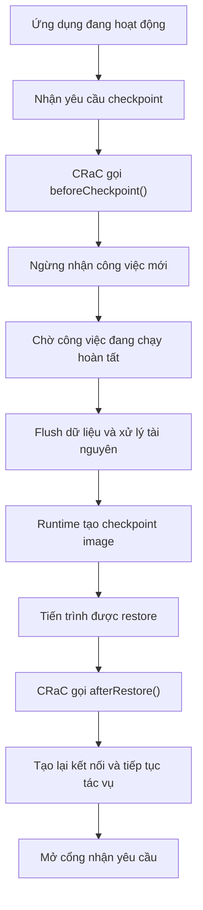
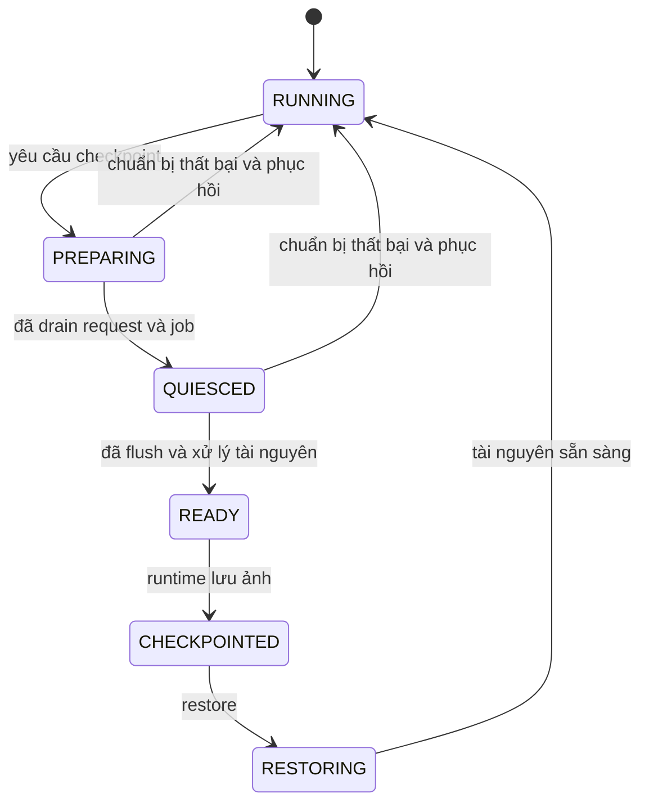

# beforeCheckpoint(): chuẩn bị trạng thái trước khi tạo ảnh

Trong CRaC (Coordinated Restore at Checkpoint), `beforeCheckpoint()` là callback mà ứng dụng dùng để chuẩn bị trước khi runtime chụp trạng thái tiến trình. Đây là một phần quan trọng của API `org.crac.Resource`: trước khi checkpoint, ứng dụng đưa các thành phần đang hoạt động về trạng thái an toàn; sau khi restore, ứng dụng khôi phục những tài nguyên cần thiết để tiếp tục phục vụ.

Một checkpoint có thể lưu lại heap, trạng thái luồng và nhiều thông tin runtime của tiến trình. Tuy nhiên, các dịch vụ bên ngoài như database, message broker, socket, scheduler hoặc hệ thống xác thực vẫn tiếp tục hoạt động độc lập. Kết nối đang mở trong heap có thể đã hết hạn khi tiến trình được restore. Vì vậy, trước khi tạo ảnh, ứng dụng phải phối hợp việc dừng nhận công việc, hoàn tất thao tác đang chạy, ghi dữ liệu cần thiết và đóng hoặc chuẩn bị lại các tài nguyên phụ thuộc môi trường.

`beforeCheckpoint()` không tự tạo checkpoint. Runtime gọi callback này trong quy trình checkpoint, trước khi lưu ảnh tiến trình. Nhiệm vụ của callback là để lại một trạng thái có thể khôi phục và tiếp tục an toàn.

## 1. Vị trí của beforeCheckpoint trong vòng đời CRaC

Một resource tham gia vào vòng đời CRaC bằng cách triển khai interface `org.crac.Resource`. Interface này khai báo hai callback:

- `beforeCheckpoint()`: chạy trước khi trạng thái tiến trình được chụp.
- `afterRestore()`: chạy sau khi tiến trình được khôi phục.

Luồng tổng quát:



Các bước D, E và F là trách nhiệm thiết kế của ứng dụng. Một ứng dụng đơn giản có thể chỉ cần đóng một client; một dịch vụ lớn có thể phải phối hợp traffic, transaction, scheduler, connection pool và nhiều thành phần khác.

### 1.1. Thời điểm callback được gọi

Khi một yêu cầu checkpoint được thực hiện, CRaC gọi callback của những resource đã đăng ký. `beforeCheckpoint()` chạy trước lúc runtime lưu trạng thái tiến trình. Sau khi callback hoàn tất, cơ chế checkpoint mới tiếp tục quy trình tạo ảnh.

Vì callback nằm ngay trước thời điểm chụp, các thay đổi mà callback thực hiện có thể trở thành trạng thái được lưu trong ảnh. Ví dụ, nếu callback đóng một client và đặt trường tham chiếu thành `null`, trạng thái `null` đó cũng nằm trong heap được checkpoint. Sau restore, `afterRestore()` cần tạo lại client và gán nó vào trường tương ứng.

### 1.2. Callback không thay thế logic khởi động

Không nên chuyển toàn bộ logic khởi tạo ứng dụng vào `beforeCheckpoint()` hoặc `afterRestore()`. Phần lớn cấu hình, bean, cấu trúc dữ liệu và trạng thái ứng dụng đã được chuẩn bị trước khi checkpoint sẽ được lưu cùng tiến trình.

Callback chỉ xử lý phần chuyển tiếp giữa hai trạng thái:

| Thời điểm | Mục tiêu | Ví dụ |
|---|---|---|
| Trước checkpoint | Đưa ứng dụng về trạng thái an toàn để chụp | Tạm dừng scheduler, drain request, đóng socket |
| Sau restore | Làm cho tài nguyên dùng được trong môi trường hiện tại | Mở lại pool, làm mới token, khởi động worker |

## 2. Resource và cách đăng ký callback

CRaC không tự biết mọi đối tượng trong ứng dụng cần được chuẩn bị như thế nào. Ứng dụng cần đăng ký resource để runtime gọi các callback vòng đời.

Các kiểu API thường dùng nằm trong package `org.crac`:

- `Resource`: interface chứa các callback trước checkpoint và sau restore.
- `Context`: ngữ cảnh quản lý resource.
- `Core`: điểm truy cập đến global context và thao tác CRaC.

Ví dụ đăng ký một resource:

```java
import org.crac.Context;
import org.crac.Core;
import org.crac.Resource;

public final class ClientResource implements Resource {

    private RemoteClient client;

    public ClientResource() throws Exception {
        this.client = RemoteClient.connect();

        // Đăng ký resource để CRaC gọi callback vòng đời.
        Core.getGlobalContext().register(this);
    }

    @Override
    public void beforeCheckpoint(
            Context<? extends Resource> context) throws Exception {
        if (client != null) {
            client.close();
            client = null;
        }
    }

    @Override
    public void afterRestore(
            Context<? extends Resource> context) throws Exception {
        client = RemoteClient.connect();
    }

    public RemoteClient getClient() {
        return client;
    }
}
```

`RemoteClient` là kiểu minh họa thuộc ứng dụng, không phải class của CRaC. Ví dụ cho thấy ý tưởng cơ bản: đóng client trước checkpoint, sau đó tạo lại client khi restore.

Đăng ký resource phải diễn ra trước khi yêu cầu checkpoint. Nếu một đối tượng không được đăng ký với context phù hợp, runtime không có callback để gọi cho đối tượng đó.

Với ứng dụng có nhiều tài nguyên phụ thuộc nhau, nên gom việc phối hợp vào một thành phần quản lý vòng đời hoặc dùng cơ chế tích hợp CRaC mà framework cung cấp. Không nên để mỗi lớp tự ý đóng một phần hệ thống mà không có quy tắc phối hợp chung.

## 3. Những mục tiêu cần đạt trước khi tạo ảnh

`beforeCheckpoint()` nên chuẩn bị một trạng thái nhất quán, có thể restore. Công việc cụ thể tùy ứng dụng, nhưng thường xoay quanh các mục tiêu dưới đây.

### 3.1. Ngừng nhận công việc mới

Trước khi chụp ảnh, ứng dụng nên ngừng nhận thêm request hoặc job mới. Nếu vẫn nhận công việc trong lúc các resource lần lượt đóng kết nối, một request có thể bắt đầu trên một client sắp bị đóng.

Có thể dùng một admission gate ở tầng ứng dụng:

1. Chuyển trạng thái instance sang `PREPARING_CHECKPOINT`.
2. Từ chối hoặc chuyển hướng request mới theo chính sách của hệ thống.
3. Ngừng lấy job mới từ queue.
4. Giữ cổng nhận traffic đóng cho đến khi các bước chuẩn bị hoàn tất.

Ví dụ về ý tưởng:

```java
public void beforeCheckpoint(
        Context<? extends Resource> context) throws Exception {

    requestGate.stopAccepting();
    requestGate.awaitInFlightRequests(Duration.ofSeconds(30));

    // Tiếp tục chuẩn bị các tài nguyên khác...
}
```

`requestGate` là thành phần do ứng dụng xây dựng. Nó có thể được tích hợp với readiness health check, load balancer hoặc cơ chế điều phối traffic của nền tảng.

Readiness nên chuyển sang trạng thái không sẵn sàng trước khi instance bắt đầu đóng tài nguyên. Nhờ vậy, hệ thống điều phối có thời gian ngừng gửi request mới đến instance.

### 3.2. Chờ công việc đang chạy hoàn tất

Ngừng nhận request mới chưa đủ. Những request đã được nhận vẫn có thể đang:

- Thực hiện transaction.
- Ghi dữ liệu.
- Gửi message.
- Đọc hoặc ghi tệp.
- Gọi dịch vụ bên ngoài.
- Giữ lock hoặc tài nguyên dùng chung.

Ứng dụng cần xác định thế nào là một công việc đã hoàn tất và chờ các công việc đang chạy đạt trạng thái an toàn. Có thể theo dõi số request đang xử lý, số transaction mở hoặc số job đang thực thi.

Nên đặt timeout cho bước chờ. Nếu công việc không thể hoàn tất trong thời gian cho phép, callback có thể báo lỗi để checkpoint bị dừng theo cơ chế của runtime. Chụp một trạng thái không nhất quán có thể gây lỗi dữ liệu khó khắc phục sau restore.

Không nên dùng `Thread.sleep()` với một khoảng thời gian tùy ý để giả định request đã kết thúc. Cần chờ dựa trên tín hiệu thực tế như counter, latch, condition hoặc cơ chế drain của framework.

### 3.3. Xử lý transaction và dữ liệu đang chờ

Checkpoint giữ trạng thái bộ nhớ, nhưng không tự bảo đảm một transaction ở database hoặc một thao tác gửi message đã hoàn tất theo ý nghĩa nghiệp vụ.

Trước checkpoint, ứng dụng cần:

- Đợi transaction đang chạy kết thúc nếu có thể.
- Commit hoặc rollback theo quy tắc nghiệp vụ.
- Flush buffer cần ghi bền vững.
- Đảm bảo event đã gửi ra hệ thống bên ngoài không bị gửi lặp khi restore.
- Lưu trạng thái xử lý job vào nơi lưu trữ bền vững nếu cần tiếp tục từ một điểm xác định.

Không phải mọi dữ liệu trong heap đều cần ghi ra database. Nếu một hàng đợi nội bộ được thiết kế để nằm trong trạng thái tiến trình và được khôi phục cùng checkpoint, việc serialize hoặc ghi lại nó có thể tạo ra công việc trùng lặp. Hãy xác định rõ dữ liệu nào là trạng thái bộ nhớ có thể khôi phục và dữ liệu nào cần tính bền vững bên ngoài.

Với các thao tác có thể được gửi lặp, nên dùng idempotency key, unique constraint hoặc cơ chế deduplication phù hợp. CRaC không thay thế các bảo đảm nhất quán của hệ thống phân tán.

### 3.4. Tạm dừng scheduler và worker

Scheduler có thể tiếp tục kích hoạt công việc trong khi ứng dụng đang chuẩn bị checkpoint. Worker cũng có thể lấy thêm job từ queue nếu không có cơ chế dừng admission.

Một quy trình thường gặp:

1. Ngừng scheduler tạo công việc mới.
2. Ngừng worker lấy thêm job.
3. Chờ job đang chạy hoàn tất hoặc lưu checkpoint nghiệp vụ của job theo thiết kế.
4. Đưa các executor và scheduler về trạng thái có thể khởi động lại sau restore.

Cần phân biệt tạm dừng một scheduler với đóng hẳn executor. Nếu gọi `shutdown()` lên một `ExecutorService` rồi giữ nguyên đối tượng đó trong heap, sau restore executor vẫn có thể ở trạng thái đã shutdown và không nhận task mới. Trong trường hợp này, ứng dụng phải tạo executor mới hoặc dùng một cơ chế pause/resume được thiết kế cho vòng đời checkpoint.

Không nên để một thread chờ vô hạn trong `beforeCheckpoint()`. Nếu worker không thể dừng an toàn, cần có timeout và chính sách xử lý khi quá thời gian.

### 3.5. Đóng hoặc giải phóng tài nguyên phụ thuộc môi trường

Một số tài nguyên không nên được sử dụng lại sau restore vì chúng phụ thuộc vào trạng thái bên ngoài tiến trình:

- Socket và kết nối TCP.
- Kết nối JDBC và connection pool.
- Client đến message broker.
- HTTP client có connection pool hoặc socket đang mở.
- File descriptor và khóa hệ điều hành.
- Token hoặc credential có thời hạn.
- Handle đến dịch vụ native hoặc thiết bị.

Các tài nguyên này nên được đóng hoặc đưa về trạng thái được thư viện hỗ trợ trước checkpoint. Sau restore, chúng được tạo lại hoặc kiểm tra trước khi ứng dụng nhận traffic.

Không phải mọi đối tượng trong heap đều cần đóng. Các cấu trúc dữ liệu thuần Java, cấu hình đã đọc, metadata đã nạp và cache có thể tiếp tục hữu ích sau restore nếu chúng không phụ thuộc vào thời gian hoặc môi trường. Chỉ xử lý những tài nguyên có vòng đời cần phối hợp.

### 3.6. Bảo đảm trạng thái ứng dụng nhất quán

Trước khi tạo ảnh, các thành phần liên quan phải đồng ý rằng ứng dụng đang ở trạng thái chuẩn bị checkpoint. Ví dụ, không thể để request gate báo đã dừng nhận việc trong khi worker vẫn lấy job mới từ queue.

Có thể biểu diễn trạng thái vòng đời bằng một state machine:



State machine giúp tránh các chuyển trạng thái tùy tiện. Mỗi bước nên có điều kiện hoàn thành rõ ràng và có thể quan sát qua log hoặc metric.

## 4. Thiết kế callback có thể vận hành an toàn

Một callback tốt cần có thứ tự rõ ràng, timeout, xử lý lỗi và khả năng quan sát. Những đặc điểm này quan trọng vì callback chạy trong thời điểm nhạy cảm: ứng dụng đang chuyển từ trạng thái hoạt động sang trạng thái được lưu.

### 4.1. Thực hiện theo thứ tự phụ thuộc

Ví dụ, nếu HTTP handler sử dụng database pool thì cần ngừng request và drain handler trước khi đóng pool. Nếu scheduler tạo job sử dụng HTTP client, scheduler cần dừng tạo job trước khi đóng client.

Một thứ tự tham khảo:

1. Đánh dấu instance đang chuẩn bị checkpoint.
2. Ngừng nhận traffic và job mới.
3. Chờ request, transaction và job đang chạy đạt trạng thái an toàn.
4. Flush dữ liệu cần lưu bền vững.
5. Dừng scheduler hoặc worker theo cách có thể khởi động lại.
6. Đóng kết nối và tài nguyên phụ thuộc môi trường.
7. Ghi log trạng thái chuẩn bị hoàn tất để phục vụ chẩn đoán.

Thứ tự thực tế phải dựa vào đồ thị phụ thuộc của ứng dụng. Ví dụ, một worker cần database để hoàn tất job thì không thể đóng database trước khi worker drain xong.

Không nên dựa vào thứ tự callback của nhiều resource độc lập nếu ứng dụng chưa xác nhận hợp đồng thứ tự của phiên bản CRaC đang dùng. Khi các thao tác phụ thuộc chặt chẽ, hãy gom chúng vào một coordinator để chủ động sắp xếp.

### 4.2. Đặt timeout cho thao tác có thể chờ

Mỗi bước chờ cần có giới hạn thời gian. Ví dụ:

- Drain HTTP request tối đa 30 giây.
- Chờ worker hoàn tất tối đa 20 giây.
- Flush buffer tối đa 10 giây.
- Đóng client với timeout do thư viện hỗ trợ.

Các giá trị trên chỉ là ví dụ. Hãy chọn theo SLA, thời gian shutdown của nền tảng và thời gian xử lý tối đa của workload.

Khi hết timeout, ứng dụng cần có chính sách rõ ràng: hủy checkpoint, rollback trạng thái chuẩn bị nếu có thể, hoặc đánh dấu instance chưa sẵn sàng để hệ thống xử lý. Tránh tiếp tục checkpoint trong khi một thao tác quan trọng vẫn đang chạy dở.

### 4.3. Giữ callback có thể lặp lại an toàn

Thiết kế thao tác chuẩn bị sao cho việc gọi lại không gây lỗi nghiêm trọng. Ví dụ, đóng một client đã đóng có thể được xử lý như thao tác no-op nếu thư viện cho phép; dừng admission gate hai lần không nên làm hỏng trạng thái.

Tính lặp lại hữu ích khi một lần chuẩn bị thất bại giữa chừng và hệ thống cần phục hồi hoặc thử lại. Tuy nhiên, không được giả định CRaC tự động gọi lại callback theo một lịch cụ thể. Đây là nguyên tắc thiết kế để ứng dụng chịu được các đường lỗi.

### 4.4. Không che giấu lỗi

Nếu không thể drain request, flush dữ liệu hoặc giải phóng một tài nguyên thiết yếu, callback nên báo lỗi. Nuốt exception rồi để runtime tiếp tục checkpoint có thể tạo ra ảnh tiến trình không an toàn.

Có thể bổ sung thông tin vào exception hoặc log để xác định resource nào thất bại. Không nên ghi secret, token hay dữ liệu nhạy cảm vào log.

### 4.5. Phục hồi nếu quá trình chuẩn bị thất bại

Một lần chuẩn bị có thể thất bại sau khi một số thành phần đã được dừng hoặc đóng. Khi đó, ứng dụng phải biết cách đưa các thành phần đã thay đổi về trạng thái có thể hoạt động, hoặc giữ instance ở trạng thái không sẵn sàng để xử lý tiếp.

Ví dụ, nếu connection pool đã đóng nhưng thao tác flush tiếp theo thất bại, ứng dụng cần tạo lại pool trước khi mở request gate. Nếu việc phục hồi không thành công, không được mở traffic trong khi dependency vẫn chưa sẵn sàng.

Cũng cần lưu ý `Resource` có hai callback chính là `beforeCheckpoint()` và `afterRestore()`. Không có callback `afterCheckpoint()` trong hợp đồng cơ bản này để tự động đảo ngược mọi thao tác sau khi ảnh đã được tạo hoặc khi một resource khác thất bại. Vì vậy, hãy thiết kế ranh giới chuẩn bị và cơ chế điều phối lỗi có chủ đích, đồng thời kiểm tra hành vi cụ thể của bản CRaC đang sử dụng.

## 5. Ví dụ phối hợp nhiều tài nguyên

Ví dụ sau minh họa một resource điều phối các thành phần của dịch vụ: request gate, scheduler, outbox và connection manager. Các kiểu `RequestGate`, `JobScheduler`, `Outbox` và `ConnectionManager` là abstraction do ứng dụng định nghĩa. Chúng không thuộc package `org.crac`.

```java
import java.time.Duration;

import org.crac.Context;
import org.crac.Core;
import org.crac.Resource;

public final class ServiceCheckpointResource implements Resource {

    private final RequestGate requestGate;
    private final JobScheduler scheduler;
    private final Outbox outbox;
    private final ConnectionManager connections;

    public ServiceCheckpointResource(
            RequestGate requestGate,
            JobScheduler scheduler,
            Outbox outbox,
            ConnectionManager connections) {

        this.requestGate = requestGate;
        this.scheduler = scheduler;
        this.outbox = outbox;
        this.connections = connections;

        Core.getGlobalContext().register(this);
    }

    @Override
    public void beforeCheckpoint(
            Context<? extends Resource> context) throws Exception {

        try {
            // 1. Không nhận thêm request hoặc job mới.
            requestGate.stopAccepting();
            scheduler.stopSubmittingJobs();

            // 2. Chờ công việc đang chạy đạt trạng thái an toàn.
            requestGate.awaitInFlight(Duration.ofSeconds(30));
            scheduler.awaitRunningJobs(Duration.ofSeconds(30));

            // 3. Ghi các event cần được lưu bền vững.
            outbox.flush();

            // 4. Đóng kết nối phụ thuộc vào môi trường bên ngoài.
            connections.closeAll();

        } catch (Exception preparationFailure) {
            // Nếu chuẩn bị thất bại, thử đưa dịch vụ về trạng thái hoạt động.
            // Chỉ mở request gate sau khi dependency và scheduler sẵn sàng.
            try {
                connections.reconnectAll();
                scheduler.resume();
                requestGate.resume();
            } catch (Exception recoveryFailure) {
                preparationFailure.addSuppressed(recoveryFailure);
                // Giữ dịch vụ ở trạng thái không nhận traffic nếu phục hồi lỗi.
            }

            throw preparationFailure;
        }
    }

    @Override
    public void afterRestore(
            Context<? extends Resource> context) throws Exception {

        // Phục hồi dependency trước, sau đó mới nhận công việc.
        connections.reconnectAll();
        scheduler.resume();
        requestGate.resume();
    }
}
```

Ví dụ thể hiện một số nguyên tắc:

- Dừng nhận công việc mới trước khi đóng dependency.
- Drain request và job đang chạy trước khi flush.
- Chỉ mở lại request gate sau khi kết nối và scheduler đã sẵn sàng.
- Exception trong bước chuẩn bị được truyền ra ngoài sau khi thử phục hồi.
- Nếu phục hồi thất bại, dịch vụ không mở cổng traffic.

Trong ứng dụng thực tế, các abstraction cần có timeout và trạng thái nội bộ rõ ràng. Phương thức `closeAll()` nên xử lý các kết nối đã đóng hoặc đóng một phần. `reconnectAll()` cần xác nhận các kết nối thiết yếu hoạt động trước khi trả về thành công.

Nếu framework đã cung cấp tích hợp CRaC cho connection pool, scheduler hoặc lifecycle bean, hãy ưu tiên cơ chế được hỗ trợ. Tránh tạo thêm resource điều phối trùng lặp có thể đóng cùng một tài nguyên hai lần.

## 6. Xử lý các loại tài nguyên cụ thể

### 6.1. Database connection và connection pool

Một kết nối JDBC có thể bị database server hoặc network đóng trong khoảng thời gian checkpoint. Khi restore, đối tượng Java đại diện cho kết nối vẫn có thể nằm trong heap nhưng phiên kết nối bên ngoài không còn hợp lệ.

Trước checkpoint:

- Ngừng nhận transaction mới.
- Chờ transaction đang mở commit hoặc rollback.
- Đóng kết nối hoặc đóng pool theo hướng dẫn của thư viện.
- Không để thread giữ connection tiếp tục chạy khi ảnh được tạo.

Sau restore:

- Tạo lại hoặc kiểm tra connection pool.
- Xác nhận có thể kết nối đến database.
- Chỉ đánh dấu ứng dụng sẵn sàng sau khi dependency thiết yếu hoạt động.

Với pool như HikariCP, cần xem xét vòng đời của chính đối tượng pool. Đóng một pool thường khiến đối tượng đó không thể dùng lại; ứng dụng có thể phải tạo instance pool mới thay vì gọi một phương thức mở lại trên đối tượng cũ.

### 6.2. HTTP client và socket

HTTP client có thể quản lý nhiều socket, connection pool, DNS cache và trạng thái TLS. Những thành phần này có thể phụ thuộc vào mạng hoặc môi trường chạy.

Trước checkpoint, đóng client hoặc giải phóng các kết nối theo khả năng của thư viện. Sau restore, tạo client mới nếu cần. Với client được dùng chung trong toàn ứng dụng, hãy đảm bảo mọi consumer đã ngừng sử dụng trước khi đóng.

### 6.3. Message broker và queue consumer

Consumer có thể đang giữ message đã nhận nhưng chưa ack. Nếu checkpoint được tạo giữa thời điểm xử lý, hệ thống có thể giao lại message hoặc tiến trình restore có thể tiếp tục với trạng thái không phù hợp.

Trước checkpoint:

1. Ngừng poll message mới.
2. Hoàn tất và ack message đã xử lý.
3. Với message chưa hoàn tất, áp dụng chính sách retry hoặc nack phù hợp.
4. Đóng consumer và kết nối nếu thư viện yêu cầu.

Sau restore, tạo consumer mới, đăng ký subscription và tiếp tục poll khi ứng dụng sẵn sàng. Thiết kế handler theo hướng idempotent để chịu được việc message được giao lại.

### 6.4. File, lock và tài nguyên native

File descriptor, file lock và native handle có thể gắn với tài nguyên của hệ điều hành. Việc giữ một tham chiếu Java không có nghĩa tài nguyên hệ điều hành sẽ luôn ở trạng thái phù hợp sau restore.

Trước checkpoint, đóng file hoặc giải phóng lock nếu tài nguyên không được hỗ trợ khôi phục. Sau restore, mở lại file, kiểm tra đường dẫn và lấy lại lock theo cơ chế của ứng dụng.

Nếu một native library có tài nguyên riêng, cần kiểm tra khả năng hỗ trợ CRaC của thư viện. Không nên mặc định mọi native handle đều được phục hồi đúng chỉ vì tiến trình đã restore.

### 6.5. Thread, executor và scheduler

Thread có thể bị chụp cùng trạng thái thực thi, nhưng công việc mà thread đang thực hiện có thể phụ thuộc vào tài nguyên đã thay đổi bên ngoài tiến trình. Một thread đang chờ socket hoặc giữ lock có thể không ở trạng thái phù hợp để tiếp tục.

Trước checkpoint, dừng tạo việc mới và đưa worker về trạng thái an toàn. Với executor không có pause/resume, hãy cân nhắc đóng executor và tạo executor mới sau restore. Không giữ một executor đã shutdown rồi kỳ vọng nó tự hoạt động trở lại.

### 6.6. Cache và dữ liệu phụ thuộc thời gian

Cache trong heap có thể được lưu cùng checkpoint. Tuy nhiên, TTL, timestamp, token hoặc dữ liệu lấy từ hệ thống bên ngoài có thể đã cũ khi restore.

Trước checkpoint, quyết định cache nào có thể giữ nguyên và cache nào cần xóa hoặc đánh dấu cần refresh. Sau restore, tính lại dữ liệu phụ thuộc thời gian và làm mới các giá trị quan trọng. Không nhất thiết xóa toàn bộ cache; hãy dựa vào tính hợp lệ của từng loại dữ liệu.

## 7. Những lỗi thiết kế thường gặp

| Lỗi | Hậu quả | Cách xử lý |
|---|---|---|
| Đóng database trước khi drain request | Request đang chạy sử dụng connection đã đóng | Ngừng admission và drain trước |
| Không dừng scheduler | Job mới xuất hiện trong lúc tài nguyên đang đóng | Pause scheduler trước khi đóng dependency |
| Chờ vô hạn trong callback | Checkpoint bị treo khi job không kết thúc | Dùng timeout và chính sách abort |
| Nuốt exception | Runtime có thể lưu trạng thái chưa an toàn | Ghi log phù hợp và truyền lỗi ra ngoài |
| Mở traffic ngay sau khi gọi reconnect | Request đến trước khi dependency sẵn sàng | Chỉ mở gate sau khi tất cả bước phục hồi hoàn tất |
| Gọi shutdown executor rồi tái sử dụng | Executor vẫn ở trạng thái shutdown sau restore | Tạo executor mới hoặc dùng cơ chế pause/resume |
| Đóng cùng một resource ở nhiều nơi | Lỗi vòng đời hoặc đóng lặp | Xác định một owner cho mỗi resource |
| Giữ token và cache cũ | Request thất bại do dữ liệu đã hết hạn | Kiểm tra và refresh sau restore |
| Ghi dữ liệu không có idempotency | Job hoặc event có thể bị xử lý lặp | Dùng idempotency key và deduplication |
| Phụ thuộc thứ tự callback không rõ ràng | Resource được đóng sai thứ tự | Dùng coordinator với thứ tự tường minh |

### 7.1. Đóng tài nguyên quá sớm

Nếu database pool bị đóng trước khi request đang chạy kết thúc, request có thể thất bại giữa chừng. Hãy luôn xác định dependency của công việc đang chạy và drain trước khi đóng tài nguyên mà công việc đó sử dụng.

### 7.2. Xóa trạng thái cần giữ lại

Không nên xóa mọi cấu trúc dữ liệu trong `beforeCheckpoint()` chỉ vì muốn ảnh checkpoint nhỏ hơn. Heap là một phần trạng thái ứng dụng cần được khôi phục. Chỉ xóa hoặc làm mới dữ liệu có lý do rõ ràng, chẳng hạn cache đã lỗi thời hoặc tham chiếu đến tài nguyên sẽ được tạo lại.

### 7.3. Không kiểm tra readiness sau restore

Việc callback `afterRestore()` được gọi không tự chứng minh mọi dịch vụ bên ngoài đã sẵn sàng. Kết nối có thể thất bại vì database đang bảo trì hoặc credential đã hết hạn. Ứng dụng cần kiểm tra các dependency thiết yếu và giữ readiness ở trạng thái false cho đến khi chúng sẵn sàng.

### 7.4. Xem callback như một nơi chạy business logic

`beforeCheckpoint()` không nên thực hiện một nghiệp vụ mới dài hoặc thay đổi dữ liệu kinh doanh tùy tiện. Callback nên tập trung vào việc đưa các hoạt động hiện có về trạng thái an toàn. Các thao tác nghiệp vụ cần được hoàn tất hoặc lưu trạng thái theo quy trình nghiệp vụ bình thường trước khi yêu cầu checkpoint.

## 8. Quan sát và kiểm thử quá trình chuẩn bị

Một ứng dụng sử dụng CRaC nên có thể giải thích vì sao checkpoint thành công hoặc thất bại. Hãy ghi log theo từng giai đoạn, đồng thời tránh ghi dữ liệu nhạy cảm.

Ví dụ các sự kiện có thể quan sát:

- `checkpoint.preparation.started`
- `checkpoint.traffic.drained`
- `checkpoint.workers.paused`
- `checkpoint.outbox.flushed`
- `checkpoint.connections.closed`
- `checkpoint.preparation.failed`

Metric hữu ích:

| Metric | Ý nghĩa |
|---|---|
| Số request đang chạy | Xác nhận traffic đã drain |
| Số job đang chạy | Xác nhận worker đã dừng an toàn |
| Thời gian drain | Phát hiện request hoặc job kéo dài |
| Thời gian flush | Theo dõi chi phí ghi dữ liệu |
| Số kết nối còn mở | Kiểm tra việc giải phóng tài nguyên |
| Số lần chuẩn bị thất bại | Phát hiện lỗi vòng đời |
| Trạng thái readiness | Ngăn traffic đến instance chưa sẵn sàng |

Nên kiểm thử ít nhất các tình huống sau:

1. Checkpoint khi không có request hoặc job đang chạy.
2. Checkpoint khi có request dài hoặc transaction đang mở.
3. Checkpoint khi worker đang xử lý message.
4. Database hoặc broker không thể kết nối lại sau restore.
5. Một bước flush hoặc đóng tài nguyên thất bại.
6. Một bước drain vượt quá timeout.
7. Restore sau một khoảng thời gian đủ dài để token hoặc cache hết hạn.
8. Restore trong môi trường triển khai có cấu hình mạng và secret thực tế.

Mục tiêu kiểm thử là chứng minh ứng dụng không nhận traffic khi trạng thái chưa sẵn sàng, không mất dữ liệu nghiệp vụ và có thể phục hồi khi một bước chuẩn bị thất bại.

## 9. Checklist thiết kế beforeCheckpoint

### Điều phối công việc

- [ ] Instance chuyển sang trạng thái chuẩn bị checkpoint.
- [ ] Readiness được cập nhật để ngừng nhận traffic mới.
- [ ] Scheduler và consumer ngừng nhận job mới.
- [ ] Request và job đang chạy được drain với timeout.
- [ ] Transaction được commit hoặc rollback theo chính sách ứng dụng.

### Dữ liệu và tài nguyên

- [ ] Buffer cần lưu bền vững đã được flush.
- [ ] Event hoặc message có thể được giao lại được xử lý idempotent.
- [ ] Connection pool, socket và client phụ thuộc môi trường được đóng hoặc chuẩn bị.
- [ ] File descriptor, lock và native handle đã được xem xét.
- [ ] Token, TTL và cache phụ thuộc thời gian có kế hoạch refresh.

### Lỗi và phục hồi

- [ ] Exception trong callback không bị nuốt.
- [ ] Timeout có chính sách xử lý rõ ràng.
- [ ] Các bước đã thực hiện có thể được rollback hoặc phục hồi khi chuẩn bị thất bại.
- [ ] Request gate chỉ mở khi dependency đã sẵn sàng.
- [ ] Log và metric đủ để xác định bước thất bại.

### Đăng ký và tích hợp

- [ ] Resource đã đăng ký với CRaC context trước checkpoint.
- [ ] Các thành phần phụ thuộc có thứ tự phối hợp rõ ràng.
- [ ] Framework integration hiện có đã được kiểm tra để tránh xử lý trùng.
- [ ] `afterRestore()` tạo lại các tài nguyên đã đóng và khởi động lại tác vụ cần thiết.

## 10. Câu hỏi thường gặp

### beforeCheckpoint() có tự tạo checkpoint image không?

Không. Đây là callback chuẩn bị do CRaC gọi trước khi runtime tạo ảnh. Việc lưu và khôi phục trạng thái tiến trình do cơ chế checkpoint/restore thực hiện.

### Có phải đóng tất cả object Java trong callback không?

Không. Các object thuần Java và dữ liệu ứng dụng có thể được lưu trong heap và tiếp tục được sử dụng sau restore. Chỉ đóng hoặc làm mới những tài nguyên có vòng đời phụ thuộc hệ điều hành, mạng, thời gian hoặc dịch vụ bên ngoài.

### Có nên dừng toàn bộ thread trước checkpoint không?

Không nhất thiết phải dừng mọi thread. Ứng dụng cần phối hợp những thread đang thực hiện công việc hoặc phụ thuộc tài nguyên bên ngoài. Một số thread runtime có thể được JVM và CRaC xử lý theo cơ chế riêng. Hãy theo dõi hướng dẫn của JDK và thư viện đang dùng.

### Nếu một bước trong beforeCheckpoint() thất bại thì sao?

Callback nên truyền lỗi ra ngoài để checkpoint không tiếp tục với trạng thái chưa an toàn. Ứng dụng cần xác định cách phục hồi các thành phần đã dừng hoặc đóng trước khi lỗi xảy ra. Nếu phục hồi không hoàn tất, giữ instance ở trạng thái không nhận traffic.

### Có thể chỉ đóng connection trong beforeCheckpoint() rồi bỏ qua afterRestore() không?

Chỉ khi ứng dụng không cần connection đó sau restore hoặc có cơ chế khác tạo lại nó trước khi sử dụng. Với client và connection pool thông thường, cần có bước tạo lại hoặc kiểm tra trong `afterRestore()`.

### Có nên flush toàn bộ dữ liệu trong bộ nhớ xuống database?

Không. Hãy phân loại dữ liệu theo yêu cầu nhất quán và khả năng khôi phục. Heap được lưu cùng checkpoint; chỉ dữ liệu cần bền vững bên ngoài hoặc cần hoàn tất theo quy tắc nghiệp vụ mới cần flush. Ghi lại toàn bộ trạng thái một cách máy móc có thể tạo trùng lặp hoặc tăng thời gian chuẩn bị.

## Kết luận

`beforeCheckpoint()` là điểm phối hợp để đưa ứng dụng Java về trạng thái an toàn trước khi CRaC lưu ảnh tiến trình. Callback cần ngừng công việc mới, drain request và job đang chạy, xử lý transaction và dữ liệu cần lưu bền vững, rồi đóng hoặc chuẩn bị lại những tài nguyên phụ thuộc môi trường.

Thiết kế tốt cần có thứ tự phụ thuộc rõ ràng, timeout, xử lý exception, khả năng phục hồi và tín hiệu readiness. Sau restore, `afterRestore()` tạo lại kết nối, khởi động tác vụ và chỉ mở nhận traffic khi các dependency thiết yếu đã sẵn sàng. Khi hai giai đoạn được phối hợp đúng, checkpoint có thể giúp ứng dụng khởi động nhanh mà vẫn giữ được tính nhất quán và khả năng vận hành.
