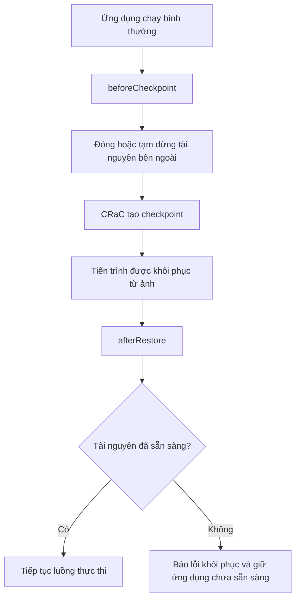

# afterRestore(): tái lập tài nguyên trước khi phục vụ

CRaC khôi phục trạng thái của một tiến trình JVM từ ảnh checkpoint. Heap, đối tượng ứng dụng và trạng thái thực thi được phục hồi theo ảnh, nhưng các tài nguyên bên ngoài có thể đã hết hiệu lực trong thời gian tiến trình tạm dừng. Một kết nối database có thể bị server đóng, socket có thể không còn hợp lệ, token có thể hết hạn, message consumer có thể cần đăng ký lại và file lock có thể đã thuộc về tiến trình khác.

Callback `afterRestore()` cho phép ứng dụng xử lý phần việc đó trong giai đoạn khôi phục. Ứng dụng dùng callback để tạo lại hoặc xác minh tài nguyên, kiểm tra phụ thuộc và chỉ tiếp tục phục vụ khi trạng thái cần thiết đã sẵn sàng.

Điểm quan trọng là phân biệt hai loại trạng thái:

- **Trạng thái trong tiến trình**: đối tượng Java, cấu hình đã nạp, cache và dữ liệu trong heap được khôi phục từ ảnh.
- **Trạng thái bên ngoài tiến trình**: database, broker, dịch vụ HTTP, filesystem, credential và các hệ thống độc lập có thể đã thay đổi trong lúc tiến trình dừng.

Restore bộ nhớ không đồng nghĩa khôi phục lại thế giới bên ngoài. `afterRestore()` là nơi đồng bộ hai phía trước khi ứng dụng tiếp tục hoạt động.

## 1. Vị trí của afterRestore trong vòng đời CRaC

Một resource của CRaC triển khai interface `org.crac.Resource`. Interface có hai callback gắn với hai thời điểm:

- `beforeCheckpoint(...)`: chuẩn bị tài nguyên trước khi tạo ảnh, thường bằng cách dừng hoạt động liên quan và đóng những tài nguyên không thể giữ qua checkpoint.
- `afterRestore(...)`: tái lập hoặc xác minh tài nguyên sau khi trạng thái tiến trình đã được khôi phục.

Luồng tổng quát:



Sau khi restore, CRaC gọi các resource đã đăng ký để ứng dụng có cơ hội tái lập tài nguyên. Các callback phải hoàn tất theo hợp đồng của runtime trước khi ứng dụng tiếp tục luồng hoạt động sau checkpoint. Vì vậy, không nên xem `afterRestore()` như một tác vụ nền tùy chọn có thể chạy sau khi server đã nhận request.

### afterRestore chỉ chạy trên đường restore

`afterRestore()` được gọi khi tiến trình được khôi phục từ checkpoint. Nó không phải callback khởi động thông thường và không được gọi chỉ vì ứng dụng vừa được chạy mới bằng `java -jar`.

Ứng dụng cần có cả hai đường khởi tạo:

1. **Khởi động mới**: tạo kết nối và tài nguyên theo lifecycle thông thường của ứng dụng.
2. **Khởi động từ checkpoint**: khôi phục đối tượng trong bộ nhớ, sau đó dùng `afterRestore()` để làm mới những tài nguyên cần thiết.

Không nên đặt toàn bộ logic khởi tạo chỉ trong `afterRestore()`, vì lần chạy mới sẽ không đi qua callback này. Ngược lại, không nên giả định các constructor, `@PostConstruct`, Spring bean initialization hoặc startup runner sẽ tự chạy lại khi một object graph đã được khôi phục từ ảnh. Các object đó đã tồn tại trong trạng thái heap được restore.

## 2. Đăng ký Resource với CRaC

Resource được đăng ký với context của CRaC để runtime gọi các callback ở đúng giai đoạn. Cách thường dùng là đăng ký với global context:

```java
import org.crac.Context;
import org.crac.Core;
import org.crac.Resource;

public final class ExampleResource implements Resource {

    public ExampleResource() {
        Core.getGlobalContext().register(this);
    }

    @Override
    public void beforeCheckpoint(Context<? extends Resource> context)
            throws Exception {
        // Chuẩn bị hoặc đóng tài nguyên trước checkpoint.
    }

    @Override
    public void afterRestore(Context<? extends Resource> context)
            throws Exception {
        // Tái lập hoặc xác minh tài nguyên sau restore.
    }
}
```

Đăng ký resource một lần trong quá trình khởi tạo ứng dụng. Object resource và trạng thái cần thiết của nó được giữ trong ảnh; khi restore, callback được gọi trên trạng thái đã khôi phục. Không tạo thêm một bản đăng ký mới trong `afterRestore()` nếu không có chủ đích rõ ràng, vì có thể dẫn đến đăng ký lặp hoặc callback chạy nhiều lần ngoài dự kiến.

Tham số `Context<? extends Resource>` là context gắn với resource callback. Phần lớn ứng dụng đơn giản không cần thao tác trực tiếp với tham số này, nhưng vẫn phải khai báo đúng chữ ký interface. Khi dùng context lồng nhau hoặc quản lý resource động, cần tuân theo API và quy tắc vòng đời của phiên bản CRaC đang sử dụng.

## 3. Những tài nguyên cần tái lập sau restore

Không phải mọi object trong heap đều cần tạo lại. Cần xác định tài nguyên nào là trạng thái thuần Java có thể tiếp tục sử dụng và tài nguyên nào đại diện cho một đối tượng bên ngoài có vòng đời độc lập.

| Tài nguyên | Việc cần làm trong afterRestore |
|---|---|
| JDBC connection / connection pool | Tạo pool hoặc connection mới, kiểm tra kết nối và cấu hình timeout |
| HTTP client có socket đang mở | Tạo lại hoặc làm mới connection, kiểm tra endpoint và TLS |
| Message broker producer/consumer | Kết nối lại, xác minh subscription, consumer group và offset |
| Redis/cache client | Kết nối lại, xác minh cluster topology và trạng thái cache |
| File handle | Mở lại file theo đường dẫn, kiểm tra inode/metadata và vị trí đọc ghi |
| File lock | Lấy lại lock theo giao thức ứng dụng và xác minh quyền sở hữu |
| Thread pool đã dừng | Tạo executor mới và khởi động worker cần thiết |
| Scheduler | Đăng ký lại lịch chạy mà không tạo tác vụ trùng |
| Credential/token ngắn hạn | Làm mới token và xác minh quyền truy cập |
| Cloud SDK client | Làm mới credential, endpoint discovery và kết nối cần thiết |

### Database và connection pool

Một object `DataSource` có thể vẫn tồn tại trong heap sau restore, nhưng các socket mà pool giữ có thể đã bị database hoặc network đóng. Nếu tiếp tục lấy connection cũ, ứng dụng có thể gặp lỗi khi request đầu tiên được xử lý.

Các hướng xử lý thường gặp:

- Đóng pool trước checkpoint bằng callback tương ứng.
- Sau restore, tạo pool mới từ cấu hình đã được lưu trong ứng dụng hoặc đọc lại từ nguồn cấu hình.
- Chạy một health check có giới hạn thời gian để xác nhận pool thực sự lấy được connection.
- Chỉ đánh dấu database dependency sẵn sàng sau khi kiểm tra thành công.

Không nên giả định connection đã mở trước checkpoint có thể sống qua khoảng thời gian restore. Database có thể restart, failover, rotate credential hoặc thay đổi DNS trong thời gian đó.

### HTTP client và kết nối mạng

Một HTTP client có thể quản lý connection pool, socket keep-alive, TLS session và DNS cache. Sau restore, các kết nối cũ có thể không còn hợp lệ dù object client vẫn nằm trong heap.

Tùy thư viện, có thể đóng và tạo lại client, xóa connection pool cũ, hoặc gọi cơ chế phục hồi mà thư viện cung cấp. Hãy dùng API chính thức của client đang dùng. Không nên chỉ tạo một object wrapper mới trong khi wrapper cũ vẫn được các service khác tham chiếu.

### Message broker và consumer

Consumer cần tái kết nối và xác minh trạng thái subscription sau restore. Đặc biệt, phải xác định message nào đã được nhận nhưng chưa được xử lý hoặc ack tại thời điểm checkpoint.

Restore trạng thái trong bộ nhớ không thể tự đảm bảo broker giữ nguyên lease hoặc assignment. Consumer có thể được phân phối lại partition, offset có thể thay đổi và message có thể được gửi lại. Thiết kế handler idempotent, xác nhận offset theo đúng thời điểm nghiệp vụ và xử lý duplicate theo giao thức broker.

### File, lock và tài nguyên native

Một file descriptor trong tiến trình được checkpoint không đảm bảo đường dẫn hoặc đối tượng file bên ngoài vẫn như cũ. File có thể đã bị thay thế, volume có thể được mount lại hoặc một tiến trình khác có thể nắm giữ lock.

Nếu cần tiếp tục thao tác với file, hãy mở lại theo đường dẫn đã xác minh và kiểm tra metadata cần thiết. Nếu dùng lock, phải thực hiện lại giao thức lấy lock. Với native library, dùng API hỗ trợ checkpoint/restore hoặc giải phóng và tạo lại tài nguyên theo hướng dẫn của thư viện.

## 4. Thiết kế callback afterRestore an toàn

Một callback tốt thực hiện các bước rõ ràng:

1. Tạo hoặc lấy lại tài nguyên từ factory/configuration.
2. Kiểm tra tài nguyên có thể thực sự phục vụ công việc.
3. Công bố tài nguyên mới cho các thành phần ứng dụng.
4. Chỉ sau đó mới đánh dấu dependency hoặc ứng dụng là ready.
5. Nếu thất bại, đóng tài nguyên tạo dở và báo lỗi để hệ thống xử lý restore thất bại.

Không nên đánh dấu ready ngay sau khi gọi constructor. Một HTTP client được tạo thành công chưa chứng minh endpoint truy cập được; một pool được tạo thành công chưa chứng minh database có thể nhận connection.

### Ví dụ: wrapper tái tạo client

Ví dụ dưới đây minh họa một wrapper giữ client có thể đóng và tạo lại. `Client` và `ClientFactory` là abstraction do ứng dụng định nghĩa; chúng không phải lớp có sẵn trong JDK.

```java
import org.crac.Context;
import org.crac.Core;
import org.crac.Resource;

public final class RestorableClient implements Resource {

    public interface Client extends AutoCloseable {
        void healthCheck() throws Exception;

        @Override
        void close() throws Exception;
    }

    @FunctionalInterface
    public interface ClientFactory {
        Client connect() throws Exception;
    }

    private final ClientFactory factory;
    private volatile Client client;
    private volatile boolean ready;

    public RestorableClient(ClientFactory factory) {
        this.factory = factory;
        Core.getGlobalContext().register(this);
    }

    // Dùng trong lifecycle khởi động JVM mới.
    public void startNormally() throws Exception {
        connectAndPublish();
    }

    @Override
    public synchronized void beforeCheckpoint(
            Context<? extends Resource> context) throws Exception {
        ready = false;

        Client oldClient = client;
        client = null;
        if (oldClient != null) {
            oldClient.close();
        }
    }

    @Override
    public synchronized void afterRestore(
            Context<? extends Resource> context) throws Exception {
        connectAndPublish();
    }

    private void connectAndPublish() throws Exception {
        Client candidate = factory.connect();
        try {
            candidate.healthCheck();
            client = candidate;
            ready = true;
        } catch (Exception failure) {
            try {
                candidate.close();
            } catch (Exception closeFailure) {
                failure.addSuppressed(closeFailure);
            }
            throw failure;
        }
    }

    public Client getClient() {
        if (!ready) {
            throw new IllegalStateException("Client is not ready");
        }
        return client;
    }
}
```

Ví dụ thể hiện một số nguyên tắc:

- Factory được giữ lại để tạo client mới từ cấu hình và credential hiện hành.
- Client cũ được đóng trước checkpoint.
- Client mới chỉ được công bố sau khi health check thành công.
- Cờ `ready` được bật sau khi tài nguyên đã được kiểm tra.
- Nếu tạo hoặc kiểm tra client thất bại, lỗi được truyền ra ngoài thay vì âm thầm tiếp tục.
- `startNormally()` phục vụ lần khởi động JVM mới; `afterRestore()` phục vụ đường khôi phục.

Trong ứng dụng thực tế, cần bảo đảm mọi thành phần đều truy cập client thông qua wrapper hoặc provider này. Nếu service khác giữ trực tiếp tham chiếu đến client cũ, việc thay `client` trong wrapper sẽ không cập nhật các tham chiếu đó. Có thể dùng dependency provider, factory hoặc một abstraction ổn định để các consumer luôn lấy client hiện tại.

Ngoài ra, callback `beforeCheckpoint` cần chạy sau khi ứng dụng đã drain công việc đang sử dụng client. Không đóng client khi request vẫn đang thực hiện. Nếu việc đóng thất bại, cần để checkpoint thất bại theo chính sách của runtime thay vì tạo ảnh với tài nguyên ở trạng thái không xác định.

## 5. Phối hợp afterRestore với readiness

Một ứng dụng được restore không nên nhận traffic chỉ vì process đã tồn tại hoặc cổng HTTP đã mở. Nó cần hoàn tất các bước phục hồi quan trọng trước khi được đưa trở lại load balancer.

Có thể chia readiness thành nhiều dependency:

- Database đã kết nối và thực hiện được truy vấn kiểm tra.
- Message broker đã kết nối và subscription/assignment đã ổn định.
- Cache hoặc distributed lock service đã sẵn sàng.
- Credential còn hiệu lực.
- Scheduler và worker đã ở trạng thái phù hợp.

Chỉ bật readiness khi các dependency bắt buộc đã sẵn sàng. Dependency tùy chọn có thể được phục hồi bất đồng bộ nếu ứng dụng có thể hoạt động an toàn khi thiếu nó; điều này phải được thể hiện rõ trong health status.

### Readiness khác liveness

- **Liveness** trả lời câu hỏi process có còn hoạt động và có cần restart hay không.
- **Readiness** trả lời câu hỏi instance có thể nhận traffic hay chưa.

Trong quá trình restore, một process có thể còn sống nhưng chưa sẵn sàng vì database pool hoặc broker chưa được tái lập. Nếu dùng liveness thay cho readiness, orchestrator có thể đưa instance vào phục vụ quá sớm.

Không nên dùng một health endpoint luôn trả về thành công chỉ vì JVM đã khởi động. Health check phải phản ánh trạng thái phục hồi thực tế.

## 6. Xử lý lỗi trong afterRestore

`afterRestore()` cho phép khai báo `throws Exception`. Nếu tài nguyên bắt buộc không thể tái lập, ứng dụng cần thể hiện thất bại rõ ràng. Bắt exception rồi ghi log và trả về bình thường có thể khiến JVM tiếp tục chạy với một dependency không dùng được.

Hãy phân loại lỗi:

| Loại lỗi | Cách xử lý phù hợp |
|---|---|
| Lỗi tạm thời, có thể retry | Retry có giới hạn, backoff và timeout tổng |
| Credential hết hạn | Lấy credential mới từ nguồn được phép rồi xác minh lại |
| Endpoint không truy cập được | Giữ readiness ở trạng thái false và báo lỗi |
| Cấu hình không hợp lệ | Dừng restore hoặc fail rõ ràng; không retry vô hạn |
| Native resource không hỗ trợ restore | Thực hiện quy trình tái tạo được thư viện hỗ trợ hoặc từ chối ảnh |
| Resource đã được đóng một phần | Dọn trạng thái dở dang và tạo lại từ đầu nếu có thể |

### Retry có giới hạn

Nếu dependency có thể phục hồi sau một khoảng gián đoạn ngắn, callback có thể thử lại trong một khoảng thời gian có giới hạn. Cần có:

- Timeout tổng để callback không treo vô hạn.
- Backoff để tránh tạo tải lớn lên dịch vụ đang gặp sự cố.
- Log có tên resource, lần thử và nguyên nhân.
- Quy tắc phân biệt lỗi tạm thời với lỗi cấu hình hoặc credential.

Không nên retry vô hạn trong callback. Nếu database không thể phục hồi, một vòng lặp không giới hạn sẽ khiến restore không có kết quả rõ ràng và khó điều phối.

### Không nuốt exception

Tránh cách viết:

```java
@Override
public void afterRestore(Context<? extends Resource> context) {
    try {
        reconnect();
    } catch (Exception exception) {
        log.error("Reconnect failed", exception);
    }
}
```

Đoạn mã trên ghi log nhưng không thông báo cho CRaC rằng resource bắt buộc chưa phục hồi được. Nếu ứng dụng tiếp tục, request có thể thất bại muộn hơn ở một nơi khó chẩn đoán.

Với dependency bắt buộc, hãy để exception truyền ra hoặc chuyển thành lỗi phù hợp theo hợp đồng API, đồng thời giữ readiness ở trạng thái false. Với dependency tùy chọn, chỉ tiếp tục khi ứng dụng đã thiết kế rõ cách hoạt động khi dependency đó vắng mặt.

## 7. Tránh khởi tạo lặp và side effect trùng

Heap đã được khôi phục chứa object graph trước checkpoint. Nếu `afterRestore()` chạy lại toàn bộ quy trình startup như một lần khởi động mới, ứng dụng có thể:

- Tạo thêm scheduler trong khi scheduler cũ đã được khôi phục.
- Đăng ký listener hoặc shutdown hook nhiều lần.
- Khởi tạo thêm thread pool và làm tăng số worker.
- Đăng ký consumer trùng hoặc tạo subscription dư thừa.
- Gửi lại thông điệp hoặc thực hiện side effect nghiệp vụ lần thứ hai.
- Ghi đè trạng thái đã được restore bằng dữ liệu mặc định.

Hãy chia logic thành các nhóm:

1. **Khởi tạo một lần cho object graph**: cấu hình, service, resource wrapper và dependency injection.
2. **Khởi tạo khi JVM chạy mới**: tạo tài nguyên ban đầu theo lifecycle startup.
3. **Tái lập sau restore**: chỉ làm mới những tài nguyên có vòng đời bên ngoài hoặc cần xác minh lại.
4. **Khởi động lại worker có chủ đích**: chỉ tạo lại executor, scheduler hoặc consumer nếu chúng đã được dừng trước checkpoint.

Nếu một bước có thể được gọi nhiều lần do retry hoặc do quy trình điều phối, thiết kế bước đó idempotent. Ví dụ, kiểm tra subscription trước khi tạo mới, dùng tên consumer group ổn định, và không thực hiện lại một giao dịch nghiệp vụ chỉ vì callback được chạy.

## 8. Tích hợp với Spring Boot

Trong ứng dụng Spring Boot, có thể đăng ký một bean triển khai `Resource`. Bean được tạo trong lần khởi động mới và đăng ký với global context. Sau restore, bean đã nằm trong heap được khôi phục và callback `afterRestore()` được gọi trên bean đó.

Ví dụ cấu trúc:

```java
import org.crac.Context;
import org.crac.Core;
import org.crac.Resource;
import org.springframework.stereotype.Component;

@Component
public final class BrokerCracResource implements Resource {

    private final BrokerConnectionManager connectionManager;

    public BrokerCracResource(BrokerConnectionManager connectionManager) {
        this.connectionManager = connectionManager;
        Core.getGlobalContext().register(this);
    }

    @Override
    public void beforeCheckpoint(Context<? extends Resource> context)
            throws Exception {
        connectionManager.stopAndClose();
    }

    @Override
    public void afterRestore(Context<? extends Resource> context)
            throws Exception {
        connectionManager.connectAndVerify();
    }
}
```

`BrokerConnectionManager` là thành phần do ứng dụng định nghĩa. Nó nên cung cấp các thao tác có ý nghĩa rõ ràng, có timeout và báo lỗi nếu kết nối không thể phục hồi. Ví dụ trên giả định manager được thiết kế để thay thế connection cũ mà không làm các service khác giữ lại tham chiếu lỗi thời.

### Những điểm cần chú ý trong Spring

- Không giả định `@PostConstruct` sẽ chạy lại trên mọi bean sau restore.
- Không tạo lại toàn bộ ApplicationContext chỉ để phục hồi socket.
- Không đăng ký cùng một Resource nhiều lần khi callback chạy.
- Dùng readiness của Spring Boot để giữ instance khỏi nhận traffic trong giai đoạn phục hồi.
- Xác minh các bean có thread, executor hoặc client native đều có lifecycle phù hợp.
- Kiểm tra thứ tự phụ thuộc giữa các resource; nếu broker phụ thuộc credential provider, phải bảo đảm credential được làm mới trước khi kết nối broker.

Nếu thứ tự giữa nhiều bước phục hồi quan trọng, hãy gom chúng vào một resource điều phối hoặc thiết kế các resource theo context/lifecycle có thứ tự được tài liệu CRaC hỗ trợ. Không dựa vào thứ tự tình cờ của bean discovery hoặc component scan.

## 9. Quan sát và ghi log quá trình phục hồi

Khi restore thất bại, log cần giúp xác định resource nào chưa sẵn sàng và vì sao. Mỗi callback nên ghi nhận:

- Tên resource và thời điểm bắt đầu.
- Thời gian thực hiện.
- Kết quả tạo lại hoặc kiểm tra.
- Số lần retry nếu có.
- Loại lỗi và thông tin phụ trợ không nhạy cảm.
- Trạng thái readiness sau khi hoàn tất.

Không ghi password, access token, private key, connection string chứa secret hoặc nội dung dữ liệu nhạy cảm vào log. Có thể ghi hostname/service name, mã lỗi, timeout và correlation id nếu các giá trị đó không tiết lộ bí mật.

Ví dụ log có cấu trúc:

```text
INFO  crac-resource=database phase=afterRestore event=start
INFO  crac-resource=database phase=afterRestore event=connected duration_ms=184
INFO  crac-resource=broker phase=afterRestore event=start
WARN  crac-resource=broker phase=afterRestore event=retry attempt=2 reason=connection_timeout
INFO  crac-resource=broker phase=afterRestore event=ready duration_ms=920
INFO  application phase=restore event=readiness_ready
```

Các chỉ số hữu ích gồm tổng thời gian restore, thời gian từng resource, số lần retry, số resource thất bại và thời gian từ lúc restore đến khi readiness thành công. Dùng chúng để xác định dependency nào làm chậm quá trình đưa instance trở lại phục vụ.

## 10. Kiểm thử afterRestore

Kiểm thử callback trong một JVM đang chạy bình thường là chưa đủ. Cần tạo ảnh checkpoint và thực hiện restore thật trên môi trường tương thích để xác nhận runtime gọi callback đúng như mong đợi.

### Các tình huống nên kiểm tra

| Tình huống | Kết quả mong đợi |
|---|---|
| Khởi động JVM mới | Startup tạo tài nguyên ban đầu; không phụ thuộc afterRestore |
| Restore khi database bình thường | Pool được tạo lại và health check thành công |
| Database tạm thời không truy cập được | Retry có giới hạn; readiness vẫn false cho đến khi thành công |
| Credential đã hết hạn | Credential được làm mới hoặc restore thất bại rõ ràng |
| Broker phân phối lại partition | Consumer xác minh assignment/offset và xử lý duplicate an toàn |
| Callback tạo resource thất bại | Không công bố resource chưa sẵn sàng |
| Restore lặp từ cùng ảnh trong môi trường test | Không tạo đăng ký, scheduler hoặc side effect trùng |
| Ứng dụng có nhiều Resource | Thứ tự phụ thuộc được quản lý và lỗi được xác định rõ |

### Quy trình kiểm thử đề xuất

1. Khởi động ứng dụng mới và xác nhận startup bình thường.
2. Xác nhận Resource đã đăng ký và tài nguyên bên ngoài đang hoạt động.
3. Gửi ứng dụng đến trạng thái có thể checkpoint.
4. Tạo checkpoint theo cách của JDK CRaC đang dùng.
5. Thay đổi một điều kiện bên ngoài có thể kiểm soát, ví dụ đóng connection cũ hoặc làm mới credential trong môi trường thử nghiệm.
6. Restore ảnh.
7. Kiểm tra log cho thấy `afterRestore()` đã chạy.
8. Xác nhận client mới thực sự hoạt động bằng health check hoặc request thực tế.
9. Xác nhận readiness chỉ chuyển sang true sau khi các dependency bắt buộc sẵn sàng.
10. Kiểm tra không có scheduler, consumer, listener hoặc side effect bị nhân đôi.

Nên thử cả trường hợp thành công và thất bại. Một callback chỉ được coi là có thể vận hành khi nó xử lý được dependency gián đoạn, credential thay đổi và lỗi tạo tài nguyên mà không để ứng dụng phục vụ trong trạng thái nửa khởi tạo.

## 11. Những hiểu lầm thường gặp

| Hiểu lầm | Cách hiểu chính xác |
|---|---|
| Restore sẽ chạy lại constructor của mọi bean. | Object graph được khôi phục từ ảnh; không phải một lần khởi tạo JVM mới. |
| afterRestore là callback startup thông thường. | Callback chỉ phục vụ đường khôi phục từ checkpoint. |
| Object client còn trong heap nghĩa là socket vẫn dùng được. | Trạng thái của dịch vụ và kết nối bên ngoài có thể đã thay đổi. |
| Chỉ cần tạo client mới là đủ. | Cần kiểm tra kết nối, quyền, subscription và trạng thái thực tế. |
| Có thể bắt mọi exception rồi tiếp tục. | Dependency bắt buộc thất bại phải được báo rõ và giữ ứng dụng chưa ready. |
| Callback có thể tạo scheduler mới mà không kiểm tra. | Có nguy cơ tạo worker hoặc tác vụ trùng với trạng thái đã restore. |
| Process đã sống nghĩa là có thể nhận request. | Readiness phải phản ánh việc phục hồi dependency đã hoàn tất. |
| Restore khôi phục transaction của hệ thống bên ngoài. | CRaC khôi phục tiến trình; transaction và tính nhất quán phân tán vẫn do ứng dụng quản lý. |

## 12. Checklist trước khi đưa instance trở lại phục vụ

- [ ] Resource đã được đăng ký đúng một lần với CRaC context.
- [ ] Đường khởi động JVM mới có logic tạo tài nguyên riêng, không phụ thuộc afterRestore.
- [ ] Tài nguyên cũ đã được đóng hoặc chuẩn bị theo hợp đồng trước checkpoint.
- [ ] afterRestore tạo hoặc làm mới kết nối cần thiết.
- [ ] Health check xác minh tài nguyên có thể thực sự hoạt động.
- [ ] Credential, DNS, endpoint và cấu hình bên ngoài đã được kiểm tra lại.
- [ ] Consumer, scheduler và worker không bị khởi tạo trùng.
- [ ] Các thao tác có side effect được bảo vệ bằng idempotency hoặc cơ chế deduplication.
- [ ] Lỗi bắt buộc được truyền ra hoặc làm restore thất bại rõ ràng.
- [ ] Retry có timeout và backoff, không lặp vô hạn.
- [ ] Readiness chỉ chuyển sang true khi dependency bắt buộc sẵn sàng.
- [ ] Log không chứa secret và có đủ thông tin để chẩn đoán.
- [ ] Đã kiểm thử restore thật, cả trường hợp dependency sẵn sàng và bị lỗi.

`afterRestore()` là ranh giới giữa việc khôi phục trạng thái JVM và việc đưa ứng dụng trở lại phục vụ. Callback cần tái lập những tài nguyên bên ngoài đã mất hiệu lực, kiểm tra chúng trước khi công bố cho ứng dụng và xử lý lỗi theo chính sách rõ ràng. Khi kết hợp đúng với readiness, idempotency và kiểm thử restore thực tế, ứng dụng có thể tiếp tục từ checkpoint mà không dựa vào các kết nối hoặc giả định đã cũ.
