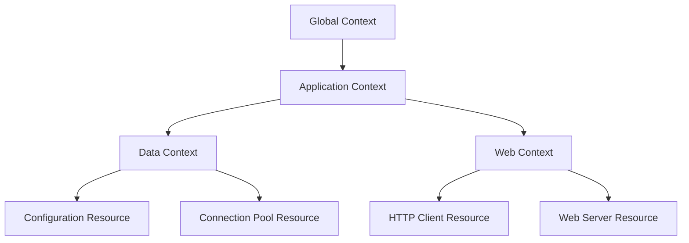

# Context lồng nhau và điều phối quan hệ phụ thuộc

Trong Java CRaC, `Resource` đại diện cho một thành phần cần nhận thông báo trước checkpoint và sau restore. `Context` quản lý một nhóm `Resource` và quyết định cách phân phối hai thông báo đó. Vì bản thân `Context` cũng là một `Resource`, một context có thể được đăng ký bên trong context khác. Các context lồng nhau tạo thành một cây quản lý vòng đời, giúp chia ứng dụng thành các nhóm tài nguyên và điều phối thứ tự xử lý theo quan hệ phụ thuộc.

Ví dụ, một ứng dụng có thể có nhóm hạ tầng chứa cấu hình bảo mật và connection pool, cùng nhóm HTTP chứa HTTP client và web server. Connection pool cần cấu hình bảo mật sẵn sàng trước khi mở; web server chỉ nên nhận request sau khi các client và dịch vụ phụ thuộc đã được phục hồi. Một cây `Context` có thể biểu diễn những quan hệ này để đóng tài nguyên theo thứ tự ngược lại và phục hồi theo thứ tự phụ thuộc.

## 1. Vai trò của `Resource` và `Context`

`Resource` là interface nhận hai callback:

- `beforeCheckpoint(Context<? extends Resource> context)`: chuẩn bị tài nguyên trước khi JVM chụp trạng thái, ví dụ dừng nhận request, đóng socket hoặc đưa một pool về trạng thái an toàn.
- `afterRestore(Context<? extends Resource> context)`: làm mới tài nguyên sau khi tiến trình được khôi phục, ví dụ mở lại kết nối, cập nhật thông tin môi trường hoặc khởi động lại dịch vụ.

Một `Resource` muốn nhận callback phải được đăng ký với một `Context` thông qua `register(resource)`. API cung cấp context gốc bằng `Core.getGlobalContext()`:

```java
import org.crac.Context;
import org.crac.Core;
import org.crac.Resource;

public final class DatabaseResource implements Resource {
    public DatabaseResource() {
        Core.getGlobalContext().register(this);
    }

    @Override
    public void beforeCheckpoint(Context<? extends Resource> context)
            throws Exception {
        // Đóng hoặc tạm dừng tài nguyên trước checkpoint.
    }

    @Override
    public void afterRestore(Context<? extends Resource> context)
            throws Exception {
        // Tạo lại hoặc kiểm tra tài nguyên sau restore.
    }
}
```

Global context là lựa chọn đơn giản cho ứng dụng nhỏ. Khi tất cả tài nguyên được đăng ký trực tiếp ở đó, danh sách tài nguyên nằm trong một nhóm chung. Ứng dụng lớn có thể cần chia theo subsystem, chẳng hạn database, messaging, HTTP server, scheduler hoặc cache. Đây là lúc context lồng nhau trở nên hữu ích.

## 2. `Context` cũng là một `Resource`

Trong API `org.crac`, `Context<R extends Resource>` là một abstract class triển khai `Resource`. Ngoài phương thức `register(R resource)`, lớp con phải định nghĩa `beforeCheckpoint(...)` và `afterRestore(...)`. Do một context cũng là một resource, context con có thể được đăng ký với context cha:

```java
Context<Resource> global = Core.getGlobalContext();
Context<Resource> subsystem = createSubsystemContext();

global.register(subsystem);
```

Đoạn trên minh họa quan hệ cha-con; `createSubsystemContext()` là factory do ứng dụng tự triển khai. API không yêu cầu một phương thức dựng sẵn tên `createContext()`. Muốn tạo context con với quy tắc riêng, ứng dụng định nghĩa một lớp kế thừa `Context`.

Mô hình phân cấp có thể hình dung như sau:



Mỗi context cha chỉ cần biết các context hoặc resource con trực tiếp của nó. Context con chịu trách nhiệm điều phối nhóm bên trong. Cấu trúc này giảm sự phụ thuộc trực tiếp giữa các thành phần và giúp tổ chức lifecycle theo ranh giới của subsystem.

## 3. Thứ tự callback và quan hệ phụ thuộc

Global context có quy tắc thứ tự rõ ràng:

| Thời điểm | Thứ tự thông báo |
|---|---|
| `beforeCheckpoint` | Đảo ngược thứ tự đăng ký |
| `afterRestore` | Theo thứ tự đăng ký |

Quy tắc này hỗ trợ quan hệ phụ thuộc. Thành phần cung cấp dependency nên được đăng ký trước thành phần sử dụng dependency đó. Khi checkpoint, thành phần sử dụng được dừng trước; khi restore, dependency được phục hồi trước khi consumer khởi động.

Ví dụ, nếu web server phụ thuộc vào HTTP client, HTTP client phụ thuộc vào cấu hình TLS, và connection pool phụ thuộc vào cấu hình bảo mật, thứ tự đăng ký có thể là:

1. Configuration hoặc secret provider.
2. TLS context và connection pool.
3. HTTP client.
4. Web server.

Khi checkpoint, callback chạy theo thứ tự ngược: web server dừng nhận request trước, sau đó HTTP client đóng, tiếp đến connection pool và cuối cùng cấu hình nền tảng được giải phóng nếu cần. Khi restore, thứ tự được đảo lại để cấu hình, pool, client rồi server lần lượt sẵn sàng.

Thứ tự đăng ký không phải bộ giải bài toán dependency tự động. Người thiết kế phải xác định dependency thực tế và sắp xếp các resource phù hợp. Nếu có phụ thuộc vòng, hãy tách trách nhiệm hoặc tạo một resource điều phối chung thay vì cố xử lý bằng cách đổi thứ tự đăng ký.

## 4. Tạo một `Context` tùy chỉnh

Khi cần một nhóm resource có thứ tự callback riêng, có thể kế thừa `Context`. Ví dụ sau tạo `OrderedContext`, lưu các resource con và áp dụng quy tắc: gọi `beforeCheckpoint` theo thứ tự ngược, gọi `afterRestore` theo thứ tự đăng ký.

```java
import java.util.ArrayList;
import java.util.List;
import java.util.Objects;

import org.crac.CheckpointException;
import org.crac.Context;
import org.crac.Resource;
import org.crac.RestoreException;

public final class OrderedContext<R extends Resource> extends Context<R> {
    private final List<R> resources = new ArrayList<>();

    @Override
    public synchronized void register(R resource) {
        resources.add(Objects.requireNonNull(resource, "resource"));
    }

    private synchronized List<R> snapshot() {
        return new ArrayList<>(resources);
    }

    @Override
    public void beforeCheckpoint(Context<? extends Resource> parent)
            throws CheckpointException {
        List<R> current = snapshot();
        CheckpointException failure = null;

        for (int i = current.size() - 1; i >= 0; i--) {
            try {
                current.get(i).beforeCheckpoint(this);
            } catch (Exception e) {
                if (failure == null) {
                    failure = new CheckpointException(
                            "One or more resources failed before checkpoint");
                }
                failure.addSuppressed(e);
            }
        }

        if (failure != null) {
            throw failure;
        }
    }

    @Override
    public void afterRestore(Context<? extends Resource> parent)
            throws RestoreException {
        List<R> current = snapshot();
        RestoreException failure = null;

        for (R resource : current) {
            try {
                resource.afterRestore(this);
            } catch (Exception e) {
                if (failure == null) {
                    failure = new RestoreException(
                            "One or more resources failed after restore");
                }
                failure.addSuppressed(e);
            }
        }

        if (failure != null) {
            throw failure;
        }
    }
}
```

Một số điểm trong cách triển khai:

- `OrderedContext` kế thừa `Context<R>`, vì vậy bản thân nó có thể được đăng ký như một `Resource` trong context cha.
- `register` giữ các resource con trong danh sách. `snapshot()` tạo bản sao để callback không giữ khóa đồng bộ trong lúc gọi mã của resource.
- `beforeCheckpoint` duyệt danh sách từ cuối về đầu; `afterRestore` duyệt từ đầu đến cuối.
- Callback của resource con nhận `this`, tức context trực tiếp điều phối resource đó. Tham số `parent` là context đã gọi callback trên context hiện tại.
- Các exception được gom bằng `addSuppressed` để các resource còn lại vẫn nhận callback và lỗi có thể được báo cáo cùng nhau.

Đây là một mẫu triển khai để minh họa. Trong ứng dụng thực tế, cần xác định chính sách đăng ký, đồng bộ và lỗi phù hợp với lifecycle của ứng dụng. Nếu resource có thể được thêm trong lúc checkpoint hoặc restore đang chạy, cần quy định rõ resource mới sẽ tham gia từ chu kỳ nào. Cách đơn giản và dễ dự đoán nhất là hoàn tất đăng ký trước khi ứng dụng cho phép tạo checkpoint.

## 5. Xây dựng cây context cho ứng dụng

Giả sử ứng dụng có hai subsystem: data và web. Data cần cấu hình trước connection pool; web cần HTTP client trước web server. Ta có thể tạo hai context con rồi đăng ký chúng trong application context:

```java
import org.crac.Context;
import org.crac.Core;
import org.crac.Resource;

public final class ApplicationCracSetup {
    private final OrderedContext<Resource> application =
            new OrderedContext<>();
    private final OrderedContext<Resource> data =
            new OrderedContext<>();
    private final OrderedContext<Resource> web =
            new OrderedContext<>();

    public ApplicationCracSetup(
            Resource configuration,
            Resource connectionPool,
            Resource httpClient,
            Resource webServer) {

        // Dependency được đăng ký trước consumer.
        data.register(configuration);
        data.register(connectionPool);

        web.register(httpClient);
        web.register(webServer);

        // Data phải phục hồi trước web.
        application.register(data);
        application.register(web);

        Context<Resource> global = Core.getGlobalContext();
        global.register(application);
    }
}
```

Trong ví dụ, `configuration`, `connectionPool`, `httpClient` và `webServer` là các đối tượng triển khai `Resource`. Context `application` giữ hai context con; mỗi context con giữ các resource trực tiếp của subsystem. Khi global context gọi `application`, context này tiếp tục phân phối callback xuống cây.

Thứ tự được tạo ra như sau:

| Giai đoạn | Trình tự |
|---|---|
| Checkpoint | `webServer` → `httpClient` → `connectionPool` → `configuration` |
| Restore | `configuration` → `connectionPool` → `httpClient` → `webServer` |

Để cây context hoạt động ổn định, hãy giữ tham chiếu mạnh tới `ApplicationCracSetup` hoặc ít nhất tới `application` trong một thành phần sống suốt vòng đời ứng dụng. Global context có thể giữ resource đã đăng ký bằng weak reference; nếu chỉ tạo context trong biến cục bộ rồi bỏ tham chiếu, context có thể bị garbage collector thu hồi và không còn nhận callback. Các context con và resource lá cũng phải được giữ sống bởi context cha hoặc thành phần sở hữu phù hợp.

Không đăng ký cùng một resource vừa trực tiếp với global context vừa bên trong context con. Nếu làm vậy, resource có thể nhận callback nhiều lần trong cùng một chu kỳ. Mỗi resource nên có một context sở hữu rõ ràng.

## 6. Điều phối lỗi trong cây context

Callback CRaC có thể thất bại. Ví dụ, connection pool không đóng được kết nối trước checkpoint hoặc HTTP client không thể tạo lại TLS session sau restore. Một context cần xử lý lỗi sao cho không che giấu nguyên nhân và không khiến ứng dụng báo sẵn sàng sai.

Global context tổng hợp lỗi từ các resource bằng `CheckpointException` hoặc `RestoreException`, giữ lỗi thành phần trong danh sách suppressed exceptions. Khi tự triển khai context, nên duy trì hành vi tương tự: tiếp tục thông báo cho các resource còn lại, gom lỗi, rồi ném exception tổng hợp về context cha.

Khi checkpoint callback thất bại, checkpoint không nên được xem là thành công. Runtime có thể thực hiện pha restore của tiến trình ban đầu sau khi checkpoint notification thất bại; resource cần có logic phục hồi nhất quán cho tình huống này. Khi restore callback thất bại, ứng dụng không được chuyển sang trạng thái ready nếu một dependency bắt buộc chưa hoạt động.

Ví dụ kiểm tra exception tổng hợp ở điểm gọi checkpoint:

```java
import org.crac.CheckpointException;
import org.crac.Core;
import org.crac.RestoreException;

public final class CheckpointCoordinator {
    public void checkpoint() {
        try {
            Core.checkpointRestore();
        } catch (CheckpointException e) {
            logCheckpointFailure(e);
            throw e;
        } catch (RestoreException e) {
            logRestoreFailure(e);
            throw e;
        }
    }

    private void logCheckpointFailure(CheckpointException e) {
        for (Throwable cause : e.getSuppressed()) {
            System.err.println("beforeCheckpoint failed: " + cause);
        }
    }

    private void logRestoreFailure(RestoreException e) {
        for (Throwable cause : e.getSuppressed()) {
            System.err.println("afterRestore failed: " + cause);
        }
    }
}
```

Đây là ví dụ minh họa cách phân biệt hai nhóm lỗi. Ứng dụng thực tế nên dùng logging framework, ghi đầy đủ cause chain và suppressed exceptions, đồng thời quyết định rõ khi nào tiến trình phải dừng hoặc không nhận traffic.

## 7. Những nguyên tắc khi thiết kế context lồng nhau

### Nhóm theo vòng đời của subsystem

Một context con nên đại diện cho nhóm tài nguyên có chung ranh giới quản lý, ví dụ persistence, messaging, web hoặc scheduler. Tránh tạo context chỉ để bọc một object đơn giản nếu nó không giúp làm rõ thứ tự hoặc quyền sở hữu.

### Đăng ký theo chiều dependency

Trong mỗi context, đăng ký dependency trước consumer. Quy tắc này giúp callback checkpoint chạy theo chiều tháo dỡ và callback restore chạy theo chiều dựng lại. Ghi rõ quan hệ phụ thuộc trong tài liệu hoặc sơ đồ để người bảo trì hiểu vì sao thứ tự đăng ký được chọn.

### Một resource chỉ có một nơi quản lý

Đăng ký trùng ở nhiều context có thể khiến callback chạy nhiều lần. Chọn một context sở hữu resource và để context cha quản lý context con.

### Giữ context và resource sống

Global context giữ weak reference tới resource đã đăng ký. Hãy giữ tham chiếu mạnh trong application singleton, lifecycle bean hoặc registry sống suốt thời gian tiến trình. Context tùy chỉnh cũng phải giữ các resource con mà nó quản lý.

### Đăng ký trước khi checkpoint bắt đầu

Không thay đổi cây context tùy tiện khi callback đang chạy. Nếu ứng dụng có plugin hoặc resource động, cần một cơ chế đồng bộ để đóng băng danh sách đăng ký trước checkpoint và xác định cách đăng ký mới tham gia chu kỳ tiếp theo.

### Tránh công việc dài và phụ thuộc lẫn nhau trong callback

Callback là một phần của thời gian checkpoint/restore. Chỉ thực hiện thao tác cần thiết để đóng, đồng bộ hoặc phục hồi tài nguyên. Nếu một resource cần nhiều bước, hãy đóng gói các bước trong resource đó hoặc context chuyên trách thay vì để nhiều resource thao tác trên cùng một trạng thái.

### Kiểm tra nhiều chu kỳ

Một cây context có thể hoạt động đúng trong lần checkpoint đầu tiên nhưng gặp lỗi khi restore nhiều lần. Hãy kiểm tra connection pool, executor, scheduler, client và server qua nhiều chu kỳ để phát hiện đăng ký trùng, thread bị nhân đôi hoặc tài nguyên không được đóng đúng.

## 8. Các lỗi thường gặp

| Vấn đề | Nguyên nhân có thể | Cách xử lý |
|---|---|---|
| Resource không nhận callback | Không được đăng ký hoặc context đã bị garbage collector thu hồi | Kiểm tra context sở hữu và giữ tham chiếu mạnh |
| Callback chạy hai lần | Cùng resource được đăng ký ở context cha và context con | Chỉ đăng ký tại một context sở hữu |
| Restore consumer trước dependency | Thứ tự đăng ký không phản ánh quan hệ phụ thuộc | Đăng ký provider trước consumer |
| Một lỗi làm mất thông tin lỗi khác | Custom context dừng ngay ở exception đầu tiên | Tiếp tục thông báo các resource còn lại và gom lỗi suppressed |
| Ứng dụng ready dù resource chưa phục hồi | Readiness không chờ callback hoặc bỏ qua exception | Chỉ mở traffic sau khi phục hồi thành công |
| Context con không phân phối callback xuống dưới | Lớp con không triển khai đúng hai callback hoặc không gọi resource con | Kiểm tra implementation của `Context` tùy chỉnh |
| Cây context khó bảo trì | Nhóm quá nhỏ, phụ thuộc vòng hoặc đăng ký rải rác | Gom theo subsystem và mô tả thứ tự phụ thuộc |

Một lỗi khác là chỉ dựa vào thứ tự tạo object trong dependency injection container mà không kiểm tra thứ tự đăng ký với CRaC. Hai thứ tự này có thể khác nhau. Hãy đăng ký resource một cách tường minh và kiểm tra log callback trong một lần checkpoint/restore thử nghiệm.

## 9. Kiểm tra thứ tự bằng log

Trong giai đoạn phát triển, có thể ghi log trong callback để nhìn thấy thứ tự thực tế. Ví dụ:

```java
public final class NamedResource implements Resource {
    private final String name;

    public NamedResource(String name) {
        this.name = name;
    }

    @Override
    public void beforeCheckpoint(Context<? extends Resource> context) {
        System.out.println("beforeCheckpoint: " + name);
    }

    @Override
    public void afterRestore(Context<? extends Resource> context) {
        System.out.println("afterRestore: " + name);
    }
}
```

Đăng ký các resource theo dependency order rồi tạo checkpoint trên CRaC-enabled runtime. Log cần thể hiện các resource được dừng theo thứ tự ngược và phục hồi theo thứ tự đăng ký. Với context lồng nhau, log nên ghi cả tên context và tên resource để xác định nhánh nào đang xử lý.

Không nên để `System.out.println` làm cơ chế quan sát duy nhất trong production. Dùng logger có tên subsystem, mã định danh checkpoint và thông tin exception để có thể truy vết thứ tự trong môi trường thật.

## 10. Checklist thiết kế

- [ ] Mỗi tài nguyên cần phối hợp checkpoint/restore đều triển khai `Resource`.
- [ ] Mỗi resource được đăng ký đúng một lần với context sở hữu.
- [ ] Context con kế thừa `Context<R>` và tự phân phối callback cho resource con.
- [ ] Cây context phản ánh ranh giới subsystem và dependency thực tế.
- [ ] Dependency được đăng ký trước consumer.
- [ ] `beforeCheckpoint` chạy ngược thứ tự đăng ký; `afterRestore` chạy theo thứ tự đăng ký.
- [ ] Custom context gom lỗi và giữ suppressed exceptions.
- [ ] Context và resource được giữ tham chiếu mạnh trong suốt vòng đời cần thiết.
- [ ] Cây đăng ký không thay đổi tùy tiện khi callback đang thực thi.
- [ ] Readiness chỉ thành công sau khi các resource bắt buộc đã phục hồi.
- [ ] Đã quan sát thứ tự callback và thử nhiều chu kỳ checkpoint/restore.

## 11. Tài liệu tham khảo

- [CRaC API 1.5.0 — `Context`](https://javadoc.io/static/org.crac/crac/1.5.0/org/crac/Context.html): định nghĩa `Context` là một `Resource`, cách đăng ký resource con và callback của context.
- [CRaC API 1.5.0 — Package `org.crac`](https://javadoc.io/static/org.crac/crac/1.5.0/org/crac/package-summary.html): mô tả hierarchy của context và quy tắc notification của global context.
- [CRaC Best Practices](https://crac.org/reference/best-practices/): các lưu ý về vòng đời resource và việc giữ tham chiếu tới resource đã đăng ký.

Context lồng nhau cho phép chia tài nguyên thành các nhóm có vòng đời riêng và kết nối các nhóm thành một cây điều phối. Vì `Context` cũng là `Resource`, context con có thể được đăng ký trong context cha. Khi thiết kế cây này, hãy đăng ký dependency trước consumer, xử lý checkpoint theo thứ tự ngược, restore theo thứ tự đăng ký, giữ context sống và tổng hợp lỗi để ứng dụng chỉ tiếp tục phục vụ khi mọi tài nguyên bắt buộc đã sẵn sàng.
