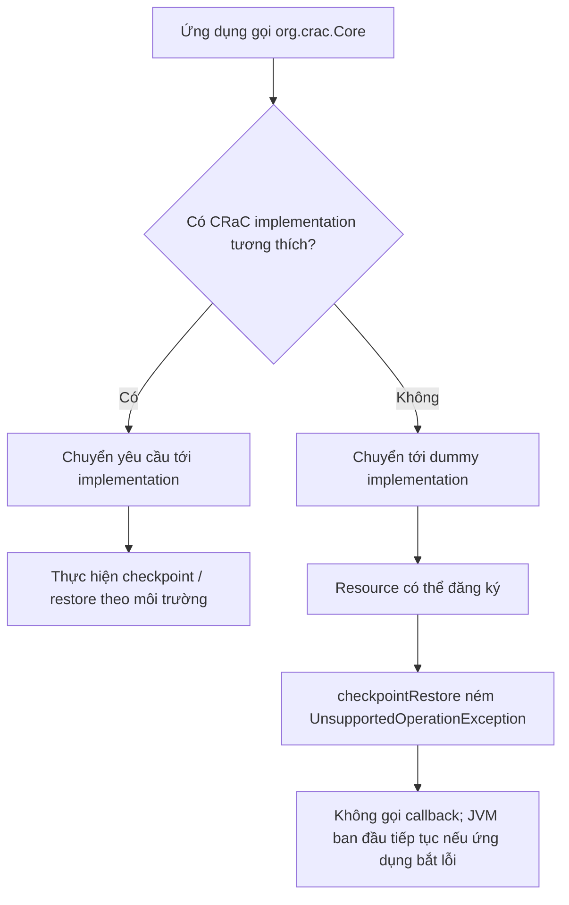

# Hành vi của `org.crac` trên JVM không hỗ trợ checkpoint

Ứng dụng Java có thể cần sử dụng CRaC API trong code nhưng vẫn phải chạy được trên máy phát triển, môi trường kiểm thử hoặc JVM thông thường không có khả năng checkpoint/restore. Package `org.crac` được thiết kế để hỗ trợ tình huống này thông qua một thư viện tương thích. Thư viện cung cấp API để biên dịch ứng dụng và tìm implementation CRaC ở runtime; nếu không tìm thấy implementation tương thích, nó chuyển sang dummy implementation.

Trên JVM không có CRaC implementation, ứng dụng vẫn có thể khởi tạo và đăng ký `Resource` qua dummy implementation. Tuy nhiên, thao tác yêu cầu checkpoint không thể thực hiện: `Core.checkpointRestore()` ném `UnsupportedOperationException`, không phát callback checkpoint/restore và việc thực thi tiếp tục trong JVM ban đầu nếu ứng dụng bắt ngoại lệ này. Đây là hành vi fallback giúp ứng dụng có thể chạy trong môi trường không hỗ trợ CRaC, đồng thời báo rõ rằng chức năng checkpoint không khả dụng.

Để hiểu đúng hành vi này, cần phân biệt ba vấn đề: có API để biên dịch hay không, runtime có implementation CRaC hay không, và một lần checkpoint cụ thể có thành công trong môi trường hiện tại hay không.

## 1. `org.crac` là lớp API tương thích

CRaC API không thuộc Java SE. Một JDK thông thường không bắt buộc phải cung cấp package CRaC. Dự án CRaC có các API package khác nhau theo implementation và giai đoạn phát triển, trong đó:

- `jdk.crac` là API được cung cấp bởi CRaC-enabled JDK.
- `org.crac` được cung cấp bởi thư viện tương thích `org.crac:crac`, hướng tới ứng dụng muốn biên dịch và chạy trên cả runtime có CRaC lẫn runtime không có implementation CRaC.

Thư viện `org.crac` phản chiếu API tương ứng và kiểm tra implementation khi chạy. Khi phát hiện implementation CRaC tương thích, các yêu cầu được chuyển tiếp tới implementation đó. Khi không có implementation, thư viện sử dụng dummy implementation.

Trong Gradle, dependency có thể được khai báo theo cách sau, với phiên bản được quản lý tập trung trong dự án:

```groovy
dependencies {
    implementation("org.crac:crac:${cracVersion}")
}
```

Tên artifact `org.crac:crac` rất quan trọng: đây là thư viện cung cấp package `org.crac` cho ứng dụng. Chỉ cài một JDK Java SE thông thường không tự động làm cho `import org.crac.Core` hợp lệ. Nếu không có dependency tương ứng trong quá trình biên dịch, compiler sẽ không tìm thấy package; nếu class được tham chiếu nhưng không có trên runtime classpath/module path, JVM có thể báo `ClassNotFoundException` hoặc `NoClassDefFoundError` tùy cách nạp class.

## 2. Điều gì xảy ra khi không tìm thấy CRaC implementation?

Khi ứng dụng có thư viện `org.crac` nhưng JVM hiện tại không cung cấp implementation CRaC mà thư viện nhận diện được, các lời gọi API được chuyển tới dummy implementation.

Dummy implementation có hai đặc điểm quan trọng:

1. Cho phép ứng dụng đăng ký Resource để giữ cho code khởi tạo và cấu trúc tích hợp có thể chạy trên JVM thông thường.
2. Không thực hiện checkpoint/restore. Khi ứng dụng yêu cầu checkpoint, lời gọi thất bại bằng `UnsupportedOperationException`.

Với `Core.checkpointRestore()`, hành vi không hỗ trợ được mô tả cụ thể là: không có notification callback nào được thực hiện và luồng thực thi tiếp tục trong Java instance ban đầu. Vì vậy, nếu ứng dụng bắt `UnsupportedOperationException`, code sau khối `catch` vẫn chạy trong cùng JVM đang khởi động.



Điều này không có nghĩa dummy implementation giả lập một checkpoint thành công. Nó chỉ duy trì khả năng chạy của phần tích hợp API trong khi từ chối thao tác mà runtime không thể thực hiện.

## 3. Phân biệt các trường hợp runtime

Không nên gộp mọi tình huống “checkpoint không chạy” thành một loại lỗi. Các trường hợp dưới đây có nguyên nhân và cách xử lý khác nhau.

| Tình huống | Hành vi điển hình | Ý nghĩa |
|---|---|---|
| Không có `org.crac` dependency | Lỗi biên dịch khi import package; hoặc lỗi nạp class nếu thiếu thư viện lúc chạy. | Ứng dụng chưa có API tương thích trên classpath/module path. |
| Có `org.crac` library, không có CRaC implementation | Dummy implementation được dùng; `checkpointRestore()` ném `UnsupportedOperationException`; không có callback notification. | JVM có thể chạy ứng dụng nhưng không thể checkpoint bằng CRaC. |
| Có CRaC implementation và môi trường đáp ứng yêu cầu | Runtime thực hiện notification, checkpoint và restore theo quy trình hỗ trợ. | Có thể tiếp tục sau restore nếu thao tác thành công. |
| Có CRaC implementation nhưng checkpoint hoặc restore gặp lỗi | Có thể nhận `CheckpointException`, `RestoreException` hoặc lỗi cụ thể từ runtime/môi trường. | CRaC đã được nhận diện, nhưng lần thao tác cụ thể thất bại. |

Ví dụ, một CRaC-enabled JDK có thể được cài nhưng thiếu quyền hệ điều hành, cấu hình engine hoặc điều kiện cần thiết để checkpoint. Đây không giống trường hợp JVM thông thường dùng dummy implementation. Khi có implementation thật, runtime có thể bắt đầu quy trình checkpoint rồi báo lỗi vì trạng thái tiến trình hoặc môi trường không đáp ứng yêu cầu.

Do đó, `UnsupportedOperationException` là tín hiệu rằng chức năng checkpoint không được hỗ trợ trong runtime đang được dùng qua API tương thích. `CheckpointException` hoặc `RestoreException` thường cho biết đã có implementation tham gia quy trình nhưng một bước notification, checkpoint hoặc restore thất bại. Cần đọc nguyên nhân và thông tin suppressed exception để xác định lỗi cụ thể.

## 4. Resource hoạt động thế nào trên JVM không hỗ trợ checkpoint?

Một điểm dễ gây hiểu nhầm là dummy implementation vẫn cho phép đăng ký Resource. Điều đó giúp ứng dụng có thể tạo các đối tượng quản lý tài nguyên theo cùng một cấu trúc code trên nhiều môi trường.

Ví dụ:

```java
import org.crac.Context;
import org.crac.Core;
import org.crac.Resource;

public final class CacheResource implements Resource {

    public CacheResource() {
        Core.getGlobalContext().register(this);
    }

    @Override
    public void beforeCheckpoint(Context<? extends Resource> context) {
        System.out.println("Prepare cache before checkpoint");
    }

    @Override
    public void afterRestore(Context<? extends Resource> context) {
        System.out.println("Refresh cache after restore");
    }
}
```

Khi chạy trên runtime có CRaC, các callback được gọi trong những giai đoạn tương ứng của vòng đời checkpoint/restore. Khi chạy qua dummy implementation trên JVM không hỗ trợ, thao tác đăng ký vẫn có thể thực hiện, nhưng không có checkpoint event để kích hoạt callback. Vì vậy, hai dòng log trong callback không xuất hiện chỉ vì ứng dụng gọi `Core.checkpointRestore()` trên JVM thông thường.

Điều này có ích cho khả năng tương thích của code: ứng dụng có thể luôn tạo và đăng ký Resource mà không phải rải điều kiện kiểm tra runtime quanh từng constructor. Nhưng không được dựa vào callback CRaC để thực hiện công việc khởi tạo thiết yếu trong một lần chạy thông thường. Nếu ứng dụng cần mở cache, tạo pool hoặc kết nối database ở startup bình thường, hãy dùng lifecycle khởi tạo thông thường của ứng dụng. Callback `afterRestore(...)` chỉ dành cho công việc cần xử lý khi có sự kiện restore.

## 5. Bắt `UnsupportedOperationException` khi yêu cầu checkpoint

Vì `UnsupportedOperationException` là unchecked exception, chữ ký phương thức Java không bắt buộc khai báo nó trong `throws`. Ứng dụng có thể bắt riêng ngoại lệ này để chọn hành vi khi runtime không hỗ trợ checkpoint.

```java
import org.crac.CheckpointException;
import org.crac.Core;
import org.crac.RestoreException;

public final class CheckpointCoordinator {

    public void requestCheckpoint() {
        try {
            Core.checkpointRestore();
            System.out.println("Checkpoint and restore completed");
        } catch (UnsupportedOperationException ex) {
            // Runtime hiện tại không hỗ trợ CRaC.
            System.out.println("CRaC is not supported; continue without checkpoint");
        } catch (CheckpointException ex) {
            // Lỗi trong giai đoạn checkpoint notification / checkpoint.
            throw new IllegalStateException("Checkpoint failed", ex);
        } catch (RestoreException ex) {
            // Lỗi trong giai đoạn restore notification / restore.
            throw new IllegalStateException("Restore failed", ex);
        }
    }
}
```

Ví dụ thể hiện chính sách “chạy tiếp không checkpoint” khi API báo unsupported. Trong ứng dụng thật, log nên ghi nhận rõ runtime không hỗ trợ để người vận hành không hiểu nhầm rằng checkpoint đã thành công. Nếu ứng dụng bắt buộc phải chạy từ checkpoint, chính sách phù hợp có thể là dừng khởi động hoặc báo lỗi cấu hình thay vì tiếp tục.

Không nên bắt mọi `RuntimeException` rồi bỏ qua. Điều đó có thể che giấu lỗi lập trình hoặc lỗi bất ngờ trong quá trình tích hợp. Hãy xử lý đúng ngoại lệ biểu thị unsupported và để các lỗi không mong đợi được quan sát.

## 6. Phân biệt lỗi unsupported với lỗi checkpoint thực tế

Hai nhóm lỗi cần được xử lý khác nhau:

### 6.1. Runtime không hỗ trợ CRaC

Trong trường hợp dùng dummy implementation, `Core.checkpointRestore()` ném `UnsupportedOperationException`. Không có notification callback và tiến trình ban đầu tiếp tục. Đây thường là điều kiện môi trường đã biết trước, chẳng hạn chạy unit test trên JDK thông thường hoặc chạy một bản ứng dụng không yêu cầu chức năng checkpoint.

Ứng dụng có thể:

- Tiếp tục chạy theo chế độ khởi động thông thường nếu checkpoint là tùy chọn.
- Báo cấu hình không phù hợp và dừng nếu checkpoint là yêu cầu bắt buộc.
- Ghi metric hoặc log để phân biệt rõ chế độ có CRaC với chế độ không CRaC.

### 6.2. Runtime hỗ trợ nhưng một lần checkpoint thất bại

Khi implementation CRaC thực sự tham gia, lỗi có thể xảy ra do Resource callback, file descriptor hoặc socket chưa được xử lý, quyền hệ điều hành, engine, kernel, cấu hình hoặc checkpoint image. Khi đó cần phân tích `CheckpointException`, `RestoreException` và các nguyên nhân đi kèm.

Ví dụ, nếu `beforeCheckpoint(...)` phát hiện một resource không thể chuẩn bị và ném lỗi, runtime có thể báo `CheckpointException`. Nếu bước notification sau restore gặp lỗi, runtime có thể báo `RestoreException`. Hành vi cụ thể cần đối chiếu Javadoc và tài liệu của phiên bản CRaC đang sử dụng.

Không nên đổi các lỗi checkpoint thực tế thành “không hỗ trợ CRaC”. Làm như vậy sẽ che mất vấn đề mà ứng dụng hoặc môi trường cần sửa.

## 7. Thiết kế ứng dụng chạy được ở cả hai loại môi trường

Một ứng dụng có thể cần chạy trong hai chế độ:

| Chế độ | Mục tiêu | Hành vi mong muốn |
|---|---|---|
| JVM có CRaC | Tạo checkpoint và restore để giảm thời gian khởi động. | Resource phối hợp trước checkpoint và sau restore; checkpoint request được runtime xử lý. |
| JVM không có CRaC | Chạy ứng dụng theo quy trình khởi động thông thường. | API tương thích cho phép khởi tạo và đăng ký Resource; yêu cầu checkpoint được nhận diện là unsupported và ứng dụng áp dụng chính sách fallback. |

Để hỗ trợ cả hai, cần thiết kế rõ những công việc nào là bắt buộc trong mọi lần chạy và những công việc nào chỉ dành cho restore:

- Khởi tạo ứng dụng thông thường phải diễn ra độc lập với callback CRaC.
- Resource callback chỉ quản lý phần tài nguyên cần thay đổi quanh checkpoint/restore.
- Nếu checkpoint là tùy chọn, chỉ bỏ qua đúng trường hợp unsupported đã xác định.
- Nếu checkpoint là bắt buộc, kiểm tra khả năng runtime sớm trong quy trình triển khai hoặc để thao tác checkpoint thất bại theo chính sách rõ ràng.
- Không giả định callback đã chạy trên JVM không hỗ trợ chỉ vì Resource đã được đăng ký.

Một cách tổ chức đơn giản là đặt quyết định chính sách tại một coordinator thay vì để mọi Resource tự kiểm tra runtime. Resource vẫn tập trung vào vòng đời tài nguyên; coordinator quyết định ứng dụng tiếp tục không checkpoint hay phải dừng khi chức năng không khả dụng.

## 8. Ví dụ kiểm thử trên JVM thông thường

Khi chạy unit test trên JDK không hỗ trợ CRaC nhưng có dependency `org.crac:crac`, có thể kiểm tra fallback mà không cần tạo checkpoint image.

Giả sử ứng dụng có coordinator như ví dụ trước. Test có thể xác nhận phương thức yêu cầu checkpoint không làm test thất bại nếu chính sách là cho phép chạy tiếp. Cũng có thể dùng Resource có bộ đếm để kiểm tra callback không được gọi bởi yêu cầu checkpoint trên dummy implementation.

Ví dụ ý tưởng kiểm thử:

```java
import org.crac.Context;
import org.crac.Core;
import org.crac.Resource;

final class CountingResource implements Resource {
    int beforeCount;
    int afterCount;

    @Override
    public void beforeCheckpoint(Context<? extends Resource> context) {
        beforeCount++;
    }

    @Override
    public void afterRestore(Context<? extends Resource> context) {
        afterCount++;
    }
}
```

Trong test trên một runtime đã xác nhận không có CRaC implementation:

1. Tạo và đăng ký `CountingResource`.
2. Gọi `Core.checkpointRestore()` và mong đợi `UnsupportedOperationException`.
3. Xác nhận `beforeCount` và `afterCount` vẫn bằng 0.
4. Xác nhận code xử lý fallback của ứng dụng tiếp tục theo chính sách đã định.

Không nên chạy test này một cách mù quáng trên CRaC-enabled JDK: khi runtime hỗ trợ, lời gọi có thể thực sự checkpoint tiến trình thay vì ném unsupported. Hãy tách test fallback khỏi integration test CRaC thật và chạy chúng trong các môi trường được xác định rõ.

## 9. Ma trận kiểm thử theo môi trường

| Môi trường kiểm thử | Mục tiêu | Bằng chứng cần quan sát |
|---|---|---|
| Compile với `org.crac:crac` | Code có thể tham chiếu API tương thích. | Build thành công và dependency có trong cấu hình. |
| JVM thông thường, có compatibility library | Kiểm tra dummy implementation. | Đăng ký Resource không cần checkpoint; `checkpointRestore()` ném `UnsupportedOperationException`; callback không chạy. |
| CRaC-enabled JDK, môi trường được cấu hình đúng | Kiểm tra đường đi tới implementation thật. | Callback, checkpoint image và restore hoạt động theo kịch bản. |
| CRaC-enabled JDK, môi trường thiếu quyền hoặc cấu hình | Kiểm tra lỗi vận hành. | Lỗi checkpoint/restore được ghi nhận với nguyên nhân cụ thể; không bị nhầm thành unsupported fallback. |
| Runtime không có thư viện `org.crac` | Kiểm tra lỗi đóng gói classpath/module path. | Lỗi compile hoặc class loading được nhận diện đúng. |

Ma trận này giúp tránh kết luận sai từ một lần chạy đơn lẻ. Một ứng dụng chạy thành công trên JVM thường chỉ chứng minh đường chạy fallback của compatibility library hoạt động; nó chưa chứng minh đường checkpoint/restore thật.

## 10. Những hiểu lầm thường gặp

**“JVM thường tự có package `org.crac`.”** Không đúng. `org.crac` được cung cấp bởi compatibility library. Cần đưa dependency vào build và runtime classpath/module path.

**“Có thể import `org.crac` thì JVM chắc chắn hỗ trợ checkpoint.”** Không đúng. Có API để biên dịch không đồng nghĩa runtime có CRaC implementation. Compatibility library có thể dùng dummy implementation.

**“Dummy implementation thực hiện checkpoint rỗng.”** Không đúng. Nó cho phép đăng ký Resource nhưng yêu cầu checkpoint thất bại bằng `UnsupportedOperationException`; không có notification callback.

**“Callback `beforeCheckpoint` và `afterRestore` luôn chạy khi ứng dụng gọi API.”** Không đúng trên runtime không hỗ trợ. Không có checkpoint/restore event nên callback không được thực hiện.

**“Mọi lỗi từ `checkpointRestore()` đều có nghĩa JVM không hỗ trợ.”** Không đúng. `UnsupportedOperationException` biểu thị chức năng không được hỗ trợ trong đường API đó; `CheckpointException` và `RestoreException` có thể biểu thị lỗi trong một lần checkpoint/restore trên runtime có implementation.

**“Bắt `UnsupportedOperationException` là đủ để hỗ trợ mọi trường hợp.”** Không đúng. Ứng dụng còn phải quyết định checkpoint là tùy chọn hay bắt buộc, xử lý lỗi checkpoint thật, và kiểm thử Resource trên runtime hỗ trợ.

## 11. Checklist khi chạy `org.crac` trên JVM không hỗ trợ checkpoint

- [ ] Đã thêm compatibility library `org.crac:crac` vào dependency của ứng dụng.
- [ ] Đã phân biệt package `org.crac` với API `jdk.crac` được cung cấp bởi CRaC-enabled JDK.
- [ ] Đã xác nhận runtime đang dùng có hay không có CRaC implementation.
- [ ] Hiểu rằng dummy implementation cho phép đăng ký Resource nhưng không thực hiện checkpoint.
- [ ] Xử lý `UnsupportedOperationException` theo chính sách checkpoint tùy chọn hoặc bắt buộc.
- [ ] Không kỳ vọng `beforeCheckpoint(...)` hoặc `afterRestore(...)` chạy trên dummy implementation.
- [ ] Không nhầm `UnsupportedOperationException` với `CheckpointException` hoặc `RestoreException`.
- [ ] Đã kiểm tra dependency có mặt ở cả compile time và runtime.
- [ ] Đã có integration test riêng trên CRaC-enabled JDK nếu ứng dụng cần checkpoint thật.

## 12. Thuật ngữ cần nhớ

- **`org.crac`:** package API do compatibility library cung cấp để ứng dụng có thể tích hợp CRaC trên nhiều loại Java runtime.
- **`jdk.crac`:** package API được cung cấp bởi CRaC-enabled JDK.
- **Compatibility library:** thư viện giúp code sử dụng API CRaC có thể biên dịch và chạy trên runtime có hoặc không có implementation.
- **Dummy implementation:** implementation dự phòng cho phép đăng ký Resource nhưng không thực hiện checkpoint/restore.
- **`UnsupportedOperationException`:** ngoại lệ báo thao tác checkpoint/restore không được runtime hỗ trợ; trong hành vi dummy đã mô tả, không có notification callback và JVM ban đầu tiếp tục.
- **`CheckpointException`:** ngoại lệ liên quan đến lỗi trong giai đoạn checkpoint notification hoặc checkpoint.
- **`RestoreException`:** ngoại lệ liên quan đến lỗi trong giai đoạn restore notification hoặc restore.
- **Runtime implementation:** phần thực thi CRaC thực tế mà compatibility API chuyển tiếp yêu cầu tới khi được phát hiện.

Khi chạy `org.crac` trên JVM không hỗ trợ checkpoint, ứng dụng có thể vẫn khởi động và đăng ký Resource nhờ dummy implementation. Lời gọi yêu cầu checkpoint sẽ ném `UnsupportedOperationException`, không gọi callback và tiếp tục trong tiến trình ban đầu nếu ứng dụng xử lý ngoại lệ. Hãy giữ rõ ranh giới này trong code và trong kiểm thử: chạy được API tương thích trên JVM thông thường là khả năng fallback, còn checkpoint/restore thật luôn cần một runtime CRaC và môi trường được hỗ trợ.

## Tài liệu tham khảo

- [CRaC project documentation — API](https://github.com/CRaC/docs#crac): phân biệt `jdk.crac` và `org.crac`, cơ chế phát hiện implementation và dummy implementation.
- [Azul — Integrating CRaC in your Application](https://docs.azul.com/crac/usage/integrating-crac): dependency `org.crac:crac`, hành vi khi không có implementation và cách đăng ký Resource.
- [Javadoc — `org.crac.Core`](https://javadoc.io/doc/org.crac/crac/latest/org/crac/Core.html): chữ ký và ngoại lệ của `checkpointRestore()`.
