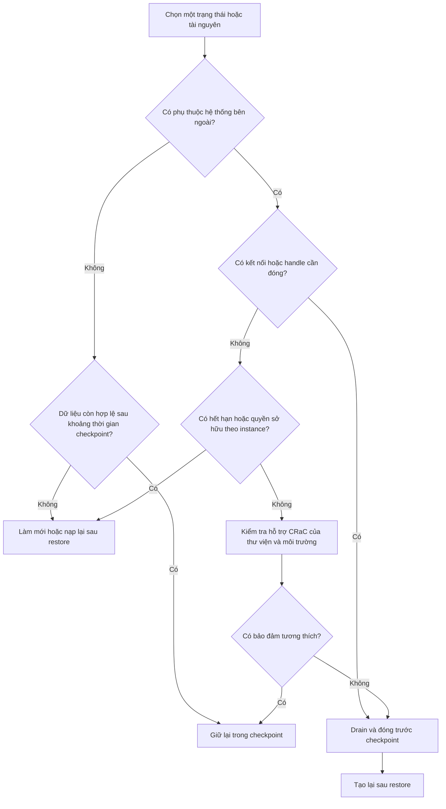

# Phân loại trạng thái có thể giữ lại, phải đóng và phải tạo mới

Khi chuẩn bị một ứng dụng Java cho CRaC, cần quyết định rõ trạng thái nào có thể được giữ nguyên trong checkpoint, trạng thái nào phải được đóng hoặc tạm dừng trước checkpoint, và trạng thái nào phải được tạo lại sau restore. Quyết định này không phụ thuộc đơn giản vào việc một giá trị là object Java hay tài nguyên hệ điều hành. Một object có thể vẫn tồn tại trong heap sau restore nhưng tài nguyên bên ngoài mà nó đại diện đã hết hiệu lực. Ngược lại, nhiều cấu trúc dữ liệu nội bộ có thể được giữ nguyên và tái sử dụng an toàn.

Nguyên tắc quan trọng là **checkpoint lưu trạng thái tiến trình tại một thời điểm; nó không bảo đảm các hệ thống bên ngoài vẫn ở cùng trạng thái khi tiến trình được restore**. Database có thể đã đóng kết nối, token có thể hết hạn, DNS có thể đổi địa chỉ, lease có thể thuộc về instance khác và một message có thể đã được broker giao cho consumer khác. Vì vậy, hãy phân loại theo nguồn dữ liệu, vòng đời và khả năng hợp lệ sau restore của từng trạng thái.

## 1. Ba nhóm trạng thái chính

Trong thiết kế CRaC, có thể bắt đầu bằng ba nhóm sau:

| Nhóm | Trước checkpoint | Sau restore | Ví dụ thường gặp |
|---|---|---|---|
| Có thể giữ lại | Đưa ứng dụng về trạng thái ổn định; giữ object trong bộ nhớ | Tiếp tục sử dụng sau khi xác nhận dữ liệu vẫn phù hợp | Metadata bất biến, cấu trúc parser, bean nội bộ, cache đã được kiểm soát độ mới |
| Phải đóng hoặc tạm dừng | Ngừng sử dụng, drain công việc rồi đóng hoặc pause theo hướng dẫn thư viện | Mở lại, resume hoặc tạo lại phần tài nguyên đã đóng | TCP connection, JDBC connection, HTTP connection, consumer, file lock, native handle |
| Phải tạo mới hoặc làm mới | Không dựa vào giá trị cũ như danh tính hay quyền sở hữu hiện hành | Đọc lại, xác thực lại hoặc đăng ký lại trong môi trường hiện tại | Token, lease, instance identity, service discovery, lịch chạy phụ thuộc thời gian |

Ba nhóm này là cách phân loại theo chính sách ứng dụng. Một số thành phần có thể thuộc nhiều nhóm: giữ lại object quản lý connection pool nhưng phải đóng các kết nối vật lý; giữ cấu trúc cache nhưng phải làm mới dữ liệu đã hết TTL; giữ executor nhưng phải dừng và khởi động lại các tác vụ. Cần phân loại cả object bao ngoài lẫn tài nguyên mà object đó sở hữu.

Ngoài ra, có một quy tắc áp dụng cho cả ba nhóm: **công việc đang thực hiện phải được hoàn tất, tạm dừng an toàn hoặc khôi phục từ nguồn dữ liệu bền vững**. Không nên checkpoint giữa một giao dịch nghiệp vụ hoặc một thao tác I/O mà trạng thái bên ngoài không thể được tiếp tục nhất quán.

## 2. Trạng thái có thể giữ lại

Trạng thái có thể giữ lại thường là dữ liệu nội bộ có vòng đời ổn định, không phụ thuộc vào một phiên kết nối bên ngoài và không cần được cấp phát độc quyền cho từng tiến trình restore.

Các ví dụ thường phù hợp gồm:

- Object bất biến, bảng tra cứu tĩnh và metadata đã được nạp.
- Cấu trúc parser, serializer, bộ chuyển đổi và các cấu trúc dữ liệu nội bộ.
- Spring `ApplicationContext`, bean graph và các cấu trúc khởi tạo đã hoàn tất, nếu các bean không giữ tài nguyên bên ngoài cần xử lý riêng.
- Kết quả warm-up có thể tái sử dụng, chẳng hạn mã đã được biên dịch tối ưu và các cấu trúc nội bộ đã được chuẩn bị.
- Cache chứa dữ liệu ổn định hoặc có chính sách kiểm tra độ mới rõ ràng.

Giữ lại một object không có nghĩa mọi trường bên trong object đều còn hợp lệ. Ví dụ, một bean có thể chứa cấu hình bất biến và đồng thời giữ một HTTP connection. Cấu hình có thể giữ lại; connection cần được xử lý theo vòng đời của HTTP client. Vì vậy, hãy phân loại ở mức tài nguyên thành phần thay vì gắn một nhãn duy nhất cho toàn bộ bean.

### Cache và dữ liệu có thể thay đổi

Cache là ví dụ dễ gây nhầm lẫn. Cache trong heap được phục hồi cùng checkpoint, nhưng nguồn dữ liệu có thể thay đổi trong khoảng thời gian từ lúc tạo checkpoint đến lúc restore. Một cache có thể giữ lại nếu:

1. Dữ liệu không thay đổi trong khoảng thời gian cần dùng; hoặc
2. Dữ liệu có TTL và ứng dụng kiểm tra lại hạn sau restore; hoặc
3. Cache có version, timestamp hoặc cơ chế invalidation để xác định dữ liệu còn hợp lệ.

Nếu không đáp ứng các điều kiện này, nên xóa hoặc làm mới cache sau restore. Không nên mặc định một cache vẫn mới chỉ vì object của nó còn nằm trong heap.

Ví dụ, một bảng mã quốc gia ít thay đổi có thể được giữ lại. Một cache giá sản phẩm, quyền truy cập hoặc trạng thái tồn kho cần kiểm tra lại theo nguồn dữ liệu hiện hành trước khi dùng cho nghiệp vụ quan trọng.

### Cấu trúc nội bộ và trạng thái nghiệp vụ

Các cấu trúc dữ liệu nội bộ có thể được giữ lại, nhưng cần xem xét việc snapshot được dùng để tạo một hay nhiều tiến trình restore. Nếu checkpoint chứa bộ đếm cục bộ, mã định danh được tạo một lần hoặc trạng thái đã xử lý, các bản restore có thể bắt đầu với cùng giá trị đó.

Ví dụ, một `AtomicLong` trong heap không trở thành bộ cấp số duy nhất trên toàn cụm chỉ vì nó được checkpoint. Hai tiến trình restore từ cùng snapshot có thể cùng tiếp tục với một giá trị bộ đếm. Với ID phân tán, số thứ tự, quyền leader hoặc trạng thái cần duy nhất, phải dùng cơ chế cấp phát bên ngoài hoặc tạo lại danh tính sau restore.

## 3. Tài nguyên phải đóng hoặc tạm dừng trước checkpoint

Nhóm này gồm các tài nguyên đang gắn với hệ điều hành, kết nối bên ngoài hoặc một hoạt động có thể gây thay đổi trạng thái khi tiến trình bị dừng. Một số tài nguyên có thể được runtime hoặc thư viện hỗ trợ phục hồi trực tiếp; tuy nhiên, ứng dụng chỉ nên giữ nguyên chúng khi phiên bản thư viện và môi trường triển khai có cam kết tương thích rõ ràng.

Các tài nguyên thường cần xử lý gồm:

- Kết nối TCP, socket và các phiên làm việc với dịch vụ bên ngoài.
- Kết nối vật lý trong JDBC connection pool hoặc kết nối database đang được sử dụng.
- HTTP connection, WebSocket, gRPC channel hoặc client giữ kết nối lâu dài.
- Message consumer, subscription và các thành phần đang nhận công việc từ broker.
- File lock, process lock, lease hoặc tài nguyên có quyền sở hữu bên ngoài.
- Native handle, thư viện native và tài nguyên hệ điều hành không được bảo đảm khôi phục.
- Executor hoặc scheduler đang chạy công việc nền, nếu công việc cần được dừng và lập lịch lại.

Không phải mọi file hoặc thread đều bắt buộc phải đóng. File descriptor trỏ đến file cục bộ có thể được hỗ trợ bởi một số cấu hình checkpoint/restore nếu filesystem và môi trường tương thích. Thread pool đang idle cũng có thể được giữ trong một số trường hợp. Hãy kiểm tra hướng dẫn của JDK CRaC, hệ điều hành, driver và thư viện đang dùng. Nếu không có bảo đảm tương thích, thiết kế theo hướng đóng/tạm dừng và mở lại sẽ dễ kiểm soát hơn.

### Kết nối mạng và database

Một TCP socket có thể vẫn được biểu diễn bằng một object Java sau restore, nhưng phía server có thể đã đóng kết nối hoặc trạng thái phiên đã thay đổi. Tương tự, một JDBC `Connection` có thể trỏ đến phiên database không còn hợp lệ. Nếu ứng dụng tiếp tục sử dụng connection cũ, lỗi thường chỉ xuất hiện khi request đầu tiên thực hiện I/O.

Một quy trình thường dùng là:

1. Ngừng nhận request mới và chờ các request đang sử dụng connection kết thúc.
2. Dừng các tác vụ nền đang truy cập database hoặc dịch vụ HTTP.
3. Đóng connection vật lý hoặc đưa pool/client về trạng thái được thư viện hỗ trợ trước checkpoint.
4. Sau restore, tạo lại connection hoặc khởi động lại pool/client.
5. Kiểm tra khả năng kết nối và chỉ bật readiness khi dependency bắt buộc đã sẵn sàng.

Với connection pool, cần làm theo tích hợp CRaC của pool và driver. Đừng chỉ đóng một connection đang mượn rồi cho rằng toàn bộ pool đã an toàn; pool có thể chứa nhiều connection vật lý, thread housekeeper và timer riêng.

### Consumer, scheduler và thread nền

Consumer có thể đang giữ partition assignment, offset state hoặc kết nối broker. Trước checkpoint, cần dừng nhận message mới và xử lý message đang thực hiện theo chính sách ack/commit của hệ thống. Sau restore, consumer thường phải kết nối lại và tham gia consumer group để broker phân phối assignment hiện hành.

Scheduler cũng cần được phân loại. Một tác vụ được lập lịch dựa trên thời gian trước checkpoint có thể đã quá hạn khi restore. Một tác vụ định kỳ có thể bị chạy trùng nếu nhiều tiến trình restore cùng khởi động scheduler. Hãy xác định tác vụ nào cần reschedule, tác vụ nào cần lấy lease và tác vụ nào phải chạy theo cơ chế chỉ một instance.

Đối với thread pool, hãy phân biệt pool đang idle với worker đang giữ request, transaction, lock hoặc I/O. Nếu có công việc đang chạy, cần drain hoặc dừng an toàn trước checkpoint. Không nên chụp snapshot khi một thread đang ở giữa thao tác không thể tiếp tục nhất quán.

## 4. Trạng thái phải tạo mới hoặc làm mới sau restore

Nhóm này bao gồm những giá trị có thể đã hết hạn, thay đổi theo môi trường hoặc cần được cấp phát lại cho từng tiến trình. Có thể giữ object bao ngoài nếu phù hợp, nhưng dữ liệu bên trong cần được nạp lại.

| Trạng thái | Vì sao cần làm mới | Hành động sau restore |
|---|---|---|
| Access token, session, credential tạm thời | Có thể hết hạn hoặc bị thu hồi | Xác thực lại hoặc lấy token mới |
| DNS và service discovery | Địa chỉ dịch vụ có thể thay đổi | Tra cứu lại hoặc dùng cơ chế discovery hiện hành |
| Lease, leader lock, distributed lock | Quyền sở hữu có thể đã hết hạn hoặc thuộc instance khác | Đăng ký/lấy lease lại qua hệ thống phối hợp |
| Instance ID và thông tin đăng ký node | Nhiều bản restore có thể cùng mang một ID cũ | Xin ID mới hoặc đăng ký lại với nền tảng |
| Cache có TTL, feature flag và cấu hình động | Nguồn dữ liệu có thể đã cập nhật | Kiểm tra version/TTL và tải lại khi cần |
| Timer, deadline và lịch chạy | Thời gian thực đã trôi qua trong lúc checkpoint | Tính lại deadline và lập lịch theo thời điểm hiện tại |
| Trạng thái consumer group | Assignment có thể đã thay đổi | Kết nối lại và tham gia group |

Một số trạng thái không nhất thiết phải tạo lại toàn bộ object. Ví dụ, một client có thể giữ nguyên cấu hình và factory, nhưng phải lấy token mới và mở channel mới. Tách cấu hình ổn định khỏi trạng thái phiên giúp callback phục hồi đơn giản hơn.

### Thời gian và deadline

Không nên giả định một deadline được tính trước checkpoint vẫn mang ý nghĩa như lúc tạo. Nếu một tác vụ phải chạy trước một thời điểm cụ thể, hãy so sánh deadline với thời gian hiện tại sau restore và tính lại thời gian chờ. Với lịch định kỳ, cần quyết định rõ bỏ qua lần chạy đã trễ, chạy bù hay lên lịch ở chu kỳ kế tiếp.

Các giá trị dựa trên thời gian monotonic hoặc thời gian tạm thời của runtime cần được đánh giá theo cách thư viện quản lý timer. Tránh lưu một khoảng chờ đã tính trước checkpoint rồi sử dụng nguyên trạng mà không xét thời gian đã trôi qua.

### Bí mật và thông tin xác thực

Checkpoint có thể chứa dữ liệu heap, do đó các token, credential, khóa hoặc thông tin nhạy cảm đang nằm trong bộ nhớ có thể xuất hiện trong artifact checkpoint. Cần kiểm soát quyền truy cập và vòng đời của checkpoint như một artifact nhạy cảm. Với thông tin có thể hết hạn hoặc được cấp theo instance, nên lấy lại từ secret manager hoặc identity provider sau restore thay vì dựa vào bản sao cũ.

## 5. Công việc đang diễn ra cần được drain hoặc khôi phục từ nguồn bền vững

Một request đang xử lý, transaction chưa commit, message đang được xử lý hoặc thao tác ghi file dở dang không nên được coi là trạng thái nội bộ có thể giữ lại vô điều kiện. Heap có thể giữ object mô tả công việc, nhưng hệ thống bên ngoài có thể đã commit, timeout hoặc giao công việc cho một tiến trình khác.

Trước checkpoint, hãy xác định cách xử lý cho từng loại công việc:

- **Hoàn tất:** cho phép request hoặc transaction kết thúc trước khi checkpoint.
- **Tạm dừng có giao thức:** dùng cơ chế pause/resume mà thư viện hỗ trợ và bảo đảm trạng thái bên ngoài đồng bộ.
- **Rollback hoặc release:** rollback transaction, nhả lock và trả lại message theo chính sách của broker.
- **Khôi phục từ nguồn bền vững:** lưu tiến độ vào database, queue hoặc workflow store; sau restore, nạp lại và tiếp tục từ checkpoint nghiệp vụ của chính ứng dụng.

Không nên nhầm checkpoint của tiến trình với checkpoint nghiệp vụ. CRaC lưu trạng thái tiến trình; nó không thay thế transaction log, message offset, workflow state hoặc cơ chế idempotency của ứng dụng phân tán.

Ví dụ, nếu một consumer đã nhận message nhưng chưa commit offset, sau restore cần tuân theo giao thức của broker để xác định message có được giao lại hay không. Nếu handler đã ghi dữ liệu nhưng chưa ack message, thao tác có thể được chạy lại. Giao dịch và handler nên có tính idempotent hoặc dùng khóa chống trùng phù hợp.

## 6. Quy trình phân loại một tài nguyên

Với mỗi bean, client, pool, cache hoặc thread nền, hãy trả lời lần lượt các câu hỏi:

1. **Nguồn sự thật ở đâu?** Giá trị chỉ tồn tại trong heap hay còn được quản lý bởi database, broker, hệ điều hành hoặc dịch vụ bên ngoài?
2. **Có thể hết hạn hoặc thay đổi không?** Token, lease, DNS, cấu hình và cache có TTL cần được kiểm tra lại.
3. **Có giữ tài nguyên hệ điều hành hoặc kết nối không?** Socket, file handle, native handle và connection pool cần theo hướng dẫn CRaC của thư viện.
4. **Có đang thực hiện công việc không?** Request, transaction, message và tác vụ nền phải được drain hoặc khôi phục theo giao thức.
5. **Có thể tạo nhiều bản restore từ cùng checkpoint không?** Nếu có, instance ID, lease, bộ đếm và side effect cần được thiết kế cho nhiều bản sao.
6. **Thành phần nào sở hữu vòng đời?** Chủ sở hữu resource nên chịu trách nhiệm dừng, đóng, tạo lại và báo trạng thái readiness.

Có thể biểu diễn quy trình quyết định bằng sơ đồ:



Nếu chưa thể xác định một tài nguyên có an toàn để giữ hay không, không nên suy luận chỉ từ việc object vẫn còn trong heap. Hãy tìm tài liệu CRaC của JDK và thư viện cụ thể, sau đó thử checkpoint/restore trong môi trường tương thích và quan sát hành vi của tài nguyên.

## 7. Áp dụng phân loại bằng CRaC Resource callbacks

CRaC cung cấp `org.crac.Resource` để một thành phần đăng ký công việc cần thực hiện trước checkpoint và sau restore. Thành phần quản lý tài nguyên nên sở hữu callback tương ứng, vì nó hiểu cách đóng và mở tài nguyên.

Ví dụ dưới đây minh họa một client kết nối đến dịch vụ bên ngoài:

```java
import org.crac.Context;
import org.crac.Core;
import org.crac.Resource;

public final class RemoteClientResource implements Resource {

    private final RemoteClientFactory factory;
    private RemoteClient client;

    public RemoteClientResource(RemoteClientFactory factory) {
        this.factory = factory;
        this.client = factory.connect();
        Core.getGlobalContext().register(this);
    }

    @Override
    public void beforeCheckpoint(Context<? extends Resource> context)
            throws Exception {
        stopAcceptingCallsAndDrain();

        if (client != null) {
            client.close();
            client = null;
        }
    }

    @Override
    public void afterRestore(Context<? extends Resource> context)
            throws Exception {
        client = factory.connect();
        verifyConnection(client);
        resumeAcceptingCalls();
    }

    // Các phương thức điều phối được triển khai theo client thực tế.
    private void stopAcceptingCallsAndDrain() throws Exception { /* ... */ }
    private void verifyConnection(RemoteClient value) throws Exception { /* ... */ }
    private void resumeAcceptingCalls() { /* ... */ }
}
```

`RemoteClient` và `RemoteClientFactory` là kiểu minh họa, không phải API chuẩn của CRaC. Trong ứng dụng thực tế, thay chúng bằng client đang dùng và áp dụng hướng dẫn checkpoint/restore của thư viện đó. Việc đăng ký resource cần diễn ra một lần trong quá trình khởi tạo. Nếu thư viện đã cung cấp CRaC integration riêng, nên dùng integration đó để tránh đăng ký callback trùng hoặc đóng/mở cùng tài nguyên hai lần.

Trình tự trong ví dụ thể hiện các trách nhiệm chính:

1. Ngừng nhận lời gọi mới đến client.
2. Chờ lời gọi đang chạy kết thúc trong thời gian có giới hạn.
3. Đóng client trước khi checkpoint và bỏ tham chiếu đến phiên kết nối cũ.
4. Sau restore, tạo client mới bằng factory.
5. Kiểm tra kết nối và chỉ cho phép lời gọi mới khi client đã sẵn sàng.

Trong code thật, `stopAcceptingCallsAndDrain()` cần có timeout và phải báo lỗi nếu không thể đưa client về trạng thái an toàn. Không nên chờ vô hạn hoặc đóng kết nối trong khi thread khác vẫn đang sử dụng nó. Nếu `factory.connect()` thất bại sau restore, thành phần phải giữ trạng thái chưa sẵn sàng và để cơ chế readiness của ứng dụng xử lý lỗi.

### Không phải mọi bean đều cần một Resource riêng

Không cần đăng ký từng bean Spring vào CRaC chỉ vì bean đó tồn tại trong `ApplicationContext`. Hãy đăng ký những thành phần sở hữu tài nguyên thực sự cần chuyển trạng thái. Một bean chỉ chứa dữ liệu bất biến có thể được giữ nguyên. Một bean quản lý pool, client hoặc scheduler cần tham gia vòng đời nếu thư viện không tự xử lý. Nếu thư viện đã tích hợp CRaC, hãy tránh tạo một lớp callback thứ hai làm trùng trách nhiệm.

## 8. Ví dụ phân loại trong một ứng dụng Spring Boot

Giả sử dịch vụ Spring Boot có `DataSource`, HTTP client, cache sản phẩm, message consumer và scheduler. Có thể bắt đầu bằng bảng phân loại sau:

| Thành phần | Phân loại ban đầu | Việc cần làm |
|---|---|---|
| Spring bean không giữ tài nguyên ngoài | Giữ lại | Tiếp tục dùng trạng thái đã khởi tạo |
| Metadata sản phẩm bất biến | Giữ lại | Giữ trong heap nếu version vẫn phù hợp |
| Cache tồn kho | Làm mới/kiểm tra | Kiểm tra TTL hoặc tải lại từ nguồn sự thật |
| `DataSource` và pool | Phụ thuộc integration | Dùng hỗ trợ CRaC của pool/driver; xử lý kết nối vật lý đúng vòng đời |
| HTTP client giữ connection | Đóng và tạo lại hoặc dùng integration CRaC | Drain request, đóng channel/connection, mở lại sau restore |
| Message consumer | Pause/close và tham gia lại | Dừng nhận message, xử lý ack/commit, join group sau restore |
| Scheduler | Tạm dừng và lập lịch lại | Tính lại deadline, tránh chạy trùng giữa các replica |
| Access token | Tạo mới/làm mới | Xác thực lại nếu token đã hết hạn hoặc không còn hợp lệ |
| Leader lease | Đăng ký lại | Lấy quyền sở hữu qua hệ thống phối hợp sau restore |

Một ứng dụng có thể tổ chức các bước này theo vòng đời tổng thể:

```text
Khởi động và warm-up
    |
    +-- Tạo bean, metadata và cache ổn định
    +-- Đăng ký CRaC-aware resources
    |
Chuẩn bị checkpoint
    |
    +-- Ngừng nhận traffic và drain request
    +-- Pause consumer và scheduler
    +-- Đóng hoặc chuẩn bị pool/client theo integration
    +-- Xác nhận các tài nguyên đã sẵn sàng
    |
Checkpoint
    |
Restore
    |
    +-- Khôi phục cấu trúc nội bộ đã lưu
    +-- Tạo lại connection và consumer
    +-- Làm mới token, lease, cấu hình và cache cần thiết
    +-- Kiểm tra dependency
    |
Readiness thành công
    |
Phục vụ traffic
```

Readiness phải phản ánh khả năng phục vụ thực tế. Việc callback đã chạy xong không đủ nếu database vẫn không truy cập được hoặc consumer chưa tham gia lại thành công. Hãy giữ instance ngoài load balancer cho đến khi những dependency bắt buộc đã sẵn sàng.

## 9. Những sai lầm thường gặp

### Giữ object connection vì nó vẫn còn trong heap

Object Java có thể còn nguyên nhưng socket hoặc phiên server đã bị đóng. Kiểm tra vòng đời của connection và dùng CRaC integration của thư viện hoặc đóng/mở lại theo callback.

### Đóng toàn bộ ứng dụng mà không phân biệt dữ liệu nội bộ

Đóng mọi thứ trước checkpoint làm mất lợi ích warm-up và có thể buộc ứng dụng khởi tạo lại nhiều thành phần không cần thiết. Hãy giữ lại dữ liệu nội bộ ổn định, chỉ xử lý tài nguyên cần chuyển trạng thái.

### Chỉ đóng một connection nhưng bỏ quên pool và thread nền

Pool có thể sở hữu nhiều connection, timer và worker riêng. Cần dùng API lifecycle của pool hoặc integration được hỗ trợ thay vì đóng một connection đơn lẻ.

### Checkpoint khi request hoặc transaction còn dang dở

Trạng thái trong heap không bảo đảm giao dịch bên ngoài sẽ được tiếp tục đúng. Hãy drain request, hoàn tất hoặc rollback transaction và dùng nguồn dữ liệu bền vững để khôi phục công việc.

### Giữ nguyên token, lease và instance ID

Các giá trị này có thể hết hạn hoặc bị nhân bản khi restore nhiều bản. Hãy làm mới credential, đăng ký lease và tạo identity phù hợp cho từng instance.

### Khởi động lại scheduler mà không xét nhiều replica

Nhiều bản restore có thể cùng chạy một tác vụ. Dùng distributed lock/lease hoặc cơ chế điều phối bên ngoài nếu tác vụ chỉ được phép chạy trên một instance.

### Bật readiness ngay khi JVM restore xong

JVM phục hồi thành công không đồng nghĩa database, broker và HTTP client đã sẵn sàng. Readiness phải chờ việc khôi phục dependency bắt buộc hoàn tất.

## 10. Kiểm chứng phân loại trong môi trường triển khai

Sau khi phân loại, hãy kiểm chứng từng nhóm bằng một lần checkpoint/restore thực tế trong môi trường tương thích với JDK và hệ điều hành triển khai. Quan sát các điểm sau:

- Tài nguyên nào được giữ nguyên và có thể sử dụng ngay sau restore?
- Tài nguyên nào được đóng trong `beforeCheckpoint` và mở lại trong `afterRestore`?
- Có thread nào còn xử lý công việc hoặc giữ lock khi checkpoint bắt đầu không?
- Token, lease, DNS và cache có được kiểm tra theo trạng thái hiện hành không?
- Nếu callback đóng hoặc mở tài nguyên thất bại, checkpoint/readiness có báo trạng thái lỗi rõ ràng không?
- Khi tạo hai bản restore từ cùng checkpoint, có ID, lease, scheduler hoặc side effect nào bị trùng không?

Nên ghi log theo từng tài nguyên với các mốc `beforeCheckpoint-start`, `beforeCheckpoint-complete`, `afterRestore-start` và `afterRestore-complete`. Gắn tên resource và định danh instance hiện tại để xác định thành phần nào gây lỗi. Không ghi token, mật khẩu hoặc nội dung bí mật vào log.

Các phép đo hữu ích gồm thời gian drain, thời gian đóng tài nguyên, thời gian restore, thời gian tạo lại dependency và thời gian từ restore đến readiness. Nếu một resource mất nhiều thời gian để mở lại, hãy đánh giá xem có thể giữ phần cấu trúc ổn định của nó và chỉ tái tạo phần phiên kết nối hay không.

## 11. Kết luận

Phân loại trạng thái là bước nền tảng để một ứng dụng CRaC phục hồi đúng. Dữ liệu nội bộ ổn định có thể được giữ lại để tận dụng kết quả khởi tạo và warm-up. Kết nối, handle và hoạt động gắn với hệ điều hành hoặc hệ thống bên ngoài cần được drain, đóng hoặc tạm dừng theo hướng dẫn của thư viện. Token, lease, định danh, cấu hình động và dữ liệu có thời hạn cần được kiểm tra hoặc tạo mới theo môi trường sau restore.

Với mỗi tài nguyên, hãy xác định chủ sở hữu, nguồn sự thật, điều kiện hết hạn, hành động trước checkpoint và hành động sau restore. Sau đó kiểm tra trường hợp nhiều tiến trình được restore từ cùng snapshot. Cách phân loại này giúp giữ lại phần trạng thái có giá trị, phục hồi đúng các kết nối và tránh sử dụng dữ liệu cũ hoặc tạo side effect trùng lặp khi ứng dụng quay lại hoạt động.
