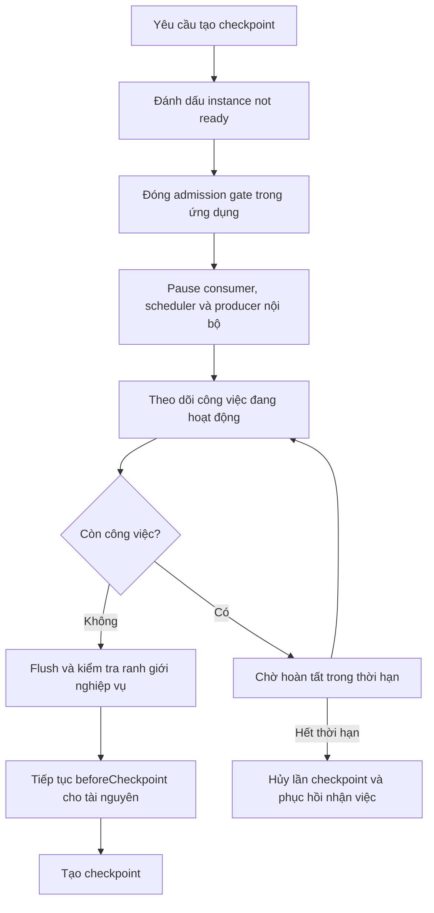

# Ngừng nhận công việc mới và chờ công việc đang chạy hoàn tất

Trước khi tạo checkpoint CRaC, ứng dụng cần đưa tiến trình về một trạng thái có thể khôi phục an toàn. Một yêu cầu HTTP đang chạy, một message handler đang xử lý dở hoặc một transaction chưa kết thúc có thể để lại trạng thái không nhất quán nếu tiến trình bị chụp giữa chừng. Vì vậy, ứng dụng phải **ngừng nhận công việc mới**, sau đó **chờ toàn bộ công việc đã được nhận hoàn tất** trước khi tiếp tục bước chuẩn bị tài nguyên và checkpoint.

Quá trình này thường được gọi là *quiescing* và *draining*. Quiescing đóng cổng nhận việc mới; draining chờ các công việc đã được chấp nhận đi đến điểm kết thúc an toàn. Hai việc này phải phối hợp với ingress/load balancer, HTTP server, message consumer, scheduler, executor và các luồng nền của ứng dụng.

Đây là một phần quan trọng của vòng đời tài nguyên CRaC. Callback `Resource.beforeCheckpoint(...)` là nơi ứng dụng điều phối việc dừng nhận việc và chờ drain. Nếu không thể đạt trạng thái an toàn trong thời hạn đã định, ứng dụng nên từ chối lần checkpoint đó và tiếp tục phục vụ theo quy trình phục hồi đã thiết kế.

## 1. Vì sao phải ngừng nhận việc trước checkpoint?

Checkpoint lưu trạng thái của tiến trình tại một thời điểm. Nếu ứng dụng vẫn nhận và xử lý công việc trong lúc chuẩn bị checkpoint, có thể xảy ra những tình huống như:

- Request đã ghi một phần dữ liệu nhưng chưa commit transaction.
- Message đã được lấy khỏi broker nhưng chưa xử lý xong hoặc chưa ack.
- Một tác vụ bất đồng bộ đã được đưa vào executor nhưng chưa chạy.
- Một job định kỳ đang cập nhật cache hoặc trạng thái dùng chung.
- Một request đã trả response nhưng công việc nền mà nó khởi tạo vẫn còn chạy.
- Một thread đang giữ lock hoặc đang sửa cấu trúc dữ liệu mà thành phần khác cần phục hồi.

Nếu checkpoint được tạo ở giữa các hoạt động này, trạng thái heap có thể không còn phản ánh một ranh giới nghiệp vụ hoàn chỉnh. Sau restore, ứng dụng có nguy cơ tiếp tục từ trạng thái dở dang, xử lý lặp một công việc, bỏ sót message hoặc giữ một tài nguyên không còn hợp lệ.

Mục tiêu của drain không phải là chờ tất cả thread trong JVM kết thúc. JVM vẫn có các thread nền phục vụ runtime. Mục tiêu là chờ **các đơn vị công việc nghiệp vụ mà ứng dụng đã nhận** đạt tới một ranh giới an toàn: request đã hoàn tất, transaction đã commit/rollback, message đã được xử lý và ack phù hợp, hoặc job đã lưu tiến độ và dừng tại điểm có thể tiếp tục.

## 2. Hai giai đoạn: đóng cổng và drain công việc

### Đóng cổng nhận việc mới

Ứng dụng cần ngăn các nguồn tạo công việc mới trước khi chụp trạng thái. Các nguồn thường gặp gồm:

- Traffic HTTP/HTTPS từ load balancer, ingress hoặc API gateway.
- Message mới từ Kafka, RabbitMQ, JMS hoặc hệ thống hàng đợi khác.
- Lịch chạy từ scheduler như `@Scheduled`, Quartz hoặc cron nội bộ.
- Poller đọc database, thư mục, object storage hoặc dịch vụ bên ngoài.
- Tác vụ mới được tạo từ callback, listener, timer và executor.
- Kết nối dài hạn như WebSocket hoặc stream có thể tiếp tục gửi message.

Việc đánh dấu instance là *not ready* giúp nền tảng ngừng gửi traffic mới tới instance đó. Tuy nhiên, readiness chỉ là tín hiệu cho hệ thống điều phối; nó không phải một khóa đồng bộ trong ứng dụng. Trong khoảng thời gian load balancer cập nhật trạng thái, request có thể vẫn đến. Kết nối keep-alive, request đã nằm trong hàng đợi mạng hoặc message đã được consumer nhận cũng có thể tiếp tục xuất hiện.

Vì vậy, cần có một **admission gate** ngay trong ứng dụng. Gate này quyết định một công việc mới có được chấp nhận hay không. Khi gate đóng, request hoặc tác vụ mới phải nhận phản hồi phù hợp, được chuyển sang instance khác hoặc được giữ lại ở nguồn phát theo chính sách retry. Không nên nhận việc rồi âm thầm bỏ nó.

### Chờ công việc đang chạy hoàn tất

Sau khi gate đóng, ứng dụng theo dõi số lượng công việc đang hoạt động và chờ số lượng đó về 0. Mỗi công việc được tính là đang hoạt động từ lúc được chấp nhận cho tới khi thực sự kết thúc.

Ví dụ, với HTTP request có gọi xử lý bất đồng bộ, lease theo dõi công việc phải được giữ tới khi `CompletableFuture` hoàn tất. Nếu chỉ giảm bộ đếm ngay khi controller trả về mà tác vụ nền vẫn đang chạy, drain có thể báo hoàn tất quá sớm.

Với message consumer, phải phân biệt việc dừng nhận message mới với việc xử lý message đã nhận. Consumer có thể pause hoặc ngừng poll; các handler đã bắt đầu vẫn phải hoàn tất, commit offset hoặc ack theo đúng semantics của broker. Không ack trước khi công việc được lưu bền vững.



## 3. Theo dõi chính xác công việc đang hoạt động

Một bộ đếm đơn giản chỉ hữu ích nếu mọi đường nhận việc đều tuân thủ cùng một quy tắc. Cần xác định rõ thời điểm tăng và giảm bộ đếm:

1. Tăng bộ đếm một cách nguyên tử khi gate chấp nhận công việc.
2. Trả về một lease/handle gắn với công việc đó.
3. Giữ lease trong suốt thời gian xử lý, kể cả khi công việc chuyển qua thread khác hoặc chạy bất đồng bộ.
4. Chỉ giảm bộ đếm khi công việc thực sự kết thúc hoặc đã lưu tiến độ và dừng an toàn.
5. Đóng lease đúng một lần, kể cả khi có nhiều nhánh hoàn tất hoặc xử lý lỗi.

Không nên dùng hai thao tác tách rời kiểu `if (accepting) { count++; }` nếu không có khóa hoặc cơ chế atomic phối hợp. Một thread có thể đóng gate giữa lần kiểm tra và lúc tăng bộ đếm; drain khi đó có thể nhìn thấy số công việc bằng 0 rồi bắt đầu checkpoint, trong khi một công việc mới vừa lọt qua.

### Ví dụ admission gate có bộ đếm và lease

Ví dụ dưới đây dùng `ReentrantLock` và `Condition` để việc kiểm tra gate và tăng bộ đếm diễn ra trong cùng một vùng khóa. `Lease` có thể được đóng từ thread khác và bảo đảm chỉ giảm bộ đếm một lần.

```java
import java.time.Duration;
import java.util.concurrent.atomic.AtomicBoolean;
import java.util.concurrent.locks.Condition;
import java.util.concurrent.locks.ReentrantLock;

final class WorkGate {
    private final ReentrantLock lock = new ReentrantLock();
    private final Condition drained = lock.newCondition();

    private boolean accepting = true;
    private int inFlight;

    Lease tryAcquire() {
        lock.lock();
        try {
            if (!accepting) {
                return null;
            }
            inFlight++;
            return new Lease();
        } finally {
            lock.unlock();
        }
    }

    void stopAccepting() {
        lock.lock();
        try {
            accepting = false;
        } finally {
            lock.unlock();
        }
    }

    boolean awaitDrained(Duration timeout) throws InterruptedException {
        long remaining = timeout.toNanos();
        lock.lockInterruptibly();
        try {
            while (inFlight != 0) {
                if (remaining <= 0) {
                    return false;
                }
                remaining = drained.awaitNanos(remaining);
            }
            return true;
        } finally {
            lock.unlock();
        }
    }

    void resumeAccepting() {
        lock.lock();
        try {
            accepting = true;
        } finally {
            lock.unlock();
        }
    }

    final class Lease implements AutoCloseable {
        private final AtomicBoolean closed = new AtomicBoolean();

        @Override
        public void close() {
            if (!closed.compareAndSet(false, true)) {
                return;
            }

            lock.lock();
            try {
                inFlight--;
                if (inFlight == 0) {
                    drained.signalAll();
                }
            } finally {
                lock.unlock();
            }
        }
    }
}
```

Một HTTP handler có thể dùng gate như sau:

```java
void handleRequest(HttpExchange exchange) throws IOException {
    WorkGate.Lease lease = workGate.tryAcquire();
    if (lease == null) {
        exchange.sendResponseHeaders(503, -1);
        return;
    }

    try (lease) {
        processRequest(exchange);
    }
}
```

Đây là ví dụ minh họa cho một công việc đồng bộ. Trong ứng dụng thực tế, cần bảo đảm lease được giữ đến khi phần xử lý nghiệp vụ kết thúc. Nếu handler chỉ tạo `CompletableFuture` rồi trả về, hãy đóng lease trong nhánh hoàn tất của future:

```java
WorkGate.Lease lease = workGate.tryAcquire();
if (lease == null) {
    return CompletableFuture.failedFuture(
            new ServiceUnavailableException("Instance is draining")
    );
}

return processAsync()
        .whenComplete((result, error) -> lease.close());
```

Trong code thực tế, hãy xử lý việc executor từ chối task, lỗi trước khi future được tạo và cancellation sao cho lease luôn được đóng. Nếu công việc chuyển tiếp sang một queue nội bộ, lease phải theo dõi cả thời gian chờ và xử lý theo đúng định nghĩa đơn vị công việc của ứng dụng.

## 4. Điều phối admission gate với CRaC

`Resource.beforeCheckpoint(...)` có thể gọi coordinator để đóng cổng, dừng các nguồn tạo việc và chờ drain. Ví dụ dưới đây minh họa thứ tự điều phối; `ProducerController` là abstraction của ứng dụng để pause/resume consumer, scheduler và poller.

```java
import java.time.Duration;
import java.util.concurrent.TimeoutException;

import org.crac.Context;
import org.crac.Resource;

final class DrainResource implements Resource {
    private final WorkGate gate;
    private final ProducerController producers;
    private final Duration drainTimeout;

    DrainResource(
            WorkGate gate,
            ProducerController producers,
            Duration drainTimeout) {
        this.gate = gate;
        this.producers = producers;
        this.drainTimeout = drainTimeout;
    }

    @Override
    public void beforeCheckpoint(Context<? extends Resource> context)
            throws Exception {
        gate.stopAccepting();

        try {
            producers.pause();

            if (!gate.awaitDrained(drainTimeout)) {
                throw new TimeoutException(
                        "Active work did not drain before checkpoint deadline"
                );
            }
        } catch (Exception failure) {
            try {
                producers.resume();
            } catch (Exception resumeFailure) {
                failure.addSuppressed(resumeFailure);
            }
            gate.resumeAccepting();
            throw failure;
        }
    }

    @Override
    public void afterRestore(Context<? extends Resource> context)
            throws Exception {
        // Recreate required dependencies and refresh dynamic configuration first.
        // Resume producers and open the gate only after the service is ready.
    }
}
```

`ProducerController` là interface do ứng dụng định nghĩa; nó không phải API có sẵn của CRaC. Trong một triển khai đầy đủ, nhánh `afterRestore` phải gọi một restore coordinator để:

1. Khôi phục database pool, broker client, socket và các tài nguyên bắt buộc.
2. Làm mới credential, DNS, lease và thông tin nhận diện instance.
3. Kiểm tra các dependency cần thiết cho request.
4. Mở lại admission gate và resume consumer/scheduler theo thứ tự đã xác định.
5. Chuyển readiness về trạng thái nhận traffic sau khi các bước trên thành công.

Nếu nhiều `Resource` độc lập cùng quản lý các thành phần phụ thuộc nhau, cần thiết kế thứ tự callback hoặc một coordinator chung. Không mở gate ngay khi một callback bất kỳ chạy nếu các resource khác vẫn chưa phục hồi xong.

## 5. Xử lý từng loại nguồn công việc

| Nguồn công việc | Cách ngừng nhận việc mới | Điều kiện drain |
|---|---|---|
| HTTP request | Đánh dấu not ready, đóng admission gate, từ chối request mới nếu vẫn tới | Response đã hoàn tất; transaction commit/rollback; lease đã đóng |
| Message consumer | Pause partition/consumer hoặc ngừng poll | Message đã xử lý xong và ack/commit theo semantics của broker |
| Scheduler | Ngừng kích hoạt lần chạy mới | Job hiện tại hoàn tất hoặc lưu checkpoint tiến độ riêng của job |
| Poller | Dừng poll hoặc nhận batch mới | Batch đã xử lý xong; offset/cursor được cập nhật an toàn |
| Executor nội bộ | Ngừng submit task mới | Hàng đợi và task đang chạy được xử lý theo chính sách; task bị từ chối phải được trả lại nguồn |
| WebSocket/stream | Ngừng nhận session mới hoặc message mới; gửi tín hiệu đóng nếu phù hợp | Message đang xử lý hoàn tất; session được đóng hoặc trạng thái được lưu để reconnect |
| Background callback | Hủy lịch phát sinh callback mới | Callback đang chạy hoàn tất và giải phóng tài nguyên |

### HTTP và readiness

Với Spring Boot, ứng dụng có thể phát tín hiệu readiness để báo với nền tảng rằng instance không còn nhận traffic mới:

```java
AvailabilityChangeEvent.publish(
        applicationContext,
        ReadinessState.REFUSING_TRAFFIC
);
```

Sau khi phục hồi hoàn tất, ứng dụng có thể chuyển lại:

```java
AvailabilityChangeEvent.publish(
        applicationContext,
        ReadinessState.ACCEPTING_TRAFFIC
);
```

Đây là tín hiệu cho readiness probe và hệ thống điều phối. Nó không tự theo dõi request đang chạy và cũng không thay thế admission gate. Hãy kết hợp readiness với bộ đếm in-flight ở filter, interceptor hoặc lớp điều phối request. Với async MVC, reactive stream hoặc streaming response, bộ đếm phải phản ánh thời điểm xử lý thực sự kết thúc, không chỉ thời điểm method ban đầu trả về.

### Message broker

Với consumer, hãy phân biệt rõ *pause intake* và *finish in-flight*. Một consumer có thể đã nhận message trước khi pause có hiệu lực. Drain cần đợi handler đang chạy hoàn tất và xác nhận ack/offset commit đúng thời điểm.

Nếu message không thể hoàn tất trong thời hạn drain, có thể để broker redeliver sau khi consumer khởi động lại, nhưng chỉ khi handler có thiết kế idempotent và ack chưa được gửi trước khi dữ liệu bền vững. Không tự ý ack để làm bộ đếm về 0.

### Scheduler và job dài

Scheduler phải ngừng phát sinh lần chạy mới. Với job dài, cần quyết định trước liệu job có thể hoàn tất trong drain window hay phải lưu tiến độ và dừng tại một checkpoint nghiệp vụ riêng. Checkpoint JVM không tự thay thế checkpoint tiến độ của một job phân tán.

Một job xử lý hàng triệu bản ghi có thể mất nhiều phút hoặc nhiều giờ. Ép job dừng giữa một batch mà không lưu cursor/offset an toàn sẽ làm tăng nguy cơ xử lý trùng hoặc bỏ sót. Nếu không thể dừng an toàn, không tạo CRaC checkpoint ở thời điểm đó.

## 6. Thời hạn drain và cách xử lý timeout

Drain phải có thời hạn. Nếu chờ vô hạn, một request bị treo hoặc một job không kết thúc có thể làm quy trình checkpoint không bao giờ hoàn tất. Nếu chờ quá ngắn, các request hợp lệ bị từ chối hoặc checkpoint liên tục thất bại.

Thời hạn nên dựa trên:

- Timeout tối đa của request và job đang chạy.
- Thời gian cần để commit transaction, ack message và flush dữ liệu.
- Thời gian truyền trạng thái readiness tới load balancer/ingress.
- `terminationGracePeriodSeconds` hoặc giới hạn dừng của nền tảng, nếu có liên quan.
- Thời gian dành cho các callback resource khác và thao tác checkpoint.

Ví dụ một ngân sách tổng thể:

| Giai đoạn | Ngân sách minh họa |
|---|---:|
| Đóng gate và báo not ready | 2 giây |
| Chờ ingress ngừng gửi traffic mới | 3 giây |
| Drain request/job/message đang chạy | 20 giây |
| Flush và chuẩn bị resource | 5 giây |
| Dự phòng cho checkpoint engine | 10 giây |
| Tổng | 40 giây |

Đây chỉ là số liệu minh họa để lập ngân sách. Hệ thống thật phải đo latency và thời gian xử lý thực tế, đồng thời bảo đảm thời hạn callback nhỏ hơn giới hạn mà runtime và bộ điều phối cho phép.

Khi hết thời hạn:

1. Không tiếp tục checkpoint với công việc còn dang dở.
2. Ghi log số lượng công việc còn hoạt động, loại công việc và thời gian đã chờ.
3. Khôi phục trạng thái phục vụ nếu tiến trình vẫn tiếp tục chạy: resume producer, mở gate và cập nhật readiness sau khi chắc chắn tài nguyên vẫn khỏe.
4. Để thao tác checkpoint thất bại rõ ràng và cho phép hệ thống thử lại ở thời điểm phù hợp.
5. Nếu một phần tài nguyên đã đóng và không thể mở lại, đánh dấu instance chưa sẵn sàng và thực hiện quy trình phục hồi có kiểm soát.

Không nên nuốt `TimeoutException` rồi để CRaC tiếp tục chụp. Exception từ callback phải được truyền lên để thao tác checkpoint được coi là thất bại theo hợp đồng runtime. Cách xử lý retry và trạng thái tiến trình cần được kiểm chứng với CRaC JDK cùng nền tảng đang dùng.

## 7. Tránh các race condition thường gặp

### Đóng gate sau khi đã kiểm tra bộ đếm

Một lỗi phổ biến là đọc `inFlight == 0`, sau đó mới đổi `accepting = false`. Một request mới có thể được chấp nhận giữa hai thao tác. Kết quả là ứng dụng bắt đầu checkpoint dù vẫn có công việc chạy.

Giải pháp là đóng gate và kiểm tra bộ đếm bằng cùng một lock hoặc một state machine atomic có thiết kế rõ ràng. Ví dụ `WorkGate` ở trên đặt việc kiểm tra `accepting` và tăng `inFlight` trong cùng critical section.

### Chỉ đếm request đồng bộ

Nếu request tạo task bất đồng bộ, việc kết thúc HTTP handler chưa chắc là kết thúc nghiệp vụ. Hãy chuyển lease sang task và chỉ đóng khi task hoàn tất. Với reactive pipeline, đặt lease quanh subscription/termination lifecycle thay vì chỉ quanh lúc tạo publisher.

### Pause consumer nhưng bỏ quên message đã nhận

Pause chỉ ngăn poll hoặc delivery tiếp theo theo semantics của client. Handler đang chạy vẫn cần được drain. Cần theo dõi số handler active và đảm bảo ack/commit chỉ xảy ra sau khi xử lý thành công.

### Gate đóng nhưng scheduler vẫn submit task

Mọi nguồn phát sinh công việc phải đi qua gate hoặc được pause rõ ràng. Nếu scheduler vẫn chạy và tạo task liên tục, bộ đếm có thể không bao giờ về 0. Nếu task bị gate từ chối, scheduler phải xử lý kết quả từ chối theo chính sách retry hoặc bỏ lịch hợp lệ.

### Resume quá sớm sau restore

Mở gate trước khi database pool, broker client, credential hoặc cấu hình động phục hồi xong có thể làm request đầu tiên thất bại. Readiness chỉ được chuyển sang accepting khi toàn bộ dependency bắt buộc đã sẵn sàng.

### Không có đường phục hồi khi checkpoint thất bại

Nếu drain timeout sau khi đã pause consumer và đánh dấu not ready, ứng dụng phải biết cách resume. Nếu không, một lần checkpoint thất bại có thể để instance treo ở trạng thái không nhận traffic. Thiết kế callback nên có nhánh rollback/compensation cho các bước chuẩn bị có thể đảo ngược.

## 8. Quan sát và vận hành

Để biết drain có hoạt động đúng, nên xuất các metric và log theo từng lần checkpoint:

| Tín hiệu | Ý nghĩa |
|---|---|
| `crac.drain.active` | Số công việc còn hoạt động tại thời điểm quan sát |
| `crac.drain.accepting` | Gate hiện có chấp nhận công việc mới hay không |
| `crac.drain.duration` | Thời gian từ lúc bắt đầu quiesce tới khi drain xong |
| `crac.drain.timeout` | Số lần drain vượt thời hạn |
| `crac.drain.rejected` | Số công việc bị từ chối trong lúc gate đóng |
| `crac.drain.by_type` | Số lượng công việc còn lại theo HTTP, message, scheduler hoặc job |

Tên metric ở trên là gợi ý đặt tên, không phải metric mặc định của CRaC. Có thể bổ sung log gồm checkpoint attempt ID, instance ID, thời điểm đóng gate, thời điểm pause consumer, số lượng công việc đầu/cuối, timeout và kết quả phục hồi.

Không ghi payload nhạy cảm, access token hoặc dữ liệu cá nhân vào log drain. Chỉ ghi ID tương quan đã được bảo vệ và metadata cần cho điều tra.

Khi vận hành, hãy theo dõi các trường hợp:

- Drain thường xuyên hoàn tất sát timeout: có thể cần giảm thời gian xử lý, chia nhỏ job hoặc tăng ngân sách có kiểm soát.
- Một loại công việc luôn còn lại: kiểm tra lease bị rò rỉ, future không hoàn tất hoặc consumer handler bị treo.
- Bộ đếm giảm về 0 quá nhanh: có thể có đường công việc chưa được instrument.
- Nhiều request bị từ chối trước khi ingress cập nhật: xem lại readiness propagation và cách gate trả phản hồi.
- Restore thành công nhưng readiness chậm: kiểm tra thứ tự tạo lại resource và kết nối ngoài.

## 9. Checklist thiết kế drain cho CRaC

- [ ] Đã liệt kê tất cả nguồn tạo công việc mới: HTTP, message, scheduler, poller, executor và kết nối dài hạn.
- [ ] Mọi công việc được chấp nhận đều có lease hoặc cơ chế theo dõi tương đương.
- [ ] Kiểm tra gate và tăng bộ đếm là thao tác nguyên tử.
- [ ] Lease được giữ đến khi công việc bất đồng bộ thực sự hoàn tất.
- [ ] Gate được đóng trước khi chờ drain.
- [ ] Consumer, scheduler và poller có thao tác pause/resume rõ ràng.
- [ ] Request mới trong lúc drain được từ chối hoặc định tuyến lại theo chính sách retry.
- [ ] Transaction, message ack/offset và tiến độ job chỉ được xác nhận tại ranh giới bền vững.
- [ ] Drain có timeout và có nhánh phục hồi khi timeout hoặc callback thất bại.
- [ ] Callback `beforeCheckpoint` chỉ hoàn tất khi công việc nghiệp vụ đã drain an toàn.
- [ ] Sau restore, dependency được tạo lại trước khi gate mở và readiness chuyển sang accepting.
- [ ] Có metric để phát hiện lease bị rò rỉ, công việc treo và drain timeout.
- [ ] Đã thử nghiệm checkpoint trong khi có request, message và job đang chạy để xác nhận hệ thống chờ đúng hoặc từ chối checkpoint an toàn.

## 10. Kết luận

Ngừng nhận việc mới và chờ công việc đang chạy hoàn tất là bước đưa ứng dụng về trạng thái nhất quán trước checkpoint. Readiness giúp nền tảng ngừng gửi traffic tới instance; admission gate bảo vệ ứng dụng trước các request lọt qua; producer pause ngăn scheduler và consumer phát sinh thêm việc; bộ đếm lease xác nhận các công việc đã nhận thực sự hoàn tất.

Hãy đóng gate một cách nguyên tử, theo dõi cả công việc đồng bộ lẫn bất đồng bộ, đặt thời hạn drain và có đường phục hồi nếu không thể hoàn tất. Chỉ khi đã đạt ranh giới an toàn, `beforeCheckpoint` mới nên cho phép quy trình CRaC tiếp tục. Sau restore, mở lại gate sau khi tài nguyên và dependency bắt buộc đã sẵn sàng.
