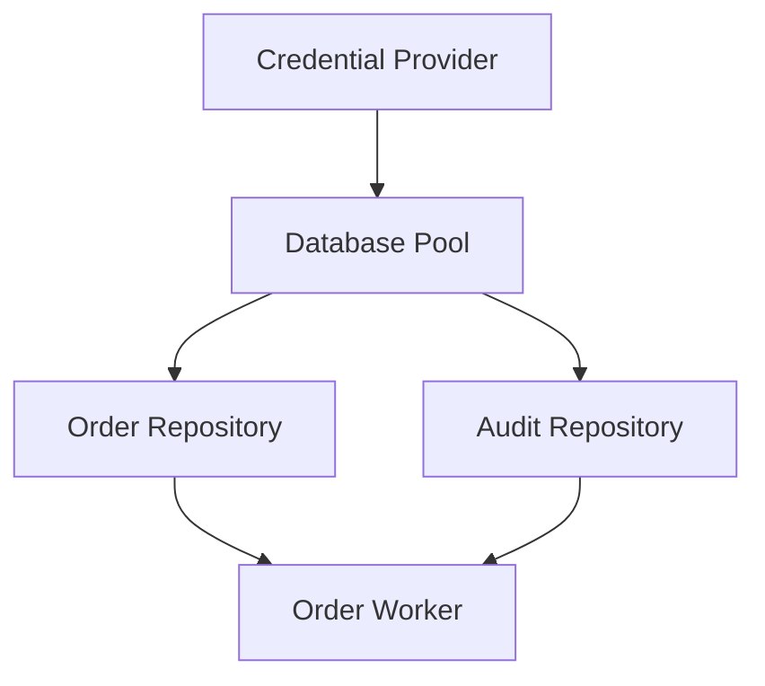

# Đóng tài nguyên theo thứ tự phụ thuộc và mở lại theo thứ tự ngược

Ứng dụng Java thường quản lý nhiều tài nguyên có quan hệ phụ thuộc. Một worker có thể sử dụng repository; repository sử dụng connection pool; connection pool cần cấu hình và thông tin xác thực để kết nối database. Khi ứng dụng hoạt động, các tài nguyên phải được khởi tạo theo thứ tự phù hợp để dependency đã sẵn sàng trước khi thành phần sử dụng nó bắt đầu chạy.

Khi chuẩn bị checkpoint CRaC, chiều xử lý phải đảo lại: dừng thành phần ở tầng trên trước, sau đó mới đóng những tài nguyên mà nó phụ thuộc. Sau restore, mở dependency trước rồi mới khởi động lại thành phần phụ thuộc. Quy tắc này giữ cho ứng dụng không sử dụng một tài nguyên đã bị đóng và giúp quá trình checkpoint–restore diễn ra có kiểm soát.

## 1. Hiểu quan hệ phụ thuộc giữa các tài nguyên

Giả sử một ứng dụng có chuỗi tài nguyên:

```text
CredentialProvider
        ↓
DatabasePool
        ↓
OrderRepository
        ↓
OrderWorker
```

Trong sơ đồ này, mũi tên biểu thị chiều phụ thuộc: thành phần phía dưới cần thành phần phía trên để hoạt động. `DatabasePool` cần thông tin xác thực; `OrderRepository` cần pool; `OrderWorker` gọi repository.

Thứ tự khởi tạo là:

1. Tạo `CredentialProvider`.
2. Mở `DatabasePool` bằng thông tin xác thực.
3. Khởi tạo `OrderRepository` với pool.
4. Khởi động `OrderWorker`.

Khi đóng, phải đi theo chiều ngược lại:

1. Dừng `OrderWorker` để không còn công việc mới sử dụng repository.
2. Đóng `OrderRepository` hoặc các tài nguyên do repository sở hữu.
3. Đóng `DatabasePool` sau khi không còn consumer sử dụng nó.
4. Giải phóng `CredentialProvider` sau khi pool đã đóng.

Nếu đóng pool trước worker, worker có thể đang thực hiện truy vấn nhưng connection đã bị đóng. Nếu giải phóng thông tin xác thực trước pool, pool có thể không hoàn tất được thao tác đóng hoặc làm mới kết nối. Thứ tự vòng đời phải phản ánh quan hệ sử dụng thực tế.

## 2. Quy tắc đóng và mở theo thứ tự ngược

Với một chuỗi phụ thuộc, quy tắc có thể ghi nhớ như sau:

| Giai đoạn | Thứ tự | Ví dụ |
|---|---|---|
| Khởi tạo ban đầu | Dependency trước, thành phần phụ thuộc sau | Credential → Pool → Repository → Worker |
| Trước checkpoint | Thành phần phụ thuộc trước, dependency sau | Worker → Repository → Pool → Credential |
| Sau restore | Dependency trước, thành phần phụ thuộc sau | Credential → Pool → Repository → Worker |

Nói cách khác, **đóng theo thứ tự ngược với thứ tự mở**. Đây cũng là nguyên tắc quen thuộc của stack và `try-with-resources`: tài nguyên được tạo sau thường được đóng trước, vì nó có thể đang sử dụng tài nguyên được tạo trước.

Với nhiều tài nguyên độc lập, không cần áp đặt một thứ tự tùy tiện giữa chúng. Chỉ cần bảo đảm mọi ràng buộc phụ thuộc được tôn trọng. Ví dụ, hai pool database độc lập có thể được mở hoặc đóng theo thứ tự bất kỳ nếu không có thành phần nào sử dụng chéo chúng.

## 3. Mô hình hóa bằng đồ thị phụ thuộc

Trong ứng dụng lớn, quan hệ tài nguyên thường không chỉ là một chuỗi. Có thể có nhiều nhánh cùng sử dụng một dependency:



Ở đây `OrderWorker` cần cả `OrderRepository` và `AuditRepository`; hai repository cùng cần `DatabasePool`. `CredentialProvider` là dependency chung của pool.

Thứ tự mở hợp lệ phải thỏa mãn:

- `CredentialProvider` mở trước `DatabasePool`.
- `DatabasePool` mở trước cả hai repository.
- Hai repository sẵn sàng trước `OrderWorker`.

Một thứ tự có thể là `CredentialProvider`, `DatabasePool`, `OrderRepository`, `AuditRepository`, `OrderWorker`. Một thứ tự khác có thể đổi vị trí hai repository vì chúng độc lập với nhau. Khi đóng, đảo lại đúng thứ tự đã chọn.

Về mặt thuật toán, có thể xem mỗi tài nguyên là một node trong directed acyclic graph (DAG). Một cạnh `A → B` có nghĩa B phụ thuộc A. Topological sort tạo ra một thứ tự mở hợp lệ; đảo thứ tự đó sẽ tạo thứ tự đóng hợp lệ.

### 3.1. Phát hiện chu kỳ phụ thuộc

Nếu A cần B để mở nhưng B cũng cần A để mở, đồ thị có chu kỳ. Không tồn tại thứ tự tuyến tính thỏa mãn cả hai yêu cầu. Đây thường là dấu hiệu thiết kế vòng đời chưa rõ ràng.

Có thể xử lý bằng cách:

- Tách phần cấu hình hoặc interface dùng chung ra khỏi hai resource.
- Dùng khởi tạo hai pha: tạo đối tượng trước, sau đó liên kết dependency khi cả hai đã tồn tại.
- Đưa các tài nguyên có vòng đời gắn chặt vào một coordinator sở hữu chung.
- Dùng callback hoặc lazy initialization để trì hoãn phần phụ thuộc thực sự đến khi hệ thống đã sẵn sàng.

Không che giấu chu kỳ bằng cách gọi `open()` lẫn nhau hoặc bắt exception rồi tiếp tục. Điều đó có thể khiến một tài nguyên được đánh dấu sẵn sàng trong khi dependency của nó chưa hoạt động.

## 4. Vì sao phải đóng thành phần phụ thuộc trước?

Một thành phần đang hoạt động có thể giữ reference đến dependency và gọi nó bất kỳ lúc nào. Vì vậy, trước khi đóng dependency, cần dừng những thành phần có khả năng sử dụng dependency đó.

Ví dụ với `OrderWorker`:

1. Ngừng nhận message hoặc công việc mới.
2. Chờ các message đang xử lý đạt trạng thái an toàn.
3. Hoàn tất hoặc rollback transaction theo chính sách nghiệp vụ.
4. Dừng thread và scheduler thuộc worker.
5. Đóng repository hoặc client mà worker sử dụng.
6. Cuối cùng đóng connection pool và credential provider.

Chỉ gọi `close()` trên một object chưa chắc đã dừng được toàn bộ hoạt động. Một scheduler có thể tiếp tục gọi object đó; một thread nền có thể đang giữ connection; một consumer có thể tiếp tục nhận message. Vì vậy, thao tác dừng nhận công việc và drain hoạt động đang chạy thường phải diễn ra trước thao tác giải phóng tài nguyên.

### 4.1. Dừng nhận việc mới và chờ việc đang chạy

Trước checkpoint, ứng dụng nên có một ranh giới quiescence: không nhận công việc mới và những công việc đang chạy đã hoàn tất hoặc được đưa về trạng thái có thể tiếp tục an toàn.

Ví dụ, một worker có thể có các bước:

- Tạm dừng consumer để không nhận thêm message.
- Chờ các handler đang chạy kết thúc trong thời hạn quy định.
- Xác nhận transaction đã commit hoặc rollback.
- Flush buffer hoặc acknowledgement cần thiết.
- Dừng executor do worker sở hữu.
- Đóng client hoặc repository sau khi không còn tác vụ sử dụng chúng.

Nếu hết thời hạn chờ mà vẫn còn công việc đang chạy, chính sách checkpoint cần quyết định rõ: hủy yêu cầu checkpoint, chờ thêm theo giới hạn, hoặc dừng instance theo quy trình an toàn. Không nên đóng dependency đang được một thread sử dụng.

## 5. Mở lại dependency trước thành phần sử dụng nó

Sau restore, ứng dụng cần tái lập các dependency trước khi khởi động worker hoặc nhận traffic. Với ví dụ ở trên:

1. Làm mới `CredentialProvider` và xác thực thông tin cần thiết.
2. Tạo lại `DatabasePool` và kiểm tra khả năng kết nối.
3. Khôi phục `OrderRepository` và `AuditRepository`.
4. Khởi động `OrderWorker` và đăng ký consumer.
5. Chỉ báo readiness khi các dependency bắt buộc đã sẵn sàng.

Nếu worker được khởi động trước pool, nó có thể nhận message rồi thất bại khi truy cập database. Nếu repository được tạo với một pool đã đóng từ trước checkpoint, object repository vẫn có thể tồn tại trong heap nhưng không thể thực hiện truy vấn.

Không nên coi việc restore tiến trình thành công là bằng chứng toàn bộ dependency đã sẵn sàng. Callback `afterRestore` và readiness ở cấp ứng dụng cần phản ánh trạng thái phục hồi thật.

## 6. Liên hệ với callback của CRaC

CRaC cung cấp `Resource` để ứng dụng chuẩn bị trước checkpoint và phục hồi sau restore:

- `beforeCheckpoint(...)`: dừng hoặc đóng tài nguyên trước khi snapshot được tạo.
- `afterRestore(...)`: tạo lại hoặc làm mới tài nguyên sau khi tiến trình được khôi phục.

Nếu đăng ký từng resource trong cùng một `Context`, cần tuân theo quy tắc thứ tự callback mà phiên bản `org.crac` đang dùng quy định. API CRaC sắp xếp callback để hỗ trợ vòng đời phụ thuộc: `beforeCheckpoint` được gọi theo thứ tự ngược với đăng ký, còn `afterRestore` theo thứ tự đăng ký. Vì vậy, khi dùng trực tiếp cơ chế này, hãy đăng ký dependency trước rồi đăng ký thành phần phụ thuộc sau.

Ví dụ, thứ tự đăng ký là:

```java
Core.getGlobalContext().register(credentialProviderResource);
Core.getGlobalContext().register(databasePoolResource);
Core.getGlobalContext().register(orderRepositoryResource);
Core.getGlobalContext().register(orderWorkerResource);
```

Với cùng context, thứ tự trên cho phép callback đóng worker trước repository, pool và credential provider; sau restore, callback phục hồi credential provider trước pool, repository và worker.

Hãy đối chiếu Javadoc của đúng phiên bản API đang dùng trước khi dựa vào thứ tự callback, nhất là khi ứng dụng sử dụng nhiều context hoặc resource lồng nhau. Không suy ra thứ tự toàn cục giữa những resource được quản lý bởi các context độc lập.

### 6.1. Dùng coordinator khi cần kiểm soát thứ tự tường minh

Khi dependency phức tạp, nhiều resource được khởi tạo bởi framework hoặc thứ tự đăng ký khó kiểm soát, có thể tạo một `Resource` điều phối vòng đời. Coordinator giữ một danh sách theo thứ tự mở; khi checkpoint, nó duyệt danh sách ngược; sau restore, nó duyệt theo thứ tự ban đầu.

Ví dụ:

```java
import org.crac.Context;
import org.crac.Core;
import org.crac.Resource;

import java.util.ArrayList;
import java.util.List;

interface ManagedResource {
    void open() throws Exception;
    void close() throws Exception;
}

public final class ResourceLifecycleCoordinator implements Resource {

    // Dependency trước, thành phần phụ thuộc sau.
    private final List<ManagedResource> openOrder;

    public ResourceLifecycleCoordinator(
            List<ManagedResource> openOrder) {
        this.openOrder = List.copyOf(openOrder);
    }

    @Override
    public void beforeCheckpoint(Context<? extends Resource> context)
            throws Exception {
        // Đóng theo thứ tự ngược: dependent trước, dependency sau.
        for (int i = openOrder.size() - 1; i >= 0; i--) {
            openOrder.get(i).close();
        }
    }

    @Override
    public void afterRestore(Context<? extends Resource> context)
            throws Exception {
        List<ManagedResource> opened = new ArrayList<>();

        try {
            // Mở dependency trước, sau đó mới mở dependent.
            for (ManagedResource resource : openOrder) {
                resource.open();
                opened.add(resource);
            }
        } catch (Exception failure) {
            // Nếu mở dở dang, giải phóng những resource đã mở theo thứ tự ngược.
            for (int i = opened.size() - 1; i >= 0; i--) {
                try {
                    opened.get(i).close();
                } catch (Exception cleanupFailure) {
                    failure.addSuppressed(cleanupFailure);
                }
            }
            throw failure;
        }
    }

    public static void register(ResourceLifecycleCoordinator coordinator) {
        Core.getGlobalContext().register(coordinator);
    }
}
```

Danh sách truyền vào coordinator phải được sắp xếp theo thứ tự dependency trước, dependent sau. Ví dụ:

```java
List<ManagedResource> openOrder = List.of(
        credentialProvider,
        databasePool,
        orderRepository,
        orderWorker
);

ResourceLifecycleCoordinator coordinator =
        new ResourceLifecycleCoordinator(openOrder);

ResourceLifecycleCoordinator.register(coordinator);
```

Ví dụ là khung điều phối vòng đời. Các implementation `ManagedResource` cần tự quản lý trạng thái mở/đóng, xử lý tài nguyên mở dở dang và bảo đảm `open()` hoặc `close()` có hành vi lỗi được xác định. Không đăng ký đồng thời coordinator và từng resource con vào cùng context nếu điều đó khiến một resource bị đóng hoặc mở hai lần.

## 7. Xử lý lỗi trong quá trình đóng và mở

Thứ tự đúng không chỉ áp dụng khi mọi thao tác thành công. Cần xác định rõ hành vi nếu một resource không thể đóng hoặc mở.

### 7.1. Một resource không đóng được trước checkpoint

Giả sử `OrderWorker` đã dừng, nhưng `OrderRepository` không thể đóng vì còn một truy vấn chưa kết thúc. Khi đó không nên tiếp tục đóng `DatabasePool`, vì repository có thể vẫn cần pool để hoàn tất hoặc giải phóng truy vấn.

Một chính sách an toàn thường là:

1. Dừng quá trình đóng tại resource lỗi.
2. Báo lỗi để checkpoint bị từ chối hoặc không được coi là thành công.
3. Giữ dependency phía dưới hoạt động cho đến khi trạng thái dependent được xử lý.
4. Thực hiện rollback/reopen những resource đã đóng trước đó nếu ứng dụng có thể khôi phục an toàn.
5. Nếu rollback không thể hoàn tất, đánh dấu instance không sẵn sàng và dùng quy trình phục hồi hoặc khởi động mới.

Không bắt exception rồi bỏ qua chỉ để tiếp tục checkpoint. Image được tạo từ một tiến trình có resource ở trạng thái không xác định có thể không restore được hoặc hoạt động sai.

### 7.2. Một dependency không mở lại được sau restore

Nếu `DatabasePool` không kết nối được, không nên tiếp tục mở repository và worker như thể hệ thống đã sẵn sàng. Hãy dừng chuỗi mở tại dependency lỗi. Những resource đã mở trước đó cần được đóng theo thứ tự ngược để tránh rò rỉ.

Sau lỗi, readiness phải tiếp tục ở trạng thái thất bại hoặc chưa sẵn sàng. Tùy nền tảng, instance có thể thử lại có giới hạn, chờ dependency phục hồi hoặc thoát để bộ điều phối tạo instance mới. Không để worker nhận traffic khi dependency bắt buộc chưa hoạt động.

### 7.3. Thiết kế thao tác mở/đóng an toàn khi gọi lặp

Trong vòng đời thực tế, resource có thể đã đóng, chưa mở, mở một phần hoặc đang phục hồi. Vì vậy:

- `close()` nên an toàn khi được gọi trên trạng thái đã đóng nếu điều đó phù hợp với API của resource.
- `open()` nên phát hiện resource đã mở để tránh tạo trùng thread, pool hoặc listener.
- Nếu `open()` thất bại giữa chừng, resource phải tự giải phóng phần đã tạo hoặc báo rõ trạng thái không hoàn chỉnh.
- Không đặt cờ `ready = true` trước khi mọi dependency bắt buộc hoạt động.
- Không dùng một biến boolean chung để đại diện trạng thái của nhiều resource độc lập.

Các thao tác phải được đồng bộ với luồng nghiệp vụ. Một `close()` idempotent vẫn không an toàn nếu thread khác tiếp tục sử dụng resource trong lúc đóng. Cần drain công việc hoặc dùng cơ chế khóa và trạng thái lifecycle phù hợp.

## 8. Những loại tài nguyên thường cần sắp xếp

| Tài nguyên | Trước checkpoint | Sau restore |
|---|---|---|
| Scheduler/worker | Dừng nhận việc, chờ tác vụ đang chạy, dừng executor do nó sở hữu | Tạo lại executor, đăng ký lịch và khởi động worker sau dependency |
| Message consumer | Pause/stop consumer, xử lý acknowledgement và message đang chạy | Tạo consumer mới, đăng ký subscription và bắt đầu nhận message |
| Repository/client | Ngừng request mới, chờ thao tác hiện tại, giải phóng state riêng | Khởi tạo lại sau connection pool hoặc client nền tảng |
| Connection pool | Đóng pool sau khi tất cả consumer đã dừng | Mở pool sau khi credential/configuration sẵn sàng |
| Credential provider | Giải phóng cache hoặc secret session nếu cần | Lấy hoặc xác thực credential mới trước khi mở pool |
| HTTP client | Dừng request, đóng socket/pool nếu cần | Tạo client hoặc connection pool mới trước khi mở service sử dụng nó |
| File handle/stream | Flush và đóng writer/stream trước file hoặc storage owner | Mở storage/file trước writer và consumer |
| Native library/context | Dừng các thành phần gọi native trước khi giải phóng context | Tạo native context trước khi khởi tạo các wrapper phụ thuộc |

Không phải mọi resource đều cần đóng. Một số thư viện hỗ trợ CRaC và tự xử lý callback; một số tài nguyên có thể được nền tảng khôi phục; một số tài nguyên phải được tạo mới. Hãy tuân theo hướng dẫn của thư viện và tránh để cả ứng dụng lẫn thư viện cùng sở hữu một vòng đời gây đóng hai lần.

## 9. Các sai lầm thường gặp

**Đóng dependency trước dependent.** Worker hoặc repository vẫn có thể sử dụng pool sau khi pool đã đóng. Hãy dừng thành phần ở tầng trên trước.

**Mở dependent trước dependency.** Worker nhận việc khi pool hoặc credential chưa sẵn sàng. Hãy mở theo thứ tự dependency trước, dependent sau.

**Chỉ gọi close mà không drain hoạt động.** Thread nền hoặc request đang chạy vẫn có thể sử dụng resource. Hãy ngừng nhận công việc mới và chờ hoạt động đang chạy đạt ranh giới an toàn.

**Giả định thứ tự đăng ký không quan trọng.** Callback CRaC trong cùng context có quy tắc thứ tự. Hãy đăng ký theo dependency order và kiểm tra đúng Javadoc của phiên bản API.

**Đăng ký resource con lẫn coordinator.** Một tài nguyên có thể bị callback hai lần nếu vừa được quản lý trực tiếp vừa được coordinator quản lý. Mỗi resource cần một chủ sở hữu vòng đời rõ ràng.

**Bỏ qua lỗi callback.** Nếu một dependent chưa đóng được, tiếp tục đóng dependency có thể làm hỏng trạng thái. Nếu dependency không mở được, không nên khởi động dependent.

**Coi thứ tự khởi tạo object là đồ thị phụ thuộc hoàn chỉnh.** Constructor order không luôn phản ánh mọi quan hệ runtime. Cần liệt kê cả thread, scheduler, listener và callback có thể sử dụng tài nguyên.

**Không xử lý chu kỳ phụ thuộc.** Hai resource chờ nhau mở hoặc đóng không thể được sắp xếp bằng một danh sách tuyến tính. Hãy tách ownership hoặc dùng khởi tạo nhiều pha.

## 10. Tự kiểm tra mức độ hiểu

1. **Nếu repository phụ thuộc connection pool, thành phần nào phải đóng trước?** Repository phải ngừng hoạt động và đóng trước pool, vì repository còn sử dụng pool.
2. **Sau restore, mở pool hay repository trước?** Mở pool trước, sau đó mới khôi phục repository.
3. **Nếu worker dùng repository và repository dùng pool, thứ tự mở là gì?** Pool → Repository → Worker; thứ tự đóng là Worker → Repository → Pool.
4. **Vì sao phải drain request trước khi đóng dependency?** Để không còn thread hoặc request đang sử dụng tài nguyên trong lúc tài nguyên đó bị giải phóng.
5. **Nếu một dependency không mở được sau restore, worker có nên nhận traffic không?** Không. Readiness phải giữ trạng thái chưa sẵn sàng và không mở dependent phía trên.
6. **Một đồ thị phụ thuộc có chu kỳ biểu thị điều gì?** Vòng đời chưa thể sắp xếp tuyến tính; cần tách ownership, dùng khởi tạo nhiều pha hoặc thiết kế lại dependency.

## Kết luận

Thứ tự vòng đời tài nguyên phải tuân theo quan hệ phụ thuộc. Khi khởi tạo hoặc restore, mở dependency trước rồi mới mở thành phần sử dụng nó. Khi chuẩn bị checkpoint, dừng và đóng thành phần phụ thuộc trước rồi mới giải phóng dependency. Với một danh sách mở hợp lệ, thứ tự đóng chính là danh sách đảo ngược.

Trong ứng dụng CRaC, hãy mô hình hóa dependency rõ ràng, dừng công việc đang chạy trước khi đóng, dùng `beforeCheckpoint` và `afterRestore` để điều phối, đồng thời xử lý lỗi callback và readiness có chủ đích. Khi có nhiều resource hoặc dependency phức tạp, một coordinator với thứ tự mở tường minh giúp vòng đời dễ hiểu và có thể kiểm soát hơn.
