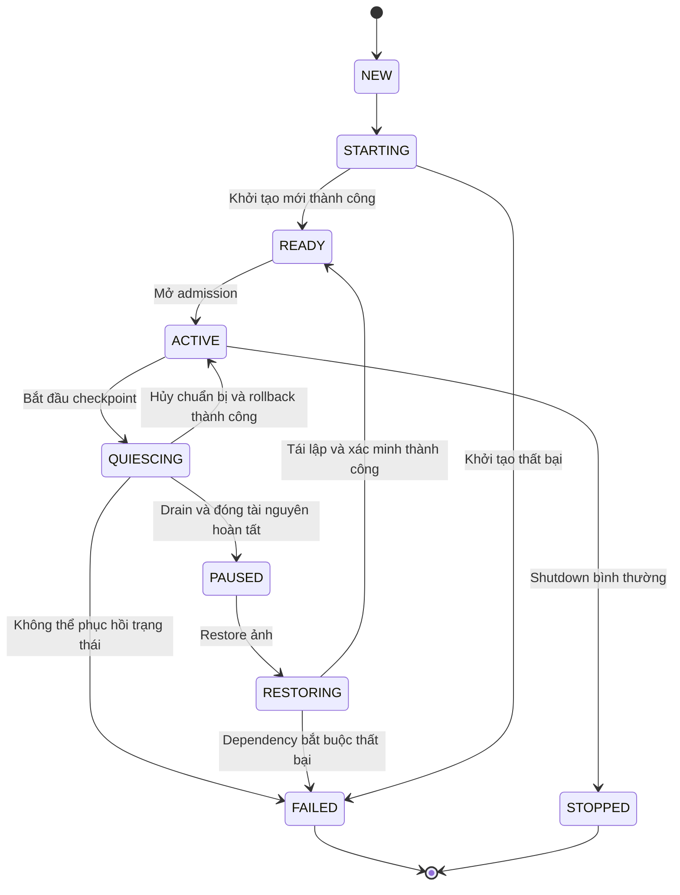

# Thiết kế trạng thái đang hoạt động, đang tạm dừng và sẵn sàng trở lại

Trong ứng dụng Java dùng CRaC, checkpoint không chỉ là thao tác ghi bộ nhớ ra ảnh. Ứng dụng phải chuyển từ trạng thái đang phục vụ sang trạng thái an toàn để chụp, sau đó có thể khôi phục và tiếp tục hoạt động mà không xử lý trùng công việc hoặc dùng lại tài nguyên đã hết hiệu lực.

Một cách thiết kế dễ kiểm soát là mô hình hóa vòng đời ứng dụng bằng các trạng thái tường minh:

- **ACTIVE**: ứng dụng đang hoạt động bình thường và có thể nhận công việc.
- **QUIESCING**: ứng dụng ngừng nhận công việc mới, chờ công việc đang chạy hoàn tất và chuẩn bị tài nguyên.
- **PAUSED**: công việc đã được dừng an toàn, các tài nguyên cần đóng đã được xử lý; trạng thái này thích hợp để checkpoint.
- **RESTORING**: tiến trình vừa được khôi phục và đang tái lập các phụ thuộc bên ngoài.
- **READY**: tài nguyên bắt buộc đã được phục hồi và kiểm tra; ứng dụng có thể được đưa trở lại phục vụ.
- **FAILED**: quá trình tạm dừng hoặc phục hồi gặp lỗi không thể tiếp tục an toàn.
- **STOPPED**: ứng dụng đã dừng hẳn theo lifecycle thông thường.

Các trạng thái này giúp trả lời ba câu hỏi vận hành: ứng dụng có đang nhận việc không, có thể checkpoint ngay không, và sau restore đã đủ điều kiện nhận request chưa.

## 1. Vì sao cần mô hình trạng thái?

Một ứng dụng có thể chứa nhiều thành phần cùng hoạt động: HTTP server, thread pool, scheduler, message consumer, database pool, cache client và các tác vụ nền. Nếu chỉ gọi checkpoint khi process còn đang hoạt động bình thường, những thành phần này có thể ở các thời điểm khác nhau:

- Request đang cập nhật dữ liệu nhưng chưa commit.
- Consumer đã nhận message nhưng chưa ack.
- Scheduler đang khởi chạy một tác vụ định kỳ.
- Thread đang giữ lock hoặc chờ I/O.
- Connection pool giữ các socket mà server bên ngoài sẽ đóng trong lúc ứng dụng dừng.
- Cache chứa dữ liệu tạm chỉ có ý nghĩa trong phiên chạy hiện tại.

Checkpoint một trạng thái như vậy có thể khiến ứng dụng sau restore tiếp tục từ một điểm không nhất quán. Ví dụ, message đã được xử lý ở hệ thống bên ngoài nhưng trạng thái ack chưa được ghi nhận; khi consumer hoạt động lại, message có thể được gửi thêm lần nữa.

Mô hình trạng thái buộc ứng dụng đi qua các bước có thứ tự. Nó cũng tạo ra một nơi tập trung để kiểm tra điều kiện trước khi cho phép checkpoint hoặc báo readiness sau restore.

## 2. Định nghĩa các trạng thái

| Trạng thái | Ý nghĩa | Nhận công việc mới? | Điều kiện rời trạng thái |
|---|---|---:|---|
| NEW | Object graph vừa được tạo trong một lần chạy mới | Không | Bắt đầu khởi tạo |
| STARTING | Đang tạo và kiểm tra tài nguyên ban đầu | Không | Dependency bắt buộc sẵn sàng |
| ACTIVE | Ứng dụng đang phục vụ bình thường | Có | Nhận yêu cầu checkpoint hoặc shutdown |
| QUIESCING | Đang ngừng admission và drain công việc | Không | Công việc đang chạy đã hoàn tất |
| PAUSED | Worker đã dừng và tài nguyên đã ở trạng thái an toàn | Không | Được khôi phục từ checkpoint |
| RESTORING | Đang tạo lại hoặc xác minh tài nguyên sau restore | Không | Tất cả dependency bắt buộc đã sẵn sàng |
| READY | Đã phục hồi, readiness có thể được bật | Có thể mở admission | Được đưa lại vào luồng phục vụ |
| FAILED | Không thể bảo đảm trạng thái an toàn hoặc phục hồi | Không | Cần xử lý lỗi hoặc thay instance |
| STOPPED | Đã dừng vĩnh viễn | Không | Không tiếp tục từ lifecycle này |

`PAUSED` và `STOPPED` có ý nghĩa khác nhau. PAUSED là trạng thái tạm thời để lưu ảnh và có thể tiếp tục sau restore. STOPPED là kết thúc vòng đời instance. Không dùng cùng một cờ `running=false` cho cả hai trường hợp, vì code phục hồi cần biết ứng dụng đang chờ restore hay đã bị dừng hẳn.

`READY` cũng khác `ACTIVE`. READY biểu thị các tài nguyên bắt buộc đã được tái lập và instance có thể nhận traffic. ACTIVE là trạng thái phục vụ bình thường sau khi admission được mở. Trong một triển khai đơn giản, hai trạng thái có thể chuyển tiếp rất nhanh; vẫn nên phân biệt chúng trong mô hình để phối hợp với load balancer và readiness probe.

## 3. Sơ đồ chuyển trạng thái

Luồng checkpoint và restore điển hình:



Các chuyển trạng thái phải có điều kiện rõ ràng. Không cho phép chuyển thẳng từ ACTIVE sang PAUSED nếu vẫn còn request hoặc worker đang thực hiện thao tác nghiệp vụ. Không chuyển từ RESTORING sang READY chỉ vì đã tạo được object client; cần kiểm tra kết nối và quyền truy cập thực tế.

### Các bất biến cần giữ

- Khi ở QUIESCING hoặc PAUSED, admission phải đóng và không nhận công việc mới.
- Chỉ chuyển sang PAUSED khi công việc đang chạy đã drain và các tài nguyên cần chuẩn bị đã hoàn tất.
- Khi ở RESTORING, readiness phải false.
- Chỉ chuyển sang READY sau khi mọi dependency bắt buộc đã phục hồi.
- Khi ở FAILED, không tự mở admission để thử phục vụ tiếp.
- STOPPED không được coi là PAUSED và không được tự động restore từ cùng object lifecycle.

## 4. Chuyển từ ACTIVE sang QUIESCING

Khi bắt đầu checkpoint, bước đầu tiên là đóng đường nhận công việc mới. Việc này cần được phối hợp với HTTP server, load balancer, message broker và scheduler.

Một trình tự có thể áp dụng:

1. Đổi trạng thái từ ACTIVE sang QUIESCING để các thành phần biết rằng instance đang chuẩn bị checkpoint.
2. Đóng admission tại HTTP filter/server hoặc đưa instance ra khỏi load balancer.
3. Dừng nhận message mới từ broker.
4. Tạm dừng lịch chạy mới và các job định kỳ.
5. Chờ request và task đang thực hiện hoàn tất trong một khoảng thời gian giới hạn.
6. Xử lý task còn lại theo chính sách: hoàn tất, lưu checkpoint nghiệp vụ hoặc hủy có kiểm soát.

Chỉ đóng cổng HTTP chưa đủ. Consumer, scheduler và worker nội bộ có thể tiếp tục tạo công việc mới. Mỗi nguồn tạo việc cần có cơ chế pause hoặc drain riêng.

### Theo dõi công việc đang chạy

Ứng dụng có thể duy trì bộ đếm số công việc đang được admission:

```java
import java.util.concurrent.atomic.AtomicInteger;

public final class InFlightCounter {

    private final AtomicInteger count = new AtomicInteger();

    public void started() {
        count.incrementAndGet();
    }

    public void finished() {
        int remaining = count.decrementAndGet();
        if (remaining < 0) {
            throw new IllegalStateException("In-flight counter became negative");
        }
    }

    public int current() {
        return count.get();
    }
}
```

Khi một request được nhận, tăng bộ đếm; trong `finally`, giảm bộ đếm. Khi quiesce, đóng admission trước rồi chờ bộ đếm về 0. Trong ứng dụng nhiều loại worker, cần theo dõi riêng hoặc gom tất cả vào một cơ chế drain thống nhất.

Ví dụ:

```java
inFlight.started();
try {
    handleRequest();
} finally {
    inFlight.finished();
}
```

Đoạn mã minh họa cần được đặt trong một admission wrapper bảo đảm `started()` chỉ được gọi sau khi request đã được chấp nhận. Nếu request bị từ chối vì QUIESCING, không tăng bộ đếm.

### Drain có timeout

Không chờ vô hạn một request hoặc tác vụ nền bị treo. Đặt deadline cho drain và ghi lại những công việc còn lại nếu hết thời gian. Tùy nghiệp vụ, có thể:

- Hủy task có thể hủy an toàn.
- Chờ thêm trong giới hạn vận hành.
- Ghi trạng thái để task tiếp tục sau restore.
- Từ chối checkpoint nếu task không thể dừng an toàn.

Không được tự ý đánh dấu drain hoàn tất khi bộ đếm vẫn còn công việc. Điều đó chỉ che giấu trạng thái không nhất quán.

## 5. Chuyển từ QUIESCING sang PAUSED

Sau khi ngừng nhận việc mới và drain thành công, ứng dụng chuẩn bị các tài nguyên bên ngoài. CRaC cung cấp `Resource.beforeCheckpoint(...)` để thực hiện bước này.

Ví dụ, resource có thể:

- Dừng worker và scheduler.
- Commit hoặc rollback transaction theo quy tắc nghiệp vụ.
- Flush file và log cần thiết.
- Ack message đã xử lý và dừng consumer.
- Đóng database connection pool hoặc HTTP connection.
- Ghi nhận trạng thái ứng dụng là PAUSED.

Chỉ đánh dấu PAUSED sau khi các bước cần thiết đã hoàn tất. Nếu đóng tài nguyên thất bại, không được coi instance đã sẵn sàng để checkpoint.

### Ví dụ Resource quản lý vòng đời

Đoạn mã sau minh họa một coordinator duy nhất điều phối admission, worker và external dependency. Các interface `AdmissionGate`, `BackgroundWork` và `ExternalDependencies` là abstraction do ứng dụng định nghĩa; cần triển khai chúng bằng API cụ thể của server, executor và client đang sử dụng.

```java
import org.crac.Context;
import org.crac.Core;
import org.crac.Resource;

public final class ApplicationLifecycleResource implements Resource {

    public enum State {
        NEW,
        STARTING,
        ACTIVE,
        QUIESCING,
        PAUSED,
        RESTORING,
        READY,
        FAILED,
        STOPPED
    }

    public interface AdmissionGate {
        void close() throws Exception;
        void open() throws Exception;
    }

    public interface BackgroundWork {
        void stopAcceptingAndDrain() throws Exception;
        void stop() throws Exception;
        void start() throws Exception;
    }

    public interface ExternalDependencies {
        void connectAndVerify() throws Exception;
        void closeForCheckpoint() throws Exception;
    }

    private final AdmissionGate admission;
    private final BackgroundWork backgroundWork;
    private final ExternalDependencies dependencies;

    private volatile State state = State.NEW;

    public ApplicationLifecycleResource(
            AdmissionGate admission,
            BackgroundWork backgroundWork,
            ExternalDependencies dependencies) {
        this.admission = admission;
        this.backgroundWork = backgroundWork;
        this.dependencies = dependencies;
        Core.getGlobalContext().register(this);
    }

    public synchronized void startNormally() throws Exception {
        require(State.NEW);
        state = State.STARTING;
        try {
            dependencies.connectAndVerify();
            backgroundWork.start();
            state = State.READY;
            admission.open();
            state = State.ACTIVE;
        } catch (Exception failure) {
            failClosed(failure);
            throw failure;
        }
    }

    @Override
    public synchronized void beforeCheckpoint(
            Context<? extends Resource> context) throws Exception {
        require(State.ACTIVE);
        state = State.QUIESCING;
        try {
            admission.close();
            backgroundWork.stopAcceptingAndDrain();
            backgroundWork.stop();
            dependencies.closeForCheckpoint();
            state = State.PAUSED;
        } catch (Exception failure) {
            // Roll back only if every dependency can be restored safely.
            try {
                dependencies.connectAndVerify();
                backgroundWork.start();
                admission.open();
                state = State.ACTIVE;
            } catch (Exception recoveryFailure) {
                failure.addSuppressed(recoveryFailure);
                failClosed(failure);
            }
            throw failure;
        }
    }

    @Override
    public synchronized void afterRestore(
            Context<? extends Resource> context) throws Exception {
        require(State.PAUSED);
        state = State.RESTORING;
        try {
            dependencies.connectAndVerify();
            backgroundWork.start();
            state = State.READY;
            admission.open();
            state = State.ACTIVE;
        } catch (Exception failure) {
            failClosed(failure);
            throw failure;
        }
    }

    public State state() {
        return state;
    }

    public boolean isReady() {
        return state == State.ACTIVE;
    }

    private void require(State expected) {
        if (state != expected) {
            throw new IllegalStateException(
                    "Expected state " + expected + " but was " + state);
        }
    }

    private void failClosed(Exception failure) {
        state = State.FAILED;
        try {
            admission.close();
        } catch (Exception closeFailure) {
            failure.addSuppressed(closeFailure);
        }
    }
}
```

Đây là khung thiết kế để minh họa chuyển trạng thái, không phải implementation hoàn chỉnh cho mọi server hoặc executor. Trong ứng dụng thật, các collaborator phải bảo đảm drain có timeout, thao tác đóng/mở có thể chẩn đoán, và `connectAndVerify()` có thể tạo lại tài nguyên đã đóng.

Ví dụ cũng thể hiện các nguyên tắc:

- `beforeCheckpoint` chỉ chấp nhận bắt đầu từ ACTIVE.
- State đổi sang QUIESCING trước khi đóng admission.
- PAUSED chỉ được đặt sau khi drain, stop và đóng dependency thành công.
- `afterRestore` chỉ chấp nhận trạng thái PAUSED được khôi phục từ ảnh.
- READY chỉ xuất hiện sau khi dependency và worker đã được phục hồi.
- Nếu rollback hoặc restore thất bại, admission bị đóng và state chuyển sang FAILED.

Nếu ứng dụng cần quản lý nhiều resource CRaC độc lập, phải xác định rõ thứ tự phụ thuộc giữa chúng. Không dựa vào thứ tự đăng ký ngẫu nhiên. Có thể gom các thao tác liên quan vào một coordinator hoặc dùng Context lồng nhau theo đúng hợp đồng của phiên bản CRaC.

## 6. Thiết kế trạng thái PAUSED

PAUSED không chỉ có nghĩa là một biến boolean đã được đặt thành false. Nó phải biểu thị một tập hợp điều kiện có thể kiểm chứng:

- Admission đã đóng.
- Không còn request hoặc task nghiệp vụ đang chạy.
- Scheduler không khởi chạy thêm job.
- Consumer không nhận thêm message.
- Message đã nhận có trạng thái xử lý/ack rõ ràng.
- Transaction đã hoàn tất hoặc được xử lý theo chính sách.
- Tài nguyên cần đóng đã đóng thành công.
- Worker không còn giữ lock hoặc buffer ở trạng thái không an toàn.

Một instance chỉ nên vào PAUSED khi các điều kiện bắt buộc này được thỏa mãn. Nếu một thành phần không thể dừng, hãy xác định nó có được CRaC/runtime hỗ trợ hay không và liệu có thể giữ nó qua checkpoint an toàn không.

### Tách trạng thái ứng dụng khỏi trạng thái từng resource

Một ứng dụng lớn có thể có nhiều tài nguyên với trạng thái riêng:

| Thành phần | Trước checkpoint | Khi PAUSED | Sau restore |
|---|---|---|---|
| HTTP admission | OPEN | CLOSED | Chờ readiness rồi OPEN |
| Request handler | RUNNING | DRAINED | RUNNING |
| Scheduler | RUNNING | STOPPED | STARTED |
| Message consumer | CONSUMING | PAUSED/CLOSED | REJOINED |
| Database pool | CONNECTED | CLOSED | RECREATED |
| HTTP client | CONNECTED | CLOSED/INVALIDATED | RECREATED |
| Cache | WARM | Giữ hoặc xóa theo chính sách | Kiểm tra hoặc làm nóng lại |

Coordinator tổng hợp trạng thái từng resource. Không nên cho rằng chỉ vì state tổng thể là PAUSED thì mọi thành phần chắc chắn đã dừng; cần có kết quả từ các bước chuẩn bị.

## 7. Thiết kế trạng thái READY sau restore

Khi khôi phục ảnh, heap chứa lại object graph đã được lưu. Nhưng kết nối mạng, credential, lock, broker assignment và dịch vụ bên ngoài có thể đã thay đổi.

Trạng thái RESTORING nên giữ admission đóng trong khi ứng dụng:

1. Đọc lại cấu hình động hoặc credential cần làm mới.
2. Tạo database pool và xác minh truy vấn.
3. Tạo HTTP client hoặc làm mới connection pool.
4. Kết nối lại broker và xác minh subscription/assignment.
5. Mở lại file, lấy lock hoặc tạo native resource nếu cần.
6. Khởi động worker và scheduler theo chính sách.
7. Kiểm tra các dependency bắt buộc.

Chỉ khi các bước bắt buộc hoàn tất mới chuyển sang READY. Một client constructor thành công chưa chứng minh server có thể phục vụ request. Hãy kiểm tra hoạt động thực tế với timeout hợp lý.

### Readiness và liveness

Readiness và liveness trả lời hai câu hỏi khác nhau:

- **Readiness**: instance có thể nhận công việc ngay bây giờ không?
- **Liveness**: process có còn sống và có khả năng tiếp tục hoạt động không?

Trong lúc RESTORING, process có thể sống nhưng chưa có database connection. Khi đó liveness có thể thành công, còn readiness phải thất bại. Nếu readiness bật quá sớm, load balancer hoặc orchestrator có thể gửi request vào một instance chưa sẵn sàng.

Với Spring Boot, có thể tích hợp state machine vào readiness health indicator. Chỉ báo readiness nên trả trạng thái chưa sẵn sàng khi state là NEW, STARTING, QUIESCING, PAUSED, RESTORING, READY hoặc FAILED; chỉ báo sẵn sàng khi state là ACTIVE, tức admission đã được mở thành công.

### READY trước khi ACTIVE

READY biểu thị toàn bộ dependency đã được kiểm tra và admission có thể được mở. ACTIVE biểu thị instance đã được đưa trở lại luồng phục vụ. Trong một triển khai, việc mở admission có thể xảy ra ngay sau READY; ở triển khai khác, bộ điều phối có thể cần cập nhật route hoặc đăng ký instance trước.

Không cần kéo dài trạng thái READY nếu hệ thống không có bước điều phối riêng. Tuy nhiên, giữ khái niệm này giúp tách lỗi phục hồi tài nguyên khỏi lỗi đưa instance trở lại traffic.

## 8. Hủy checkpoint và phục hồi sau lỗi

Quá trình chuyển sang PAUSED có thể thất bại ở giữa chừng. Ví dụ, admission đã đóng, worker đã dừng nhưng database pool chưa đóng được. Ứng dụng phải có chính sách rõ ràng:

- Nếu checkpoint chưa được thực hiện và mọi tài nguyên có thể tái lập, rollback về ACTIVE.
- Nếu rollback thành công, mở admission và cho phép phục vụ tiếp.
- Nếu rollback thất bại, chuyển sang FAILED, giữ admission đóng và để hệ thống điều phối thay thế instance hoặc xử lý sự cố.

Không được đặt state ACTIVE chỉ vì đã bắt được exception. ACTIVE chỉ hợp lệ khi tất cả điều kiện hoạt động đã được khôi phục.

CRaC cung cấp callback `beforeCheckpoint` và `afterRestore`; không thiết kế một callback `afterCheckpoint` giả định sẽ luôn được gọi để rollback. Hãy xác minh hành vi của JDK/runtime đối với lỗi xảy ra trước, trong và sau thao tác dump. Nếu ứng dụng cần tiếp tục chạy khi checkpoint thất bại, phần rollback phải được thực hiện theo luồng điều khiển và hợp đồng thực tế của runtime.

### Phân loại lỗi

| Lỗi | Phản ứng |
|---|---|
| Drain timeout | Không đánh dấu PAUSED; hủy checkpoint hoặc xử lý task theo chính sách |
| Không đóng được connection | Thử rollback nếu an toàn; nếu không, FAILED |
| Credential không hợp lệ khi restore | Giữ readiness false và báo lỗi rõ ràng |
| Broker không thể rejoin | Retry có giới hạn; không mở consumer nếu chưa xác minh |
| Worker khởi động một phần | Dừng worker đã mở và giữ FAILED nếu không thể phục hồi |
| Readiness gate không mở được | Không tuyên bố ACTIVE; báo lỗi điều phối |

Mọi lỗi cần có log và thời gian thực hiện. Tránh retry vô hạn trong callback vì nó có thể khiến quá trình restore treo mà không có kết quả vận hành rõ ràng.

## 9. Tính nhất quán của công việc và idempotency

Checkpoint lưu trạng thái của tiến trình, không tạo transaction phân tán giữa JVM và database hoặc message broker. Vì vậy, ứng dụng cần đảm bảo thao tác nghiệp vụ không bị thực hiện hai lần khi restore.

Ví dụ với message:

1. Consumer nhận message M.
2. Ứng dụng cập nhật database.
3. Trước khi ack M, checkpoint xảy ra.
4. Sau restore, broker có thể gửi lại M.
5. Handler cần nhận biết M đã được xử lý để không cập nhật database lần thứ hai.

Các giải pháp có thể dùng:

- Idempotency key theo nghiệp vụ.
- Bảng deduplication hoặc unique constraint.
- Transactional outbox/inbox.
- Ack/commit offset sau khi nghiệp vụ đã bền vững.
- Lease và lock có thời hạn thay vì giả định lease cũ vẫn còn.

Đối với scheduler, cần tránh chạy cùng một lịch hai lần nếu trạng thái scheduler được khôi phục trong khi một instance khác cũng đang chạy lịch đó. Với worker pool, cần dừng nhận việc mới, drain queue hoặc lưu trạng thái công việc theo cơ chế bền vững.

## 10. Quan sát và kiểm thử state machine

Ghi log mỗi lần chuyển trạng thái theo dạng:

```text
INFO lifecycle from=ACTIVE to=QUIESCING reason=checkpoint
INFO lifecycle from=QUIESCING to=PAUSED in_flight=0
INFO lifecycle from=PAUSED to=RESTORING reason=crac_restore
INFO lifecycle from=RESTORING to=READY dependencies=all_healthy
INFO lifecycle from=READY to=ACTIVE admission=open
```

Không ghi secret, payload nghiệp vụ hoặc credential vào log. Nên ghi thêm:

- Thời gian ở từng trạng thái.
- Số request/task đang chạy khi bắt đầu drain.
- Resource nào mất nhiều thời gian để đóng hoặc phục hồi.
- Số lần retry và nguyên nhân.
- Kết quả readiness.
- Lý do chuyển sang FAILED.

### Các kịch bản kiểm thử

| Kịch bản | Kết quả mong đợi |
|---|---|
| Khởi động JVM mới | NEW → STARTING → READY → ACTIVE |
| Checkpoint khi không có request | ACTIVE → QUIESCING → PAUSED |
| Checkpoint khi request đang chạy | Request hoàn tất rồi mới PAUSED |
| Drain timeout | Không vào PAUSED; rollback hoặc FAILED |
| Scheduler đang chạy | Job mới bị ngăn, job hiện tại được xử lý theo chính sách |
| Broker đang có message | Không mất trạng thái ack; duplicate được xử lý an toàn |
| Restore với dependency khỏe | PAUSED → RESTORING → READY → ACTIVE |
| Restore khi database lỗi | Không mở readiness; báo lỗi hoặc retry có giới hạn |
| Restore với credential hết hạn | Làm mới credential hoặc FAILED rõ ràng |
| Một resource phục hồi thất bại | Admission vẫn đóng |
| Shutdown bình thường | ACTIVE → STOPPED, không nhầm thành PAUSED |

Kiểm thử cần dùng checkpoint/restore thực tế trên runtime mục tiêu. Gọi trực tiếp một method mô phỏng `afterRestore()` chỉ kiểm tra logic Java, không chứng minh CRaC đã khôi phục object graph và gọi callback theo đúng vòng đời.

## 11. Các lỗi thiết kế thường gặp

| Thiết kế chưa an toàn | Hậu quả | Cách thiết kế |
|---|---|---|
| Chỉ dùng boolean `running` | Không phân biệt đang drain, paused và failed | Dùng enum/state machine có chuyển trạng thái hợp lệ |
| Đóng admission sau khi dừng worker | Request mới vẫn có thể tạo thêm công việc | Đóng admission trước, sau đó drain |
| Đánh dấu PAUSED trước khi đóng tài nguyên | Ảnh có thể chứa resource ở trạng thái dở dang | Chỉ PAUSED khi mọi bước bắt buộc hoàn tất |
| Mở readiness ngay đầu afterRestore | Traffic đến khi dependency chưa sẵn sàng | Giữ RESTORING cho đến khi health check thành công |
| Bắt exception rồi tiếp tục | Instance phục vụ với dependency hỏng | Chuyển FAILED và giữ admission đóng |
| Dùng STOPPED cho checkpoint | Restore không biết instance đang chờ tiếp tục hay đã kết thúc | Phân biệt PAUSED và STOPPED |
| Tạo lại mọi scheduler/consumer | Công việc hoặc side effect bị nhân đôi | Chỉ khởi động lại resource đã được dừng có chủ đích |
| Không có timeout cho drain/reconnect | Checkpoint hoặc restore treo vô hạn | Dùng deadline, timeout và chính sách lỗi |
| Dựa vào thứ tự callback tình cờ | Resource phụ thuộc có thể được phục hồi sai thứ tự | Dùng coordinator hoặc thứ tự được API hỗ trợ rõ ràng |

## 12. Checklist thiết kế

### Trước checkpoint

- [ ] Có trạng thái ACTIVE và chuyển sang QUIESCING một cách có kiểm soát.
- [ ] Admission đóng trước khi drain request và task.
- [ ] Tất cả nguồn tạo việc mới như scheduler và consumer được pause.
- [ ] Có timeout cho request/task đang chạy.
- [ ] Transaction, message, file và native resource có chính sách rõ ràng.
- [ ] Chỉ chuyển sang PAUSED sau khi mọi điều kiện bắt buộc đã hoàn tất.

### Sau restore

- [ ] Trạng thái khôi phục bắt đầu từ PAUSED và chuyển sang RESTORING.
- [ ] Dependency được tạo lại hoặc xác minh theo thứ tự phụ thuộc.
- [ ] Credential, endpoint, connection và lock được làm mới khi cần.
- [ ] Worker/scheduler chỉ được khởi động lại một lần.
- [ ] Health check thực hiện thao tác thực tế, có timeout.
- [ ] Chỉ chuyển sang READY khi mọi dependency bắt buộc khỏe.
- [ ] Admission và readiness được mở sau khi phục hồi hoàn tất.

### Lỗi và vận hành

- [ ] Có trạng thái FAILED và không tự mở admission khi thất bại.
- [ ] Có rollback khi chuẩn bị checkpoint thất bại và rollback thực sự an toàn.
- [ ] Không dựa vào callback không tồn tại như afterCheckpoint.
- [ ] Side effect và message handler có idempotency/deduplication.
- [ ] Có log chuyển trạng thái và thời gian từng bước.
- [ ] Đã thử checkpoint/restore thật, gồm cả trường hợp dependency lỗi.

Một state machine rõ ràng biến checkpoint–restore thành một quy trình có thể quan sát và kiểm soát. ACTIVE biểu thị ứng dụng đang phục vụ; QUIESCING và PAUSED bảo đảm công việc được dừng ở điểm an toàn; RESTORING tái lập các tài nguyên bên ngoài; READY xác nhận instance đủ điều kiện trở lại traffic. Khi mỗi trạng thái có bất biến và điều kiện chuyển tiếp cụ thể, ứng dụng giảm nguy cơ nhận request quá sớm, xử lý trùng công việc hoặc tiếp tục bằng kết nối đã hết hiệu lực.
