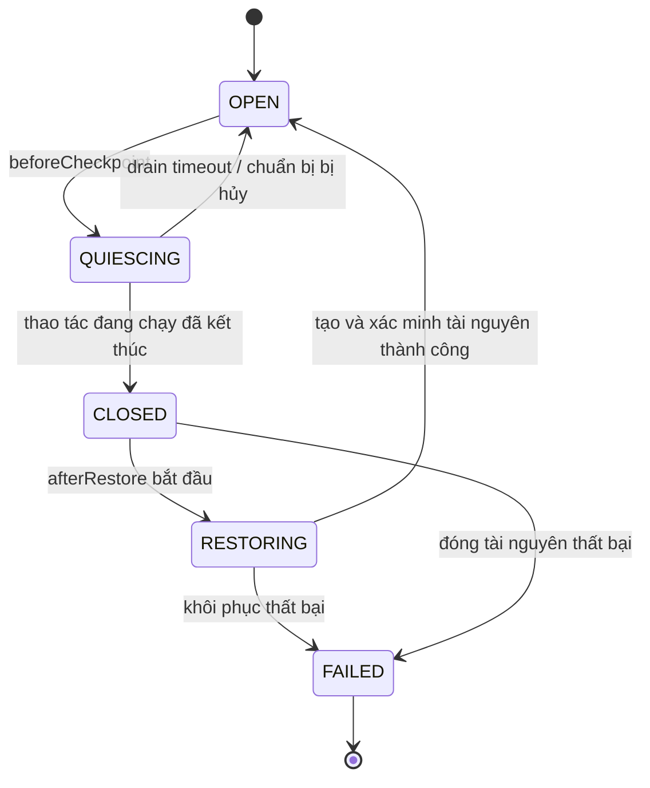

# Ngăn truy cập tài nguyên trong khoảng chuyển tiếp checkpoint–restore

Trong CRaC (Coordinated Restore at Checkpoint), ứng dụng cần kiểm soát việc sử dụng tài nguyên trong suốt quá trình chuyển từ trạng thái đang hoạt động sang checkpoint và từ checkpoint trở lại trạng thái phục vụ. Một tiến trình có thể chứa nhiều thành phần đang dùng chung tài nguyên: request HTTP, connection pool, message consumer, scheduler, socket, file handle hoặc client của dịch vụ bên ngoài. Nếu các thành phần này tiếp tục truy cập tài nguyên trong lúc resource đang được đóng hoặc khởi tạo lại, ứng dụng có thể gặp lỗi kết nối, thao tác dở dang hoặc trạng thái không nhất quán.

Giải pháp là tạo một cơ chế **đóng cổng truy cập có kiểm soát**. Trước checkpoint, ứng dụng ngừng nhận công việc mới, chặn các thao tác mới trên tài nguyên và chờ những thao tác đang chạy hoàn tất. Sau khi restore, ứng dụng giữ cổng đóng trong khi tạo lại và xác minh tài nguyên; chỉ mở quyền truy cập khi tài nguyên đã sẵn sàng.

Việc này cần được thực hiện ở hai phạm vi:

- **Phạm vi ứng dụng:** ngừng nhận request hoặc công việc mới, drain các request đang xử lý và giữ instance ở trạng thái chưa sẵn sàng.
- **Phạm vi tài nguyên:** bảo vệ từng resource để không có thao tác mới bắt đầu trong lúc tài nguyên đang chuyển trạng thái, đồng thời chờ các thao tác đã được cấp quyền hoàn tất.

Hai phạm vi phối hợp với nhau. Cổng ở cấp tài nguyên bảo vệ chính tài nguyên; readiness và ingress control bảo vệ luồng xử lý của toàn ứng dụng.

## 1. Vì sao phải ngăn truy cập trong khoảng chuyển tiếp?

Checkpoint lưu trạng thái của một tiến trình đang chạy. Trước khi ghi ảnh, ứng dụng có thể cần đóng connection pool, dừng consumer hoặc giải phóng socket. Sau khi restore, các tài nguyên này có thể cần được tạo lại vì kết nối cũ không còn hợp lệ hoặc dịch vụ bên ngoài đã thay đổi trong thời gian checkpoint được lưu trữ.

Nếu một luồng ứng dụng sử dụng tài nguyên đúng lúc callback đang đóng tài nguyên, một số tình huống có thể xảy ra:

- Request lấy được tham chiếu tới connection pool nhưng pool bị đóng trước khi request lấy connection.
- Consumer đang xử lý message trong khi callback bắt đầu đóng channel hoặc client.
- Scheduler bắt đầu một tác vụ mới sau khi ứng dụng đã bắt đầu drain.
- Một luồng đọc cache hoặc client trong lúc `afterRestore` đang thay thế đối tượng cũ bằng đối tượng mới.
- Ứng dụng báo healthy quá sớm và nhận request trong khi database pool hoặc broker client chưa kết nối lại.
- Một thao tác bất đồng bộ được khởi chạy trước checkpoint nhưng phần hoàn tất lại chạy sau khi tài nguyên đã đóng.

Chỉ đặt một cờ `isCheckpointing` rồi kiểm tra rải rác trong mã nguồn thường không đủ. Mọi đường truy cập phải dùng cùng một cơ chế đồng bộ; nếu một caller bỏ qua cờ, race condition vẫn tồn tại. Cơ chế kiểm soát cần quản lý cả thao tác mới lẫn những thao tác đã bắt đầu trước khi đóng cổng.

## 2. Phân biệt các trạng thái vòng đời

Một resource nên có trạng thái rõ ràng để quyết định có cho phép thao tác hay không. Có thể dùng mô hình sau:

| Trạng thái | Ý nghĩa | Cho phép thao tác nghiệp vụ? |
| --- | --- | --- |
| `OPEN` | Tài nguyên đã sẵn sàng và ứng dụng đang hoạt động | Có |
| `QUIESCING` | Đã chặn thao tác mới; đang chờ thao tác đang chạy hoàn tất | Không |
| `CLOSED` | Các thao tác đã kết thúc và tài nguyên đã được đóng để checkpoint | Không |
| `RESTORING` | Đang tạo lại hoặc xác minh tài nguyên sau restore | Không |
| `FAILED` | Không thể bảo đảm tài nguyên an toàn hoặc sẵn sàng | Không |

Luồng chuyển trạng thái thông thường:



`QUIESCING` là trạng thái quan trọng. Khi chuyển sang trạng thái này, hệ thống không cấp quyền cho thao tác mới nhưng vẫn cho phép các thao tác đã được cấp quyền trước đó hoàn tất. Chỉ khi số thao tác đang hoạt động về 0, callback mới đóng tài nguyên.

Nếu chờ drain quá thời hạn, callback cần báo lỗi và hủy lần chuẩn bị checkpoint. Khi đó tài nguyên chưa bị đóng, nên cổng có thể được mở lại để ứng dụng tiếp tục hoạt động hoặc thử lại sau khi xử lý nguyên nhân. Nếu việc đóng tài nguyên đã bắt đầu nhưng thất bại, không nên tự động mở cổng như thể tài nguyên vẫn khỏe mạnh; cần giữ trạng thái lỗi và để quy trình vận hành xử lý.

## 3. Hai lớp bảo vệ: ingress của ứng dụng và cổng của Resource

### 3.1. Ngừng nhận công việc mới ở cấp ứng dụng

Trước checkpoint, nền tảng triển khai hoặc lifecycle manager nên đưa instance ra khỏi luồng nhận traffic. Với ứng dụng HTTP, điều này thường được thực hiện bằng readiness, load balancer hoặc ingress controller. Với worker, cần tạm dừng nhận message mới. Với scheduler, cần ngăn lịch mới được kích hoạt.

Một quy trình drain tổng quát:

1. Đánh dấu instance không còn sẵn sàng nhận công việc mới.
2. Ngừng nhận request, message hoặc job mới.
3. Chờ request và công việc đang xử lý hoàn tất trong một giới hạn thời gian.
4. Yêu cầu từng resource đóng cổng truy cập và drain các thao tác trực tiếp trên tài nguyên.
5. Chỉ tiếp tục checkpoint khi tất cả thành phần bắt buộc đã ở trạng thái an toàn.

Callback `beforeCheckpoint` không tự động cập nhật readiness của load balancer hoặc bảo đảm ingress đã ngừng gửi request. Việc điều phối lưu lượng phải được tích hợp với nền tảng chạy ứng dụng. Nếu chỉ dựa vào resource gate, request mới vẫn có thể đi vào ứng dụng rồi nhận lỗi khi cố sử dụng resource đang bị khóa.

### 3.2. Chặn thao tác trực tiếp ở cấp Resource

Ngay cả khi ingress đã drain, vẫn có thể còn tác vụ nền, callback nội bộ hoặc đường truy cập không đi qua HTTP. Do đó, mỗi resource quan trọng cần có cổng truy cập riêng hoặc tham gia một cơ chế gate chung.

Mỗi thao tác sử dụng tài nguyên phải lấy một quyền truy cập (lease) trước khi sử dụng. Lease được giải phóng trong `finally` hoặc `try-with-resources`. Khi `beforeCheckpoint` chuyển gate sang `QUIESCING`, mọi lần lấy lease mới đều bị từ chối; callback chờ các lease cũ được giải phóng rồi mới đóng tài nguyên.

Đây là điểm cốt lõi: **đếm và chờ các thao tác đang sử dụng tài nguyên**, thay vì chỉ kiểm tra một boolean.

## 4. Mô hình Operation Gate

Một gate đơn giản có thể dùng `ReentrantLock`, `Condition` và bộ đếm số thao tác đang hoạt động. `enter()` cấp lease khi trạng thái là `OPEN`; `Lease.close()` giảm bộ đếm; `quiesceAndDrain()` chuyển sang `QUIESCING` rồi chờ bộ đếm về 0.

```java
import java.time.Duration;
import java.util.concurrent.TimeoutException;
import java.util.concurrent.locks.Condition;
import java.util.concurrent.locks.ReentrantLock;
import java.util.concurrent.atomic.AtomicBoolean;

public final class ResourceGate {

    public enum State {
        OPEN,
        QUIESCING,
        CLOSED,
        RESTORING,
        FAILED
    }

    private final ReentrantLock lock = new ReentrantLock();
    private final Condition drained = lock.newCondition();
    private State state = State.OPEN;
    private int activeOperations;

    public Lease enter() {
        lock.lock();
        try {
            if (state != State.OPEN) {
                throw new IllegalStateException(
                        "Resource is unavailable: " + state);
            }

            activeOperations++;
            return new Lease(this);
        } finally {
            lock.unlock();
        }
    }

    private void leave() {
        lock.lock();
        try {
            if (activeOperations <= 0) {
                throw new IllegalStateException("Unbalanced resource lease");
            }

            activeOperations--;
            if (activeOperations == 0) {
                drained.signalAll();
            }
        } finally {
            lock.unlock();
        }
    }

    public void quiesceAndDrain(Duration timeout)
            throws InterruptedException, TimeoutException {
        long remaining = timeout.toNanos();

        lock.lock();
        try {
            if (state != State.OPEN) {
                throw new IllegalStateException(
                        "Cannot quiesce resource from state: " + state);
            }

            state = State.QUIESCING;
            while (activeOperations > 0) {
                if (remaining <= 0) {
                    state = State.OPEN;
                    drained.signalAll();
                    throw new TimeoutException(
                            "Timed out waiting for active resource operations");
                }

                remaining = drained.awaitNanos(remaining);
            }

            state = State.CLOSED;
        } catch (InterruptedException ex) {
            state = State.OPEN;
            drained.signalAll();
            Thread.currentThread().interrupt();
            throw ex;
        } finally {
            lock.unlock();
        }
    }

    public void beginRestore() {
        lock.lock();
        try {
            if (state != State.CLOSED) {
                throw new IllegalStateException(
                        "Cannot restore resource from state: " + state);
            }
            state = State.RESTORING;
        } finally {
            lock.unlock();
        }
    }

    public void open() {
        lock.lock();
        try {
            if (state != State.RESTORING) {
                throw new IllegalStateException(
                        "Cannot open resource from state: " + state);
            }
            state = State.OPEN;
            drained.signalAll();
        } finally {
            lock.unlock();
        }
    }

    public void fail() {
        lock.lock();
        try {
            state = State.FAILED;
            drained.signalAll();
        } finally {
            lock.unlock();
        }
    }

    public State state() {
        lock.lock();
        try {
            return state;
        } finally {
            lock.unlock();
        }
    }

    public static final class Lease implements AutoCloseable {
        private final ResourceGate owner;
        private final AtomicBoolean closed = new AtomicBoolean();

        private Lease(ResourceGate owner) {
            this.owner = owner;
        }

        @Override
        public void close() {
            if (closed.compareAndSet(false, true)) {
                owner.leave();
            }
        }
    }
}
```

Gate trên minh họa các nguyên tắc đồng bộ chính:

- Kiểm tra trạng thái và tăng `activeOperations` diễn ra trong cùng một critical section. Vì vậy, thao tác mới không thể chen vào giữa lúc callback chuyển trạng thái sang `QUIESCING`.
- Khi trạng thái không còn là `OPEN`, `enter()` từ chối thao tác mới.
- `quiesceAndDrain()` đợi các lease đã cấp được đóng; nó không đóng tài nguyên khi vẫn còn thao tác đang sử dụng.
- Timeout hoặc interrupt trước khi đóng tài nguyên đưa gate về `OPEN`, cho phép ứng dụng hoạt động lại và báo checkpoint thất bại.
- `beginRestore()` giữ gate đóng trong lúc resource được tạo lại; chỉ `open()` sau khi khôi phục thành công mới cấp quyền truy cập.
- `fail()` giữ tài nguyên ở trạng thái không thể sử dụng khi không thể bảo đảm an toàn.

Đây là một mẫu nền tảng để giải thích cơ chế. Ứng dụng cần bổ sung log, metric, chính sách retry và quy tắc chuyển trạng thái phù hợp. Cũng cần giới hạn timeout bằng giá trị dương hợp lý và tránh cho caller giữ lease lâu hơn thời gian thực sự sử dụng tài nguyên.

## 5. Tích hợp Gate với Resource CRaC

Ví dụ sau kết hợp `ResourceGate` với một connection pool. Mọi thao tác dùng pool phải đi qua `withConnection`; callback CRaC không dùng đường truy cập nghiệp vụ này vì gate đang được đóng trong quá trình chuyển trạng thái.

```java
import java.sql.Connection;
import java.time.Duration;
import java.util.concurrent.TimeoutException;

import com.zaxxer.hikari.HikariDataSource;
import org.crac.Context;
import org.crac.Core;
import org.crac.Resource;

public final class ProtectedDatabaseResource implements Resource {

    @FunctionalInterface
    public interface SqlWork<T> {
        T apply(Connection connection) throws Exception;
    }

    private final ResourceGate gate = new ResourceGate();
    private HikariDataSource pool;

    public ProtectedDatabaseResource() throws Exception {
        pool = createPool();
        verifyConnection(pool);
        Core.getGlobalContext().register(this);
    }

    public <T> T withConnection(SqlWork<T> work) throws Exception {
        try (ResourceGate.Lease ignored = gate.enter();
             Connection connection = pool.getConnection()) {
            return work.apply(connection);
        }
    }

    @Override
    public void beforeCheckpoint(Context<? extends Resource> context)
            throws Exception {
        try {
            gate.quiesceAndDrain(Duration.ofSeconds(30));
        } catch (InterruptedException | TimeoutException ex) {
            // Tài nguyên chưa bị đóng; gate đã được mở lại để ứng dụng tiếp tục.
            throw ex;
        }

        try {
            if (pool != null) {
                pool.close();
                pool = null;
            }
        } catch (RuntimeException ex) {
            gate.fail();
            throw ex;
        }
    }

    @Override
    public void afterRestore(Context<? extends Resource> context)
            throws Exception {
        gate.beginRestore();
        HikariDataSource restoredPool = null;

        try {
            restoredPool = createPool();
            verifyConnection(restoredPool);
            pool = restoredPool;
            gate.open();
        } catch (Exception ex) {
            if (restoredPool != null) {
                try {
                    restoredPool.close();
                } catch (RuntimeException closeFailure) {
                    ex.addSuppressed(closeFailure);
                }
            }
            gate.fail();
            throw ex;
        }
    }

    private HikariDataSource createPool() {
        // Tạo pool từ cấu hình hiện hành của ứng dụng.
        return new HikariDataSource();
    }

    private void verifyConnection(HikariDataSource dataSource)
            throws Exception {
        try (Connection connection = dataSource.getConnection()) {
            if (!connection.isValid(5)) {
                throw new IllegalStateException("Database is not ready");
            }
        }
    }
}
```

Phần cấu hình `HikariDataSource` được rút gọn. Trong ứng dụng thực tế, `createPool()` phải nạp JDBC URL, thông tin xác thực, timeout và cấu hình từ nguồn hiện hành. Không nên giữ credential cũ trong checkpoint nếu thông tin xác thực có thể hết hạn hoặc thay đổi.

### 5.1. Đường truy cập bắt buộc phải lấy lease

Mọi caller cần sử dụng tài nguyên phải đi qua phương thức được bảo vệ:

```java
databaseResource.withConnection(connection -> {
    try (var statement = connection.prepareStatement(
            "select current_timestamp")) {
        try (var result = statement.executeQuery()) {
            result.next();
            return result.getTimestamp(1);
        }
    }
});
```

Không nên cung cấp `getPool()` công khai để caller có thể lấy pool và sử dụng trực tiếp ngoài gate. Nếu một bean khác giữ tham chiếu tới pool và gọi nó trực tiếp, cơ chế đếm lease không còn bao phủ tất cả thao tác.

Gate chỉ có tác dụng nếu mọi đường truy cập đều tuân thủ hợp đồng. Hãy đóng gói resource, cung cấp các thao tác có kiểm soát và tránh để lộ đối tượng nội bộ có thể được sử dụng sau khi gate đã đóng.

### 5.2. Vì sao callback không lấy lease?

`beforeCheckpoint` gọi `quiesceAndDrain()` để chuyển gate ra khỏi `OPEN`. Sau bước đó, `enter()` sẽ từ chối mọi thao tác mới. Nếu callback gọi `withConnection()` để tự đóng hoặc kiểm tra pool, chính callback sẽ bị gate từ chối.

Do đó, callback quản lý trực tiếp tài nguyên mà nó sở hữu sau khi đã drain xong. Đường truy cập nghiệp vụ dùng lease; đường quản trị vòng đời dùng quyền điều khiển nội bộ của `Resource`. Hai đường này cần tách biệt và chỉ callback được phép sử dụng đường quản trị trong giai đoạn chuyển trạng thái.

## 6. Chặn truy cập ở cấp ứng dụng

Resource gate bảo vệ thao tác trực tiếp với tài nguyên, nhưng request HTTP vẫn có thể vào controller và thực hiện một phần logic trước khi chạm tới resource. Để tránh tạo lỗi cho người dùng trong lúc chuẩn bị checkpoint, ứng dụng nên có một admission gate ở cấp request hoặc worker.

Ví dụ về hợp đồng admission:

```java
public interface ApplicationAdmission {
    void stopAccepting();
    void awaitInFlightRequests(Duration timeout) throws Exception;
    void startAccepting();
}
```

Lifecycle manager có thể điều phối:

```java
public void prepareForCheckpoint() throws Exception {
    admission.stopAccepting();
    admission.awaitInFlightRequests(Duration.ofSeconds(30));
    // Sau đó mới yêu cầu checkpoint theo cơ chế CRaC đã cấu hình.
}
```

Đây là API nội bộ minh họa, không phải API chuẩn của CRaC. Cách kết nối admission với readiness, servlet filter, reactive web server, load balancer hoặc message listener phụ thuộc framework và nền tảng triển khai.

Ở cấp ứng dụng, có thể chọn một trong hai chính sách khi instance không nhận việc mới:

- **Fail fast:** từ chối ngay với trạng thái có thể retry (ví dụ HTTP 503) hoặc yêu cầu producer gửi lại message.
- **Wait bounded:** chờ trong một khoảng ngắn để chuyển tiếp hoàn tất, sau đó trả lỗi nếu resource chưa sẵn sàng.

Không nên để request chờ vô thời hạn. Nếu client timeout trước khi server hoàn tất, client có thể gửi lại và tạo xử lý trùng. Với message consumer, cần phối hợp pause/resume, acknowledgment và offset để không mất message hoặc xác nhận một message khi nghiệp vụ chưa hoàn tất.

## 7. Xử lý các thao tác đang chạy

Một thao tác đã lấy lease trước khi gate chuyển sang `QUIESCING` được phép hoàn tất. Callback đợi bộ đếm lease về 0. Điều này tạo ra một ranh giới rõ ràng: sau khi `quiesceAndDrain()` trả về thành công, không còn thao tác được bảo vệ nào đang sử dụng resource.

### 7.1. Luôn giải phóng lease

Lease phải được đóng ngay cả khi thao tác thất bại:

```java
try (ResourceGate.Lease ignored = gate.enter()) {
    performOperation();
}
```

`try-with-resources` bảo đảm `close()` được gọi khi block kết thúc bình thường hoặc ném ngoại lệ. Nếu tăng bộ đếm nhưng quên giảm, callback sẽ chờ mãi hoặc hết timeout dù công việc thực tế đã xong.

### 7.2. Giới hạn thời gian drain

Không nên chờ vô thời hạn vì một request có thể bị treo, một truy vấn có thể chờ lock hoặc một client có thể không trả lời. Cần đặt timeout cho:

- thời gian xử lý request;
- thời gian chờ connection hoặc query;
- thời gian dừng consumer;
- thời gian hoàn tất transaction;
- thời gian drain tổng thể trước checkpoint.

Timeout của từng thao tác nên nhỏ hơn hoặc được phối hợp với timeout drain tổng thể. Nếu timeout drain hết hạn, checkpoint phải thất bại rõ ràng. Sau đó có thể điều tra lease nào chưa được giải phóng thông qua metric hoặc log theo operation id.

### 7.3. Không giữ lease qua tác vụ bất đồng bộ

Một lỗi tinh vi là lấy lease, gửi công việc sang executor rồi trả về ngay:

```java
try (ResourceGate.Lease ignored = gate.enter()) {
    executor.submit(() -> useResource());
}
```

Lease ở ví dụ này được đóng ngay sau khi tác vụ được submit, trong khi tác vụ thực tế có thể chưa chạy hoặc vẫn đang sử dụng tài nguyên. Gate tưởng rằng không còn thao tác nào nhưng worker thread vẫn truy cập resource.

Có hai cách xử lý:

1. Tác vụ nền tự lấy lease bên trong phần code thực thi, và chỉ giải phóng lease khi thao tác với resource hoàn tất.
2. Dùng một task wrapper chuyển lease cho worker và đóng lease trong `finally` của worker; nếu task bị hủy trước khi chạy, wrapper cũng phải giải phóng lease.

Ví dụ cách thứ nhất:

```java
executor.submit(() -> {
    try (ResourceGate.Lease ignored = gate.enter()) {
        useResource();
    }
});
```

Khi `QUIESCING` bắt đầu, task chưa chạy sẽ không lấy được lease và phải xử lý tình huống resource unavailable. Task đã lấy lease sẽ được tính vào `activeOperations` và callback chờ nó hoàn tất.

## 8. Thứ tự đóng và mở các lớp bảo vệ

Trong ứng dụng có nhiều resource phụ thuộc nhau, cần phối hợp thứ tự chuyển trạng thái. Ví dụ consumer dùng repository, repository dùng database pool. Khi chuẩn bị checkpoint, consumer phải dừng nhận việc và hoàn tất message trước khi pool đóng. Khi restore, pool phải sẵn sàng trước khi consumer tiếp tục.

Một thứ tự điển hình:

| Giai đoạn | Admission của ứng dụng | Consumer | Database pool |
| --- | --- | --- | --- |
| Đang hoạt động | Mở | Mở | Mở |
| Bắt đầu drain | Đóng nhận việc mới | Tạm dừng nhận message | Mở để request đang chạy hoàn tất |
| Chuẩn bị checkpoint | Đóng | Chờ message đang xử lý và đóng gate | Chờ thao tác đang chạy và đóng gate |
| Đã checkpoint | Đóng | Đóng | Đóng |
| Đang restore | Đóng | Giữ đóng | Tạo pool và kiểm tra kết nối |
| Hoàn tất restore | Chưa mở cho tới khi toàn bộ resource sẵn sàng | Tạo lại consumer | Mở sau khi xác minh |
| Sẵn sàng phục vụ | Mở | Mở | Mở |

Đừng mở admission ngay khi database pool vừa tạo xong nếu broker consumer, cache hoặc resource bắt buộc khác vẫn chưa sẵn sàng. Admission chỉ nên mở khi lifecycle manager đã xác nhận toàn bộ thành phần bắt buộc và readiness tổng thể đạt.

## 9. Các lỗi đồng bộ cần tránh

### 9.1. Chỉ dùng một biến boolean

Đoạn mã sau có race condition:

```java
if (!checkpointing) {
    useResource();
}
```

Một thread có thể đọc `checkpointing == false`, bị tạm dừng, rồi callback đặt cờ thành `true` và đóng resource. Khi thread tiếp tục, nó vẫn gọi `useResource()` trên tài nguyên đã đóng. Cần một thao tác nguyên tử kết hợp kiểm tra trạng thái với việc đăng ký operation đang hoạt động, như `enter()` của gate.

### 9.2. Đóng resource trước khi drain

Nếu callback đóng pool trước rồi mới chờ thao tác đang chạy, các thao tác đó có thể thất bại khi đang sử dụng connection. Thứ tự đúng là chặn thao tác mới, chờ thao tác cũ kết thúc, sau đó mới đóng resource.

### 9.3. Chờ trong khi giữ lock mà operation cần

Không giữ một lock nghiệp vụ trong suốt thời gian chờ drain nếu thao tác đang hoạt động cần chính lock đó để hoàn tất. Nếu callback giữ lock và chờ operation, còn operation chờ lock do callback đang giữ, hệ thống deadlock.

Gate mẫu chỉ giữ lock trong thời gian thay đổi trạng thái và cập nhật bộ đếm; `Condition.awaitNanos()` nhả lock khi chờ. Không giữ lock gate trong lúc thực hiện truy vấn hoặc gọi dịch vụ bên ngoài.

### 9.4. Callback tự chờ chính nó

Không gọi `quiesceAndDrain()` từ bên trong một operation đang giữ lease của cùng gate. Khi đó callback sẽ chờ lease của chính luồng gọi chưa được đóng. Hãy gọi lifecycle callback từ luồng điều phối độc lập sau khi request/task đã kết thúc, hoặc thiết kế quy trình tách phần chuẩn bị khỏi phần đang sử dụng resource.

### 9.5. Mở gate trước khi khôi phục xong

Không đặt trạng thái `OPEN` trước khi connection pool, client hoặc resource đã được tạo và xác minh. Nếu mở gate quá sớm, request có thể lấy một tham chiếu null hoặc một client chưa kết nối. Nếu khôi phục thất bại, giữ gate ở `FAILED`, giữ readiness đóng và báo lỗi.

### 9.6. Chỉ bảo vệ một đường truy cập

Một resource có thể được truy cập từ controller, scheduler, listener, callback và một tác vụ nền. Nếu chỉ controller lấy lease mà scheduler dùng trực tiếp đối tượng nội bộ, scheduler vẫn có thể truy cập trong lúc checkpoint. Cần thống kê mọi caller và buộc tất cả đi qua cùng hợp đồng truy cập.

## 10. Xử lý lỗi và khả năng phục hồi

Các lỗi trước checkpoint và sau restore có ý nghĩa khác nhau.

| Thời điểm | Ví dụ lỗi | Hành động phù hợp |
| --- | --- | --- |
| Đang drain | Một request không kết thúc trước timeout | Hủy lần checkpoint, mở lại gate nếu tài nguyên chưa đóng, ghi nhận operation còn chạy |
| Đang đóng resource | Connection pool hoặc consumer không thể đóng | Giữ gate ở `FAILED`, báo checkpoint thất bại và điều tra trạng thái tài nguyên |
| Đang restore | Không thể tạo client hoặc xác minh kết nối | Giữ gate đóng, không báo readiness, cho phép quy trình phục hồi/restart xử lý |
| Sau khi gate mở | Dịch vụ bên ngoài mất kết nối trở lại | Dùng cơ chế retry và circuit breaker thông thường; readiness có thể chuyển về chưa sẵn sàng |

Không được bắt lỗi rồi chỉ ghi log để tiếp tục như thành công. Một checkpoint được tạo khi resource chưa ở trạng thái an toàn có thể khiến lỗi xuất hiện lại sau mỗi lần restore. Tương tự, một tiến trình restore được nhưng resource chưa kết nối lại thì chưa phải instance có thể phục vụ.

Nếu callback `beforeCheckpoint` bị timeout trước khi đóng tài nguyên, gate mẫu mở lại để ứng dụng có thể tiếp tục. Nếu `pool.close()` thất bại sau khi drain, gate chuyển sang `FAILED` vì không thể giả định pool còn dùng được. Nếu `afterRestore` thất bại, gate tiếp tục đóng để ngăn request chạm tới resource chưa sẵn sàng.

## 11. Nhiều Resource và nhiều bản restore

Một ứng dụng thường có nhiều gate. Có thể đăng ký từng resource vào `Core.getGlobalContext()` để CRaC gọi callback cho từng resource. Khi đó, thứ tự callback cần phù hợp với quan hệ phụ thuộc: thành phần phụ thuộc nên ngừng trước dependency và chỉ hoạt động lại sau khi dependency sẵn sàng. Nếu nhiều resource cần một quy trình đồng bộ phức tạp, có thể dùng một coordinator quản lý nhóm và chỉ đăng ký coordinator làm resource CRaC.

Không nên để cùng một tài nguyên vừa được quản lý bởi resource riêng vừa được coordinator gọi callback lần nữa. Việc đóng hoặc mở hai lần có thể gây lỗi khó xác định.

Ngoài ra, một checkpoint có thể được dùng để tạo nhiều instance. Mỗi bản restore cần tạo gate và tài nguyên hoạt động phù hợp với instance của nó. Trạng thái gate `CLOSED` trong checkpoint là chủ ý: nó ngăn các thao tác nghiệp vụ chạy trước khi callback restore mở lại. Tuy nhiên, gate trong bộ nhớ không thay thế cơ chế điều phối phân tán. Nếu nhiều instance cùng restore, cần ID riêng, lease/lock ở hệ thống bên ngoài và xử lý idempotent để tránh nhiều instance cùng thực hiện một tác vụ độc quyền.

## 12. Kiểm tra hành vi của Resource Gate

Nên kiểm tra các tình huống chuyển trạng thái bằng unit test cho gate và smoke test CRaC cho callback.

| Kịch bản | Kết quả mong đợi |
| --- | --- |
| Gate `OPEN`, caller lấy lease | Lease được cấp và bộ đếm tăng |
| Gate chuyển `QUIESCING`, caller mới xin lease | Caller mới bị từ chối |
| Lease đang tồn tại được đóng | Bộ đếm giảm; callback được đánh thức khi về 0 |
| Drain hoàn tất | Gate chuyển `CLOSED`; callback có thể đóng resource |
| Drain timeout | Gate trở về `OPEN`; checkpoint báo lỗi; tài nguyên chưa bị đóng |
| Thread chờ drain bị interrupt | Gate trở về `OPEN`, interrupt được giữ lại và lỗi được truyền lên |
| Restore bắt đầu | Gate chuyển `RESTORING`; caller vẫn bị từ chối |
| Tạo lại và xác minh resource thành công | Gate chuyển `OPEN` |
| Tạo lại resource thất bại | Gate chuyển `FAILED`; caller tiếp tục bị từ chối |
| Lease đóng hai lần | Bộ đếm chỉ giảm một lần nhờ lease idempotent |

Một smoke test tích hợp nên quan sát log tại `beforeCheckpoint` và `afterRestore`, thử request trong lúc gate đóng, đồng thời xác nhận request chỉ được nhận lại sau khi resource sẵn sàng. Với message consumer, cần xác minh message đang xử lý được hoàn tất hoặc được giao lại theo semantics của broker.

Các metric hữu ích gồm:

- trạng thái hiện tại của từng gate;
- số thao tác đang hoạt động;
- thời gian drain;
- số lần drain timeout;
- thời gian đóng và tạo lại resource;
- số lần restore thất bại;
- thời điểm admission được đóng và mở;
- thời gian từ restore đến readiness.

Không đưa nội dung nhạy cảm hoặc dữ liệu kết nối vào log. Có thể gắn operation id hoặc resource name để xác định thao tác còn giữ lease khi drain hết thời hạn.

## 13. Kết luận

Ngăn truy cập tài nguyên trong khoảng chuyển tiếp checkpoint–restore cần một cơ chế đồng bộ có quản lý vòng đời. Trước checkpoint, ứng dụng ngừng nhận công việc mới, gate chặn thao tác mới và chờ các lease đang hoạt động kết thúc rồi mới đóng tài nguyên. Sau restore, gate tiếp tục đóng trong khi tài nguyên được tạo lại và xác minh; chỉ mở khi resource sẵn sàng.

Admission control bảo vệ toàn ứng dụng, còn operation gate bảo vệ từng tài nguyên. Cả hai cần có timeout, xử lý lỗi rõ ràng và một hợp đồng truy cập thống nhất. Khi được tổ chức đúng, ứng dụng tránh được việc request, worker hoặc scheduler chạm vào tài nguyên đang đóng hay chưa phục hồi, đồng thời chỉ nhận lưu lượng khi toàn bộ hệ thống đã sẵn sàng.
