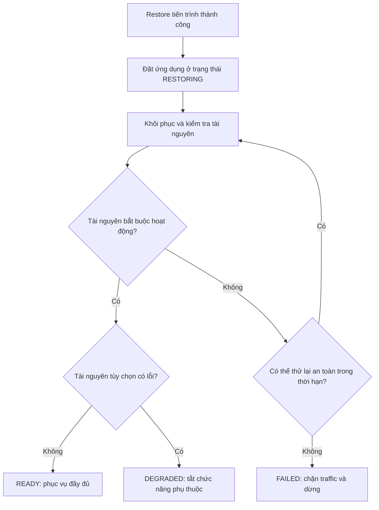
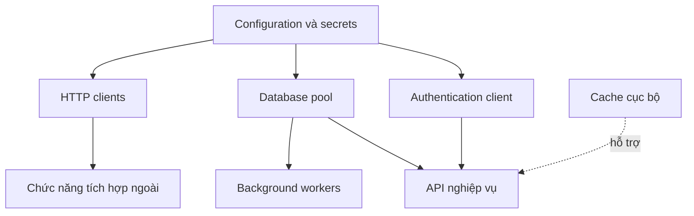

# Khôi phục một phần và chính sách dừng ứng dụng khi không thể phục vụ an toàn

Sau khi một tiến trình Java được restore từ checkpoint, không phải mọi tài nguyên mà ứng dụng cần đều chắc chắn hoạt động bình thường. Heap và trạng thái runtime có thể đã được khôi phục, trong khi database connection đã bị server đóng, message broker chưa truy cập được, cache cần nạp lại hoặc một dịch vụ phụ thuộc vẫn đang khởi động. Vì vậy, **restore tiến trình thành công không đồng nghĩa ứng dụng đã sẵn sàng phục vụ**.

Ứng dụng CRaC cần có chính sách phục hồi theo mức độ quan trọng của từng tài nguyên. Nếu một thành phần tùy chọn không khôi phục được, ứng dụng có thể chuyển sang chế độ suy giảm và tắt chức năng liên quan. Nếu một thành phần bắt buộc không hoạt động, ứng dụng phải giữ trạng thái chưa sẵn sàng và dừng theo chính sách fail-stop khi không thể khôi phục an toàn. Mục tiêu là ngăn ứng dụng nhận yêu cầu trong trạng thái có thể làm sai dữ liệu, mất thông điệp hoặc tạo ra kết quả nghiệp vụ không nhất quán.

## 1. Vì sao có thể chỉ khôi phục được một phần?

Checkpoint ghi lại trạng thái của tiến trình tại một thời điểm. Tuy nhiên, ứng dụng thường phụ thuộc vào nhiều tài nguyên nằm ngoài tiến trình hoặc có vòng đời riêng. Trong khoảng thời gian giữa checkpoint và restore, các tài nguyên đó vẫn có thể thay đổi.

Ví dụ:

- Database server có thể đóng các connection không hoạt động hoặc khởi động lại.
- Message broker có thể hết phiên, đóng channel hoặc thay đổi trạng thái consumer.
- Token hoặc credential ngắn hạn có thể hết hạn.
- DNS, địa chỉ dịch vụ, chứng chỉ TLS hoặc cấu hình mạng có thể thay đổi.
- Cache cục bộ có thể còn dữ liệu cũ, trong khi dữ liệu nguồn đã thay đổi.
- Một file, socket hoặc file descriptor được giữ trong trạng thái tiến trình có thể không còn phù hợp với môi trường sau restore.
- Dịch vụ bên ngoài có thể chưa sẵn sàng dù tiến trình Java đã chạy tiếp.

Vì thế, khôi phục cần được hiểu ở nhiều lớp:

1. **Khôi phục tiến trình:** JVM và trạng thái tiến trình được runtime đưa trở lại hoạt động.
2. **Khôi phục tài nguyên:** ứng dụng kiểm tra, đóng, tạo lại hoặc kết nối lại tài nguyên cần thiết.
3. **Khôi phục khả năng phục vụ:** các điều kiện nghiệp vụ và phụ thuộc bắt buộc đã thỏa mãn, ứng dụng mới được nhận traffic tương ứng.



Sơ đồ thể hiện chính sách ứng dụng ở mức khái niệm. Trạng thái và cách runtime báo lỗi cụ thể phụ thuộc JDK CRaC, cách restore được kích hoạt và thiết kế triển khai.

## 2. Phân loại tài nguyên theo mức độ quan trọng

Trước khi viết callback, hãy lập danh sách resource và xác định hậu quả nếu không khôi phục được. Không phải mọi lỗi đều cần dừng toàn bộ ứng dụng, nhưng cũng không nên coi mọi tài nguyên là tùy chọn.

| Nhóm tài nguyên | Ví dụ | Khi không khôi phục được |
|---|---|---|
| Bắt buộc cho toàn ứng dụng | Database chứa dữ liệu nghiệp vụ cốt lõi, kho khóa xác thực, cấu hình bảo mật thiết yếu. | Không nhận traffic cần các tài nguyên này; nếu không thể phục hồi trong chính sách cho phép thì dừng ứng dụng. |
| Bắt buộc cho một chức năng | Dịch vụ thanh toán, kho tìm kiếm, broker của một luồng nghiệp vụ riêng. | Tắt hoặc từ chối riêng chức năng phụ thuộc; các chức năng độc lập có thể tiếp tục nếu an toàn. |
| Tùy chọn, có thể tái tạo | Cache, dữ liệu gợi ý, dữ liệu thống kê tạm thời. | Có thể khởi tạo lại, bỏ qua tạm thời hoặc phục vụ với chất lượng giảm. |
| Quan sát và hỗ trợ | Metrics exporter, tracing exporter, dashboard phụ. | Có thể tiếp tục nếu việc mất quan sát không làm vi phạm yêu cầu vận hành hoặc an toàn. |

Phân loại phải dựa trên hợp đồng nghiệp vụ. Ví dụ, cache thường có thể tái tạo, nhưng nếu hệ thống dùng cache như nguồn dữ liệu duy nhất cho một quyết định quan trọng thì không thể mặc định nó là tùy chọn.

### 2.1. Tạo bản đồ phụ thuộc

Resource có thể phụ thuộc lẫn nhau. Một HTTP client cần cấu hình và credential; một worker cần database pool và broker consumer; một endpoint có thể cần cả database lẫn dịch vụ xác thực.

Ví dụ về quan hệ phụ thuộc:



Khi thiết kế thứ tự phục hồi, hãy dựa trên quan hệ phụ thuộc thực tế. Không nên giả định thứ tự callback giữa các Resource chỉ dựa trên thứ tự đăng ký nếu hợp đồng của API hoặc implementation không bảo đảm điều đó. Nếu nhiều bước cần một thứ tự rõ ràng, có thể gom chúng vào một coordinator hoặc xây dựng cơ chế điều phối phụ thuộc tường minh.

## 3. Trạng thái phục hồi và điều kiện sẵn sàng

Ứng dụng nên có trạng thái phục hồi rõ ràng để các thành phần khác biết có thể nhận yêu cầu hay chưa. Một mô hình thường dùng gồm:

| Trạng thái | Ý nghĩa | Có nhận traffic không? |
|---|---|---|
| `RESTORING` | Đang kiểm tra hoặc tạo lại tài nguyên sau restore. | Không. |
| `READY` | Tất cả tài nguyên bắt buộc cho phạm vi phục vụ đã hoạt động. | Có. |
| `DEGRADED` | Tài nguyên tùy chọn hoặc một chức năng phụ chưa sẵn sàng; phạm vi phục vụ đã bị giới hạn. | Chỉ nhận yêu cầu không phụ thuộc chức năng bị tắt. |
| `RECOVERING` | Đang thử khôi phục lại một tài nguyên chưa sẵn sàng. | Chỉ nhận phần chức năng đã được xác nhận an toàn. |
| `FAILED` | Không thể bảo đảm phục vụ an toàn. | Không. |
| `STOPPING` | Đang từ chối yêu cầu mới và kết thúc tiến trình. | Không. |

Không nhất thiết phải dùng đúng tên trạng thái này trong code. Điều quan trọng là có một nguồn trạng thái nhất quán và mọi điểm nhận traffic đều tuân theo nó.

### 3.1. Phân biệt liveness và readiness

Liveness trả lời câu hỏi tiến trình còn sống và có khả năng tiếp tục chạy hay không. Readiness trả lời câu hỏi ứng dụng có thể nhận loại traffic được định tuyến tới nó hay không.

Trong giai đoạn `RESTORING`, tiến trình có thể còn sống nhưng chưa sẵn sàng. Nếu health check chỉ kiểm tra process tồn tại hoặc một endpoint trả HTTP 200, hệ thống điều phối có thể gửi traffic quá sớm.

Readiness cần phản ánh những resource bắt buộc cho phạm vi phục vụ. Với ứng dụng có nhiều chức năng, có thể có readiness riêng cho từng nhóm capability. Ví dụ, API tra cứu có thể hoạt động khi cache gợi ý chưa sẵn sàng, nhưng API thanh toán phải bị chặn nếu database hoặc dịch vụ xác thực chưa hoạt động.

### 3.2. Chặn traffic ở trong ứng dụng

Readiness probe giúp load balancer hoặc orchestrator ngừng định tuyến tới instance chưa sẵn sàng. Tuy nhiên, ứng dụng vẫn nên có một lớp kiểm soát nội bộ để từ chối yêu cầu phụ thuộc vào resource chưa phục hồi. Điều này bảo vệ ứng dụng trong lúc health check chưa cập nhật hoặc khi có request đi thẳng tới instance.

Ví dụ, một bộ kiểm tra đơn giản có thể được gọi trước khi xử lý chức năng:

```java
public final class RecoveryGate {
    private volatile RecoveryState state = RecoveryState.RESTORING;
    private volatile boolean coreWorkReady;
    private volatile boolean recommendationsReady;

    public void requireCoreWork() {
        if (!coreWorkReady) {
            throw new ServiceUnavailableException(
                    "Core dependencies are not ready after restore");
        }
    }

    public void requireRecommendations() {
        if (!recommendationsReady) {
            throw new ServiceUnavailableException(
                    "Recommendations are temporarily unavailable");
        }
    }

    public void markCoreWorkReady() {
        coreWorkReady = true;
    }

    public void markRecommendationsReady() {
        recommendationsReady = true;
    }

    public void markDegraded() {
        state = RecoveryState.DEGRADED;
    }
}
```

Đây là ví dụ minh họa ý tưởng; trong ứng dụng thật, gate cần được cập nhật nguyên tử theo kết quả phục hồi và kiểm tra capability cụ thể. Không nên cho phép mọi chức năng chạy chỉ vì trạng thái tổng thể là `DEGRADED`.

## 4. Khôi phục một phần: tiếp tục với chức năng còn an toàn

Khôi phục một phần có nghĩa ứng dụng đã đánh giá từng tài nguyên theo mức độ quan trọng và xác định được phạm vi chức năng vẫn có thể phục vụ. Nó không có nghĩa ứng dụng bỏ qua tùy ý lỗi trong callback.

Ví dụ, một ứng dụng thương mại điện tử có thể có:

- Database đơn hàng: bắt buộc cho tạo và cập nhật đơn hàng.
- Dịch vụ thanh toán: bắt buộc cho thanh toán, nhưng không nhất thiết cho trang nội dung công khai.
- Cache gợi ý sản phẩm: tùy chọn vì có thể dựng lại.
- Metrics exporter: hỗ trợ quan sát, không tham gia trực tiếp vào quyết định nghiệp vụ.

Nếu cache gợi ý không khôi phục được, ứng dụng có thể tắt gợi ý và tiếp tục những chức năng độc lập. Nếu database đơn hàng không hoạt động, ứng dụng phải từ chối các thao tác ghi đơn hàng. Nếu kiến trúc không thể cô lập chức năng phụ thuộc, lựa chọn an toàn có thể là giữ toàn bộ ứng dụng chưa sẵn sàng.

### 4.1. Chính sách cho resource tùy chọn

Với resource có thể tái tạo hoặc không thiết yếu, callback có thể ghi nhận lỗi, vô hiệu hóa capability liên quan và cho phép quá trình phục hồi tiếp tục. Cần bảo đảm:

- Chức năng phụ thuộc resource được tắt rõ ràng.
- Các endpoint hoặc worker không sử dụng resource đang lỗi.
- Lỗi được ghi log và đo lường để có thể khắc phục.
- Có cơ chế thử khôi phục lại nếu resource có thể phục hồi sau đó.
- Việc khôi phục lại không tạo ra tài nguyên trùng hoặc race condition.

Không nên trả dữ liệu cũ như thể dữ liệu đó mới nhất nếu cache có thể đã lỗi thời. Nếu có thể phục vụ bằng nguồn dữ liệu chính, hãy chuyển sang nguồn đó; nếu không, thông báo rõ chức năng tạm thời không khả dụng.

### 4.2. Chính sách cho resource bắt buộc

Với resource bắt buộc, nếu không thể khôi phục thì ứng dụng không được báo `READY`. Tùy kiến trúc, có thể:

1. Thử lại một số lần trong khoảng thời gian hữu hạn nếu lỗi có khả năng tạm thời.
2. Giữ trạng thái `RECOVERING` và không nhận traffic phụ thuộc resource trong thời gian chờ.
3. Nếu hết thời hạn hoặc gặp lỗi không thể phục hồi, chuyển sang `FAILED` và thực hiện fail-stop.

Không nên tiếp tục xử lý nghiệp vụ khi chưa xác định được tính toàn vẹn của dữ liệu, quyền xác thực hoặc khả năng ghi nhận giao dịch.

## 5. Retry có giới hạn và an toàn

Một dịch vụ bên ngoài có thể tạm thời chưa sẵn sàng ngay sau restore. Retry là hợp lý khi lỗi có thể phục hồi, nhưng retry vô hạn có thể khiến tiến trình treo trong trạng thái không rõ ràng và che giấu sự cố kéo dài.

### 5.1. Phân loại lỗi trước khi retry

| Loại lỗi | Ví dụ | Chính sách gợi ý |
|---|---|---|
| Tạm thời | Connection refused trong lúc database đang khởi động, timeout ngắn, broker đang failover. | Retry có backoff và giới hạn thời gian. |
| Cấu hình hoặc xác thực | Sai credential, thiếu secret, certificate hết hạn hoặc sai endpoint. | Không retry vô hạn; báo lỗi và dừng hoặc chờ thay đổi cấu hình theo quy trình. |
| Không tương thích | Driver hoặc runtime không hỗ trợ thao tác cần thiết. | Dừng phục hồi; yêu cầu sửa phiên bản hoặc cấu hình. |
| Trạng thái không an toàn | Transaction chưa rõ kết quả, dữ liệu có thể đã ghi một phần. | Chặn chức năng liên quan và cần đối soát trước khi tiếp tục. |

### 5.2. Dùng backoff và deadline

Với lỗi tạm thời, có thể tăng dần khoảng nghỉ giữa các lần thử và đặt deadline tổng. Ví dụ minh họa:

```text
Lần 1: thử kết nối ngay
Lần 2: chờ 250 ms
Lần 3: chờ 500 ms
Lần 4: chờ 1 giây
Lần 5: chờ 2 giây
Hết số lần hoặc hết deadline: đánh dấu phục hồi thất bại
```

Các con số chỉ là ví dụ; cần chọn theo SLA, timeout của dịch vụ và giới hạn thời gian khởi động. Có thể thêm jitter để nhiều instance không đồng loạt retry vào cùng một thời điểm.

Retry phải có tính idempotent. Nếu lần đầu đã tạo một phần tài nguyên trước khi lỗi, lần tiếp theo cần kiểm tra và tái sử dụng hoặc giải phóng trạng thái cũ thay vì tạo thêm connection pool, thread hoặc consumer trùng.

### 5.3. Không chặn restore vô thời hạn

Callback `afterRestore(...)` nằm trong quy trình restore. Nếu callback chờ dịch vụ bên ngoài vô hạn, quá trình restore cũng có thể bị kéo dài hoặc không hoàn tất. Hãy đặt timeout và số lần thử rõ ràng.

Với một dependency tùy chọn, có thể để callback ghi nhận trạng thái degraded và cho ứng dụng tiếp tục trong chế độ giới hạn, sau đó phục hồi bất đồng bộ. Với dependency bắt buộc, ứng dụng phải giữ readiness false trong lúc phục hồi nền; nếu hết deadline, chuyển sang fail-stop. Chỉ dùng phục hồi bất đồng bộ khi mọi đường xử lý có thể bị ảnh hưởng đều được bảo vệ bằng recovery gate.

## 6. Chính sách fail-stop khi không thể phục vụ an toàn

Fail-stop là chính sách chủ động ngừng phục vụ khi ứng dụng không thể bảo đảm tính đúng đắn hoặc an toàn của yêu cầu. Thay vì cố hoạt động với trạng thái không xác định, ứng dụng từ chối traffic, kết thúc tiến trình theo cách có thể quan sát và để hệ thống triển khai thực hiện restart hoặc điều phối instance khác.

### 6.1. Khi nào cần fail-stop?

Các trường hợp điển hình:

- Database bắt buộc không thể kết nối và ứng dụng không thể thực hiện thao tác nghiệp vụ chính xác.
- Không khôi phục được credential, key hoặc cơ chế xác thực cần thiết.
- Resource quan trọng có trạng thái không xác định sau restore.
- Transaction hoặc message đang xử lý có nguy cơ bị thực hiện lặp hoặc mất dữ liệu.
- Một callback bắt buộc thất bại và không có phương án phục hồi an toàn.
- Ứng dụng không thể cô lập chức năng lỗi khỏi phần còn lại.

### 6.2. Trình tự dừng an toàn

Một quy trình dừng có thể gồm:

1. Chuyển trạng thái nội bộ sang `FAILED`.
2. Đặt readiness thành false và từ chối yêu cầu mới.
3. Ngừng nhận công việc từ scheduler, consumer hoặc worker.
4. Hủy hoặc drain các yêu cầu đang chạy theo giới hạn thời gian và chính sách nhất quán dữ liệu.
5. Đóng các tài nguyên đã được khôi phục một phần nếu có thể làm an toàn.
6. Ghi log/metric cùng nguyên nhân gốc và resource thất bại.
7. Kết thúc tiến trình bằng đường shutdown được ứng dụng và nền tảng triển khai hỗ trợ; bảo đảm lỗi được biểu diễn thành trạng thái thất bại có thể quan sát.

Không nên chỉ gọi `System.exit(...)` ngay tại đầu callback nếu ứng dụng còn cần dừng worker, đóng tài nguyên hoặc ghi nhận trạng thái. Ngược lại, cũng không nên cố shutdown phức tạp nếu trạng thái runtime đã không còn đáng tin cậy. Chọn cơ chế dừng phù hợp với framework và CRaC runtime, đồng thời kiểm thử hành vi thực tế.

### 6.3. Không nuốt lỗi của resource bắt buộc

Nếu `afterRestore(...)` của một resource bắt buộc không thể hoàn thành, hãy để lỗi được báo lên theo hợp đồng API hoặc chuyển nó thành lỗi phục hồi rõ ràng. Với `org.crac`, callback khai báo có thể ném `Exception`; lỗi trong giai đoạn restore có thể được phản ánh qua `RestoreException` ở nơi yêu cầu checkpoint/restore. Khi restore được kích hoạt từ bên ngoài, cách lỗi được báo ra tiến trình khởi chạy phụ thuộc runtime và công cụ triển khai.

Điều quan trọng là không bắt exception rồi ghi log như một cảnh báo trong khi vẫn đánh dấu ứng dụng sẵn sàng. Nếu muốn tiếp tục, resource đó phải được phân loại là tùy chọn và chức năng phụ thuộc phải được vô hiệu hóa một cách có kiểm soát.

## 7. Ví dụ tổ chức callback với resource bắt buộc và tùy chọn

Ví dụ sau minh họa một coordinator quản lý việc phục hồi. Database là dependency bắt buộc; cache gợi ý là tùy chọn. Code minh họa chính sách, các method kết nối và quản lý trạng thái cần được thay bằng implementation của ứng dụng.

```java
import org.crac.Context;
import org.crac.Core;
import org.crac.Resource;

public final class ApplicationRecovery implements Resource {

    private final RecoveryGate gate;
    private final DatabasePool database;
    private final RecommendationCache recommendationCache;

    public ApplicationRecovery(
            RecoveryGate gate,
            DatabasePool database,
            RecommendationCache recommendationCache) {
        this.gate = gate;
        this.database = database;
        this.recommendationCache = recommendationCache;
        Core.getGlobalContext().register(this);
    }

    @Override
    public void beforeCheckpoint(Context<? extends Resource> context)
            throws Exception {
        gate.markRestoring();
        database.pauseAndPrepare();
        recommendationCache.pauseIfRunning();
    }

    @Override
    public void afterRestore(Context<? extends Resource> context)
            throws Exception {
        gate.markRestoring();

        // Database là bắt buộc: lỗi phải làm phục hồi thất bại.
        try {
            database.reconnectWithBoundedRetry();
        } catch (Exception mandatoryFailure) {
            gate.markFailed(mandatoryFailure);
            throw mandatoryFailure;
        }

        // Cache có thể tái tạo: lỗi làm giảm chức năng, không làm sai dữ liệu cốt lõi.
        try {
            recommendationCache.rebuild();
            gate.enableRecommendations();
        } catch (Exception optionalFailure) {
            gate.disableRecommendations(optionalFailure);
        }

        gate.markReadyOrDegraded();
    }
}
```

Các điểm cần chú ý:

- Gate được đặt về trạng thái chưa sẵn sàng trước khi bắt đầu phục hồi.
- Lỗi database được truyền lên vì đây là resource bắt buộc.
- Lỗi cache được ghi nhận và chức năng gợi ý bị tắt.
- Trạng thái cuối chỉ được xác định sau khi đã đánh giá resource.
- Mọi request đi qua chức năng tương ứng phải kiểm tra gate/capability.

Đây là ví dụ chính sách ở cấp ứng dụng, không phải lớp `DatabasePool`, `RecommendationCache` hoặc `RecoveryGate` có sẵn trong CRaC. Trong ứng dụng thật, cần bảo đảm việc dừng và tiếp tục worker, connection pool và cache phù hợp với thư viện đang dùng.

## 8. Phục hồi bất đồng bộ sau khi ứng dụng đã restore

Một số resource có thể mất nhiều thời gian để xây dựng lại nhưng không cần thiết cho toàn bộ ứng dụng. Trong trường hợp đó, có thể cho ứng dụng chuyển sang `DEGRADED` rồi phục hồi resource ở background.

Ví dụ, cache gợi ý có thể được nạp lại sau khi database chính đã sẵn sàng. Trong thời gian cache đang dựng lại:

- API nghiệp vụ cốt lõi vẫn hoạt động nếu không phụ thuộc cache.
- API gợi ý trả trạng thái tạm thời không khả dụng hoặc dùng một fallback đã được xác định.
- Worker nạp cache phải có giới hạn thời gian, cơ chế dừng và tránh ghi đè dữ liệu mới bằng snapshot cũ.
- Khi cache hoàn tất, ứng dụng bật lại capability và cập nhật readiness phù hợp.

Không nên khởi chạy background recovery rồi lập tức báo `READY` cho mọi chức năng. Hãy biểu diễn capability nào đã sẵn sàng và kiểm tra trạng thái đó ở đúng endpoint hoặc tác vụ. Với hệ thống chỉ có một readiness probe tổng, hãy giữ probe ở trạng thái không sẵn sàng nếu bất kỳ dependency bắt buộc toàn ứng dụng nào còn thiếu.

## 9. Quan sát và vận hành trạng thái phục hồi

Phục hồi một phần chỉ có thể vận hành tốt khi đội ngũ biết resource nào đã thành công, resource nào đang retry và chức năng nào đang bị tắt.

Nên ghi nhận tối thiểu:

- Thời điểm bắt đầu và kết thúc restore.
- Trạng thái tổng thể: `RESTORING`, `READY`, `DEGRADED`, `RECOVERING` hoặc `FAILED`.
- Tên logic của resource, mức độ quan trọng và kết quả phục hồi.
- Số lần retry, thời gian chờ và nguyên nhân lỗi cuối cùng.
- Danh sách capability đang bị vô hiệu hóa.
- Lý do readiness false hoặc lý do tiến trình dừng.
- Mã định danh của lần khởi động/restore để liên kết log giữa các bước.

Không ghi secret, token, mật khẩu hoặc dữ liệu nhạy cảm vào log. Chỉ ghi định danh resource, loại lỗi và thông tin đủ để điều tra.

Một số metric hữu ích gồm thời gian restore, thời gian đến readiness, số resource phục hồi thất bại, số lần retry, thời gian ở trạng thái degraded và số lần fail-stop. Các metric này giúp phân biệt lỗi restore với lỗi phụ thuộc bên ngoài sau khi ứng dụng đã chạy.

## 10. Kiểm thử các tình huống khôi phục một phần

Không chỉ kiểm thử trường hợp mọi resource đều hoạt động. Cần mô phỏng hoặc tạo điều kiện lỗi riêng cho từng nhóm tài nguyên.

| Tình huống | Kết quả mong đợi |
|---|---|
| Tất cả resource bắt buộc và tùy chọn phục hồi thành công | Ứng dụng chuyển sang `READY`. |
| Database bắt buộc lỗi tạm thời rồi kết nối lại thành công | Ứng dụng giữ readiness false trong khi retry, sau đó chuyển sang `READY`. |
| Database bắt buộc không thể phục hồi trước deadline | Ứng dụng không nhận traffic và thực hiện fail-stop theo chính sách. |
| Cache tùy chọn không thể dựng lại | Ứng dụng chuyển `DEGRADED`, tắt chức năng phụ thuộc cache và tiếp tục chức năng độc lập. |
| Dịch vụ thanh toán lỗi nhưng API nội dung độc lập | Chặn thanh toán; chỉ tiếp tục API nội dung nếu kiến trúc bảo đảm độc lập. |
| Callback của resource bắt buộc ném exception | Lỗi được truyền ra và ứng dụng không đánh dấu sẵn sàng. |
| Retry được gọi lại sau khi đã tạo một phần resource | Không tạo pool, thread hoặc consumer trùng; trạng thái được dọn dẹp hoặc tái sử dụng an toàn. |
| Có request đến trong lúc `RESTORING` | Request bị chặn hoặc không được định tuyến tới instance. |
| Tiến trình dừng do phục hồi thất bại | Orchestrator quan sát được thất bại và có thể áp dụng chính sách restart. |

Nên kiểm tra cả log, readiness endpoint, capability gate và trạng thái thực tế của dependency. Chỉ thấy callback không ném exception chưa đủ để kết luận ứng dụng phục vụ an toàn.

## 11. Những lỗi thiết kế thường gặp

**Đánh dấu sẵn sàng ngay khi tiến trình restore xong.** Điều này bỏ qua việc khôi phục connection, credential, worker và dữ liệu phụ thuộc. Readiness phải gắn với điều kiện phục vụ thực tế.

**Coi mọi resource là bắt buộc.** Một cache có thể tái tạo không nhất thiết phải làm dừng toàn bộ ứng dụng. Phân loại sai khiến hệ thống mất khả năng phục vụ không cần thiết.

**Coi mọi resource là tùy chọn.** Bỏ qua lỗi database hoặc xác thực có thể dẫn đến sai dữ liệu hoặc mở ra hành vi không an toàn. Resource bắt buộc phải chặn traffic phụ thuộc.

**Retry vô hạn trong callback.** Restore có thể bị kéo dài không giới hạn, trong khi nguyên nhân như credential sai hoặc endpoint sai không tự biến mất. Cần deadline, backoff và chính sách kết thúc.

**Phục hồi resource theo thứ tự ngầm định.** Các callback có thể phụ thuộc nhau. Hãy điều phối thứ tự rõ ràng thay vì dựa vào thứ tự đăng ký nếu API không cam kết.

**Nuốt exception của resource quan trọng.** Log lỗi rồi trả về bình thường có thể khiến runtime và ứng dụng tiếp tục trong trạng thái không an toàn. Lỗi bắt buộc phải được truyền ra hoặc chuyển thành trạng thái fail-stop rõ ràng.

**Chỉ dựa vào load balancer readiness.** Request nội bộ hoặc request đi trực tiếp có thể vẫn tới instance. Cần gate trong ứng dụng cho những chức năng nhạy cảm.

**Không kiểm tra trạng thái một phần trước khi retry.** Tạo lại resource mà không dọn trạng thái cũ có thể làm rò rỉ connection, thread hoặc consumer trùng lặp.

## 12. Checklist xây dựng chính sách phục hồi

- [ ] Liệt kê mọi resource cần kiểm tra sau restore.
- [ ] Phân loại resource bắt buộc toàn ứng dụng, bắt buộc theo chức năng và tùy chọn.
- [ ] Ghi rõ quan hệ phụ thuộc giữa các resource.
- [ ] Xác định trạng thái ứng dụng trong lúc restore và khi phục hồi một phần.
- [ ] Chặn readiness và traffic cho tới khi resource bắt buộc hoạt động.
- [ ] Có gate trong ứng dụng cho các chức năng phụ thuộc resource.
- [ ] Retry lỗi tạm thời với backoff, giới hạn số lần và deadline.
- [ ] Bảo đảm thao tác phục hồi có thể retry an toàn và không tạo resource trùng.
- [ ] Cho phép degraded mode chỉ khi chức năng lỗi có thể được cô lập.
- [ ] Truyền lỗi của resource bắt buộc ra khỏi callback hoặc chuyển sang fail-stop rõ ràng.
- [ ] Có quy trình dừng an toàn và thông tin lỗi để orchestrator quan sát.
- [ ] Kiểm thử trường hợp thành công, lỗi tạm thời, lỗi vĩnh viễn và phục hồi một phần.

## 13. Thuật ngữ cần nhớ

- **Partial recovery:** ứng dụng khôi phục được một phần resource và chỉ tiếp tục các chức năng đã được xác nhận an toàn.
- **Critical resource:** tài nguyên bắt buộc để thực hiện một hoặc nhiều chức năng nghiệp vụ.
- **Optional resource:** tài nguyên có thể thiếu tạm thời mà không làm sai tính đúng đắn của phần chức năng còn lại.
- **Readiness:** trạng thái cho biết ứng dụng có thể nhận traffic thuộc phạm vi phục vụ hay chưa.
- **Liveness:** trạng thái cho biết tiến trình còn sống và có khả năng tiếp tục hoạt động hay không.
- **Degraded mode:** chế độ hoạt động giới hạn khi một số chức năng phụ không sẵn sàng.
- **Fail-stop:** chính sách dừng phục vụ và kết thúc tiến trình khi không thể bảo đảm an toàn.
- **Backoff:** tăng dần thời gian chờ giữa các lần thử lại.
- **Idempotent recovery:** thao tác phục hồi có thể chạy lại mà không tạo tác dụng phụ hoặc tài nguyên trùng.
- **Recovery gate:** cơ chế chặn yêu cầu hoặc capability khi điều kiện phục hồi chưa đạt.

Khi thiết kế phục hồi CRaC, hãy bắt đầu từ câu hỏi “ứng dụng có thể phục vụ an toàn những chức năng nào?” thay vì chỉ hỏi “tiến trình đã restore xong chưa?”. Resource tùy chọn có thể dẫn tới chế độ degraded nếu chức năng phụ được cô lập rõ ràng. Resource bắt buộc phải giữ ứng dụng chưa sẵn sàng; nếu retry có giới hạn không khôi phục được, fail-stop là cách bảo vệ tính đúng đắn và để nền tảng triển khai xử lý instance lỗi.
