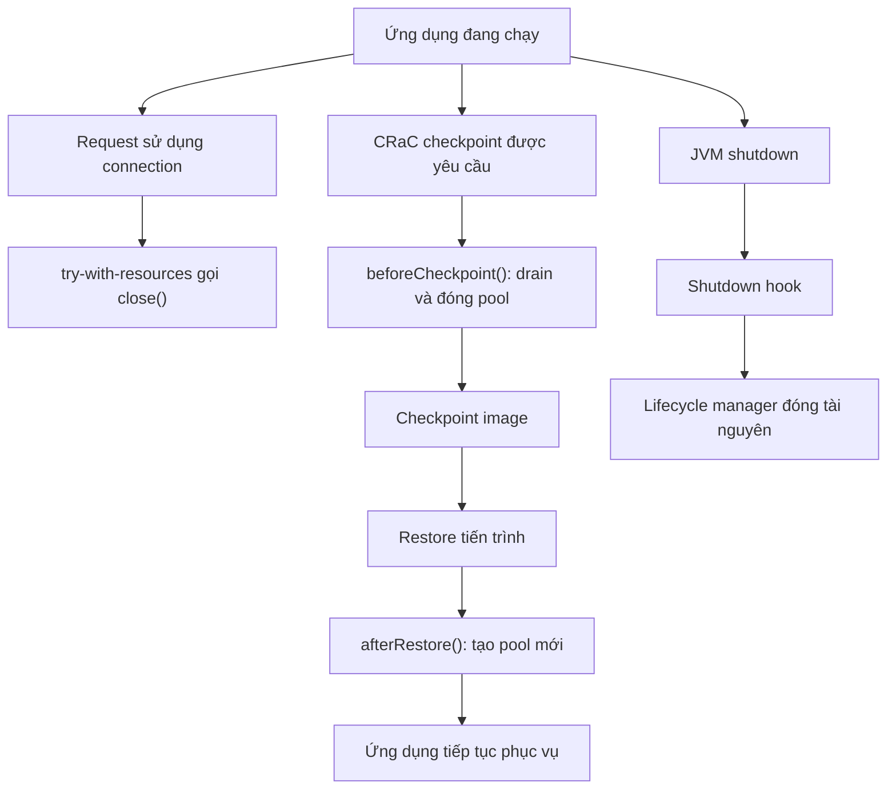

# Phân biệt callback CRaC với shutdown hook và AutoCloseable

Trong Java, nhiều cơ chế có thể được dùng để giải phóng tài nguyên khi một thành phần kết thúc vòng đời. Ba cơ chế thường dễ bị nhầm lẫn là callback của CRaC, JVM shutdown hook và interface `AutoCloseable`.

Chúng cùng có thể dẫn đến việc đóng connection, flush dữ liệu hoặc dừng một client, nhưng chúng được kích hoạt ở những thời điểm khác nhau và phục vụ những mục đích khác nhau:

- **CRaC Resource callback** phối hợp trạng thái ứng dụng trước checkpoint và sau restore.
- **Shutdown hook** chạy khi JVM đang thực hiện quá trình tắt có trật tự.
- **AutoCloseable** biểu diễn một tài nguyên có thao tác đóng tường minh, thường được gọi bằng try-with-resources hoặc bởi mã quản lý vòng đời.

Hiểu đúng ranh giới này giúp ứng dụng tránh bỏ sót bước chuẩn bị checkpoint, đóng tài nguyên quá sớm hoặc giả định rằng một cơ chế dọn dẹp sẽ tự động thay thế được cơ chế khác.

## 1. Ba cơ chế giải quyết ba thời điểm khác nhau

Hãy xét một dịch vụ Java đang giữ connection đến database và một HTTP client dùng chung. Khi dịch vụ kết thúc, các connection cần được đóng. Khi dịch vụ tạo checkpoint rồi restore, các connection có thể cần được đóng trước khi lưu ảnh và tạo lại sau khi khôi phục.

Ba cơ chế có vai trò như sau:

| Cơ chế | Được kích hoạt khi nào? | Mục tiêu chính |
|---|---|---|
| CRaC `beforeCheckpoint()` | Trước khi CRaC lưu trạng thái tiến trình | Chuẩn bị ứng dụng để checkpoint an toàn |
| CRaC `afterRestore()` | Sau khi tiến trình được khôi phục | Phục hồi tài nguyên để ứng dụng tiếp tục chạy |
| JVM shutdown hook | Khi JVM bắt đầu quá trình shutdown có trật tự | Dọn dẹp khi tiến trình kết thúc |
| `AutoCloseable.close()` | Khi mã quản lý gọi `close()` | Giải phóng tài nguyên theo phạm vi hoặc vòng đời do ứng dụng quản lý |

Điểm quan trọng là checkpoint không đồng nghĩa với shutdown. Khi checkpoint, mục tiêu là lưu trạng thái để tiếp tục thực thi sau này. Khi shutdown, mục tiêu là kết thúc tiến trình. Khi đóng một `AutoCloseable`, mục tiêu là giải phóng một tài nguyên cụ thể.

Vì vậy, callback CRaC không phải một shutdown hook khác tên, và `AutoCloseable` không tự động trở thành CRaC resource.

## 2. Callback CRaC: phối hợp checkpoint và restore

CRaC (Coordinated Restore at Checkpoint) cung cấp API trong package `org.crac`. Một đối tượng tham gia vòng đời này triển khai interface `Resource` và đăng ký với một CRaC context.

Hai callback chính là:

```java
void beforeCheckpoint(Context<? extends Resource> context)
        throws Exception;

void afterRestore(Context<? extends Resource> context)
        throws Exception;
```

### 2.1. beforeCheckpoint()

CRaC gọi `beforeCheckpoint()` trước khi lưu ảnh tiến trình. Ứng dụng dùng callback này để đưa các thành phần liên quan về trạng thái an toàn.

Những công việc thường gặp:

- Ngừng nhận request hoặc job mới.
- Chờ request, transaction và job đang chạy hoàn tất hoặc đạt điểm dừng an toàn.
- Flush dữ liệu cần lưu bền vững.
- Tạm dừng scheduler và consumer.
- Đóng socket, database connection hoặc client phụ thuộc vào môi trường bên ngoài.
- Giải phóng tài nguyên hệ điều hành không thể dùng lại sau restore.

Không phải mọi object Java đều cần đóng. Những cấu trúc dữ liệu thuần Java có thể được lưu trong heap và tiếp tục được sử dụng sau restore. Cần tập trung vào tài nguyên có vòng đời phụ thuộc vào hệ điều hành, mạng, thời gian hoặc dịch vụ bên ngoài.

### 2.2. afterRestore()

Sau khi tiến trình được khôi phục, CRaC gọi `afterRestore()` cho các resource đã đăng ký. Callback này phục hồi những tài nguyên đã đóng hoặc cần làm mới.

Ví dụ:

- Tạo lại connection đến database.
- Tạo HTTP client hoặc socket mới.
- Làm mới token đã hết hạn.
- Khởi động lại scheduler và worker.
- Kiểm tra cấu hình mạng, hostname và các dependency.

Ứng dụng chỉ nên nhận traffic sau khi các tài nguyên thiết yếu đã sẵn sàng. Nếu tạo lại database connection thất bại, callback có thể báo lỗi; readiness của ứng dụng cần phản ánh đúng trạng thái đó.

### 2.3. Đăng ký Resource

Ví dụ tối giản:

```java
import org.crac.Context;
import org.crac.Core;
import org.crac.Resource;

public final class DatabaseResource implements Resource {

    private DatabaseClient client;

    public DatabaseResource() throws Exception {
        client = DatabaseClient.connect();
        Core.getGlobalContext().register(this);
    }

    @Override
    public void beforeCheckpoint(
            Context<? extends Resource> context) throws Exception {
        closeClient();
    }

    @Override
    public void afterRestore(
            Context<? extends Resource> context) throws Exception {
        client = DatabaseClient.connect();
    }

    private void closeClient() throws Exception {
        if (client != null) {
            client.close();
            client = null;
        }
    }
}
```

`DatabaseClient` ở đây là kiểu minh họa do ứng dụng định nghĩa. `Core.getGlobalContext().register(this)` đăng ký resource để CRaC có thể gọi callback của nó.

Callback CRaC thuộc về vòng đời của tiến trình được checkpoint. Nó không tự thay thế logic shutdown thông thường và cũng không tự quản lý mọi đối tượng có phương thức `close()`.

## 3. JVM shutdown hook: dọn dẹp khi JVM tắt

Shutdown hook là một thread được đăng ký với JVM thông qua `Runtime.addShutdownHook()`. JVM khởi chạy các hook khi bắt đầu một quá trình shutdown có trật tự.

Ví dụ:

```java
public final class Application {

    public static void main(String[] args) {
        Runtime.getRuntime().addShutdownHook(
            new Thread(() -> {
                System.out.println("Application is shutting down");
                closeApplicationResources();
            }, "application-shutdown")
        );

        startApplication();
    }

    private static void closeApplicationResources() {
        // Đóng tài nguyên dùng chung khi JVM kết thúc.
    }

    private static void startApplication() {
        // Khởi tạo và chạy dịch vụ.
    }
}
```

Shutdown hook phù hợp cho những thao tác dọn dẹp ở cấp tiến trình, ví dụ đóng connection pool, flush log hoặc yêu cầu các worker dừng trước khi JVM kết thúc.

### 3.1. Khi nào shutdown hook được gọi?

Shutdown hook được chạy khi JVM bắt đầu shutdown theo một đường kết thúc có trật tự, chẳng hạn:

- Ứng dụng gọi `System.exit()`.
- JVM nhận tín hiệu kết thúc mà runtime xử lý bằng quá trình shutdown có trật tự, tùy hệ điều hành và cách tiến trình được khởi chạy.
- Một số sự kiện shutdown do môi trường runtime khởi tạo.

Các hook được chạy trong những thread riêng. JVM có thể chạy nhiều hook đồng thời; không nên dựa vào một thứ tự cố định giữa các hook độc lập.

Shutdown hook không được bảo đảm chạy trong mọi kiểu kết thúc tiến trình. Ví dụ, `Runtime.halt()`, tiến trình bị kill cưỡng bức, JVM crash hoặc mất điện có thể bỏ qua hook.

Do đó, không nên đặt bảo đảm nhất quán dữ liệu quan trọng chỉ trong shutdown hook. Những thao tác nghiệp vụ cần độ bền vững phải được thực hiện trong luồng xử lý bình thường và có cơ chế lưu trữ phù hợp.

### 3.2. Shutdown hook không thay thế callback CRaC

Checkpoint nhằm lưu tiến trình để khôi phục và tiếp tục chạy. Shutdown nhằm kết thúc JVM. Hai sự kiện có mục tiêu khác nhau.

Khi ứng dụng chuẩn bị checkpoint, hãy dùng `beforeCheckpoint()` để phối hợp resource theo hợp đồng CRaC. Khi tiến trình được restore, dùng `afterRestore()` để tạo lại những tài nguyên cần thiết.

Không nên dựa vào shutdown hook để đóng connection trước checkpoint hoặc để mở lại connection sau restore. Shutdown hook không cung cấp cặp callback tương ứng với hai giai đoạn này. Cũng không nên giả định checkpoint sẽ được xử lý như một lần JVM shutdown thông thường.

### 3.3. Những giới hạn khi viết shutdown hook

Shutdown hook nên hoàn thành nhanh và tránh phụ thuộc vào thứ tự không được bảo đảm.

Một số nguyên tắc:

- Không chờ vô hạn một worker hoặc một dịch vụ bên ngoài.
- Đặt timeout cho việc dừng executor và đóng client.
- Không gọi `System.exit()` từ bên trong shutdown hook để khởi động một quá trình shutdown lồng nhau.
- Tránh tạo thêm thread hoặc công việc phức tạp trong lúc JVM đang tắt.
- Đảm bảo thao tác đóng có thể chịu được trường hợp tài nguyên đã được đóng trước đó.
- Không ghi secret hoặc thông tin xác thực vào log.

Ví dụ shutdown hook chỉ yêu cầu một thành phần đóng tài nguyên:

```java
Runtime.getRuntime().addShutdownHook(
    new Thread(() -> {
        try {
            applicationLifecycle.close();
        } catch (Exception e) {
            logger.error("Failed to close application resources", e);
        }
    }, "application-shutdown")
);
```

`applicationLifecycle.close()` cần có timeout và chính sách lỗi phù hợp. Không nên để hook giữ JVM ở trạng thái shutdown vô thời hạn vì một dịch vụ bên ngoài không phản hồi.

## 4. AutoCloseable: đóng tài nguyên theo phạm vi quản lý

`AutoCloseable` là interface chuẩn của Java, khai báo phương thức:

```java
public interface AutoCloseable {
    void close() throws Exception;
}
```

Một lớp triển khai `AutoCloseable` cung cấp cách giải phóng tài nguyên khi người sở hữu gọi `close()`. Cơ chế này thường được dùng với try-with-resources.

### 4.1. AutoCloseable và try-with-resources

Ví dụ:

```java
try (var connection = dataSource.getConnection()) {
    executeQuery(connection);
}
```

Khi rời khỏi khối `try`, Java tự gọi `close()` trên `connection`, kể cả khi phần thân khối ném exception. Nếu có nhiều resource trong cùng câu lệnh try-with-resources, chúng được đóng theo thứ tự ngược với thứ tự khai báo.

Đây là cơ chế quản lý tài nguyên theo phạm vi sử dụng. Ví dụ, một JDBC connection được mở cho một truy vấn hoặc một transaction rồi đóng khi công việc hoàn tất.

`AutoCloseable` không tự đăng ký một object với JVM hoặc CRaC. Nó không tự biết khi nào checkpoint xảy ra, cũng không có callback để tạo lại tài nguyên sau restore.

### 4.2. close() không đồng nghĩa với afterRestore()

`close()` giải phóng tài nguyên đang được quản lý. Sau khi đóng, object có thể không còn sử dụng được.

`afterRestore()` phục hồi tài nguyên cần thiết sau khi tiến trình được khôi phục. Nó có thể tạo một client mới hoặc mở lại connection pool.

Không nên kỳ vọng gọi `close()` sẽ khiến một object tự biết cách mở lại. Việc tạo lại tài nguyên cần logic riêng, thường được đặt trong một factory hoặc phương thức `reconnect()`.

### 4.3. AutoCloseable giúp viết mã CRaC rõ ràng hơn

Hai cơ chế có thể được kết hợp. Một CRaC resource có thể dùng một phương thức đóng nội bộ, và phương thức đó cũng được gọi từ `AutoCloseable.close()` khi ứng dụng kết thúc bình thường.

Ví dụ:

```java
import org.crac.Context;
import org.crac.Core;
import org.crac.Resource;

public final class CracAwareClient
        implements Resource, AutoCloseable {

    private RemoteClient client;

    public CracAwareClient() throws Exception {
        openClient();
        Core.getGlobalContext().register(this);
    }

    @Override
    public synchronized void beforeCheckpoint(
            Context<? extends Resource> context) throws Exception {
        closeClient();
    }

    @Override
    public synchronized void afterRestore(
            Context<? extends Resource> context) throws Exception {
        openClient();
    }

    private void openClient() throws Exception {
        if (client == null) {
            client = RemoteClient.connect();
        }
    }

    private void closeClient() throws Exception {
        if (client != null) {
            RemoteClient oldClient = client;
            client = null;
            oldClient.close();
        }
    }

    @Override
    public synchronized void close() throws Exception {
        closeClient();
    }

    public synchronized RemoteClient getClient() {
        if (client == null) {
            throw new IllegalStateException(
                "Client is not available in the current lifecycle state");
        }
        return client;
    }
}
```

Trong ví dụ:

- `beforeCheckpoint()` đóng client trước khi checkpoint.
- `afterRestore()` tạo client mới sau restore.
- `close()` đóng client khi ứng dụng kết thúc hoặc khi lifecycle manager gọi.
- `closeClient()` đặt trường về `null` trước khi gọi close trên client cũ, giúp thao tác đóng lặp lại không đóng cùng một tham chiếu nhiều lần.

`RemoteClient` là kiểu minh họa của ứng dụng. Trong mã thực tế, cần bảo đảm các thread đang dùng client đã dừng trước khi đóng, và các consumer không gọi `getClient()` trong lúc client chưa được phục hồi.

Cũng cần phân biệt object `CracAwareClient` với connection bên trong nó. Object resource có thể còn tồn tại trong heap sau restore, trong khi connection cũ đã được đóng. Callback `afterRestore()` gắn một connection mới vào object đang được khôi phục.

## 5. So sánh chi tiết

### 5.1. Theo thời điểm và phạm vi

| Tiêu chí | CRaC Resource | Shutdown hook | AutoCloseable |
|---|---|---|---|
| Cách kích hoạt | CRaC context gọi callback | JVM khởi chạy hook khi shutdown | Mã quản lý gọi `close()` |
| Mục tiêu | Chuẩn bị checkpoint và phục hồi sau restore | Dọn dẹp khi JVM kết thúc | Giải phóng một tài nguyên |
| Có giai đoạn phục hồi sau restore? | Có `afterRestore()` | Không | Không tự có |
| Phạm vi | Vòng đời tiến trình checkpoint/restore | Vòng đời tắt JVM | Object hoặc resource được quản lý |
| Thường dùng cho | Connection, scheduler, client cần phối hợp checkpoint | Đóng dịch vụ khi JVM kết thúc | File, stream, connection, lock |
| Có thể thay thế cơ chế khác? | Không | Không | Không |

### 5.2. Theo khả năng phối hợp

CRaC cung cấp hai thời điểm rõ ràng nên phù hợp với tài nguyên cần đóng trước checkpoint và tạo lại sau restore.

Shutdown hook chỉ thông báo rằng JVM đang tắt. Hook không cung cấp một giai đoạn tiếp tục sau restore. Nhiều hook có thể chạy đồng thời, do đó không nên dựa vào thứ tự giữa các hook để đóng một chuỗi dependency.

`AutoCloseable` có phạm vi nhỏ và rõ ràng: nơi sở hữu tài nguyên quyết định thời điểm đóng. Nó phù hợp với tài nguyên ngắn hạn, nhưng không có khả năng tự điều phối toàn bộ tiến trình.

## 6. Kết hợp ba cơ chế trong cùng một ứng dụng

Một ứng dụng có thể sử dụng cả ba cơ chế, miễn là mỗi cơ chế có trách nhiệm rõ ràng.

Ví dụ với dịch vụ quản lý database pool:

1. Mỗi request mở một connection ngắn hạn bằng try-with-resources. `AutoCloseable` đảm bảo connection được đóng sau khi request hoàn tất.
2. Một resource CRaC quản lý vòng đời của connection pool dùng chung. `beforeCheckpoint()` drain request rồi đóng pool; `afterRestore()` tạo pool mới và xác nhận kết nối hoạt động.
3. Một shutdown hook yêu cầu lifecycle manager dừng dịch vụ và đóng các tài nguyên còn lại khi JVM kết thúc bình thường.

Luồng này có thể mô tả như sau:



Trong triển khai thực tế, tránh đăng ký nhiều nơi cùng đóng một tài nguyên mà không có quy tắc ownership. Ví dụ, nếu CRaC resource đã đóng pool trước checkpoint và shutdown hook cũng gọi `close()`, thao tác đóng cần an toàn khi pool đã đóng hoặc đã được thay thế.

Một cách tổ chức tốt là giao quyền sở hữu tài nguyên cho một lifecycle manager. CRaC callback, shutdown hook và các luồng quản lý khác gọi vào manager đó; manager chịu trách nhiệm điều phối thứ tự và trạng thái.

### 6.1. Ví dụ lifecycle manager

```java
public final class ApplicationLifecycle implements AutoCloseable {

    private final DatabasePoolManager database;
    private final JobScheduler scheduler;
    private boolean acceptingRequests = true;

    public ApplicationLifecycle(
            DatabasePoolManager database,
            JobScheduler scheduler) {
        this.database = database;
        this.scheduler = scheduler;
    }

    public synchronized void prepareForCheckpoint() throws Exception {
        acceptingRequests = false;
        scheduler.pauseAndDrain();
        database.close();
    }

    public synchronized void resumeAfterRestore() throws Exception {
        database.reconnect();
        scheduler.resume();
        acceptingRequests = true;
    }

    @Override
    public synchronized void close() throws Exception {
        acceptingRequests = false;
        scheduler.stop();
        database.close();
    }
}
```

Đây là abstraction minh họa. Trong ứng dụng thật, cần xử lý timeout, đồng bộ truy cập và trạng thái phục hồi lỗi. Có thể tách riêng `prepareForCheckpoint()`, `resumeAfterRestore()` và `close()` vì chúng không có cùng ý nghĩa:

- `prepareForCheckpoint()` chuẩn bị một trạng thái có thể khôi phục.
- `resumeAfterRestore()` tái lập hoạt động sau khi restore.
- `close()` kết thúc vòng đời ứng dụng.

Không nên triển khai `close()` bằng cách gọi `resumeAfterRestore()` hoặc ngược lại. Đóng hoàn toàn và chuẩn bị để tiếp tục là hai trạng thái khác nhau.

## 7. Những nhầm lẫn cần tránh

### 7.1. Dùng shutdown hook để đóng tài nguyên trước checkpoint

Shutdown hook phục vụ quá trình JVM kết thúc. Nó không phải callback chuẩn bị checkpoint. Nếu ứng dụng cần đóng socket hoặc connection pool trước khi chụp ảnh, hãy đăng ký CRaC resource và triển khai `beforeCheckpoint()`.

### 7.2. Cho rằng AutoCloseable tự được CRaC gọi

Việc một lớp triển khai `AutoCloseable` không khiến CRaC tự gọi `close()`. Muốn tham gia vòng đời checkpoint, đối tượng phải được đăng ký như CRaC resource hoặc được quản lý bởi một resource đã đăng ký.

### 7.3. Dùng try-with-resources cho một tài nguyên cần sống xuyên suốt ứng dụng

Try-with-resources đóng tài nguyên khi rời khỏi phạm vi `try`. Nếu đặt một client dùng chung của ứng dụng trong một khối try ngắn, client sẽ bị đóng ngay khi khối kết thúc. Hãy phân biệt tài nguyên ngắn hạn theo request với tài nguyên dùng chung theo vòng đời ứng dụng.

### 7.4. Mở lại object đã đóng mà không tạo lại trạng thái bên ngoài

Một số object sau `close()` không thể được mở lại. Ví dụ, một executor đã shutdown hoặc một connection đã đóng có thể không hỗ trợ tái sử dụng. Sau restore, hãy tạo instance mới khi thư viện yêu cầu.

### 7.5. Dựa vào thứ tự shutdown hook

JVM có thể chạy các shutdown hook đồng thời. Nếu hook A cần database vẫn mở để ghi dữ liệu, còn hook B đóng database, việc phụ thuộc thứ tự giữa hai hook có thể gây race condition. Hãy dùng một lifecycle manager duy nhất để điều phối thứ tự shutdown.

### 7.6. Cho rằng dọn dẹp luôn được thực hiện

Shutdown hook có thể không chạy nếu JVM bị dừng cưỡng bức hoặc crash. `close()` chỉ chạy khi mã quản lý thực sự gọi nó. Callback CRaC chỉ được gọi trong quy trình CRaC tương ứng. Không cơ chế nào thay thế được việc thiết kế dữ liệu bền vững và xử lý lỗi trong luồng nghiệp vụ.

## 8. Chọn cơ chế nào cho từng tình huống?

| Tình huống | Cơ chế phù hợp | Lý do |
|---|---|---|
| Đóng một file sau khi đọc xong | AutoCloseable | Tài nguyên có phạm vi sử dụng rõ |
| Đóng JDBC connection sau một request | AutoCloseable | Try-with-resources đảm bảo đóng sau khi xử lý |
| Đóng pool và tạo lại sau CRaC restore | CRaC Resource | Cần callback trước checkpoint và sau restore |
| Tạm dừng scheduler trước checkpoint, chạy lại sau restore | CRaC Resource | Đây là chuyển tiếp trong vòng đời checkpoint/restore |
| Flush log và dừng dịch vụ khi JVM kết thúc | Shutdown hook hoặc lifecycle manager | Dọn dẹp trong quá trình shutdown |
| Giải phóng tài nguyên khi một component bị hủy bởi container quản lý | AutoCloseable hoặc lifecycle API của framework | Vòng đời component được framework quản lý |
| Bảo đảm transaction nghiệp vụ đã commit | Transaction manager và logic nghiệp vụ | Không nên phụ thuộc vào shutdown hook |
| Tạo lại token sau restore | CRaC Resource hoặc logic khởi tạo sau restore | Dữ liệu xác thực có thể hết hạn trong thời gian checkpoint |

Không phải mọi ứng dụng đều cần cả ba cơ chế. Hãy chọn dựa trên vòng đời thực tế của tài nguyên.

## 9. Checklist thiết kế vòng đời tài nguyên

### CRaC

- [ ] Resource cần phối hợp đã triển khai `org.crac.Resource`.
- [ ] Resource được đăng ký trước khi checkpoint.
- [ ] `beforeCheckpoint()` ngừng công việc mới và đưa tài nguyên về trạng thái an toàn.
- [ ] `afterRestore()` tạo lại hoặc kiểm tra tài nguyên cần thiết.
- [ ] Ứng dụng chỉ nhận traffic sau khi dependency đã sẵn sàng.

### Shutdown hook

- [ ] Hook chỉ xử lý công việc dọn dẹp khi JVM shutdown.
- [ ] Hook có timeout và không chờ vô hạn.
- [ ] Không phụ thuộc vào thứ tự chạy giữa các hook.
- [ ] Thao tác đóng có thể chịu được trạng thái tài nguyên đã đóng.
- [ ] Ứng dụng không phụ thuộc shutdown hook để bảo đảm dữ liệu nghiệp vụ.

### AutoCloseable

- [ ] Tài nguyên có một owner rõ ràng chịu trách nhiệm gọi `close()`.
- [ ] Tài nguyên ngắn hạn được quản lý bằng try-with-resources khi phù hợp.
- [ ] `close()` xử lý đúng lỗi và giải phóng tài nguyên.
- [ ] Không giả định object có thể được mở lại sau khi đóng.
- [ ] Tài nguyên dùng chung có vòng đời riêng, không bị đóng nhầm khi rời khỏi một scope ngắn.

### Tích hợp

- [ ] Một lifecycle manager điều phối các tài nguyên có quan hệ phụ thuộc.
- [ ] Không có nhiều thành phần cùng đóng một resource mà không có ownership rõ ràng.
- [ ] Đã kiểm thử shutdown bình thường, checkpoint/restore và lỗi khi kết nối lại.
- [ ] Log thể hiện rõ trạng thái chuẩn bị checkpoint, restore và shutdown.

## 10. Câu hỏi thường gặp

### CRaC có gọi shutdown hook khi tạo checkpoint không?

Checkpoint và JVM shutdown là hai sự kiện khác nhau. Không nên dựa vào shutdown hook như hợp đồng chuẩn bị checkpoint. Hãy dùng `beforeCheckpoint()` cho công việc trước checkpoint và `afterRestore()` cho việc phục hồi.

### Một class có thể vừa triển khai Resource vừa triển khai AutoCloseable không?

Có. Đây là cách hữu ích khi cùng một client cần đóng trước checkpoint, tạo lại sau restore và cũng cần được đóng khi ứng dụng kết thúc. Cần bảo đảm phương thức đóng an toàn khi được gọi nhiều lần và không để consumer sử dụng client trong lúc nó chưa sẵn sàng.

### AutoCloseable có tự động gọi afterRestore() không?

Không. `AutoCloseable` chỉ khai báo thao tác đóng. Logic mở lại phải được ứng dụng viết riêng, ví dụ trong callback `afterRestore()` của CRaC resource.

### Có nên đăng ký shutdown hook cho mỗi AutoCloseable không?

Thông thường không. Điều đó có thể tạo nhiều hook chạy đồng thời và làm khó kiểm soát thứ tự đóng. Nên có một lifecycle manager hoặc một hook ở cấp ứng dụng để đóng các thành phần theo thứ tự phụ thuộc.

### Shutdown hook có bảo đảm chạy khi ứng dụng bị kill không?

Không. Một số kiểu kết thúc cưỡng bức, crash hoặc mất điện không cho JVM cơ hội chạy hook. Vì vậy, dữ liệu quan trọng phải được ghi bền vững trong quá trình xử lý bình thường.

### Nếu beforeCheckpoint() đã đóng tài nguyên, shutdown hook có thể đóng lại không?

Có thể nếu thao tác đóng được thiết kế an toàn khi lặp lại. Tuy nhiên, cần quản lý trạng thái rõ ràng để tránh đóng nhầm một tài nguyên mới được tạo sau restore hoặc đóng một object không còn thuộc owner hiện tại.

## Kết luận

CRaC Resource, shutdown hook và `AutoCloseable` đều hỗ trợ quản lý tài nguyên nhưng thuộc những ranh giới vòng đời khác nhau. CRaC phối hợp trạng thái trước checkpoint và sau restore; shutdown hook dọn dẹp khi JVM tắt; `AutoCloseable` giải phóng một tài nguyên khi owner gọi `close()`.

Một ứng dụng có thể kết hợp chúng: dùng try-with-resources cho connection ngắn hạn, dùng CRaC resource cho client hoặc pool cần tạo lại sau restore, và dùng lifecycle manager được gọi từ shutdown hook để kết thúc dịch vụ có trật tự. Khi mỗi cơ chế được dùng đúng mục đích và ownership của tài nguyên rõ ràng, ứng dụng có thể checkpoint, restore và shutdown mà không nhầm lẫn giữa việc tạm dừng để tiếp tục với việc kết thúc hoàn toàn.
