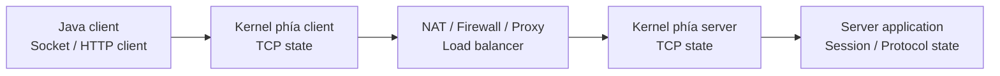
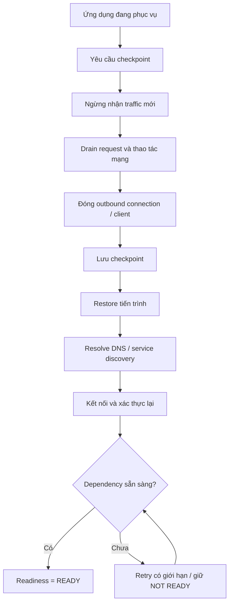

# Vì sao kết nối đang mở không bảo đảm còn hợp lệ sau restore

Trong Java, một đối tượng kết nối có thể vẫn còn trong heap sau khi tiến trình được khôi phục, nhưng điều đó không chứng minh đầu bên kia vẫn giữ phiên kết nối hoặc đường mạng vẫn hoạt động. Với CRaC (Coordinated Restore at Checkpoint), tiến trình có thể được khôi phục từ trạng thái đã lưu sau một khoảng thời gian mà database, server, load balancer, firewall, NAT hoặc dịch vụ xác thực vẫn tiếp tục vận hành độc lập.

Vì vậy, cần phân biệt ba trạng thái:

- **Đối tượng Java còn tồn tại:** biến tham chiếu đến Socket, HTTP client hoặc JDBC connection vẫn có giá trị trong heap.
- **Trạng thái cục bộ còn tồn tại:** JVM và hệ điều hành có thể khôi phục một phần trạng thái socket hoặc file descriptor.
- **Kết nối đầu cuối còn hoạt động:** peer ở xa, đường mạng và trạng thái giao thức ứng dụng vẫn chấp nhận trao đổi dữ liệu.

Hai trạng thái đầu không tự động bảo đảm trạng thái thứ ba. Một kết nối đã thiết lập có thể được khôi phục trong một số môi trường, nhưng cũng có thể đã bị peer đóng, bị thiết bị mạng loại bỏ hoặc trở nên không phù hợp với cấu hình hiện tại. Ứng dụng cần kiểm tra và quản lý lại kết nối sau restore.

## 1. Hiểu đúng “kết nối đang mở”

Một kết nối mạng không chỉ là một object Java. Nó là sự phối hợp giữa nhiều thành phần:

1. Object Java và các buffer trong heap.
2. Socket và file descriptor do hệ điều hành quản lý.
3. Trạng thái TCP hoặc giao thức truyền tải khác ở kernel.
4. Trạng thái của peer, chẳng hạn server, database hoặc message broker.
5. Các thiết bị trung gian như NAT, firewall, proxy và load balancer.
6. Trạng thái tầng ứng dụng như TLS, session, authentication, transaction hoặc subscription.

Có thể hình dung đường đi của một kết nối TCP như sau:



Khi checkpoint, CRaC phối hợp với JVM và cơ chế checkpoint/restore của hệ điều hành để lưu trạng thái tiến trình. Tuy nhiên, server ở máy khác không bị đóng băng theo tiến trình Java. NAT vẫn có thể hết hạn mapping, load balancer vẫn có thể dọn connection idle, server vẫn có thể restart và token vẫn có thể hết hạn.

Do đó, câu hỏi đúng không chỉ là “object Socket còn tồn tại không?” mà là “toàn bộ đường truyền và trạng thái giao thức có còn được các thành phần ở hai đầu chấp nhận không?”.

## 2. Điều gì có thể xảy ra trong thời gian checkpoint?

Giả sử một ứng dụng tạo checkpoint lúc 10:00 và được restore lúc 10:20. Trong 20 phút đó, nhiều sự kiện có thể xảy ra:

- Server đóng kết nối vì idle timeout.
- Database failover sang node khác.
- Load balancer loại bỏ backend cũ.
- NAT hoặc firewall xóa mapping vì không thấy traffic.
- DNS được cập nhật sang địa chỉ mới.
- Chứng chỉ TLS hoặc credential được thay thế.
- Message broker restart hoặc thu hồi consumer session.
- Mạng của container thay đổi khi workload được chuyển sang host khác.

Tiến trình Java có thể khôi phục heap với cùng một tham chiếu đến client cũ, nhưng những sự kiện bên ngoài đã làm thay đổi điều kiện kết nối.

```mermaid
sequenceDiagram
    participant J as Java process
    participant N as Network path
    participant S as Remote server
    J->>S: TCP connection established
    Note over J: Create checkpoint
    Note over N,S: Time passes; peer or network state changes
    S-->>N: Close / expire idle connection
    Note over J: Restore process
    J->>S: Reuse old client and send data
    S-->>J: Connection reset / timeout / protocol error
```

Đây là một tình huống điển hình, không phải kết quả bắt buộc của mọi lần restore. Một số cấu hình checkpoint/restore có thể khôi phục established TCP socket trong những điều kiện nhất định. Nhưng khả năng khôi phục socket ở phía client không buộc peer và các thiết bị trung gian phải giữ nguyên trạng thái trong suốt thời gian tiến trình vắng mặt.

## 3. Vì sao kết nối có thể mất hiệu lực?

### 3.1. Peer đã đóng kết nối

Server có thể chủ động đóng connection vì:

- Idle timeout.
- Bảo trì hoặc restart.
- Deploy phiên bản mới.
- Failover.
- Giới hạn số lượng connection.
- Chính sách quản lý session.

Khi server đóng kết nối, client không nhất thiết nhận được thông báo ngay lập tức. Nếu không có traffic, phía client có thể vẫn giữ object Socket và tin rằng socket chưa bị đóng.

Một lần ghi dữ liệu tiếp theo có thể phát sinh SocketException, Connection reset, Broken pipe hoặc lỗi tương tự. Một số trường hợp, lần ghi đầu tiên thậm chí chưa báo lỗi vì dữ liệu mới chỉ được đưa vào buffer cục bộ; lỗi xuất hiện ở lần đọc hoặc ghi sau đó.

### 3.2. NAT, firewall và load balancer hết hạn trạng thái

Các thiết bị trung gian thường duy trì bảng trạng thái cho connection. Mapping có thể bị xóa khi không có traffic trong một khoảng thời gian.

Ví dụ:

- NAT không còn mapping giữa địa chỉ nội bộ và địa chỉ công khai.
- Firewall loại bỏ một flow idle.
- Load balancer đóng kết nối keep-alive không hoạt động.
- Proxy restart và mất trạng thái connection đang quản lý.

Sau restore, client có thể tiếp tục giữ một socket cục bộ trong khi đường truyền qua thiết bị trung gian đã không còn được nhận diện.

Việc bật TCP keepalive có thể giúp phát hiện một số kết nối chết trong lúc ứng dụng đang hoạt động, nhưng không phải giải pháp tuyệt đối. Keepalive có chu kỳ và timeout riêng, có thể dài hơn idle timeout của thiết bị mạng. Khi tiến trình bị checkpoint, ứng dụng cũng không thể chủ động gửi heartbeat ở tầng Java.

### 3.3. Server hoặc database đã failover

Một database cluster có thể chuyển primary, thay đổi địa chỉ endpoint hoặc đóng các session hiện có. Kết nối cũ có thể trỏ đến node đã ngừng phục vụ.

Tương tự, message broker có thể restart hoặc thay đổi leader. Client cũ giữ trạng thái consumer, channel hoặc session không còn hợp lệ.

Khi kết nối lại, client cần phân giải endpoint hiện tại, xác thực lại và khôi phục subscription hoặc transaction theo hợp đồng của thư viện.

### 3.4. Địa chỉ IP, route và môi trường mạng thay đổi

Khi ứng dụng chạy trong container hoặc nền tảng điều phối, môi trường restore có thể khác môi trường tạo checkpoint:

- Pod hoặc container được chạy trên host khác.
- Network namespace được tạo lại.
- Địa chỉ IP hoặc route thay đổi.
- Interface mạng hoặc gateway thay đổi.
- Chính sách network của workload được cập nhật.

Một socket đã gắn với địa chỉ local và remote cụ thể không tự động thích nghi với mọi thay đổi mạng. Khả năng restore socket phụ thuộc vào hệ điều hành, cơ chế checkpoint/restore và cấu hình triển khai.

### 3.5. DNS trỏ đến endpoint mới

DNS thường được tra cứu khi tạo kết nối. Một kết nối TCP đã thiết lập không tự chuyển sang địa chỉ mới chỉ vì DNS record thay đổi.

Ví dụ, trước checkpoint hostname db.internal phân giải thành IP của node A. Trong thời gian checkpoint, hệ thống chuyển database sang node B và cập nhật DNS. Nếu ứng dụng tiếp tục dùng connection cũ, nó vẫn liên quan đến endpoint cũ.

Khi tạo connection mới, cần phân giải lại hostname theo chính sách DNS và service discovery của client. Cũng cần chú ý DNS cache trong JVM hoặc thư viện có thể giữ kết quả cũ lâu hơn mong muốn.

### 3.6. TLS và trạng thái bảo mật

TLS nằm trên TCP. Một TCP socket còn mở không có nghĩa mọi trạng thái bảo mật và chính sách xác thực vẫn còn phù hợp.

Các tình huống có thể xảy ra:

- Peer đã đóng TLS session.
- Chứng chỉ server được thay thế hoặc hết hạn.
- Credential hoặc token của client hết hạn.
- Chính sách trust store hoặc cấu hình TLS thay đổi.
- Proxy TLS restart và không còn giữ session cũ.

Khi tạo kết nối mới, TLS handshake cần được thực hiện lại theo cấu hình hiện tại. Ứng dụng cũng phải làm mới token hoặc credential nếu chúng đã hết hạn.

### 3.7. Trạng thái tầng ứng dụng đã hết hạn

Ngay cả khi TCP và TLS còn trao đổi được dữ liệu, trạng thái ở tầng ứng dụng vẫn có thể mất hiệu lực:

- Database session đã bị server thu hồi.
- Transaction đã timeout hoặc rollback.
- Broker consumer group đã rebalance.
- Lease hoặc lock phân tán đã hết hạn.
- HTTP session hoặc authentication token đã hết hạn.
- Subscription đến dịch vụ bên ngoài đã bị hủy.

Vì thế, “socket connected” không đồng nghĩa với “dịch vụ sẵn sàng xử lý nghiệp vụ”.

## 4. Phân biệt trạng thái cục bộ và trạng thái thực tế của peer

Các thuộc tính của Java Socket chỉ phản ánh một phần trạng thái cục bộ.

Ví dụ:

- Socket.isClosed() cho biết socket đã được đóng ở phía Java hay chưa.
- Socket.isConnected() cho biết socket đã từng kết nối thành công hay chưa.
- Socket.isBound() cho biết socket đã từng bind vào địa chỉ local hay chưa.

Đặc biệt, isConnected() không phải phép kiểm tra xem peer hiện tại có còn hoạt động hay không. Một socket có thể trả về true cho isConnected() trong khi server đã biến mất hoặc đường mạng đã bị ngắt.

Tương tự, việc gọi isClosed() trả về false chỉ có nghĩa ứng dụng chưa đóng socket cục bộ. Nó không xác nhận NAT mapping, firewall state hoặc remote process vẫn còn.

Để kiểm tra khả năng trao đổi thực tế, ứng dụng cần thực hiện một thao tác giao tiếp có ý nghĩa, ví dụ:

- Gửi health-check hoặc heartbeat ở tầng ứng dụng.
- Thực hiện một truy vấn nhẹ đến database.
- Gọi endpoint health của dịch vụ.
- Đọc/ghi một message theo giao thức của broker.
- Thực hiện một request xác nhận phiên làm việc còn hợp lệ.

Ngay cả heartbeat cũng chỉ xác nhận trạng thái tại thời điểm kiểm tra. Kết nối vẫn có thể lỗi ngay sau đó, vì vậy mọi thao tác thực tế vẫn cần xử lý lỗi mạng.

## 5. TCP có thể khôi phục được không?

Cần phân biệt khả năng kỹ thuật của checkpoint/restore với độ tin cậy đầu cuối.

Một số công cụ cấp hệ điều hành, chẳng hạn CRIU trong môi trường Linux, có khả năng checkpoint và restore một số established TCP connection với các điều kiện và giới hạn cụ thể. JDK CRaC phối hợp với cơ chế của hệ điều hành và cho phép ứng dụng chuẩn bị tài nguyên thông qua callback.

Tuy nhiên, khả năng khôi phục TCP socket không có nghĩa mọi kết nối đều an toàn để giữ lại:

- Peer có thể đã timeout trong khoảng tiến trình bị checkpoint.
- Thiết bị mạng có thể đã xóa trạng thái flow.
- Địa chỉ hoặc route có thể đã thay đổi.
- Server có thể đã failover.
- Session ở tầng ứng dụng có thể đã hết hạn.

Vì vậy, ứng dụng cần tuân theo tài liệu của JDK, CRaC implementation, CRIU và nền tảng triển khai. Nếu thư viện cung cấp CRaC integration, hãy kiểm tra cách thư viện xử lý connection pool và socket. Không nên giả định mọi socket đều được tự động đóng hoặc tự động phục hồi theo cùng một cách.

Với kết nối outbound đến database, broker và dịch vụ HTTP, một chiến lược thường dễ kiểm soát là đóng hoặc đưa client về trạng thái an toàn trước checkpoint, sau đó tạo kết nối mới sau restore.

## 6. Quy trình quản lý kết nối mạng với CRaC

Một quy trình an toàn thường gồm hai giai đoạn.

### 6.1. Trước checkpoint

Ứng dụng nên:

1. Chuyển readiness sang trạng thái không sẵn sàng để ngừng nhận traffic mới.
2. Ngừng tạo request hoặc job mới.
3. Chờ các request và thao tác mạng đang chạy hoàn tất.
4. Xử lý transaction và message đang dang dở theo chính sách nghiệp vụ.
5. Đóng connection hoặc connection pool theo hướng dẫn của thư viện.
6. Giải phóng consumer, socket và tài nguyên phụ thuộc môi trường.
7. Để CRaC tiếp tục tạo checkpoint sau khi callback hoàn tất.

Không nên đóng socket trong khi một thread khác vẫn đang ghi hoặc đọc. Hãy drain công việc đang sử dụng client trước.

### 6.2. Sau restore

Sau khi tiến trình được khôi phục:

1. Đọc lại cấu hình mạng cần thiết nếu cấu hình có thể thay đổi.
2. Phân giải lại hostname hoặc lấy endpoint mới từ service discovery.
3. Tạo connection mới hoặc khởi tạo lại connection pool.
4. Thực hiện TLS handshake và xác thực lại.
5. Khôi phục subscription, consumer hoặc session ở tầng ứng dụng.
6. Kiểm tra các dependency thiết yếu.
7. Chỉ chuyển readiness sang trạng thái sẵn sàng khi kết nối đã được xác nhận.

Không mở traffic chỉ vì callback đã chạy đến cuối. Kết nối có thể chưa tạo được hoặc server vẫn chưa sẵn sàng.



## 7. Ví dụ Java: đóng Socket trước checkpoint và kết nối lại sau restore

Ví dụ dưới đây minh họa một TCP client đăng ký với CRaC. Socket cũ được đóng trong beforeCheckpoint(); sau restore, client tạo socket mới bằng hostname và port cấu hình.

```java
import java.io.IOException;
import java.net.InetSocketAddress;
import java.net.Socket;

import org.crac.Context;
import org.crac.Core;
import org.crac.Resource;

public final class TcpClientResource implements Resource, AutoCloseable {

    private final String host;
    private final int port;
    private final int connectTimeoutMillis;

    private Socket socket;

    public TcpClientResource(
            String host,
            int port,
            int connectTimeoutMillis) throws IOException {

        this.host = host;
        this.port = port;
        this.connectTimeoutMillis = connectTimeoutMillis;

        connect();
        Core.getGlobalContext().register(this);
    }

    private synchronized void connect() throws IOException {
        if (socket != null) {
            throw new IllegalStateException("Socket is already assigned");
        }

        Socket candidate = new Socket();

        try {
            candidate.setKeepAlive(true);
            candidate.connect(
                new InetSocketAddress(host, port),
                connectTimeoutMillis
            );
            socket = candidate;
        } catch (IOException e) {
            try {
                candidate.close();
            } catch (IOException closeFailure) {
                e.addSuppressed(closeFailure);
            }
            throw e;
        }
    }

    private synchronized void closeConnection() throws IOException {
        Socket oldSocket = socket;
        socket = null;

        if (oldSocket != null) {
            oldSocket.close();
        }
    }

    @Override
    public synchronized void beforeCheckpoint(
            Context<? extends Resource> context) throws Exception {
        closeConnection();
    }

    @Override
    public synchronized void afterRestore(
            Context<? extends Resource> context) throws Exception {
        connect();
    }

    @Override
    public synchronized void close() throws IOException {
        closeConnection();
    }

    public synchronized void send(byte[] payload) throws IOException {
        if (socket == null) {
            throw new IllegalStateException("Connection is not ready");
        }

        socket.getOutputStream().write(payload);
        socket.getOutputStream().flush();
    }
}
```

Trong ví dụ:

- Constructor tạo kết nối ban đầu và đăng ký resource với global context.
- beforeCheckpoint() đóng socket cũ và xóa tham chiếu cục bộ.
- afterRestore() tạo socket mới bằng hostname và port.
- close() cho phép lifecycle manager đóng client khi ứng dụng kết thúc.
- Các phương thức đồng bộ hóa truy cập vào trường socket để tránh đóng và ghi đồng thời trong phạm vi ví dụ.

Đây là ví dụ tối giản về vòng đời. Ứng dụng production cần phối hợp request gate và drain mọi thao tác đang dùng client trước checkpoint. Cũng cần có chính sách timeout, retry và readiness khi kết nối sau restore thất bại.

Một điểm quan trọng: setKeepAlive(true) chỉ bật TCP keepalive theo cấu hình của hệ điều hành. Nó không chứng minh peer sẽ giữ connection trong suốt checkpoint và không thay thế bước tạo lại connection.

## 8. Kết nối lại cần xử lý lỗi như thế nào?

Việc gọi connect sau restore có thể thất bại vì server chưa khởi động xong, DNS chưa cập nhật, credential chưa sẵn sàng hoặc mạng chưa được cấu hình hoàn chỉnh.

Một client bền vững cần có chính sách kết nối lại.

### 8.1. Retry có giới hạn và exponential backoff

Không nên retry liên tục không nghỉ. Điều đó có thể làm tăng tải lên một server đang gặp sự cố.

Exponential backoff tăng khoảng chờ sau mỗi lần thất bại. Thêm jitter giúp nhiều instance không cùng retry tại một thời điểm.

Ví dụ về lịch retry:

| Lần thử | Khoảng chờ minh họa |
|---|---:|
| 1 | 200 ms |
| 2 | 400 ms |
| 3 | 800 ms |
| 4 | 1.6 s |
| 5 | 3.2 s |

Các giá trị cần có giới hạn tối đa và được điều chỉnh theo SLA. Sau số lần thử nhất định, ứng dụng có thể chuyển sang trạng thái degraded, tiếp tục retry nền hoặc báo lỗi cho nền tảng điều phối.

### 8.2. Phân loại lỗi

Không phải lỗi nào cũng nên retry theo cùng một cách.

| Loại lỗi | Ví dụ | Hướng xử lý |
|---|---|---|
| Lỗi kết nối tạm thời | Connection refused, timeout | Retry có backoff |
| Peer đóng connection | Connection reset, broken pipe | Tạo connection mới; xác định kết quả thao tác trước đó |
| DNS hoặc service discovery | Hostname chưa phân giải được | Retry phân giải, refresh endpoint |
| Xác thực | Token hết hạn, credential bị từ chối | Làm mới credential rồi thử lại theo chính sách |
| Lỗi cấu hình | Sai hostname, port, trust store | Báo lỗi cấu hình; tránh retry vô hạn |
| Lỗi giao thức | Session hoặc subscription không hợp lệ | Khởi tạo lại session ở tầng ứng dụng |

### 8.3. Không retry mù quáng thao tác ghi

Một tình huống khó là client gửi một lệnh ghi, server đã commit dữ liệu, nhưng phản hồi bị mất trước khi client nhận được. Sau restore, client chỉ thấy timeout hoặc reset. Nếu gửi lại lệnh, nghiệp vụ có thể được thực hiện hai lần.

Ví dụ:

1. Client gửi yêu cầu chuyển tiền.
2. Server thực hiện và commit giao dịch.
3. Kết nối bị đứt trước khi phản hồi về client.
4. Client restore và retry yêu cầu.
5. Server nhận yêu cầu lần thứ hai.

Để xử lý, cần dùng idempotency key, request ID, unique constraint hoặc cơ chế deduplication. Client phải biết liệu thao tác có thể được gửi lại an toàn hay cần truy vấn trạng thái trước.

CRaC không tự bảo đảm exactly-once delivery cho giao thức ứng dụng.

### 8.4. Connection pool cần loại bỏ connection lỗi thời

Với HTTP client hoặc database pool, không nên giữ một connection cũ trong pool chỉ vì object pool còn tồn tại. Cần xem xét:

- Đóng hoặc evict connection đang mở trước checkpoint.
- Tạo lại pool hoặc refresh pool sau restore theo hướng dẫn của thư viện.
- Cấu hình idle timeout và maximum lifetime phù hợp với hạ tầng.
- Dùng validation query hoặc health check khi thư viện hỗ trợ.
- Loại bỏ connection khi phát hiện lỗi I/O.
- Không dùng một connection đang được thread khác sử dụng để kiểm tra health.

Các thư viện có tích hợp CRaC có thể đã triển khai một phần các bước này. Hãy xác nhận phiên bản và cách đăng ký resource để tránh vừa dùng integration tự động vừa tự đóng cùng tài nguyên lần thứ hai.

## 9. Phân biệt outbound connection, accepted socket và listening socket

Không phải mọi socket đều có cùng vai trò.

| Loại socket | Ý nghĩa | Cách xử lý cần cân nhắc |
|---|---|---|
| Outbound connection | Client kết nối đến server/database/broker | Thường đóng trước checkpoint và tạo lại sau restore |
| Accepted socket | Kết nối của một client đã vào server | Drain request/session; xử lý việc client có thể reconnect |
| Listening socket | Socket đang lắng nghe trên một port | Kiểm tra hỗ trợ restore và trạng thái bind; không bind lại mù quáng |
| Datagram socket | Socket dùng UDP, không có TCP session | Kiểm tra endpoint, route, multicast membership và trạng thái giao thức |

Listening socket khác với established outbound connection. Nếu listening socket được restore và vẫn giữ port, việc ứng dụng gọi bind lại có thể gặp lỗi địa chỉ đã được sử dụng. Ngược lại, nếu listener không được khôi phục, server cần mở listener mới trước khi readiness chuyển sang trạng thái sẵn sàng.

Đối với accepted socket, peer client có thể đã timeout trong lúc server được checkpoint. Server nên có timeout và khả năng xử lý client reconnect. Với ứng dụng HTTP stateless, thường dễ quản lý hơn nếu kết thúc request đang chạy trước checkpoint và để client hoặc load balancer gửi lại request theo chính sách phù hợp.

Không có một quy tắc đóng hoặc giữ socket áp dụng cho mọi loại ứng dụng. Hãy kiểm tra tài liệu CRaC/JDK, cơ chế hệ điều hành và framework đang sử dụng.

## 10. Các ví dụ theo loại dịch vụ

### 10.1. JDBC và database connection pool

Một JDBC connection đại diện cho session đến database. Session có thể bị server đóng khi idle, khi failover hoặc khi database restart.

Trước checkpoint:

- Ngừng nhận transaction mới.
- Chờ transaction hiện tại kết thúc.
- Đóng connection hoặc pool theo hướng dẫn của pool implementation.

Sau restore:

- Tạo lại hoặc refresh pool.
- Xác thực lại database.
- Kiểm tra khả năng thực hiện một truy vấn nhẹ.
- Chỉ nhận request khi pool có connection hợp lệ.

Một đối tượng DataSource có thể còn tồn tại trong heap nhưng không có nghĩa mọi connection bên trong pool còn hoạt động.

### 10.2. HTTP client và keep-alive

HTTP client thường tái sử dụng connection keep-alive để giảm chi phí TCP và TLS handshake. Server hoặc proxy có thể đóng connection idle mà client không nhận được thông báo ngay.

Sau restore, pool có thể chứa các connection stale. Tùy thư viện, cần đóng client cũ, evict connection hoặc tạo client mới. Khi retry request, cần phân biệt request an toàn để retry (ví dụ GET idempotent) với request ghi có thể đã được server xử lý.

### 10.3. Message broker

Broker client thường duy trì connection, heartbeat, consumer group, subscription và offset. Nếu tiến trình bị checkpoint quá lâu, broker có thể xem consumer là mất kết nối và thực hiện rebalance.

Sau restore, client có thể phải:

- Tạo connection mới.
- Xác thực lại.
- Đăng ký consumer hoặc subscription lại.
- Đọc offset hiện tại.
- Xử lý message có thể được giao lại.
- Đảm bảo handler idempotent.

Không nên giả định trạng thái consumer trong heap vẫn là trạng thái hiện hành mà broker công nhận.

### 10.4. WebSocket và kết nối hai chiều dài hạn

WebSocket duy trì một session hai chiều qua TCP. Server, proxy hoặc load balancer có thể đóng session trong lúc checkpoint. Khi restore, object WebSocket còn trong heap nhưng peer đã loại bỏ session.

Thông thường, ứng dụng cần đóng session trước checkpoint và thiết lập WebSocket mới sau restore. Cần có cơ chế đăng ký lại subscription, khôi phục trạng thái giao tiếp và đồng bộ dữ liệu bỏ lỡ trong thời gian gián đoạn.

### 10.5. gRPC và HTTP/2

Một HTTP/2 connection có thể chứa nhiều stream. Nếu connection bị đóng, các stream đang hoạt động có thể thất bại cùng lúc. gRPC client có thể cần tạo channel mới, resolve endpoint lại và thiết lập TLS/HTTP/2 session mới.

Cần kiểm tra cách thư viện gRPC quản lý channel và kết nối trong môi trường CRaC. Một channel object còn tồn tại không đồng nghĩa transport bên dưới đã sẵn sàng.

## 11. Quan sát và kiểm thử sau restore

Để biết kết nối có thực sự sẵn sàng, ứng dụng nên ghi nhận trạng thái theo từng bước:

- Checkpoint preparation bắt đầu.
- Số request đang chạy đã về 0.
- Outbound connections đã đóng.
- Restore bắt đầu.
- DNS/service discovery đã được làm mới.
- TLS/authentication thành công.
- Connection pool hoặc client đã sẵn sàng.
- Readiness chuyển sang READY.

Các metric hữu ích:

| Metric | Mục đích |
|---|---|
| Thời gian reconnect | Đo độ trễ khôi phục dependency |
| Số lần retry | Phát hiện endpoint chưa sẵn sàng |
| Tỷ lệ connection reset/timeout | Phát hiện connection stale |
| Số connection trong pool | Phát hiện pool rỗng hoặc connection lỗi |
| Thời gian DNS lookup | Phát hiện vấn đề service discovery |
| Số lần auth refresh | Theo dõi credential hết hạn |
| Readiness duration | Đo thời gian từ restore đến khi nhận traffic |

Nên kiểm thử những tình huống sau:

1. Restore ngay sau khi checkpoint.
2. Restore sau khoảng thời gian dài hơn idle timeout của server hoặc load balancer.
3. Server restart trong thời gian tiến trình bị checkpoint.
4. Database failover sang node khác.
5. DNS record thay đổi trong thời gian checkpoint.
6. Token hoặc chứng chỉ hết hạn trước khi restore.
7. Network interface, route hoặc container được thay đổi.
8. Request ghi đã được server commit nhưng phản hồi bị mất.
9. Broker rebalance consumer group trong thời gian checkpoint.
10. Reconnect thất bại tạm thời rồi thành công sau một số lần retry.

Mục tiêu là chứng minh ứng dụng phát hiện được kết nối lỗi, tạo lại session khi cần, không nhận traffic quá sớm và không lặp thao tác nghiệp vụ một cách nguy hiểm.

## 12. Checklist quản lý kết nối mạng

### Trước checkpoint

- [ ] Ngừng nhận request và job mới.
- [ ] Drain các thao tác đang dùng kết nối.
- [ ] Hoàn tất hoặc xử lý transaction theo chính sách.
- [ ] Đóng hoặc chuẩn bị lại outbound connection và connection pool.
- [ ] Dừng consumer và xử lý subscription.
- [ ] Ghi nhận trạng thái kết nối để chẩn đoán.

### Sau restore

- [ ] Resolve lại hostname hoặc endpoint khi cần.
- [ ] Tạo kết nối mới hoặc kiểm tra connection pool.
- [ ] Thực hiện TLS handshake và xác thực lại.
- [ ] Khôi phục session, consumer hoặc subscription.
- [ ] Retry có giới hạn và backoff.
- [ ] Readiness chỉ chuyển sang READY khi dependency thiết yếu đã xác nhận hoạt động.

### Xử lý lỗi

- [ ] Không xem Socket.isConnected() là health check đầu cuối.
- [ ] Phân biệt lỗi mạng tạm thời với lỗi cấu hình và xác thực.
- [ ] Không retry thao tác ghi nếu chưa có cơ chế idempotency.
- [ ] Có timeout cho connect, read, write và health check.
- [ ] Có metric cho reconnect, reset, timeout và readiness.
- [ ] Đã kiểm thử peer timeout, failover, DNS change và restore dài hạn.

## 13. Câu hỏi thường gặp

### Socket object còn tồn tại sau restore có nghĩa kết nối vẫn hoạt động không?

Không. Object Java còn tồn tại chỉ phản ánh trạng thái trong heap. Kết nối thực tế còn phụ thuộc kernel, peer, NAT, firewall, proxy và trạng thái giao thức ứng dụng. Cần kiểm tra hoặc tạo kết nối mới.

### CRaC có luôn đóng mọi socket trước checkpoint không?

Không nên giả định như vậy. Ứng dụng và thư viện cần quản lý resource theo hướng dẫn của JDK CRaC và môi trường triển khai. Một số socket có thể được hỗ trợ checkpoint/restore trong điều kiện cụ thể, nhưng peer và network path vẫn có thể thay đổi trong thời gian checkpoint.

### TCP keepalive có giải quyết được vấn đề không?

Không hoàn toàn. Keepalive giúp phát hiện một số kết nối không còn phản hồi, nhưng chu kỳ kiểm tra phụ thuộc cấu hình hệ điều hành và có thể dài hơn timeout của thiết bị trung gian. Nó cũng không làm mới DNS, TLS credential hoặc session ở tầng ứng dụng.

### Socket.isConnected() có kiểm tra server còn sống không?

Không. Phương thức này cho biết socket đã từng kết nối thành công và chưa bị đóng cục bộ theo trạng thái Java. Nó không gửi gói kiểm tra đến peer và không chứng minh server hiện còn hoạt động.

### Có nên luôn đóng outbound connection trước checkpoint?

Với nhiều client kết nối database, broker và dịch vụ HTTP, đóng hoặc evict connection trước checkpoint rồi tạo lại sau restore là chiến lược dễ kiểm soát. Tuy nhiên, cần kiểm tra tài liệu của JDK, thư viện và loại socket. Listening socket và các loại socket khác có yêu cầu riêng.

### Nếu reconnect sau restore thất bại thì ứng dụng nên làm gì?

Giữ readiness ở trạng thái không sẵn sàng, áp dụng retry có giới hạn hoặc backoff, ghi nhận lỗi và không nhận request phụ thuộc vào connection đó. Nếu lỗi là cấu hình hoặc credential, cần xử lý nguyên nhân thay vì retry vô hạn.

### Có thể retry request sau khi kết nối bị reset không?

Chỉ khi biết request có thể thực hiện lặp an toàn hoặc có idempotency key. Nếu server đã commit nhưng response bị mất, retry mù quáng có thể tạo tác dụng phụ hai lần.

## Kết luận

Kết nối đang mở trong heap không bảo đảm còn hợp lệ sau restore vì kết nối mạng là trạng thái phân tán giữa JVM, kernel, peer, thiết bị trung gian và giao thức ứng dụng. Trong thời gian tiến trình bị checkpoint, server có thể đóng session, NAT có thể hết hạn mapping, DNS có thể đổi endpoint, token có thể hết hạn và database hoặc broker có thể failover.

Với CRaC, ứng dụng nên phối hợp việc drain công việc và đóng các kết nối phụ thuộc môi trường trong beforeCheckpoint(). Sau restore, hãy phân giải endpoint lại khi cần, tạo kết nối mới, xác thực và khôi phục session ở tầng ứng dụng. Chỉ mở readiness sau khi dependency thiết yếu đã sẵn sàng. Mọi thao tác mạng vẫn cần timeout, xử lý lỗi và retry an toàn; đặc biệt, các thao tác ghi phải có cơ chế idempotency để chịu được trường hợp phản hồi bị mất.
